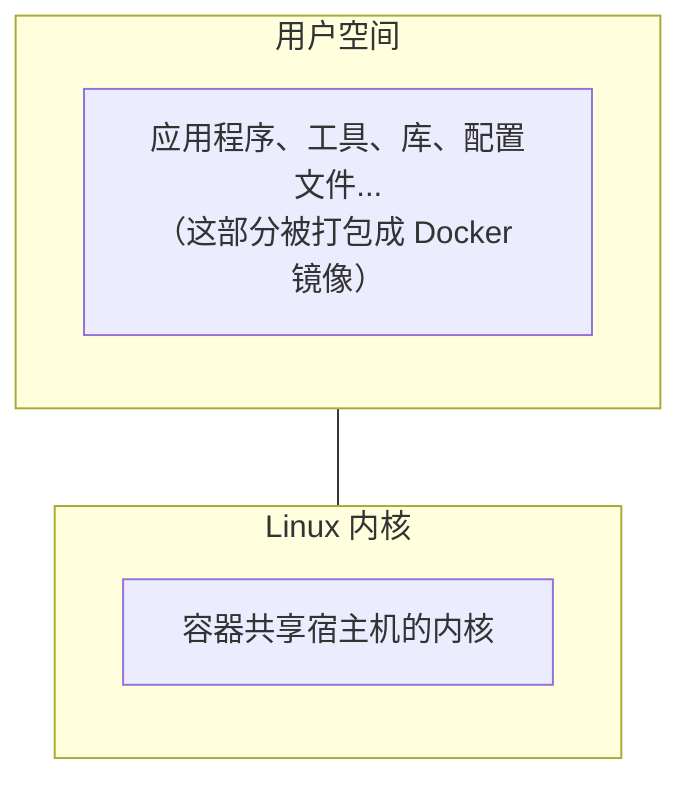
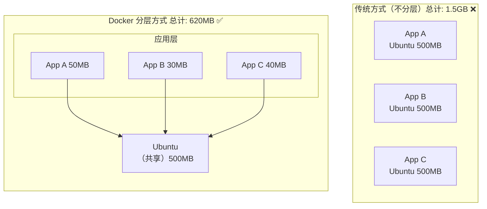
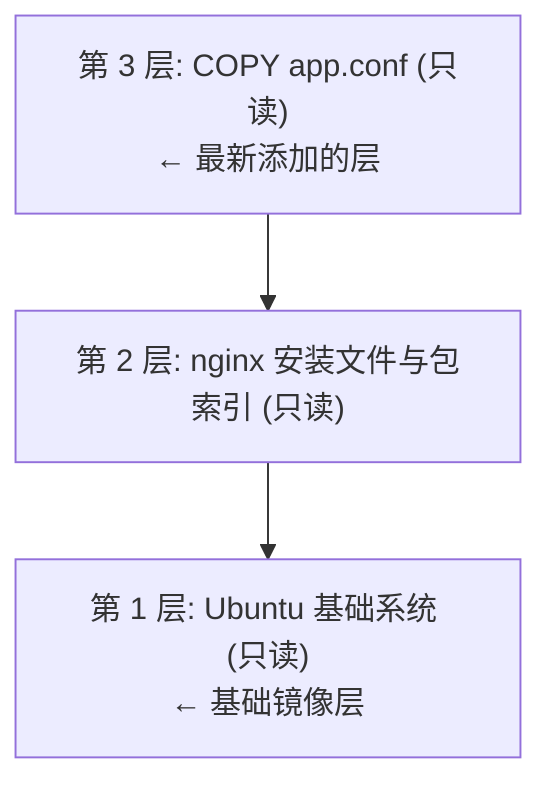
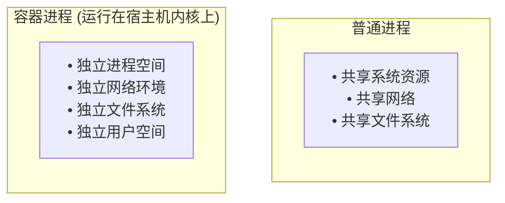
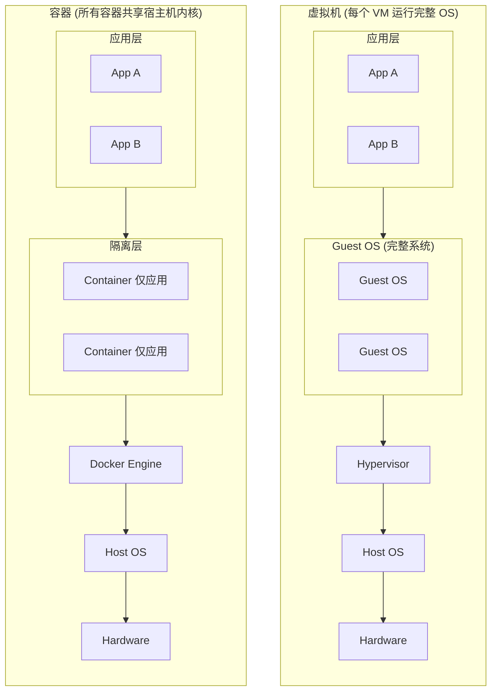
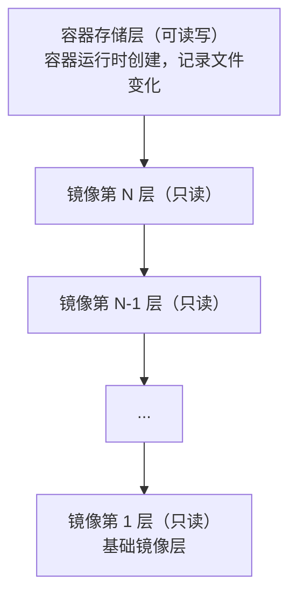
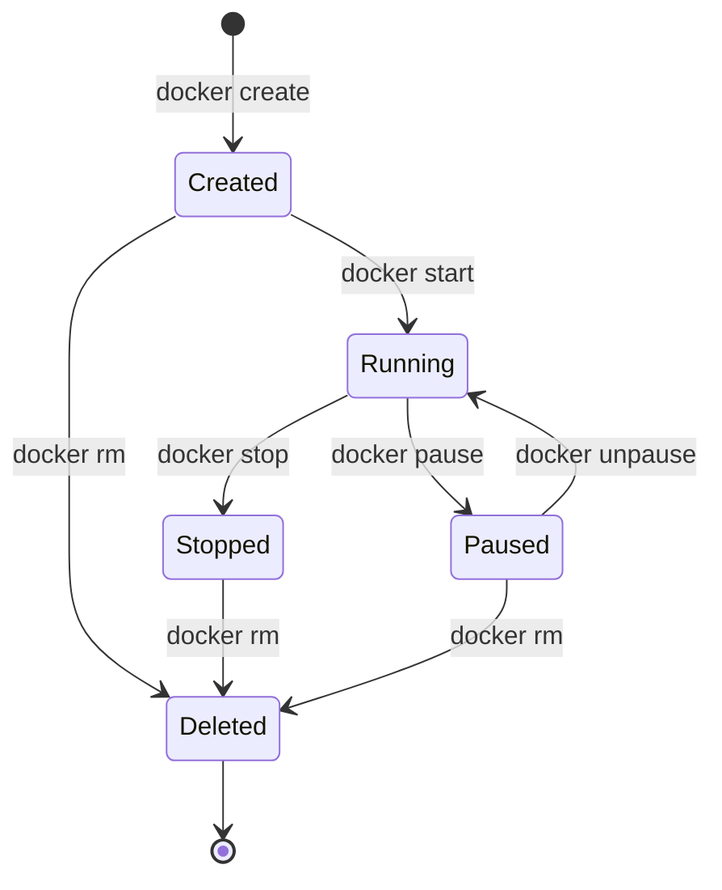
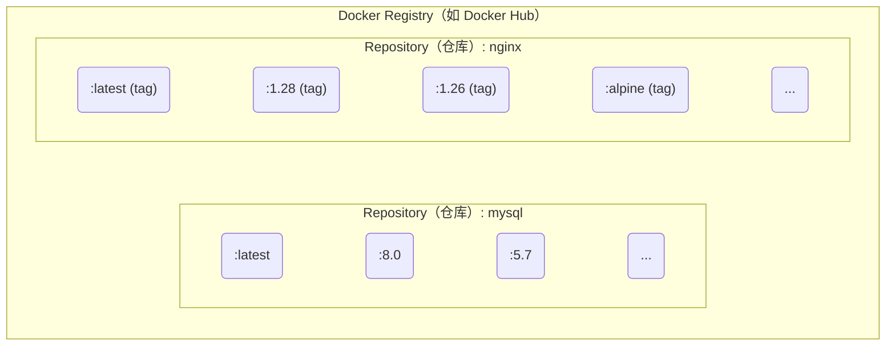

# 第二章 基本概念

> **版本说明**：本章内容及示例基于 Docker v29.x 编写。镜像标签相关示例请查阅官方文档以确认最新可用版本。

**Docker** 包括三个基本概念：

* **镜像** (`Image`)：Docker 镜像是一个特殊的文件系统，除了提供容器运行时所需的程序、库、资源、配置等文件外，还包含了一些为运行时准备的一些配置参数（如匿名卷、环境变量、用户等）。镜像不包含任何动态数据，其内容在构建之后也不会被改变。
* **容器** (`Container`)：镜像 (`Image`) 和容器 (`Container`) 的关系，就像是面向对象程序设计中的 `类` 和 `实例` 一样，镜像是静态的定义，容器是镜像运行时的实体。容器可以被创建、启动、停止、删除、暂停等。
* **仓库** (`Repository`)：镜像构建完成后，可以很容易的在当前宿主机上运行，但是，如果需要在其他服务器上使用这个镜像，我们就需要一个集中的存储、分发镜像的服务，Docker Registry 就是这样的服务。

理解了这三个概念，就理解了 **Docker** 的整个生命周期。

* [Docker 镜像](2.1_image.md)
* [Docker 容器](2.2_container.md)
* [Docker 仓库](2.3_repository.md)

## 1. 镜像

> **版本说明**：本节示例基于 Docker v29.x 编写。示例中使用的镜像标签（如 `ubuntu:24.04`、`nginx:latest`）为演示用途，建议查阅 [Docker Hub](https://hub.docker.com) 或相应镜像的官方页面确认最新可用版本。

Docker 镜像作为容器运行的基石，其设计理念和实现机制至关重要。本节将深入探讨镜像的本质、与操作系统的关系、内容构成以及核心的分层存储机制。

### 1.1 一句话理解镜像

> **Docker 镜像是一个只读的模板，包含了运行应用所需的一切：代码、运行时、库、环境变量和配置文件。** 如果用一个类比：**镜像就像是一张光盘或 ISO 文件**。你可以用同一张光盘在不同电脑上安装系统，而光盘本身不会被修改。同样，一个镜像可以创建多个容器，而镜像本身保持不变。

### 1.2 镜像与操作系统的关系

我们都知道，操作系统分为 **内核** 和 **用户空间**：


对于 Linux 而言，内核启动后会挂载 `root` 文件系统来提供用户空间支持。**Docker 镜像** 本质上就是一个 `root` 文件系统。

例如，官方镜像 `ubuntu:24.04` 包含了一套完整的 Ubuntu 24.04 最小系统的 root 文件系统——但 **不包含 Linux 内核**（因为容器共享宿主机的内核）。

### 1.3 镜像包含什么？

Docker 镜像是一个特殊的文件系统，包含：

| 内容类型 | 示例 |
|---------|------|
| **程序文件** | 应用二进制文件、Python/Node 解释器 |
| **库文件** | libc、OpenSSL、各种依赖库 |
| **配置文件** | nginx.conf、my.cnf 等 |
| **环境变量** | PATH、LANG 等预设值 |
| **元数据** | 启动命令、暴露端口、数据卷定义 |

**关键特性**：

- ✅ 镜像是 **只读** 的
- ✅ 镜像 **不包含** 动态数据
- ✅ 镜像构建后 **内容不会改变**

### 1.4 分层存储：镜像的核心设计

镜像的分层存储机制是 Docker 最具创新性的特性之一。通过 Union FS 技术，Docker 能够高效地构建和管理镜像。

#### 为什么需要分层？

笔者认为，分层存储是 Docker 最巧妙的设计之一。

假设你有三个应用，都基于 Ubuntu 运行：



#### 分层是如何工作的？

笔者用一个更贴近最佳实践的 Dockerfile 来解释分层：

```docker
FROM ubuntu:24.04                              # 第 1 层：基础系统（约 78MB）
RUN apt-get update && apt-get install -y nginx # 第 2 层：更新索引并安装 nginx
COPY app.conf /etc/nginx/                      # 第 3 层：复制配置文件
```
这里特意把 `apt-get update` 和 `apt-get install` 放在同一个 `RUN` 里，避免构建缓存导致包索引过期。

构建后的镜像结构：


每一层的特点：

- **只读**：构建完成后不可修改
- **可共享**：多个镜像可以共享相同的层
- **有缓存**：未变化的层不会重新构建

#### 分层存储的 “陷阱”

> ⚠️ **笔者特别提醒**：理解这一点可以帮你避免构建出臃肿的镜像。**关键原理**：每一层的文件变化会被记录，但 **删除操作只是标记，不会真正减小镜像体积**。

```docker
## 错误示范 ❌

FROM ubuntu:24.04
RUN apt-get update
RUN apt-get install -y build-essential  # 安装编译工具（约 200MB）
RUN make && make install                  # 编译应用
RUN apt-get remove build-essential        # 试图删除编译工具

## 结果：镜像仍然包含 200MB 的编译工具！
```
```docker
## 正确做法 ✅

FROM ubuntu:24.04
RUN apt-get update && \
    apt-get install -y build-essential && \
    make && make install && \
    apt-get remove -y build-essential && \
    apt-get autoremove -y && \
    rm -rf /var/lib/apt/lists/*

## 在同一层完成安装、使用、清理

```

### 1.5 查看镜像的构建历史

```bash
## 查看镜像的历史（每层的构建记录）

$ docker history nginx:latest

IMAGE          CREATED       CREATED BY                                      SIZE
a6bd71f48f68   2 weeks ago   CMD ["nginx" "-g" "daemon off;"]                0B
<missing>      2 weeks ago   STOPSIGNAL SIGQUIT                              0B
<missing>      2 weeks ago   EXPOSE map[80/tcp:{}]                           0B
<missing>      2 weeks ago   ENTRYPOINT ["/docker-entrypoint.sh"]            0B
<missing>      2 weeks ago   COPY 30-tune-worker-processes.sh /docker-ent…   4.62kB
...
```
需要注意：`docker history` 展示的是镜像的构建历史。像 `CMD`、`ENTRYPOINT`、`EXPOSE`、`STOPSIGNAL` 这类 `0B` 项主要是镜像配置元数据，并不等同于新增了可见的文件系统内容；真正占用空间的通常是 `RUN`、`COPY`、`ADD` 等带来的文件变化。

### 1.6 镜像的标识

Docker 镜像有多种标识方式：

#### 1. 镜像名称和标签

格式：`[仓库地址/]仓库名[:标签]`

```bash
## 完整格式

registry.example.com/myproject/myapp:v1.2.3

## 简写（使用 Docker Hub）

nginx:1.28
ubuntu:24.04

## 省略标签（默认使用 latest）

nginx  # 等同于 nginx:latest
```

#### 2. 镜像 ID：Content-Addressable 标识

每个镜像有一个基于内容计算的唯一 ID：

```bash
$ docker images
REPOSITORY   TAG       IMAGE ID       CREATED        SIZE
nginx        latest    a6bd71f48f68   2 weeks ago    187MB
ubuntu       24.04     ca2b0f26964c   3 weeks ago    78.1MB
```

#### 3. 镜像摘要

更精确的标识，基于镜像内容的 SHA256 哈希：

```bash
$ docker images --digests
REPOSITORY  TAG     DIGEST                                                                    IMAGE ID
nginx       latest  sha256:6db391d1c0cfb30588ba0bf72ea999404f2764184d8b8d10d89e8a9c6... a6bd71f48f68
```
> 💡 笔者建议：在生产环境使用镜像摘要而非标签，因为标签可以被覆盖，但摘要是不可变的。

### 1.7 镜像的来源

Docker 镜像可以通过以下方式获取：

| 方式 | 说明 | 示例 |
|------|------|------|
| **从 Registry 拉取** | 最常用的方式 | `docker pull nginx` |
| **从 Dockerfile 构建** | 自定义镜像 | `docker build -t myapp .` |
| **从容器提交** | 保存容器状态（不推荐）| `docker commit` |
| **从文件导入** | 离线传输 | `docker load < image.tar` |

## 2. 容器

容器是 Docker 技术的核心，是应用实际运行的载体。本节将从容器的本质、与虚拟机的区别、存储层机制以及生命周期管理等方面，全面解析 Docker 容器。

### 2.1 一句话理解容器

> **容器是镜像的运行实例。如果把镜像比作程序，那么容器就是进程。** 用面向对象编程的术语来说：**镜像是类 (Class)，容器是对象 (Instance)**。

- 一个镜像可以创建多个容器
- 每个容器相互独立，互不影响
- 容器可以被创建、启动、停止、删除、暂停

### 2.2 容器的本质

> 💡 笔者认为，理解这一点是理解 Docker 的关键：**容器的本质是一个特殊的进程**。


这种隔离主要通过 Linux 内核的 **Namespace** 实现，资源限制通常与 **cgroups** 配合。具体表现为：

- **进程空间**：容器看不到宿主机上的其他进程。
- **网络**：在默认网络模式下，容器通常拥有独立的网络命名空间，并可分配独立 IP；使用 `host` 或 `container:` 等模式时则例外。
- **文件系统**：容器拥有独立的 root 目录。
- **用户**：默认情况下，容器内的 `root` 仍是 `uid 0`，但通常只拥有受限 capabilities；如果启用 `userns-remap` 或 rootless 等机制，还会进一步映射为宿主机上的低权限用户。

### 2.3 容器 vs 虚拟机：核心区别

很多初学者会混淆容器和虚拟机。笔者用一张图来说明：


| 特性 | 容器 | 虚拟机 |
|------|------|--------|
| **隔离级别** | 操作系统级 (Namespaces/cgroups) | 硬件虚拟化级 (Hypervisor) |
| **启动时间** | 通常更快 | 通常更慢 |
| **资源占用** | 通常更低 | 通常更高 |
| **运行开销** | 通常更接近原生 | 通常有更高虚拟化开销 |
| **内核** | 共享宿主机内核 | 各自独立内核 |

### 2.4 容器的存储层

理解容器的存储层机制对于数据的持久化和镜像的优化至关重要。本节将介绍容器的可写层以及 Copy-on-Write 机制。

#### 镜像层 + 容器层

当容器运行时，Docker 会在镜像的只读层之上创建一个 **可写层**（容器存储层）：



#### Copy-on-Write：写时复制

当容器需要修改镜像层中的文件时：

1. Docker 将该文件 **复制** 到容器存储层
2. 在容器层中进行修改
3. 原始镜像层保持不变

```bash
读取文件：直接从镜像层读取（共享，高效）
修改文件：复制到容器层，然后修改（只有这个容器能看到修改）
```

#### ⚠️ 容器存储层的生命周期

> **笔者特别强调**：这是新手最容易踩的坑！**容器存储层与容器生命周期绑定。容器删除，数据就没了！**

```bash
## 创建容器，写入数据

$ docker run -it ubuntu bash
root@abc123:/# echo "important data" > /data.txt
root@abc123:/# exit

## 删除容器

$ docker rm abc123

## 数据丢了！没有任何办法恢复！

```

#### 正确的数据持久化方式

按照 Docker 最佳实践，容器存储层应该保持 **无状态**。需要持久化的数据应该使用：

| 方式 | 说明 | 适用场景 |
|------|------|---------|
| **[数据卷 (Volume) ](../08_data/8.1_volume.md)** | Docker 管理的存储 | 数据库、应用数据 |
| **[绑定挂载 (Bind Mount) ](../08_data/8.2_bind-mounts.md)** | 挂载宿主机目录 | 开发时共享代码 |

```bash
## 使用数据卷（推荐）

$ docker run -v mydata:/var/lib/mysql mysql

## 使用绑定挂载

$ docker run -v /host/path:/container/path nginx
```
这些位置的读写 **会跳过容器存储层**，直接写入宿主机，性能更好，也不会随容器删除而丢失。

### 2.5 容器的生命周期

掌握容器的生命周期对于管理和调试 Docker 应用非常重要。如图 2-1 所示，这里先聚焦最常见的创建、运行、暂停、停止和删除流转；Docker CLI 中还可能看到 `restarting`、`removing`、`dead` 等状态。


图 2-1：容器生命周期状态流转图

常用生命周期命令如下：

```bash
## 创建并启动容器（最常用）

$ docker run nginx

## 分步操作

$ docker create nginx    # 创建容器（不启动）
$ docker start abc123    # 启动容器

## 停止容器

$ docker stop abc123     # 优雅停止（发送 SIGTERM，等待后发送 SIGKILL）
$ docker kill abc123     # 强制停止（直接发送 SIGKILL）

## 暂停/恢复（不常用，但有时有用）

$ docker pause abc123    # 暂停容器内所有进程
$ docker unpause abc123  # 恢复

## 删除容器

$ docker rm abc123       # 删除已停止的容器
$ docker rm -f abc123    # 强制删除运行中的容器
```

### 2.6 容器与进程的关系

> **核心概念**：容器的生命周期 = 主进程 (PID 1) 的生命周期

```bash
## 主进程运行，容器运行

## 主进程退出，容器停止

```
这就是为什么：

```bash
## 这个容器会立即退出（bash 没有输入就退出了）

$ docker run ubuntu

## 这个容器会持续运行（官方 nginx 镜像让 nginx 在前台运行）

$ docker run nginx
```
官方 `nginx` 镜像默认使用 `nginx -g 'daemon off;'`，让主进程保持在前台运行，这样容器才会持续处于运行状态。

详细解释请参考[后台运行](../05_container/5.2_daemon.md)章节。

### 2.7 容器的隔离性

Docker 容器通过以下 Namespace 实现隔离：

| Namespace | 隔离内容 | 效果 |
|-----------|---------|------|
| **PID** | 进程 ID | 容器内 PID 1 是应用进程，看不到宿主机其他进程 |
| **NET** | 网络 | 独立的网络栈、IP 地址、端口 |
| **MNT** | 文件系统 | 独立的根目录和挂载点 |
| **UTS** | 主机名 | 独立的主机名和域名 |
| **IPC** | 进程间通信 | 独立的信号量、消息队列 |
| **USER** | 用户 | 独立的用户和组 ID |

> 想深入了解？请阅读[底层实现 - 命名空间](../12_implementation/12.2_namespace.md)。

## 3. 仓库

> **版本说明**：本节示例基于 Docker v29.x 和常见镜像版本编写。示例中的版本号（如 `nginx:1.28`、`mysql:8.4`、`mysql:5.7` 等）为演示用途。实际使用时请访问 [Docker Hub 官方页面](https://hub.docker.com) 或相应镜像的发布页确认最新可用版本和标签。

Docker Registry 是镜像分发和管理的核心组件。本节将介绍 Registry 的基本概念、公共和私有服务的选择，以及镜像的安全管理。

### 3.1 一句话理解 Registry

> **Docker Registry 是存储和分发 Docker 镜像的服务，类似于代码的 GitHub 或包管理的 npm。**

镜像构建完成后，可以在当前机器上运行。但如果需要在其他服务器上使用这个镜像，就需要一个集中的存储和分发服务——这就是 Docker Registry。

### 3.2 核心概念

要熟练使用 Docker Registry，首先需要理清它与仓库 (Repository)、标签 (Tag) 之间的关系。

#### Registry、仓库、标签的关系

Docker Registry 中可以包含多个 Repository，每个 Repository 可以包含多个 Tag。如图 2-2 所示，它们之间具有清晰的层级关系。


图 2-2：Registry、Repository 与 Tag 的层级关系

相关基本概念具体如下：

| 概念 | 说明 | 示例 |
|------|------|------|
| **Registry** | 存储镜像的服务 | Docker Hub、ghcr.io |
| **Repository（仓库）** | 同一软件的镜像集合 | `nginx`、`mysql`、`mycompany/myapp` |
| **Tag（标签）** | 仓库内的版本标识 | `latest`、`1.28`、`alpine` |

#### 镜像的完整名称

一个完整的 Docker 镜像名称由 Registry 地址、用户名/组织名、仓库名和标签组成。了解其结构有助于我们更准确地定位镜像。基本格式如下：

```bash
[registry 地址/][用户名/]仓库名[:标签]
```
示例：

```bash
## 完整格式

registry.example.com/mycompany/myapp:v1.2.3
│                    │         │     │
│                    │         │     └── 标签
│                    │         └── 仓库名
│                    └── 用户名/组织名
└── Registry 地址

## Docker Hub 官方镜像（省略 registry 和用户名）

nginx:1.28
ubuntu:24.04

## Docker Hub 用户镜像

jwilder/nginx-proxy:latest

## 其他 Registry

ghcr.io/username/myapp:v1.0
us-west1-docker.pkg.dev/my-project/my-repo/myapp:v1.0
```
> 💡 **笔者提示**：如果不指定 Registry 地址，默认使用 Docker Hub。如果不指定标签，默认使用 `latest`。

### 3.3 公共 Registry 服务

公共 Registry 服务为开发者提供了便捷的镜像获取途径。其中最著名的是 Docker Hub。

#### 默认的 Docker Hub

[Docker Hub](https://hub.docker.com/) 是最大的公共 Registry，也是 Docker 的默认 Registry。

**特点**：

- 拥有大量[官方镜像](https://hub.docker.com/search?q=&type=image&image_filter=official)（nginx、mysql、redis 等）
- 免费账户可以创建公开仓库
- 免费个人账户可创建 1 个私有仓库；更高套餐支持更多私有仓库

```bash
## 从 Docker Hub 拉取镜像

$ docker pull nginx              # 官方镜像
$ docker pull bitnami/redis      # 第三方镜像

## 推送镜像到 Docker Hub

$ docker login
$ docker push username/myapp:v1.0
```

#### 其他公共 Registry

除了 Docker Hub，还有以下几个常见的公共 Registry：

| Registry | 地址 | 说明 |
|----------|------|------|
| **GitHub Container Registry** | ghcr.io | GitHub 提供，与 GitHub Actions 集成好 |
| **Google Artifact Registry** | LOCATION-docker.pkg.dev | Google Cloud 当前推荐；也支持迁移后的 `gcr.io` 兼容域名 |
| **Quay.io** | quay.io | Red Hat 提供 |
| **阿里云容器镜像服务** | registry.cn-*.aliyuncs.com | 国内访问快 |
| **腾讯云容器镜像服务** | ccr.ccs.tencentyun.com | 国内访问快 |

Google 的 Container Registry 已废弃并完成下线，当前应优先使用 Artifact Registry；如果已经完成迁移，部分 `gcr.io` 域名请求会被兼容到 Artifact Registry。

### 3.4 镜像加速器

由于网络原因，在国内直接访问 Docker Hub 可能会很慢。可以配置 **镜像加速器** (Registry Mirror) 来加速下载。配置示例如下：

```jsonc
// /etc/docker/daemon.json
{
  "registry-mirrors": [
    "https://your-accelerator-url"
  ]
}
```
详细配置方法请参考[镜像加速器](../03_install/3.9_mirror.md)章节。

> ⚠️ **笔者提醒**：镜像加速器的可用性经常变化，使用前建议先测试是否可用。

### 3.5 私有 Registry

出于安全和隐私的考虑，企业往往需要搭建自己的私有 Registry。以下是几种常见的搭建方案。

#### 官方 Registry 镜像

Docker 官方提供了 [registry](https://hub.docker.com/_/registry/) 镜像，可以快速搭建私有 Registry：

```bash
## 启动一个本地 Registry

$ docker run -d -p 5000:5000 --name registry registry:2

## 推送镜像到本地 Registry

$ docker tag myapp:v1.0 localhost:5000/myapp:v1.0
$ docker push localhost:5000/myapp:v1.0

## 从本地 Registry 拉取

$ docker pull localhost:5000/myapp:v1.0
```

#### 企业级解决方案

官方 Registry 功能较为基础，企业环境常用以下方案：

| 方案 | 特点 |
|------|------|
| **[Harbor](https://goharbor.io/)** | CNCF 项目，功能全面（用户管理、漏洞扫描、镜像签名）|
| **[Nexus Repository](../06_repository/6.4_nexus3_registry.md)** | 支持多种制品类型（Docker、Maven、npm 等）|
| **云厂商服务** | 阿里云 ACR、腾讯云 TCR、AWS ECR 等 |

笔者建议：

- 小团队：可以先用官方 Registry，够用即可
- 中大型团队：推荐 Harbor，功能完善且开源免费
- 已使用云服务：直接用云厂商的 Registry 服务更省心

### 3.6 镜像的推送和拉取

掌握镜像的推送 (Push) 和拉取 (Pull) 是使用 Docker Registry 的基本功。

#### 完整工作流程

如图 2-3 所示，镜像从开发环境构建后推送到 Registry，再由生产环境拉取并运行。

```bash
开发者机器                    Registry                    生产服务器
     │                           │                             │
     │  docker build             │                             │
     │  构建镜像                  │                             │
     │                           │                             │
     │  docker push ─────────────▶                             │
     │  推送镜像                  │  存储镜像                   │
     │                           │                             │
     │                           │  ◀───────────── docker pull │
     │                           │                  拉取镜像    │
     │                           │                             │
     │                           │                  docker run │
     │                           │                  运行容器    │
```
图 2-3：镜像构建、推送与拉取流程

#### 常用命令

```bash
## 登录 Registry

$ docker login                      # 登录 Docker Hub
$ docker login registry.example.com # 登录其他 Registry

## 拉取镜像

$ docker pull nginx:1.28

## 标记镜像（准备推送）

$ docker tag myapp:latest registry.example.com/myteam/myapp:v1.0

## 推送镜像

$ docker push registry.example.com/myteam/myapp:v1.0

## 登出

$ docker logout
```

### 3.7 镜像的安全性

在使用公共镜像或维护私有镜像时，安全性是不容忽视的重要环节。

#### 使用官方镜像

Docker Hub 的[官方镜像](https://hub.docker.com/search?q=&type=image&image_filter=official)（标有 “Official Image” 标识）经过 Docker 团队审核，相对更安全。示例如下：

```bash
## 官方镜像示例

nginx          # ✅ 官方
mysql          # ✅ 官方
redis          # ✅ 官方

## 第三方镜像（需要自行评估可信度）

bitnami/redis  # ⚠️ 需要评估
someuser/myapp # ⚠️ 需要评估
```

#### 镜像签名

当前更推荐使用 Sigstore / Notation 体系进行镜像签名与验证。`Docker Content Trust (DCT)` 已被正式退役：自 Docker Engine 29.0 起 DCT 已从 Docker CLI 中移除（`docker trust` 子命令不再随 CLI 发布，仅能作为独立插件自行构建；`docker push`、`docker pull`、`docker build`、`docker run` 等命令上的 `--disable-content-trust` 选项虽仍可解析，但已标记为废弃且不再有实际作用），Docker 官方的 Notary v1 服务 `notary.docker.io` 也将于 2026 年 12 月 8 日完全关闭；最早一批 DCT 签名证书自 2025 年 8 月 8 日起已开始过期，Docker 建议镜像发布者迁移到 Sigstore、Notation 等方案。不建议把 DCT 作为新项目方案。

> 注意：Cosign 默认会把签名推送回镜像所在仓库，请使用你有推送权限的镜像地址。

```bash
## 准备一个你有写权限的镜像地址
$ export IMAGE=<你的仓库名>/nginx:1.28
$ docker pull nginx:1.28
$ docker tag nginx:1.28 $IMAGE
$ docker push $IMAGE

## 生成签名密钥（会生成 cosign.key / cosign.pub）
$ cosign generate-key-pair

## 使用 Cosign 签名与验证
$ cosign sign --key cosign.key $IMAGE
$ cosign verify --key cosign.pub $IMAGE
```

#### 漏洞扫描

```bash
## 使用 Docker Scout 扫描镜像漏洞

$ docker scout cves nginx:latest

## 使用 Trivy（开源工具）

$ trivy image nginx:latest
```
