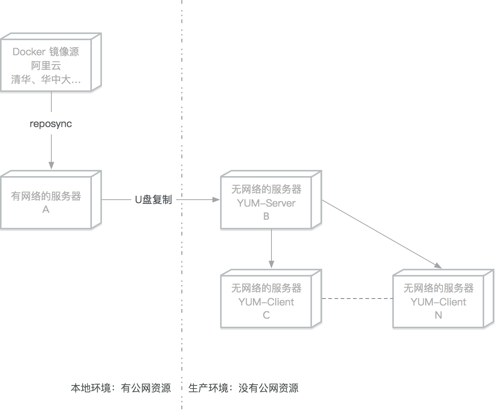
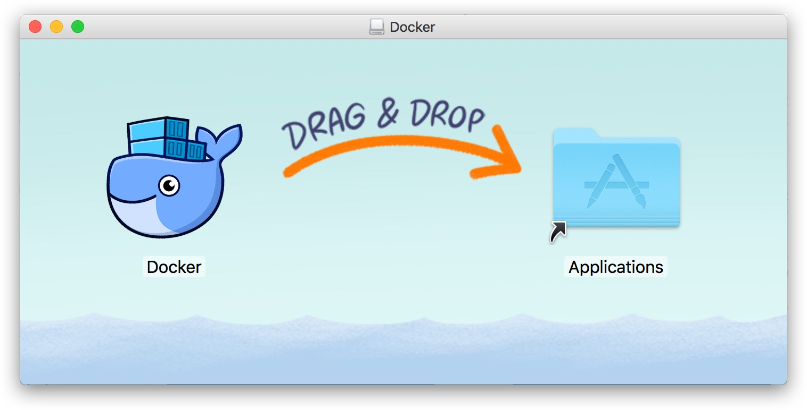
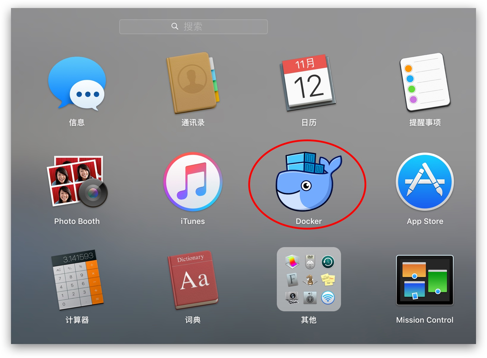
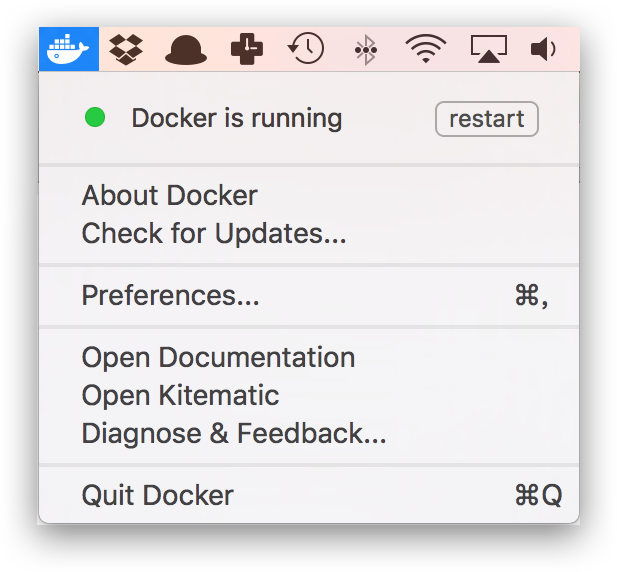
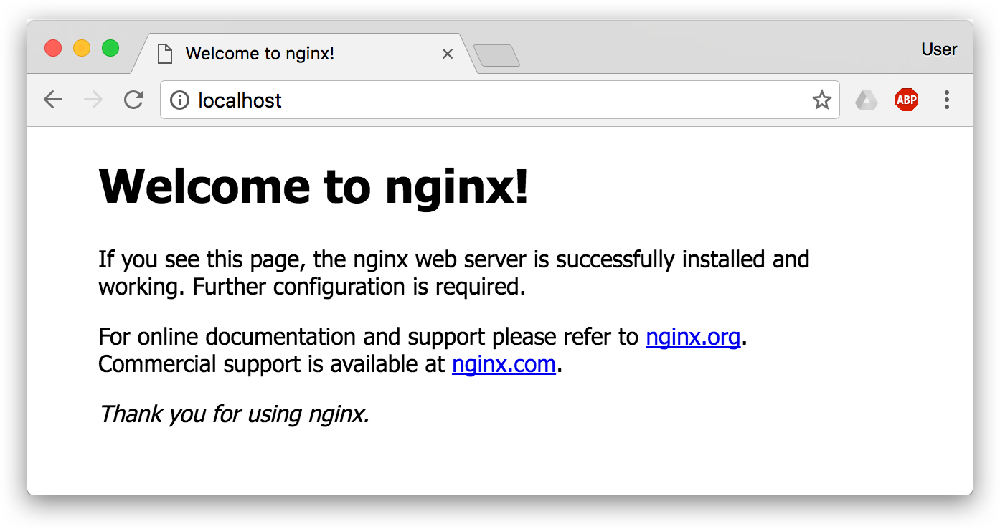
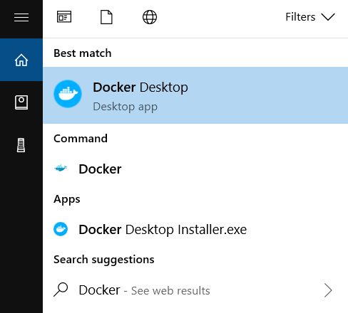

# 第三章 安装 Docker

Docker Engine 主要提供 `stable` 和 `test` 两个更新频道；`test.docker.com` 对应测试频道，适合预发布验证，不建议直接用于生产环境。

官方网站上有各种环境下的[安装指南](https://docs.docker.com/get-started/get-docker/)，这里主要介绍 Docker 在 `Linux`、`Windows 10/11` 和 `macOS` 上的安装。

## 安装方式选择指南

在开始安装前，笔者建议你根据以下决策树选择最合适的安装方式：

### 生产环境 vs 开发环境

**生产环境**（服务器部署）：

- 优先使用**官方 APT/YUM 源安装**（Ubuntu、Debian、Fedora、CentOS）
- 优势：获得官方安全更新、长期技术支持、版本管理清晰
- 安装步骤稍多一些，但这种“麻烦”是值得的——它为你的生产系统争取了稳定性和可维护性

**开发环境**（本地开发机、测试服务器）：

- 配置 **Docker 官方源后** 使用包管理器安装，或在一次性测试环境使用官方脚本自动安装
- 如果你想快速上手，官方脚本（`get.docker.com`）是最便捷的选择
- 国内用户注意：这一步一定要选对镜像源，否则网络卡顿会严重影响体验

### 国内用户的网络优化建议

值得注意的是，国内直接访问 Docker 官方源速度较慢，建议：

- **安装过程**：使用阿里云、腾讯云等国内镜像源
- **镜像拉取**：安装完成后配置 Docker 镜像加速器（详见 [3.9 镜像加速器](3.9_mirror.md)），这一步对日常开发的体验提升最明显

### 特殊场景

- **Raspberry Pi/ARM 平台**：见 [3.5 Raspberry Pi](3.5_raspberry-pi.md)
- **离线环境**：见 [3.6 Linux 离线安装](3.6_offline.md)
- **macOS/Windows**：Docker Desktop 是官方推荐的一站式解决方案
- **需要实验特性**：见 [3.10 开启实验特性](3.10_experimental.md)

## 详细安装指南

* [Ubuntu](3.1_ubuntu.md)
* [Debian](3.2_debian.md)
* [Fedora](3.3_fedora.md)
* [CentOS](3.4_centos.md)
* [Raspberry Pi](3.5_raspberry-pi.md)
* [Linux 离线安装](3.6_offline.md)
* [macOS](3.7_mac.md)
* [Windows 10/11](3.8_windows.md)
* [镜像加速器](3.9_mirror.md)
* [开启实验特性](3.10_experimental.md)

## 1. Ubuntu

Ubuntu 是 Docker 最常用的运行环境之一。本节将介绍如何在 Ubuntu 系统上安装 Docker，并配置国内镜像加速。

### 为什么推荐 APT 源安装而不是脚本？

虽然 Docker 官方提供了便捷的安装脚本（`get.docker.com`），但笔者在生产环境中**强烈推荐通过 Docker 官方 APT 仓库安装**，原因如下：

- **版本管理**：通过 APT 仓库安装后，可以像管理其他系统软件包一样升级、回滚和锁定版本
- **安全更新**：Docker 官方仓库会持续发布新版本和安全修复，适合长期维护
- **一致性**：团队更容易锁定同一版本，避免“在我的机器上可以运行”的问题
- **卸载干净**：APT 包管理系统会负责清理所有相关文件，脚本安装的清理往往不够彻底

如果你只是想快速尝试 Docker，脚本安装没有问题；但一旦涉及持久运维，APT 源是更成熟的选择。

> 警告：切勿在没有配置 Docker APT 源的情况下直接使用 apt 命令安装 Docker。

### 1.1 准备工作

在开始安装之前，我们需要确认系统版本是否满足要求，并清理可能存在的旧版本。

#### 系统要求

根据 Docker 官方安装文档，当前受支持的 [Ubuntu](https://ubuntu.com/server) 64 位版本包括（具体以官方 [安装文档](https://docs.docker.com/engine/install/ubuntu/) 为准）：


* Ubuntu Resolute Raccoon 26.04 (LTS)
* Ubuntu Noble 24.04 (LTS)
* Ubuntu Jammy 22.04 (LTS)

> **警告**：Ubuntu 20.04 LTS 已不在 Docker 当前支持列表中，不建议用于新部署。对于仍在运行 20.04 的生产系统，应尽快升级到 22.04 LTS 或 24.04 LTS；若短期内无法迁移，可通过 Ubuntu Pro 获取操作系统层面的扩展安全维护（ESM），但这并不改变 Docker 官方支持矩阵。

在 Ubuntu LTS 版本上，目前 Docker 支持 amd64、arm64、armhf、ppc64el、s390x 等 5 个平台；而非 LTS 版本支持的平台通常较少。同时，LTS 版本会获得 5 年的升级维护支持，这样的系统会获得更长期的安全保障，因此在生产环境中推荐使用 LTS 版本。

#### 卸载旧版本

Docker 官方建议先卸载可能冲突的非官方软件包：

```bash
$ for pkg in docker.io docker-compose docker-compose-v2 docker-doc podman-docker containerd runc;
do
    sudo apt remove $pkg;
done
```

### 1.2 使用 APT 安装

先安装基础依赖，并准备 Docker 官方密钥目录：

```bash
$ sudo apt update

$ sudo apt install ca-certificates curl
$ sudo install -m 0755 -d /etc/apt/keyrings
```
如果企业内网已经维护了受信任的软件包镜像，可在后续步骤中替换 `URIs` 的域名；默认建议优先以 Docker 官方仓库为准。

为了确认所下载软件包的合法性，需要添加仓库签名密钥：

```bash
$ sudo curl -fsSL https://download.docker.com/linux/ubuntu/gpg -o /etc/apt/keyrings/docker.asc
$ sudo chmod a+r /etc/apt/keyrings/docker.asc
```
然后向 `apt` 添加 Docker 仓库：

```bash
$ sudo tee /etc/apt/sources.list.d/docker.sources <<EOF
Types: deb
URIs: https://download.docker.com/linux/ubuntu
Suites: $(. /etc/os-release && echo "${UBUNTU_CODENAME:-$VERSION_CODENAME}")
Components: stable
Architectures: $(dpkg --print-architecture)
Signed-By: /etc/apt/keyrings/docker.asc
EOF
```
> 如果需要测试频道，可将 `Components: stable` 改为 `test`，或改用 `test.docker.com` 脚本在测试环境验证。

更新 APT 缓存，并安装 Docker Engine 及常用 CLI 插件：

```bash
$ sudo apt update

$ sudo apt install docker-ce docker-ce-cli containerd.io docker-buildx-plugin docker-compose-plugin
```

### 1.3 使用脚本自动安装

在测试或开发环境中，Docker 官方提供了便捷安装脚本，但官方明确不建议把它作为生产环境的标准安装方式。

在真正执行前，建议先用 `--dry-run` 预览脚本动作：

```bash
$ curl -fsSL https://get.docker.com -o get-docker.sh
$ sudo sh ./get-docker.sh --dry-run

# 若需要测试频道：
# curl -fsSL https://test.docker.com -o test-docker.sh
# sudo sh ./test-docker.sh
```
确认无误后，再执行 `sudo sh ./get-docker.sh` 安装稳定版。

### 1.4 启动 Docker

```bash
$ sudo systemctl enable --now docker
```

### 1.5 建立 docker 用户组

默认情况下，`docker` 命令会使用 [Unix socket](https://en.wikipedia.org/wiki/Unix_domain_socket) 与 Docker 引擎通讯。而只有 `root` 用户和 `docker` 组的用户才可以访问 Docker 引擎的 Unix socket。出于安全考虑，一般 Linux 系统上不会直接使用 `root` 用户。因此，更好的做法是将需要使用 `docker` 的用户加入 `docker` 用户组。

> ⚠️ **安全警告：`docker` 用户组等同于 `root` 权限**
>
> 将用户加入 `docker` 组免去了每次执行 `docker` 命令时输入 `sudo` 的繁琐，但这也意味着该用户可以轻易获取主机的最高 root 权限（例如通过挂载根目录运行容器）。
> 如果你在一个多用户共享的生产系统上配置，切勿随意将普通用户加入此组。此时，更安全的替代方案是使用官方提供的 **[Rootless 模式 (Rootless mode)](https://docs.docker.com/engine/security/rootless/)**，它允许在没有任何 root 权限的情况下运行 Docker 守护进程和容器。

建立 `docker` 组：

```bash
$ sudo groupadd docker
```
将当前用户加入 `docker` 组：

```bash
$ sudo usermod -aG docker $USER
```
退出当前终端并重新登录，进行如下测试。

### 1.6 测试 Docker 是否安装正确

```bash
$ docker run --rm hello-world

Unable to find image 'hello-world:latest' locally
latest: Pulling from library/hello-world
b8dfde127a29: Pull complete
Digest: sha256:308866a43596e83578c7dfa15e27a73011bdd402185a84c5cd7f32a88b501a24
Status: Downloaded newer image for hello-world:latest

Hello from Docker!
This message shows that your installation appears to be working correctly.

To generate this message, Docker took the following steps:
 1. The Docker client contacted the Docker daemon.
 2. The Docker daemon pulled the "hello-world" image from the Docker Hub.
    (amd64)
 3. The Docker daemon created a new container from that image which runs the
    executable that produces the output you are currently reading.
 4. The Docker daemon streamed that output to the Docker client, which sent it
    to your terminal.

To try something more ambitious, you can run an Ubuntu container with:
 $ docker run -it ubuntu bash

Share images, automate workflows, and more with a free Docker ID:
 https://hub.docker.com/

For more examples and ideas, visit:
 https://docs.docker.com/get-started/
```
若能正常输出以上信息，则说明安装成功。

### 1.7 镜像加速

如果在使用过程中发现拉取 Docker 镜像十分缓慢，可以配置 Docker [国内镜像加速](3.9_mirror.md)。

## 2. Debian

Debian 以其稳定性著称，是 Docker 的理想宿主系统。本节将指导你在 Debian 上完成 Docker 的安装。

### APT 源安装的必要性

与 Ubuntu 类似，Debian 用户在安装 Docker 时同样应该优先选择 Docker 官方 APT 仓库。对于服务器环境，这种方式更利于版本控制、升级和长期维护。

> 警告：切勿在没有配置 Docker APT 源的情况下直接使用 apt 命令安装 Docker。

### 2.1 准备工作

安装前请仔细检查 Debian 版本支持情况，并卸载旧版本以避免冲突。

#### 系统要求

Docker 支持以下版本的 [Debian](https://www.debian.org/intro/about) 操作系统（具体以官方 [安装文档](https://docs.docker.com/engine/install/debian/) 为准）：

* Debian Trixie 13 (stable)
* Debian Bookworm 12（oldstable，全面支持至 2026 年 6 月 10 日，LTS 至 2028 年 6 月 30 日）
* Debian Bullseye 11（oldoldstable，LTS 支持至 2026 年 8 月 31 日）

> **注意**：Debian Bullseye 11 已于 2026 年 8 月 31 日结束长期支持。建议新部署使用 Bookworm 12 或 Trixie 13。

#### 卸载旧版本

Docker 官方建议先卸载可能冲突的非官方软件包：

```bash
$ for pkg in docker.io docker-compose docker-compose-v2 docker-doc podman-docker containerd runc; do
    sudo apt remove $pkg
done
```

### 2.2 使用 APT 安装

先安装基础依赖，并准备密钥目录：

```bash
$ sudo apt update

$ sudo apt install ca-certificates curl
$ sudo install -m 0755 -d /etc/apt/keyrings
```
如果公司内网维护了受信任镜像站，可在后续仓库地址中替换域名；默认建议优先使用 Docker 官方仓库。

为了确认所下载软件包的合法性，需要添加软件源的 GPG 密钥。

```bash
$ sudo curl -fsSL https://download.docker.com/linux/debian/gpg -o /etc/apt/keyrings/docker.asc
$ sudo chmod a+r /etc/apt/keyrings/docker.asc
```
然后，我们需要向 `sources.list` 中添加 Docker 软件源：

> 在一些基于 Debian 的 Linux 发行版中，`$(. /etc/os-release && echo "$VERSION_CODENAME")` 可能不会返回 Debian 官方仓库使用的代号，例如 [Kali Linux](https://www.kali.org/docs/policy/kali-linux-relationship-with-debian/) 等衍生发行版。此时请手动替换为对应的 Debian 代号，例如 `bookworm`。

```bash
$ sudo tee /etc/apt/sources.list.d/docker.sources <<EOF
Types: deb
URIs: https://download.docker.com/linux/debian
Suites: $(. /etc/os-release && echo "$VERSION_CODENAME")
Components: stable
Architectures: $(dpkg --print-architecture)
Signed-By: /etc/apt/keyrings/docker.asc
EOF
```
> 如果使用 Kali 等衍生发行版，请把 `Suites` 对应的版本代号替换为映射到的 Debian 代号，例如 `bookworm`。如果需要测试频道，可将 `Components: stable` 改为 `test`。

更新 APT 缓存，并安装 Docker Engine 及常用 CLI 插件。

```bash
$ sudo apt update

$ sudo apt install docker-ce docker-ce-cli containerd.io docker-buildx-plugin docker-compose-plugin
```

### 2.3 使用脚本自动安装

在测试或开发环境中，Docker 官方提供了便捷安装脚本，但官方明确不建议把它作为生产环境的标准安装方式。

在真正执行前，建议先用 `--dry-run` 预览脚本动作：

```bash
$ curl -fsSL https://get.docker.com -o get-docker.sh
$ sudo sh ./get-docker.sh --dry-run

# 若需要测试频道：
# curl -fsSL https://test.docker.com -o test-docker.sh
# sudo sh ./test-docker.sh
```
确认无误后，再执行 `sudo sh ./get-docker.sh` 安装稳定版。

### 2.4 启动 Docker

```bash
$ sudo systemctl enable --now docker
```

### 2.5 建立 docker 用户组

默认情况下，`docker` 命令会使用 [Unix socket](https://en.wikipedia.org/wiki/Unix_domain_socket) 与 Docker 引擎通讯。而只有 `root` 用户和 `docker` 组的用户才可以访问 Docker 引擎的 Unix socket。出于安全考虑，一般 Linux 系统上不会直接使用 `root` 用户。因此，更好的做法是将需要使用 `docker` 的用户加入 `docker` 用户组。

> ⚠️ **安全警告：`docker` 用户组等同于 `root` 权限**
>
> 将用户加入 `docker` 组免去了每次执行 `docker` 命令时输入 `sudo` 的繁琐，但这也意味着该用户可以轻易获取主机的最高 root 权限（例如通过挂载根目录运行容器）。
> 如果你在一个多用户共享的生产系统上配置，切勿随意将普通用户加入此组。此时，更安全的替代方案是使用官方提供的 **[Rootless 模式 (Rootless mode)](https://docs.docker.com/engine/security/rootless/)**，它允许在没有任何 root 权限的情况下运行 Docker 守护进程和容器。

建立 `docker` 组：

```bash
$ sudo groupadd docker
```
将当前用户加入 `docker` 组：

```bash
$ sudo usermod -aG docker $USER
```
退出当前终端并重新登录，进行如下测试。

### 2.6 测试 Docker 是否安装正确

```bash
$ docker run --rm hello-world

Unable to find image 'hello-world:latest' locally
latest: Pulling from library/hello-world
b8dfde127a29: Pull complete
Digest: sha256:308866a43596e83578c7dfa15e27a73011bdd402185a84c5cd7f32a88b501a24
Status: Downloaded newer image for hello-world:latest

Hello from Docker!
This message shows that your installation appears to be working correctly.

To generate this message, Docker took the following steps:
 1. The Docker client contacted the Docker daemon.
 2. The Docker daemon pulled the "hello-world" image from the Docker Hub.
    (amd64)
 3. The Docker daemon created a new container from that image which runs the
    executable that produces the output you are currently reading.
 4. The Docker daemon streamed that output to the Docker client, which sent it
    to your terminal.

To try something more ambitious, you can run an Ubuntu container with:
 $ docker run -it ubuntu bash

Share images, automate workflows, and more with a free Docker ID:
 https://hub.docker.com/

For more examples and ideas, visit:
 https://docs.docker.com/get-started/
```
若能正常输出以上信息，则说明安装成功。

### 2.7 镜像加速

如果在使用过程中发现拉取 Docker 镜像十分缓慢，可以配置 Docker [国内镜像加速](3.9_mirror.md)。

## 3. Fedora

Fedora 作为技术前沿的 Linux 发行版，对 Docker 有着良好的支持。本节介绍在 Fedora 上的安装步骤。

### YUM/DNF 源安装的策略建议

Fedora 的快速发布周期（每 6 个月发布新版本）决定了它的用户群体多为开发者和技术爱好者。虽然通过 DNF 可以直接安装 Docker，但笔者建议仍然通过 Docker 官方 YUM 源进行安装，原因是：Fedora 官方仓库的 Docker 版本往往滞后，而官方源能确保你获得最新的 Docker 功能和安全补丁。特别是在开发环境需要用到最新 Docker 特性时，这一点显得尤为重要。

> 警告：切勿在没有配置 Docker dnf 源的情况下直接使用 dnf 命令安装 Docker。

### 3.1 准备工作

确保你的 Fedora 版本在支持列表中，并清理旧版本。

#### 系统要求

根据 Docker 官方安装文档，当前受支持的 [Fedora](https://fedoraproject.org/) 版本包括（具体以官方 [安装文档](https://docs.docker.com/engine/install/fedora/) 为准）：

* Fedora 44
* Fedora 43

#### 卸载旧版本

旧版本的 Docker 称为 `docker` 或者 `docker-engine`，使用以下命令卸载旧版本：

```bash
$ sudo dnf remove docker \
                  docker-client \
                  docker-client-latest \
                  docker-common \
                  docker-latest \
                  docker-latest-logrotate \
                  docker-logrotate \
                  docker-selinux \
                  docker-engine-selinux \
                  docker-engine
```

### 3.2 使用 dnf 安装

使用 dnf 包管理器安装是推荐的方式，便于后续的更新和管理。

执行以下命令安装依赖包：

```bash
$ sudo dnf -y install dnf-plugins-core
```
默认建议优先使用 Docker 官方仓库；如果企业内网维护了受信任镜像站，可自行替换仓库 URL。

执行下面的命令添加 `dnf` 软件源：

```bash
$ sudo dnf config-manager addrepo --from-repofile https://download.docker.com/linux/fedora/docker-ce.repo
```
如果需要测试版本的 Docker 请使用以下命令：

```bash
$ sudo dnf config-manager --set-enabled docker-ce-test
```
你也可以禁用测试版本的 Docker

```bash
$ sudo dnf config-manager --set-disabled docker-ce-test
```

#### 安装 Docker

更新 `dnf` 软件源缓存，并安装 Docker Engine 及常用 CLI 插件。

```bash
$ sudo dnf update
$ sudo dnf install docker-ce docker-ce-cli containerd.io docker-buildx-plugin docker-compose-plugin
```
你也可以使用以下命令安装指定版本的 Docker

```bash
$ dnf list docker-ce  --showduplicates | sort -r

docker-ce.x86_64          3:29.4.0-1.fc42                       docker-ce-stable

$ sudo dnf -y install docker-ce-<VERSION_STRING> docker-ce-cli-<VERSION_STRING>
```

### 3.3 使用脚本自动安装

在测试或开发环境中，Docker 官方提供了便捷安装脚本，但官方明确不建议把它作为生产环境的标准安装方式。

在真正执行前，建议先用 `--dry-run` 预览脚本动作：

```bash
$ curl -fsSL https://get.docker.com -o get-docker.sh
$ sudo sh ./get-docker.sh --dry-run

# 若需要测试频道：
# curl -fsSL https://test.docker.com -o test-docker.sh
# sudo sh ./test-docker.sh
```
确认无误后，再执行 `sudo sh ./get-docker.sh` 安装稳定版。

### 3.4 启动 Docker

```bash
$ sudo systemctl enable --now docker
```

### 3.5 建立 docker 用户组

默认情况下，`docker` 命令会使用 [Unix socket](https://en.wikipedia.org/wiki/Unix_domain_socket) 与 Docker 引擎通讯。而只有 `root` 用户和 `docker` 组的用户才可以访问 Docker 引擎的 Unix socket。出于安全考虑，一般 Linux 系统上不会直接使用 `root` 用户。因此，更好的做法是将需要使用 `docker` 的用户加入 `docker` 用户组。

> ⚠️ **安全警告：`docker` 用户组等同于 `root` 权限**
>
> 将用户加入 `docker` 组免去了每次执行 `docker` 命令时输入 `sudo` 的繁琐，但这也意味着该用户可以轻易获取主机的最高 root 权限（例如通过挂载根目录运行容器）。
> 如果你在一个多用户共享的生产系统上配置，切勿随意将普通用户加入此组。此时，更安全的替代方案是使用官方提供的 **[Rootless 模式 (Rootless mode)](https://docs.docker.com/engine/security/rootless/)**，它允许在没有任何 root 权限的情况下运行 Docker 守护进程和容器。

建立 `docker` 组：

```bash
$ sudo groupadd docker
```
将当前用户加入 `docker` 组：

```bash
$ sudo usermod -aG docker $USER
```
退出当前终端并重新登录，进行如下测试。

### 3.6 测试 Docker 是否安装正确

```bash
$ docker run --rm hello-world

Unable to find image 'hello-world:latest' locally
latest: Pulling from library/hello-world
b8dfde127a29: Pull complete
Digest: sha256:308866a43596e83578c7dfa15e27a73011bdd402185a84c5cd7f32a88b501a24
Status: Downloaded newer image for hello-world:latest

Hello from Docker!
This message shows that your installation appears to be working correctly.

To generate this message, Docker took the following steps:
 1. The Docker client contacted the Docker daemon.
 2. The Docker daemon pulled the "hello-world" image from the Docker Hub.
    (amd64)
 3. The Docker daemon created a new container from that image which runs the
    executable that produces the output you are currently reading.
 4. The Docker daemon streamed that output to the Docker client, which sent it
    to your terminal.

To try something more ambitious, you can run an Ubuntu container with:
 $ docker run -it ubuntu bash

Share images, automate workflows, and more with a free Docker ID:
 https://hub.docker.com/

For more examples and ideas, visit:
 https://docs.docker.com/get-started/
```
若能正常输出以上信息，则说明安装成功。

### 3.7 镜像加速

如果在使用过程中发现拉取 Docker 镜像十分缓慢，可以配置 Docker [国内镜像加速](3.9_mirror.md)。

## 4. CentOS

CentOS（及其替代品 Rocky Linux、AlmaLinux）是企业级服务器常用的操作系统。本节介绍在这些系统上安装 Docker 的步骤。

### 企业级部署的版本选择

值得注意的是，**CentOS 8 已停止维护，CentOS 7 已停止支持**。如果你正在规划新的生产部署，强烈建议选择 Rocky Linux 或 AlmaLinux——这两个项目是由社区维护的 CentOS 替代品，延续了 CentOS 的企业级特性，同时提供了更长的生命周期承诺。选择稳定的基础系统，才能为 Docker 的长期运维奠定坚实基础。

> 警告：切勿在没有配置 Docker YUM 源的情况下直接使用 yum 命令安装 Docker。

### 4.1 准备工作

安装前请确认系统版本和内核版本满足 Docker 的运行要求。

#### 系统要求

> **严重警告**：CentOS 7 已于 2024 年 6 月 30 日结束所有支持，不再接收任何安全更新。CentOS 8 已于 2021 年 12 月 31 日停止维护。强烈建议新项目使用 **Rocky Linux** 或 **AlmaLinux** 替代，这两个项目由社区维护，提供长期支持承诺。

Docker 官方当前安装文档覆盖的 CentOS 平台为 **CentOS Stream 9** 和 **CentOS Stream 10**（具体以官方 [安装文档](https://docs.docker.com/engine/install/centos/) 为准）。Rocky Linux、AlmaLinux 等 RHEL 兼容发行版通常可以沿用相近步骤，但建议先在测试环境验证仓库与依赖是否匹配。

对于 Rocky Linux、AlmaLinux 或 CentOS Stream，推荐使用 `dnf` 包管理器。

#### 卸载旧版本

旧版本的 Docker 称为 `docker` 或者 `docker-engine`，使用以下命令卸载旧版本：

```bash
$ sudo yum remove docker \
                  docker-client \
                  docker-client-latest \
                  docker-common \
                  docker-latest \
                  docker-latest-logrotate \
                  docker-logrotate \
                  docker-selinux \
                  docker-engine-selinux \
                  docker-engine \
                  docker-ce-cli \
                  containerd.io
```

### 4.2 使用 yum 安装

使用 yum/dnf 安装是管理 Docker 生命周期的标准方式。

执行以下命令安装依赖包：

```bash
$ sudo dnf install -y dnf-plugins-core
```
默认建议优先使用 Docker 官方仓库；如果企业内网维护了受信任镜像站，可自行替换仓库 URL。

执行下面的命令添加 `yum` 软件源：

```bash
$ sudo dnf config-manager \
    --add-repo \
    https://download.docker.com/linux/centos/docker-ce.repo
```
如果需要测试版本的 Docker 请执行以下命令：

```bash
$ sudo dnf config-manager --set-enabled docker-ce-test
```

#### 安装 Docker

更新 `dnf` 软件源缓存，并安装 Docker Engine 及常用 CLI 插件。

```bash
$ sudo dnf install docker-ce docker-ce-cli containerd.io docker-buildx-plugin docker-compose-plugin
```

### 4.3 防火墙注意事项

Docker 官方提醒：如果主机使用 `ufw` 或 `firewalld` 管理防火墙，容器暴露出的端口可能绕过现有规则；同时 Docker 仅兼容 `iptables-nft` 和 `iptables-legacy`，不支持直接由 `nft` 创建的规则集。

因此，生产环境中更稳妥的做法是：

- 明确使用 `iptables-nft` 或 `iptables-legacy` 维护规则；
- 需要限制容器流量时，优先把自定义规则写入 `DOCKER-USER` 链；
- 在变更防火墙策略前，先用测试容器验证端口暴露和东西向流量是否符合预期。

### 4.4 使用脚本自动安装

在测试或开发环境中，Docker 官方提供了便捷安装脚本，但官方明确不建议把它作为生产环境的标准安装方式。

在真正执行前，建议先用 `--dry-run` 预览脚本动作：

```bash
$ curl -fsSL https://get.docker.com -o get-docker.sh
$ sudo sh ./get-docker.sh --dry-run

# 若需要测试频道：
# curl -fsSL https://test.docker.com -o test-docker.sh
# sudo sh ./test-docker.sh

```
确认无误后，再执行 `sudo sh ./get-docker.sh` 安装稳定版。

### 4.5 启动 Docker

```bash
$ sudo systemctl enable --now docker
```

### 4.6 建立 docker 用户组

默认情况下，`docker` 命令会使用 [Unix socket](https://en.wikipedia.org/wiki/Unix_domain_socket) 与 Docker 引擎通讯。而只有 `root` 用户和 `docker` 组的用户才可以访问 Docker 引擎的 Unix socket。出于安全考虑，一般 Linux 系统上不会直接使用 `root` 用户。因此，更好的做法是将需要使用 `docker` 的用户加入 `docker` 用户组。

> ⚠️ **安全警告：`docker` 用户组等同于 `root` 权限**
>
> 将用户加入 `docker` 组免去了每次执行 `docker` 命令时输入 `sudo` 的繁琐，但这也意味着该用户可以轻易获取主机的最高 root 权限（例如通过挂载根目录运行容器）。
> 如果你在一个多用户共享的生产系统上配置，切勿随意将普通用户加入此组。此时，更安全的替代方案是使用官方提供的 **[Rootless 模式 (Rootless mode)](https://docs.docker.com/engine/security/rootless/)**，它允许在没有任何 root 权限的情况下运行 Docker 守护进程和容器。

建立 `docker` 组：

```bash
$ sudo groupadd docker
```
将当前用户加入 `docker` 组：

```bash
$ sudo usermod -aG docker $USER
```
退出当前终端并重新登录，进行如下测试。

### 4.7 测试 Docker 是否安装正确

```bash
$ docker run --rm hello-world

Unable to find image 'hello-world:latest' locally
latest: Pulling from library/hello-world
b8dfde127a29: Pull complete
Digest: sha256:308866a43596e83578c7dfa15e27a73011bdd402185a84c5cd7f32a88b501a24
Status: Downloaded newer image for hello-world:latest

Hello from Docker!
This message shows that your installation appears to be working correctly.

To generate this message, Docker took the following steps:
 1. The Docker client contacted the Docker daemon.
 2. The Docker daemon pulled the "hello-world" image from the Docker Hub.
    (amd64)
 3. The Docker daemon created a new container from that image which runs the
    executable that produces the output you are currently reading.
 4. The Docker daemon streamed that output to the Docker client, which sent it
    to your terminal.

To try something more ambitious, you can run an Ubuntu container with:
 $ docker run -it ubuntu bash

Share images, automate workflows, and more with a free Docker ID:
 https://hub.docker.com/

For more examples and ideas, visit:
 https://docs.docker.com/get-started/
```
若能正常输出以上信息，则说明安装成功。

### 4.8 镜像加速

如果在使用过程中发现拉取 Docker 镜像十分缓慢，可以配置 Docker [国内镜像加速](3.9_mirror.md)。

### 4.9 添加内核参数

如果在 CentOS 使用 Docker 看到下面的这些警告信息：

```bash
WARNING: bridge-nf-call-iptables is disabled
WARNING: bridge-nf-call-ip6tables is disabled
```
请添加内核配置参数以启用这些功能。

```bash
$ sudo tee -a /etc/sysctl.conf <<-EOF
net.bridge.bridge-nf-call-ip6tables = 1
net.bridge.bridge-nf-call-iptables = 1
EOF
```
然后重新加载 `sysctl.conf` 即可

```bash
$ sudo sysctl -p
```

## 5. Raspberry Pi

树莓派等 ARM 架构设备在物联网和边缘计算领域应用广泛。本节介绍如何在树莓派上安装 Docker。

### 树莓派运行 Docker 的现实考虑

树莓派是 Docker 在边缘计算的一个优秀用例。但在安装前，笔者建议你了解几个实际情况：

**性能特性**：

- Raspberry Pi 4 及以上才能流畅运行 Docker 和基本容器
- Raspberry Pi Zero 2 可以运行，但性能受限
- 磁盘 I/O 是主要瓶颈（特别是使用 microSD 卡时）

**镜像可用性**：

- 并非所有 Docker 镜像都有 ARM 版本（arm64 或 armv7）
- 官方镜像通常提供多架构支持，但第三方镜像可能没有
- 某些依赖 Intel 特定指令的应用无法在 ARM 上运行

**存储和内存**：

- 容器镜像会占用较多存储空间，128GB microSD 卡建议最多运行 3-4 个中等大小的容器
- 512MB 或 1GB 内存的树莓派运行多个容器会非常吃力

**实践建议**：树莓派 Docker 部署最适合轻量级应用——单个微服务、监控代理、Web 服务器等。复杂多容器应用还是应该部署在性能更强的硬件上。

> 警告：切勿在没有配置 Docker APT 源的情况下直接使用 apt 命令安装 Docker。

### 5.1 系统要求

Docker 对 ARM 架构有着良好的支持。

Docker 可以运行在多种 CPU 架构上，但本小节**只聚焦 Raspberry Pi OS 32-bit (armhf)** 的官方安装流程；如果你使用的是 64 位 Raspberry Pi OS，请直接参考 Debian `arm64` 安装说明。

Docker 官方目前单独提供的是 **Raspberry Pi OS 32-bit (armhf)** 安装页（具体以官方 [安装文档](https://docs.docker.com/engine/install/raspberry-pi-os/) 为准），支持情况如下：

* Raspberry Pi OS Bookworm
* Raspberry Pi OS Bullseye

> **重要提醒**：Docker Engine v28 是官方最后一个支持 Raspberry Pi OS 32-bit (armhf) 的大版本。从 v29 开始，32 位 Raspberry Pi OS 不再提供新主版本软件包。若你使用的是 64 位 Raspberry Pi OS，请直接参考 Debian `arm64` 安装方式。

*注：*`Raspberry Pi OS` 由树莓派的开发与维护机构[树莓派基金会](https://www.raspberrypi.org/)官方支持，并推荐用作树莓派的首选系统，其基于 `Debian`。

### 5.2 使用 APT 安装

推荐使用 APT 包管理器进行安装，以确保版本的稳定性和安全性。

先安装基础依赖，并准备密钥目录：

```bash
$ sudo apt-get update

$ sudo apt-get install \
     ca-certificates \
     curl \
     gnupg
```
默认建议优先使用 Docker 官方仓库；如果企业内网维护了受信任镜像站，可自行替换仓库 URL。

为了确认所下载软件包的合法性，需要添加软件源的 GPG 密钥。

```bash
$ sudo install -m 0755 -d /etc/apt/keyrings
$ sudo curl -fsSL https://download.docker.com/linux/raspbian/gpg -o /etc/apt/keyrings/docker.asc
$ sudo chmod a+r /etc/apt/keyrings/docker.asc
```
然后，我们需要向 `sources.list` 中添加 Docker 软件源：

```bash
$ sudo tee /etc/apt/sources.list.d/docker.sources <<EOF
Types: deb
URIs: https://download.docker.com/linux/raspbian
Suites: $(. /etc/os-release && echo "$VERSION_CODENAME")
Components: stable
Architectures: $(dpkg --print-architecture)
Signed-By: /etc/apt/keyrings/docker.asc
EOF
```
> 以上命令会添加稳定版本的 Docker APT 源，如果需要测试版本的 Docker 请将 stable 改为 test。

#### 报错解决办法

在 `Raspberry Pi OS Bullseye/Bookworm` 中，如果你使用 `add-apt-repository` 添加源，可能会出现如下报错。官方当前更推荐的做法是**不要继续回退到旧式单行 `deb` 配置**，而是直接使用上面的 `docker.sources` 文件方式写入仓库：

```bash
Traceback (most recent call last):
 File "/usr/bin/add-apt-repository", line 95, in <module>
   sp = SoftwareProperties(options=options)
 File "/usr/lib/python3/dist-packages/softwareproperties/SoftwareProperties.py", line 109, in __init__
   self.reload_sourceslist()
 File "/usr/lib/python3/dist-packages/softwareproperties/SoftwareProperties.py", line 599, in reload_sourceslist
   self.distro.get_sources(self.sourceslist)
 File "/usr/lib/python3/dist-packages/aptsources/distro.py", line 91, in get_sources
   raise NoDistroTemplateException(
aptsources.distro.NoDistroTemplateException: Error: could not find a distribution template for Raspbian/bullseye
```
如果之前已经写入了错误的源配置，建议先删除旧条目，再重新执行本节前面的 `docker.asc + docker.sources` 两步。

#### 安装 Docker

更新 apt 软件包缓存，并安装 Docker Engine 及常用 CLI 插件。

```bash
$ sudo apt-get update

$ sudo apt-get install docker-ce docker-ce-cli containerd.io docker-buildx-plugin docker-compose-plugin
```

### 5.3 使用脚本自动安装

在测试或开发环境中，Docker 官方提供了便捷安装脚本，但官方明确不建议把它作为生产环境的标准安装方式。

在真正执行前，建议先用 `--dry-run` 预览脚本动作：

```bash
$ curl -fsSL https://get.docker.com -o get-docker.sh
$ sudo sh ./get-docker.sh --dry-run

# 若需要测试频道：
# curl -fsSL https://test.docker.com -o test-docker.sh
# sudo sh ./test-docker.sh

```
确认无误后，再执行 `sudo sh ./get-docker.sh` 安装稳定版。如果你运行的是 64 位 Raspberry Pi OS，更推荐直接迁移到 Debian `arm64` 安装路径，而不是继续停留在 32 位 armhf 流程上。

### 5.4 启动 Docker

```bash
$ sudo systemctl enable --now docker
```

### 5.5 建立 docker 用户组

默认情况下，`docker` 命令会使用 [Unix socket](https://en.wikipedia.org/wiki/Unix_domain_socket) 与 Docker 引擎通讯。而只有 `root` 用户和 `docker` 组的用户才可以访问 Docker 引擎的 Unix socket。出于安全考虑，一般 Linux 系统上不会直接使用 `root` 用户。因此，更好的做法是将需要使用 `docker` 的用户加入 `docker` 用户组。

> ⚠️ **安全警告：`docker` 用户组等同于 `root` 权限**
>
> 将用户加入 `docker` 组免去了每次执行 `docker` 命令时输入 `sudo` 的繁琐，但这也意味着该用户可以轻易获取主机的最高 root 权限（例如通过挂载根目录运行容器）。
> 如果你在一个多用户共享的生产系统上配置，切勿随意将普通用户加入此组。此时，更安全的替代方案是使用官方提供的 **[Rootless 模式 (Rootless mode)](https://docs.docker.com/engine/security/rootless/)**，它允许在没有任何 root 权限的情况下运行 Docker 守护进程和容器。

建立 `docker` 组：

```bash
$ sudo groupadd docker
```
将当前用户加入 `docker` 组：

```bash
$ sudo usermod -aG docker $USER
```
退出当前终端并重新登录，进行如下测试。

### 5.6 测试 Docker 是否安装正确

```bash
$ docker run --rm hello-world

Unable to find image 'hello-world:latest' locally
latest: Pulling from library/hello-world
4ee5c797bcd7: Pull complete
Digest: sha256:308866a43596e83578c7dfa15e27a73011bdd402185a84c5cd7f32a88b501a24
Status: Downloaded newer image for hello-world:latest

Hello from Docker!
This message shows that your installation appears to be working correctly.

To generate this message, Docker took the following steps:
 1. The Docker client contacted the Docker daemon.
 2. The Docker daemon pulled the "hello-world" image from the Docker Hub.
    (arm32v7)
 3. The Docker daemon created a new container from that image which runs the
    executable that produces the output you are currently reading.
 4. The Docker daemon streamed that output to the Docker client, which sent it
    to your terminal.

To try something more ambitious, you can run an Ubuntu container with:
 $ docker run -it ubuntu bash

Share images, automate workflows, and more with a free Docker ID:
 https://hub.docker.com/

For more examples and ideas, visit:
 https://docs.docker.com/get-started/
```
若能正常输出以上信息，则说明安装成功。

*注意：* ARM 平台不能使用 `x86` 镜像，查看 Raspberry Pi OS 可使用镜像请访问 [arm32v7](https://hub.docker.com/u/arm32v7/) 或者 [arm64v8](https://hub.docker.com/u/arm64v8/)。

### 5.7 镜像加速

如果在使用过程中发现拉取 Docker 镜像十分缓慢，可以配置 Docker [国内镜像加速](3.9_mirror.md)。

## 6. Linux 离线安装

生产环境中一般都是没有公网资源的，本文介绍如何在生产服务器上离线部署 `Docker`

括号内的字母表示该操作需要在哪些服务器上执行



### 6.1 CentOS/Rocky/AlmaLinux 离线安装 Docker

在无法连接外网的安全环境中，离线安装是唯一的选择。本节介绍如何在 RHEL 系发行版中进行离线安装。

> 注意：Docker 官方当前支持的 RHEL 兼容平台基线已是 **CentOS Stream 9/10**（具体以官方 [安装文档](https://docs.docker.com/engine/install/centos/) 为准）。下面的离线示例建议统一按 `el9` 软件包和 `dnf` 流程准备，Rocky Linux 9、AlmaLinux 9 也可先在测试环境按相同思路验证。

### 6.1.1 本地 RPM 文件安装：推荐

推荐这种方式，是因为在生产环境中一般会选定某个指定的 Docker 软件版本使用。

#### 查询可用的软件版本

```bash
$ sudo dnf -y install dnf-plugins-core
$ sudo dnf config-manager --add-repo https://download.docker.com/linux/rhel/docker-ce.repo
$ sudo dnf list docker-ce --showduplicates | sort -r
```
```bash
docker-ce.x86_64            3:29.4.0-1.el9                      docker-ce-stable
docker-ce.x86_64            3:29.3.1-1.el9                      docker-ce-stable
docker-ce.x86_64            3:29.3.0-1.el9                      docker-ce-stable
```

#### 下载到指定文件夹

```bash
sudo dnf install --downloadonly --downloaddir=/tmp/docker_offline_install/ \
  docker-ce-<VERSION_STRING> \
  docker-ce-cli-<VERSION_STRING> \
  containerd.io \
  docker-buildx-plugin \
  docker-compose-plugin
```

下载完成后，把 `/tmp/docker_offline_install/` 目录中的全部 RPM 文件复制到离线目标服务器。

#### 在目标服务器进入文件夹后安装

* 离线安装时，不要使用 `rpm --nodeps --force` 跳过依赖检查；应先把完整依赖包集复制到目标服务器，再让 `dnf` 从本地 RPM 安装。

```bash
$ sudo dnf install ./*.rpm
```

#### 锁定软件版本（可选）

**下载锁定版本软件**

可参考下文的网络源搭建

```bash
$ sudo dnf install 'dnf-command(versionlock)'
```
**锁定软件版本**

```bash
$ sudo dnf versionlock add docker-ce docker-ce-cli containerd.io docker-buildx-plugin docker-compose-plugin
```
**查看锁定列表**

```bash
$ sudo dnf versionlock list
```
**锁定后无法再更新**

```bash
$ sudo dnf upgrade docker-ce
```
**解锁指定软件**

```bash
$ sudo dnf versionlock delete docker-ce docker-ce-cli containerd.io docker-buildx-plugin docker-compose-plugin
```
**解锁所有软件**

```bash
$ sudo dnf versionlock clear
```

#### 6.1.2 本地仓库服务器搭建安装 Docker

##### 挂载 ISO 镜像搭建本地 File 源

```bash
## 备份其他网络源

$ repo_backup="/etc/yum.repos.d/backup-$(date +%Y%m%d%H%M%S)"
$ sudo mkdir -p "$repo_backup"
$ sudo find /etc/yum.repos.d -maxdepth 1 -type f -name '*.repo' -exec mv {} "$repo_backup"/ \;

## 挂载光盘或者iso镜像

$ sudo mount /dev/cdrom /mnt
```
```bash
## 添加本地源

$ sudo tee /etc/yum.repos.d/local-base.repo <<EOF
[local_base]
name=local_base
baseurl=file:///mnt
enabled=1
gpgcheck=1
EOF
```
```bash
## 测试刚才的本地源,安装createrepo软件

$ sudo dnf clean all
$ sudo dnf install -y createrepo_c httpd
```

##### 根据本地文件搭建 BaseOS/AppStream 网络源

```bash
## 安装apache 服务器

## 新建centos目录

$ sudo mkdir -p /var/www/html/base

## 复制光盘内的文件到刚才新建的目录

$ sudo cp -R /mnt/* /var/www/html/base/
$ sudo createrepo_c /var/www/html/base/
$ sudo systemctl enable --now httpd
```

##### 下载 Docker CE 仓库内容

在有网络的服务器上同步 Docker CE RPM 包：

```bash
$ sudo dnf -y install dnf-plugins-core
$ sudo dnf config-manager --add-repo https://download.docker.com/linux/rhel/docker-ce.repo
$ mkdir -p /tmp/docker-ce
$ sudo dnf reposync --repo=docker-ce-stable --download-path=/tmp/docker-ce
```

##### 创建仓库索引

把下载的 docker-ce 文件夹复制到离线的服务器

```bash
## 把 docker-ce 文件夹复制到 /var/www/html/docker-ce

$ sudo createrepo_c /var/www/html/docker-ce/
```

##### DNF 客户端设置

```bash
$ repo_backup="/etc/yum.repos.d/backup-$(date +%Y%m%d%H%M%S)"
$ sudo mkdir -p "$repo_backup"
$ sudo find /etc/yum.repos.d -maxdepth 1 -type f -name '*.repo' -exec mv {} "$repo_backup"/ \;
$ sudo tee /etc/yum.repos.d/local-files.repo <<EOF
[local_base]
name=local_base

## 改成仓库服务器地址

baseurl=http://x.x.x.x/base
enabled=1
gpgcheck=1
proxy=_none_
[docker-ce-stable]
name=docker-ce-stable

## 改成仓库服务器地址

baseurl=http://x.x.x.x/docker-ce
enabled=1
gpgcheck=1
proxy=_none_
EOF

```

##### 安装 Docker

```bash
$ sudo dnf makecache
$ sudo dnf install docker-ce docker-ce-cli containerd.io docker-buildx-plugin docker-compose-plugin
$ sudo systemctl enable --now docker
$ sudo docker run hello-world
```

## 7. macOS

### Mac 用户的特殊考虑

macOS 上没有原生 Linux 内核，Docker 需要运行在一个轻量级虚拟机中。Docker Desktop 完全封装了这个复杂性，让 Mac 用户可以像 Linux 用户一样使用 Docker。但有几点需要特别了解：

**性能特性**：

- Apple Silicon（M 系列芯片）比 Intel Mac 的性能更好，且拥有原生支持
- 文件 I/O 性能：macOS 与容器之间的卷挂载性能不如 Linux（这是虚拟化的代价）
- 内存使用：Docker Desktop 本身会消耗一定内存用于虚拟机管理

**许可考虑**：

- 小型企业（少于 250 名员工且年收入低于 1000 万美元）、个人使用、教育和非商业开源项目可免费使用
- 超出上述范围的商业用途需要付费订阅

### 7.1 系统要求

[Docker Desktop for Mac](https://docs.docker.com/desktop/setup/install/mac-install/) 支持当前版本及前两个主要版本的 macOS（具体以官方 [安装文档](https://docs.docker.com/desktop/setup/install/mac-install/) 为准），并且至少需要 4 GB 内存。对于 Apple Silicon 机型，若需要兼容部分 Intel 命令行工具，官方建议安装 Rosetta 2。

### 7.2 安装

> [!WARNING]
> **商业许可限制**：Docker Desktop 对小型企业（少于 250 名员工且年收入低于 1000 万美元）、个人使用、教育和非商业开源项目仍然免费。超出上述范围的商业用途需要付费订阅。企业用户请注意合规风险。

Docker Desktop 为 Mac 用户提供了标准的图形化安装体验。官方当前主要提供 DMG 交互安装和命令行/企业部署安装；这里先介绍最常见的 DMG 安装方式。

#### 手动下载安装

如果需要手动下载，可直接使用 [Docker Desktop for Mac Intel 版](https://desktop.docker.com/mac/main/amd64/Docker.dmg) 安装包。

> 如果你的电脑搭载的是 Apple Silicon 芯片（`arm64` 架构），请使用 [Docker Desktop for Mac Apple Silicon 版](https://desktop.docker.com/mac/main/arm64/Docker.dmg)。

如同 macOS 其他软件一样，安装也非常简单，双击下载的 `.dmg` 文件，然后将那只叫 [Moby](https://www.docker.com/blog/call-me-moby-dock/) 的鲸鱼图标拖拽到 `Application` 文件夹即可（其间需要输入用户密码）。



### 7.3 运行

从应用中找到 Docker 图标并点击运行。



运行之后，会在右上角菜单栏看到多了一个鲸鱼图标，这个图标表明了 Docker 的运行状态。


每次点击鲸鱼图标会弹出操作菜单。



之后，你可以在终端通过命令检查安装后的 Docker 版本。

```bash
$ docker version
$ docker info
```
如果 `docker version` 和 `docker info` 都能正常返回信息，就可以尝试运行一个 [Nginx 服务器](https://hub.docker.com/_/nginx/)：

```bash
$ docker run -d -p 80:80 --name webserver nginx
```
服务运行后，可以访问 [http://localhost](http://localhost)。如果看到了 `Welcome to nginx!`，就说明 Docker Desktop for Mac 安装成功了。



要停止并删除 Nginx 容器，执行下面的命令：

```bash
$ docker stop webserver
$ docker rm webserver
```

### 7.4 替代容器运行时

Docker Desktop 并非 macOS 上运行容器的唯一选择。以下两个工具也广泛使用，各有侧重：

| 特性 | Docker Desktop | OrbStack | Colima |
|------|---------------|-----------|--------|
| 启动速度 | 较慢（约 10–30 秒） | 极快（约 2 秒） | 中等（约 5–10 秒） |
| 空闲内存占用 | 4–6 GB | 200–300 MB | 约 400 MB |
| 图形界面 | 完整 GUI | 轻量 GUI | 仅命令行 |
| Apple Silicon | 支持 | 原生优化 | 支持 |
| 商业许可 | 大型企业需付费 | 个人免费，商业付费 | MIT 开源 |
| Kubernetes | 内置 | 内置 | 通过 k3s 支持 |

**[OrbStack](https://orbstack.dev/)**：以极低的资源占用和接近原生的 I/O 性能著称。对于 Apple Silicon 机型上需要频繁构建镜像的开发者，体验提升尤为明显。个人和教育用途免费。

**[Colima](https://github.com/abiosoft/colima)**：完全开源的命令行方案，底层基于 Lima 虚拟机。适合偏好终端工作流、不需要 GUI 的开发者，或企业中希望避免商业许可限制的团队。

> 上述三种工具均兼容标准的 `docker` CLI 命令。从 Docker Desktop 切换到 OrbStack 或 Colima 时，已有的镜像和容器配置通常可以平滑迁移。

### 7.5 镜像加速

如果在使用过程中发现拉取 Docker 镜像十分缓慢，可以配置 Docker [国内镜像加速](3.9_mirror.md)。

## 8. Windows 10/11

在 Windows 平台上，Docker Desktop 提供了完整的 Docker 开发环境。本节介绍在 Windows 10/11 上的安装和配置。

### Windows 上的 Docker：运行原理理解

与 macOS 类似，Windows 也没有原生 Linux 容器支持。Docker Desktop for Windows 有两种运行后端可选：

**WSL 2（Windows Subsystem for Linux 2）** - 推荐：

- 利用 Hyper-V 虚拟化运行真正的 Linux 内核
- 性能更好，文件系统集成更深
- 现代 Windows 10/11 的标准选择
- 支持在 Linux 和 Windows 之间的无缝文件访问

**Hyper-V** - 传统方案：

- 纯虚拟化方式
- 性能略低于 WSL 2
- 在某些企业网络环境下仍被使用

**实践建议**：WSL 2 和 Hyper-V 在功能上都能满足 Docker Desktop 的日常开发需求，选择哪种后端应以机器能力、企业策略和你的工作流为准；如果系统只满足其中一种后端的前置条件，安装器才会自动选择可用的那一种。

### 8.1 系统要求

[Docker Desktop for Windows](https://docs.docker.com/desktop/setup/install/windows-install/) 支持 Docker 官方文档列出的受支持 Windows 10/11 64 位版本（具体以官方 [安装文档](https://docs.docker.com/desktop/setup/install/windows-install/) 为准）。若使用 WSL 2 后端，需要启用 WSL 2，并满足官方要求的 `WSL 2.1.5` 或更高版本；若使用 Hyper-V 后端，则需要启用 Hyper-V 和 Containers 功能。Windows 10 64 位支持 Enterprise、Pro 和 Education 22H2（build 19045），Windows 11 64 位支持 Enterprise、Pro 和 Education 23H2（build 22631）或更高版本，且官方建议主机至少具备 8 GB 内存。

### 8.2 安装

> [!WARNING]
> **商业许可限制**：Docker Desktop 对小型企业（少于 250 名员工且年收入少于 1000 万美元）、个人使用、教育和非商业开源项目仍然免费。对于其他商业用途，以及政府机构使用，需要付费订阅。企业用户请注意合规风险。

**手动下载安装**

官方当前提供三个主要入口：

- [Docker Desktop for Windows x86_64 安装包](https://desktop.docker.com/win/main/amd64/Docker%20Desktop%20Installer.exe)
- [Docker Desktop for Windows Microsoft Store 版本](https://apps.microsoft.com/detail/XP8CBJ40XLBWKX)
- [Docker Desktop for Windows Arm 早期访问版](https://desktop.docker.com/win/main/arm64/Docker%20Desktop%20Installer.exe)

下载好对应安装包后，双击 `Docker Desktop Installer.exe` 开始安装。

**使用**[**winget**](https://learn.microsoft.com/windows/package-manager/winget/)**安装**

```powershell
$ winget install Docker.DockerDesktop
```

### 8.3 在 WSL2 运行 Docker

若你的环境使用 WSL 2 后端，请先确认 `wsl --version` 满足 Docker 官方的版本要求，并按 Docker Desktop 的 WSL 说明启用对应功能。

### 8.4 运行

在 Windows 搜索栏输入 **Docker** 点击 **Docker Desktop** 开始运行。



Docker 启动之后会在 Windows 任务栏出现鲸鱼图标。


等待片刻，当鲸鱼图标静止时，说明 Docker 启动成功，之后你可以打开 PowerShell 使用 Docker。

> 推荐使用 Windows Terminal 在终端使用 Docker。

### 8.5 镜像加速

如果在使用过程中发现拉取 Docker 镜像十分缓慢，可以配置 Docker [国内镜像加速](3.9_mirror.md)。

## 9. 镜像加速器

国内从 Docker Hub 拉取镜像有时会遇到困难，此时可以配置镜像加速器。

> ⚠️ **注意**：镜像加速器的可用性经常变化。配置前请先访问 [docker-practice/docker-registry-cn-mirror-test](https://github.com/docker-practice/docker-registry-cn-mirror-test/actions) 查看各镜像站的实时状态。

### 9.1 推荐配置方案

针对不同的使用场景，我们推荐以下几种镜像加速配置方案，以确保最佳的拉取速度。

> ⚠️ **重要提示**：国内大多数 Docker Hub 加速服务已于 2024 年中旬关闭（包括阿里云、腾讯云、网易云、百度云等）。如下推荐的镜像源可用性因人而异，建议先测试可用性再配置。

1. **云服务器用户**：优先使用所在云平台提供的内部加速器（见本页末尾“云服务商”部分）
2. **本地开发用户**：优先使用自建 pull-through cache；如果必须依赖社区镜像，请先用上面的测试仓库确认实时可用性
3. **代理方案**：如有条件，可配置 HTTP 代理直接访问 Docker Hub

更稳妥的长期方案是使用**自己控制的 pull-through cache / registry mirror**，或者优先使用云厂商提供的内网镜像。下文统一用 `https://<your-registry-mirror>` 作为占位符；如果你选择第三方公共站，请先确认可用性、服务条款和缓存策略。

### 9.2 Ubuntu 22.04+、Debian 12+、Rocky/Alma/CentOS Stream 9+

目前主流 Linux 发行版均已使用 [systemd](https://systemd.io/) 进行服务管理，这里介绍如何在使用 systemd 的 Linux 发行版中配置镜像加速器。

请首先执行以下命令，查看是否在 `docker.service` 文件中配置过镜像地址。

```bash
$ systemctl cat docker | grep '\-\-registry\-mirror'
```
如果该命令有输出，那么请执行 `$ systemctl cat docker` 查看 `ExecStart=` 出现的位置，修改对应的文件内容去掉 `--registry-mirror` 参数及其值，并按接下来的步骤进行配置。

如果以上命令没有任何输出，那么就可以在 `/etc/docker/daemon.json` 中写入如下内容（如果文件不存在请新建该文件）：

```json
{
  "registry-mirrors": [
    "https://<your-registry-mirror>"
  ]
}
```
> 注意，一定要保证该文件符合 json 规范，否则 Docker 将不能启动。

之后重新启动服务。

```bash
$ sudo systemctl daemon-reload
$ sudo systemctl restart docker
```

### 9.3 Windows 10/11

对于使用 `Windows 10/11` 的用户，在任务栏托盘 Docker 图标内打开 `Settings`，在左侧导航菜单选择 `Docker Engine`，在右侧像下边一样编辑 JSON 文件，之后点击 `Apply & Restart` 保存后 Docker 就会重启并应用配置的镜像地址了。

```json
{
  "registry-mirrors": [
    "https://<your-registry-mirror>"
  ]
}
```

### 9.4 macOS

对于使用 macOS 的用户，在任务栏点击 Docker Desktop 应用图标 -> `Settings...`，在左侧导航菜单选择 `Docker Engine`，在右侧像下边一样编辑 json 文件。修改完成之后，点击 `Apply & restart` 按钮，Docker 就会重启并应用配置的镜像地址了。

```json
{
  "registry-mirrors": [
    "https://<your-registry-mirror>"
  ]
}
```

### 9.5 检查加速器是否生效

执行 `$ docker info`，如果从结果中看到了如下内容，说明配置成功。

```bash
Registry Mirrors:
 https://<your-registry-mirror>/
```

### 9.6 Kubernetes 官方镜像地址迁移

Kubernetes 社区已将官方镜像地址从 `k8s.gcr.io` 迁移到 `registry.k8s.io`。建议优先使用新地址。若需查找国内可用的替代镜像，可以登录 [阿里云容器镜像服务](https://www.aliyun.com/product/acr)，在 **镜像中心** -> **镜像搜索** 中查找对应镜像。

一般情况下有如下对应关系：

```bash
$ docker pull registry.k8s.io/xxx
```

### 9.7 已停止服务的镜像列表

以下镜像源已停止服务，添加无用的镜像加速器会拖慢拉取速度，请从配置中删除：

* https://hub.atomgit.com （已于 2024 年底关闭）
* https://registry.cn-hangzhou.aliyuncs.com （阿里云 Docker 加速已于 2024 年关闭）
* https://dockerhub.azk8s.cn （已转为私有）
* https://reg-mirror.qiniu.com （已停止服务）
* https://registry.docker-cn.com （已停止服务）
* https://hub-mirror.c.163.com （网易云镜像已于 2024 年关闭）
* https://mirror.baidubce.com （百度云镜像已停止）

建议 **watch（页面右上角）** [镜像测试仓库](https://github.com/docker-practice/docker-registry-cn-mirror-test) 这个 GitHub 仓库，我们会持续更新各镜像源的可用状态。

### 9.8 云服务商

某些云服务商提供了 **仅供内部** 访问的镜像服务，当您的 Docker 运行在云平台时可以选择它们。

* [腾讯云 `https://mirror.ccs.tencentyun.com`](https://cloud.tencent.com/product/tke)

## 10. 开启实验特性

一些 docker 命令或功能仅当 **实验特性** 开启时才能使用，请按照以下方法进行设置。

### 10.1 Docker CLI 的实验特性

CLI 的实验特性通常包含仍在开发中的新功能。幸运的是，在较新版本中这些特性已经更加易用。

从 `v20.10` 及更高版本开始，Docker CLI 所有实验特性的命令均默认开启，无需再进行配置或设置系统环境变量。

### 10.2 开启 dockerd 的实验特性

编辑 `/etc/docker/daemon.json`，新增如下条目

```json
{
  "experimental": true
}
```

保存后重启 Docker daemon：

```bash
$ sudo systemctl restart docker
```

然后执行下面的命令验证服务端实验特性已经生效：

```bash
$ docker version
```

若输出中的 `Server` / `Engine` 部分出现 `Experimental: true`，说明 daemon 端实验特性已经启用。
