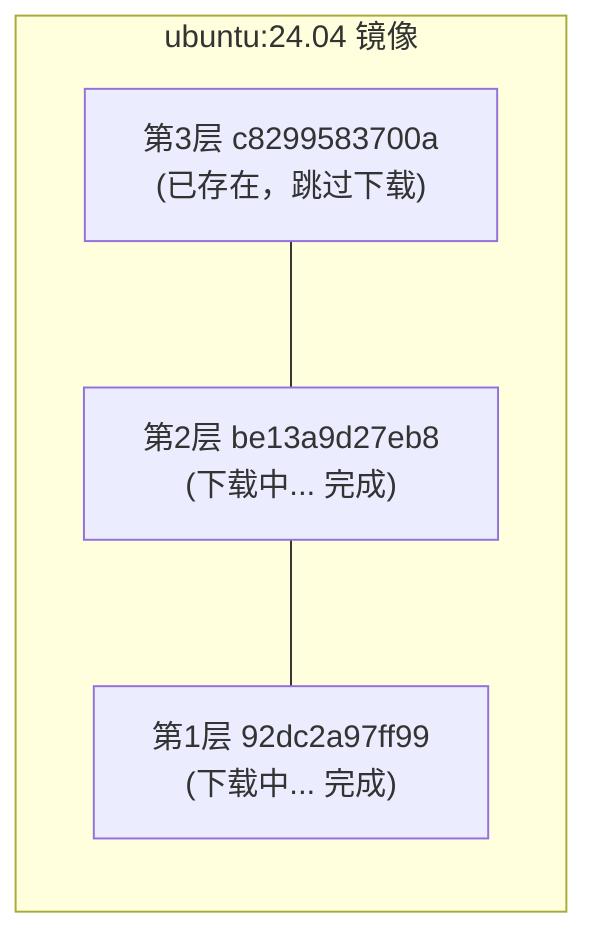
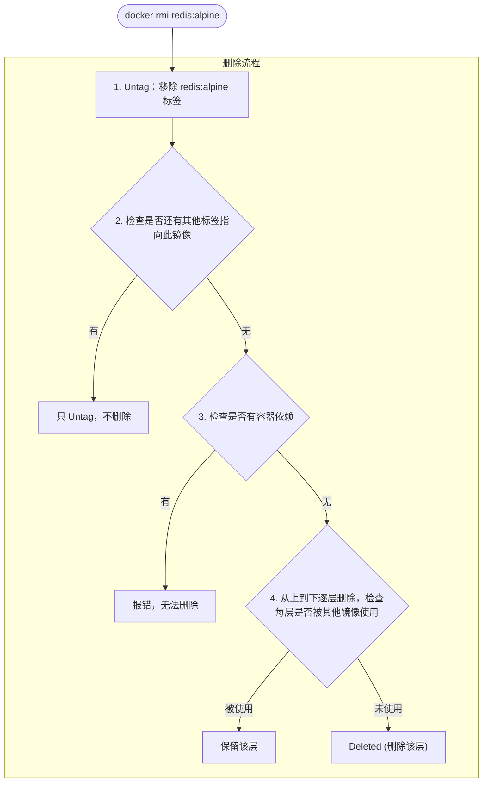
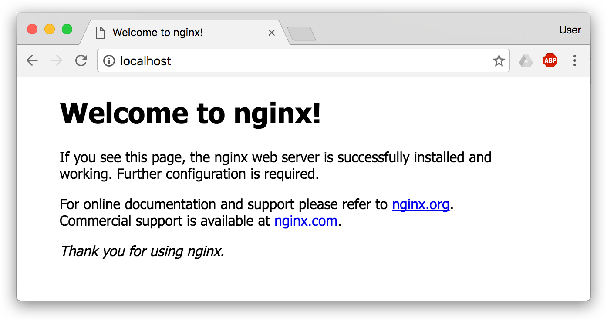
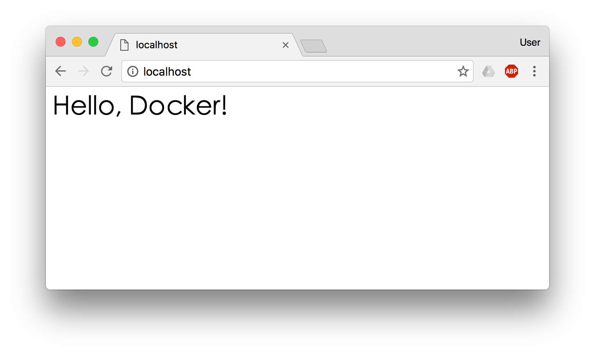
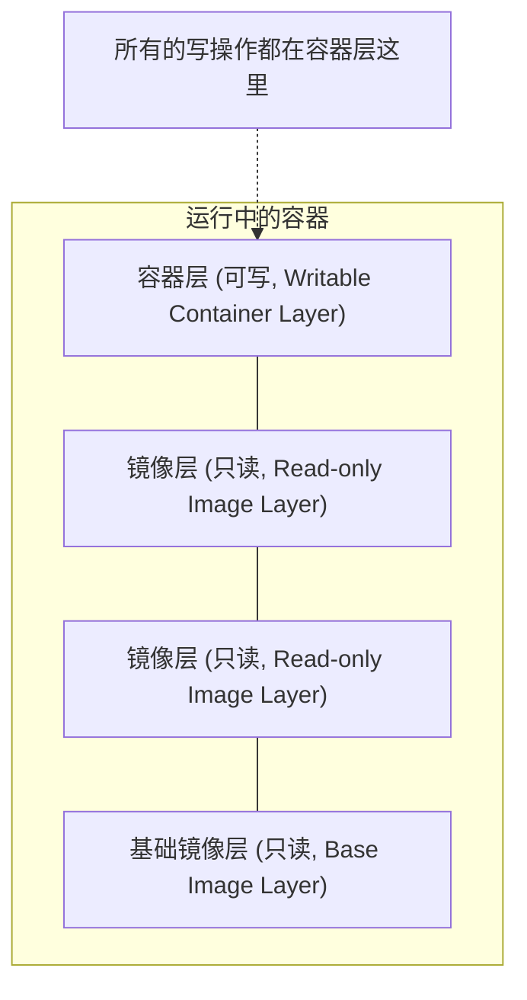

# 第四章 使用镜像

在之前的介绍中，我们知道镜像是 Docker 的三大组件之一。

Docker 运行容器前需要本地存在对应的镜像，如果本地不存在该镜像，Docker 会从镜像仓库下载该镜像。

## 1. 获取镜像

从 Docker 镜像仓库获取镜像可谓是 Docker 运作的第一步。本节将介绍如何使用 `docker pull` 命令下载镜像，以及如何理解下载过程。

> **版本号最佳实践**
>
> - **永远指定版本号**：避免使用 `latest` 标签，应指定具体的版本（如 `ubuntu:24.04`、`nginx:1.28`），以确保镜像内容稳定一致。
> - **在生产环境使用摘要**：优先使用镜像摘要（SHA256）而非标签，如 `nginx@sha256:abc123...`，因为摘要不可变。
> - **定期评估依赖**：即使指定了版本号，仍应定期检查依赖的基础镜像是否有安全更新。

### 1.1 docker pull 命令

从镜像仓库获取镜像的命令是 `docker pull`：

```bash
docker pull [选项] [Registry地址/]仓库名[:标签]
```

#### 镜像名称格式

Docker 镜像名称由 Registry 地址、用户名、仓库名和标签组成。其标准格式如下：

```bash
docker.io / library / ubuntu : 24.04
────┬────   ───┬───   ──┬───   ──┬──
    │         │        │        │
Registry地址  用户名    仓库名    标签
 (可省略)    (可省略)
```
| 组成部分 | 说明 | 默认值 |
|---------|------|--------|
| Registry 地址 | 镜像仓库地址 | `docker.io` (Docker Hub)|
| 用户名 | 镜像所属用户/组织 | `library`（官方镜像）|
| 仓库名 | 镜像名称 | 必须指定 |
| 标签 | 版本标识 | `latest` |

#### 示例

```bash
## 完整格式

$ docker pull docker.io/library/ubuntu:24.04

## 省略 Registry（默认 Docker Hub）

$ docker pull library/ubuntu:24.04

## 省略 library（官方镜像）

$ docker pull ubuntu:24.04

## 省略标签（默认 latest）

$ docker pull ubuntu

## 拉取第三方镜像

$ docker pull bitnami/redis:latest

## 从其他 Registry 拉取

$ docker pull ghcr.io/username/myapp:v1.0
```
---

### 1.2 下载过程解析

当我们执行 `docker pull` 命令时，Docker 会输出详细的下载进度。让我们以 `ubuntu:24.04` 为例来解析这些信息。

```bash
$ docker pull ubuntu:24.04
24.04: Pulling from library/ubuntu
92dc2a97ff99: Pull complete
be13a9d27eb8: Pull complete
c8299583700a: Pull complete
Digest: sha256:4bc3ae6596938cb0d9e5ac51a1152ec9dcac2a1c50829c74abd9c4361e321b26
Status: Downloaded newer image for ubuntu:24.04
docker.io/library/ubuntu:24.04
```

#### 输出解读

| 输出内容 | 说明 |
|---------|------|
| `Pulling from library/ubuntu` | 正在从官方 ubuntu 仓库拉取 |
| `92dc2a97ff99: Pull complete` | 各层的下载状态（显示层 ID 前 12 位）|
| `Digest: sha256:...` | 镜像内容的唯一摘要 |
| `docker.io/library/ubuntu:24.04` | 镜像的完整名称 |

#### 分层下载

从输出可以看到，镜像是 **分层下载** 的：


如果本地已有相同的层，Docker 会跳过下载，节省带宽和时间。

---

### 1.3 常用选项

`docker pull` 命令支持多种选项来满足不同的下载需求，例如下载所有标签、指定平台架构等。

| 选项 | 说明 | 示例 |
|------|------|------|
| `--all-tags, -a` | 拉取所有标签 | `docker pull -a ubuntu` |
| `--platform` | 指定平台架构 | `docker pull --platform linux/arm64 nginx` |
| `--quiet, -q` | 静默模式 | `docker pull -q nginx` |

#### 指定平台

在 Apple Silicon Mac 上拉取 x86 镜像：

```bash
$ docker pull --platform linux/amd64 nginx
```
---

### 1.4 拉取后运行

拉取镜像后，可以基于它启动容器：

```bash
## 拉取镜像

$ docker pull ubuntu:24.04

## 运行容器

$ docker run -it --rm ubuntu:24.04 bash
root@e7009c6ce357:/# cat /etc/os-release
PRETTY_NAME="Ubuntu 24.04 LTS"
...
root@e7009c6ce357:/# exit
```

> 本例使用 `ubuntu:24.04` 这样的具体版本标签是最佳实践。若无特殊需求，避免使用 `docker pull ubuntu` 或 `ubuntu:latest`，因为镜像内容可能在某个时刻发生变化。

**参数说明**：

| 参数 | 说明 |
|------|------|
| `-it` | 交互式终端模式 |
| `--rm` | 退出后自动删除容器 |
| `bash` | 启动命令 |

> 💡 `docker run` 在需要时会自动 `pull` 镜像，因此通常不需要单独执行 `docker pull`。

---

### 1.5 镜像加速

从 Docker Hub 下载可能较慢。可以配置镜像加速器：

```jsonc
// /etc/docker/daemon.json (Linux)
// ~/.docker/daemon.json (Docker Desktop)
{
  "registry-mirrors": [
    "https://your-accelerator-url"
  ]
}
```
配置后重启 Docker：

```bash
$ sudo systemctl restart docker  # Linux

## 或在 Docker Desktop 中重启
```
详见镜像加速器章节。

---

### 1.6 验证镜像完整性

为了确保下载的镜像没有被篡改且内容一致，我们可以校验镜像的摘要 (Digest)。

#### 查看镜像摘要

```bash
$ docker images --digests ubuntu
REPOSITORY   TAG     DIGEST                                                                    IMAGE ID
ubuntu       24.04   sha256:4bc3ae6596938cb0d9e5ac51a1152ec9dcac2a1c50829c74abd9c4361e321b26   ca2b0f26964c
```

#### 使用摘要拉取

用摘要拉取可确保获取完全相同的镜像：

```bash
$ docker pull ubuntu@sha256:4bc3ae6596938cb0d9e5ac51a1152ec9dcac2a1c50829c74abd9c4361e321b26
```
> 笔者建议：生产环境使用摘要而非标签，因为标签可能被覆盖，摘要则是不可变的。

---

### 1.7 常见问题

在使用 `docker pull` 过程中，可能会遇到下载速度慢、镜像不存在或磁盘空间不足等问题。以下是一些常见问题的排查思路。

#### Q：下载速度很慢

1. 配置镜像加速器
2. 检查网络连接
3. 尝试拉取更小的镜像版本（如 `alpine` 变体）

#### Q：提示镜像不存在

```bash
Error: pull access denied, repository does not exist
```
可能原因：

- 镜像名拼写错误
- 私有镜像未登录（需要 `docker login`）
- 镜像确实不存在

#### Q：磁盘空间不足

```bash
## 清理未使用的镜像

$ docker image prune

## 清理所有未使用资源

$ docker system prune
```
---

## 2. 列出镜像

在下载了镜像后，我们可以使用 `docker image ls` 命令列出本地主机上的镜像。

### 2.1 基本用法

查看本地已下载的镜像：

```bash
$ docker image ls
REPOSITORY   TAG       IMAGE ID       CREATED        SIZE
redis        latest    5f515359c7f8   5 days ago     183MB
nginx        latest    05a60462f8ba   5 days ago     181MB
ubuntu       24.04     329ed837d508   3 days ago     78MB
ubuntu       noble     329ed837d508   3 days ago     78MB
```
> 💡 `docker images` 是 `docker image ls` 的简写，两者等效。

---

### 2.2 输出字段说明

`docker image ls` 命令默认输出的列表包含仓库名、标签、镜像 ID、创建时间和占用空间等信息。

| 字段 | 说明 |
|------|------|
| **REPOSITORY** | 仓库名 |
| **TAG** | 标签（版本）|
| **IMAGE ID** | 镜像唯一标识（短 ID，前 12 位）|
| **CREATED** | 创建时间 |
| **SIZE** | 本地占用空间 |

#### 同一镜像多个标签

注意上面的 `ubuntu:24.04` 和 `ubuntu:noble` 拥有相同的 IMAGE ID——它们是同一个镜像的不同标签，只占用一份存储空间。

> **版本说明**：`ubuntu:24.04` 是具体版本号，`ubuntu:noble` 是发布代号（Ubuntu 24.04 的代号）。在 Dockerfile 中应优先使用版本号（如 `ubuntu:24.04`）而非发布代号，因为版本号在将来更易理解。

---

### 2.3 理解镜像大小

Docker 镜像的大小可能与我们通常理解的文件大小有所不同，这涉及到分层存储的概念。

#### 本地大小 vs Hub 显示大小

| 位置 | 显示大小 | 说明 |
|------|---------|------|
| Docker Hub | 29MB | 压缩后的网络传输大小 |
| docker image ls | 78MB | 本地解压后的实际大小 |

#### 实际磁盘占用

由于镜像是分层存储，不同镜像可能共享相同的层：

```bash
ubuntu:24.04    nginx:latest    redis:latest
    │               │                │
    └───────┬───────┘                │
            ▼                        │
       共享基础层 ◄───────────────────┘
```
因此，`docker image ls` 中各镜像大小之和 > 实际磁盘占用。

#### 查看实际空间占用

```bash
$ docker system df
TYPE            TOTAL   ACTIVE   SIZE      RECLAIMABLE
Images          15      3        2.5GB     1.8GB (72%)
Containers      5       2        100MB     80MB (80%)
Local Volumes   8       2        500MB     400MB (80%)
Build Cache     0       0        0B        0B
```
---

### 2.4 过滤镜像

随着本地镜像数量的增加，我们需要更有效的方式来查找特定的镜像。Docker 提供了多种过滤方式。

#### 按仓库名过滤

```bash
## 列出所有 ubuntu 镜像

$ docker images ubuntu
REPOSITORY   TAG     IMAGE ID       SIZE
ubuntu       24.04   329ed837d508   78MB
ubuntu       noble   329ed837d508   78MB
ubuntu       22.04   a1b2c3d4e5f6   72MB
```

#### 按仓库名和标签过滤

```bash
$ docker images ubuntu:24.04
REPOSITORY   TAG     IMAGE ID       SIZE
ubuntu       24.04   329ed837d508   78MB
```

#### 使用过滤器 --filter

| 过滤条件 | 说明 | 示例 |
|---------|------|------|
| `dangling=true` | 虚悬镜像 | `-f dangling=true` |
| `before=镜像` | 在某镜像之前创建 | `-f before=nginx:latest` |
| `since=镜像` | 在某镜像之后创建 | `-f since=nginx:latest` |
| `label=key=value` | 按 LABEL 过滤 | `-f label=version=1.0` |
| `reference=pattern` | 按名称模式 | `-f reference='*:latest'` |

```bash
## 列出 nginx 之后创建的镜像

$ docker images -f since=nginx:latest

## 列出所有带 latest 标签的镜像

$ docker images -f reference='*:latest'

## 列出带特定 LABEL 的镜像

$ docker images -f label=maintainer=example@email.com
```
---

### 2.5 虚悬镜像

仓库名和标签都为 `<none>` 的镜像被称为虚悬镜像。自 Docker Engine 29 起，`docker image ls` 默认不再列出它们，需要 `-a` 或 `dangling=true` 过滤器才能看到。

#### 什么是虚悬镜像

仓库名和标签都显示为 `<none>` 的镜像：

```bash
$ docker images -f dangling=true
REPOSITORY   TAG       IMAGE ID       SIZE
<none>       <none>    00285df0df87   342MB
```

#### 产生原因

1. **镜像重新构建**：新镜像使用了旧镜像的标签，旧镜像标签被移除
2. **docker pull 更新**：拉取更新版本时，旧版本失去标签

#### 处理虚悬镜像

```bash
## 列出虚悬镜像

$ docker images -f dangling=true

## 删除虚悬镜像

$ docker image prune
```
---

### 2.6 中间层镜像

`docker image ls` 默认列出的只是有标签的顶层镜像。除了虚悬镜像，被隐藏的还有一类为了加速镜像构建、重复利用资源而存在的中间层镜像。

#### 查看所有镜像：包含中间层

```bash
$ docker images -a
```
会显示默认隐藏的镜像：构建过程中产生的中间层，以及上面提到的虚悬镜像。中间层被其他镜像依赖。

> ⚠️ 不要删除中间层镜像。它们是其他镜像的依赖，删除会导致上层镜像无法使用。删除顶层镜像时会自动清理不再需要的中间层。

---

### 2.7 格式化输出

为了配合脚本使用或展示更关注的信息，我们可以使用 `--format` 参数来自定义输出格式。

#### 只输出 ID

```bash
$ docker images -q
5f515359c7f8
05a60462f8ba
329ed837d508
```
常用于配合其他命令：

```bash
## 删除所有镜像

$ docker rmi $(docker images -q)

## 删除所有 redis 镜像

$ docker rmi $(docker images -q redis)
```

#### 显示完整 ID

```bash
$ docker images --no-trunc
```

#### 显示摘要

```bash
$ docker images --digests
REPOSITORY   TAG     DIGEST                    IMAGE ID
nginx        latest  sha256:b4f0e0bdeb5...    e43d811ce2f4
```

#### 自定义格式

使用 Go 模板语法自定义输出：

```bash
## 只显示 ID 和仓库名

$ docker images --format "{{.ID}}: {{.Repository}}"
5f515359c7f8: redis
05a60462f8ba: nginx
329ed837d508: ubuntu

## 表格形式（带标题）

$ docker images --format "table {{.Repository}}\t{{.Tag}}\t{{.Size}}"
REPOSITORY   TAG       SIZE
redis        latest    183MB
nginx        latest    181MB
ubuntu       24.04     78MB
```

#### 可用模板字段

| 字段 | 说明 |
|------|------|
| `.ID` | 镜像 ID |
| `.Repository` | 仓库名 |
| `.Tag` | 标签 |
| `.Digest` | 摘要 |
| `.CreatedSince` | 创建后经过的时间 |
| `.CreatedAt` | 创建时间 |
| `.Size` | 大小 |

---

### 2.8 常用命令组合

```bash
## 列出所有镜像及其大小，按大小排序（需要系统 sort 命令）

$ docker images --format "{{.Size}}\t{{.Repository}}:{{.Tag}}" | sort -h

## 查找大于 500MB 的镜像

$ docker images --format "{{.Size}}\t{{.Repository}}:{{.Tag}}" | grep -E "^[0-9]+(\.[0-9]+)?GB|^[5-9][0-9]{2}MB"

## 导出镜像列表

$ docker images --format "{{.Repository}}:{{.Tag}}" > images.txt
```
---

## 3. 删除本地镜像

当不再需要某个镜像时，我们可以将其删除以释放存储空间。本节介绍删除镜像的常用方法。

### 3.1 基本用法

使用 `docker image rm` 删除本地镜像：

```bash
$ docker image rm [选项] <镜像1> [<镜像2> ...]
```
> 💡 `docker rmi` 是 `docker image rm` 的简写，两者等效。

---

### 3.2 镜像标识方式

删除镜像时，可以使用多种方式指定镜像：

| 方式 | 说明 | 示例 |
|------|------|------|
| **短 ID** | ID 的前几位（通常 3-4 位）| `docker rmi 501` |
| **长 ID** | 完整的镜像 ID | `docker rmi 501ad78535f0...` |
| **镜像名:标签** | 仓库名和标签 | `docker rmi redis:7.0` |
| **镜像摘要** | 精确的内容摘要 | `docker rmi nginx@sha256:...` |

> **版本提示**：建议使用 **镜像名:标签** 的方式删除，特别是当需要明确清理特定版本的镜像时。例如 `docker rmi redis:7.0` 比 `docker rmi redis:latest` 更清晰且安全。

#### 使用短 ID 删除

```bash
$ docker image ls
REPOSITORY   TAG     IMAGE ID       SIZE
redis        alpine  501ad78535f0   30MB
nginx        latest  e43d811ce2f4   142MB

## 只需输入足够区分的前几位

$ docker rmi 501
Untagged: redis:alpine
Deleted: sha256:501ad78535f0...
```

#### 使用镜像名删除

```bash
$ docker rmi redis:alpine
Untagged: redis:alpine
Deleted: sha256:501ad78535f0...
```

#### 使用摘要删除

摘要删除最精确，适用于 CI/CD 场景：

```bash
## 查看镜像摘要

$ docker images --digests
REPOSITORY   TAG    DIGEST                   IMAGE ID
nginx        latest sha256:b4f0e0bdeb5...    e43d811ce2f4

## 使用摘要删除

$ docker rmi nginx@sha256:b4f0e0bdeb578043c1ea6862f0d40cc4afe32a4a582f3be235a3b164422be228
```
---

### 3.3 理解输出信息

执行删除命令后，Docker 会输出一系列的操作记录，理解这些信息有助于我们掌握镜像删除的机制。

删除镜像时会看到两类信息：**Untagged** 和 **Deleted**

```bash
$ docker rmi redis:alpine
Untagged: redis:alpine
Untagged: redis@sha256:f1ed3708f538b537eb9c2a7dd50dc90a706f7debd7e1196c9264edeea521a86d
Deleted: sha256:501ad78535f015d88872e13fa87a828425117e3d28075d0c117932b05bf189b7
Deleted: sha256:96167737e29ca8e9d74982ef2a0dda76ed7b430da55e321c071f0dbff8c2899b
Deleted: sha256:32770d1dcf835f192cafd6b9263b7b597a1778a403a109e2cc2ee866f74adf23
```

#### Untagged vs Deleted

| 操作 | 含义 |
|------|------|
| **Untagged** | 移除镜像的标签 |
| **Deleted** | 删除镜像的存储层 |

#### 删除流程

Docker 会检测镜像是否有容器依赖或其他标签指向，只有在确认为无用资源时才会真正删除存储层。


---

### 3.4 批量删除

手动一个一个删除镜像非常繁琐，Docker 提供了 `image prune` 命令和 shell 组合命令来实现批量清理。

#### 删除所有虚悬镜像

虚悬镜像 (dangling)：没有标签的镜像，通常是旧版本被新版本覆盖后产生的

```bash
## 查看虚悬镜像

$ docker images -f dangling=true

## 删除虚悬镜像

$ docker image prune

## 不提示确认

$ docker image prune -f
```

#### 删除所有未使用的镜像

```bash
## 删除所有没有被容器使用的镜像

$ docker image prune -a

## 保留最近 24 小时的

$ docker image prune -a --filter "until=24h"
```

#### 按条件删除

```bash
## 删除所有 redis 镜像

$ docker rmi $(docker images -q redis)

## 删除 mongo:8.0 之前的所有镜像

$ docker rmi $(docker images -q -f before=mongo:8.0)

## 删除某个时间之前的镜像

$ docker image prune -a --filter "until=168h"  # 7天前
```
---

### 3.5 删除失败的常见原因

在删除镜像时，Docker 可能会提示错误并拒绝执行。这通常是为了防止误删正在使用的资源。

#### 原因一：有容器依赖

```bash
$ docker rmi nginx
Error: conflict: unable to remove repository reference "nginx"
(must force) - container abc123 is using its referenced image
```
**解决方案**：

```bash
## 方案1：先删除依赖的容器

$ docker rm abc123
$ docker rmi nginx

## 方案2：强制删除镜像（容器仍可运行，但无法再创建新容器）

$ docker rmi -f nginx
```

#### 原因二：多个标签指向同一镜像

```bash
$ docker images
REPOSITORY   TAG     IMAGE ID
ubuntu       24.04   ca2b0f26964c
ubuntu       latest  ca2b0f26964c   # 同一个镜像

$ docker rmi ubuntu:24.04
Untagged: ubuntu:24.04

## 只是移除标签，镜像仍存在（因为还有 ubuntu:latest 指向它）
```
当同一个镜像有多个标签时，`docker rmi` 只是删除指定的标签，不会删除镜像本身。

#### 原因三：被其他镜像依赖：中间层

```bash
$ docker rmi some_base_image
Error: image has dependent child images
```
中间层镜像被其他镜像依赖，无法删除。需要先删除依赖它的镜像。

---

### 3.6 常用过滤条件

| 过滤条件 | 说明 | 示例 |
|---------|------|------|
| `dangling=true` | 虚悬镜像 | `-f dangling=true` |
| `before=镜像` | 在某镜像之前 | `-f before=mongo:3.2` |
| `since=镜像` | 在某镜像之后 | `-f since=mongo:3.2` |
| `label=key=value` | 按标签过滤 | `-f label=version=1.0` |
| `reference=pattern` | 按名称模式 | `-f reference='*:latest'` |

---

### 3.7 清理策略

针对不同的环境（开发环境 vs 生产环境），我们应该采用不同的镜像清理策略。

#### 开发环境

```bash
## 定期清理虚悬镜像

$ docker image prune -f

## 一键清理所有未使用资源

$ docker system prune -a
```

#### CI/CD 环境

```bash
## 只保留最近使用的镜像

$ docker image prune -a --filter "until=72h" -f
```

#### 查看空间占用

```bash
$ docker system df
TYPE            TOTAL   ACTIVE   SIZE      RECLAIMABLE
Images          15      3        2.5GB     1.8GB (72%)
Containers      5       2        100MB     80MB (80%)
Local Volumes   8       2        500MB     400MB (80%)
Build Cache     0       0        0B        0B
```
---

## 4. 利用 commit 理解镜像构成

> 注意：如果你是初学者，可以暂时跳过后面的内容，直接学习容器一节。

`docker commit` 除了帮助理解镜像分层之外，在少数场景下也可用于留存现场，例如事后分析被入侵容器的状态；但是，日常定制镜像不应依赖 `docker commit`，而应使用下一节介绍的 `Dockerfile`。

镜像是容器的基础，每次执行 `docker run` 的时候都会指定哪个镜像作为容器运行的基础。在之前的例子中，我们所使用的都是来自于 Docker Hub 的镜像。直接使用这些镜像是可以满足一定的需求，而当这些镜像无法直接满足需求时，我们就需要定制这些镜像。接下来的几节就将讲解如何定制镜像。

回顾一下之前我们学到的知识，镜像是多层存储，每一层是在前一层的基础上进行的修改；而容器同样也是多层存储，它以镜像层为只读基础，并在最上方增加一层供运行时写入的容器层。

现在让我们以定制一个 Web 服务器为例子，来讲解镜像是如何构建的。

> **版本提示**：以下示例中 `nginx` 镜像使用默认 `latest` 标签。生产环境建议指定具体版本号（如 `nginx:1.28`），以避免镜像更新带来的不兼容性。

```bash
$ docker run --name webserver -d -p 8080:80 nginx
```
这条命令会用 `nginx` 镜像启动一个容器，命名为 `webserver`。其中，`-p 8080:80` 表示把宿主机的 `8080` 端口映射到容器内的 `80` 端口，这样我们就可以用浏览器去访问这个 `nginx` 服务器。

如果是在本机运行的 Docker，那么可以直接访问：`http://localhost:8080`；如果是在虚拟机、云服务器上安装的 Docker，则需要将 `localhost` 换为虚拟机地址或者实际云服务器地址，并保留 `8080` 端口。

直接用浏览器访问的话，我们会看到默认的 Nginx 欢迎页面。



现在，假设我们非常不喜欢这个欢迎页面，我们希望改成欢迎 Docker 的文字，我们可以使用 `docker exec` 命令进入容器，修改其内容。

```bash
$ docker exec -it webserver bash
root@3729b97e8226:/# echo '<h1>Hello, Docker!</h1>' > /usr/share/nginx/html/index.html
root@3729b97e8226:/# exit
exit
```
我们以交互式终端方式进入 `webserver` 容器，并执行了 `bash` 命令，也就是获得一个可操作的 Shell。

然后，我们用 `<h1>Hello, Docker!</h1>` 覆盖了 `/usr/share/nginx/html/index.html` 的内容。

现在我们再刷新浏览器的话，会发现内容被改变了。



我们修改了容器的文件，也就是改动了容器的存储层。我们可以通过 `docker diff` 命令看到具体的改动。

```bash
$ docker diff webserver
C /root
A /root/.bash_history
C /run
C /usr
C /usr/share
C /usr/share/nginx
C /usr/share/nginx/html
C /usr/share/nginx/html/index.html
C /var
C /var/cache
C /var/cache/nginx
A /var/cache/nginx/client_temp
A /var/cache/nginx/fastcgi_temp
A /var/cache/nginx/proxy_temp
A /var/cache/nginx/scgi_temp
A /var/cache/nginx/uwsgi_temp
```
其中，`A` 表示新增（Added），`C` 表示变更（Changed），`D` 表示删除（Deleted）。

现在我们定制好了变化，我们希望能将其保存下来形成镜像。

要知道，当我们运行一个容器的时候（如果不使用卷的话），我们做的任何文件修改都会被记录于容器存储层里。而 Docker 提供了一个 `docker commit` 命令，可以将容器的存储层保存下来成为镜像。换句话说，就是在原有镜像的基础上，再叠加上容器的存储层，并构成新的镜像。以后我们运行这个新镜像的时候，就会拥有原有容器最后的文件变化。

`docker commit` 的语法格式为：

```bash
docker commit [选项] <容器ID或容器名> [<仓库名>[:<标签>]]
```
我们可以用下面的命令将容器保存为镜像。默认情况下，`docker commit` 会在提交时暂停容器进程，以降低数据损坏的风险；如果确实不希望暂停，可以显式指定 `--no-pause`：

```bash
$ docker commit \
    --author "Tao Wang <twang2218@gmail.com>" \
    --message "修改了默认网页" \
    webserver \
    nginx:v2
sha256:07e33465974800ce65751acc279adc6ed2dc5ed4e0838f8b86f0c87aa1795214
```
其中 `--author` 是指定修改的作者，而 `--message` 则是记录本次修改的内容。这点和 `git` 版本控制相似，不过这里这些信息可以省略留空。

我们可以在 `docker image ls` 中看到这个新定制的镜像。下面的输出仅为示例，标签、创建时间和大小会随着镜像版本和本地环境不同而变化：

```bash
$ docker image ls nginx
REPOSITORY          TAG                 IMAGE ID            CREATED             SIZE
nginx               v2                  07e334659748        9 seconds ago       181.5 MB
nginx               1.30                05a60462f8ba        12 days ago         181.5 MB
nginx               latest              e43d811ce2f4        4 weeks ago         181.5 MB
```

> **版本说明**：上面示例中 `nginx:1.30` 代表 1.30 系列的最新 patch 版本。在实际应用中应根据需求选择确切的版本号，而不是盲目使用 `latest`。

我们还可以用 `docker history` 具体查看镜像内的历史记录。例如先执行 `docker history nginx:v2`，再对比 `docker history nginx:latest`，就能看到我们刚刚提交出来的新层。

```bash
$ docker history nginx:v2
IMAGE               CREATED             CREATED BY                                      SIZE                COMMENT
07e334659748        54 seconds ago      nginx -g daemon off;                            95 B                修改了默认网页
e43d811ce2f4        4 weeks ago         /bin/sh -c #(nop)  CMD ["nginx" "-g" "daemon    0 B
<missing>           4 weeks ago         /bin/sh -c #(nop)  EXPOSE 443/tcp 80/tcp        0 B
<missing>           4 weeks ago         /bin/sh -c ln -sf /dev/stdout /var/log/nginx/   22 B
<missing>           4 weeks ago         /bin/sh -c apt-key adv --keyserver hkp://pgp.   58.46 MB
<missing>           4 weeks ago         /bin/sh -c #(nop)  ENV NGINX_VERSION=1.27.0-1   0 B
<missing>           4 weeks ago         /bin/sh -c #(nop)  MAINTAINER NGINX Docker Ma   0 B
<missing>           4 weeks ago         /bin/sh -c #(nop)  CMD ["/bin/bash"]            0 B
<missing>           4 weeks ago         /bin/sh -c #(nop) ADD file:23aa4f893e3288698c   123 MB
```
新的镜像定制好后，我们可以来运行这个镜像。

```bash
$ docker run --name web2 -d -p 81:80 nginx:v2
```
这里我们将新容器命名为 `web2`，并把宿主机的 `81` 端口映射到容器的 `80` 端口。访问 `http://localhost:81` 后，看到的内容应该和之前修改后的 `webserver` 一样。

至此，我们第一次完成了定制镜像，使用的是 `docker commit` 命令，手动操作给旧的镜像添加了新的一层，形成新的镜像，对镜像多层存储应该有了更直观的感觉。

### 4.1 慎用 `docker commit`

使用 `docker commit` 命令虽然可以比较直观地帮助理解镜像分层存储的概念，但它不应作为常规定制镜像的方式。

首先，如果仔细观察之前的 `docker diff webserver` 的结果，你会发现除了真正想要修改的 `/usr/share/nginx/html/index.html` 文件外，由于命令的执行，还有很多文件被改动或添加了。这还仅仅是最简单的操作，如果是安装软件包、编译构建，那会有大量的无关内容被添加进来，将会导致镜像极为臃肿。

此外，使用 `docker commit` 意味着所有对镜像的操作都是黑箱操作，生成的镜像也被称为 **黑箱镜像**，换句话说，就是除了制作镜像的人知道执行过什么命令、怎么生成的镜像，别人根本无从得知。而且，即使是这个制作镜像的人，过一段时间后也无法记清具体的操作。这种黑箱镜像的维护工作是非常痛苦的。

而且，回顾之前提及的镜像所使用的分层存储的概念，除当前层外，之前的每一层都不会发生改变。换句话说，任何修改的结果仅仅是在当前层进行标记、添加、修改，而不会改动上一层。如果使用 `docker commit` 制作镜像，以及后期继续修改，那么每一次修改都会让镜像再膨胀一层；即使某些文件在更高层里被删除了，它们仍然存在于更低层中，只是在最终视图里被隐藏而已。因此，日常定制镜像应使用下一节介绍的 `Dockerfile`，把构建过程写成可重复执行、便于审查的文本。

## 5. 使用 Dockerfile 定制镜像

从刚才的 `docker commit` 的学习中，我们可以了解到，镜像的定制实际上就是定制每一层所添加的配置、文件。如果我们可以把每一层修改、安装、构建、操作的命令都写入一个脚本，用这个脚本来构建、定制镜像，那么之前提及的无法重复、镜像构建不透明、体积难以控制等问题就会更容易解决。这个脚本就是 Dockerfile。

Dockerfile 是一个文本文件，其内包含了一条条的 **指令 (Instruction)**。其中，会修改文件系统的指令通常会创建新层；而 `LABEL`、`CMD` 这类只修改镜像元数据的指令，则不会新增文件系统层。每一条指令的内容，都是在描述该镜像应当如何构建。

### 5.1 使用 docker init 快速创建：推荐

Docker 提供了 `docker init` 命令，可以根据项目类型自动生成 `Dockerfile`、`.dockerignore`、`compose.yaml` 和 `README.Docker.md` 等文件：

```bash
$ docker init
```
该命令会交互式地询问项目类型（支持 Go、Node.js、Python、Rust、Java、ASP.NET Core、PHP with Apache 等），并生成可作为起点的配置文件。对于新项目，这是一个很好的起步方式，但生成后的内容仍应结合项目实际情况继续调整。

### 5.2 手动创建 Dockerfile

还以之前定制 `nginx` 镜像为例，这次我们使用 Dockerfile 来定制。

在一个空白目录中，建立一个文本文件，并命名为 `Dockerfile`：

```bash
$ mkdir mynginx
$ cd mynginx
$ touch Dockerfile
```
其内容为：

> **版本提示**：下面示例中 `FROM nginx` 使用的是 `latest` 标签。在实际应用中应使用明确的版本号（如 `FROM nginx:1.28`），以确保 Dockerfile 的可重现性和稳定性。

```docker
FROM nginx
RUN echo '<h1>Hello, Docker!</h1>' > /usr/share/nginx/html/index.html
```
这个 Dockerfile 很简单，一共就两行。涉及到了两条指令，`FROM` 和 `RUN`。

### 5.3 FROM 指定基础镜像

所谓定制镜像，那一定是以一个镜像为基础，在其上进行定制。就像我们之前运行了一个 `nginx` 镜像的容器，再进行修改一样，基础镜像是必须指定的。而 `FROM` 就是指定 **基础镜像**，因此一个 `Dockerfile` 中 `FROM` 是必备的指令，并且必须是第一条**构建指令**——按官方 Dockerfile 参考，它之前只允许出现 parser 指令、注释和全局作用域的 `ARG`，`ARG` 是唯一能写在 `FROM` 之前的指令（见 7.7 ARG）。

> **版本号最佳实践**：在 `FROM` 指令中 **务必指定具体版本号**（如 `FROM ubuntu:24.04` 或 `FROM python:3.12-slim`）而非 `FROM ubuntu` 或 `FROM python:latest`。这样可以确保 Dockerfile 在不同时间、不同环境下构建出的镜像内容一致，避免因基础镜像更新导致的不可预期的变化。

在 [Docker Hub](https://hub.docker.com/search?q=&type=image&image_filter=official) 上有非常多的高质量的官方镜像，有可以直接拿来使用的服务类的镜像，如 [`nginx`](https://hub.docker.com/_/nginx/)、[`redis`](https://hub.docker.com/_/redis/)、[`mongo`](https://hub.docker.com/_/mongo/)、[`mysql`](https://hub.docker.com/_/mysql/)、[`httpd`](https://hub.docker.com/_/httpd/)、[`php`](https://hub.docker.com/_/php/)、[`tomcat`](https://hub.docker.com/_/tomcat/) 等；也有一些方便开发、构建、运行各种语言应用的镜像，如 [`node`](https://hub.docker.com/_/node)、[`eclipse-temurin`](https://hub.docker.com/_/eclipse-temurin/)、[`python`](https://hub.docker.com/_/python/)、[`ruby`](https://hub.docker.com/_/ruby/)、[`golang`](https://hub.docker.com/_/golang/) 等。可以在其中寻找一个最符合我们最终目标的镜像为基础镜像进行定制。

如果没有找到对应服务的镜像，官方镜像中还提供了一些更为基础的操作系统镜像，如 [`ubuntu`](https://hub.docker.com/_/ubuntu/)、[`debian`](https://hub.docker.com/_/debian/)、[`centos`](https://hub.docker.com/_/centos/)、[`fedora`](https://hub.docker.com/_/fedora/)、[`alpine`](https://hub.docker.com/_/alpine/) 等，这些操作系统的软件库为我们提供了更广阔的扩展空间。

除了选择现有镜像为基础镜像外，Docker 还存在一个特殊的镜像，名为 `scratch`。这个镜像是虚拟的概念，并不实际存在，它表示一个空白的镜像。

```docker
FROM scratch
...
```
如果你以 `scratch` 为基础镜像的话，意味着你不以任何镜像为基础，接下来所写的指令将作为镜像第一层开始存在。

不以任何系统为基础，直接将可执行文件复制进镜像的做法并不罕见，对于 Linux 下静态编译的程序来说，并不需要有操作系统提供运行时支持，所需的一切库都已经在可执行文件里了，因此直接 `FROM scratch` 会让镜像体积更加小巧。使用 [Go 语言](https://golang.google.cn/)开发的应用很多会使用这种方式来制作镜像，这也是有人认为 Go 是特别适合容器微服务架构的语言的原因之一。

### 5.4 RUN 执行命令

`RUN` 指令是用来执行命令行命令的。由于命令行的强大能力，`RUN` 指令在定制镜像时是最常用的指令之一。其格式有两种：

* *shell* 格式：`RUN <命令>`，就像直接在命令行中输入的命令一样。刚才写的 Dockerfile 中的 `RUN` 指令就是这种格式。

```docker
RUN echo '<h1>Hello, Docker!</h1>' > /usr/share/nginx/html/index.html
```

* *exec* 格式：`RUN ["可执行文件", "参数1", "参数2"]`，这更像是函数调用中的格式。

在会修改文件系统的指令里，`RUN` 是最典型的一类。每一个 `RUN` 的行为，都可以类比为我们刚才手工建立镜像的过程：先基于当前结果启动一个临时构建环境，在其上执行这些命令，再把这一步产生的文件系统变化保存为新的结果层。

> **注意**
>
> 每一个 `RUN` 指令都会产生一个新的镜像层。为了减少镜像体积和层数，我们通常会将多个命令合并到一个 `RUN` 指令中执行。
>
> 更多关于 `RUN` 指令的详细用法、最佳实践（如清理缓存、使用 pipefail 等）及 `Union FS` 的层数限制等内容，请参阅 **第七章 Dockerfile 指令详解** 中的 **RUN 指令** 小节。

要想编写优秀的 `Dockerfile`，必须了解每一条指令的作用和副作用。在 **第七章 Dockerfile 指令详解** 中，我们将对 `COPY`，`ADD`，`CMD`，`ENTRYPOINT` 等指令进行详细讲解。

### 5.5 构建镜像

好了，让我们再回到之前定制的 nginx 镜像的 Dockerfile 来。现在我们明白了这个 Dockerfile 的内容，那么让我们来构建这个镜像吧。

在 `Dockerfile` 文件所在目录执行：

```bash
$ docker build -t nginx:v3 .
```

在当前版本的 Docker 中，`docker build` 默认会通过 Buildx 调用 BuildKit，因此你更常看到的是 `[+] Building ...` 这类输出。为了帮助理解“每一步如何形成镜像历史”，下面仍展示一种较容易阅读的经典输出形式：

```bash
Sending build context to Docker daemon 2.048 kB
Step 1 : FROM nginx
 ---> e43d811ce2f4
Step 2 : RUN echo '<h1>Hello, Docker!</h1>' > /usr/share/nginx/html/index.html
 ---> Running in 9cdc27646c7b
 ---> 44aa4490ce2c
Removing intermediate container 9cdc27646c7b
Successfully built 44aa4490ce2c
```
从命令的输出结果中，我们可以清晰地看到镜像的构建过程。在 `Step 2` 中，如同我们之前所说的那样，`RUN` 指令启动了一个容器 `9cdc27646c7b`，执行了所要求的命令，并最后提交了这一层 `44aa4490ce2c`，随后删除了所用到的这个容器 `9cdc27646c7b`。

这里我们使用了 `docker build` 命令进行镜像构建。其格式为：

```bash
docker build [选项] <上下文路径/URL/->
```
在这里我们指定了最终镜像的名称 `-t nginx:v3`，构建成功后，我们可以像之前运行 `nginx:v2` 那样来运行这个镜像，其结果会和 `nginx:v2` 一样。

### 5.6 镜像构建上下文

如果注意，会看到 `docker build` 命令最后有一个 `.`。`.` 表示当前目录，而 `Dockerfile` 就在当前目录，因此不少初学者以为这个路径是在指定 `Dockerfile` 所在路径，这么理解其实是不准确的。如果对应上面的命令格式，你可能会发现，这是在指定 **上下文路径**。那么什么是上下文呢？

首先要理解 `docker build` 的工作原理。今天的 `docker build` 默认会通过 Buildx 向 BuildKit 后端发起构建请求；无论后端运行在本机还是远端，位置参数指定的都是 **构建上下文**，也就是构建器可以访问到的文件集合。

当我们进行镜像构建的时候，并非所有定制都会通过 `RUN` 指令完成，经常还需要把本地文件复制进镜像，比如通过 `COPY` 指令、`ADD` 指令等。因此，构建器必须能够访问这些文件，而它能访问的范围正是你传给 `docker build` 的那个上下文。

如果上下文是本地目录，那么这个目录中的文件和子目录就会成为可用输入；如果上下文是远端 Git 仓库或 tar 包，那么构建器会直接获取对应内容。对于本地目录，BuildKit 会按需读取构建过程中真正需要的文件，而不是让 Dockerfile 任意访问宿主机上的任意路径。

如果在 `Dockerfile` 中这么写：

```docker
COPY ./package.json /app/
```
这并不是要复制执行 `docker build` 命令所在的目录下的 `package.json`，也不是复制 `Dockerfile` 所在目录下的 `package.json`，而是复制 **上下文 (context)** 目录下的 `package.json`。

因此，`COPY` 这类指令中的源文件路径都应该以构建上下文为基准来理解。对于 legacy builder，像 `COPY ../package.json /app` 这样的写法会直接报错；而在 BuildKit 下，前导的越界 `../` 会被剥离并重新解释为上下文内路径。无论是哪种情况，构建器都无法读取上下文之外的宿主机文件；如果真的需要那些文件，应该先把它们放进上下文目录，或重新选择合适的上下文。

现在就可以理解刚才的命令 `docker build -t nginx:v3 .` 中的这个 `.`，实际上是在指定上下文目录，而不是单纯指定 `Dockerfile` 所在目录。

如果观察 `docker build` 的经典输出，或 BuildKit 输出中的 `transferring context` 提示，我们其实都能看到上下文传输的过程：

```bash
$ docker build -t nginx:v3 .
Sending build context to Docker daemon 2.048 kB
...
```
理解构建上下文对于镜像构建是很重要的，避免犯一些不应该的错误。比如有些初学者在发现需要的文件不在上下文里后，干脆把上下文切到硬盘根目录去构建。这样做即使在 BuildKit 下也会让可见上下文变得过大，并且在使用 `COPY . .`、`ADD . /app` 之类写法时，仍可能触发大规模上下文传输，导致构建缓慢甚至失败。这显然是使用错误。

一般来说，应该会将 `Dockerfile` 置于一个空目录下，或者项目根目录下。如果该目录下没有所需文件，那么应该把所需文件复制一份过来。如果目录下有些东西确实不希望构建时传给 Docker 引擎，那么可以用 `.gitignore` 一样的语法写一个 `.dockerignore`，该文件是用于剔除不需要作为上下文传递给 Docker 引擎的。

那么为什么会有人误以为 `.` 是指定 `Dockerfile` 所在目录呢？这是因为在默认情况下，如果不额外指定 `Dockerfile` 的话，会将上下文目录下的名为 `Dockerfile` 的文件作为 Dockerfile。

这只是默认行为，实际上 `Dockerfile` 的文件名并不要求必须为 `Dockerfile`，而且并不要求必须位于上下文目录中，比如可以用 `-f ../Dockerfile.php` 参数指定某个文件作为 `Dockerfile`。

当然，一般大家习惯性的会使用默认的文件名 `Dockerfile`，以及会将其置于镜像构建上下文目录中。

### 5.7 其他 `docker build` 的用法

#### 直接用 Git repo 进行构建

或许你已经注意到了，`docker build` 还支持从 URL 构建，也就是直接把远端 Git 仓库作为上下文。传统写法可以使用 URL 片段 `#ref:dir`，例如：

```bash
$ docker build https://github.com/user/myrepo.git#mybranch:docker
```
这行命令表示：把 Git 仓库作为构建上下文，使用 `mybranch` 分支中的 `docker/` 子目录来构建。在较新的 Buildx 中，也可以改用结构更清晰的查询参数写法，例如 `?branch=mybranch&subdir=docker`。

#### 用给定的 tar 压缩包构建

```bash
$ docker build http://server/context.tar.gz
```
如果所给出的 URL 不是个 Git repo，而是个 `tar` 压缩包，那么 Docker 引擎会下载这个包，并自动解压缩，以其作为上下文，开始构建。

#### 从标准输入中读取 Dockerfile 进行构建

```bash
docker build - < Dockerfile
```
或

```bash
cat Dockerfile | docker build -
```
如果标准输入传入的是文本文件，则将其视为 `Dockerfile`，并开始构建。这种形式由于直接从标准输入中读取 Dockerfile 的内容，它没有上下文，因此不可以像其他方法那样可以将本地文件 `COPY` 进镜像之类的事情。

#### 从标准输入中读取上下文压缩包进行构建

```bash
$ docker build - < context.tar.gz
```
如果发现标准输入的文件格式是 `gzip`、`bzip2` 以及 `xz` 的话，将会将其视为上下文压缩包，直接将其展开，将里面视为上下文，并开始构建。

## 6. 其他制作镜像的方式

除了标准的使用 `Dockerfile` 生成镜像的方法外，由于各种特殊需求和历史原因，还提供了一些其他方法用以生成镜像。

### 6.1 从 rootfs 压缩包导入

格式：`docker import [选项] <文件>|<URL>|- [<仓库名>[:<标签>]]`

压缩包可以是本地文件、远程 Web 文件，甚至是从标准输入中得到。压缩包将会在镜像 `/` 目录展开，并直接作为镜像第一层提交。

比如我们想要创建一个 [OpenVZ](https://openvz.org) 的 Ubuntu 16.04 [模板](https://wiki.openvz.org/Download/template/precreated)的镜像：

> **版本提示**：`noble` 对应 Ubuntu 24.04 LTS。实际用于生产环境时，应选择仍在安全维护期内的发行版，并按团队的基础镜像更新策略定期重建。

```bash
$ docker import \
    http://download.openvz.org/template/precreated/ubuntu-16.04-x86_64.tar.gz \
    openvz/ubuntu:16.04

Downloading from http://download.openvz.org/template/precreated/ubuntu-16.04-x86_64.tar.gz
sha256:412b8fc3e3f786dca0197834a698932b9c51b69bd8cf49e100c35d38c9879213
```
这条命令自动下载了 `ubuntu-16.04-x86_64.tar.gz` 文件，并且作为根文件系统展开导入，并保存为镜像 `openvz/ubuntu:16.04`。

导入成功后，我们可以用 `docker image ls` 看到这个导入的镜像：

```bash
$ docker image ls openvz/ubuntu
REPOSITORY          TAG                 IMAGE ID            CREATED             SIZE
openvz/ubuntu       16.04               412b8fc3e3f7        55 seconds ago      505MB
```
如果我们查看其历史的话，会看到描述中有导入的文件链接：

```bash
$ docker history openvz/ubuntu:16.04
IMAGE               CREATED              CREATED BY          SIZE                COMMENT
f477a6e18e98        About a minute ago                       214.9 MB            Imported from http://download.openvz.org/template/precreated/ubuntu-16.04-x86_64.tar.gz
```

### 6.2 Docker 镜像的导入和导出 `docker save` 和 `docker load`

Docker 还提供了 `docker save` 和 `docker load` 命令，用以将镜像保存为一个文件，然后传输到另一个位置上，再加载进来。这是在没有 Docker Registry 时的做法，现在已经不推荐，镜像迁移应该直接使用 Docker Registry，无论是直接使用 Docker Hub 还是使用内网私有 Registry 都可以。

#### 保存镜像

使用 `docker save` 命令可以将镜像保存为归档文件。

比如我们希望保存这个 `alpine` 镜像。

```bash
$ docker image ls alpine
REPOSITORY          TAG                 IMAGE ID            CREATED             SIZE
alpine              latest              baa5d63471ea        5 weeks ago         4.803 MB
```

> **版本提示**：`alpine:latest` 为最新版本的 Alpine Linux。如果需要特定版本号（如 `alpine:3.24`），可以明确指定以确保可重现性；注意选一个仍在维护的版本，`alpine:3.20` 已于 2026-04 结束支持。
保存镜像的命令为：

```bash
$ docker save alpine -o filename
$ file filename
filename: POSIX tar archive
```
这里的 filename 可以为任意名称甚至任意后缀名，但文件的本质都是归档文件

**注意：如果同名则会覆盖（没有警告）**

若使用 `gzip` 压缩：

```bash
$ docker save alpine | gzip > alpine-latest.tar.gz
```
然后我们将 `alpine-latest.tar.gz` 文件复制到了另一个机器上，可以用下面这个命令加载镜像：

```bash
$ docker load -i alpine-latest.tar.gz
Loaded image: alpine:latest
```
如果我们结合这两个命令以及 `ssh` 甚至 `pv` 的话，利用 Linux 强大的管道，我们可以写一个命令完成从一个机器将镜像迁移到另一个机器，并且带进度条的功能：

```bash
docker save <镜像名> | bzip2 | pv | ssh <用户名>@<主机名> 'cat | docker load'
```

## 7. 实现原理

Docker 镜像是怎么实现增量的修改和维护的？为什么容器启动如此之快？这一切都归功于 Docker 的镜像分层存储设计。

### 7.1 镜像与分层存储

在之前的章节中，我们一直强调镜像包含操作系统完整的 `root` 文件系统，其体积往往是庞大的。因此在 Docker 设计时，就充分利用 **Union FS** 的技术，将其设计为分层存储的架构。

Docker 镜像并不是一个单纯的文件，而是由一组文件系统叠加构成的。

最底层的镜像称为 **基础镜像 (Base Image)**，通常是各种 Linux 发行版的 root 文件系统，如 Ubuntu、Debian、CentOS 等。

当我们在基础镜像之上构建新的镜像时（例如安装了 Nginx），Docker 并不是复制一份基础镜像，而是在基础镜像之上，**新建一个层 (Layer)**，并在该层中仅记录为了安装 Nginx 而发生的文件变更（添加、修改、删除）。

这种分层存储结构使得镜像的复用、分发变得非常高效：

*   **复用**：如果多个镜像都基于同一个基础镜像（例如都基于 `ubuntu:24.04`），那么宿主机只需要下载一份 `ubuntu:24.04`，所有镜像都可以共享它。
*   **轻量分发**：镜像可以复用已有层，只传输和存储新增差异层；不过镜像是否足够小，仍然取决于基础镜像和新增内容本身。

### 7.2 容器层与读写

我们要理解的一个关键概念是：**镜像的每一层都是只读的 (Read-only)**。

那么，既然镜像只读，容器为什么能写文件呢？

当容器启动时，Docker 会在镜像的最上层，添加一个新的 **可写层 (Writable Layer)**，通常被称为 **容器层**。



*   **读取文件**：当容器需要读取文件时，Docker 会从最上层（容器层）开始向下层（镜像层）寻找，直到找到该文件为止。
*   **修改文件**：当容器需要修改某个文件时，Docker 会从下层镜像中将该文件复制到上层的容器层，然后对副本进行修改。这被称为 **写时复制 (Copy-on-Write，CoW)** 策略。
*   **删除文件**：当容器删除某个文件时，Docker 并不是真的去下层删除它（因为下层是只读的），而是在容器层创建一个特殊的 “白障 (Whiteout)” 文件，用来标记该文件已被删除，从而在容器视图中隐藏它。

这就是为什么：

1.  **容器删除后数据会丢失**：因为所有的数据修改都保存在最上层的容器层中，容器销毁时，这个层也就随之销毁了。（除非使用了数据卷，详见数据管理）。
2.  **镜像不可变**：无论我们在容器里删除了多少文件，基础镜像的体积并不会减小，因为它们依然存在于底层的只读层中。

### 7.3 内容寻址与镜像 ID

Docker 镜像的每一层都有一个唯一的 ID，这个 ID 是根据该层的内容计算出来的哈希值 (SHA256)。这意味着：

*   **内容即 ID**：只要层的内容有一丁点变化，ID 就会变。
*   **安全性**：确保了镜像内容的完整性，下载过程中如果数据损坏，ID 校验就会失败。
*   **去重**：如果两个不同的镜像（甚至是不同来源的镜像）包含相同的层（ID 相同），Docker 引擎在本地只会存储一份，绝不重复下载。

### 7.4 联合文件系统

Docker 使用联合文件系统 (Union FS) 与写时复制思路来实现这种分层挂载。传统的实现方式常见于 `overlay2`、`aufs`、`btrfs`、`zfs` 等存储驱动；而在 Docker Engine 29.0 及之后的全新安装中，默认镜像后端已经变为 containerd image store，它使用 snapshotter 来管理这些层。

> **版本背景**：Docker Engine 29.0.0 发布于 2025 年 11 月 10 日，是一个重要版本分界点。Docker Engine 29.0 及之后的全新安装默认使用 containerd image store；从更早版本升级的 daemon 会继续使用 legacy graph driver，直到显式启用 containerd image store。Docker Desktop 4.34 及之后也默认启用 containerd image store，实际环境仍应以当前配置为准。

虽然底层实现细节不同，但它们都遵循上述的 **分层 + CoW** 模型；因此，无论你看到的是 `overlay2` 还是 containerd snapshotter，理解镜像层、容器层和写时复制的方式都是一样重要的。

> 想要深入了解 Overlay2 等文件系统的具体实现原理，包括 WorkDir、UpperDir、LowerDir 等底层细节，请阅读 **第十二章 底层实现** 中的 **联合文件系统** 章节。
