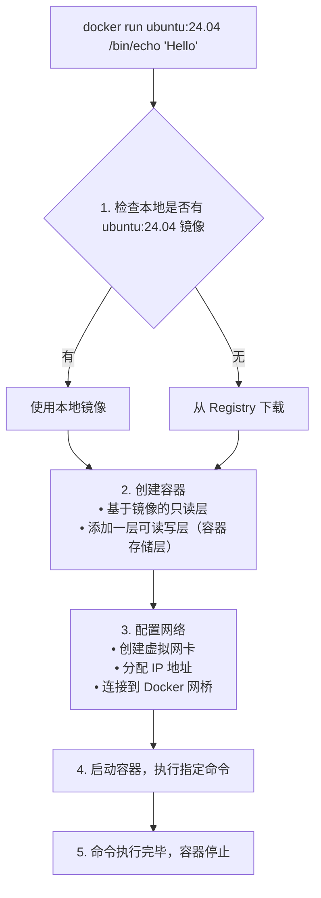
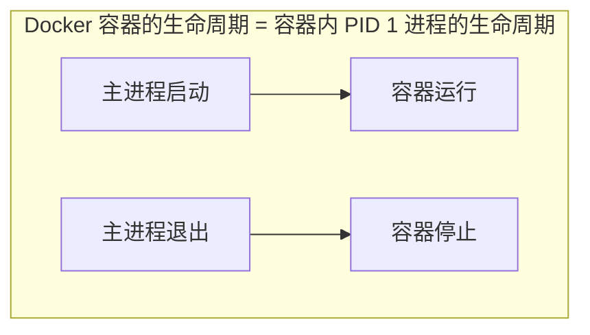
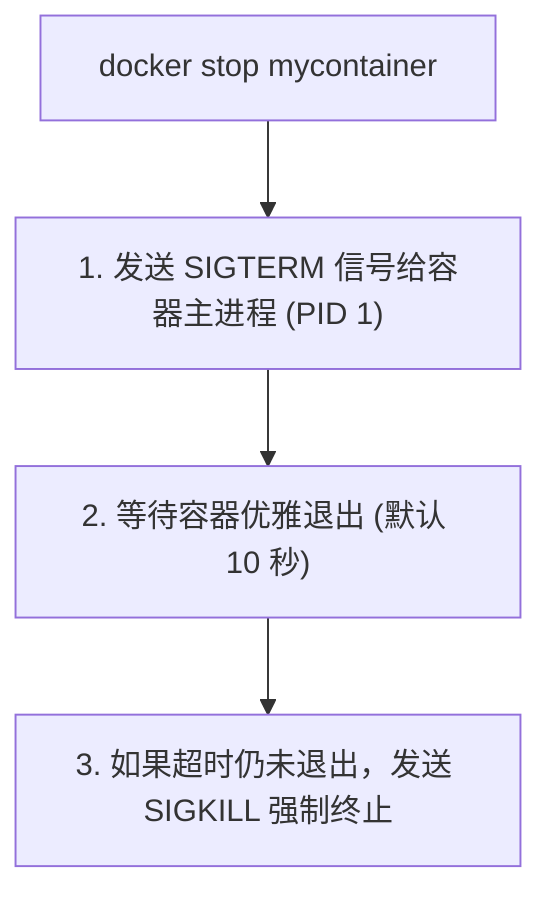
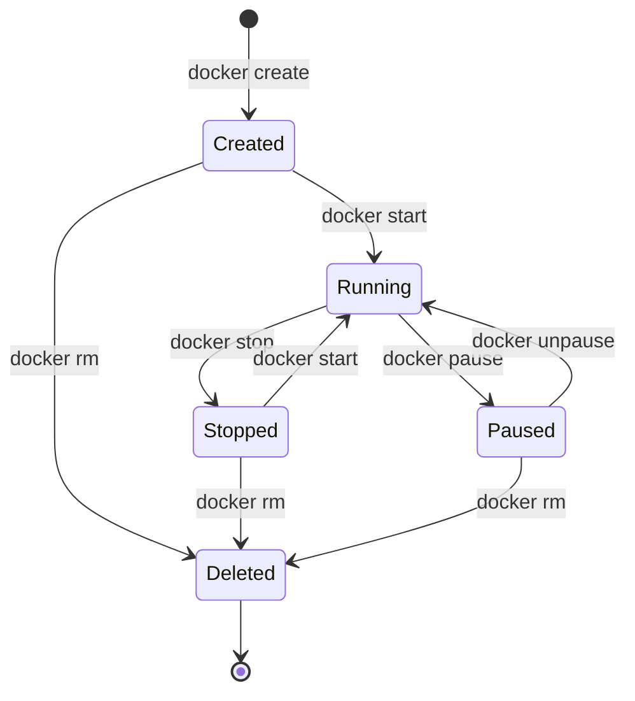
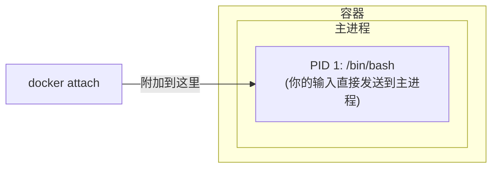
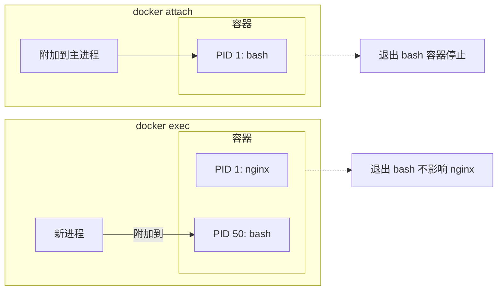

# 第五章 操作容器

容器是 Docker 又一核心概念。

简单的说，容器是独立运行的一个或一组应用，以及它们的运行态环境。对应的，虚拟机可以理解为模拟运行的一整套操作系统（提供了运行态环境和其他系统环境）和跑在上面的应用。

本章将具体介绍如何来管理一个容器，包括创建、启动和停止等。

## 版本号说明

本章示例涉及多个 Docker 镜像，遵循以下版本号最佳实践：

- **官方镜像**（如 `ubuntu`、`nginx`、`mysql`）：使用具体大版本号（如 `ubuntu:24.04`、`mysql:8.4`）而非 `latest`，确保示例的可重复性
- **镜像标签约定**：
  - `latest` 或 `v1.0.0` 等：带标签的自定义镜像，示例中指定具体版本
  - `24.04`、`8.4`：官方镜像的稳定版本分支
  - 生产环境建议：**运行/部署**服务镜像时指定确切版本号（如 `nginx:1.28.0`、`mysql:8.4.4`）而非仅大版本号，让每次部署可复现、升级是显式动作。
  （注意这与 第 7 章 对 **Dockerfile 基础镜像** 的建议方向相反：基础镜像用主/次版本号，以便重新构建时自动带上补丁。两者面向的是不同环节。）

* 启动容器
* 守护态运行
* 终止容器
* 进入容器
* 导出和导入容器
* 删除容器

## 1. 启动

本节将详细介绍 Docker 容器的启动方式，包括新建启动和重新启动已停止的容器。

### 1.1 启动方式概述

启动容器有两种方式：

- **新建并启动**：基于镜像创建新容器
- **重新启动**：将已终止的容器重新运行

由于 Docker 容器非常轻量，实际使用中常常是随时删除和新建容器，而不是反复重启同一个容器。

### 1.2 新建并启动

#### 基本语法

```bash
docker run [选项] 镜像 [命令] [参数...]
```

#### 最简单的例子

输出 “Hello World” 后容器自动终止：

```bash
$ docker run ubuntu:24.04 /bin/echo 'Hello world'
Hello world
```
这与直接执行 `/bin/echo 'Hello world'` 几乎没有区别，但实际上已经启动了一个完整的 Ubuntu 容器来执行这条命令。

> **版本说明**：示例使用 `ubuntu:24.04`，这是仍受 Docker 支持的 LTS 版本（当前最新 LTS 为 26.04）。如需其他版本，可替换为 `ubuntu:26.04`、`ubuntu:22.04` 等；不要用已不在支持列表中的 `ubuntu:20.04`（见 3.1 节）。

#### 交互式容器

启动一个可以交互的 bash 终端：

```bash
$ docker run -it ubuntu:24.04 /bin/bash
root@af8bae53bdd3:/#
```
**参数说明**：

| 参数 | 作用 |
|------|------|
| `-i` | 保持标准输入 (stdin) 打开，允许输入 |
| `-t` | 分配伪终端 (pseudo-TTY)，提供终端界面 |
| `-it` | 两者组合使用，获得交互式终端 |

在交互模式下可以执行命令：

```bash
root@af8bae53bdd3:/# pwd
/
root@af8bae53bdd3:/# ls
bin boot dev etc home lib lib64 media mnt opt proc root run sbin srv sys tmp usr var
root@af8bae53bdd3:/# exit  # 退出容器
```

### 1.3 docker run 的完整流程

执行 `docker run` 时，Docker 在后台完成以下操作：



### 1.4 常用启动选项

#### 基础选项

| 选项 | 说明 | 示例 |
|------|------|------|
| `-d` | 后台运行 (detach)| `docker run -d nginx:latest` |
| `-it` | 交互式终端 | `docker run -it ubuntu:24.04 bash` |
| `--name` | 指定容器名称 | `docker run --name myapp nginx:latest` |
| `--rm` | 退出后自动删除容器 | `docker run --rm ubuntu:24.04 echo hi` |

#### 端口映射

```bash
## 将容器的 80 端口映射到宿主机的 8080 端口

$ docker run -d -p 8080:80 nginx:latest

## 随机映射端口

$ docker run -d -P nginx:latest

## 只绑定到 localhost

$ docker run -d -p 127.0.0.1:8080:80 nginx:latest
```

#### 数据卷挂载

```bash
## 挂载命名卷

$ docker run -v mydata:/data nginx:latest

## 挂载宿主机目录

$ docker run -v /host/path:/container/path nginx:latest

## 只读挂载

$ docker run -v /host/path:/container/path:ro nginx:latest
```

#### 环境变量

```bash
## 设置单个环境变量

$ docker run -e MYSQL_ROOT_PASSWORD=secret mysql

## 从文件加载环境变量

$ docker run --env-file .env myapp
```

#### 资源限制

```bash
## 限制内存

$ docker run -m 512m nginx:latest

## 限制 CPU

$ docker run --cpus=1.5 nginx:latest
```

### 1.5 启动已终止容器

使用 `docker start` 重新启动已停止的容器：

```bash
## 查看所有容器（包括已停止的）

$ docker ps -a
CONTAINER ID  IMAGE   STATUS                     NAMES
af8bae53bdd3  ubuntu  Exited (0) 2 minutes ago   myubuntu

## 重新启动

$ docker start myubuntu

## 启动并附加终端

$ docker start -ai myubuntu
```

### 1.6 容器内进程的特点

容器内只运行指定的应用程序及其必需资源：

```bash
root@ba267838cc1b:/# ps
  PID TTY          TIME CMD
    1 ?        00:00:00 bash
   11 ?        00:00:00 ps
```
可见容器中仅运行了 `bash` 进程。这种特点使得 Docker 对资源的利用率极高。

> 💡 笔者提示：容器内的 PID 1 进程很重要——它是容器的主进程，该进程退出则容器停止。详见后台运行章节。

### 1.7 常见问题

#### Q：容器启动后立即退出

**原因**：主进程执行完毕或无法保持运行

```bash
## 这个容器会立即退出（echo 执行完就结束了）

$ docker run ubuntu:24.04 echo "hello"

## 解决：使用能持续运行的命令

$ docker run -d nginx:latest  # nginx 是持续运行的服务
```
详细解释见后台运行。

#### Q：无法连接容器内的服务

**原因**：未正确映射端口

```bash
## 错误：没有 -p 参数，外部无法访问

$ docker run -d nginx:latest

## 正确：映射端口

$ docker run -d -p 80:80 nginx:latest
```

#### Q：容器内修改的文件丢失

**原因**：未使用数据卷，数据保存在容器存储层

```bash
## 使用数据卷持久化

$ docker run -v mydata:/app/data myapp
```
详见数据管理。

## 2. 守护态运行

在生产环境中，我们通常需要容器持续运行，不受终端关闭的影响。本节将深入讲解如何让容器在后台运行，以及理解容器生命周期的核心概念。

### 2.1 核心概念：前台 vs 后台

当你在终端运行一个程序时，有两种模式：

- **前台运行**：程序占用当前终端，输出直接显示，关闭终端程序就停止
- **后台运行**：程序在后台执行，不占用终端，终端关闭也不影响程序

Docker 容器默认是 **前台运行** 的。使用 `-d` (detach) 参数可以让容器在后台运行。

### 2.2 基本使用

#### 前台运行：默认

```bash
$ docker run ubuntu:24.04 /bin/sh -c "while true; do echo hello world; sleep 1; done"
hello world
hello world
hello world
hello world
```
容器会把输出的结果 (STDOUT) 打印到宿主机上面。此时：

- 终端被占用，无法执行其他命令
- 按 `Ctrl+C` 会终止容器
- 关闭终端窗口，容器也会停止

#### 后台运行：使用 -d 参数

```bash
$ docker run -d ubuntu:24.04 /bin/sh -c "while true; do echo hello world; sleep 1; done"
77b2dc01fe0f3f1265df143181e7b9af5e05279a884f4776ee75350ea9d8017a
```
使用 `-d` 参数后：

- 容器在后台运行
- 返回容器的完整 ID
- 终端立即释放，可以继续执行其他命令
- 输出不会直接显示（需要用 `docker logs` 查看）

### 2.3 深入理解：容器为什么会 “立即退出”？

> **这是初学者最常遇到的困惑。** 理解这个问题，你就理解了 Docker 的核心设计理念。

很多人尝试这样启动容器：

```bash
$ docker run -d ubuntu:24.04
```
然后用 `docker ps` 查看，发现容器根本不在运行！这是为什么？

#### 核心原理：容器的生命周期与主进程绑定


当你运行 `docker run -d ubuntu:24.04` 时：

1. 容器启动
2. 没有指定命令，默认执行 `/bin/bash`
3. 但没有交互式终端（没有 `-it` 参数），bash 发现没有输入源
4. bash 立即退出
5. 主进程退出，容器停止

**关键理解**：

- ❌ `-d` 参数 **不是** 让容器 “一直运行”
- ✅ `-d` 参数是让容器 “在后台运行”，能运行多久取决于主进程

#### 常见的 “立即退出” 场景

| 场景 | 原因 | 解决方案 |
|------|------|---------|
| `docker run -d ubuntu` | 默认 bash 无输入立即退出 | 指定长期运行的命令 |
| `docker run -d nginx` 后改了配置 | 配置错误导致 nginx 启动失败 | 查看 `docker logs` |
| 自定义镜像容器启动即退 | Dockerfile 的 CMD 执行完毕 | 确保 CMD 是前台进程 |

### 2.4 查看后台容器

#### 查看运行中的容器

```bash
$ docker container ls
CONTAINER ID  IMAGE         COMMAND               CREATED        STATUS       PORTS NAMES
77b2dc01fe0f  ubuntu:24.04  /bin/sh -c 'while tr  2 minutes ago  Up 1 minute        agitated_wright
```

#### 查看容器输出日志

```bash
$ docker container logs 77b2dc01fe0f
hello world
hello world
hello world
...
```
**实时查看日志**（类似 `tail -f`）：

```bash
$ docker container logs -f 77b2dc01fe0f
```

#### 查看已停止的容器

```bash
$ docker container ls -a
```
加上 `-a` 参数可以看到所有容器，包括已停止的。这对于调试 “容器启动即退出” 的问题非常有用。

### 2.5 最佳实践

#### 1. 长期运行的服务使用 -d

```bash
## Web 服务器

$ docker run -d -p 80:80 nginx:latest

## 数据库

$ docker run -d -p 3306:3306 mysql:8.4

## 缓存服务

$ docker run -d -p 6379:6379 redis:latest
```

> **版本说明**：示例使用常见的标签如 `latest` 或稳定大版本号如 `mysql:8.4`。具体版本可根据需求调整，生产环境建议明确指定版本号（如 `mysql:8.4.4`）而非使用 `latest`。

#### 2. 调试时先用前台模式

当容器启动有问题时，**去掉 `-d` 参数** 可以直接看到输出和错误：

```bash
## 有问题的容器，先前台运行看看发生了什么

$ docker run myimage:v1.0.0
```

#### 3. 使用 --rm 自动清理

对于一次性任务，使用 `--rm` 参数让容器退出后自动删除：

```bash
$ docker run --rm ubuntu:24.04 echo "Hello, World!"
Hello, World!

## 容器执行完后自动删除

...
```

#### 4. 配合日志查看

```bash
## 后台启动

$ docker run -d --name myapp myimage:v1.0.0

## 查看最近 100 行日志

$ docker logs --tail 100 myapp

## 实时跟踪日志

$ docker logs -f myapp

## 查看带时间戳的日志

$ docker logs -t myapp
```

### 2.6 常见问题排查

#### Q：容器启动后立即退出

1. **查看退出状态码**：
   ```bash
   $ docker ps -a --filter "name=mycontainer"
   # 查看 STATUS 列，如 “Exited (1)” 表示异常退出

   ```

2. **查看容器日志**：
   ```bash
   $ docker logs mycontainer
   ```

3. **以交互模式调试**：
   ```bash
   # /bin/sh 覆盖镜像原本的启动命令，避免容器再次崩溃退出
   # 进入 shell 后可手动执行原启动命令，定位具体报错原因
   $ docker run -it myimage:v1.0.0 /bin/sh
   ```

#### Q：容器在后台运行但无法访问服务

1. **检查端口映射**：
   ```bash
   $ docker port mycontainer
   ```

2. **检查容器内服务状态**：
   ```bash
   $ docker exec mycontainer ps aux
   ```

#### Q：如何让已经在后台运行的容器回到前台？

使用 `docker attach`：

```bash
$ docker attach mycontainer
```
> **注意**：`attach` 会连接到容器的主进程。如果主进程不是交互式的，你可能只能看到输出。使用 `Ctrl+P` `Ctrl+Q` 可以安全退出而不停止容器。

### 2.7 延伸阅读

- 进入容器：如何进入正在运行的容器执行命令
- 容器日志：生产环境的日志管理最佳实践
- HEALTHCHECK 健康检查：自动检测容器内服务是否正常
- Docker Compose：管理多个后台容器的更好方式

## 3. 终止

本节将介绍如何终止一个运行中的容器，以及几种不同的终止方式及其区别。

### 3.1 终止方式概述

终止容器有三种方式：

| 方式 | 命令 | 说明 |
|------|------|------|
| **优雅停止** | `docker stop` | 先发 SIGTERM，超时后发 SIGKILL |
| **强制停止** | `docker kill` | 直接发 SIGKILL |
| **自动终止** | - | 容器主进程退出时自动停止 |

---

### 3.2 docker stop：推荐

#### docker stop 基本用法

```bash
$ docker stop 容器名或ID
```

#### 工作原理



#### 自定义超时时间

```bash
## 等待 30 秒后强制终止

$ docker stop -t 30 mycontainer

## 立即发送 SIGKILL（相当于 docker kill）

$ docker stop -t 0 mycontainer
```

#### 停止多个容器

```bash
## 停止多个指定容器

$ docker stop container1 container2 container3

## 停止所有运行中的容器

$ docker stop $(docker ps -q)
```
---

### 3.3 docker kill

#### 基本用法

```bash
$ docker kill 容器名或ID
```

#### 与 stop 的区别

| 命令 | 信号 | 使用场景 |
|------|------|---------|
| `docker stop` | SIGTERM → SIGKILL | 正常停止，让应用优雅退出 |
| `docker kill` | SIGKILL | 应用无响应，强制终止 |

#### 发送自定义信号

```bash
## 发送 SIGHUP（让进程重新加载配置）

$ docker kill -s HUP mycontainer

## 发送 SIGTERM

$ docker kill -s TERM mycontainer
```
---

### 3.4 容器自动终止

容器的生命周期与主进程绑定。主进程退出时，容器自动停止：

```bash
## 主进程是交互式 bash

$ docker run -it ubuntu bash
root@abc123:/# exit    # 退出 bash → 容器停止

## 主进程执行完毕

$ docker run ubuntu echo "Hello"    # echo 执行完 → 容器停止
```
---

### 3.5 查看已停止的容器

```bash
$ docker ps -a
CONTAINER ID   IMAGE    COMMAND       STATUS                      NAMES
ba267838cc1b   ubuntu   "/bin/bash"   Exited (0) 2 minutes ago    myubuntu
c5d3a5e8f7b2   nginx    "nginx"       Up 5 minutes                mynginx
```
**STATUS 字段说明**：

| 状态 | 说明 |
|------|------|
| `Up X minutes` | 运行中 |
| `Exited (0)` | 正常退出（退出码 0）|
| `Exited (1)` | 异常退出（非零退出码）|
| `Exited (137)` | 被 SIGKILL 终止 (128 + 9)|
| `Exited (143)` | 被 SIGTERM 终止 (128 + 15)|

---

### 3.6 重新启动容器

#### 启动已停止的容器

```bash
$ docker start 容器名或ID

## 启动并附加终端

$ docker start -ai 容器名
```

#### 重启运行中的容器

```bash
## 先停止再启动

$ docker restart 容器名

## 自定义停止超时

$ docker restart -t 30 容器名
```
---

### 3.7 生命周期状态图


---

### 3.8 批量操作

#### 停止所有容器

```bash
$ docker stop $(docker ps -q)
```

#### 删除所有已停止的容器

```bash
$ docker container prune
```

#### 停止并删除所有容器

```bash
$ docker stop $(docker ps -q) && docker container prune -f
```
---

### 3.9 常见问题

#### Q：容器停止很慢

原因：应用没有正确处理 SIGTERM 信号，需要等待超时后强制终止。

解决方案：

1. 在应用中正确处理 SIGTERM
2. 使用 `docker stop -t 0` 立即终止
3. 检查 Dockerfile 中的 `STOPSIGNAL` 配置

#### Q：如何让容器优雅退出

确保容器主进程正确处理信号：

```dockerfile
## Dockerfile 示例

FROM node:22-alpine
...

## 使用 exec 形式确保信号能传递给 node 进程

CMD ["node", "server.js"]
```

> **版本说明**：示例使用 `node:22-alpine`，这是一个精简的 Node.js 22 版本镜像。可根据需求替换为其他版本（如 `node:24-alpine`、`node:latest`）。

#### Q：容器无法停止

```bash
## 强制终止

$ docker kill 容器名

## 如果仍无法停止，检查系统资源

$ docker inspect 容器名
```
---

## 4. 进入容器

### 4.1 为什么需要进入容器

使用 `-d` 参数启动容器后，容器在后台运行。以下场景需要进入容器内部操作：

| 场景 | 示例 |
|------|------|
| **调试问题** | 查看日志、检查配置、排查错误 |
| **临时操作** | 执行数据库迁移、清理缓存 |
| **检查状态** | 查看进程、网络连接、文件系统 |
| **开发测试** | 交互式测试命令、验证环境 |

### 4.2 两种进入方式

Docker 提供两种进入容器的命令：

| 命令 | 推荐程度 | 特点 |
|------|---------|------|
| `docker exec` | ✅ **推荐** | 启动新进程，退出不影响容器 |
| `docker attach` | ⚠️ 谨慎使用 | 附加到主进程，退出可能停止容器 |

---

### 4.3 docker exec：推荐

#### docker exec 基本用法

```bash
## 进入容器并启动交互式 shell

$ docker exec -it 容器名 /bin/bash

## 或使用 sh（适用于 Alpine 等精简镜像）

$ docker exec -it 容器名 /bin/sh
```

#### 参数说明

| 参数 | 作用 |
|------|------|
| `-i` | 保持标准输入打开 (interactive)|
| `-t` | 分配伪终端 (TTY)|
| `-it` | 两者组合，获得完整交互体验 |
| `-u` | 指定用户（如 `-u root`）|
| `-w` | 指定工作目录 |
| `-e` | 设置环境变量 |

#### docker exec 示例

```bash
## 启动一个后台容器

$ docker run -dit --name myubuntu ubuntu
69d137adef7a...

## 进入容器（交互式 shell）

$ docker exec -it myubuntu bash
root@69d137adef7a:/# ls
bin  boot  dev  etc  home  lib  ...
root@69d137adef7a:/# exit

## 容器仍在运行！

$ docker ps
CONTAINER ID   IMAGE    STATUS         NAMES
69d137adef7a   ubuntu   Up 2 minutes   myubuntu
```

#### 执行单条命令

不进入交互模式，直接执行命令：

```bash
## 查看容器内进程

$ docker exec myubuntu ps aux

## 查看配置文件

$ docker exec myubuntu cat /etc/nginx/nginx.conf

## 以 root 用户执行

$ docker exec -u root myubuntu apt update
```

#### 只用 -i 不用 -t 的区别

```bash
## 只用 -i：可以执行命令，但没有提示符

$ docker exec -i myubuntu bash
ls           # 输入命令
bin          # 输出结果
boot
dev
...

## 用 -it：有完整的终端体验

$ docker exec -it myubuntu bash
root@69d137adef7a:/#    # 有提示符
```
> 💡 通常使用 `-it` 组合。只有在脚本中需要通过管道传入命令时才只用 `-i`。

---

### 4.4 docker attach：谨慎使用

#### docker attach 基本用法

```bash
$ docker attach 容器名
```

#### 工作原理

`attach` 会附加到容器的 **主进程** (PID 1) 的标准输入输出：



#### docker attach 示例

```bash
## 启动容器

$ docker run -dit --name myubuntu ubuntu
243c32535da7...

## 附加到容器

$ docker attach myubuntu
root@243c32535da7:/#
```

#### ⚠️ 重要警告

**从 attach 会话中输入 `exit` 或按 `Ctrl+D` 会导致容器停止！**

```bash
$ docker attach myubuntu
root@243c32535da7:/# exit    # 这会停止容器！

$ docker ps
CONTAINER ID   IMAGE    STATUS                     NAMES
243c32535da7   ubuntu   Exited (0) 2 seconds ago   myubuntu
```
**原因**：attach 附加到主进程，退出主进程就等于退出容器。

#### 安全退出 attach

使用 `Ctrl+P` 然后 `Ctrl+Q` 可以从 attach 会话中 **分离**，而不停止容器：

```bash
$ docker attach myubuntu
root@243c32535da7:/#

## 按 Ctrl+P 然后 Ctrl+Q

read escape sequence

$ docker ps    # 容器仍在运行
CONTAINER ID   IMAGE    STATUS         NAMES
243c32535da7   ubuntu   Up 5 minutes   myubuntu
```
---

### 4.5 exec vs attach 对比

| 特性 | docker exec | docker attach |
|------|-------------|---------------|
| **工作方式** | 在容器内启动新进程 | 附加到主进程 |
| **退出影响** | 不影响容器 | 可能停止容器 |
| **多终端** | 可以开多个 | 共享同一个会话 |
| **适用场景** | 调试、临时操作 | 查看主进程输出 |
| **推荐程度** | ✅ 推荐 | ⚠️ 特殊场景使用 |


---

### 4.6 最佳实践

#### 1. 首选 docker exec

```bash
## 进入容器调试

$ docker exec -it myapp bash

## 查看日志

$ docker exec myapp tail -f /var/log/app.log

## 执行数据库迁移

$ docker exec myapp python manage.py migrate
```

#### 2. 生产环境避免进入容器

笔者建议：生产环境应尽量避免进入容器直接操作，而是通过：

- 日志系统查看日志（如 `docker logs` 或集中式日志）
- 监控系统查看状态
- 重新部署而非手动修改

#### 3. 无 shell 镜像的处理

某些精简镜像（如基于 `scratch` 或 `distroless`）没有 shell：

```bash
## 这会失败

$ docker exec -it myapp bash
OCI runtime exec failed: exec failed: unable to start container process: exec: "bash": executable file not found

## 解决方案：使用调试容器（需要 Docker Desktop Pro/Team/Business 订阅）

$ docker debug myapp
```
> **注意**：`docker debug` 是 Docker Desktop 4.33+ 提供的功能，需要 Pro、Team 或 Business 订阅。它会附加一个包含常用调试工具（vim、curl、htop 等）的工具箱到目标容器，即使目标镜像基于 `scratch` 也能使用。
---

### 4.7 常见问题

#### Q：exec 进入后看不到其他终端的操作

这是正常的。exec 启动的是独立进程，多个 exec 会话互不影响。

#### Q：容器没有 bash

尝试使用 sh：

```bash
$ docker exec -it myapp /bin/sh
```

#### Q：需要 root 权限

```bash
$ docker exec -u root -it myapp bash
```
---

## 5. 导出和导入

当我们需要迁移容器或者备份容器时，可以使用 Docker 的导入和导出功能。本节将介绍这两个命令的使用方法。

### 5.1 导出容器

如果要导出本地某个容器，可以使用 `docker export` 命令。
```bash
$ docker container ls -a
CONTAINER ID        IMAGE               COMMAND             CREATED             STATUS                    PORTS               NAMES
7691a814370e        ubuntu:24.04        "/bin/bash"         36 hours ago        Exited (0) 21 hours ago                       test
$ docker export 7691a814370e > ubuntu.tar
```
这样将导出容器快照到本地文件。

> **版本说明**：导出的容器快照不包含镜像版本历史，导入时可以自定义标签和版本号。

### 5.2 导入容器快照

可以使用 `docker import` 从容器快照文件中再导入为镜像，例如

```bash
$ cat ubuntu.tar | docker import - test/ubuntu:v1.0
$ docker image ls
REPOSITORY          TAG                 IMAGE ID            CREATED              SIZE
test/ubuntu         v1.0                9d37a6082e97        About a minute ago   171.3 MB
```
此外，也可以通过指定 URL 或者某个目录来导入，例如

```bash
$ docker import http://example.com/exampleimage.tgz example/imagerepo
```
*注：用户既可以使用 `docker load` 来导入镜像存储文件到本地镜像库，也可以使用 `docker import` 来导入一个容器快照到本地镜像库。这两者的区别在于容器快照文件将丢弃所有的历史记录和元数据信息（即仅保存容器当时的快照状态），而镜像存储文件将保存完整记录，体积也要大。此外，从容器快照文件导入时可以重新指定标签等元数据信息。*

## 6. 删除

随着容器的创建和停止，系统中会积累大量的容器。本节将介绍如何删除不再需要的容器，以及如何清理所有停止的容器。

### 6.1 基本用法

使用 `docker rm` 删除已停止的容器：

```bash
$ docker rm 容器名或ID
```
> 💡 `docker rm` 是 `docker container rm` 的简写，两者等效。

---

### 6.2 删除选项

| 选项 | 说明 | 示例 |
|------|------|------|
| 无参数 | 删除已停止的容器 | `docker rm mycontainer` |
| `-f` | 强制删除运行中的容器 | `docker rm -f mycontainer` |
| `-v` | 同时删除关联的匿名卷 | `docker rm -v mycontainer` |

#### 删除已停止的容器

```bash
$ docker rm mycontainer
mycontainer
```

#### 强制删除运行中的容器

```bash
## 不加 -f 会报错

$ docker rm running_container
Error: cannot remove running container

## 加 -f 强制删除

$ docker rm -f running_container
running_container
```
> ⚠️ 强制删除会向容器发送 SIGKILL 信号，可能导致数据丢失。建议先 `docker stop` 优雅停止。

#### 删除容器及其数据卷

```bash
## 删除容器时同时删除其匿名卷

$ docker rm -v mycontainer
```
> 注意：只删除匿名卷，命名卷不会被删除。

---

### 6.3 批量删除

#### 删除所有已停止的容器

```bash
## 方式一：使用 prune 命令（推荐）

$ docker container prune

WARNING! This will remove all stopped containers.
Are you sure you want to continue? [y/N] y
Deleted Containers:
abc123...
def456...
Total reclaimed space: 150MB

## 方式二：不提示确认

$ docker container prune -f
```

#### 删除所有容器：包括运行中的

```bash
## 先停止所有容器，再删除

$ docker stop $(docker ps -q)
$ docker rm $(docker ps -aq)

## 或者直接强制删除

$ docker rm -f $(docker ps -aq)
```

#### 按条件删除

```bash
## 删除所有已退出的容器

$ docker rm $(docker ps -aq -f status=exited)

## 删除名称包含 "test" 的容器

$ docker rm $(docker ps -aq -f name=test)

## 删除 24 小时前创建的容器

$ docker container prune --filter "until=24h"
```
---

### 6.4 常用过滤条件

`docker ps` 的过滤条件可以配合 `rm` 使用：

| 过滤条件 | 说明 | 示例 |
|---------|------|------|
| `status=exited` | 已退出的容器 | `-f status=exited` |
| `status=created` | 已创建未启动 | `-f status=created` |
| `name=xxx` | 名称匹配 | `-f name=myapp` |
| `ancestor=xxx` | 基于某镜像创建 | `-f ancestor=nginx` |
| `before=xxx` | 在某容器之前创建 | `-f before=mycontainer` |
| `since=xxx` | 在某容器之后创建 | `-f since=mycontainer` |

#### 示例

```bash
## 删除所有基于 nginx 镜像的容器

$ docker rm $(docker ps -aq -f ancestor=nginx)

## 删除所有创建后未启动的容器

$ docker rm $(docker ps -aq -f status=created)
```
---

### 6.5 容器与镜像的依赖关系

> 有容器依赖的镜像无法删除。

```bash
## 尝试删除有容器依赖的镜像

$ docker image rm nginx
Error: image is being used by stopped container abc123

## 需要先删除依赖该镜像的容器

$ docker rm abc123
$ docker image rm nginx
```
---

### 6.6 清理策略建议

#### 开发环境

```bash
## 定期清理已停止的容器

$ docker container prune -f

## 一键清理所有未使用资源

$ docker system prune -f
```

#### 生产环境

```bash
## 使用 --rm 参数运行临时容器

$ docker run --rm ubuntu echo "Hello"

## 容器退出后自动删除

## 定期清理（设置保留时间）

$ docker container prune --filter "until=168h"  # 保留 7 天内的
```

#### 完整清理脚本

```bash
#!/bin/bash

## cleanup.sh - Docker 资源清理脚本

echo "清理已停止的容器..."
docker container prune -f

echo "清理未使用的镜像..."
docker image prune -f

echo "清理未使用的数据卷..."
docker volume prune -f

echo "清理未使用的网络..."
docker network prune -f

echo "清理完成！"
docker system df
```
---

### 6.7 常见问题

#### Q：容器无法删除

```bash
Error: container is running
```
解决：先停止容器，或使用 `-f` 强制删除

```bash
$ docker stop mycontainer
$ docker rm mycontainer

## 或

$ docker rm -f mycontainer
```

#### Q：删除后磁盘空间没释放

可能原因：

1. 容器的数据卷未删除（使用 `-v` 参数）
2. 镜像未删除
3. 构建缓存未清理

解决：

```bash
## 查看空间占用

$ docker system df

## 完整清理

$ docker system prune -a --volumes
```
---
