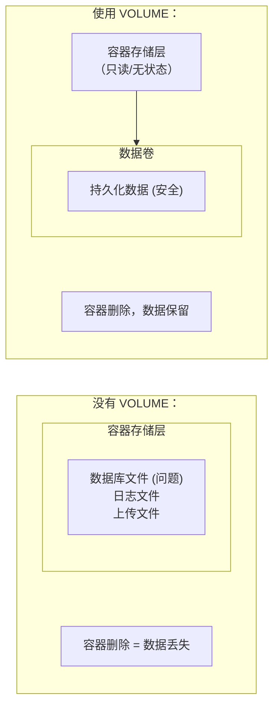
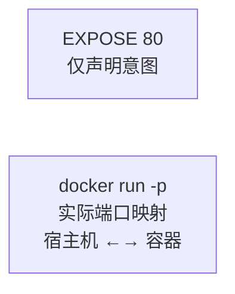
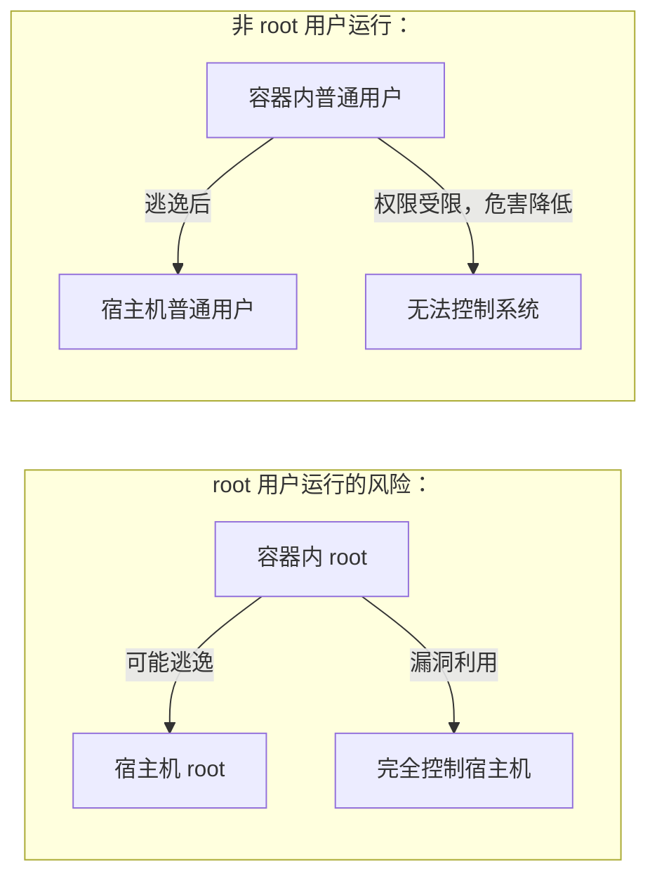

# 第七章 Dockerfile 指令详解

## 什么是 Dockerfile

Dockerfile 是一个文本文件，其内包含了一条条的 **指令 (Instruction)**，每一条指令构建一层，因此每一条指令的内容，就是描述该层应当如何构建。

在[第四章](../04_image/README.md)中，我们通过 `docker commit` 学习了镜像的构成。但是，手动 `commit` 只能作为临时修补，并不适合作为生产环境镜像的构建方式。

使用 Dockerfile 构建镜像有以下优势：

*   **自动化**：可以通过 `docker build` 命令自动构建镜像。
*   **可重复性**：由于 Dockerfile 是文本文件，可以确保每次构建的结果一致。
*   **版本控制**：Dockerfile 可以纳入版本控制系统（如 Git），便于追踪变更。
*   **透明性**：任何人都可以通过阅读 Dockerfile 了解镜像的构建过程。

## Dockerfile 编写哲学

在深入每个指令的细节之前，笔者想强调一个至关重要的原则：**Dockerfile 不是脚本，而是镜像的“设计图”**。这个区别决定了你如何思考每条指令的作用。

相比编写 Bash 脚本的思维（“按顺序执行这些命令”），Dockerfile 的思维应该是（“这一层镜像应该如何构建，下一层如何分层”）。这个思维转变会影响你的决策：

- **合并命令**：一个 `RUN apt-get update && apt-get install ...` 应该写在一起，而不是分开成多个 `RUN` 指令，因为它们是同一个“层”的逻辑
- **选择合适的指令**：`COPY` vs `ADD`、`CMD` vs `ENTRYPOINT` 这些选择不是随意的，而是根据镜像分层的语义来决定的
- **优化镜像大小**：最后才清理缓存、删除临时文件，让这些“瘦身”操作在同一层完成

这个章节将详细介绍各个指令。在学习指令语法时，请始终思考：“这个指令为什么要以这样的方式工作？如果我是 Docker，我应该如何设计它？”

## Dockerfile 基本结构

Dockerfile 一般分为四部分：基础镜像信息、维护者信息、镜像操作指令和容器启动时执行指令。

可运行 `docker buildx build --check` 校验的[完整 Dockerfile 示例](../examples/validated/dockerfile/Dockerfile)与配套 `index.html` 保存在仓库中。它使用 `scratch`，因此结构检查不会解析远程基础镜像元数据。下面的围栏与该文件由测试强制保持一致。

<!-- canonical-example: dockerfile -->
```dockerfile
FROM scratch

COPY index.html /index.html
```

### 指令详解

本章将详细讲解 Dockerfile 中的各个指令：

*   [RUN 执行命令](7.1_run.md)
*   [COPY 复制文件](7.2_copy.md)
*   [ADD 更高级的复制文件](7.3_add.md)
*   [CMD 容器启动命令](7.4_cmd.md)
*   [ENTRYPOINT 入口点](7.5_entrypoint.md)
*   [ENV 设置环境变量](7.6_env.md)
*   [ARG 构建参数](7.7_arg.md)
*   [VOLUME 定义匿名卷](7.8_volume.md)
*   [EXPOSE 暴露端口](7.9_expose.md)
*   [WORKDIR 指定工作目录](7.10_workdir.md)
*   [USER 指定当前用户](7.11_user.md)
*   [HEALTHCHECK 健康检查](7.12_healthcheck.md)
*   [ONBUILD 为他人作嫁衣裳](7.13_onbuild.md)
*   [LABEL 为镜像添加元数据](7.14_label.md)
*   [SHELL 指令](7.15_shell.md)

### 高级特性

本章还将介绍 Dockerfile 的高级特性：

*   [多阶段构建](7.17_multistage_builds.md)
*   [多阶段构建实战：Laravel 应用](7.18_multistage_builds_laravel.md)

### 参考与最佳实践

此外，我们还将介绍 Dockerfile 的最佳实践和常见问题。

*   [参考文档](7.16_references.md)

## 使用 Dockerfile 构建镜像

构建镜像的基本命令格式为：

```bash
docker build [选项] <上下文路径/URL/->
```
例如，在 Dockerfile 所在目录执行：

```bash
docker build -t my-image:1.0 .
```

### 关于版本号最佳实践

本章中的 Dockerfile 示例使用的基础镜像标签遵循以下原则：

- **通用标签**（如 `ubuntu:24.04`、`alpine`、`nginx`）：保持原样，无需修改
- **基础镜像版本号**（如 `node:22`、`python:3.12`）：使用主或次版本号而非完整版本号（patch），这样可以自动获取最新的补丁版本，确保获得安全更新。
  （这条只针对 **Dockerfile 的基础镜像**；部署一个服务镜像时反而应钉死确切版本，见 [第 5 章](../05_container/README.md)。）
- **避免**：不建议使用 `latest` 标签和完整的 patch 版本号（如 `20.10.0`）作为基础镜像，因为这会导致构建的不可重现性或安全风险

读者在使用这些示例时，应根据实际生产环境需求选择合适的版本号。

更多关于 `docker build` 的用法，我们在实战中会结合具体指令进行演示。

## 1. RUN 执行命令

### 何时使用 RUN

`RUN` 是 Dockerfile 中最常用的指令，主要用于在镜像构建阶段执行命令来修改镜像。具体来说：

- **安装依赖**：`RUN apt-get install nginx`
- **编译程序**：`RUN gcc -o app main.c`
- **下载文件**：`RUN curl -O https://example.com/file.tar.gz`
- **配置系统**：`RUN mkdir -p /app/data`

理解 RUN 的核心是理解**镜像分层**：每一个 RUN 都会在当前层之上创建新的一层，这会影响镜像大小。因此，合理使用 RUN（特别是合并多个 RUN）是构建轻量级镜像的关键。

### 1.1 基本语法

```docker
RUN <command>
RUN ["executable", "param1", "param2"]
```
`RUN` 指令是 Dockerfile 中最常用的指令之一。它在 **当前镜像层** 之上创建一个新层，执行指定的命令，并提交结果。

---

### 1.2 两种格式对比

#### 1. Shell 格式

```docker
RUN apt-get update
```

- **特点**：默认通过 `/bin/sh -c` 执行。
- **优势**：可以使用环境变量、管道、重定向等 Shell 特性。
- **示例**：
  ```docker
  RUN echo "Hello" > /test.txt
  ```

#### 2. Exec 格式

```docker
RUN ["apt-get", "update"]
```

- **特点**：直接调用可执行文件，不经过 Shell。
- **优势**：避免 Shell 字符串解析问题，适用于参数中包含特殊字符的情况。
- **注意**：无法使用 `$VAR` 环境变量替换（除非显式调用 shell）。

---

### 1.3 常见最佳实践

#### 1. 组合命令：减少层数

每一个 `RUN` 指令都会新建一层镜像。为了减少镜像体积和层数，应使用 `&&` 连接命令。

**❌ 糟糕的写法**（创建 3 层）：

```docker
RUN apt-get update
RUN apt-get install -y nginx
RUN rm -rf /var/lib/apt/lists/*
```
**✅ 推荐写法**（创建 1 层）：

```docker
RUN apt-get update && \
    apt-get install -y nginx && \
    rm -rf /var/lib/apt/lists/*
```

#### 2. 清理缓存

在安装完软件后，立即清除缓存，可以显著减小镜像体积。

- **Debian/Ubuntu**:
  ```docker
  RUN apt-get update && apt-get install -y package-bar \
      && rm -rf /var/lib/apt/lists/*
  ```

- **Alpine**:
  ```docker
  RUN apk add --no-cache package-bar
  ```

#### 3. 使用 `set -e` 和 `pipefail`

默认情况下，管道命令 `cmd1 | cmd2` 的返回值由最后一个命令 (`cmd2`) 决定，即使前面的命令失败了，整个 `RUN` 仍可能视为成功。

**❌ 隐蔽的错误**：

```docker
## 如果下载失败，gzip 可能会报错，但如果不影响后续，构建可能继续

RUN wget http://error-url | gzip -d > file
```
**✅ 推荐写法**：

```docker
SHELL ["/bin/bash", "-o", "pipefail", "-c"]
RUN wget http://url | gzip -d > file
```
---

### 1.4 常见问题

#### Q：为什么 `RUN cd /app` 不生效？

```docker
RUN cd /app
RUN touch hello.txt
```
**结果**：`hello.txt` 会出现在根目录 `/`，而不是 `/app`。**原因**：每个 `RUN` 都在一个新的 Shell/容器环境中执行。`cd` 只影响当前 `RUN` 的环境。**解决**：使用 `WORKDIR` 指令。

```docker
WORKDIR /app
RUN touch hello.txt
```

#### Q：环境变量不生效？

```docker
RUN export MY_VAR=hello
RUN echo $MY_VAR
```
**结果**：输出为空。**原因**：同上，环境变量只在当前 `RUN` 有效。**解决**：使用 `ENV` 指令，或在同一行 `RUN` 中导出。

```docker
ENV MY_VAR=hello
RUN echo $MY_VAR
```
---

### 1.5 高级技巧

#### 1. 使用 BuildKit 的挂载缓存

BuildKit 支持在 `RUN` 指令中使用 `--mount` 挂载缓存，加速构建。

```docker
## 缓存 apt 包

RUN --mount=type=cache,target=/var/cache/apt,sharing=locked \
    --mount=type=cache,target=/var/lib/apt,sharing=locked \
    apt-get update && apt-get install -y gcc
```
```docker
## 缓存 Go 模块

RUN --mount=type=cache,target=/go/pkg/mod \
    go build -o app
```

#### 2. 挂载密钥

安全地使用 SSH 密钥或 Token，而不将其记录在镜像中。

```docker
RUN --mount=type=secret,id=mysecret \
    my-private-tool --token-file /run/secrets/mysecret
```

不要在构建命令中 `cat`、`echo` 或打印密钥内容；应把 `/run/secrets/<id>` 路径交给真正消费密钥的工具。

#### 3. Heredoc 语法

BuildKit 支持使用 heredoc 语法编写多行脚本，无需行末反斜杠 `\` 连接：

```docker
RUN <<EOF
apt-get update
apt-get install -y \
  build-essential \
  curl \
  git
rm -rf /var/lib/apt/lists/*
EOF
```

优势：

- 可读性更强，不需要在每行末尾添加 `\`
- 避免在脚本中转义引号
- 支持多个 heredoc 块，可指定不同的 Shell

```docker
RUN <<EOF
echo "使用默认 /bin/sh"
EOF

RUN <<'EOF'
#!/bin/bash
set -euo pipefail
echo "使用 bash"
wget http://example.com/file.tar.gz
EOF
```

> 使用 heredoc 需要在 Dockerfile 首行声明 BuildKit 语法版本：`# syntax=docker/dockerfile:1`

---

## 2. COPY 复制文件

### 何时使用 COPY

`COPY` 是在构建镜像时，将构建上下文（Dockerfile 所在目录及其子目录）中的文件或目录复制到容器内的指令。它是处理应用代码、配置文件最常用的方式。

典型场景：

- 复制应用源码：`COPY . /app`
- 复制配置文件：`COPY nginx.conf /etc/nginx/nginx.conf`
- 复制静态资源：`COPY public /app/public`

**为什么 COPY 比 ADD 更值得推荐？** 笔者建议在 90% 的情况下使用 COPY。原因是 COPY 的语义更清晰——它就是简单地复制文件。而 ADD 有额外的功能（自动解压、支持 URL），这些功能往往会带来意外的行为。除非你明确需要 ADD 的自动解压功能，否则用 COPY。详见 [7.3 ADD 指令](7.3_add.md) 中的详细对比。

### 2.1 基本语法

```docker
COPY [选项] <源路径>... <目标路径>
COPY [选项] ["<源路径1>", "<源路径2>", ... "<目标路径>"]
```
`COPY` 指令将构建上下文中的文件或目录复制到镜像内。

---

### 2.2 基本用法

#### 复制单个文件

```docker
## 复制文件到指定目录

COPY package.json /app/

## 复制文件并重命名

COPY config.json /app/settings.json
```

#### 复制多个文件

```docker
## 复制多个指定文件

COPY package.json package-lock.json /app/

## 使用通配符

COPY *.json /app/
COPY src/*.js /app/src/
```

#### 复制目录

```docker
## 复制整个目录的内容（不是目录本身）

COPY src/ /app/src/
```
> ⚠️ **注意**：复制目录时，复制的是目录的 **内容**，不包含目录本身。

```bash
构建上下文：              镜像内：
src/                     /app/src/
├── index.js      →      ├── index.js
└── utils.js             └── utils.js
```
---

### 2.3 通配符规则

COPY 支持 Go 的 `filepath.Match` 通配符规则：

| 通配符 | 说明 | 示例 |
|--------|------|------|
| `*` | 匹配任意字符序列 | `*.json` |
| `?` | 匹配单个字符 | `config?.json` |
| `[abc]` | 匹配括号内任一字符 | `[abc].txt` |
| `[a-z]` | 匹配范围内字符 | `file[0-9].txt` |

```docker
COPY hom* /mydir/       # home.txt, homework.md 等
COPY hom?.txt /mydir/   # home.txt, homy.txt 等
COPY app[0-9].js /app/  # app0.js ~ app9.js
```
---

### 2.4 目标路径

#### 绝对路径

```docker
COPY app.js /usr/src/app/
```

#### 相对路径：基于 WORKDIR

```docker
WORKDIR /app
COPY package.json ./        # 复制到 /app/package.json
COPY src/ ./src/            # 复制到 /app/src/
```

#### 自动创建目录

如果目标目录不存在，Docker 会自动创建：

```docker
## /app/config/ 不存在也会自动创建

COPY settings.json /app/config/
```
---

### 2.5 修改文件所有者

使用 `--chown` 选项设置文件的用户和组：

```docker
## 使用用户名和组名

COPY --chown=node:node package.json /app/

## 使用 UID 和 GID

COPY --chown=1000:1000 . /app/

## 只指定用户

COPY --chown=node . /app/
```
> 💡 结合 `USER` 指令使用，确保应用以非 root 用户运行。

---

### 2.6 保留文件元数据

COPY 会保留源文件的元数据：

- 读、写、执行权限
- 修改时间

这对于脚本文件特别重要：

```docker
## start.sh 的可执行权限会被保留

COPY start.sh /app/
```
---

### 2.7 COPY vs ADD

| 特性 | COPY | ADD |
|------|------|-----|
| 复制本地文件 | ✅ | ✅ |
| 自动解压 tar | ❌ | ✅ |
| 支持 URL | ❌ | ✅（不推荐）|
| 推荐程度 | ✅ **推荐** | ⚠️ 特殊场景使用 |

```docker
## 推荐：使用 COPY

COPY app.tar.gz /app/
RUN tar -xzf /app/app.tar.gz

## ADD 会自动解压（行为不明显，不推荐）

ADD app.tar.gz /app/
```
> 笔者建议：除非需要自动解压 tar 文件，否则始终使用 COPY。明确的行为比隐式的魔法更好。

---

### 2.8 多阶段构建中的 COPY

#### 从其他构建阶段复制

```docker
## 构建阶段

FROM node:22 AS builder
WORKDIR /app
COPY package*.json ./
RUN npm install
COPY . .
RUN npm run build

## 生产阶段

FROM nginx:alpine
COPY --from=builder /app/dist /usr/share/nginx/html
```

#### 使用 --link 优化缓存

```docker
## 使用 --link 后，文件以独立层添加，不依赖前序指令

COPY --link --from=builder /app/dist /usr/share/nginx/html
```
`--link` 的优势：

- 更高效利用构建缓存
- 并行化构建过程
- 加速多阶段构建

> ⚠️ **注意**：使用 `--link` 需要满足以下条件：
> - 启用 BuildKit（Docker Engine 23.0+ 默认启用）
> - Dockerfile 语法版本 1.4 或更高（在首行声明 `# syntax=docker/dockerfile:1`）
> - 目标路径在前序指令中应不存在或为空目录

---

### 2.9 dockerignore

使用 `.dockerignore` 排除不需要复制的文件：

```text
## .dockerignore

node_modules
.git
.env
*.log
Dockerfile
.dockerignore
```
这可以：

- 减小构建上下文大小
- 加速构建
- 避免复制敏感文件

---

### 2.10 最佳实践

#### 1. 利用缓存，先复制依赖文件

```docker
## ✅ 好：先复制依赖定义，再安装，最后复制代码

COPY package.json package-lock.json ./
RUN npm install
COPY . .

## ❌ 差：一次性复制所有文件，代码变更会导致重新 npm install

COPY . .
RUN npm install
```

#### 2. 使用 .dockerignore

```docker
## 确保 node_modules 不被复制

COPY . .

## .dockerignore 中应包含 node_modules

...
```

#### 3. 明确复制路径

```docker
## ✅ 好：明确的路径

COPY src/ /app/src/
COPY package.json /app/

## ❌ 差：过于宽泛

COPY . .
```
---

> **🔥 踩坑实录**
>
> 某公司在优化 Node.js 应用的 Docker 镜像时，发现构建出来的镜像体积超过了 2GB，远远超过生产部署的需求。排查发现，Dockerfile 中使用了 `COPY . .` 把整个构建上下文复制进镜像，导致 `node_modules/`、`.git/` 目录和大量测试数据全部被打包进镜像。最初他们没有创建 `.dockerignore` 文件，默认会复制所有文件。解决方案是添加一个 `.dockerignore` 文件，排除这些不必要的目录，使镜像缩小到了 200MB。这个教训深刻地说明了：`.dockerignore` 和 `.gitignore` 一样重要，应该在项目初始化时就创建，而不是等到出现问题时才想起来。建议的标准做法是先复制 `package.json` 和 `package-lock.json` 安装依赖，再复制应用代码，同时在 `.dockerignore` 中明确列出 `node_modules`、`.git`、test 目录等。

## 3. ADD 更高级的复制文件

### 何时使用 ADD？何时用 COPY？

在开始前，让我们直言不讳：**在大多数情况下，你应该使用 COPY，而不是 ADD**。

`ADD` 在 `COPY` 基础上增加了两个额外功能。它不是 `COPY` 的通用替代品，但在少数场景中更合适：

1. 自动解压 tar 压缩包（有时你想复制一个 .tar.gz 本身，而 ADD 会意外地解压它）
2. 支持从 URL 下载公开远程文件，并可配合 `--checksum` 做校验

**实践中的建议**：本地普通文件默认用 COPY；本地 tar 自动解压或公开远程 artifact 下载并校验时用 ADD；需要认证、请求头、重试或自定义解压流程时用 `RUN curl/wget`。

### 3.1 基本语法

```docker
ADD [选项] <源路径>... <目标路径>
ADD [选项] ["<源路径>", ... "<目标路径>"]
```
`ADD` 在 `COPY` 基础上增加了两个功能：

1. 自动解压 tar 压缩包
2. 支持从 URL 下载文件

---

### 3.2 ADD vs COPY 详细对比

| 特性 | COPY | ADD |
|------|------|-----|
| 复制本地文件 | ✅ | ✅ |
| 自动解压 tar | ❌ | ✅ |
| 支持 URL | ❌ | ✅（公开 artifact 可配合校验使用）|
| 行为可预测性 | ✅ 高 | ⚠️ 低 |
| 推荐程度 | ✅ **普通复制优先使用** | 解压、本地 Git/公开远程 artifact |

> **笔者建议**：普通复制始终优先 COPY；只有当你明确需要 ADD 的额外语义时再使用 ADD，并把意图写清楚。

---

### 3.3 自动解压功能

#### 基本用法：自动解压本地 tar

```docker
## 自动解压 tar.gz 到目标目录

ADD app.tar.gz /app/
```
ADD 会识别并解压以下格式：

- `.tar`
- `.tar.gz` / `.tgz`
- `.tar.bz2` / `.tbz2`
- `.tar.xz` / `.txz`

#### 实际应用

官方基础镜像通常使用 ADD 解压根文件系统：

```docker
FROM scratch
ADD ubuntu-noble-core-cloudimg-amd64-root.tar.gz /
```

#### 解压过程

```bash
ADD app.tar.gz /app/
        │
        ├─ 识别 .tar.gz 格式
        ├─ 自动解压
        └─ 内容放入 /app/

app.tar.gz 包含：        /app/ 目录结果：
├── src/                 ├── src/
│   └── main.py          │   └── main.py
└── config.json          └── config.json
```
---

### 3.4 URL 下载功能：谨慎使用

#### 基本用法

```docker
## 从 URL 下载文件

ADD https://example.com/app.zip /app/app.zip
```

#### 使用边界

| 场景 | 建议 |
|------|------|
| 公开、版本固定的远程 artifact | 使用 `ADD --checksum=sha256:... URL dest` |
| 需要认证、请求头或复杂重试 | 使用 `RUN curl/wget` |
| 下载后需要复杂解压、校验或清理 | 使用 `RUN curl/wget`，把流程显式写出 |
| URL 内容可变但无校验 | 不建议直接写入 Dockerfile |

#### 推荐写法

```docker
## ✅ 公开 artifact：使用 ADD 并固定校验值

ADD --checksum=sha256:<digest> https://example.com/app.tar.gz /tmp/app.tar.gz
RUN tar -xzf /tmp/app.tar.gz -C /app && rm /tmp/app.tar.gz

## ✅ 需要认证、请求头或特殊处理：使用 RUN + curl

RUN curl -fsSL https://example.com/app.tar.gz | tar -xz -C /app
```
`ADD --checksum` 的优势是缓存更精确，并且校验值直接绑定到 Dockerfile。`RUN curl/wget` 的优势是控制力更强，适合企业内网、认证下载或复杂处理。


---

### 3.5 修改文件所有者

```docker
ADD --chown=node:node app.tar.gz /app/
ADD --chown=1000:1000 files/ /app/
```
---

### 3.6 何时使用 ADD

#### ✅ 适合使用 ADD

```docker
## 解压本地 tar 文件

FROM scratch
ADD rootfs.tar.gz /

## 解压应用包

ADD dist.tar.gz /app/

## 下载公开 artifact 并校验

ADD --checksum=sha256:<digest> https://example.com/app.tar.gz /tmp/app.tar.gz
```

#### ❌ 不适合使用 ADD

```docker
## 复制普通文件（用 COPY）

ADD package.json /app/          # ❌
COPY package.json /app/         # ✅

## 需要认证或复杂下载逻辑（用 RUN + curl/wget）

ADD https://example.com/file /  # ❌ 无法传认证信息，也没有显式处理
RUN curl -fsSL ... -o /file     # ✅

## 需要保留 tar 不解压（用 COPY）

ADD archive.tar.gz /archives/   # ❌ 会解压
COPY archive.tar.gz /archives/  # ✅ 保持原样
```
---

### 3.7 缓存行为

ADD 可能导致构建缓存失效：

```docker
## 如果 app.tar.gz 内容变化，此层及后续层都需重建

ADD app.tar.gz /app/
RUN npm install
```
**优化建议**：

```docker
## 先复制依赖文件

COPY package*.json /app/
RUN npm install

## 再添加应用代码

ADD app.tar.gz /app/
```
---

### 3.8 最佳实践

#### 1. 默认使用 COPY

```docker
## ✅ 大多数场景使用 COPY

COPY . /app/
```

#### 2. 仅在需要解压时使用 ADD

```docker
## ✅ 自动解压场景

ADD app.tar.gz /app/
```

#### 3. 远程 artifact 使用 ADD 时必须固定校验值

```docker
## ✅ 公开 artifact

ADD --checksum=sha256:<digest> https://example.com/file.tar.gz /tmp/file.tar.gz

## ✅ 认证下载或复杂处理

RUN curl -fsSL https://example.com/file.tar.gz | tar -xz -C /app
```

#### 4. 解压后清理

```docker
## 如果需要控制解压过程

COPY app.tar.gz /tmp/
RUN tar -xzf /tmp/app.tar.gz -C /app && \
    rm /tmp/app.tar.gz
```
---

## 4. CMD 容器启动命令

### 何时使用 CMD，何时使用 ENTRYPOINT？

在深入 CMD 的细节之前，我们需要理解一个关键问题：**CMD 和 ENTRYPOINT 应该在什么时候使用？**

这是 Dockerfile 使用中最常见的困惑之一。简单的答案是：

- **CMD**：定义容器的“默认命令”。如果用户在 `docker run` 时提供命令，CMD 会被覆盖
- **ENTRYPOINT**：定义容器的“入口脚本”。通常用于启动应用的某个特定部分

**决策树**：

1. **你的容器是否有不可变的启动逻辑？** 比如需要先做一些初始化工作，然后才运行应用 → 使用 ENTRYPOINT
2. **用户经常会在 `docker run` 时传入不同的命令吗？** → 使用 CMD（让用户灵活覆盖）
3. **大多数情况下，你希望容器始终以相同的方式启动？** → 使用 ENTRYPOINT

更多细节见 [7.5 ENTRYPOINT 指令](7.5_entrypoint.md)。

### 4.1 什么是 CMD

`CMD` 指令用于指定容器启动时默认执行的命令。它定义了容器的 “主进程”。

> **核心概念**：容器的生命周期 = 主进程的生命周期。CMD 指定的命令就是这个主进程。

---

### 4.2 语法格式

CMD 有三种格式：

| 格式 | 语法 | 推荐程度 |
|------|------|---------|
| **exec 格式**| `CMD ["可执行文件", "参数1", "参数2"]` | ✅**推荐** |
| **shell 格式** | `CMD 命令 参数1 参数2` | ⚠️ 简单场景 |
| **参数格式** | `CMD ["参数1", "参数2"]` | 配合 ENTRYPOINT |

#### exec 格式：推荐

```docker
CMD ["nginx", "-g", "daemon off;"]
CMD ["python", "app.py"]
CMD ["node", "server.js"]
```
**优点**：

- 直接执行指定程序，是容器的 PID 1
- 正确接收信号（如 SIGTERM）
- 无需 shell 解析

#### shell 格式

```docker
CMD echo "Hello World"
CMD nginx -g "daemon off;"
```
**实际执行**：会被包装为 `sh -c`

```docker
## 你写的

CMD echo $HOME

## 实际执行的

CMD ["sh", "-c", "echo $HOME"]
```
**优点**：可以使用 `$HOME` 这类 shell 变量展开、管道等 shell 特性

**缺点**：主进程是 sh，信号无法正确传递给应用

---

### 4.3 exec 格式 vs shell 格式

| 特性 | exec 格式 | shell 格式 |
|------|----------|-----------|
| 主进程 | 指定的程序 | `/bin/sh` |
| 信号传递 | ✅ 正确 | ❌ 无法传递 |
| `$VAR` shell 展开 | ❌ 不自动展开；环境变量仍会传入进程 | ✅ 自动展开 |
| 推荐使用 | ✅ 大多数场景 | 需要 shell 特性时 |

#### 信号传递问题示例

```docker
## ❌ shell 格式：docker stop 会超时

CMD node server.js

## 实际是 sh -c "node server.js"

## SIGTERM 发给 sh，不会传递给 node

## ✅ exec 格式：docker stop 正常工作

CMD ["node", "server.js"]

## SIGTERM 直接发给 node

...
```
---

### 4.4 运行时覆盖 CMD

`docker run` 后的命令会覆盖 Dockerfile 中的 CMD：

```bash
## ubuntu 默认 CMD 是 /bin/bash

$ docker run -it ubuntu        # 进入 bash
$ docker run ubuntu cat /etc/os-release  # 覆盖为 cat 命令
```
```bash
Dockerfile:              docker run 命令:
CMD ["/bin/bash"]   +    cat /etc/os-release
        │                        │
        └───────► 被覆盖 ◄───────┘
                    ↓
           执行: cat /etc/os-release
```
---

### 4.5 经典错误：容器立即退出

#### 错误示例

```docker
## ❌ 容器启动后立即退出

CMD service nginx start
```

#### 原因分析

```bash
1. CMD service nginx start
   ↓ 被转换为
2. CMD ["sh", "-c", "service nginx start"]
   ↓
3. sh 启动，执行 service 命令
   ↓
4. service 命令将 nginx 放到后台
   ↓
5. service 命令结束，sh 退出
   ↓
6. 容器主进程（sh）退出 → 容器停止
```

#### 正确做法

```docker
## ✅ 让 nginx 在前台运行

CMD ["nginx", "-g", "daemon off;"]
```
---

### 4.6 CMD vs ENTRYPOINT

| 指令 | 用途 | 运行时行为 |
|------|------|-----------|
| **CMD**| 默认命令 | `docker run` 参数会 **覆盖** 它 |
| **ENTRYPOINT**| 入口点 | `docker run` 参数会 **追加** 到它后面 |

#### 单独使用 CMD

```docker
## Dockerfile

CMD ["curl", "-s", "http://example.com"]
```
```bash
$ docker run myimage              # 执行默认命令
$ docker run myimage curl -v ...  # 完全覆盖
```

#### 搭配 ENTRYPOINT

```docker
## Dockerfile

ENTRYPOINT ["curl", "-s"]
CMD ["http://example.com"]
```
```bash
$ docker run myimage              # curl -s http://example.com
$ docker run myimage http://other.com  # curl -s http://other.com（参数覆盖）
```
详见 [ENTRYPOINT 入口点](7.5_entrypoint.md)章节。

---

### 4.7 最佳实践

#### 1. 优先使用 exec 格式

```docker
## ✅ 推荐

CMD ["python", "app.py"]

## ⚠️ 仅在需要 shell 特性时使用

CMD ["sh", "-c", "echo $PATH && python app.py"]
```

#### 2. 确保应用在前台运行

```docker
## ✅ 前台运行

CMD ["nginx", "-g", "daemon off;"]
CMD ["apache2ctl", "-D", "FOREGROUND"]
CMD ["java", "-jar", "app.jar"]

## ❌ 不要使用后台服务命令

CMD service nginx start
CMD systemctl start nginx
```

#### 3. 使用双引号

```docker
## ✅ 正确：双引号

CMD ["node", "server.js"]

## ❌ 错误：单引号（JSON 不支持）

CMD ['node', 'server.js']
```

#### 4. 配合 ENTRYPOINT 使用

```docker
## 用于可配置参数的场景

ENTRYPOINT ["python", "app.py"]
CMD ["--port", "8080"]

## 运行时可以覆盖端口

$ docker run myapp --port 9000

...
```
---

### 4.8 常见问题

#### Q：CMD 可以写多个吗？

不可以。多个 CMD 只有最后一个生效：

```docker
CMD ["echo", "first"]
CMD ["echo", "second"]  # 只有这个生效
```

#### Q：如何在 CMD 中使用环境变量？

```docker
## 方法1：使用 shell 格式

CMD echo "Port is $PORT"

## 方法2：显式使用 sh -c

CMD ["sh", "-c", "echo Port is $PORT"]
```

#### Q：为什么我的容器不响应 Ctrl+C？

可能是使用了 shell 格式，信号被 sh 吃掉了：

```docker
## ❌ 信号无法传递

CMD python app.py

## ✅ 信号正确传递

CMD ["python", "app.py"]
```
---

## 5. ENTRYPOINT 入口点

### 何时使用 ENTRYPOINT：从“容器”到“命令”

如果说 CMD 是“容器中的默认程序”，那么 ENTRYPOINT 就是“把容器变成一个命令”。这个思维转变决定了你何时使用 ENTRYPOINT。

**使用 ENTRYPOINT 的典型场景**：

1. **命令行工具**：你想让镜像像 `curl` 或 `wget` 一样使用
   ```dockerfile
   ENTRYPOINT ["curl"]
   # docker run myimage http://example.com → curl http://example.com
   ```

2. **应用启动脚本**：你有一个初始化脚本，需要接收命令行参数
   ```dockerfile
   ENTRYPOINT ["/app/entrypoint.sh"]
   # docker run myimage --debug → /app/entrypoint.sh --debug
   ```

3. **与 CMD 结合**：ENTRYPOINT 定义入口，CMD 定义默认参数
   ```dockerfile
   ENTRYPOINT ["python", "app.py"]
   CMD ["--port", "8000"]
   # docker run myimage → python app.py --port 8000
   # docker run myimage --port 9000 → python app.py --port 9000
   ```

**对比 CMD**：如果没有这些“把容器当命令用”的需求，通常使用 CMD 就足够了。

### 5.1 什么是 ENTRYPOINT

`ENTRYPOINT` 指定容器启动时运行的入口程序。与 CMD 不同，ENTRYPOINT 定义的命令不会被 `docker run` 的参数覆盖，而是 **接收这些参数**。

> **核心作用**：让镜像像一个可执行程序一样使用，`docker run` 的参数作为这个程序的参数。

---

### 5.2 语法格式

| 格式 | 语法 | 推荐程度 |
|------|------|---------|
| **exec 格式**| `ENTRYPOINT ["可执行文件", "参数1"]` | ✅**推荐** |
| **shell 格式** | `ENTRYPOINT 命令 参数` | ⚠️ 不推荐 |

```docker
## exec 格式（推荐）

ENTRYPOINT ["nginx", "-g", "daemon off;"]

## shell 格式（不推荐）

ENTRYPOINT nginx -g "daemon off;"
```
---

### 5.3 ENTRYPOINT vs CMD

#### 核心区别

| 特性 | ENTRYPOINT | CMD |
|------|------------|-----|
| **定位** | 固定的入口程序 | 默认参数 |
| **docker run 参数** | 追加为参数 | 完全覆盖 |
| **覆盖方式** | `--entrypoint` | 直接指定命令 |
| **适用场景** | 把镜像当命令用 | 提供默认行为 |

#### 行为对比

```docker
## 只用 CMD

CMD ["curl", "-s", "http://example.com"]
```
```bash
$ docker run myimage              # curl -s http://example.com
$ docker run myimage -v           # 执行 -v（错误！）
$ docker run myimage curl -v ...  # curl -v ...（完全替换）
```
```docker
## 只用 ENTRYPOINT

ENTRYPOINT ["curl", "-s"]
```
```bash
$ docker run myimage                      # curl -s（缺参数）
$ docker run myimage http://example.com   # curl -s http://example.com ✓
```
```docker
## ENTRYPOINT + CMD 组合（推荐）

ENTRYPOINT ["curl", "-s"]
CMD ["http://example.com"]
```
```bash
$ docker run myimage                      # curl -s http://example.com（默认）
$ docker run myimage http://other.com     # curl -s http://other.com ✓
$ docker run myimage -v http://other.com  # curl -s -v http://other.com ✓
```
---

### 5.4 场景一：让镜像像命令一样使用

#### 需求：启动前准备

创建一个查询公网 IP 的 “命令” 镜像。

#### 使用 CMD 的问题

```docker
FROM ubuntu:24.04
RUN apt-get update && apt-get install -y curl && rm -rf /var/lib/apt/lists/*
CMD ["curl", "-s", "http://myip.ipip.net"]
```
```bash
$ docker run myip           # ✓ 正常工作
当前 IP：61.148.226.66

$ docker run myip -i        # ✗ 错误！
exec: "-i": executable file not found

## -i 替换了整个 CMD，被当作可执行文件

...
```

#### 使用 ENTRYPOINT 解决

```docker
FROM ubuntu:24.04
RUN apt-get update && apt-get install -y curl && rm -rf /var/lib/apt/lists/*
ENTRYPOINT ["curl", "-s", "http://myip.ipip.net"]
```
```bash
$ docker run myip           # ✓ 正常工作
当前 IP：61.148.226.66

$ docker run myip -i        # ✓ 添加 -i 参数
HTTP/1.1 200 OK
...
当前 IP：61.148.226.66
```

#### 交互图示

```bash
ENTRYPOINT ["curl", "-s", "http://myip.ipip.net"]
            │
docker run myip -i
            │
            ▼
curl -s http://myip.ipip.net -i
└─────────────────────────────┘
     ENTRYPOINT + docker run 参数
```
---

### 5.5 场景二：启动前的准备工作

#### 需求

在启动主服务前执行初始化脚本（如数据库迁移、权限设置）。

#### 实现方式

```docker
# 建议使用 redis:7 等具体版本标签，避免 latest，具体版本号根据生产需求选择
FROM redis:7-alpine
COPY docker-entrypoint.sh /usr/local/bin/
ENTRYPOINT ["docker-entrypoint.sh"]
CMD ["redis-server"]
```
**docker-entrypoint.sh**：

```bash
#!/bin/sh
set -e

## 准备工作

echo "Initializing..."

## 如果第一个参数是 redis-server，以 redis 用户运行

if [ "$1" = 'redis-server' ]; then
    chown -R redis:redis /data
    exec gosu redis "$@"
fi

## 其他命令直接执行

exec "$@"
```

#### 工作流程

```bash
docker run redis                    docker run redis bash
        │                                    │
        ▼                                    ▼
docker-entrypoint.sh redis-server   docker-entrypoint.sh bash
        │                                    │
        ├─ 初始化                            ├─ 初始化
        ├─ chown -R redis:redis /data        │
        └─ exec gosu redis redis-server      └─ exec bash
           (以 redis 用户运行)                  (以 root 用户运行)
```

#### 关键点

1. **exec “$@”**：用传入的参数替换当前进程，确保信号正确传递
2. **条件判断**：根据 CMD 不同执行不同逻辑
3. **用户切换**：使用 `gosu` 切换用户（比 `su` 更适合容器）

---

### 5.6 场景三：带参数的应用

```docker
# 建议使用 python:3.12 或 python:3，具体版本号根据应用兼容性需求选择
FROM python:3.12-slim
WORKDIR /app
COPY . .
RUN pip install -r requirements.txt

ENTRYPOINT ["python", "app.py"]
CMD ["--host", "0.0.0.0", "--port", "8080"]
```
```bash
## 使用默认参数

$ docker run myapp

## 执行: python app.py --host 0.0.0.0 --port 8080

## 覆盖参数

$ docker run myapp --host 0.0.0.0 --port 9000

## 执行: python app.py --host 0.0.0.0 --port 9000

## 完全不同的参数

$ docker run myapp --help

## 执行: python app.py --help

...
```
---

### 5.7 覆盖 ENTRYPOINT

使用 `--entrypoint` 参数覆盖：

```bash
## 正常运行

$ docker run myimage

## 覆盖 ENTRYPOINT 进入 shell 调试

$ docker run --entrypoint /bin/sh myimage

## 覆盖 ENTRYPOINT 并传入参数

$ docker run --entrypoint /bin/cat myimage /etc/os-release
```
---

### 5.8 ENTRYPOINT 与 CMD 组合表

| ENTRYPOINT | CMD | 最终执行命令 |
|------------|-----|-------------|
| 无 | 无 | 无（容器无法启动）|
| 无 | `["cmd", "p1"]` | `cmd p1` |
| `["ep", "p1"]` | 无 | `ep p1` |
| `["ep", "p1"]` | `["cmd", "p2"]` | `ep p1 cmd p2` |
| `ep p1` (shell)| `["cmd", "p2"]` | `/bin/sh -c "ep p1"`（CMD 被忽略）|

> ⚠️ **注意**：shell 格式的 ENTRYPOINT 会忽略 CMD！

---

### 5.9 最佳实践

#### 1. 使用 exec 格式

```docker
## ✅ 推荐

ENTRYPOINT ["python", "app.py"]

## ❌ 避免 shell 格式

ENTRYPOINT python app.py
```

#### 2. 提供有意义的默认参数

```docker
ENTRYPOINT ["nginx"]
CMD ["-g", "daemon off;"]
```

#### 3. 入口脚本使用 exec

```bash
#!/bin/sh

## 准备工作...

## 使用 exec 替换当前进程

exec "$@"
```

#### 4. 处理信号

确保 ENTRYPOINT 脚本能正确传递信号：

```bash
#!/bin/bash
trap 'kill -TERM $PID' TERM INT

## 启动应用

app "$@" &
PID=$!

## 等待应用退出

wait $PID
```
---

## 6. ENV 设置环境变量

### 6.1 基本语法

```docker
## 格式一：单个变量

ENV <key>=<value>

## 格式二：多个变量

ENV <key1>=<value1> <key2>=<value2> ...
```
> ⚠️ 用空格分隔的旧写法 `ENV <key> <value>`（`ARG` 同理）虽然仍能构建，但已被官方弃用。BuildKit 的
> [LegacyKeyValueFormat](https://docs.docker.com/reference/build-checks/legacy-key-value-format/) 构建检查会报
> `"ENV key=value" should be used instead of legacy "ENV key value" format`，`docker buildx build --check`（见 [10.2](../10_buildx/10.2_buildx.md)）会直接把它标出来。一律用等号。

---

### 6.2 基本用法

#### 设置单个变量

```docker
ENV NODE_VERSION=20
ENV APP_ENV=production
```

#### 设置多个变量

```docker
ENV NODE_VERSION=20 \
    APP_ENV=production \
    APP_NAME="My Application"
```
> 💡 包含空格的值用双引号括起来。

---

### 6.3 环境变量的作用

#### 1. 后续指令中使用

```docker
ENV NODE_VERSION=20.10.0

## 在 RUN 中使用

RUN curl -fsSL https://nodejs.org/dist/v${NODE_VERSION}/node-v${NODE_VERSION}-linux-x64.tar.xz \
    | tar -xJ -C /usr/local --strip-components=1

## 在 WORKDIR 中使用

ENV APP_HOME=/app
WORKDIR $APP_HOME

## 在 COPY 中使用

COPY . $APP_HOME
```

#### 2. 容器运行时使用

```docker
ENV DATABASE_URL=postgres://localhost/mydb
```
应用代码中可以读取：

```python
import os
db_url = os.environ.get('DATABASE_URL')
```
```javascript
const dbUrl = process.env.DATABASE_URL;
```
---

### 6.4 支持环境变量的指令

以下指令可以使用 `$变量名` 或 `${变量名}` 格式：

| 指令 | 示例 |
|------|------|
| `RUN` | `RUN echo $VERSION` |
| `CMD` | `CMD ["sh", "-c", "echo $HOME"]` |
| `ENTRYPOINT` | 同上 |
| `COPY` | `COPY . $APP_HOME` |
| `ADD` | `ADD app.tar.gz $APP_HOME` |
| `WORKDIR` | `WORKDIR $APP_HOME` |
| `EXPOSE` | `EXPOSE $PORT` |
| `VOLUME` | `VOLUME $DATA_DIR` |
| `USER` | `USER $USERNAME` |
| `LABEL` | `LABEL version=$VERSION` |
| `FROM` | `FROM node:$NODE_VERSION` |

> **注意**：`FROM` 是上表中的特例——它只能引用在第一条 `FROM` 之前用 `ARG` 声明的变量，**无法**使用 `ENV` 定义的环境变量（`ENV` 要进入构建阶段后才生效）。其余指令才能引用 `ENV` 环境变量。

---

### 6.5 运行时覆盖

使用 `-e` 或 `--env` 覆盖 Dockerfile 中定义的环境变量：

```bash
## 覆盖单个变量

$ docker run -e APP_ENV=development myimage

## 覆盖多个变量

$ docker run -e APP_ENV=development -e DEBUG=true myimage

## 从环境变量文件读取

$ docker run --env-file .env myimage
```

#### .env 文件格式

```bash
## .env

APP_ENV=development
DEBUG=true
DATABASE_URL=postgres://localhost/mydb
```
---

### 6.6 ENV vs ARG

| 特性 | ENV | ARG |
|------|-----|-----|
| **生效时间** | 构建时 + 运行时 | 仅构建时 |
| **持久性** | 写入镜像，运行时可用 | 构建后消失 |
| **覆盖方式** | `docker run -e` | `docker build --build-arg` |
| **适用场景** | 应用配置 | 构建参数（如版本号）|

#### 组合使用

```docker
## ARG 接收构建时参数

ARG NODE_VERSION=20

## ENV 保存到运行时

ENV NODE_VERSION=$NODE_VERSION

## 后续指令使用

RUN curl -fsSL https://nodejs.org/dist/v${NODE_VERSION}/...
```
```bash
## 构建时指定版本

$ docker build --build-arg NODE_VERSION=18 -t myapp .
```
---

### 6.7 最佳实践

#### 1. 统一管理版本号

```docker
## ✅ 好：版本集中管理

ENV NGINX_VERSION=1.30 \
    NODE_VERSION=22 \
    PYTHON_VERSION=3.12

RUN apt-get install nginx=${NGINX_VERSION}

## ❌ 差：版本分散在各处

RUN apt-get install nginx=1.30
```

#### 2. 不要存储敏感信息

```docker
## ❌ 错误：密码写入镜像

ENV DB_PASSWORD=secret123

## ⚠️ 好一些但仍会泄漏：-e 会进入 shell history、宿主机进程 argv（同机任何用户 ps 可见），
## 并永久固化在 docker inspect 的 Config.Env 里

## docker run -e DB_PASSWORD=xxx myimage

## ✅ 正确：用文件传入，不进命令行

## docker run --env-file ./db.env myimage        # 文件权限设为 600
## 或使用 Compose secrets / *_FILE 约定，见 11.8 节

...
```

#### 3. 为应用提供合理默认值

```docker
ENV APP_ENV=production \
    APP_PORT=8080 \
    LOG_LEVEL=info
```

#### 4. 使用有意义的变量名

```docker
## ✅ 好：清晰的命名

ENV REDIS_HOST=localhost \
    REDIS_PORT=6379

## ❌ 差：模糊的命名

ENV HOST=localhost \
    PORT=6379
```
---

### 6.8 常见问题

#### Q：环境变量在 CMD 中不展开

exec 格式不会自动执行 shell 展开，因此命令参数里的 `$PORT` 会按字面值传给进程；但环境变量本身仍会注入进程环境，应用可以通过语言运行时读取。

```docker
## ❌ 不会展开 $PORT

CMD ["python", "app.py", "--port", "$PORT"]

## ✅ 使用 shell 格式或显式调用 sh

CMD ["sh", "-c", "python app.py --port $PORT"]
```

#### Q：如何查看容器的环境变量

```bash
$ docker inspect mycontainer --format '{{json .Config.Env}}'
$ docker exec mycontainer env
```

#### Q：多行 ENV 还是多个 ENV

```docker
## ✅ 推荐：减少层数

ENV VAR1=value1 \
    VAR2=value2 \
    VAR3=value3

## ⚠️ 多个 ENV 会多出几条构建历史记录（元数据指令，不增加文件系统层）

ENV VAR1=value1
ENV VAR2=value2
ENV VAR3=value3
```
---

## 7. ARG 构建参数

### 7.1 基本语法

```docker
ARG <参数名>[=<默认值>]
```
`ARG` 指令定义构建时的变量，可以在 `docker build` 时通过 `--build-arg` 传入。

---

### 7.2 ARG vs ENV

| 特性 | ARG | ENV |
|------|-----|-----|
| **生效时间** | 仅构建时 | 构建时 + 运行时 |
| **持久性** | 构建后消失 | 写入镜像 |
| **覆盖方式** | `docker build --build-arg` | `docker run -e` |
| **适用场景** | 构建参数（版本号等）| 应用配置 |
| **可见性** | `docker history` 可见 | `docker inspect` 可见 |

```dockerfile
构建时                         运行时
├─ ARG VERSION=1.0             │ （ARG 已消失）
├─ ENV APP_ENV=prod            │ APP_ENV=prod（仍存在）
└─ RUN echo $VERSION           │
```
> ⚠️ **安全提示**：不要用 ARG 传递密码等敏感信息，`docker history` 可以查看所有 ARG 值。

---

### 7.3 基本用法

#### 定义和使用

```docker
## 定义有默认值的 ARG
## 建议使用主版本号，如 20 而非 20.10.0，这样可以自动获取最新的补丁版本

ARG NODE_VERSION=20

## 使用 ARG

FROM node:${NODE_VERSION}-alpine
RUN echo "Using Node.js $NODE_VERSION"
```

#### 构建时覆盖

```bash
## 使用默认值

$ docker build -t myapp .

## 覆盖默认值

$ docker build --build-arg NODE_VERSION=18 -t myapp .
```
---

### 7.4 ARG 的作用域

#### FROM 之前的 ARG

```docker
## FROM 之前的 ARG 只能用于 FROM 指令

ARG REGISTRY=docker.io
ARG IMAGE_NAME=node

FROM ${REGISTRY}/${IMAGE_NAME}:20

## ❌ 这里无法使用上面的 ARG

RUN echo $REGISTRY  # 输出空
```

#### FROM 之后重新声明

```docker
ARG NODE_VERSION=20

FROM node:${NODE_VERSION}-alpine

## 需要再次声明才能使用

ARG NODE_VERSION
RUN echo "Node version: $NODE_VERSION"
```

#### 多阶段构建中的 ARG

```docker
ARG BASE_VERSION=alpine

FROM node:22-${BASE_VERSION} AS builder

## 需要重新声明

ARG NODE_VERSION=20
RUN echo "Building with Node $NODE_VERSION"

FROM node:22-${BASE_VERSION}

## 每个阶段都需要重新声明

ARG NODE_VERSION=20
RUN echo "Running with Node $NODE_VERSION"
```
---

### 7.5 常见使用场景

#### 1. 控制基础镜像版本

```docker
# 推荐使用主版本号（如 3），或指定次版本号（如 3.19），避免指定完整补丁版本
ARG ALPINE_VERSION=3
FROM alpine:${ALPINE_VERSION}
```
```bash
$ docker build --build-arg ALPINE_VERSION=3.19 .
```

#### 2. 设置软件版本

```docker
# 使用次版本号 (1.30) 而非完整版本号 (1.30.0)，以便自动更新到最新补丁版本
ARG NGINX_VERSION=1.30

RUN curl -fsSL https://nginx.org/download/nginx-${NGINX_VERSION}.tar.gz | tar -xz
```

#### 3. 配置构建环境

```docker
ARG BUILD_ENV=production
ARG ENABLE_DEBUG=false

RUN if [ "$ENABLE_DEBUG" = "true" ]; then \
        npm install --include=dev; \
    else \
        npm install --production; \
    fi
```

#### 4. 配置私有仓库

不要用 `ARG` 或 `ENV` 传递仓库 token。Docker 官方构建检查会把这类写法视为不安全，因为构建参数和环境变量可能进入镜像元数据或历史记录。使用 BuildKit secret mount 只在单条 `RUN` 指令期间暴露凭据：

```docker
RUN --mount=type=secret,id=npm_token \
    NPM_TOKEN="$(cat /run/secrets/npm_token)" && \
    printf "//registry.npmjs.org/:_authToken=%s\n" "$NPM_TOKEN" > ~/.npmrc && \
    npm install && \
    rm ~/.npmrc
```
```bash
## 构建时传入 token

$ docker build --secret id=npm_token,env=NPM_TOKEN .
```
---

### 7.6 将 ARG 传递给 ENV

如果需要在运行时使用 ARG 的值：

```docker
ARG VERSION=1.0.0

## 将 ARG 传递给 ENV

ENV APP_VERSION=$VERSION

## 运行时可用

CMD echo "App version: $APP_VERSION"
```
---

### 7.7 预定义 ARG

Docker 提供了一些预定义的 ARG，无需声明即可使用：

| ARG | 说明 |
|-----|------|
| `HTTP_PROXY` | HTTP 代理 |
| `HTTPS_PROXY` | HTTPS 代理 |
| `NO_PROXY` | 不使用代理的地址 |
| `FTP_PROXY` | FTP 代理 |

```bash
## 构建时使用代理

$ docker build --build-arg HTTP_PROXY=http://proxy:8080 .
```
---

### 7.8 最佳实践

#### 1. 为 ARG 提供合理默认值

```docker
## ✅ 好：有默认值，建议使用主或次版本号而非完整版本号

ARG NODE_VERSION=20

## ⚠️ 需要每次传入

ARG NODE_VERSION
```

#### 2. 不要用 ARG 存储敏感信息

```docker
## ❌ 错误：密码会被记录在镜像历史中

ARG DB_PASSWORD
RUN echo "password=$DB_PASSWORD" > /app/.env

## ✅ 正确：使用 secrets 或运行时环境变量

...
```

#### 3. 使用 ARG 提高构建灵活性

```docker
# 推荐使用次版本号标签，允许Docker自动拉取最新的补丁版本
ARG BASE_IMAGE=python:3.12-slim
FROM ${BASE_IMAGE}

## 可以构建不同基础镜像的版本

## docker build --build-arg BASE_IMAGE=python:3-slim .

...
```
---

## 8. VOLUME 定义匿名卷

### 8.1 基本语法

```docker
VOLUME ["/路径1", "/路径2"]
VOLUME /路径
```
`VOLUME` 指令创建挂载点，并标记为外部挂载的卷。

---

### 8.2 为什么使用 VOLUME

> **核心原则**：容器存储层应该保持无状态，任何运行时数据都应该存储在卷中。


---

### 8.3 基本用法

#### 定义单个卷

```docker
FROM mysql:8.4
VOLUME /var/lib/mysql
```

#### 定义多个卷

```docker
FROM myapp
VOLUME ["/data", "/logs", "/config"]
```
---

### 8.4 VOLUME 的行为

#### 1. 自动创建匿名卷

如果运行时未指定挂载，Docker 会自动创建匿名卷：

```bash
$ docker run mysql:8.4
$ docker volume ls
DRIVER    VOLUME NAME
local     a1b2c3d4e5f6...  # 自动创建的匿名卷
```

#### 2. 可被命名卷覆盖

```bash
## 使用命名卷替代匿名卷

$ docker run -v mysql_data:/var/lib/mysql mysql:8.4
```

#### 3. 可被 Bind Mount 覆盖

```bash
## 使用宿主机目录替代

$ docker run -v /my/data:/var/lib/mysql mysql:8.4
```
---

### 8.5 VOLUME 在构建时的特殊行为

> ⚠️ **重要**：`VOLUME` 之后再写入该目录的构建语义取决于 builder。legacy builder 会丢弃这些修改；BuildKit 会保留。但运行容器时，一旦该路径挂载了卷，卷会遮蔽镜像内同路径的内容。

```docker
FROM ubuntu
VOLUME /data

## ⚠️ legacy builder 会丢弃；BuildKit 会保留，但运行时挂载卷会遮蔽它

RUN echo "hello" > /data/test.txt
```
**原因**：旧 builder 会在构建过程中为该目录创建临时匿名卷，后续写入发生在临时卷中；BuildKit 则会把修改保留在镜像层。为了避免不同 builder 下出现不同结果，也为了避免运行时卷遮蔽镜像内初始化数据，不要把必须存在的初始化文件写在 `VOLUME` 之后。

#### 正确做法

```docker
FROM ubuntu

## ✅ 先写入文件

RUN mkdir -p /data && echo "hello" > /data/test.txt

## 再声明 VOLUME

VOLUME /data
```
---

### 8.6 常见使用场景

#### 数据库持久化

```docker
# 建议使用 postgres:16 等具体版本标签，避免 latest，具体版本号根据数据库兼容性需求选择
FROM postgres:16
VOLUME /var/lib/postgresql/data
```

#### 日志目录

```docker
FROM nginx
VOLUME /var/log/nginx
```

#### 上传文件目录

```docker
FROM myapp
VOLUME /app/uploads
```
---

### 8.7 查看 VOLUME 定义

```bash
## 查看镜像定义的 VOLUME

$ docker inspect mysql:8.4 --format '{{json .Config.Volumes}}' | jq
{
  "/var/lib/mysql": {}
}

## 查看容器挂载的卷

$ docker inspect mycontainer --format '{{json .Mounts}}' | jq
```
---

### 8.8 VOLUME vs docker run -v

| 特性 | Dockerfile VOLUME | docker run -v |
|------|-------------------|---------------|
| **定义时机** | 镜像构建时 | 容器运行时 |
| **默认行为** | 创建匿名卷 | 可指定命名卷或路径 |
| **灵活性** | 低（固定路径）| 高（可任意指定）|
| **适用场景** | 定义必须持久化的路径 | 灵活的数据管理 |

---

### 8.9 在 Compose 中

在 Compose 中配置如下：

```yaml
services:
  db:
    # 建议使用 postgres:16 或其他具体版本，避免 latest
    image: postgres:16
    volumes:
      # 命名卷（推荐）

      - postgres_data:/var/lib/postgresql/data
      # Bind Mount

      - ./init.sql:/docker-entrypoint-initdb.d/init.sql

volumes:
  postgres_data:  # 声明命名卷
```
---

### 8.10 安全注意事项

#### 匿名卷可能导致数据丢失

```bash
## 使用 --rm 运行的容器，匿名卷会在容器删除时一起删除

$ docker run --rm mysql:8.4

## 容器停止后，数据丢失！

...
```
**解决**：始终使用命名卷

```bash
$ docker run -v mysql_data:/var/lib/mysql mysql:8.4
```
---

### 8.11 最佳实践

#### 1. 定义必须持久化的路径

```docker
## 数据库必须使用卷

FROM postgres:16
VOLUME /var/lib/postgresql/data
```

#### 2. 不要在 VOLUME 后修改目录

```docker
## ❌ 避免

VOLUME /app/data
RUN cp init-data.json /app/data/

## ✅ 正确

RUN mkdir -p /app/data && cp init-data.json /app/data/
VOLUME /app/data
```

#### 3. 文档中说明 VOLUME 用途

```docker
## 持久化用户上传的文件

VOLUME /app/uploads

## 持久化数据库数据

VOLUME /var/lib/mysql
```
---

## 9. EXPOSE 暴露端口

### 9.1 基本语法

```docker
EXPOSE <端口> [<端口>/<协议>...]
```
`EXPOSE` 声明容器运行时提供服务的端口。这是一个 **文档性质的声明**，告诉使用者容器会监听哪些端口。

---

### 9.2 基本用法

```docker
## 声明单个端口

EXPOSE 80

## 声明多个端口

EXPOSE 80 443

## 声明 TCP 和 UDP 端口

EXPOSE 80/tcp
EXPOSE 53/udp
```
---

### 9.3 EXPOSE 的作用

#### 1. 文档说明

告诉镜像使用者，容器将在哪些端口提供服务：

```docker
## 使用者一看就知道这是 web 应用

EXPOSE 80 443
```
```bash
## 查看镜像暴露的端口

$ docker inspect nginx --format '{{.Config.ExposedPorts}}'
map[80/tcp:{}]
```

#### 2. 配合 -P 使用

使用 `docker run -P` 时，Docker 会自动映射 EXPOSE 的端口到宿主机随机端口：

```docker
## Dockerfile

EXPOSE 80
```
```bash
$ docker run -P nginx
$ docker port $(docker ps -q)
80/tcp -> 0.0.0.0:32768
```
---

### 9.4 EXPOSE vs -p

| 特性 | EXPOSE | -p |
|------|--------|-----|
| **位置** | Dockerfile | docker run 命令 |
| **作用** | 声明/文档 | 实际端口映射 |
| **是否必需** | 否 | 是（外部访问时）|
| **映射发生时** | 不发生 | 运行时发生 |



#### 没有 EXPOSE 也能 -p

```docker
## 即使没有 EXPOSE，也可以使用 -p

FROM nginx

## 没有 EXPOSE

...
```
```bash
## 仍然可以映射端口

$ docker run -p 8080:80 mynginx
```
---

### 9.5 常见误解

#### 误解：EXPOSE 会打开端口

```docker
## ❌ 错误理解：这不会让容器可从外部访问

EXPOSE 80
```
EXPOSE 不会：

- 自动进行端口映射
- 让服务可从外部访问
- 在容器启动时开启端口监听

EXPOSE 只是元数据声明。容器是否实际监听该端口，取决于容器内的应用。

#### 正确理解

```docker
## Dockerfile

FROM nginx
EXPOSE 80    # 1. 声明：这个容器会在 80 端口提供服务
```
```bash
## 运行：需要 -p 才能从外部访问

$ docker run -p 8080:80 nginx    # 2. 映射：宿主机 8080 → 容器 80
```
---

### 9.6 最佳实践

#### 1. 总是声明应用使用的端口

```docker
## Web 服务

FROM nginx
EXPOSE 80 443

## 数据库

FROM postgres
EXPOSE 5432

## Redis

FROM redis
EXPOSE 6379
```

#### 2. 使用明确的协议

```docker
## 默认是 TCP

EXPOSE 80

## 明确指定 UDP

EXPOSE 53/udp

## 同时支持 TCP 和 UDP

EXPOSE 53/tcp 53/udp
```

#### 3. 与应用实际端口保持一致

```docker
## ✅ 好：EXPOSE 与应用端口一致

ENV PORT=3000
EXPOSE 3000
CMD ["node", "server.js"]

## ❌ 差：EXPOSE 与应用端口不一致（误导）

EXPOSE 80
CMD ["node", "server.js"]  # 实际监听 3000
```
---

### 9.7 使用环境变量

```docker
ARG PORT=80
EXPOSE $PORT
```
---

### 9.8 在 Compose 中

在 Compose 中配置如下：

```yaml
services:
  web:
    build: .
    ports:
      - "8080:80"    # 映射端口（类似 -p）
    expose:
      - "80"         # 仅声明（类似 EXPOSE）
```
`expose` 在 Compose 中仅用于容器间通信的文档说明，不进行端口映射。

---

## 10. WORKDIR 指定工作目录

### 10.1 基本语法

```docker
WORKDIR <工作目录路径>
```
`WORKDIR` 指定后续指令的工作目录。如果目录不存在，Docker 会自动创建。

---

### 10.2 基本用法

```docker
WORKDIR /app

RUN pwd          # 输出 /app
RUN echo "hello" > world.txt    # 创建 /app/world.txt
COPY . .         # 复制到 /app/
```
---

### 10.3 为什么需要 WORKDIR

#### 常见错误

```docker
## ❌ 错误：cd 在下一个 RUN 中无效

RUN cd /app
RUN echo "hello" > world.txt    # 文件在根目录！
```

#### 原因分析

```dockerfile
RUN cd /app
    ↓
启动容器 → cd /app（仅内存变化）→ 提交镜像层 → 容器销毁
                                   │
                                   ↓ 工作目录未改变！
RUN echo "hello" > world.txt
    ↓
启动新容器（工作目录在 /）→ 创建 /world.txt
```
每个 RUN 都在新容器中执行，**前一个 RUN 的内存状态（包括工作目录）不会保留**。

#### 正确做法

```docker
## ✅ 正确：使用 WORKDIR

WORKDIR /app
RUN echo "hello" > world.txt    # 创建 /app/world.txt
```
---

### 10.4 相对路径

WORKDIR 支持相对路径，基于上一个 WORKDIR：

```docker
WORKDIR /a
WORKDIR b
WORKDIR c

RUN pwd    # 输出 /a/b/c
```
---

### 10.5 使用环境变量

```docker
ENV APP_HOME=/app
WORKDIR $APP_HOME

RUN pwd    # 输出 /app
```
---

### 10.6 多阶段构建中的 WORKDIR

```docker
## 构建阶段
## 建议使用 node:22 或 node: 等具体版本标签，避免使用 latest

FROM node:22 AS builder
WORKDIR /build
COPY package*.json ./
RUN npm install
COPY . .
RUN npm run build

## 生产阶段
## 建议使用 nginx:alpine 或其他具体版本

FROM nginx:alpine
WORKDIR /usr/share/nginx/html
COPY --from=builder /build/dist .
```
---

### 10.7 最佳实践

#### 1. 尽早设置 WORKDIR

```docker
# 建议使用 node:22 等主/次版本号标签
FROM node:22
WORKDIR /app    # 尽早设置

COPY package*.json ./
RUN npm install
COPY . .
CMD ["node", "server.js"]
```

#### 2. 使用绝对路径

```docker
## ✅ 推荐：绝对路径，意图明确

WORKDIR /app

## ⚠️ 避免：相对路径可能造成混淆

WORKDIR app
```

#### 3. 不要用 RUN cd

```docker
## ❌ 避免

RUN cd /app && echo "hello" > world.txt

## ✅ 推荐

WORKDIR /app
RUN echo "hello" > world.txt
```

#### 4. 适时重置 WORKDIR

```docker
WORKDIR /app

## ... 应用相关操作 ...

WORKDIR /data

## ... 数据相关操作 ...

...
```
---

### 10.8 与其他指令的关系

| 指令 | WORKDIR 的影响 |
|------|---------------|
| `RUN` | 在 WORKDIR 中执行命令 |
| `CMD` | 在 WORKDIR 中启动 |
| `ENTRYPOINT` | 在 WORKDIR 中启动 |
| `COPY` | 相对目标路径基于 WORKDIR |
| `ADD` | 相对目标路径基于 WORKDIR |

```docker
WORKDIR /app

RUN pwd                    # /app
COPY . .                   # 复制到 /app
CMD ["./start.sh"]         # /app/start.sh
```
---

### 10.9 运行时覆盖

使用 `-w` 参数覆盖工作目录：

```bash
$ docker run -w /tmp myimage pwd
/tmp
```
---

## 11. USER 指定当前用户

### 11.1 基本语法

```docker
USER <用户名>[:<用户组>]
USER <UID>[:<GID>]
```
`USER` 指令切换后续指令 (RUN、CMD、ENTRYPOINT) 的执行用户。

---

### 11.2 为什么要使用 USER

> 笔者强调：以非 root 用户运行容器是最重要的安全实践之一。


---

### 11.3 基本用法

#### 创建并切换用户

```docker
FROM node:22-alpine

## 1. 创建用户和组

RUN addgroup -g 1001 appgroup && \
    adduser -u 1001 -G appgroup -D appuser

## 2. 设置目录权限

WORKDIR /app
COPY --chown=appuser:appgroup . .

## 3. 切换用户

USER appuser

## 4. 后续命令以 appuser 身份运行

CMD ["node", "server.js"]
```

#### 使用 UID/GID

```docker
## 也可以使用数字

USER 1001:1001
```
---

### 11.4 用户必须已存在

`USER` 指令只能切换到 **已存在** 的用户：

```docker
## ❌ 错误：用户不存在

USER nonexistent

## Error: unable to find user nonexistent

## ✅ 正确：先创建用户

RUN useradd -r -s /bin/false appuser
USER appuser
```

#### 创建用户的方式

**Debian/Ubuntu**：

```docker
RUN groupadd -r appgroup && \
    useradd -r -g appgroup appuser
```
**Alpine**：

```docker
RUN addgroup -g 1001 -S appgroup && \
    adduser -u 1001 -S -G appgroup appuser
```
| 选项 | 说明 |
|------|------|
| `-r` (useradd) / `-S` (adduser) | 创建系统用户 |
| `-g` | 指定主组 |
| `-G` | 指定附加组 |
| `-u` | 指定 UID |
| `-s /bin/false` | 禁用登录 shell |

---

### 11.5 运行时切换用户

#### 使用 gosu：推荐

在 ENTRYPOINT 脚本中切换用户时，不要使用 `su` 或 `sudo`，应使用 [gosu](https://github.com/tianon/gosu)：

```docker
FROM debian:bookworm

## 创建用户

RUN groupadd -r redis && useradd -r -g redis redis

## 安装 gosu

RUN apt-get update && apt-get install -y gosu && rm -rf /var/lib/apt/lists/*

COPY docker-entrypoint.sh /usr/local/bin/
ENTRYPOINT ["docker-entrypoint.sh"]
CMD ["redis-server"]
```
**docker-entrypoint.sh**：

```bash
#!/bin/bash
set -e

## 以 root 执行初始化

chown -R redis:redis /data

## 用 gosu 切换到 redis 用户运行服务

exec gosu redis "$@"
```

#### 为什么不用 su/sudo

| 问题 | su/sudo | gosu |
|------|---------|------|
| TTY 要求 | 需要 | 不需要 |
| 信号传递 | 不正确 | 正确 |
| 子进程 | 是 | exec 替换 |
| 容器中使用 | ❌ | ✅ |

---

### 11.6 运行时覆盖用户

使用 `-u` 或 `--user` 参数：

```bash
## 以指定用户运行

$ docker run -u 1001:1001 myimage

## 以 root 运行（调试时）

$ docker run -u root myimage
```
---

### 11.7 文件权限处理

切换用户后，确保应用有权访问文件：

```docker
FROM node:22-alpine

## 创建用户

RUN adduser -D -u 1001 appuser

WORKDIR /app

## 方式1：使用 --chown

COPY --chown=appuser:appuser . .

## 方式2：手动 chown（减少层数）

## COPY . .

## RUN chown -R appuser:appuser /app

USER appuser
CMD ["node", "server.js"]
```
---

### 11.8 最佳实践

#### 1. 始终使用非 root 用户

```docker
## ✅ 推荐

RUN adduser -D appuser
USER appuser
CMD ["myapp"]

## ❌ 避免

CMD ["myapp"]  # 以 root 运行
```

#### 2. 使用固定 UID/GID

便于在宿主机和容器间共享文件：

```docker
## 使用常见的非 root UID

RUN addgroup -g 1000 -S appgroup && \
    adduser -u 1000 -S -G appgroup appuser
USER 1000:1000
```

#### 3. 多阶段构建中的 USER

```docker
## 构建阶段可以用 root

FROM node:22 AS builder
WORKDIR /app
COPY . .
RUN npm install && npm run build

## 生产阶段用非 root

FROM node:22-alpine
RUN adduser -D appuser
WORKDIR /app
COPY --from=builder --chown=appuser:appuser /app/dist .
USER appuser
CMD ["node", "server.js"]
```
---

### 11.9 常见问题

#### Q：权限被拒绝

```bash
permission denied: '/app/data.log'
```
**解决**：确保目录权限正确

```docker
RUN mkdir -p /app/data && chown appuser:appuser /app/data
```

#### Q：无法绑定低于 1024 的端口

非 root 用户无法绑定 80、443 等端口。

**解决**：

1. 使用高端口（如 8080）
2. 在运行时映射端口：`docker run -p 80:8080`

---

## 12. HEALTHCHECK 健康检查

### 12.1 基本语法

```docker
HEALTHCHECK [选项] CMD <命令>
HEALTHCHECK NONE
```
`HEALTHCHECK` 指令告诉 Docker 如何判断容器状态是否正常。这是保障服务高可用的重要机制。

---

### 12.2 为什么需要 HEALTHCHECK

在没有 HEALTHCHECK 之前，Docker 只能通过 **进程退出码** 来判断容器状态。**问题场景**：

- Web 服务死锁，无法响应请求，但进程仍在运行
- 数据库正在启动中，尚未准备好接受连接
- 应用陷入死循环，CPU 爆满但进程存活

**引入 HEALTHCHECK 后**：
Docker 定期执行指定的检查命令，根据返回值判断容器是否 “健康”。

```bash
容器状态转换：
Starting ──成功──> Healthy ──失败N次──> Unhealthy
                    ▲                │
                    └──────成功──────┘
```
---

### 12.3 基本用法

#### Web 服务检查

```docker
# 注：nginx 镜像推荐使用具体的版本标签（如 nginx:1.28-alpine）
FROM nginx
RUN apt-get update && apt-get install -y curl && rm -rf /var/lib/apt/lists/*

HEALTHCHECK --interval=30s --timeout=3s --retries=3 \
  CMD curl -fs http://localhost/ || exit 1
```

#### 命令返回值

- `0`：成功 (healthy)
- `1`：失败 (unhealthy)
- `2`：保留值（不使用）

#### 常用选项

| 选项 | 说明 | 默认值 |
|------|------|--------|
| `--interval` | 两次检查的间隔 | 30s |
| `--timeout` | 检查命令的超时时间 | 30s |
| `--start-period` | 启动缓冲期（期间失败不计入次数）| 0s |
| `--retries` | 连续失败多少次标记为 unhealthy | 3 |

---

### 12.4 屏蔽健康检查

如果基础镜像定义了 HEALTHCHECK，但你不想使用它：

```docker
FROM my-base-image
HEALTHCHECK NONE
```
---

### 12.5 常见检查脚本

#### HTTP 服务

使用 `curl` 或 `wget`：

```docker
## 使用 curl

HEALTHCHECK CMD curl -f http://localhost/ || exit 1

## 使用 wget（Alpine 默认包含）

HEALTHCHECK CMD wget -q --spider http://localhost/ || exit 1
```

#### 数据库

```docker
## MySQL

HEALTHCHECK CMD mysqladmin ping -h localhost || exit 1

## Redis

HEALTHCHECK CMD redis-cli ping || exit 1
```

#### 自定义脚本

```docker
COPY healthcheck.sh /usr/local/bin/
HEALTHCHECK CMD ["healthcheck.sh"]
```
---

### 12.6 在 Compose 中使用

可以在 `compose.yaml`（或 `docker-compose.yml`）中覆盖或定义健康检查：

```yaml
services:
  web:
    image: nginx
    healthcheck:
      test: ["CMD", "curl", "-f", "http://localhost"]
      interval: 1m30s
      timeout: 10s
      retries: 3
      start_period: 40s
```
带健康检查的依赖启动：

```yaml
services:
  web:
    depends_on:
      db:
        condition: service_healthy  # 等待 db 变健康才启动 web
  db:
    image: mysql
    healthcheck:
      test: ["CMD", "mysqladmin", "ping", "-h", "localhost"]
```
---

### 12.7 查看健康状态

```bash
## 查看容器状态（包含健康信息）

$ docker ps
CONTAINER ID   STATUS
abc123         Up 1 minute (healthy)
def456         Up 2 minutes (unhealthy)

## 查看详细健康日志

$ docker inspect --format '{{json .State.Health}}' mycontainer | jq
{
  "Status": "healthy",
  "FailingStreak": 0,
  "Log": [
    {
      "Start": "...",
      "End": "...",
      "ExitCode": 0,
      "Output": "..."
    }
  ]
}
```
---

### 12.8 最佳实践

#### 1. 避免副作用

健康检查会被频繁执行，不要在检查脚本中进行写操作或消耗大量资源的操作。

#### 2. 使用轻量级工具

优先使用镜像中已有的工具（如 `wget`），避免为了健康检查安装庞大的依赖（如 `curl`）。

#### 3. 设置合理的 Start Period

应用启动可能需要时间（如 Java 应用）。设置 `--start-period` 可以防止在启动阶段因检查失败而误判。

```docker
## 给应用 1 分钟启动时间

HEALTHCHECK --start-period=60s CMD curl -f http://localhost/ || exit 1
```

#### 4. 只检查核心依赖

健康检查应主要关注 **当前服务** 是否可用，而不是检查其下游依赖（数据库等）。下游依赖的检查应由应用逻辑处理。

#### 5. 与容器编排平台的关系

不同平台对 HEALTHCHECK 的支持有所不同：

- **Docker Compose**：直接使用 Dockerfile 中定义的 HEALTHCHECK，也可在 `compose.yaml` 中覆盖
- **Docker Swarm**：使用 HEALTHCHECK 进行服务健康判断和滚动更新决策
- **Kubernetes**：**忽略** Dockerfile 中的 HEALTHCHECK，使用自己的 `livenessProbe` 和 `readinessProbe` 机制

如果应用同时部署在 Docker Compose 和 Kubernetes 环境中，建议在 Dockerfile 中保留 HEALTHCHECK（供 Compose 使用），同时在 Kubernetes 的 Pod 配置中定义对应的探针。

---

## 13. ONBUILD 为他人作嫁衣裳

### 13.1 基本语法

```docker
ONBUILD <其他指令>
```
`ONBUILD` 是一个特殊的指令，它后面跟的是其他指令（如 `RUN`，`COPY` 等），这些指令 **在当前镜像构建时不会执行**，只有当以当前镜像为基础镜像去构建下一级镜像时才会被执行。

---

### 13.2 为什么需要 ONBUILD

`ONBUILD` 主要用于制作 **语言栈基础镜像** 或 **框架基础镜像**。

#### 场景：维护 Node.js 项目

假设你有多个 Node.js 项目，它们的构建流程都一样：

1. 创建目录
2. 复制 `package.json`
3. 执行 `npm install`
4. 复制源码
5. 启动应用

如果不使用 `ONBUILD`，每个项目的 Dockerfile 都要重复这些步骤，且通过 `COPY` 复制文件时，基础镜像无法预知子项目的文件名。

#### 使用 ONBUILD 的解决方案

**基础镜像 (my-node-base)**：

```docker
FROM node:22-alpine
WORKDIR /app

## 这些指令将在子镜像构建时执行

ONBUILD COPY package*.json ./
ONBUILD RUN npm install
ONBUILD COPY . .

CMD ["npm", "start"]
```
**子项目 Dockerfile**：

```docker
FROM my-node-base

## 只需要一行！

## 构建时会自动执行 COPY 和 RUN

...
```
---

### 13.3 执行机制

```bash
基础镜像构建：
Dockerfile (含 ONBUILD) ──build──> 基础镜像 (记录了 ONBUILD 触发器)
                                    (指令未执行)

子镜像构建：
FROM 基础镜像 ──build──> 读取基础镜像触发器 ──> 执行触发器指令 ──> 继续执行子 Dockerfile
```
---

### 13.4 常见使用场景

#### 1. 自动处理依赖安装

```docker
## Python 基础镜像

ONBUILD COPY requirements.txt ./
ONBUILD RUN pip install -r requirements.txt
```

#### 2. 自动编译代码

```docker
## Go 基础镜像

ONBUILD COPY . .
ONBUILD RUN go build -o app main.go
```

#### 3. 处理静态资源

```docker
## Nginx 静态网站基础镜像

ONBUILD COPY dist/ /usr/share/nginx/html/
```
---

### 13.5 注意事项

#### 1. 继承性限制

`ONBUILD` 指令 **只会继承一次**。

- 镜像 A（含 ONBUILD）
- 镜像 B (FROM A) -> 触发 ONBUILD
- 镜像 C (FROM B) -> **不会** 再次触发 ONBUILD

#### 2. 构建上下文

子镜像构建时，`ONBUILD COPY . .` 中的 `.` 指的是 **子项目** 的构建上下文，而不是基础镜像的上下文。

#### 3. 不允许级联

`ONBUILD ONBUILD` 是非法的。你不能写 `ONBUILD ONBUILD COPY ...`。

#### 4. 可能会导致构建失败

由于 `ONBUILD` 实际上是在子镜像中执行指令，如果子项目的上下文不满足要求（例如缺少 `package.json`），会导致子镜像构建失败，且错误信息可能比较隐晦。

---

### 13.6 最佳实践

#### 1. 命名规范

建议在镜像标签中添加 `-onbuild` 后缀，明确告知使用者该镜像包含触发器。

```bash
node:22-onbuild
python:3.12-onbuild
```

#### 2. 避免执行耗时操作

尽量不要在 `ONBUILD` 中执行过于耗时或不确定的操作（如更新系统软件），这会让子镜像构建变得缓慢且不可控。

#### 3. 清理工作

如果 `ONBUILD` 指令产生了临时文件，最好在同一个指令链中清理，或者提供机制让子镜像清理。

---

## 14. LABEL 为镜像添加元数据

### 14.1 基本语法

```docker
LABEL <key>=<value> <key>=<value> ...
```
`LABEL` 指令以键值对的形式给镜像添加元数据。这些数据不会影响镜像的功能，但可以帮助用户理解镜像，或被自动化工具使用。

---

### 14.2 为什么需要 LABEL

1. **版本管理**：记录版本号、构建时间、Git Commit ID
2. **联系信息**：维护者邮箱、文档地址、支持渠道
3. **自动化工具**：CI/CD 工具可以读取标签触发操作
4. **许可证信息**：声明开源协议

---

### 14.3 基本用法

#### 定义单个标签

```docker
LABEL version="1.0"
LABEL description="这是一个 Web 应用服务器"
```

#### 定义多个标签：推荐

```docker
LABEL maintainer="user@example.com" \
      version="1.2.0" \
      description="My App Description" \
      org.opencontainers.image.authors="Yeasy"
```
> 💡 包含空格的值需要用引号括起来。

---

### 14.4 常用标签规范

为了标准和互操作性，推荐使用 [OCI Image Format Specification](https://github.com/opencontainers/image-spec/blob/main/annotations.md#pre-defined-annotation-keys) 定义的标准标签：

| 标签 Key | 说明 | 示例 |
|----------|------|------|
| `org.opencontainers.image.created` | 构建时间(RFC 3339) | `2024-01-01T00:00:00Z` |
| `org.opencontainers.image.authors` | 作者/维护者 | `support@example.com` |
| `org.opencontainers.image.url` | 项目主页 | `https://example.com` |
| `org.opencontainers.image.documentation`| 文档地址 | `https://example.com/docs` |
| `org.opencontainers.image.source` | 源码仓库 | `https://github.com/user/repo` |
| `org.opencontainers.image.version` | 版本号 | `1.0.0` |
| `org.opencontainers.image.licenses` | 许可证 | `MIT` |
| `org.opencontainers.image.title` | 镜像标题 | `My App` |
| `org.opencontainers.image.description` | 描述 | `Production ready web server` |

#### 示例

```docker
LABEL org.opencontainers.image.authors="yeasy" \
      org.opencontainers.image.documentation="https://yeasy.gitbook.io/docker_practice/" \
      org.opencontainers.image.source="https://github.com/yeasy/docker_practice" \
      org.opencontainers.image.licenses="MIT"
```
---

### 14.5 MAINTAINER 指令：已废弃

旧版本的 Dockerfile 中常看到 `MAINTAINER` 指令：

```docker
## ❌ 已弃用

MAINTAINER user@example.com
```
现在推荐使用 `LABEL`：

```docker
## ✅ 推荐

LABEL maintainer="user@example.com"

## 或

LABEL org.opencontainers.image.authors="user@example.com"
```
---

### 14.6 动态标签

 配合 `ARG` 使用，可以在构建时动态注入标签：

```docker
ARG BUILD_DATE
ARG VCS_REF

LABEL org.opencontainers.image.created=$BUILD_DATE \
      org.opencontainers.image.revision=$VCS_REF
```
构建命令：

```bash
$ docker build \
  --build-arg BUILD_DATE=$(date -u +'%Y-%m-%dT%H:%M:%SZ') \
  --build-arg VCS_REF=$(git rev-parse --short HEAD) \
  .
```
---

### 14.7 查看标签

#### docker inspect

查看镜像的标签信息：

```bash
$ docker inspect nginx --format '{{json .Config.Labels}}' | jq
{
  "maintainer": "NGINX Docker Maintainers <docker-maint@nginx.com>"
}
```

#### 过滤器

可以使用标签过滤镜像：

```bash
## 列出作者是 yeasy 的所有镜像

$ docker images --filter "label=org.opencontainers.image.authors=yeasy"

## 删除所有带有特定标签的镜像

$ docker rmi $(docker images -q --filter "label=stage=builder")
```
---

## 15. SHELL 指令

### 15.1 基本语法

```docker
SHELL ["executable", "parameters"]
```
`SHELL` 指令允许覆盖 Docker 默认的 shell。

- **Linux 默认**：`["/bin/sh", "-c"]`
- **Windows 默认**：`["cmd", "/S", "/C"]`

该指令会影响后续的 `RUN`，`CMD`，`ENTRYPOINT` 指令（当它们使用 shell 格式时）。

---

### 15.2 为什么要用 SHELL 指令

#### 1. 使用 bash 特性

默认的 `/bin/sh`（通常是 dash 或 alpine 的 ash）功能有限。如果你需要使用 bash 的特有功能（如数组、`{}` 扩展、`pipefail` 等），可以切换 shell。

```docker
FROM ubuntu:24.04

## 切换到 bash

SHELL ["/bin/bash", "-c"]

## 现在可以使用 bash 特性了

RUN echo {a..z}
```

#### 2. 增强错误处理

默认情况下，管道命令 `cmd1 | cmd2` 只要 `cmd2` 成功，整个指令就视为成功。这可能掩盖构建错误。

```docker
## ❌ 这里的 wget 失败了，但构建继续（因为 tar 成功了）

RUN wget -O - https://invalid-url | tar xz
```
使用 `SHELL` 启用 `pipefail`：

```docker
## ✅ 启用 pipefail

SHELL ["/bin/bash", "-o", "pipefail", "-c"]

## 如果 wget 失败，整个 RUN 就会失败

RUN wget -O - https://invalid-url | tar xz
```

#### 3. Windows 环境

在 Windows 容器中，经常需要在 `cmd` 和 `powershell` 之间切换。

```docker
FROM mcr.microsoft.com/windows/servercore:ltsc2022

## 默认是 cmd

RUN echo Default shell is cmd

## 切换到 powershell

SHELL ["powershell", "-command"]
RUN Write-Host "Hello from PowerShell"

## 切回 cmd

SHELL ["cmd", "/S", "/C"]
```
---

### 15.3 作用范围

`SHELL` 指令可以出现多次，每次只影响其后的指令：

```docker
FROM ubuntu:24.04

## 使用默认 sh

RUN echo "Using sh"

SHELL ["/bin/bash", "-c"]

## 使用 bash

RUN echo "Using bash"

SHELL ["/bin/sh", "-c"]

## 回到 sh

RUN echo "Using sh again"
```
---

### 15.4 对其他指令的影响

`SHELL` 影响的是所有使用 **shell 格式** 的指令：

| 指令格式 | 是否受 SHELL 影响 |
|---------|-------------------|
| `RUN command` | ✅ 是 |
| `RUN ["exec", "param"]` | ❌ 否 |
| `CMD command` | ✅ 是 |
| `CMD ["exec", "param"]` | ❌ 否 |
| `ENTRYPOINT command` | ✅ 是 |
| `ENTRYPOINT ["exec", "param"]` | ❌ 否 |

---

### 15.5 最佳实践

#### 1. 推荐开启 pipefail

对于使用 bash 的镜像，强烈建议开启 `pipefail`，以确保构建过程中的错误能被及时捕获。

```docker
SHELL ["/bin/bash", "-o", "pipefail", "-c"]
```

#### 2. 明确意图

如果由于脚本需求必须更改 shell，最好在 Dockerfile 中显式声明，而不是依赖默认行为。

#### 3. 尽量保持一致

避免在 Dockerfile 中频繁切换 SHELL，这会使构建过程难以理解和调试。尽量在头部定义一次即可。

---

## 16. 参考文档

### 官方文档

* `Dockerfile` 官方参考手册：https://docs.docker.com/reference/dockerfile/

* `Dockerfile` 最佳实践指南：https://docs.docker.com/build/building/best-practices/

* `Docker` 官方镜像 `Dockerfile` 库：https://github.com/docker-library/docs

### 常用指令总结

Dockerfile 中的常用指令包括：

- **FROM**: 指定基础镜像，必须是第一条构建指令（只有全局 `ARG`、注释和 parser 指令可以在它之前）
- **RUN**: 在镜像中执行命令，用于安装软件包等
- **COPY**: 复制文件到镜像中
- **ADD**: 更高级的复制文件（支持 URL 和自动解压）
- **CMD**: 容器默认执行的命令
- **ENTRYPOINT**: 容器启动时的入口点
- **ENV**: 设置环境变量
- **ARG**: 构建时的参数变量
- **VOLUME**: 定义匿名卷挂载点
- **EXPOSE**: 声明容器监听的端口
- **WORKDIR**: 设置工作目录
- **USER**: 指定运行容器时的用户
- **HEALTHCHECK**: 配置容器健康检查
- **ONBUILD**: 设置触发器指令，在子镜像构建时执行
- **LABEL**: 为镜像添加元数据标签
- **SHELL**: 指定 RUN 等指令使用的 shell

### 最佳实践建议

1. 使用具体的基础镜像版本标签而非 latest
2. 最小化镜像层数，合并 RUN 指令
3. 使用 .dockerignore 文件排除不必要的文件
4. 安装必要的软件包后清理缓存
5. 使用多阶段构建减小最终镜像体积
6. 避免以 root 身份运行容器应用

### 相关资源

- Docker 官方镜像库：https://hub.docker.com/
- Docker 镜像构建最佳实践：https://docs.docker.com/build/building/best-practices/

## 17. 多阶段构建

在 Docker 17.05 版本之前，我们构建 Docker 镜像时，通常会采用两种方式：

### 17.1 全部放入一个 Dockerfile

一种方式是将所有的构建过程包含在一个 `Dockerfile` 中，包括项目及其依赖库的编译、测试、打包等流程，这里可能会带来的一些问题：

  * 镜像层次多，镜像体积较大，部署时间变长

  * 源代码存在泄露的风险

例如，编写 `app.go` 文件，该程序输出 `Hello World!`

```go
package main

import "fmt"

func main(){
    fmt.Printf("Hello World!");
}
```
编写 `Dockerfile.one` 文件

```docker
FROM golang:alpine

RUN apk --no-cache add git ca-certificates

WORKDIR /go/src/github.com/go/helloworld/

COPY app.go .

RUN go mod init helloworld \
  && go get github.com/go-sql-driver/mysql \
  && CGO_ENABLED=0 GOOS=linux go build -a -installsuffix cgo -o app . \
  && cp /go/src/github.com/go/helloworld/app /root

WORKDIR /root/

CMD ["./app"]
```
构建镜像

```bash
$ docker build -t go/helloworld:1 -f Dockerfile.one .
```

### 17.2 分散到多个 Dockerfile

另一种方式，就是我们事先在一个 `Dockerfile` 将项目及其依赖库编译测试打包好后，再将其拷贝到运行环境中，这种方式需要我们编写两个 `Dockerfile` 和一些编译脚本才能将其两个阶段自动整合起来，这种方式虽然可以很好地规避第一种方式存在的风险，但明显部署过程较复杂。

例如，编写 `Dockerfile.build` 文件

```docker
FROM golang:alpine

RUN apk --no-cache add git

WORKDIR /go/src/github.com/go/helloworld

COPY app.go .

RUN go mod init helloworld \
  && go get github.com/go-sql-driver/mysql \
  && CGO_ENABLED=0 GOOS=linux go build -a -installsuffix cgo -o app .
```
编写 `Dockerfile.copy` 文件

```docker
FROM alpine:3

RUN apk --no-cache add ca-certificates

WORKDIR /root/

COPY app .

CMD ["./app"]
```
新建 `build.sh`

```bash
#!/bin/sh
echo Building go/helloworld:build

docker build -t go/helloworld:build . -f Dockerfile.build

docker create --name extract go/helloworld:build
docker cp extract:/go/src/github.com/go/helloworld/app ./app
docker rm -f extract

echo Building go/helloworld:2

docker build --no-cache -t go/helloworld:2 . -f Dockerfile.copy
rm ./app
```
现在运行脚本即可构建镜像

```bash
$ chmod +x build.sh

$ ./build.sh
```
对比两种方式生成的镜像大小

```bash
$ docker image ls

REPOSITORY      TAG    IMAGE ID        CREATED         SIZE
go/helloworld   2      f7cf3465432c    22 seconds ago  6.47MB
go/helloworld   1      f55d3e16affc    2 minutes ago   295MB
```

### 17.3 使用多阶段构建

为解决以上问题，Docker v17.05 开始支持多阶段构建 (`multistage builds`)。使用多阶段构建我们就可以很容易解决前面提到的问题，并且只需要编写一个 `Dockerfile`：

例如，编写 `Dockerfile` 文件

```docker
FROM golang:alpine AS builder

RUN apk --no-cache add git

WORKDIR /go/src/github.com/go/helloworld/

RUN go mod init helloworld \
  && go get github.com/go-sql-driver/mysql

COPY app.go .

RUN CGO_ENABLED=0 GOOS=linux go build -a -installsuffix cgo -o app .

FROM alpine:3 AS prod

RUN apk --no-cache add ca-certificates

WORKDIR /root/

COPY --from=builder /go/src/github.com/go/helloworld/app .

CMD ["./app"]
```
构建镜像

```bash
$ docker build -t go/helloworld:3 .
```
对比三个镜像大小

```bash
$ docker image ls

REPOSITORY        TAG   IMAGE ID         CREATED            SIZE
go/helloworld     3     d6911ed9c846     7 seconds ago      6.47MB
go/helloworld     2     f7cf3465432c     22 seconds ago     6.47MB
go/helloworld     1     f55d3e16affc     2 minutes ago      295MB
```
很明显使用多阶段构建的镜像体积小，同时也完美解决了上边提到的问题。

> **Go Modules 最佳实践**：上述示例为简化演示在 Dockerfile 中临时执行 `go mod init`。在实际项目中，通常已在代码仓库中维护好 `go.mod` 和 `go.sum` 文件。推荐的 Dockerfile 写法是先拷贝这两个文件并执行 `go mod download` 以利用 Docker 层缓存，再拷贝源码并构建：
>
> ```docker
> COPY go.mod go.sum ./
> RUN go mod download
> COPY . .
> RUN go build -o app .
> ```

### 17.4 只构建某一阶段的镜像

我们可以使用 `AS` 来为某一阶段命名（关键字大小写要与 `FROM` 一致，否则 `docker buildx build --check` 的 [FromAsCasing](https://docs.docker.com/reference/build-checks/from-as-casing/) 会报 `'as' and 'FROM' keywords' casing do not match`），例如

```docker
FROM golang:alpine AS builder
```
例如当我们只想构建 `builder` 阶段的镜像时，增加 `--target=builder` 参数即可

```bash
$ docker build --target builder -t username/imagename:tag .
```

### 17.5 构建时从其他镜像复制文件

上面例子中我们使用 `COPY --from=builder /go/src/github.com/go/helloworld/app .` 通过已命名阶段（`as builder`）从上一阶段的镜像中复制文件（命名引用比 `--from=0` 这种位置索引更易读，也是当前官方推荐的最佳实践）；我们也可以复制任意镜像中的文件。

```docker
COPY --from=nginx:1.28-alpine /etc/nginx/nginx.conf /nginx.conf
```

## 18. 实战多阶段构建 Laravel 镜像

> 本节适用于 PHP 开发者阅读。`Laravel` 基于 8.x 版本，各个版本的文件结构可能会有差异，请根据实际自行修改。

### 18.1 准备

新建一个 `Laravel` 项目或在已有的 `Laravel` 项目根目录下新建 `Dockerfile` `.dockerignore` `laravel.conf` 文件。

在 `.dockerignore` 文件中写入以下内容。

```bash
.idea/
.git/

vendor/

node_modules/

public/js/
public/css/
public/mix-manifest.json

yarn-error.log

bootstrap/cache/*
storage/

## 自行添加其他需要排除的文件，例如 .env.* 文件

...
```
在 `laravel.conf` 文件中写入 nginx 配置。

```nginx
server {
  listen 80 default_server;
  root /app/laravel/public;
  index index.php index.html;

  location / {
      try_files $uri $uri/ /index.php?$query_string;
  }

  location ~ .*\.php(\/.*)*$ {
    fastcgi_pass   laravel:9000;
    include        fastcgi.conf;

    # fastcgi_connect_timeout 300;

    # fastcgi_send_timeout 300;

    # fastcgi_read_timeout 300;

  }
}
```

### 18.2 前端构建

第一阶段进行前端构建。

```docker
# 注：node 镜像推荐使用具体的版本标签（如 node:22-alpine）
FROM node:22-alpine AS frontend

COPY package.json /app/

RUN set -x ; cd /app \
      && npm install --registry=https://registry.npmmirror.com

COPY webpack.mix.js webpack.config.js tailwind.config.js /app/
COPY resources/ /app/resources/

RUN set -x ; cd /app \
      && touch artisan \
      && mkdir -p public \
      && npm run production
```

### 18.3 安装 Composer 依赖

第二阶段安装 Composer 依赖。

```docker
# 注：composer 镜像推荐使用具体的版本标签（如 composer:2.x）
FROM composer:2 AS composer

COPY database/ /app/database/
COPY composer.json composer.lock /app/

RUN set -x ; cd /app \
      && composer config -g repo.packagist composer https://mirrors.aliyun.com/composer/ \
      && composer install \
           --ignore-platform-reqs \
           --no-interaction \
           --no-plugins \
           --no-scripts \
           --prefer-dist
```

### 18.4 整合以上阶段所生成的文件

第三阶段对以上阶段生成的文件进行整合。

```docker
# 注：php 镜像版本号已包含 major.minor（8.3），生产环境可根据需要调整
FROM php:8.3-fpm-alpine AS laravel

ARG LARAVEL_PATH=/app/laravel

COPY --from=composer /app/vendor/ ${LARAVEL_PATH}/vendor/
COPY . ${LARAVEL_PATH}
COPY --from=frontend /app/public/js/ ${LARAVEL_PATH}/public/js/
COPY --from=frontend /app/public/css/ ${LARAVEL_PATH}/public/css/
COPY --from=frontend /app/public/mix-manifest.json ${LARAVEL_PATH}/public/mix-manifest.json

RUN set -x ; cd ${LARAVEL_PATH} \
      && mkdir -p storage \
      && mkdir -p storage/framework/cache \
      && mkdir -p storage/framework/sessions \
      && mkdir -p storage/framework/testing \
      && mkdir -p storage/framework/views \
      && mkdir -p storage/logs \
      && chown -R www-data:www-data storage \
      && chmod -R 775 storage \
      && php artisan package:discover
```

### 18.5 最后一个阶段构建 NGINX 镜像

```docker
# 注：nginx 镜像推荐使用具体的版本标签（如 nginx:1.28-alpine）
FROM nginx:1.28-alpine AS nginx

ARG LARAVEL_PATH=/app/laravel

COPY laravel.conf /etc/nginx/conf.d/
COPY --from=laravel ${LARAVEL_PATH}/public ${LARAVEL_PATH}/public
```

### 18.6 构建 Laravel 及 Nginx 镜像

使用 `docker build` 命令构建镜像。

```bash
$ docker build -t my/laravel --target=laravel .

$ docker build -t my/nginx --target=nginx .
```

### 18.7 启动容器并测试

新建 Docker 网络

```bash
$ docker network create laravel
```
启动 laravel 容器，`--name=laravel` 参数设定的名字必须与 `nginx` 配置文件中的 `fastcgi_pass   laravel:9000;` 一致

```bash
$ docker run -dit --rm --name=laravel --network=laravel my/laravel
```
启动 nginx 容器

```bash
$ docker run -dit --rm --network=laravel -p 8080:80 my/nginx
```
浏览器访问 `127.0.0.1:8080` 可以看到 Laravel 项目首页。

> 也许 Laravel 项目依赖其他外部服务，例如 redis、MySQL，请自行启动这些服务之后再进行测试，本小节不再赘述。

### 18.8 生产环境优化

本小节内容为了方便测试，将配置文件直接放到了镜像中，实际在使用时 **建议** 将配置文件作为 `config` 或 `secret` 挂载到容器中，请读者自行学习 `Kubernetes` 的相关内容。

由于篇幅所限本小节只是简单列出，更多内容可以参考 [khs1994-docker/laravel-demo](https://github.com/khs1994-docker/laravel-demo) 项目。

### 18.9 附录

完整的 `Dockerfile` 文件如下。

```docker
# 注：生产环境推荐使用具体的版本标签，如 node:22-alpine、composer:2.x、php:8.3-fpm-alpine、nginx:1.28-alpine
FROM node:22-alpine AS frontend

COPY package.json /app/

RUN set -x ; cd /app \
      && npm install --registry=https://registry.npmmirror.com

COPY webpack.mix.js webpack.config.js tailwind.config.js /app/
COPY resources/ /app/resources/

RUN set -x ; cd /app \
      && touch artisan \
      && mkdir -p public \
      && npm run production

FROM composer:2 AS composer

COPY database/ /app/database/
COPY composer.json composer.lock /app/

RUN set -x ; cd /app \
      && composer config -g repo.packagist composer https://mirrors.aliyun.com/composer/ \
      && composer install \
           --ignore-platform-reqs \
           --no-interaction \
           --no-plugins \
           --no-scripts \
           --prefer-dist

FROM php:8.3-fpm-alpine AS laravel

ARG LARAVEL_PATH=/app/laravel

COPY --from=composer /app/vendor/ ${LARAVEL_PATH}/vendor/
COPY . ${LARAVEL_PATH}
COPY --from=frontend /app/public/js/ ${LARAVEL_PATH}/public/js/
COPY --from=frontend /app/public/css/ ${LARAVEL_PATH}/public/css/
COPY --from=frontend /app/public/mix-manifest.json ${LARAVEL_PATH}/public/mix-manifest.json

RUN set -x ; cd ${LARAVEL_PATH} \
      && mkdir -p storage \
      && mkdir -p storage/framework/cache \
      && mkdir -p storage/framework/sessions \
      && mkdir -p storage/framework/testing \
      && mkdir -p storage/framework/views \
      && mkdir -p storage/logs \
      && chown -R www-data:www-data storage \
      && chmod -R 775 storage \
      && php artisan package:discover

FROM nginx:1.28-alpine AS nginx

ARG LARAVEL_PATH=/app/laravel

COPY laravel.conf /etc/nginx/conf.d/
COPY --from=laravel ${LARAVEL_PATH}/public ${LARAVEL_PATH}/public
```
