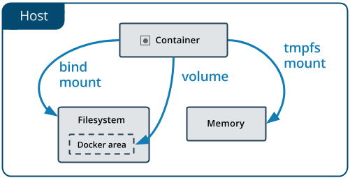
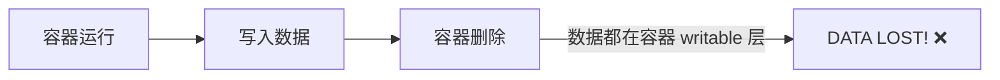
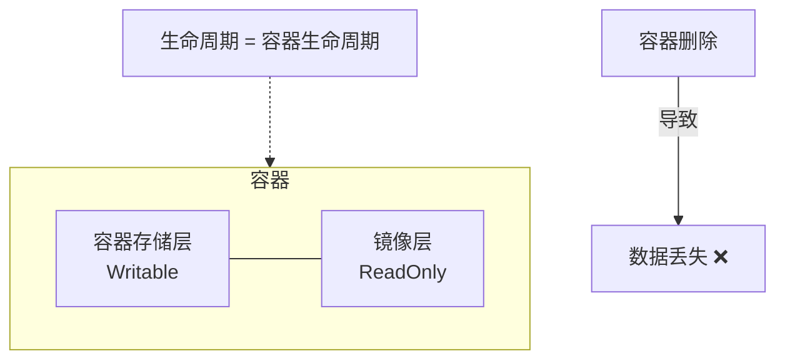
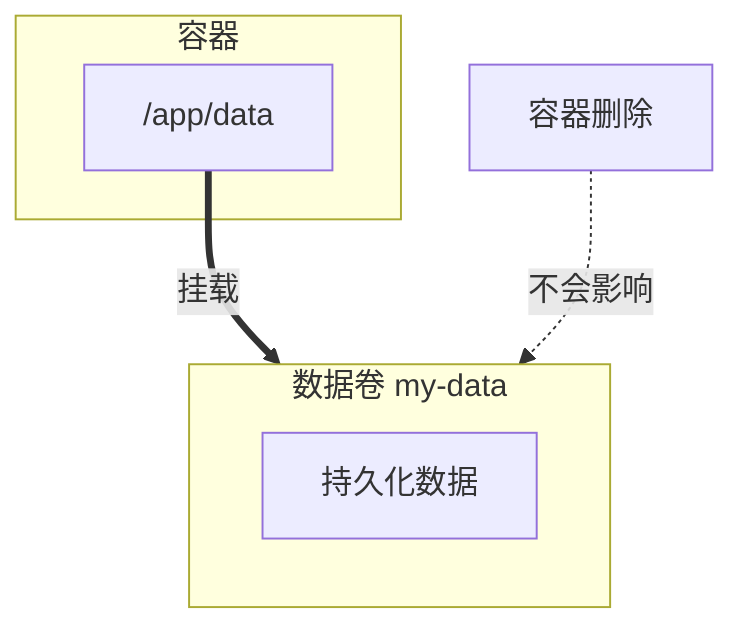
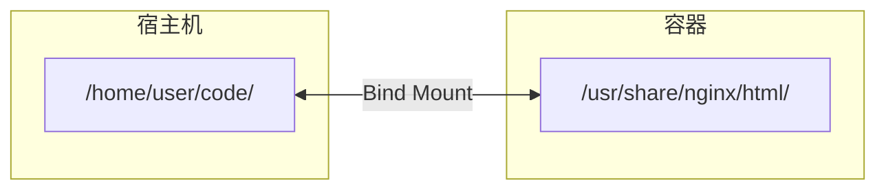

# 第八章 数据管理

如图 8-1 所示，Docker 数据管理主要围绕三类挂载方式展开。

<p align="center">
  
</p>

图 8-1：Docker 数据挂载类型示意图

这一章介绍如何在 Docker 内部以及容器之间管理数据，在容器中管理数据主要有以下几种方式：

* 数据卷
* 挂载主机目录
* tmpfs 挂载

## 1. 数据卷

### 1.1 为什么需要数据卷

容器的存储层有一个关键问题：**容器删除后，数据就没了**。


数据卷 (Volume) 解决了这个问题，它的生命周期独立于容器。

---

### 1.2 数据卷的特性

| 特性 | 说明 |
|------|------|
| **持久化** | 容器删除后数据仍然保留 |
| **共享** | 多个容器可以挂载同一个数据卷 |
| **即时生效** | 对数据卷的修改立即可见 |
| **不影响镜像** | 数据卷中的数据不会打包进镜像 |
| **性能更好** | 绕过 UnionFS，直接读写 |

---

### 1.3 数据卷 vs 容器存储层

#### 容器存储层：不推荐存储重要数据



#### 数据卷：推荐


---

### 1.4 数据卷基本操作

#### 创建数据卷

```bash
$ docker volume create my-vol
```

#### 列出所有数据卷

```bash
$ docker volume ls
DRIVER    VOLUME NAME
local     my-vol
local     postgres_data
local     redis_data
```

#### 查看数据卷详情

```bash
$ docker volume inspect my-vol
[
    {
        "CreatedAt": "2026-01-15T10:00:00Z",
        "Driver": "local",
        "Labels": {},
        "Mountpoint": "/var/lib/docker/volumes/my-vol/_data",
        "Name": "my-vol",
        "Options": {},
        "Scope": "local"
    }
]
```
**关键字段**：

- `Mountpoint`：数据卷在宿主机上的实际存储位置
- `Driver`：存储驱动（默认 local，也可以用第三方驱动）

---

### 1.5 挂载数据卷

#### 方式一：--mount：推荐

```bash
$ docker run -d \
    --name web \
    --mount source=my-vol,target=/usr/share/nginx/html \
    nginx
```
**参数说明**：

| 参数 | 说明 |
|------|------|
| `source` | 数据卷名称（不存在会自动创建）|
| `target` | 容器内挂载路径 |
| `readonly` | 可选，只读挂载 |

#### 方式二：-v：简写

```bash
$ docker run -d \
    --name web \
    -v my-vol:/usr/share/nginx/html \
    nginx
```
**格式**：`-v 数据卷名:容器路径[:选项]`

#### 两种方式对比

| 特性 | --mount | -v |
|------|---------|-----|
| 语法 | 键值对，更清晰 | 冒号分隔，更简洁 |
| **数据卷 (Volume)** 挂载行为 | 卷不存在会自动创建，与 `-v` 结果一致 | 卷不存在会自动创建 |
| **绑定挂载 (Bind Mount)** 行为 | ⭐**宿主机路径不存在会报错**，不会自动创建 | 宿主机路径不存在会 **自动创建为目录** |
| 推荐程度 | ✅ 推荐（更明确安全，避免误创建）| 常用（更简洁）|

> **提示**：官方更推荐使用 `--mount`。除了语法格式可读性更好之外，最重要的行为差异发生在 **绑定挂载 (Bind Mount)** 时：如果挂载的宿主机源路径尚未存在，`-v` 会擅自将其自动创建为一个空目录；而 `--mount` 则会严格检查并直接报错。这能有效避免因路径拼写错误而在宿主机上留下垃圾目录（以及导致的容器访问空目录问题）。而对于本节的 **数据卷 (Volume)** 挂载而言，两者在目标指定的卷不存在时皆会自动创建卷，产生的结果是 **完全一致** 的。

#### 只读挂载

```bash
## --mount 方式

$ docker run -d \
    --mount source=my-vol,target=/data,readonly \
    nginx

## -v 方式

$ docker run -d \
    -v my-vol:/data:ro \
    nginx
```
---

### 1.6 使用场景示例

#### 场景一：数据库持久化

```bash
## 创建数据卷

$ docker volume create postgres_data

## 启动 PostgreSQL，数据存储在数据卷中

$ docker run -d \
    --name postgres \
    -e POSTGRES_PASSWORD=secret \
    -v postgres_data:/var/lib/postgresql/data \
    postgres:16  # 确保与环境兼容的 PostgreSQL 版本

## 即使删除容器，数据仍然保留

$ docker rm -f postgres

## 重新启动，数据还在

$ docker run -d \
    --name postgres \
    -e POSTGRES_PASSWORD=secret \
    -v postgres_data:/var/lib/postgresql/data \
    postgres:16  # 确保与环境兼容的 PostgreSQL 版本
```

#### 场景二：多容器共享数据

```bash
## 创建共享数据卷

$ docker volume create shared-data

## 容器 A 写入数据

$ docker run -d --name writer \
    -v shared-data:/data \
    alpine sh -c "while true; do date >> /data/log.txt; sleep 5; done"

## 容器 B 读取数据

$ docker run --rm \
    -v shared-data:/data \
    alpine cat /data/log.txt
```

#### 场景三：配置文件持久化

```bash
## 将 nginx 配置存储在数据卷中

$ docker run -d \
    -v nginx-config:/etc/nginx/conf.d \
    -v nginx-logs:/var/log/nginx \
    -p 80:80 \
    nginx
```
---

### 1.7 数据卷管理

#### 删除数据卷

```bash
## 删除指定数据卷

$ docker volume rm my-vol

## 删除容器时同时删除数据卷

$ docker rm -v container_name
```

#### 清理未使用的数据卷

```bash
## 查看未被任何容器使用的数据卷

$ docker volume ls -f dangling=true

## 删除所有未使用的数据卷

$ docker volume prune

## 强制删除（不提示确认）

$ docker volume prune -f
```
> ⚠️ **注意**：数据卷不会自动垃圾回收。长期运行的系统应定期清理无用数据卷。

---

### 1.8 数据卷备份与恢复

#### 备份数据卷

```bash
## 使用临时容器挂载数据卷，打包备份

$ docker run --rm \
    -v my-vol:/source:ro \
    -v $(pwd):/backup \
    alpine tar czf /backup/my-vol-backup.tar.gz -C /source .
```
**原理**：

1. 创建临时容器
2. 挂载要备份的数据卷到 `/source`
3. 挂载当前目录到 `/backup`
4. 使用 tar 打包

#### 恢复数据卷

```bash
## 创建新数据卷

$ docker volume create my-vol-restored

## 解压备份到新数据卷

$ docker run --rm \
    -v my-vol-restored:/target \
    -v $(pwd):/backup:ro \
    alpine tar xzf /backup/my-vol-backup.tar.gz -C /target
```

#### 备份脚本示例

```bash
#!/bin/bash

## backup-volume.sh

VOLUME_NAME=$1
BACKUP_DIR=${2:-/backups}
TIMESTAMP=$(date +%Y%m%d_%H%M%S)

docker run --rm \
    -v ${VOLUME_NAME}:/source:ro \
    -v ${BACKUP_DIR}:/backup \
    alpine tar czf /backup/${VOLUME_NAME}_${TIMESTAMP}.tar.gz -C /source .

echo "Backed up ${VOLUME_NAME} to ${BACKUP_DIR}/${VOLUME_NAME}_${TIMESTAMP}.tar.gz"
```
---

### 1.9 数据卷 vs 绑定挂载

Docker 有两种主要的数据持久化方式：

| 特性 | 数据卷 (Volume) | 绑定挂载 (Bind Mount) |
|------|----------------|---------------------|
| **管理方式** | Docker 管理 | 用户管理 |
| **存储位置** | `/var/lib/docker/volumes/` | 任意宿主机路径 |
| **可移植性** | 更好 | 依赖宿主机路径 |
| **适用场景** | 生产数据持久化 | 开发时同步代码 |
| **备份** | 需要工具 | 直接访问文件 |

```bash
## 数据卷

$ docker run -v mydata:/app/data nginx

## 绑定挂载

$ docker run -v /host/path:/app/data nginx
```
详见绑定挂载章节。

---

### 1.10 常见问题

#### Q：如何知道容器使用了哪些数据卷？

```bash
$ docker inspect container_name --format '{{json .Mounts}}' | jq
```

#### Q：数据卷的数据在哪里？

```bash
## 查看数据卷详情

$ docker volume inspect my-vol

## Mountpoint 字段显示实际路径

"Mountpoint": "/var/lib/docker/volumes/my-vol/_data"
```
> ⚠️ **注意**：不建议直接修改 Mountpoint 中的文件，应通过容器操作。

#### Q：如何在不同机器间迁移数据卷？

1. 在源机器备份：`docker run --rm -v mydata:/data -v $(pwd):/backup alpine tar czf /backup/data.tar.gz -C /data .`
2. 传输 tar.gz 文件
3. 在目标机器恢复

---

## 2. 挂载主机目录

### 2.1 什么是绑定挂载

Bind Mount（绑定挂载）将 **Docker daemon 所在主机** 上的目录或文件直接挂载到容器中。容器可以读写这台主机上的文件系统。


目录结构（同一份文件）：
```text
/home/user/code/ (或 /usr/share/nginx/html/)
├── index.html
├── style.css
└── app.js
```
---

### 2.2 Bind Mount vs Volume

| 特性 | Bind Mount | Volume |
|------|------------|--------|
| **数据位置** | 宿主机任意路径 | Docker 管理的目录 |
| **路径指定** | 必须是绝对路径 | 卷名 |
| **可移植性** | 依赖宿主机路径 | 更好（Docker 管理）|
| **性能** | 依赖宿主机文件系统 | 优化的存储驱动 |
| **适用场景** | 开发环境、配置文件 | 生产数据持久化 |
| **备份** | 直接访问文件 | 需要通过 Docker |

#### 选择建议

| 需求 | 推荐方案 |
|------|----------|
| 开发时同步代码 | Bind Mount |
| 持久化数据库数据 | Volume |
| 共享配置文件 | Bind Mount |
| 容器间共享数据 | Volume |
| 备份方便 | Bind Mount（直接访问）|
| 生产环境 | Volume |

---

### 2.3 基本语法

#### 使用 `--mount`：推荐

```bash
$ docker run -d \
    --mount type=bind,source=/宿主机路径,target=/容器路径 \
    nginx
```

#### 使用 `-v`：简写

```bash
$ docker run -d \
    -v /宿主机路径:/容器路径 \
    nginx
```

#### 两种语法对比

| 特性 | --mount | -v |
|------|---------|-----|
| 语法 | 键值对，更清晰 | 冒号分隔，更简洁 |
| 路径不存在时 | 直接报错 (Fail Fast) | 静默自动创建 **目录** |
| 推荐程度 | ✅ 推荐 | 常用 |

> **⚠️ 陷阱**：如果不小心挂载了一个不存在的主机路径，使用 `-v` 会在 **daemon 主机** 上静默创建一个空目录。对于本地 Docker Desktop 用户，这个主机通常就是本机；对于远程 daemon，这个主机就是远程机器。这也是 Docker 官方更推荐使用 `--mount` 的原因：它会直接报错，避免因路径拼写错误而挂错位置。

---

### 2.4 使用场景

#### 场景一：开发环境代码同步

```bash
## 将本地代码目录挂载到容器

$ docker run -d \
    -p 8080:80 \
    --mount type=bind,source=$(pwd)/src,target=/usr/share/nginx/html \
    nginx

## 修改本地文件，容器内立即生效（热更新）

$ echo "Hello" > src/index.html

## 浏览器刷新即可看到变化

...
```

#### 场景二：配置文件挂载

```bash
## 挂载自定义 nginx 配置

$ docker run -d \
    --mount type=bind,source=/path/to/nginx.conf,target=/etc/nginx/nginx.conf,readonly \
    nginx
```

#### 场景三：日志收集

```bash
## 将容器日志输出到宿主机目录

$ docker run -d \
    --mount type=bind,source=/var/log/myapp,target=/app/logs \
    myapp
```

#### 场景四：共享 SSH 密钥

只读挂载可以防止容器修改主机密钥，但不能防止容器读取并外传密钥。只有在镜像完全可信、密钥作用域很窄且可随时轮换时，才考虑这种做法。更稳妥的方式是使用 SSH agent socket 转发、一次性 deploy key，或在 CI/构建场景中使用 BuildKit `--ssh`。

```bash
## 挂载 SSH 密钥（只读）

$ docker run --rm -it \
    --mount type=bind,source=$HOME/.ssh,target=/root/.ssh,readonly \
    alpine ssh user@remote
```
---

### 2.5 只读挂载

防止容器修改宿主机文件：

```bash
## --mount 语法

$ docker run -d \
    --mount type=bind,source=/config,target=/app/config,readonly \
    myapp

## -v 语法

$ docker run -d \
    -v /config:/app/config:ro \
    myapp
```
容器内尝试写入会报错：

```bash
$ touch /app/config/new.txt
touch: /app/config/new.txt: Read-only file system
```
---

### 2.6 挂载单个文件

```bash
## 挂载 bash 历史记录

$ docker run --rm -it \
    --mount type=bind,source=$HOME/.bash_history,target=/root/.bash_history \
    ubuntu bash

## 挂载自定义配置文件

$ docker run -d \
    --mount type=bind,source=/path/to/my.cnf,target=/etc/mysql/my.cnf \
    mysql
```
> ⚠️ **注意**：挂载单个文件时，如果宿主机上的文件被编辑器替换（而非原地修改），容器内仍是旧文件的 inode。建议重启容器或挂载目录。

---

### 2.7 查看挂载信息

```bash
$ docker inspect mycontainer --format '{{json .Mounts}}' | jq
```
输出：

```json
[
  {
    "Type": "bind",
    "Source": "/home/user/code",
    "Destination": "/app",
    "Mode": "",
    "RW": true,
    "Propagation": "rprivate"
  }
]
```
| 字段 | 说明 |
|------|------|
| `Type` | 挂载类型 (bind)|
| `Source` | 宿主机路径 |
| `Destination` | 容器内路径 |
| `RW` | 是否可读写 |
| `Propagation` | 挂载传播模式 |

---

### 2.8 常见问题

#### Q：路径不存在报错

```bash
$ docker run --mount type=bind,source=/not/exist,target=/app nginx
docker: Error response from daemon: invalid mount config for type "bind":
bind source path does not exist: /not/exist
```
**解决**：确保源路径存在。若你确实需要自动创建目录，可改用 `-v`，但要先确认创建位置就是你想要的主机路径。

#### Q：权限问题

容器内用户可能无权访问挂载的文件：

```bash
## 方法1：确保宿主机文件权限允许容器用户访问

$ chmod -R 755 /path/to/data

## 方法2：以 root 运行容器

$ docker run -u root ...

## 方法3：使用相同的 UID

$ docker run -u $(id -u):$(id -g) ...
```

#### Q：macOS/Windows 性能问题

在 Docker Desktop 上，Bind Mount 性能通常不如 Volume，因为数据需要在宿主机文件系统和 Linux VM 之间同步：

```bash
## 使用 :cached 或 :delegated 提高性能（macOS，仅 Docker Desktop 4.5 及更早版本）

$ docker run -v /host/path:/container/path:cached myapp
```
| 选项 | 说明 |
|------|------|
| `:cached` | 宿主机权威，容器读取可能延迟 |
| `:delegated` | 容器权威，宿主机读取可能延迟 |
| `:consistent` | 默认，完全一致（最慢）|

> **注意**：Docker Desktop 4.6+ 默认使用 VirtioFS 文件共享引擎，上述 `:cached`/`:delegated` 选项已被静默忽略。如需优化文件同步性能，请参考 Docker Desktop 的 [Synchronized file shares](https://docs.docker.com/desktop/features/synchronized-file-sharing/) 功能。

---

### 2.9 最佳实践

#### 1. 开发环境使用 Bind Mount

```bash
## 代码热更新

$ docker run -v "$(pwd)":/app -w /app -p 3000:3000 node:22 npm run dev
```

#### 2. 生产环境使用 Volume

```bash
## 数据持久化

$ docker run -v mysql_data:/var/lib/mysql mysql
```

#### 3. 配置文件使用只读挂载

```bash
$ docker run -v /config/nginx.conf:/etc/nginx/nginx.conf:ro nginx
```

#### 4. 注意路径安全

```bash
## ❌ 危险：挂载根目录或敏感目录

$ docker run -v /:/host ...

## ✅ 只挂载必要的目录

$ docker run -v /app/data:/data ...
```
---

## 3. tmpfs 挂载

`tmpfs` 挂载会把数据放在内存中，而不是写入容器可写层或数据卷。它只适用于 Linux 语义的容器环境，适合需要快速读写但不要求持久化的数据。

### 3.1 适用场景

- 临时缓存
- 会话数据
- 不希望落盘的敏感中间文件

### 3.2 基本用法

使用 `--mount` 语法（推荐）：

```bash
$ docker run --mount type=tmpfs,destination=/run,tmpfs-size=67108864,tmpfs-mode=1770 nginx
```
也可以使用 `--tmpfs` 简写语法：

```bash
$ docker run --tmpfs /run:size=64m nginx
```
> **注意**：`--tmpfs` 更适合简单场景；如果你希望显式描述挂载点、大小和权限，`--mount type=tmpfs,...` 的可读性更好，也更便于后续维护。

### 3.3 注意事项

- 容器停止后，`tmpfs` 数据会丢失。
- `tmpfs` 占用宿主机内存，建议显式限制大小。
- 不适合需要持久化的数据。
- `tmpfs` 不适合多个容器共享同一份数据，也不适合当作跨重启的缓存层。
- 在内存压力较高时，部分数据可能受系统交换机制影响，因此不要把 `tmpfs` 当作绝对不会落盘的安全边界。

### 3.4 与 Volume / Bind Mount 对比

| 类型 | 数据位置 | 持久化 | 典型用途 |
|------|---------|-------|---------|
| Volume | Docker 管理目录 | 是 | 数据库、长期业务数据 |
| Bind Mount | 宿主机指定目录 | 是 | 开发联调、配置文件共享 |
| tmpfs | 内存 | 否 | 高速临时数据、敏感临时文件 |
