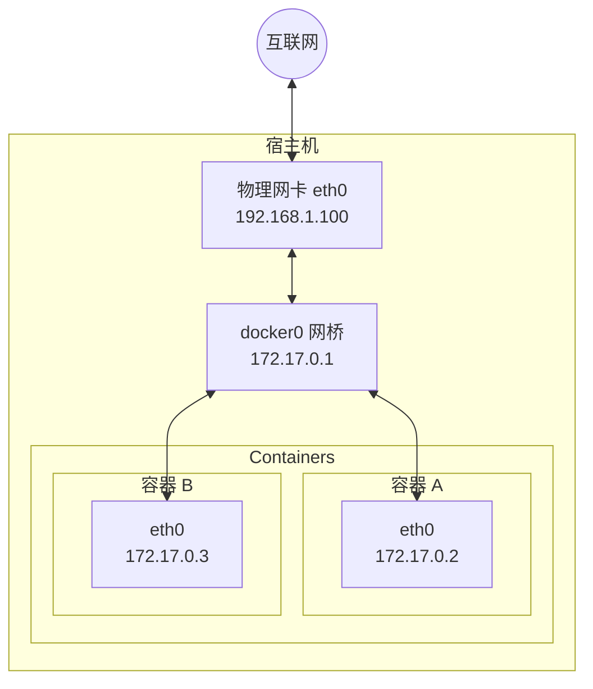
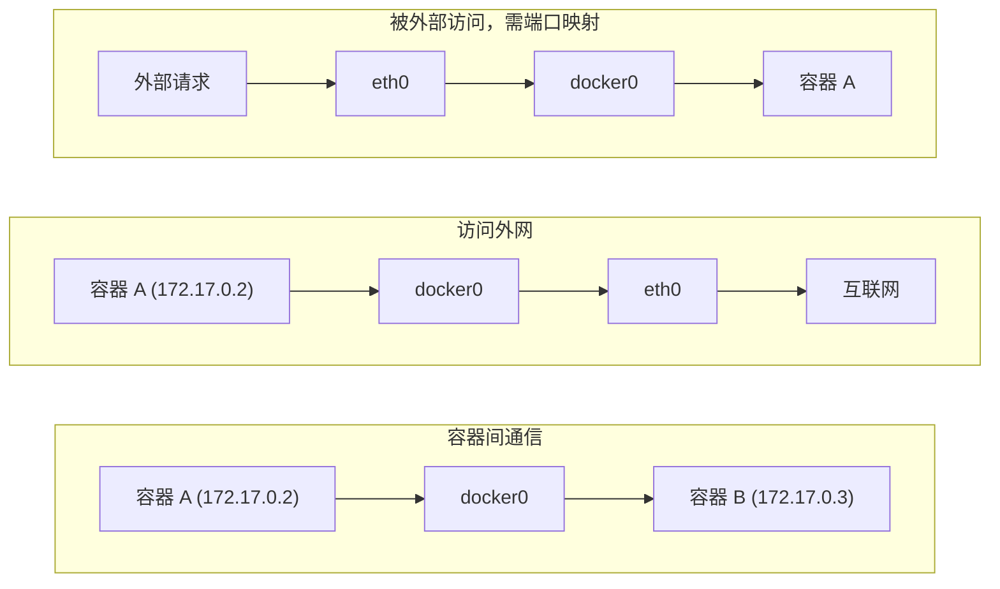
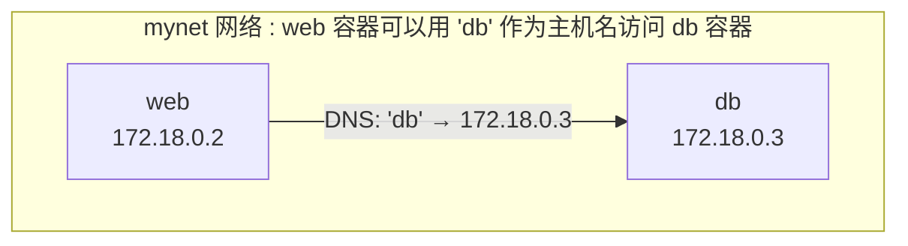
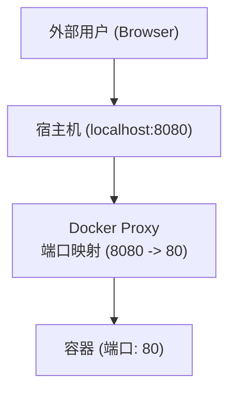
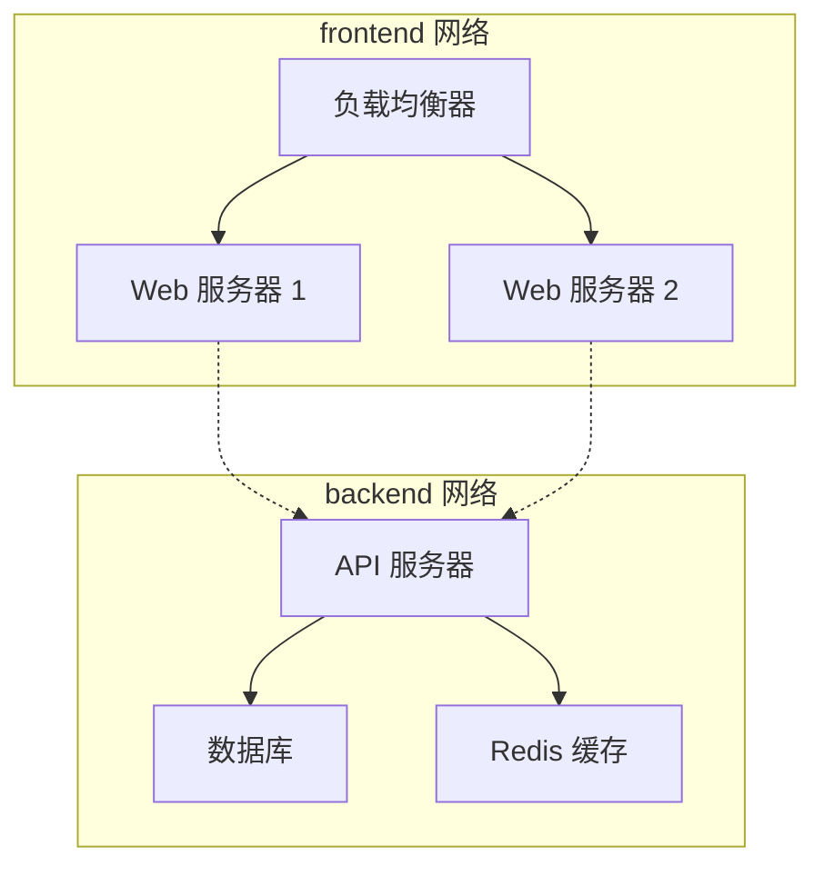

# 第九章 网络配置

Docker 容器需要网络来与外部世界通信、容器之间相互通信以及与宿主机通信。Docker 在安装时会自动配置网络基础设施，大多数情况下开箱即用。

## 概述

Docker 启动时自动创建以下网络组件：


本章将详细介绍 Docker 网络配置的各个方面。

## 1. 配置 DNS

Docker 1.10.0 以后，内建了一个 DNS 服务器，使得容器可以直接通过容器名称通信。方法很简单，只要在创建容器时使用 `--name` 为容器命名即可。

但是使用 Docker DNS 有个前提条件，就是它只能在 **自定义网络** 中使用。也就是说，如果使用的是默认的 `bridge` 网络，是无法使用 DNS 的，所以我们就需要自定义网络。

### 1.1 容器的 DNS 机制

Docker 容器的 DNS 配置有两种情况：

1. **默认 Bridge 网络**：继承宿主机的 DNS 配置 (`/etc/resolv.conf`)。
2. **自定义网络**（推荐）：使用 Docker 嵌入式 DNS 服务器 (Embedded DNS)，支持通过 **容器名** 进行服务发现。

---

### 1.2 嵌入式 DNS

这是 Docker 网络最强大的功能之一。在自定义网络中，容器可以通过 “名字” 找到彼此，而不需要知道对方的 IP（因为 IP 可能会变）。

```bash
## 1. 创建自定义网络

$ docker network create mynet

## 2. 启动容器 web 并加入网络

$ docker run -d --name web --network mynet nginx

## 3. 启动容器 client 并尝试 ping web

$ docker run -it --rm --network mynet alpine ping web
PING web (172.18.0.2): 56 data bytes
64 bytes from 172.18.0.2: seq=0 ttl=64 time=0.074 ms
```
**原理**：
Docker 守护进程在 `127.0.0.11` 运行了一个 DNS 服务器。容器内的 DNS 请求会被转发到这里。如果是容器名，解析为容器 IP；如果是外部域名（如 google.com），转发给上游 DNS。

---

### 1.3 配置 DNS 参数

如果你需要手动配置容器的 DNS（例如使用内网 DNS 服务器），可以在 `docker run` 中使用以下参数：

#### 1. --dns

指定 DNS 服务器 IP。

```bash
$ docker run -it --dns=114.114.114.114 ubuntu cat /etc/resolv.conf
nameserver 114.114.114.114
```

#### 2. --dns-search

指定 DNS 搜索域。例如设置为 `example.com`，则 `ping host` 会尝试解析 `host.example.com`。

```bash
$ docker run --dns-search=example.com myapp
```

#### 3. --hostname 与 -h

设置容器的主机名。

```bash
$ docker run -h myweb nginx
```
---

### 1.4 全局 DNS 配置

如果希望所有容器都使用特定的 DNS 服务器（而不是继承宿主机），可以修改 `/etc/docker/daemon.json`：

```json
{
  "dns": [
    "114.114.114.114",
    "8.8.8.8"
  ]
}
```
修改后需要重启 Docker 服务：`systemctl restart docker`。

---

### 1.5 常见问题

以下是使用容器 DNS 时常见的问题及解决方法：

#### Q：容器无法解析域名

**现象**：`ping www.baidu.com` 失败，但 `ping 8.8.8.8` 成功。**解决**：

1. 宿主机的 `/etc/resolv.conf` 可能有问题（例如使用了本地回环地址 127.0.0.53，特别是 Ubuntu 系统）。Docker 可能会尝试修复，但有时会失败。
2. 尝试手动指定 DNS：`docker run --dns 8.8.8.8 ...`
3. 检查防火墙是否拦截了 UDP 53 端口。

#### Q：无法通过容器名通信

**现象**：`ping db` 提示 `bad address 'db'`。**原因**：

- 你可能在使用 **默认的 bridge 网络**。默认 bridge 网络 **不支持** 通过容器名进行 DNS 解析（这是一个历史遗留设计）。
- **解决**：使用自定义网络 (`docker network create ...`)。

---

## 2. 网络类型

Docker 提供了多种网络驱动来满足不同的使用场景。安装 Docker 后，系统会自动创建三个默认网络：

```bash
$ docker network ls
NETWORK ID     NAME      DRIVER    SCOPE
abc123...      bridge    bridge    local
def456...      host      host      local
ghi789...      none      null      local
```

### 2.1 网络类型对比

各网络类型的特点和适用场景如下：

| 网络类型 | 说明 | 适用场景 |
|---------|------|---------|
| **bridge** | 默认类型，容器连接到虚拟网桥 | 大多数单机场景 |
| **host** | 容器直接使用宿主机网络栈 | 需要最高网络性能时 |
| **none** | 禁用网络 | 完全隔离的容器 |
| **overlay** | 跨主机网络 | Docker Swarm 集群 |
| **macvlan** | 容器拥有独立 MAC 地址 | Linux 主机上需要直接接入物理网络 |
| **ipvlan** | 容器共享父接口 MAC，独享 IP | 同网段大量容器、对 MAC 数量受限的网络 |

### 2.2 Bridge 网络：默认

Bridge 是 Docker 默认使用的网络模式。在原生 Linux Docker Engine 上，Docker 启动时通常会创建 `docker0` 虚拟网桥，未指定网络的容器会连接到这个网桥上。Docker Desktop 运行在虚拟机内，宿主机上不会直接看到 `docker0`，也不能假设宿主机可直接访问每个容器 IP。

核心组件如下：

| 组件 | 说明 |
|------|------|
| **docker0** | 虚拟网桥，充当交换机角色 |
| **veth pair** | 虚拟网卡对，一端在容器内，一端连接网桥 |
| **容器 eth0** | 容器内的网卡 |
| **IP 地址** | 自动从 172.17.0.0/16 网段分配 |

### 2.3 Host 网络

使用 `--network host` 参数启动的容器会直接使用宿主机的网络栈，不再拥有独立的网络命名空间。容器内的端口就是宿主机的端口，无需端口映射。

```bash
$ docker run -d --network host nginx
```
这种模式下网络性能最高，但容器之间和宿主机之间没有网络隔离。

> 注意：host 网络优先用于明确需要高性能或大量端口的 Linux 主机场景。Docker Desktop 仅在较新版本中支持，且需要在设置中启用；使用 host 网络时 `-p` / `--publish` 端口映射不会生效。普通 Web 服务默认仍建议使用 bridge 网络并显式发布端口。

### 2.4 None 网络

使用 `--network none` 参数启动的容器只有 `lo` 回环网卡，完全没有外部网络连接。适用于只需要运行计算任务、不需要网络的容器。

```bash
$ docker run -it --network none alpine ip addr
1: lo: <LOOPBACK,UP,LOWER_UP> ...
    inet 127.0.0.1/8 scope host lo
```

### 2.5 Macvlan 与平台限制

Macvlan 适合少数需要让容器像物理主机一样直接出现在二层网络中的场景。它只支持 Linux 主机，不支持 Docker Desktop for Mac / Windows，也不支持 rootless 模式；多数云厂商网络会阻断或限制 macvlan。默认情况下，macvlan 容器与宿主机直接通信也需要额外路由或接口配置。

### 2.6 数据流向

容器网络中的数据流向可以分为以下几种情况：



## 3. 自定义网络

在生产环境中，推荐使用用户自定义网络代替默认的 bridge 网络。自定义网络提供了更好的隔离性和服务发现能力。

### 3.1 为什么要用自定义网络

默认 bridge 网络存在以下局限，而自定义网络可以很好地解决这些问题：

| 问题 | 自定义网络的优势 |
|------|-----------------|
| 只能用 IP 通信 | 支持容器名 DNS 解析 |
| 所有容器在同一网络 | 更好的隔离性 |
| 需要 --link（已废弃）| 原生支持服务发现 |

### 3.2 创建自定义网络

使用 `docker network create` 命令可以创建自定义网络：

```bash
## 创建网络

$ docker network create mynet

## 查看网络详情

$ docker network inspect mynet
```

### 3.3 使用自定义网络

启动容器时通过 `--network` 参数指定连接的网络：

```bash
## 启动容器并连接到自定义网络

$ docker run -d --name web --network mynet nginx
$ docker run -d --name db --network mynet postgres

## 在 web 容器中可以直接用容器名访问 db

$ docker exec web ping db
PING db (172.18.0.3): 56 data bytes
64 bytes from 172.18.0.3: seq=0 ttl=64 time=0.083 ms
```

### 3.4 容器名 DNS 解析

自定义网络自动提供 DNS 服务。Docker 守护进程在 `127.0.0.11` 运行了一个嵌入式 DNS 服务器，容器内的 DNS 请求会被转发到这里：

- 如果是容器名，解析为容器 IP
- 如果是外部域名（如 google.com），转发给上游 DNS



### 3.5 常用网络命令

以下是 Docker 网络管理中常用的命令：

```bash
## 列出网络

$ docker network ls

## 创建网络

$ docker network create mynet

## 查看网络详情

$ docker network inspect mynet

## 连接容器到网络

$ docker network connect mynet mycontainer

## 断开网络连接

$ docker network disconnect mynet mycontainer

## 删除网络

$ docker network rm mynet

## 清理未使用的网络

$ docker network prune
```
---

> **🔥 踩坑实录**
>
> 一个新手开发者通过 `docker compose` 部署了两个容器化服务：服务 A 和服务 B。他在服务 A 的代码中尝试用 `localhost:3000` 访问服务 B，结果始终连接超时。这个错误非常隐蔽——在本地单机开发时看不出问题，因为他可能在同一个进程中测试。排查时他错误地认为是防火墙或网络配置问题。实际原因是：每个容器都有独立的网络命名空间，`localhost` 在容器内部只指向容器自己，不是宿主机也不是其他容器。正确的做法是使用 Compose 自动创建的服务名作为主机名：`http://service-b:3000`。Compose 会自动在网络中注册服务名的 DNS，这样容器间通信才能正确解析。改动仅需一行代码，问题随之消失。

## 4. 容器互联

容器之间的网络通信是 Docker 网络的核心功能之一。本节介绍容器互联的几种方式。

### 4.1 同一网络内的容器

同一自定义网络内的容器可以直接通过容器名通信，这是推荐的容器互联方式：

```bash
## 创建网络

$ docker network create app-net

## 启动应用和数据库

$ docker run -d --name redis --network app-net redis
$ docker run -d --name app --network app-net myapp

## app 容器中可以用 redis:6379 连接 Redis

...
```

### 4.2 连接到多个网络

一个容器可以同时连接到多个网络，这对于需要跨网络通信的中间件容器特别有用：

```bash
## 启动容器

$ docker run -d --name multi-net-container --network frontend nginx

## 再连接到另一个网络

$ docker network connect backend multi-net-container

## 查看容器的网络

$ docker inspect multi-net-container --format '{{json .NetworkSettings.Networks}}'
```

### 4.3 ⚠️ --link 已废弃

`--link` 是 Docker 早期用于容器互联的方式，**已经被废弃**，不建议在新项目中使用。请使用自定义网络替代：

```bash
## 旧方式（不推荐）

$ docker run --link db:database myapp

## 新方式（推荐）

$ docker network create mynet
$ docker run --network mynet --name db postgres
$ docker run --network mynet --name app myapp
```
使用自定义网络的优势在于：

- 原生支持 DNS 解析
- 不需要在容器启动时显式声明依赖
- 更灵活，可以动态 connect/disconnect

## 5. 外部访问容器

容器运行在自己的隔离网络环境中（通常是 Bridge 模式）。为了让外部网络访问容器内的服务，我们需要将容器的端口映射到宿主机的端口。

### 5.1 为什么要映射端口

容器的网络访问规则如下：

- **容器之间**：可以通过 IP 或容器名（自定义网络）互通。
- **宿主机访问容器**：原生 Linux 环境下可按网络配置访问容器 IP；Docker Desktop 上不能依赖容器 IP，应通过端口映射、容器名（容器间）或 `host.docker.internal` 等机制访问。
- **外部网络访问容器**：❌ 默认无法直接访问。

为了让外部（如你的浏览器、其他局域网机器）访问容器内的服务，我们需要将容器的端口 **映射** 到宿主机的端口。


---

### 5.2 端口映射方式

Docker 提供了多种方式来指定端口映射。

#### 1. 指定映射

使用 `-p <宿主机端口>:<容器端口>` 格式：

```bash
## 将宿主机的 8080 端口映射到容器的 80 端口

$ docker run -d -p 8080:80 nginx
```
此时访问 `http://localhost:8080` 即可看到 Nginx 页面。

**多种格式**：

| 格式 | 含义 | 示例 |
|------|------|------|
| `ip:hostPort:containerPort` | 绑定指定 IP 的特定端口 | `-p 127.0.0.1:8080:80`（仅 IPv4 本机访问）|
| `ip::containerPort` | 绑定指定 IP 的随机端口 | `-p 127.0.0.1::80` |
| `hostPort:containerPort` | 绑定所有地址（通常包括 `0.0.0.0` 和 `[::]`）的特定端口 | `-p 8080:80`（默认）|
| `containerPort` | 绑定所有地址的随机端口 | `-p 80` |

#### 2. 随机映射

如果不关心宿主机使用哪个端口，可以使用随机映射。使用 `-P`（大写）参数，Docker 会把 Dockerfile 中 `EXPOSE` 指令暴露的所有端口发布到宿主机的随机高位端口。具体落在哪个端口，取决于宿主机当前可用的临时端口范围。

```bash
$ docker run -d -P nginx
```
查看映射结果：

```bash
$ docker ps
CONTAINER ID   PORTS
abc123456      0.0.0.0:49153->80/tcp
```
此时 Nginx 被映射到了宿主机的一个随机高位端口，例如 `49153`。

---

### 5.3 查看端口映射

可以使用以下命令查看容器的端口映射：

#### docker port

运行 `docker port` 可以查看到指定容器的端口映射情况：

```bash
$ docker port mycontainer
80/tcp -> 0.0.0.0:8080
80/tcp -> [::]:8080
```

#### docker ps

运行 `docker ps` 可以查看到所有容器的端口映射列表：

```bash
$ docker ps
CONTAINER ID   IMAGE     PORTS                  NAMES
abc123456      nginx     0.0.0.0:8080->80/tcp   web
```
---

### 5.4 最佳实践与安全

在配置端口映射时，需要注意以下安全事项：

#### 1. 限制监听 IP

默认情况下，`-p 8080:80` 会监听所有可用地址，常见输出包括 `0.0.0.0:8080` 和 `[::]:8080`。这意味着任何人只要能连接你的宿主机 IP，就能访问该服务。

如果不希望对外暴露（例如数据库服务），应绑定到回环地址。IPv4 使用 `127.0.0.1`，IPv6 使用 `[::1]`：

```bash
## 仅允许本机访问

$ docker run -d -p 127.0.0.1:3306:3306 mysql
$ docker run -d -p '[::1]:3306:3306' mysql
```

#### 2. 避免端口冲突

如果宿主机 8080 已经被占用了，容器将无法启动。

**解决**：

- 更换宿主机端口：`-p 8081:80`
- 让 Docker 自动分配：`-p 80`

#### 3. UDP 映射

默认是 TCP 协议。如果要映射 UDP 服务（如 DNS，Syslog）：

```bash
$ docker run -d -p 53:53/udp dns-server
```
---

### 5.5 实现原理

Docker 使用 `docker-proxy` 进程（用户态）或 `iptables` DNAT 规则（内核态）来实现端口转发。

当流量到达宿主机端口时，iptables 规则将其目标地址修改为容器 IP 并转发：

```bash
## 简化的 iptables 逻辑

iptables -t nat -A DOCKER -p tcp --dport 8080 -j DNAT --to-destination 172.17.0.2:80
```
这也是为什么你在容器内部看到的访问来源 IP 通常是网关 IP（如 172.17.0.1），而不是真实的外部 Client IP（除非使用 host 网络模式）。

---

## 6. 网络隔离

Docker 网络提供了天然的隔离能力，不同网络之间的容器默认无法通信。这是 Docker 网络安全的重要基础。

### 6.1 网络隔离原理

不同网络之间默认隔离，容器只能与同一网络中的容器直接通信：

```bash
## 创建两个网络

$ docker network create frontend
$ docker network create backend

## 容器 A 在 frontend

$ docker run -d --name web --network frontend nginx

## 容器 B 在 backend

$ docker run -d --name db --network backend postgres

## web 无法直接访问 db（不同网络）

$ docker exec web ping db
ping: db: Name or service not known
```

### 6.2 安全优势

这种隔离机制带来以下安全优势：

| 场景 | 说明 |
|------|------|
| **前后端分离** | 前端容器无法直接访问数据库网络 |
| **微服务隔离** | 不同微服务组可以使用不同网络 |
| **多租户** | 不同租户的容器在不同网络中完全隔离 |
| **最小权限** | 容器只能访问必要的网络资源 |

### 6.3 跨网络通信

如果确实需要某个容器跨网络通信，可以将其同时连接到多个网络：

```bash
## 创建一个中间件容器，连接到两个网络

$ docker run -d --name api --network frontend myapi
$ docker network connect backend api

## 现在 api 容器既可以访问 frontend 中的 web，也可以访问 backend 中的 db
```
这种方式让你可以精确控制哪些容器可以跨网络通信，遵循最小权限原则。

### 6.4 典型网络架构

一个典型的多层应用网络架构如下：


在这种架构中，API 服务器同时连接到 `frontend` 和 `backend` 网络，充当两个网络之间的桥梁。负载均衡器和 Web 服务器无法直接访问数据库，增强了安全性。

## 7. 容器网络高级特性

本节聚焦 Docker 自身可见的高级网络能力：Overlay 网络、服务发现和 DNS 解析。更偏 Kubernetes 编排网络的概念，如 CNI 和 NetworkPolicy，不在本章展开。

### 7.1 Overlay 网络原理与配置

Overlay 网络在现有网络基础上建立虚拟网络，允许容器跨宿主机通信。它是 Swarm 场景下的核心网络驱动之一。

#### Overlay 网络工作原理

Overlay 网络通过隧道封装技术（通常是 VXLAN）将容器网络流量封装在宿主机物理网络的 UDP 数据包中传输。Docker overlay 网络默认使用 `4789/udp` 作为数据通道端口，同时 Swarm 控制面与节点通信还需要相应开放 `2377/tcp`、`7946/tcp` 和 `7946/udp`。

```text
容器 A (192.168.0.2)
    ↓
veth 对
    ↓
br-net (网桥)
    ↓
Docker 引擎 (VXLAN 封装)
    ↓
物理网络 (172.16.0.0/24)
    ↓
Docker 引擎 (VXLAN 解封装)
    ↓
br-net (网桥)
    ↓
veth 对
    ↓
容器 B (192.168.0.3，不同宿主机)
```

#### 创建和使用 Overlay 网络

Overlay 网络依赖 Swarm。若要让独立容器加入 overlay 网络，需要把网络创建为 `attachable`。

```bash
# 初始化 Swarm
docker swarm init

# 创建 attachable overlay 网络
docker network create --driver overlay \
  --attachable \
  --subnet 192.168.0.0/24 \
  --opt com.docker.network.driver.mtu=1450 \
  my-overlay-net

# 验证网络创建
docker network ls
docker network inspect my-overlay-net

# 在 Swarm 服务中使用 overlay 网络
docker service create --name web \
  --network my-overlay-net \
  --replicas 3 \
  nginx  # 确保与环境兼容的 Nginx 版本

# 单机环境下也可以让普通容器加入 attachable overlay 网络
docker run -d --name container1 --network my-overlay-net busybox sleep 1d
docker run -d --name container2 --network my-overlay-net busybox sleep 1d

# 测试跨容器通信
docker exec container1 ping -c 1 container2
```

#### Overlay 网络性能优化

```bash
# 调整 MTU（Maximum Transmission Unit）避免分片
# VXLAN 开销 50 字节，物理 MTU 1500 时建议设置为 1450
docker network create --driver overlay \
  --attachable \
  --opt com.docker.network.driver.mtu=1450 \
  optimized-overlay

# 启用 IP 地址管理（IPAM）自定义
docker network create --driver overlay \
  --attachable \
  --subnet 10.0.9.0/24 \
  --aux-address "my-router=10.0.9.2" \
  my-custom-overlay
```

### 7.2 容器 DNS 解析机制

Docker 内置 DNS 服务器，但 DNS 解析涉及多个层面的配置。

#### DNS 解析流程

```text
容器应用 (dig www.example.com)
    ↓
容器内 /etc/resolv.conf (127.0.0.11:53)
    ↓
Docker 内嵌 DNS 服务器 (127.0.0.11)
    ↓
用户自定义 DNS 或宿主机 /etc/resolv.conf
    ↓
外部 DNS 服务器 (8.8.8.8 等)
    ↓
DNS 响应 → 容器缓存 → 应用
```

#### 配置容器 DNS

**在运行时指定 DNS：**

```bash
# 单个容器
docker run -d \
  --dns 8.8.8.8 \
  --dns 1.1.1.1 \
  --dns-search example.com \
  nginx  # 确保与环境兼容的 Nginx 版本

# DNS 选项
docker run -d \
  --dns-option ndots:2 \
  --dns-option timeout:1 \
  --dns-option attempts:3 \
  nginx  # 确保与环境兼容的 Nginx 版本

# 查看容器 DNS 配置
docker exec <container_id> cat /etc/resolv.conf
```

**Docker Compose DNS 配置：**

```yaml
services:
  web:
    image: nginx
    dns:
      - 8.8.8.8
      - 1.1.1.1
    dns_search:
      - example.com
      - local

  db:
    image: postgres
    networks:
      - backend
    hostname: postgres-db

networks:
  backend:
    driver: bridge

# 容器内 /etc/resolv.conf 将被自动配置
# search example.com local
# nameserver 8.8.8.8
# nameserver 1.1.1.1
```

**Docker 守护进程级别配置：**

```json
{
  "dns": ["8.8.8.8", "1.1.1.1"],
  "dns-search": ["example.com"]
}
```

#### 自定义服务发现

**使用 Docker 内建 DNS 的服务发现：**

```bash
# 创建自定义网络
docker network create mynet

# 运行服务
docker run -d --name web --network mynet nginx  # 确保与环境兼容的 Nginx 版本
docker run -d --name db --network mynet postgres  # 确保与环境兼容的 PostgreSQL 版本

# 在其他容器中通过服务名访问
docker run -it --network mynet busybox sh

# ping web  # 自动解析到 web 容器 IP
# ping db   # 自动解析到 db 容器 IP
```

**Compose 服务名自动发现：**

```yaml
services:
  frontend:
    image: nginx
    depends_on:
      - backend
    environment:
      BACKEND_URL: http://backend:8080

  backend:
    image: myapp
    depends_on:
      - database

  database:
    image: postgres
    environment:
      POSTGRES_DB: mydb

# frontend 容器可以直接访问 http://backend:8080
# backend 容器可以直接访问 postgres://database:5432
```

### 7.3 本章边界

Docker 的网络章节重点讨论 bridge、host、none、overlay 和 DNS 等能力。CNI、NetworkPolicy、Calico、Cilium 这类概念属于 Kubernetes 编排网络的范畴，后续在 Kubernetes 章节中再展开会更清晰。
