# 第十二章 底层实现

Docker 底层的核心技术包括 Linux 上的命名空间 (Namespaces)、控制组 (Control groups)、Union 文件系统 (Union file systems) 和容器格式 (Container format)。

我们知道，传统的虚拟机通过在宿主主机中运行 hypervisor 来模拟一整套完整的硬件环境提供给虚拟机的操作系统。虚拟机系统看到的环境是可限制的，也是彼此隔离的。
这种直接的做法实现了对资源最完整的封装，但很多时候往往意味着系统资源的浪费。
例如，以宿主机和虚拟机系统都为 Linux 系统为例，虚拟机中运行的应用其实可以利用宿主机系统中的运行环境。

我们知道，在操作系统中，包括内核、文件系统、网络、PID、UID、IPC、内存、硬盘、CPU 等等，所有的资源都是应用进程直接共享的。
要想实现虚拟化，除了要实现对内存、CPU、网络 IO、硬盘 IO、存储空间等的限制外，还要实现文件系统、网络、PID、UID、IPC 等等的相互隔离。
前者相对容易实现一些，后者则需要宿主机系统的深入支持。

随着 Linux 系统对于命名空间功能的完善实现，程序员已经可以实现上面的所有需求，让某些进程在彼此隔离的命名空间中运行。大家虽然都共用一个内核和某些运行时环境（例如一些系统命令和系统库），但是彼此却看不到，都以为系统中只有自己的存在。这种机制就是容器 (Container)，利用命名空间来做权限的隔离控制，利用 cgroups 来做资源分配。

## 1. 基本架构

Docker 的架构设计简洁而高效，主要由客户端和服务端两部分组成。

### 1.1 核心架构图

Docker 采用了 **C/S（客户端/服务端）** 架构。Client 向 Daemon 发送请求，Daemon 负责构建、运行和分发容器。

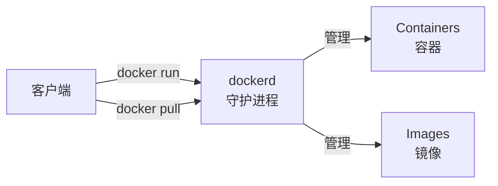
---

### 1.2 组件详解

Docker 的内部架构如同洋葱一样分层，每一层专注解决特定问题：

#### 1. Docker CLI：客户端

用户与 Docker 交互的主要方式。它将用户命令（如 `docker run`）转换为 API 请求发送给 dockerd。

#### 2. Dockerd：守护进程

Docker 的大脑。

- 监听 API 请求
- 管理 Docker 对象（镜像、容器、网络、卷）
- 编排下层组件完成工作

#### 3. Containerd：高级运行时

行业标准的容器运行时（CNCF 毕业项目）。

- 管理容器的完整生命周期（启动、停止）
- 镜像拉取与存储
- **不包含** 复杂的与容器无关的功能（如构建、API）
- Kubernetes 也可以直接使用 containerd（跳过 Docker）

#### 4. Runc：低级运行时

用于创建和运行容器的 CLI 工具。

- 直接与内核交互 (Namespaces，Cgroups)
- 遵循 OCI (Open Container Initiative) 规范
- **主要职责**：根据配置启动一个容器，然后退出（将控制权交给容器进程）

#### 5. Shim

每个容器都有一个 shim 进程。

- **解耦**：允许 dockerd 重启而不影响容器运行
- **保持 IO**：维持容器的标准输入输出
- **状态汇报**：向 containerd 汇报容器退出状态

---

### 1.3 容器启动流程

当执行 `docker run -d nginx` 时，内部发生了什么？

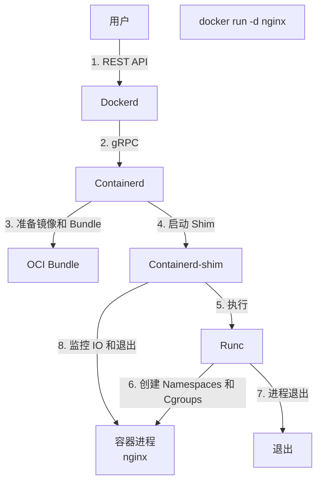

1. **CLI** 发送请求给 **Dockerd**
2. **Dockerd** 解析请求，调用 **Containerd**
3. **Containerd** 准备镜像，转换为 OCI Bundle
4. **Containerd** 创建 **Shim** 进程
5. **Shim** 调用 **Runc**
6. **Runc** 与系统内核交互，创建 Namespaces 和 Cgroups
7. **Runc** 启动 nginx 进程后退出
8. **Shim** 接管容器 IO 和生命周期监控

---

### 1.4 Docker Engine v29.x 变化

从 Docker Engine v29.x 开始，架构进一步简化和标准化：

- **Containerd 镜像存储 (Image Store)**：在 v29.x 的新安装场景中默认启用。Docker 直接使用 Containerd 的镜像管理能力，不再维护自己的一套 graphdriver。
  - **优势**：多平台镜像支持更好，可保存 SBOM/Provenance 等 attestations，并可使用 containerd snapshotters 的 lazy pulling 等能力。
- **实验性 nftables 支持**：随着主流 Linux 发行版逐步弃用 iptables，Docker v29.x 引入了实验性 nftables 后端。启用方式为 `dockerd --firewall-backend=nftables`，可直接创建 nftables 规则而无需依赖 iptables-nft 转换层。生产环境请谨慎使用。

---

### 1.5 Docker Desktop 架构

在 macOS 和 Windows 上，因为内核差异，架构稍微复杂：

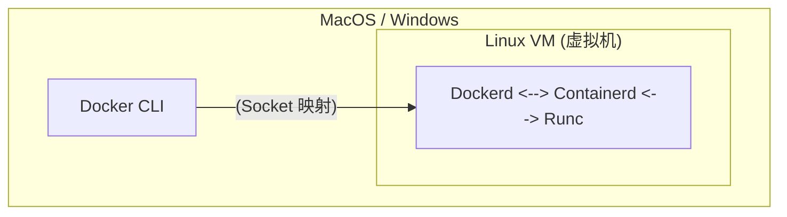

- 使用轻量级虚拟机 (Apple Virtualization / WSL 2) 运行 Linux 内核
- 文件挂载 (Bind Mount) 需要跨越 VM 边界（这也是文件 I/O 慢的原因）
- 网络端口需要从宿主机转发到 VM

---

### 1.6 总结

| 组件 | 角色 | 关键职责 |
|------|------|----------|
| **CLI** | 指挥官 | 发送指令，展示结果 |
| **Dockerd** | 大管家 | API 接口，整体调度 |
| **Containerd** | 经理 | 容器生命周期，镜像管理 |
| **Shim** | 监工 | 保持 IO，允许无守护进程重启 |
| **Runc** | 工人 | 真正干活（创建容器），干完就走 |

### 1.7 延伸阅读

- 命名空间：Runc 如何隔离容器
- 控制组：Runc 如何限制资源
- 联合文件系统：镜像如何存储

## 2. 命名空间

命名空间是 Linux 内核一个强大的特性。每个容器都有自己单独的命名空间，运行在其中的应用都像是在独立的操作系统中运行一样。命名空间保证了容器之间彼此互不影响。

### 2.1 什么是 Namespace

> **Namespace 是 Linux 内核提供的资源隔离机制，它让容器内的进程仿佛运行在独立的操作系统中。** Namespace 是容器技术的核心基础之一。它回答了一个关键问题：**如何让一个进程 “以为” 自己独占整个系统？**

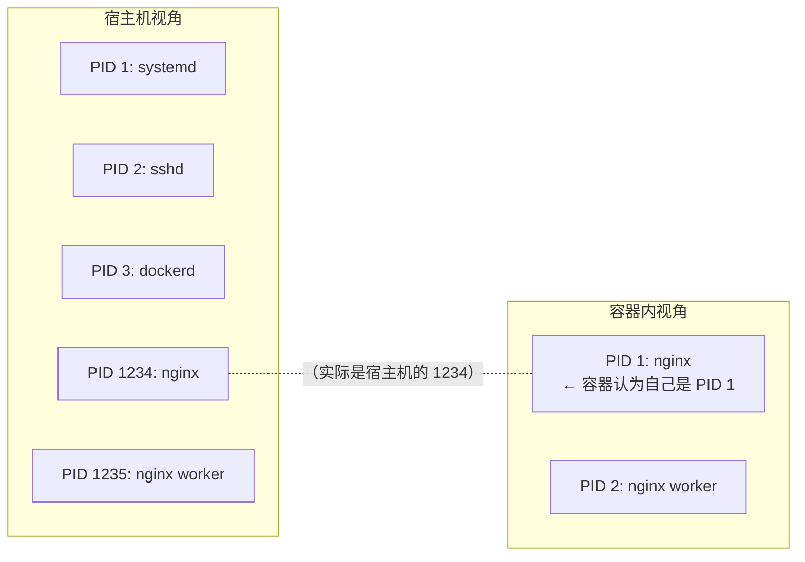

### 2.2 Namespace 的类型

Linux 内核（5.6+）共提供 8 种 Namespace。Docker 容器默认启用其中的 PID、NET、MNT、UTS、IPC（在 cgroup v2 主机上还包括 Cgroup）；USER Namespace 默认**不**启用，需要通过 `daemon.json` 的 `userns-remap` 显式开启（详见第 18.1 节），Time Namespace 则未被使用：

| Namespace | 隔离内容 | 容器中的效果 |
|-----------|---------|-------------|
| **PID** | 进程 ID | 容器内 PID 从 1 开始，看不到其他容器和宿主机进程 |
| **NET** | 网络栈 | 独立的网卡、IP 地址、端口、路由表 |
| **MNT** | 挂载点 | 独立的文件系统视图，自己的根目录 |
| **UTS** | 主机名 | 独立的主机名和域名 |
| **IPC** | 进程间通信 | 独立的信号量、消息队列、共享内存 |
| **USER** | 用户/组 ID | 容器内的 root 可以映射为宿主机的普通用户（默认不启用，需 `userns-remap` 显式开启）|
| **Cgroup** | Cgroup 根目录 | 隔离 cgroup 层级视图 (Linux 4.6+)|
| **Time** | 系统时钟 | 隔离 CLOCK_MONOTONIC 和 CLOCK_BOOTTIME (Linux 5.6+)|

---

### 2.3 PID Namespace

PID Namespace 负责进程 ID 的隔离，使得容器内的进程彼此不可见。

#### PID 的作用

隔离进程 ID，让每个容器有自己的进程编号空间。

#### PID 隔离效果

```bash
## 宿主机上查看进程

$ ps aux | grep nginx
root     12345  0.0  0.1  nginx: master process
root     12346  0.0  0.1  nginx: worker process

## 容器内查看进程

$ docker exec mycontainer ps aux
PID   USER     COMMAND
  1   root     nginx: master process    ← 在容器内是 PID 1
  2   root     nginx: worker process
```

#### PID 关键点

- 容器内的 PID 1 进程特殊重要——它是容器的主进程，退出则容器停止
- 容器内无法看到宿主机或其他容器的进程
- 宿主机可以看到所有容器内的进程（但 PID 不同）

---

### 2.4 NET Namespace

NET Namespace 负责网络栈的隔离，包括网卡、路由表和 iptables 规则等。

#### NET 的作用

隔离网络栈，每个容器拥有独立的网络环境。

#### NET 隔离效果

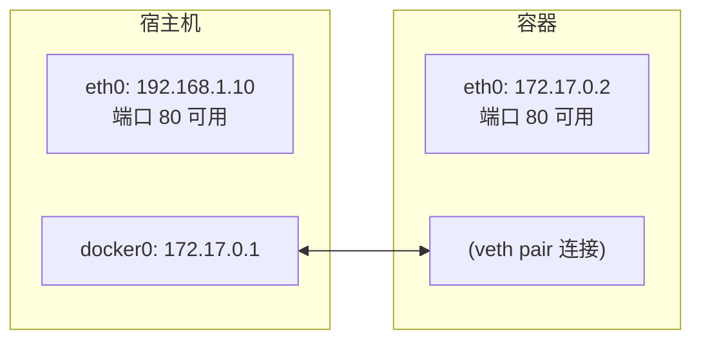

#### NET 关键点

- 每个容器有独立的网卡、IP、路由表、iptables 规则
- 多个容器可以监听相同端口（如都监听 80）
- Docker 使用 veth pair 连接容器网络和宿主机网桥

---

### 2.5 MNT Namespace

MNT Namespace 负责文件系统挂载点的隔离，确保容器看到独立的文件系统视图。

#### MNT 的作用

隔离文件系统挂载点，每个容器有自己的根目录。

#### MNT 隔离效果

```bash
宿主机文件系统：                  容器内看到的：
/                               /  ← 容器的根目录
├── bin/                        ├── bin/
├── home/                       ├── home/
├── var/                        ├── var/
│   └── lib/                    │   └── lib/
│       └── docker/             │
│           └── overlay2/       │
│               └── merged/ ────┼─── 这个目录成为容器的 /
└── ...                         └── ...
```

#### 与 chroot 的区别

| 特性 | chroot | MNT Namespace |
|------|--------|---------------|
| 安全性 | 可以逃逸 | 更安全 |
| 挂载隔离 | 无 | 完全隔离 |
| /proc/mounts | 共享 | 独立 |

---

### 2.6 UTS Namespace

UTS Namespace 主要用于隔离主机名和域名。

#### UTS 的作用

隔离主机名和域名，让每个容器可以有自己的主机名。

#### UTS 隔离效果

```bash
## 宿主机

$ hostname
my-server

## 容器内

$ docker run --hostname mycontainer ubuntu hostname
mycontainer
```
UTS = “UNIX Time-sharing System”，是历史遗留的名称。

---

### 2.7 IPC Namespace

IPC Namespace 用于隔离进程间通信资源，如 System V IPC 和 POSIX 消息队列。

#### IPC 的作用

隔离 System V IPC 和 POSIX 消息队列。

#### 隔离的资源

- 信号量 (semaphores)
- 消息队列 (message queues)
- 共享内存 (shared memory)

#### IPC 关键点

- 同一容器内的进程可以通过 IPC 通信
- 不同容器的进程无法通过 IPC 通信（除非显式共享）

---

### 2.8 USER Namespace

USER Namespace 允许将容器内的用户 ID 映射到宿主机的不同用户 ID。

#### USER 的作用

隔离用户和组 ID，实现权限隔离。

#### USER 隔离效果

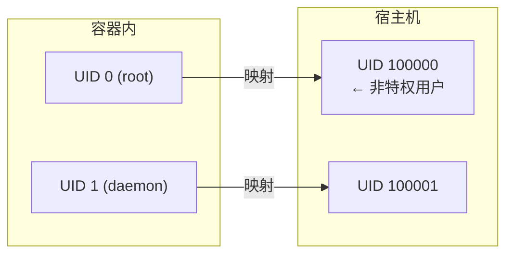

#### 安全意义

容器内的 root 用户可以映射为宿主机上的普通用户，即使容器被突破，攻击者在宿主机上也只有普通权限。

> 💡 笔者建议：生产环境建议启用 User Namespace，增强安全性。

---

### 2.9 动手实验：体验 Namespace

使用 `unshare` 命令可以在不使用 Docker 的情况下体验 Namespace：

#### 实验 1：UTS Namespace

```bash
## 创建新的 UTS namespace 并启动 shell

$ sudo unshare --uts /bin/bash

## 修改主机名（只影响这个 namespace）

$ hostname container-test
$ hostname
container-test

## 退出后查看宿主机主机名（未改变）

$ exit
$ hostname
my-server
```

#### 实验 2：PID Namespace

```bash
## 创建新的 PID 和 MNT namespace

$ sudo unshare --pid --mount --fork /bin/bash

## 挂载新的 /proc

$ mount -t proc proc /proc

## 查看进程（只能看到当前 shell）

$ ps aux
USER       PID %CPU %MEM    VSZ   RSS TTY      STAT START   TIME COMMAND
root         1  0.0  0.0   8960  4516 pts/0    S    10:00   0:00 /bin/bash
root         8  0.0  0.0  10072  3200 pts/0    R+   10:00   0:00 ps aux
```

#### 实验 3：NET Namespace

```bash
## 创建新的网络 namespace

$ sudo unshare --net /bin/bash

## 查看网络接口（只有 lo）

$ ip addr
1: lo: <LOOPBACK> mtu 65536 qdisc noop state DOWN
    link/loopback 00:00:00:00:00:00 brd 00:00:00:00:00:00
```
---

### 2.10 Namespace 的局限性

Namespace 提供了隔离但不是安全边界：

| 方面 | 说明 |
|------|------|
| **共享内核** | 所有容器共享宿主机内核，内核漏洞可能影响所有容器 |
| **部分资源未隔离** | /proc、/sys 部分内容仍可见；Time Namespace (Linux 5.6+) 虽已可用，但 Docker 默认不启用 |
| **非虚拟化** | 比虚拟机隔离性弱 |

> 需要更强隔离时，可考虑 gVisor、Kata Containers 等安全容器方案。

---

## 3. 控制组

控制组 (Cgroups) 是 Linux 内核提供的另一种关键机制，主要用于资源的限制和审计。

### 3.1 什么是控制组

控制组（Control Groups，简称 cgroups）是 Linux 内核的一个特性，用于 **限制、记录和隔离** 进程组的资源使用（CPU、内存、磁盘 I/O、网络等）。

> **核心作用**：让多个容器公平共享宿主机资源，防止单个容器耗尽系统资源。

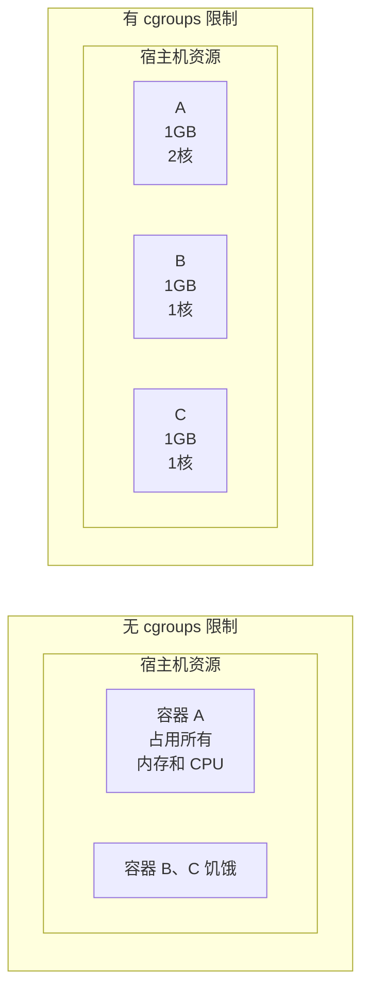
---

### 3.2 cgroups 的历史

| 时间 | 事件 |
|------|------|
| 2006 | Google 工程师提出 “process containers” 概念 |
| 2007 | 为避免与 Linux 容器概念混淆，更名为 “control groups” (cgroups) |
| 2008 | Linux 2.6.24（2008 年 1 月）正式合并 cgroups v1 |
| 2016 | Linux 4.5 引入 cgroups v2 |
| 现在 | Docker 在宿主机支持 cgroups v2 时会自动使用 v2，否则回退到 v1 |

---

### 3.3 cgroups 可以限制的资源

| 资源类型 | 子系统 | 说明 |
|---------|--------|------|
| **CPU** | `cpu`, `cpuset` | CPU 使用时间和核心分配 |
| **内存** | `memory` | 内存使用上限和 swap |
| **块设备 I/O** | `blkio` | 磁盘读写速度限制 |
| **网络** | `net_cls`, `net_prio` | 网络带宽优先级 |
| **进程数** | `pids` | 限制进程/线程数量 |

---

### 3.4 Docker 中的资源限制

Docker 提供了丰富的参数来配置容器的资源限制，主要包括内存、CPU、磁盘 I/O 等。

#### 内存限制

```bash
## 限制容器最多使用 512MB 内存

$ docker run -m 512m myapp

## 限制内存 + swap

$ docker run -m 512m --memory-swap 1g myapp

## 软限制（超过时警告，不会 OOM Kill）

$ docker run --memory-reservation 256m myapp
```
| 参数 | 说明 |
|------|------|
| `-m` / `--memory` | 硬限制（超过会 OOM Kill）|
| `--memory-swap` | 内存 + swap 总限制 |
| `--memory-reservation` | 软限制（内存竞争时生效）|
| `--oom-kill-disable` | 禁用 OOM Killer（谨慎使用）|

#### CPU 限制

```bash
## 限制使用 1.5 个 CPU 核心

$ docker run --cpus=1.5 myapp

## 限制使用 CPU 0 和 1

$ docker run --cpuset-cpus="0,1" myapp

## 设置 CPU 使用权重（相对值，默认 1024）

$ docker run --cpu-shares=512 myapp
```
| 参数 | 说明 |
|------|------|
| `--cpus` | 限制 CPU 核心数（如 1.5）|
| `--cpuset-cpus` | 绑定到特定 CPU 核心 |
| `--cpu-shares` | CPU 时间片权重（相对值）|
| `--cpu-period` / `--cpu-quota` | 精细控制 CPU 配额 |

#### 磁盘 I/O 限制

```bash
## 限制设备写入速度为 10MB/s

$ docker run --device-write-bps /dev/sda:10mb myapp

## 限制设备读取速度

$ docker run --device-read-bps /dev/sda:10mb myapp

## 限制 IOPS

$ docker run --device-write-iops /dev/sda:100 myapp
```

#### 进程数限制

```bash
## 限制最多 100 个进程

$ docker run --pids-limit=100 myapp
```
---

### 3.5 查看容器资源使用

```bash
## 实时监控所有容器的资源使用

$ docker stats
CONTAINER ID   NAME    CPU %   MEM USAGE / LIMIT   MEM %   NET I/O        BLOCK I/O
abc123         web     0.50%   45.5MiB / 512MiB    8.89%   1.2kB / 0B     0B / 0B
def456         db      2.30%   256MiB / 1GiB       25.00%  5.6kB / 3.2kB  4.1MB / 2.3MB

## 查看特定容器

$ docker stats mycontainer

## 查看容器的 cgroup 配置

$ docker inspect mycontainer --format '{{json .HostConfig}}' | jq
```
---

### 3.6 资源限制的效果

#### 内存超限

```bash
## 启动限制 100MB 内存的容器

$ docker run -m 100m stress --vm 1 --vm-bytes 200M

## 容器会被 OOM Killer 杀死

$ docker ps -a
CONTAINER ID   STATUS                      NAMES
abc123         Exited (137) 5 seconds ago  hopeful_darwin

## 137 = 128 + 9，表示被 SIGKILL（9） 杀死

...
```

#### CPU 限制验证

```bash
## 不限制 CPU

$ docker run --rm stress --cpu 4

## 占满所有 CPU

## 限制为 1 个核心

$ docker run --rm --cpus=1 stress --cpu 4

## 只能使用约 100% CPU（1 个核心）

...
```
---

### 3.7 cgroups v1 vs v2

| 特性 | cgroups v1 | cgroups v2 |
|------|-----------|-----------|
| 层级结构 | 多层级（每个资源单独）| 统一层级 |
| 管理复杂度 | 复杂 | 简化 |
| 资源分配 | 基于层级 | 基于子树 |
| PSI（压力监控）| ❌ | ✅ |
| rootless 容器 | 部分支持 | 完整支持 |

#### Docker 对 cgroups v2 的支持

Docker 20.10+ 开始支持 cgroups v2（如果系统支持），提供更好的性能和资源隔离。cgroup 驱动可以通过 Docker 守护进程配置文件 `/etc/docker/daemon.json` 的 `exec-opts` 配置项指定：

```json
{
  "exec-opts": ["native.cgroupdriver=systemd"]
}
```

`native.cgroupdriver` 仅支持 `systemd` 和 `cgroupfs` 两个取值；若不指定，cgroup v1 主机默认使用 `cgroupfs`，带 systemd 的 cgroup v2 主机默认使用 `systemd`。重启 Docker 守护进程后生效。

#### 检查系统使用的版本

```bash
## 查看 cgroup 版本

$ mount | grep cgroup
cgroup2 on /sys/fs/cgroup type cgroup2 (rw,nosuid,nodev,noexec,relatime)

## 如果显示 cgroup2 表示 v2

## 或者

$ cat /proc/filesystems | grep cgroup
nodev   cgroup
nodev   cgroup2
```
---

### 3.8 在 Compose 中设置限制

在 Compose 中设置限制配置如下：

```yaml
services:
  web:
    image: nginx
    deploy:
      resources:
        limits:
          cpus: '0.5'
          memory: 512M
        reservations:
          cpus: '0.25'
          memory: 256M
```
---

### 3.9 最佳实践

在使用 Cgroups 限制资源时，遵循一些最佳实践可以避免潜在的问题。

#### 1. 始终设置内存限制

```bash
## 防止 OOM 影响宿主机

$ docker run -m 1g myapp
```

#### 2. 为关键应用设置 CPU 保证

```bash
$ docker run --cpus=2 --cpu-shares=2048 critical-app
```

#### 3. 监控资源使用

```bash
## 配合 Prometheus + cAdvisor 监控

$ docker run -d --name cadvisor \
    -v /:/rootfs:ro \
    -v /var/run:/var/run:ro \
    -v /sys:/sys:ro \
    -v /var/lib/docker:/var/lib/docker:ro \
    ghcr.io/google/cadvisor
```
---

## 4. 联合文件系统

联合文件系统 (UnionFS) 是 Docker 镜像分层存储的基础，它允许将多个目录挂载为同一个虚拟文件系统。

### 4.1 什么是联合文件系统

联合文件系统 (UnionFS) 是一种 **分层、轻量级** 的文件系统，它将多个目录 “联合” 挂载到同一个虚拟目录，形成一个统一的文件系统视图。

> **核心思想**：将多个只读层叠加，最上层可写，形成完整的文件系统。

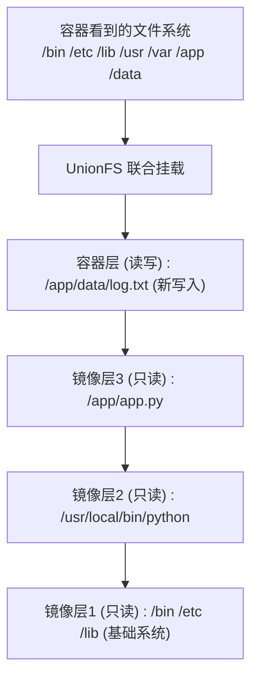
---

### 4.2 为什么 Docker 使用联合文件系统

Docker 选择联合文件系统作为其存储驱动，主要基于以下几个核心优势。

#### 1. 镜像分层复用

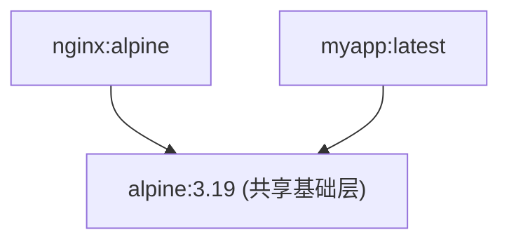
多个镜像共享相同的底层，节省磁盘空间。

#### 2. 快速构建

每个 Dockerfile 指令创建一层，只有变化的层需要重建：

```docker
FROM node:22          # 层1：基础镜像
COPY package.json ./  # 层2：依赖定义
RUN npm install       # 层3：安装依赖
COPY . .              # 层4：应用代码
```
代码变化时，只需重建层 4，层 1-3 使用缓存。

#### 3. 容器启动快

容器启动时不需要复制镜像，只需：

1. 在镜像层上创建一个薄的可写层
2. 联合挂载所有层

---

### 4.3 Copy-on-Write：写时复制

当容器修改只读层中的文件时：

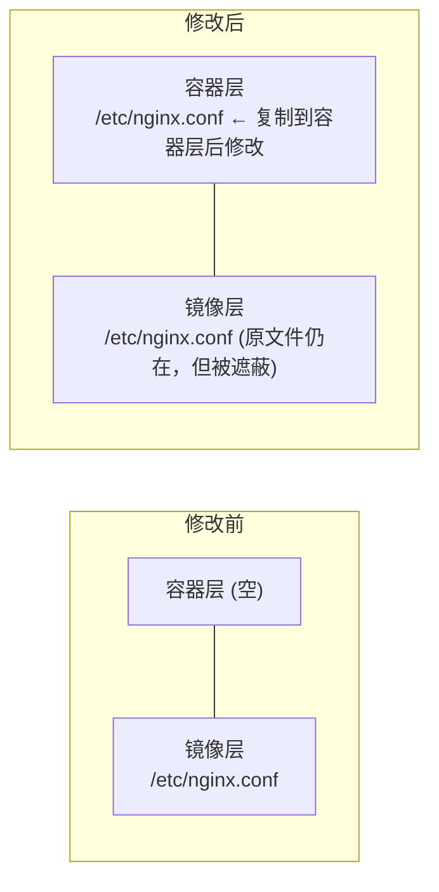
**流程**：

1. 从只读层读取文件
2. 复制到容器的可写层
3. 在可写层中修改
4. 后续读取使用可写层的版本

---

### 4.4 Docker 支持的存储驱动

Docker 的存储驱动经历了从早期各式各样的机制（如 aufs, devicemapper），到被广泛使用的现代经典 graph driver (`overlay2`)，再到当下（Engine v29.x 及以后）**在新安装场景中默认启用的 containerd 镜像存储引擎（containerd image store）** 的演进。

| 存储后端 / 驱动 | 核心特性说明 | 推荐程度 |
|---------|------|---------|
| **containerd image store**|（v29.x 新一代默认后端，新装默认）基于 containerd 的 snapshotters，原生支持 OCI image index、多架构镜像与 Attestations 构建溯源元数据存储；启用 `userns-remap` 时不可用。 | ✅**强烈推荐（现代默认）** |
| **overlay2**|（经典 Graph Driver）传统架构下的现代 Linux 默认驱动，性能优秀，但在处理复杂溯源元数据（索引）时受限。 | ✅**推荐（主要后备）** |
| **aufs** | 早期默认，已从现代 Docker Engine 移除 | 历史资料 |
| **btrfs**/**zfs** | 使用原生稳定文件系统快照能力 | 特定场景 |
| **devicemapper** | 块设备级存储，已从现代 Docker Engine 移除 | 历史资料 |
| **vfs** | 不使用 CoW，每层完整复制 | 仅测试 |

#### Classic Graph Drivers 与 Snapshotters 的核心差异

传统模型（如 `overlay2`）将镜像拉取解包的过程由 Docker 的 graph drivers 处理。而新的 `containerd image store` 则将这一职责彻底下放给了 `containerd` 自身的 `snapshotters`（底层在 Linux 发行版通常依然利用操作系统的 overlayfs）。这种架构改变带来了：

1. 本地免拉取查看多平台镜像 index manifest 与 attestations (SBOM、Provenance)。
2. 允许 Docker 使用 containerd snapshotters 管理镜像层，便于与现代 OCI 生态能力对齐。它不表示 kubelet/containerd 会自动复用 Docker 本地镜像；Kubernetes 镜像分发仍应以 registry、镜像拉取策略和运行时配置为准。

#### 查看当前存储驱动与后端

```bash
## 查看默认存储驱动
$ docker info | grep "Storage Driver"
Storage Driver: overlay2

## 在 Engine v29.x 中，可以通过如下输出验证是否开启了 containerd 镜像后端：
$ docker info -f '{{ .DriverStatus }}'
[[driver-type io.containerd.snapshotter.v1]]
```
---

### 4.5 overlay2 工作原理

在经典 graph driver 体系下，overlay2 仍是 Linux 上的主要推荐驱动；Docker Engine 29 新安装场景默认走 containerd image store/snapshotter。

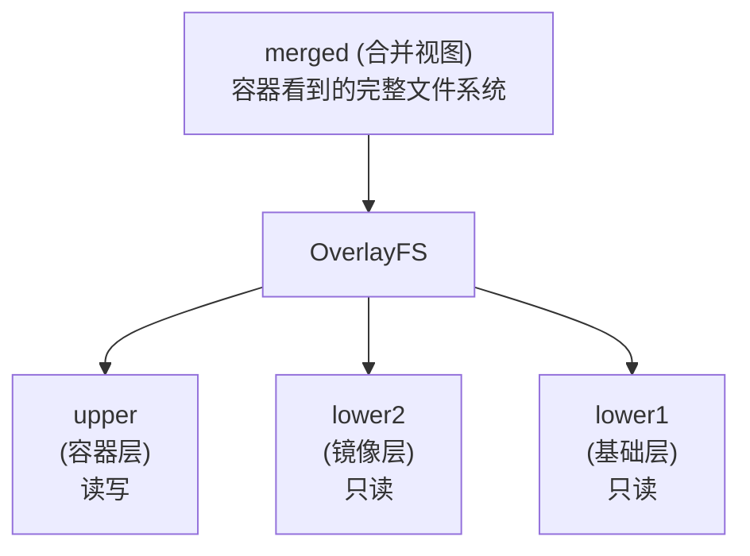

- **lowerdir**：只读的镜像层（可以有多个）
- **upperdir**：可写的容器层
- **workdir**：OverlayFS 的工作目录
- **merged**：联合挂载后的视图

#### 文件操作行为

| 操作 | 行为 |
|------|------|
| **读取** | 从上到下查找第一个匹配的文件 |
| **创建** | 在 upper 层创建 |
| **修改** | 如果在 lower 层，先复制到 upper 层再修改 |
| **删除** | 在 upper 层创建 whiteout 文件标记删除 |

---

### 4.6 查看镜像层

```bash
## 查看镜像的层信息

$ docker history nginx:alpine
IMAGE          CREATED       CREATED BY                                      SIZE
a6eb2a334a9f   2 weeks ago   CMD ["nginx" "-g" "daemon off;"]                0B
<missing>      2 weeks ago   STOPSIGNAL SIGQUIT                              0B
<missing>      2 weeks ago   EXPOSE map[80/tcp:{}]                           0B
<missing>      2 weeks ago   ENTRYPOINT ["/docker-entrypoint.sh"]            0B
<missing>      2 weeks ago   COPY 30-tune-worker-processes.sh /docker-ent…   4.62kB
...

## 查看层的存储位置

$ docker inspect nginx:alpine --format '{{json .GraphDriver.Data}}' | jq
{
  "LowerDir": "/var/lib/docker/overlay2/.../diff:/var/lib/docker/overlay2/.../diff",
  "MergedDir": "/var/lib/docker/overlay2/.../merged",
  "UpperDir": "/var/lib/docker/overlay2/.../diff",
  "WorkDir": "/var/lib/docker/overlay2/.../work"
}
```
---

### 4.7 最佳实践

为了构建高效、轻量的镜像，我们在使用联合文件系统时应注意以下几点。

#### 1. 减少镜像层数

```docker
## ❌ 每条命令创建一层

RUN apt-get update
RUN apt-get install -y nginx
RUN rm -rf /var/lib/apt/lists/*

## ✅ 合并为一层

RUN apt-get update && \
    apt-get install -y nginx && \
    rm -rf /var/lib/apt/lists/*
```

#### 2. 避免在容器中写入大量数据

容器层的写入性能低于直接写入。大量数据应使用：

- 数据卷 (Volume)
- 绑定挂载 (Bind Mount)

#### 3. 使用 .dockerignore

排除不需要的文件可以：

- 减小构建上下文
- 避免创建不必要的层

---

## 5. 容器格式

### Docker 容器格式的演进

最初，Docker 采用了 `LXC` 中的容器格式。从 0.7 版本以后开始去除 LXC 的依赖，转而使用自行开发的 [libcontainer](https://github.com/docker/libcontainer)。从 1.11 开始，则进一步演进为使用 [runC](https://github.com/opencontainers/runc) 和 [containerd](https://github.com/containerd/containerd)。

### 关键组件说明

#### LXC

Docker 早期版本（0.1-0.7）直接使用 LXC 作为容器运行时，利用 Linux Namespaces 和 Cgroups 实现容器隔离。

#### libcontainer

- Docker 自行开发的容器库
- 提供了容器的通用接口
- 不依赖于特定的 Linux 容器实现
- 更灵活和可控

#### runC

- OCI（Open Container Initiative）标准实现
- 轻量级的容器运行时
- 独立的二进制文件，可单独使用
- 基于 libcontainer 发展而来

#### containerd

- Docker 开源的容器运行时
- 提供了容器的完整生命周期管理
- 支持 runC 和其他 OCI 兼容的运行时
- 在 Kubernetes 等编排系统中广泛使用

### 容器规范标准

Docker 积极参与 Open Container Initiative (OCI) 的制定，推动了以下规范的发展：

- **Image Spec**：容器镜像格式规范
- **Runtime Spec**：容器运行时接口规范
- **Distribution Spec**：容器镜像分发规范

### 架构演变的优势

从 LXC → libcontainer → runC/containerd 的演变提供了以下优势：

1. 减少外部依赖
2. 提高运行效率
3. 遵循行业标准（OCI）
4. 增强可移植性和互操作性
5. 支持多种容器运行时选择

## 6. 网络

Docker 的网络实现其实就是利用了 Linux 上的网络命名空间和虚拟网络设备（特别是 veth pair）。建议先熟悉了解这两部分的基本概念再阅读本章。

### 6.1 基本原理

首先，要实现网络通信，机器需要至少一个网络接口（物理接口或虚拟接口）来收发数据包；此外，如果不同子网之间要进行通信，需要路由机制。

Docker 中的网络接口默认都是虚拟的接口。虚拟接口的优势之一是转发效率较高。
Linux 通过在内核中进行数据复制来实现虚拟接口之间的数据转发，发送接口的发送缓存中的数据包被直接复制到接收接口的接收缓存中。对于本地系统和容器内系统看来就像是一个正常的以太网卡，只是它不需要真正同外部网络设备通信，速度要快很多。

Docker 容器网络就利用了这项技术。它在本地主机和容器内分别创建一个虚拟接口，并让它们彼此连通（这样的一对接口叫做 `veth pair`）。

### 6.2 创建网络参数

Docker 创建一个容器的时候，会执行如下操作：

* 创建一对虚拟接口，分别放到本地主机和新容器中；
* 本地主机一端桥接到默认的 docker0 或指定网桥上，并具有一个唯一的名字，如 veth65f9；
* 容器一端放到新容器中，并修改名字作为 eth0，这个接口只在容器的命名空间可见；
* 从网桥可用地址段中获取一个空闲地址分配给容器的 eth0，并配置默认路由到桥接网卡 veth65f9。

完成这些之后，容器就可以使用 eth0 虚拟网卡来连接其他容器和其他网络。

可以在 `docker run` 的时候通过 `--network` 参数来指定容器的网络配置，有 4 个可选值：

* `--network=bridge` 这个是默认值，连接到默认的网桥。
* `--network=host` 告诉 Docker 不要将容器网络放到隔离的命名空间中，即不要容器化容器内的网络。此时容器使用本地主机的网络，它拥有完全的本地主机接口访问权限。容器进程可以跟主机其他 root 进程一样可以打开低范围的端口，可以访问本地网络服务比如 D-bus，还可以让容器做一些影响整个主机系统的事情，比如重启主机。因此使用这个选项的时候要非常小心。如果进一步的使用 `--privileged=true`，容器会被允许直接配置主机的网络堆栈。
* `--network=container:NAME_or_ID` 让 Docker 将新建容器的进程放到一个已存在容器的网络栈中，新容器进程有自己的文件系统、进程列表和资源限制，但会和已存在的容器共享 IP 地址和端口等网络资源，两者进程可以直接通过 `lo` 环回接口通信。
* `--network=none` 让 Docker 将新容器放到隔离的网络栈中，但是不进行网络配置。之后，用户可以自己进行配置。

### 6.3 网络配置细节

用户使用 `--net=none` 后，可以自行配置网络，让容器达到跟平常一样具有访问网络的权限。通过这个过程，可以了解 Docker 配置网络的细节。

首先，启动一个 `/bin/bash` 容器，指定 `--net=none` 参数。
```bash
$ docker run -i -t --rm --net=none base /bin/bash
root@63f36fc01b5f:/#
```
在本地主机查找容器的进程 id，并为它创建网络命名空间。
```bash
$ docker inspect -f '{{.State.Pid}}' 63f36fc01b5f
2778
$ pid=2778
$ sudo mkdir -p /var/run/netns
$ sudo ln -s /proc/$pid/ns/net /var/run/netns/$pid
```
检查桥接网卡的 IP 和子网掩码信息。
```bash
$ ip addr show docker0
21: docker0: ...
inet 172.17.0.1/16 scope global docker0
...
```
创建一对 “veth pair” 接口 A 和 B，绑定 A 到网桥 `docker0`，并启用它
```bash
$ sudo ip link add A type veth peer name B
$ sudo ip link set A master docker0
$ sudo ip link set A up
```
将 B 放到容器的网络命名空间，命名为 eth0，启动它并配置一个可用 IP（桥接网段）和默认网关。
```bash
$ sudo ip link set B netns $pid
$ sudo ip netns exec $pid ip link set dev B name eth0
$ sudo ip netns exec $pid ip link set eth0 up
$ sudo ip netns exec $pid ip addr add 172.17.0.99/16 dev eth0
$ sudo ip netns exec $pid ip route add default via 172.17.0.1
```
以上，就是 Docker 配置网络的具体过程。

当容器结束后，Docker 会清空容器，容器内的 eth0 会随网络命名空间一起被清除，A 接口也被自动从 `docker0` 卸载。

此外，用户可以使用 `ip netns exec` 命令来在指定网络命名空间中进行配置，从而配置容器内的网络。
