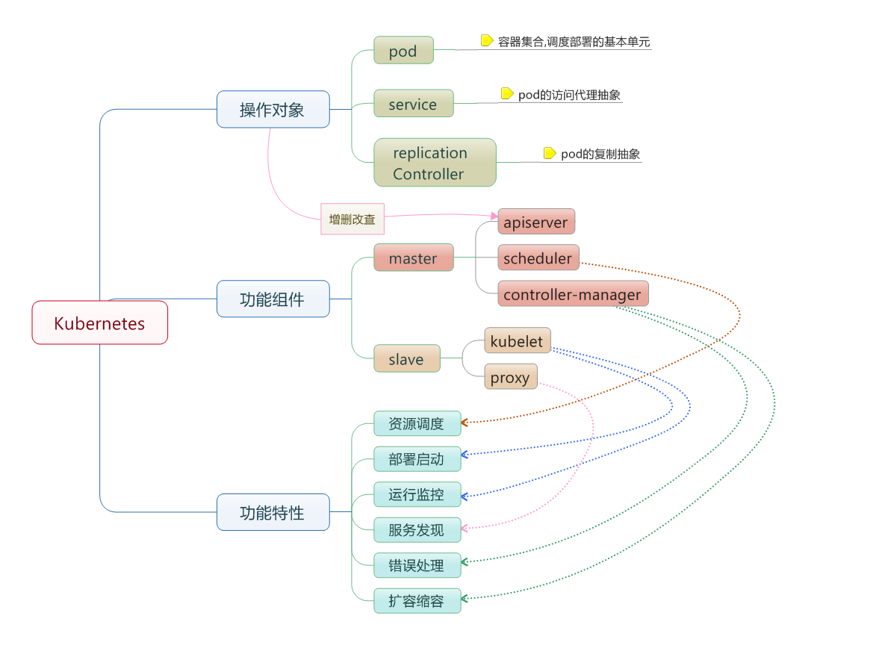
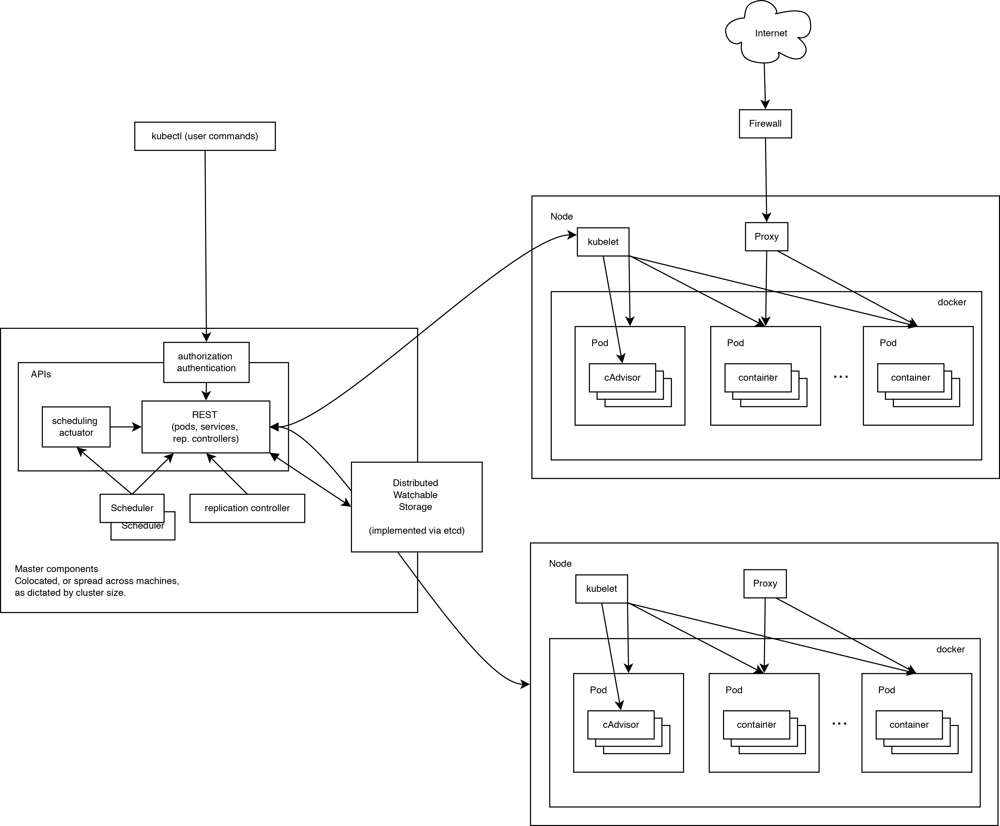
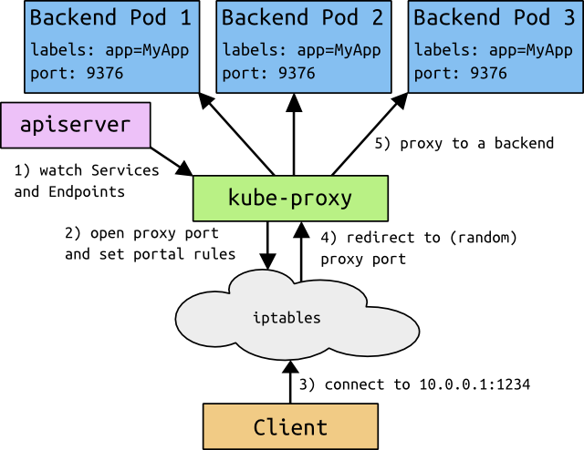

# 第十三章 容器编排基础

`Kubernetes` 是 Google 发起的开源容器编排系统，它支持多种云平台与私有数据中心。

`Kubernetes` 负责对容器工作负载进行调度与编排，其目的是让用户通过集群声明式地管理应用，而无需手动干预每个容器的生命周期细节。

Kubernetes 的最小调度单位是 `Pod`。一个 `Pod` 由一组紧密协作的容器构成，它们共享网络命名空间、IP 以及部分存储资源，也可以根据需要对 Pod 进行端口映射。

如果你已经熟悉 Docker，可以用以下对照来理解 Kubernetes 的核心概念：Docker 中的“容器”对应 Kubernetes 的 `Pod`（一个或多个容器的组合）；`docker-compose.yml` 的角色类似于 Kubernetes 的 `Deployment` + `Service` 声明；`docker run` 的端口映射和网络配置，在 Kubernetes 中由 `Service` 和 `Ingress` 接管。掌握这些映射关系，有助于从单机 Docker 平滑过渡到集群编排。

本章将分为 5 节介绍 `Kubernetes`：

* [简介](13.1_intro.md)
* [基本概念](13.2_concepts.md)
* [架构设计](13.3_design.md)
* [高级特性](13.4_advanced.md)
* [实战练习](13.5_practice.md)

## 1. 简介

如图 13-1 所示，Kubernetes 使用舵手图标作为项目标识。


图 13-1：Kubernetes 项目标识

### 1.1 什么是 Kubernetes

Kubernetes（常简称为 K8s）是 Google 开源的容器编排引擎。如果说 Docker 解决了 “如何打包和运送集装箱” 的问题，那么 Kubernetes 解决的就是 “如何管理海量集装箱的调度、运行和维护” 的问题。

它不仅仅是一个编排系统，更是一个 **云原生应用操作系统**。

> **名字由来**：Kubernetes 在希腊语中意为 “舵手” 或 “飞行员”。K8s 是因为 k 和 s 之间有 8 个字母。

---

### 1.2 为什么需要 Kubernetes

当我们在单机运行几个容器时，Docker Compose 就足够了。但在生产环境中，我们需要面对：

- **多主机调度**：容器应该运行在哪台机器上？
- **自动恢复**：容器崩溃了怎么办？节点挂了怎么办？
- **服务发现**：容器 IP 变了，其他服务怎么找到它？
- **负载均衡**：流量大了，如何分发给多个副本？
- **滚动更新**：如何不中断服务升级应用？

Kubernetes 完美解决了这些问题。

---

### 1.3 核心概念

Kubernetes 的核心概念包括 Pod、Node、Deployment、Service 和 Namespace 等，这些是学习和使用 Kubernetes 的基础。

#### Pod：豆荚

Kubernetes 的最小调度单位。一个 Pod 可以包含一个或多个紧密协作的容器（共享网络和存储）。就像豌豆荚里的豌豆一样。

#### Node：节点

运行 Pod 的物理机或虚拟机。

#### Deployment：部署

定义应用的期望状态（如：需要 3 个副本，镜像版本为 v1）。K8s 会持续确保当前状态符合期望状态。

#### Service：服务

定义一组 Pod 的访问策略。提供稳定的 Cluster IP 和 DNS 名称，负责负载均衡。

#### Namespace：命名空间

用于多租户资源隔离。

---

### 1.4 Docker 用户如何过渡

如果你已经熟悉 Docker，学习 K8s 会很容易：

| Docker 概念 | Kubernetes 概念 | 说明 |
|------------|----------------|------|
| Container  | Pod            | K8s 增加了一层 Pod 包装 |
| Volume     | PersistentVolume | K8s 的存储更加抽象和强大 |
| Network    | Service/Ingress| K8s 的网络模型更扁平 |
| Compose    | Deployment + Service | 声明式配置的理念是一致的 |

---

### 1.5 架构

Kubernetes 也是 C/S 架构，由 **Control Plane（控制平面）** 和 **Worker Node（工作节点）** 组成：

- **Control Plane**：负责决策 (API Server，Scheduler，Controller Manager，etcd)
- **Worker Node**：负责干活 (Kubelet，Kube-proxy，Container Runtime)

---

### 1.6 学习建议

Kubernetes 的学习曲线较陡峭。建议的学习路径：

1. **理解基本概念**：Pod，Deployment，Service
2. **动手实践**：使用 Minikube 或 Kind 在本地搭建集群
3. **部署应用**：编写 YAML 部署一个无状态应用
4. **深入原理**：网络模型、存储机制、调度算法

---

### 1.7 延伸阅读

- [Minikube 安装](../14_kubernetes_setup/README.md)：本地体验 K8s
- [Kubernetes 官网](https://kubernetes.io/)：官方文档

## 2. 基本概念

如图 13-2 所示，Kubernetes 由控制平面与工作节点构成。



图 13-2：Kubernetes 基本概念示意图

* 节点 (`Node`)：一个节点是一个运行 Kubernetes 中的主机。
* 容器组 (`Pod`)：Kubernetes 中最小的可部署和调度单元；一个 Pod 包含一个或多个紧密协作的容器，共享网络身份，并可共享一个或多个卷 (volume)。
* 容器组生命周期 (`pod-states`)：包含所有容器状态集合，包括容器组状态类型，容器组生命周期，事件，重启策略。
* 服务 (`services`)：一个 Kubernetes 服务是容器组逻辑的高级抽象，同时也对外提供访问容器组的策略。
* 卷 (`volumes`)：一个卷就是一个目录，容器对其有访问权限。
* 标签 (`labels`)：标签是用来连接一组对象的，比如容器组。标签可以被用来组织和选择子对象。
* 接口权限 (`accessing_the_api`)：端口，IP 地址和代理的防火墙规则。
* web 界面 (`ux`)：用户可以通过 Headlamp 等仍在维护的 web 界面观察和操作 Kubernetes；历史 Dashboard 已停止维护。
* 命令行操作 (`cli`)：`kubectl` 命令。

### 2.1 节点

在 `Kubernetes` 中，节点是实际工作的点，节点可以是虚拟机或者物理机器，依赖于一个集群环境。每个节点都有一些必要的组件以运行容器组，并且它们都可以通过控制平面来管理。必要组件包括 kubelet、容器运行时（如 containerd 或 CRI-O）和 kube-proxy；Docker 不再是 Kubernetes 节点的默认基线运行时。

#### 容器状态

容器状态用来描述节点的当前状态。现在，其中包含三个信息：

##### 主机 IP

主机 IP 需要云平台来查询，`Kubernetes` 把它作为状态的一部分来保存。如果 `Kubernetes` 没有运行在云平台上，节点 ID 就是必需的。IP 地址可以变化，并且可以包含多种类型的 IP 地址，如公共 IP，私有 IP，动态 IP，ipv6 等等。

##### 节点状态

注：`Pending` / `Running` / `Succeeded` / `Failed` / `Unknown` 是 **Pod 的生命周期阶段**（`pod.status.phase`），不是节点状态。节点本身没有 `Terminated` 状态。

节点的状态通过一组条件（Conditions）来描述。主要条件包括 `Ready`（kubelet 健康且可以接收 Pod）、`MemoryPressure`（内存不足）、`DiskPressure`（磁盘不足）和 `PIDPressure`（进程数过多）等。其中 `Ready` 条件最为关键：值为 `True` 表示节点健康可调度，`False` 表示节点异常，`Unknown` 表示节点控制器超过一定时间未收到心跳。被标记为 `Unknown` 较长时间的节点，其上的 Pod 会被驱逐重新调度到其他节点。

#### 节点管理

节点并非 Kubernetes 创建，而是由云平台创建，或者就是物理机器、虚拟机。在 Kubernetes 中，节点仅仅是一条记录，节点创建之后，Kubernetes 会检查其是否可用。可以通过 `kubectl` 查看节点信息：

```bash
$ kubectl get nodes
NAME           STATUS   ROLES           AGE   VERSION
control-plane  Ready    control-plane   10d   v1.36.0
worker-1       Ready    <none>          10d   v1.36.0
worker-2       Ready    <none>          10d   v1.36.0
```
每个节点的详细信息以如下结构保存：

```yaml
apiVersion: v1
kind: Node
metadata:
  name: worker-1
  labels:
    kubernetes.io/os: linux
status:
  capacity:
    cpu: "4"
    memory: 8Gi
  conditions:
    - type: Ready
      status: "True"
```

#### 节点控制器

在 Kubernetes 控制平面中，节点控制器 (Node Controller) 负责管理节点的生命周期，主要包含：

* 集群范围内节点状态同步
* 单节点生命周期管理

节点控制器会持续监控节点的健康状态。当节点变为不可达时，控制器会等待一个超时期限，然后将该节点上的 Pod 标记为失败，并触发重新调度。可以使用 `kubectl` 来管理节点，例如标记节点为不可调度或排空节点上的工作负载：

```bash
## 标记节点为不可调度
$ kubectl cordon worker-1

## 排空节点上的 Pod
$ kubectl drain worker-1 --ignore-daemonsets
```

### 2.2 容器组

在 Kubernetes 中，使用的最小调度单位是容器组 (Pod)，它是创建、调度、管理的最小单位。一个 Pod 包含一个或多个紧密协作的容器，它们共享网络命名空间，并可共享一个或多个存储卷。

Pod 通常不会被直接创建，而是通过 Deployment 等控制器来管理。当节点发生故障时，控制器会在其他可用节点上重新创建 Pod。

#### 容器组设计的初衷

容器组 (Pod) 的设计主要是为了解决应用间的紧密协作和资源共享问题。

#### 资源共享和通信

容器组主要是为了数据共享和它们之间的通信。

在一个容器组中，容器都使用相同的网络地址和端口，可以通过本地网络来相互通信。每个容器组都有独立的 IP，可以通过网络来和其他物理主机或者容器通信。

容器组可以挂载一组存储卷（挂载点）。卷不只用于持久化，也可用于 `emptyDir` 临时交换、ConfigMap/Secret 投射、日志旁路收集等场景。真正需要跨 Pod 生命周期保留的数据，应使用 PersistentVolume / PersistentVolumeClaim 等持久化机制。

#### 容器组管理

容器组是一个应用管理和部署的高层次抽象，同时也是一组容器的接口。容器组是部署、水平放缩的最小单位。

#### 容器组的使用

容器组可以通过组合来构建复杂的应用，典型的使用模式包含：

* 内容管理，文件和数据加载以及本地缓存管理等。
* 日志和检查点备份，压缩，快照等。
* 监听数据变化，跟踪日志，日志和监控代理，消息发布等。
* 代理，网桥
* 控制器，管理，配置以及更新

#### 为什么不在一个容器里运行多个程序

1. **透明化**：为了使容器组中的容器保持一致的基础设施和服务，比如进程管理和资源监控。
2. **解耦依赖**：每个容器都可能独立地重新构建和发布。
3. **方便使用**：用户不必运行独立的程序管理，也不用担心每个应用程序的退出状态。
4. **高效**：考虑到基础设施有更多的职责，容器必须要轻量化。

#### 容器组的生命状态

Pod phase 包括若干状态值：`Pending`、`Running`、`Succeeded`、`Failed`、`Unknown`。

| 状态 | 说明 |
|------|------|
| **Pending** | Pod 已被集群接受，但有一个或多个容器还没有运行起来（可能在拉取镜像）。|
| **Running** | Pod 已被调度到节点，并且所有容器都已启动。至少有一个容器处于运行状态。|
| **Succeeded** | Pod 中的所有容器都正常退出，且不会被重启。|
| **Failed** | Pod 中的所有容器都已终止，且至少有一个容器以失败状态退出。|
| **Unknown** | 集群无法获取 Pod 状态，常见原因是节点失联。|

#### 容器组生命周期与重启策略

Pod 的重启策略 (`restartPolicy`) 决定了容器退出后的行为：

| 重启策略 | 容器正常退出 | 容器异常退出 |
|---------|------------|------------|
| **Always**（默认）| 重启容器 | 重启容器 |
| **OnFailure** | 不重启 | 重启容器 |
| **Never** | 不重启 | 不重启 |

当节点故障或不可达时，Pod 可能先表现为 `Unknown`，之后根据控制器、驱逐策略和垃圾回收机制转为 `Failed` 或被重新创建。如果这些 Pod 由 Deployment 等控制器管理，控制器会自动在其他节点上重新创建。

### 2.3 Deployment 与 ReplicaSet

Deployment 是管理无状态应用的推荐方式，它通过 ReplicaSet 来确保指定数量的 Pod 副本始终在运行。

```yaml
apiVersion: apps/v1
kind: Deployment
metadata:
  name: nginx-deployment
spec:
  replicas: 3
  selector:
    matchLabels:
      app: nginx
  template:
    metadata:
      labels:
        app: nginx
    spec:
      containers:
        - name: nginx
          image: nginx:1.28
          ports:
            - containerPort: 80
```
Deployment 的核心能力包括：

* **副本管理**：确保始终有指定数量的 Pod 在运行
* **滚动更新**：逐步替换旧版本 Pod，实现零停机部署
* **回滚**：如果新版本出现问题，可以快速回滚到之前的版本

> 早期 Kubernetes 使用 Replication Controller (RC) 来管理副本，现已被 ReplicaSet/Deployment 取代。

### 2.4 StatefulSet

Deployment 适合无状态应用，而 **StatefulSet** 用于管理有状态应用（如数据库、消息队列）。与 Deployment 不同，StatefulSet 为每个 Pod 提供稳定的网络标识和持久化存储。

```yaml
apiVersion: apps/v1
kind: StatefulSet
metadata:
  name: mysql
spec:
  serviceName: mysql
  replicas: 3
  selector:
    matchLabels:
      app: mysql
  template:
    metadata:
      labels:
        app: mysql
    spec:
      containers:
        - name: mysql
          image: mysql:8.4
          volumeMounts:
            - name: data
              mountPath: /var/lib/mysql
  volumeClaimTemplates:
    - metadata:
        name: data
      spec:
        accessModes: ["ReadWriteOnce"]
        resources:
          requests:
            storage: 10Gi
```

StatefulSet 的核心特性：

* **稳定的网络标识**：Pod 名称按顺序编号（mysql-0, mysql-1, mysql-2），配合 Headless Service 提供可预测的 DNS 名称
* **有序部署与删除**：Pod 按序号顺序创建，逆序删除
* **持久化存储**：通过 `volumeClaimTemplates` 为每个 Pod 自动创建独立的 PVC

### 2.5 DaemonSet

**DaemonSet** 确保在集群的每个节点（或指定节点）上运行一个 Pod 副本。典型用途包括日志收集、监控代理和网络插件。

```yaml
apiVersion: apps/v1
kind: DaemonSet
metadata:
  name: fluentd
spec:
  selector:
    matchLabels:
      app: fluentd
  template:
    metadata:
      labels:
        app: fluentd
    spec:
      containers:
        - name: fluentd
          image: fluent/fluentd:v1.17
          volumeMounts:
            - name: varlog
              mountPath: /var/log
      volumes:
        - name: varlog
          hostPath:
            path: /var/log
```

当新节点加入集群时，DaemonSet 会自动在该节点上创建 Pod；当节点被移除时，对应的 Pod 也会被回收。

### 2.6 Job 与 CronJob

**Job** 用于运行一次性任务，确保指定数量的 Pod 成功完成后自动退出。**CronJob** 则按照 cron 表达式周期性地创建 Job。

```yaml
apiVersion: batch/v1
kind: Job
metadata:
  name: data-migration
spec:
  completions: 1
  template:
    spec:
      containers:
        - name: migrate
          image: myapp/migrate:latest
          command: ["python", "migrate.py"]
      restartPolicy: Never
  backoffLimit: 3
```

```yaml
apiVersion: batch/v1
kind: CronJob
metadata:
  name: daily-backup
spec:
  schedule: "0 2 * * *"
  jobTemplate:
    spec:
      template:
        spec:
          containers:
            - name: backup
              image: myapp/backup:latest
          restartPolicy: OnFailure
```

Job 的 `backoffLimit` 控制失败重试次数，`completions` 指定需要成功完成的 Pod 数量。CronJob 适用于定时备份、报表生成等场景。

### 2.7 服务

服务 (Service) 定义了一组 Pod 的逻辑集合和访问策略。由于 Pod 的 IP 地址是动态分配的，Service 提供了一个稳定的访问入口。

```yaml
apiVersion: v1
kind: Service
metadata:
  name: nginx-service
spec:
  selector:
    app: nginx
  ports:
    - port: 80
      targetPort: 80
  type: ClusterIP
```
常见的 Service 类型：

| 类型 | 说明 |
|------|------|
| **ClusterIP** | 默认类型，仅集群内部可访问 |
| **NodePort** | 在每个节点上开放固定端口，集群外部可通过 `节点IP:端口` 访问 |
| **LoadBalancer** | 通过云平台的负载均衡器暴露服务 |

### 2.8 卷

卷 (Volume) 为 Pod 中的容器提供持久化存储。Kubernetes 支持多种卷类型：

| 卷类型 | 说明 |
|-------|------|
| **emptyDir** | 临时存储，Pod 删除后数据丢失 |
| **hostPath** | 挂载节点上的文件或目录 |
| **PersistentVolumeClaim** | 使用持久卷声明，与底层存储解耦 |
| **configMap / secret** | 将配置或敏感数据挂载为文件 |

生产环境中，推荐使用 PersistentVolume (PV) 和 PersistentVolumeClaim (PVC) 来管理存储，实现存储资源与使用者的解耦。

### 2.9 标签

标签 (Label) 是附加到 Kubernetes 对象上的键值对，用于组织和选择对象子集。标签是 Kubernetes 中实现松耦合的关键机制。

```bash
## 为 Pod 添加标签
$ kubectl label pod my-pod env=production

## 通过标签选择器查询
$ kubectl get pods -l env=production
```
Service、Deployment 等资源都通过标签选择器 (`selector`) 来关联目标 Pod。

### 2.10 API 访问控制

Kubernetes API 的访问通过三个阶段进行控制：

1. **认证 (Authentication)**：验证请求者的身份（如证书、Token、OIDC）
2. **授权 (Authorization)**：判断请求者是否有权限执行操作（通常使用 RBAC）
3. **准入控制 (Admission Control)**：在请求被持久化之前对其进行校验或修改

### 2.11 Dashboard

Kubernetes Dashboard 是一个基于 Web 的用户界面，用于部署容器化应用、监控集群资源和排查问题。Dashboard 的部署方法详见[部署 Dashboard](../14_kubernetes_setup/14.7_dashboard.md) 章节。

### 2.12 命令行工具 kubectl

`kubectl` 是 Kubernetes 的命令行工具，用于与集群进行交互。常用命令如下：

```bash
## 查看集群中的资源
$ kubectl get pods,deployments,services,nodes

## 创建资源
$ kubectl apply -f deployment.yaml

## 查看 Pod 日志
$ kubectl logs my-pod

## 进入 Pod 执行命令
$ kubectl exec -it my-pod -- /bin/sh

## 查看资源详情
$ kubectl describe pod my-pod
```
更多 kubectl 操作详见[kubectl 命令行](../14_kubernetes_setup/14.8_kubectl.md)章节。

## 3. 架构设计

任何优秀的项目都离不开优秀的架构设计。本小节将介绍 Kubernetes 在架构方面的设计考虑。

### 3.1 基本考虑

如果让我们自己从头设计一套容器管理平台，有如下几个方面是很容易想到的：

* 分布式架构，保证扩展性；
* 逻辑集中式的控制平面 + 物理分布式的运行平面；
* 一套资源调度系统，管理哪个容器该分配到哪个节点上；
* 一套对容器内服务进行抽象和 HA 的系统。

### 3.2 运行原理

如图 13-3 所示，该图完整展示了 Kubernetes 的运行原理。



图 13-3：Kubernetes 运行原理图

可见，Kubernetes 首先是一套分布式系统，由多个节点组成，节点分为两类：一类是属于管理平面的主节点/控制节点 (Master Node)；一类是属于运行平面的工作节点 (Worker Node)。

显然，复杂的工作肯定都交给控制节点去做了，工作节点负责提供稳定的操作接口和能力抽象即可。

从这张图上，我们没有能发现 Kubernetes 中对于控制平面的分布式实现，但是由于数据后端自身就是一套分布式的数据库 Etcd，因此可以很容易扩展到分布式实现。

### 3.3 控制平面

控制平面 (Control Plane) 是 Kubernetes 集群的大脑，负责做出全局决策（如调度）以及检测和响应集群事件。

#### 主节点服务

主节点上需要提供如下的管理服务：

* `apiserver` 是整个系统的对外接口，提供一套 RESTful 的 [Kubernetes API](https://kubernetes.io/zh-cn/docs/concepts/overview/kubernetes-api/)，供客户端和其他组件调用；
* `scheduler` 负责对资源进行调度，分配某个 pod 到某个节点上。是 pluggable 的，意味着很容易选择其他实现方式；
* `controller-manager` 负责管理控制器，包括 endpoint-controller（刷新服务和 pod 的关联信息）和 replication-controller（维护某个 pod 的复制为配置的数值）。

#### Etcd

这里 Etcd 既作为数据后端，又作为消息中间件。

通过 Etcd 来存储所有的主节点上的状态信息，很容易实现主节点的分布式扩展。

组件可以自动的去侦测 Etcd 中的数值变化来获得通知，并且获得更新后的数据来执行相应的操作。

### 3.4 工作节点

* kubelet 是工作节点执行操作的 agent，负责具体的容器生命周期管理，根据从数据库中获取的信息来管理容器，并上报 pod 运行状态等；
* kube-proxy 是一个简单的网络访问代理，同时也是一个 Load Balancer。它负责将访问到某个服务的请求具体分配给工作节点上的 Pod（同一类标签）。



图 13-4：kube-proxy 请求转发示意图

## 4. 高级特性

掌握了 Kubernetes 的核心概念 (Pod，Service，Deployment) 后，我们需要了解更多高级特性以构建生产级应用。

### 4.1 Helm - 包管理工具

[Helm](https://helm.sh/) 被称为 Kubernetes 的包管理器（类似于 Linux 的 apt/yum）。它将一组 Kubernetes 资源定义文件打包为一个 **Chart**。

*   **安装应用**：`helm install my-release bitnami/mysql`
*   **版本管理**：轻松回滚应用的发布版本。
*   **模板化**：支持复杂的应用部署逻辑配置。

### 4.2 Gateway API 与 Ingress

Service 虽然提供了负载均衡，但通常是 4 层 (TCP/UDP)。集群需要 7 层 (HTTP/HTTPS) 路由能力来充当网关。

#### Gateway API（推荐）

> **重要**：Kubernetes 社区推荐使用 [Gateway API](https://gateway-api.sigs.k8s.io/) 作为新一代流量管理标准。原 `kubernetes/ingress-nginx` 项目已于 2026 年 3 月退役停止维护，不再接收安全更新。

Gateway API 基于 CRD 实现，提供了比 Ingress 更强大和标准化的流量管理能力：

*   **GatewayClass**：定义网关实现（类似 IngressClass）。
*   **Gateway**：定义监听端口和协议（由基础设施团队管理）。
*   **HTTPRoute**：定义 HTTP 路由规则（由应用团队管理）。
*   **职责分离**：基础设施、集群运维和应用开发者各管各的资源。

```yaml
apiVersion: gateway.networking.k8s.io/v1
kind: HTTPRoute
metadata:
  name: my-route
spec:
  parentRefs:
  - name: my-gateway
  hostnames:
  - "api.example.com"
  rules:
  - matches:
    - path:
        type: PathPrefix
        value: /api
    backendRefs:
    - name: api-svc
      port: 80
```

常见的 Gateway API 实现有 Envoy Gateway、Istio、Cilium、Traefik、Kong 等。

#### Ingress（传统方案）

Ingress 资源仍可正常使用，但建议新项目直接采用 Gateway API。已有 Ingress 配置可按需逐步迁移。

*   **域名路由**：基于 Host 将请求转发不同服务。
*   **路径路由**：基于 Path 将请求转发。
*   **SSL/TLS**：集中管理证书。

### 4.3 Persistent Volume 与 StorageClass

容器内的文件是临时的。对于有状态应用（如数据库），需要持久化存储。

*   **PVC (Persistent Volume Claim)**：用户申请存储的声明。
*   **PV (Persistent Volume)**：实际的存储资源（NFS，AWS EBS，Ceph 等）。
*   **StorageClass**：定义存储类，支持动态创建 PV。
*   **VolumeAttributesClass**：Kubernetes 1.34 起 GA，用于在 CSI 驱动支持 `ModifyVolume` 时动态调整卷属性，例如性能等级或服务质量参数。

### 4.4 Horizontal Pod Autoscaling

HPA 根据 CPU 利用率或其他指标（如内存、自定义指标）自动扩缩 Deployment 或 ReplicaSet 中的 Pod 数量。

```yaml
apiVersion: autoscaling/v2
kind: HorizontalPodAutoscaler
metadata:
  name: php-apache
spec:
  scaleTargetRef:
    apiVersion: apps/v1
    kind: Deployment
    name: php-apache
  minReplicas: 1
  maxReplicas: 10
  metrics:
  - type: Resource
    resource:
      name: cpu
      target:
        type: Utilization
        averageUtilization: 50
```

### 4.5 ConfigMap 与 Secret

*   **ConfigMap**：存储非机密的配置数据（配置文件、环境变量）。
*   **Secret**：存储机密数据（密码、Token、证书）。Secret 值默认只是 Base64 编码并存入 etcd；生产环境应显式启用 etcd 静态加密或 KMS。

通过将配置与镜像分离，保证了容器的可移植性。

### 4.6 Pod Security Standards

> **注意**：PodSecurityPolicy (PSP) 已在 Kubernetes 1.25 中完全移除。

Kubernetes 使用 **Pod Security Standards** 定义三个安全级别，通过内置的 Pod Security Admission 控制器在命名空间级别执行：

*   **Privileged**：不受限制，适用于系统级和基础设施工作负载。
*   **Baseline**：防止已知的权限提升，适用于大多数工作负载。
*   **Restricted**：严格限制，遵循 Pod 安全加固最佳实践。

```yaml
apiVersion: v1
kind: Namespace
metadata:
  name: my-app
  labels:
    pod-security.kubernetes.io/enforce: baseline
    pod-security.kubernetes.io/warn: restricted
```

### 4.7 Sidecar Containers

Kubernetes 1.33 起 Sidecar Containers 进入 GA。它们通过 `initContainers` 中带 `restartPolicy: Always` 的容器表达，既保留 init container 的启动顺序，又会在主容器生命周期内持续运行。对于旧集群或不需要启动顺序控制的场景，仍可使用普通多容器 Pod。

## 5. 实战练习

本章通过部署一个 Nginx 网站并配置 Service，串联前面学到的 Deployment、探针、资源配额和服务发现知识。

Deployment 与 Service 的[合并清单](../examples/validated/kubernetes/web.yaml)使用仓库内固定的 Kubernetes 1.31 strict schema 做离线 `kubeconform` 校验。下面的围栏与该文件由测试强制保持一致。

开始前请先准备好可用的 Kubernetes 集群和 `kubectl` 上下文。你可以先完成 [14.3 Docker Desktop](../14_kubernetes_setup/14.3_docker-desktop.md) 或 [14.4 Kind](../14_kubernetes_setup/14.4_kind.md)，并确认：

```bash
kubectl get nodes
```

### 5.1 目标

1. 部署一个包含 readiness probe 和资源请求/限制的 Nginx Deployment。
2. 创建一个 ClusterIP Service 暴露 Nginx。
3. 通过端口转发访问服务，并观察一次滚动发布。

### 5.2 保存并应用合并清单

<!-- canonical-example: kubernetes -->
```yaml
apiVersion: apps/v1
kind: Deployment
metadata:
  name: nginx-deployment
  labels:
    app: nginx
spec:
  replicas: 2
  selector:
    matchLabels:
      app: nginx
  template:
    metadata:
      labels:
        app: nginx
    spec:
      containers:
        - name: nginx
          image: nginx:1.28-alpine
          ports:
            - name: http
              containerPort: 80
          readinessProbe:
            httpGet:
              path: /
              port: http
          resources:
            requests:
              cpu: 50m
              memory: 32Mi
            limits:
              cpu: 200m
              memory: 128Mi
---
apiVersion: v1
kind: Service
metadata:
  name: nginx-service
spec:
  selector:
    app: nginx
  ports:
    - name: http
      port: 80
      targetPort: http
```

仓库内运行时，可直接应用经过校验的文件：

```bash
kubectl apply -f examples/validated/kubernetes/web.yaml
kubectl get deployment/nginx-deployment service/nginx-service
```

Service 未指定 `type`，因此使用默认的 `ClusterIP`，不会依赖不同本地集群对 NodePort 的宿主机映射行为。

### 5.3 访问服务

```bash
kubectl port-forward service/nginx-service 8080:80
```

然后访问 `http://localhost:8080`。结束端口转发可按 `Ctrl+C`。

> Ingress 只有在集群中已安装 Ingress controller 且配置了 IngressClass 时才会生效。当前练习只覆盖 Service；Ingress/Gateway API 建议在完成第 14 章后再单独练习。

### 5.4 观察滚动发布

修改 Pod 模板中的环境变量会触发 Deployment 滚动发布，而无需依赖另一个外部镜像标签：

```bash
kubectl set env deployment/nginx-deployment RELEASE_MARKER=demo-v2
kubectl rollout status deployment/nginx-deployment
```

### 5.5 清理资源

```bash
kubectl delete -f examples/validated/kubernetes/web.yaml
```
