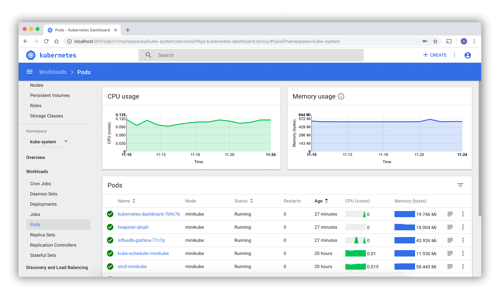

# 第十四章 部署 Kubernetes

目前，Kubernetes 支持在多种环境下使用，包括本地主机（Ubuntu、Debian、CentOS、Fedora 等）、云服务（[腾讯云 TKE](https://cloud.tencent.com/product/tke)、[阿里云 ACK](https://cn.aliyun.com/product/ack)、[百度云](https://cloud.baidu.com/product/cce.html)等）。

你可以使用以下几种方式部署 Kubernetes，接下来的小节会对各种方式进行详细介绍。

* 使用 kubeadm 部署（CRI 使用 containerd）
  * Kubernetes 也支持 CRI-O 等符合 CRI 的运行时；本文以 containerd 为主线。
* 使用 kubeadm 部署（使用 Docker）
* 在 Docker Desktop 使用
* Kind - Kubernetes IN Docker
* K3s - 轻量级 Kubernetes
* 一步步部署 Kubernetes 集群
* 可视化管理界面：Headlamp 与历史 Dashboard
* Kubernetes 命令行 kubectl

除了上述方式，企业生产环境中还有两个常见的部署工具值得关注：

* **[KubeKey](https://github.com/kubesphere/kubekey)**：KubeSphere 社区开源的集群部署工具（CNCF 认证），支持一条命令从裸机部署到高可用集群，内置对 containerd 和多 Linux 发行版的适配，适合需要快速搭建私有化 Kubernetes 的团队。
* **[RKE2](https://docs.rke2.io/)**：SUSE Rancher 出品的安全加固型 Kubernetes 发行版，默认启用 CIS 基准合规、SELinux 支持和 etcd 自动快照，适合对安全审计有严格要求的企业场景。

## 1. 使用 kubeadm 部署 Kubernetes

`kubeadm` 提供了 `kubeadm init` 以及 `kubeadm join` 这两个命令，作为快速创建 `Kubernetes` 集群的常用工具。

> **版本说明**：Kubernetes 版本更新较快（约每 4 个月一个新版本），本文档基于 Kubernetes 1.36 编写。更完整的安装和兼容性说明请以 [Kubernetes 官方 kubeadm 文档](https://kubernetes.io/docs/setup/production-environment/tools/kubeadm/install-kubeadm/) 和 [containerd 官方文档](https://containerd.io/docs/) 为准。

### 1.1 安装 containerd

参考安装 Docker 一节添加 apt/yum 源，之后执行如下命令。

```bash
# debian 系

$ sudo apt install containerd.io

# rhel 系

$ sudo yum install containerd.io
```

### 1.2 配置 containerd

先生成默认配置文件，然后只调整与 kubeadm 相关的关键项：

```bash
$ sudo mkdir -p /etc/containerd
$ containerd config default | sudo tee /etc/containerd/config.toml > /dev/null
```

打开 `/etc/containerd/config.toml`，确认 `runc` 选项使用 `systemd` cgroup 驱动：

```toml
# containerd 2.x（当前默认版本）
[plugins."io.containerd.cri.v1.runtime".containerd.runtimes.runc.options]
  SystemdCgroup = true

# containerd 1.x（旧版本）使用以下路径，2.x 亦兼容
# [plugins."io.containerd.grpc.v1.cri".containerd.runtimes.runc.options]
#   SystemdCgroup = true
```

> **提示**：`containerd config default` 生成的默认配置会自动使用当前版本的正确路径。如果你使用的是 containerd 2.x，配置中的插件路径将以 `io.containerd.cri.v1.runtime` 开头；如果仍在使用 1.x，则为 `io.containerd.grpc.v1.cri`。

默认配置里的其他内容通常可以保持不变。修改完成后重启 containerd：

```bash
$ sudo systemctl restart containerd
```

### 1.3 安装 **kubelet**、**kubeadm**、**kubectl**、**cri-tools**、**kubernetes-cni**

需要在每台机器上安装以下的软件包：

#### Ubuntu/Debian

```bash
$ K8S_MINOR="v1.36"

$ sudo apt-get update
$ sudo apt-get install -y ca-certificates curl gpg

$ sudo install -m 0755 -d /etc/apt/keyrings
$ curl -fsSL "https://pkgs.k8s.io/core:/stable:/${K8S_MINOR}/deb/Release.key" | sudo gpg --dearmor -o /etc/apt/keyrings/kubernetes-apt-keyring.gpg
$ sudo chmod a+r /etc/apt/keyrings/kubernetes-apt-keyring.gpg

$ echo "deb [signed-by=/etc/apt/keyrings/kubernetes-apt-keyring.gpg] https://pkgs.k8s.io/core:/stable:/${K8S_MINOR}/deb/ /" | sudo tee /etc/apt/sources.list.d/kubernetes.list > /dev/null

$ sudo apt-get update
$ sudo apt-get install -y kubelet kubeadm kubectl cri-tools kubernetes-cni

$ sudo apt-mark hold kubelet kubeadm kubectl
```

#### CentOS/Fedora

```bash
$ K8S_MINOR="v1.36"

$ cat <<EOF | sudo tee /etc/yum.repos.d/kubernetes.repo
[kubernetes]
name=Kubernetes
baseurl=https://pkgs.k8s.io/core:/stable:/${K8S_MINOR}/rpm/
enabled=1
gpgcheck=1
repo_gpgcheck=1
gpgkey=https://pkgs.k8s.io/core:/stable:/${K8S_MINOR}/rpm/repodata/repomd.xml.key
EOF

$ sudo yum install -y kubelet kubeadm kubectl cri-tools kubernetes-cni
```

### 1.4 修改内核的运行参数

#### 加载内核模块

```bash
$ cat <<EOF | sudo tee /etc/modules-load.d/k8s.conf
overlay
br_netfilter
EOF

$ sudo modprobe overlay
$ sudo modprobe br_netfilter
```

#### cgroup v2 要求：必须

Kubernetes 自 v1.35 起弃用 cgroup v1，默认要求节点使用 cgroup v2。从 v1.35 开始，kubelet 在 cgroup v1 节点上默认会拒绝启动，但管理员可以在 kubelet 配置中设置 `failCgroupV1: false` 来兼容 cgroup v1（仅建议用于遗留系统过渡期）。验证节点是否支持 cgroup v2：

```bash
$ mount | grep cgroup2
```

如果输出包含 `cgroup2`，则系统已支持 cgroup v2。对于仍在使用 cgroup v1 的系统（如较旧的 RHEL 8），建议升级内核或更新系统配置以启用 cgroup v2。

#### 禁用 swap：必须

kubelet 默认要求禁用 swap，否则可能导致初始化失败或节点无法加入集群。

```bash
$ sudo swapoff -a

# 如需永久禁用，可在 /etc/fstab 中注释 swap 对应行
```
```bash
$ cat <<EOF | sudo tee /etc/sysctl.d/99-kubernetes-cri.conf
net.bridge.bridge-nf-call-iptables  = 1
net.ipv4.ip_forward                 = 1
net.bridge.bridge-nf-call-ip6tables = 1
EOF

# 应用配置

$ sudo sysctl --system
```

### 1.5 配置 kubelet

为了让 kubelet 正确运行，我们需要对其进行一些必要的配置。

#### 修改 `kubelet.service`（可选：IPVS 模式）

> **注意**：kube-proxy 的 IPVS 模式已在 Kubernetes 1.35 中被标记为弃用；Kubernetes 1.36 文档仍将其列为已弃用模式，并推荐迁移到 nftables。新部署应使用默认的 iptables 模式或 nftables 模式（Kubernetes 1.33+ 稳定）。以下 IPVS 配置仅供旧环境参考。

`/etc/systemd/system/kubelet.service.d/10-proxy-ipvs.conf` 写入以下内容

```bash
# 启用 ipvs 相关内核模块（已弃用，建议迁移至 nftables）

[Service]
ExecStartPre=-/sbin/modprobe ip_vs
ExecStartPre=-/sbin/modprobe ip_vs_rr
ExecStartPre=-/sbin/modprobe ip_vs_wrr
ExecStartPre=-/sbin/modprobe ip_vs_sh
```
执行以下命令应用配置。

```bash
$ sudo systemctl daemon-reload
```

### 1.6 部署

安装配置完成后，我们将分别在 Master 节点和 Worker 节点上进行部署操作。

#### master

```bash
$ sudo systemctl enable containerd

$ sudo systemctl start containerd

$ sudo kubeadm init \
      --pod-network-cidr 10.244.0.0/16 \
      --cri-socket unix:///run/containerd/containerd.sock \
      --v 5
```

* `--pod-network-cidr 10.244.0.0/16` 参数与后续 CNI 插件有关，这里以 `flannel` 为例，若后续部署其他类型的网络插件请更改此参数。
* kubeadm 默认使用 `registry.k8s.io` 拉取 Kubernetes 控制平面镜像。受限网络环境可通过 kubeadm 配置文件中的 `imageRepository` 指向受信任镜像仓库；不要把第三方镜像仓库当成通用默认值。

> 若 `kubeadm` 预检失败，应按提示修复缺失依赖、内核参数、swap 或运行时配置。实验环境确需忽略预检时，只忽略明确理解且可接受的单项检查，不建议使用 `--ignore-preflight-errors=all`。

执行成功会输出

```bash
...
[addons] Applied essential addon: CoreDNS
I1116 12:35:13.270407   86677 request.go:538] Throttling request took 181.409184ms, request: POST:https://<CONTROL_PLANE_HOST>:6443/api/v1/namespaces/kube-system/serviceaccounts
I1116 12:35:13.470292   86677 request.go:538] Throttling request took 186.088112ms, request: POST:https://<CONTROL_PLANE_HOST>:6443/api/v1/namespaces/kube-system/configmaps
[addons] Applied essential addon: kube-proxy

Your Kubernetes control-plane has initialized successfully!

To start using your cluster, you need to run the following as a regular user:

  mkdir -p $HOME/.kube
  sudo cp -i /etc/kubernetes/admin.conf $HOME/.kube/config
  sudo chown $(id -u):$(id -g) $HOME/.kube/config

You should now deploy a pod network to the cluster.
Run "kubectl apply -f [podnetwork].yaml" with one of the options listed at:
  https://kubernetes.io/docs/concepts/cluster-administration/addons/

Then you can join any number of worker nodes by running the following on each as root:

kubeadm join <CONTROL_PLANE_HOST>:6443 --token <TOKEN> \
    --discovery-token-ca-cert-hash sha256:<DISCOVERY_TOKEN_CA_CERT_HASH>
```

#### node 工作节点

在 **另一主机** 重复 **部署** 小节以前的步骤，安装配置好 kubelet。根据提示，加入到集群。

```bash
$ sudo systemctl enable containerd

$ sudo systemctl start containerd

$ kubeadm join <CONTROL_PLANE_HOST>:6443 \
    --token <TOKEN> \
    --discovery-token-ca-cert-hash sha256:<DISCOVERY_TOKEN_CA_CERT_HASH> \
    --cri-socket unix:///run/containerd/containerd.sock
```

其中 `<CONTROL_PLANE_HOST>`、`<TOKEN>` 和 `<DISCOVERY_TOKEN_CA_CERT_HASH>` 应使用你自己的 `kubeadm init` 输出，不要复用示例值。

### 1.7 查看服务

所有服务启动后，通过 `crictl` 查看本地实际运行的容器。这些服务大概分为三类：主节点服务、工作节点服务和其他服务。

```bash
CONTAINER_RUNTIME_ENDPOINT=unix:///run/containerd/containerd.sock crictl ps -a
```

#### 主节点服务

* `apiserver` 是整个系统的对外接口，提供 RESTful 方式供客户端和其他组件调用；

* `scheduler` 负责对资源进行调度，分配某个 pod 到某个节点上；

* `controller-manager` 负责管理控制器，包括 endpoint-controller（刷新服务和 pod 的关联信息）和 replication-controller（维护某个 pod 的复制为配置的数值）。

#### 工作节点服务

* `proxy` 为 pod 上的服务提供访问的代理。

#### 其他服务

* Etcd 是所有状态的存储数据库；

### 1.8 使用

将 `/etc/kubernetes/admin.conf` 复制到 `~/.kube/config`

执行 `$ kubectl get all -A` 查看启动的服务。

由于未部署 CNI 插件，CoreDNS 未正常启动。如何使用 Kubernetes，请参考后续章节。

### 1.9 部署 CNI

这里以 `flannel` 为例进行介绍。

#### flannel

检查 podCIDR 设置

```bash
$ kubectl get node -o yaml | grep CIDR

# 输出

    podCIDR: 10.244.0.0/16
    podCIDRs:
```
```bash
# 注意：以下以 v0.28.4 为示例；安装前请到 releases 页面核验当前版本
# 参见 https://github.com/flannel-io/flannel/releases
$ kubectl apply -f https://raw.githubusercontent.com/flannel-io/flannel/v0.28.4/Documentation/kube-flannel.yml
```

### 1.10 master 节点默认不能运行 pod

如果用 `kubeadm` 部署一个单节点集群，默认情况下无法使用，请执行以下命令解除限制

```bash
$ kubectl taint nodes --all node-role.kubernetes.io/control-plane-

# 较旧版本使用 master taint

# $ kubectl taint nodes --all node-role.kubernetes.io/master-

# 恢复默认值

# $ kubectl taint nodes NODE_NAME node-role.kubernetes.io/control-plane=true:NoSchedule

...
```

## 2. 使用 kubeadm 部署 Kubernetes：使用 Docker

`kubeadm` 提供了 `kubeadm init` 以及 `kubeadm join` 这两个命令，作为快速创建 `Kubernetes` 集群的最佳实践。

> **版本说明**：本文档基于 Kubernetes v1.36 编写。Kubernetes 版本更新较快（约每 4 个月一个新版本），本文档中的第三方工具版本（如 cri-dockerd、flannel）仅为示例，请根据实际需求更新至当前版本。更完整的安装和兼容性说明请以 [Kubernetes 官方文档](https://kubernetes.io/docs/setup/production-environment/tools/kubeadm/install-kubeadm/) 为准。

> ⚠️ **强烈提示：Docker 与 Kubernetes 环境的时代分界**
>
> 自 Kubernetes v1.24 起，内置的 `dockershim` 组件已被正式移除。这意味着 **Kubernetes 不再将 Docker Engine 作为默认内置的容器运行时**。虽然 Docker 仍然是你本地构建、管理镜像的绝佳工具，但它已不再是 kubelet 的默认运行时选项。
>
> 因此，**强烈推荐** 读者直接参考同目录下的《使用 kubeadm 部署 Kubernetes（CRI 使用 containerd）》作为主要的部署路线。
>
> 本文档保留，主要用于历史环境维护或特殊需求场景：如果你必须在较新的 Kubernetes 集群中继续使用 Docker Engine 作为底层运行时，你必须理解 CRI 层机制，额外部署并配置第三方兼容层 `cri-dockerd`，同时在部署时手动补充 `--cri-socket` 等参数约束。

### 2.1 安装 Docker

参考安装 Docker 一节安装 Docker。

### 2.2 安装并配置 cri-dockerd

由于 Kubernetes v1.24 移除了内置的 dockershim，需要额外安装 **cri-dockerd** 作为 Docker 与 kubelet 之间的 CRI（Container Runtime Interface）适配层。

#### Ubuntu/Debian

```bash
# 安装 cri-dockerd
# 注意：以下以 v0.4.3 为示例；安装前请到 releases 页面核验当前版本和校验值
# 参见 https://github.com/Mirantis/cri-dockerd/releases

$ cd /tmp
$ wget https://github.com/Mirantis/cri-dockerd/releases/download/v0.4.3/cri-dockerd-0.4.3.amd64.tgz
$ tar xzvf cri-dockerd-0.4.3.amd64.tgz
$ sudo mv cri-dockerd/cri-dockerd /usr/local/bin/

# 下载并安装 systemd service 文件

$ wget https://raw.githubusercontent.com/Mirantis/cri-dockerd/master/packaging/systemd/cri-docker.service
$ wget https://raw.githubusercontent.com/Mirantis/cri-dockerd/master/packaging/systemd/cri-docker.socket
$ sed -i -e 's,/usr/bin/cri-dockerd,/usr/local/bin/cri-dockerd,' cri-docker.service
$ sudo mv cri-docker.service cri-docker.socket /etc/systemd/system/

# 启动 cri-dockerd

$ sudo systemctl daemon-reload
$ sudo systemctl enable cri-docker
$ sudo systemctl start cri-docker

# 验证安装

$ sudo /usr/local/bin/cri-dockerd --version
```

#### CentOS/Fedora

```bash
# 安装 cri-dockerd
# 注意：以下以 v0.4.3 为示例；安装前请到 releases 页面核验当前版本和校验值
# 参见 https://github.com/Mirantis/cri-dockerd/releases

$ cd /tmp
$ wget https://github.com/Mirantis/cri-dockerd/releases/download/v0.4.3/cri-dockerd-0.4.3.amd64.tgz
$ tar xzvf cri-dockerd-0.4.3.amd64.tgz
$ sudo mv cri-dockerd/cri-dockerd /usr/local/bin/

# 下载并安装 systemd service 文件

$ wget https://raw.githubusercontent.com/Mirantis/cri-dockerd/master/packaging/systemd/cri-docker.service
$ wget https://raw.githubusercontent.com/Mirantis/cri-dockerd/master/packaging/systemd/cri-docker.socket
$ sed -i -e 's,/usr/bin/cri-dockerd,/usr/local/bin/cri-dockerd,' cri-docker.service
$ sudo mv cri-docker.service cri-docker.socket /etc/systemd/system/

# 启动 cri-dockerd

$ sudo systemctl daemon-reload
$ sudo systemctl enable cri-docker
$ sudo systemctl start cri-docker
```

### 2.3 安装 **kubelet**、**kubeadm**、**kubectl**

需要在每台机器上安装以下的软件包：

#### Ubuntu/Debian

```bash
$ K8S_MINOR="v1.36"

$ sudo apt-get update
$ sudo apt-get install -y ca-certificates curl gpg

$ sudo install -m 0755 -d /etc/apt/keyrings
$ curl -fsSL "https://pkgs.k8s.io/core:/stable:/${K8S_MINOR}/deb/Release.key" | sudo gpg --dearmor -o /etc/apt/keyrings/kubernetes-apt-keyring.gpg
$ sudo chmod a+r /etc/apt/keyrings/kubernetes-apt-keyring.gpg

$ echo "deb [signed-by=/etc/apt/keyrings/kubernetes-apt-keyring.gpg] https://pkgs.k8s.io/core:/stable:/${K8S_MINOR}/deb/ /" | sudo tee /etc/apt/sources.list.d/kubernetes.list > /dev/null

$ sudo apt-get update
$ sudo apt-get install -y kubelet kubeadm kubectl

$ sudo apt-mark hold kubelet kubeadm kubectl
```

#### CentOS/Fedora

```bash
$ K8S_MINOR="v1.36"

$ cat <<EOF | sudo tee /etc/yum.repos.d/kubernetes.repo
[kubernetes]
name=Kubernetes
baseurl=https://pkgs.k8s.io/core:/stable:/${K8S_MINOR}/rpm/
enabled=1
gpgcheck=1
repo_gpgcheck=1
gpgkey=https://pkgs.k8s.io/core:/stable:/${K8S_MINOR}/rpm/repodata/repomd.xml.key
EOF

$ sudo yum install -y kubelet kubeadm kubectl
```

### 2.4 修改内核的运行参数

#### cgroup v2 要求：必须

Kubernetes v1.36 默认要求节点使用 cgroup v2。kubelet 在 cgroup v1 节点上默认会拒绝启动，但管理员可以在 kubelet 配置中设置 `failCgroupV1: false` 来兼容 cgroup v1（仅建议用于遗留系统过渡期）。验证节点是否支持 cgroup v2：

```bash
$ mount | grep cgroup2
```

如果输出包含 `cgroup2`，则系统已支持 cgroup v2。对于仍在使用 cgroup v1 的系统（如较旧的 RHEL 8），建议升级内核或更新系统配置以启用 cgroup v2。

#### 加载内核模块

```bash
$ cat <<EOF | sudo tee /etc/modules-load.d/k8s.conf
overlay
br_netfilter
EOF

$ sudo modprobe overlay
$ sudo modprobe br_netfilter
```

#### swap 设置：现代集群仍建议优先关闭

在现代 Kubernetes 中，Linux 节点已经支持更细粒度的 swap 行为控制。对于多数 `kubeadm` 教学环境，**优先关闭 swap 仍然是最稳妥的默认做法**，因为这样最接近常见生产基线，也能避免不同发行版和 kubelet 配置差异带来的排障成本。

如果你明确要在启用 swap 的前提下运行节点，则应额外核对 kubelet 的 `NoSwap` / `LimitedSwap` 配置与当前 Kubernetes 版本文档，而不要把“开着 swap 也能跑”直接当作通用默认路径。

```bash
$ sudo swapoff -a

# 如需永久禁用，可在 /etc/fstab 中注释 swap 对应行
```
```bash
$ cat <<EOF | sudo tee /etc/sysctl.d/99-kubernetes-cri.conf
net.bridge.bridge-nf-call-iptables  = 1
net.ipv4.ip_forward                 = 1
net.bridge.bridge-nf-call-ip6tables = 1
EOF

# 应用配置

$ sudo sysctl --system
```

### 2.5 配置 kubelet

为了让 kubelet 正确运行，我们需要对其进行一些必要的配置。

#### 修改 `kubelet.service`（可选：IPVS 模式）

> **注意**：kube-proxy 的 IPVS 模式已在 Kubernetes 1.35 中被标记为弃用；Kubernetes 1.36 文档仍将其列为已弃用模式，并推荐迁移到 nftables。新部署应使用默认的 iptables 模式或 nftables 模式（Kubernetes 1.33+ 稳定）。以下 IPVS 配置仅供旧环境参考。

`/etc/systemd/system/kubelet.service.d/10-proxy-ipvs.conf` 写入以下内容

```bash
# 启用 ipvs 相关内核模块（已弃用，建议迁移至 nftables）

[Service]
ExecStartPre=-/sbin/modprobe ip_vs
ExecStartPre=-/sbin/modprobe ip_vs_rr
ExecStartPre=-/sbin/modprobe ip_vs_wrr
ExecStartPre=-/sbin/modprobe ip_vs_sh
```
执行以下命令应用配置。

```bash
$ sudo systemctl daemon-reload
```

### 2.6 部署

安装配置完成后，我们将分别在 Master 节点和 Worker 节点上进行部署操作。

#### master

```bash
$ sudo kubeadm init --pod-network-cidr 10.244.0.0/16 \
      --cri-socket unix:///var/run/cri-dockerd.sock \
      --v 5
```

* `--cri-socket unix:///var/run/cri-dockerd.sock` 参数指定使用 cri-dockerd 作为容器运行时接口。
* `--pod-network-cidr 10.244.0.0/16` 参数与后续 CNI 插件有关，这里以 `flannel` 为例，若后续部署其他类型的网络插件请更改此参数。
* kubeadm 默认使用 `registry.k8s.io` 拉取 Kubernetes 控制平面镜像。受限网络环境可通过 kubeadm 配置文件中的 `imageRepository` 指向受信任镜像仓库；不要把第三方镜像仓库当成通用默认值。

> 若 `kubeadm` 预检失败，应按提示修复缺失依赖、内核参数、swap 或运行时配置。实验环境确需忽略预检时，只忽略明确理解且可接受的单项检查，不建议使用 `--ignore-preflight-errors=all`。

执行成功会输出

```bash
...
[addons] Applied essential addon: CoreDNS
I1116 12:35:13.270407   86677 request.go:538] Throttling request took 181.409184ms, request: POST:https://<CONTROL_PLANE_HOST>:6443/api/v1/namespaces/kube-system/serviceaccounts
I1116 12:35:13.470292   86677 request.go:538] Throttling request took 186.088112ms, request: POST:https://<CONTROL_PLANE_HOST>:6443/api/v1/namespaces/kube-system/configmaps
[addons] Applied essential addon: kube-proxy

Your Kubernetes control-plane has initialized successfully!

To start using your cluster, you need to run the following as a regular user:

  mkdir -p $HOME/.kube
  sudo cp -i /etc/kubernetes/admin.conf $HOME/.kube/config
  sudo chown $(id -u):$(id -g) $HOME/.kube/config

You should now deploy a pod network to the cluster.
Run "kubectl apply -f [podnetwork].yaml" with one of the options listed at:
  https://kubernetes.io/docs/concepts/cluster-administration/addons/

Then you can join any number of worker nodes by running the following on each as root:

kubeadm join <CONTROL_PLANE_HOST>:6443 --token <TOKEN> \
    --discovery-token-ca-cert-hash sha256:<DISCOVERY_TOKEN_CA_CERT_HASH>
```

#### node 工作节点

在 **另一主机** 重复 **部署** 小节以前的步骤，安装配置好 kubelet。根据提示，加入到集群。

```bash
$ kubeadm join <CONTROL_PLANE_HOST>:6443 --token <TOKEN> \
    --discovery-token-ca-cert-hash sha256:<DISCOVERY_TOKEN_CA_CERT_HASH> \
    --cri-socket unix:///var/run/cri-dockerd.sock
```

其中 `<CONTROL_PLANE_HOST>`、`<TOKEN>` 和 `<DISCOVERY_TOKEN_CA_CERT_HASH>` 应使用你自己的 `kubeadm init` 输出，不要复用示例值。

### 2.7 查看服务

所有服务启动后，查看本地实际运行的 Docker 容器。这些服务大概分为三类：主节点服务、工作节点服务和其他服务。

#### 主节点服务

* `apiserver` 是整个系统的对外接口，提供 RESTful 方式供客户端和其他组件调用；

* `scheduler` 负责对资源进行调度，分配某个 pod 到某个节点上；

* `controller-manager` 负责管理控制器，包括 endpoint-controller（刷新服务和 pod 的关联信息）和 replication-controller（维护某个 pod 的复制为配置的数值）。

#### 工作节点服务

* `proxy` 为 pod 上的服务提供访问的代理。

#### 其他服务

* Etcd 是所有状态的存储数据库；

### 2.8 使用

将 `/etc/kubernetes/admin.conf` 复制到 `~/.kube/config`

执行 `$ kubectl get all -A` 查看启动的服务。

由于未部署 CNI 插件，CoreDNS 未正常启动。如何使用 Kubernetes，请参考后续章节。

### 2.9 部署 CNI

这里以 `flannel` 为例进行介绍。

#### flannel

检查 podCIDR 设置

```bash
$ kubectl get node -o yaml | grep CIDR

# 输出

    podCIDR: 10.244.0.0/16
    podCIDRs:
```
```bash
# 注意：以下以 v0.28.4 为示例；安装前请到 releases 页面核验当前版本
# 参见 https://github.com/flannel-io/flannel/releases
$ kubectl apply -f https://raw.githubusercontent.com/flannel-io/flannel/v0.28.4/Documentation/kube-flannel.yml
```

### 2.10 master 节点默认不能运行 pod

如果用 `kubeadm` 部署一个单节点集群，默认情况下无法使用，请执行以下命令解除限制

```bash
$ kubectl taint nodes --all node-role.kubernetes.io/control-plane-

# 较旧版本使用 master taint

# $ kubectl taint nodes --all node-role.kubernetes.io/master-

# 恢复默认值

# $ kubectl taint nodes NODE_NAME node-role.kubernetes.io/control-plane=true:NoSchedule

...
```

## 3. 在 Docker Desktop 使用

使用 Docker Desktop 可以很方便的启用 Kubernetes。

### 3.1 启用 Kubernetes

在 Docker Desktop 设置页面，进入 `Kubernetes`，创建或启用集群。较新的 Docker Desktop 可选择 `kind` 或 `kubeadm` 作为集群创建方式；日常本地开发优先选择 `kind`，因为它支持多节点和版本选择。


> 注意：Docker Desktop Kubernetes 的控制平面镜像默认从 Docker Hub 拉取，例如 `docker.io/docker/desktop-*` 或 `docker.io/kindest/node:<tag>`。如果企业网络不能访问 Docker Hub，应按 Docker Desktop 的 `KubernetesImagesRepository` 设置镜像仓库，并用 `docker desktop kubernetes images list`（Docker Desktop 4.44+）或 `docker ps` 确认实际镜像标签。普通 Docker Engine 的 `registry-mirrors` 不会自动改写这些控制平面镜像。

### 3.2 测试

```bash
$ kubectl version
$ kubectl config use-context docker-desktop
$ kubectl get nodes
```
如果 `kubectl get nodes` 显示节点为 `Ready`，则证明 Kubernetes 成功启动。

## 4. Kind - Kubernetes IN Docker

[Kind](https://kind.sigs.k8s.io/) (Kubernetes in Docker) 是一个使用 Docker 容器作为节点运行本地 Kubernetes 集群的工具。主要用于测试 Kubernetes 本身，也非常适合本地开发和 CI 环境。

> **版本说明**：本文档基于 Kind v0.33.0 编写。Kind 会根据下载时的默认行为自动拉取对应的 Kubernetes 版本。建议定期更新 Kind 到最新版本以获得最新的 Kubernetes 支持。详见 [Kind Releases](https://github.com/kubernetes-sigs/kind/releases)。

### 4.1 为什么选择 Kind

Kind 相比其他本地集群方案（如 Minikube）有以下显著优势：

*   **轻量便捷**：只要有 Docker 环境即可，无需额外虚拟机。
*   **多集群支持**：可以轻松在本地启动多个集群。
*   **多版本支持**：支持指定 Kubernetes 版本进行测试。
*   **HA 支持**：支持模拟高可用集群（多 Control Plane）。

### 4.2 安装 Kind

Kind 是一个二进制文件，放到 PATH 中即可使用。以下是不同系统的安装方法。

#### macOS

```bash
brew install kind
```

#### Linux / Windows

可以下载二进制文件：

```bash
# Linux AMD64
# 注意：v0.33.0 为编写本文档时的最新版本，请根据需要替换为当前版本
# 参见 https://github.com/kubernetes-sigs/kind/releases

curl -Lo ./kind https://kind.sigs.k8s.io/dl/v0.33.0/kind-linux-amd64
chmod +x ./kind
sudo mv ./kind /usr/local/bin/kind
```

### 4.3 创建集群

最简单的创建方式：

```bash
kind create cluster
```
指定集群名称：

```bash
kind create cluster --name my-cluster
```

### 4.4 与集群交互

Kind 会自动将 kubeconfig 合并到 `~/.kube/config`。

```bash
kubectl cluster-info --context kind-kind
kubectl get nodes
```

### 4.5 高级用法：配置集群

创建一个 `kind-config.yaml` 来定制集群，例如映射端口到宿主机：

```yaml
kind: Cluster
apiVersion: kind.x-k8s.io/v1alpha4
nodes:
- role: control-plane
  extraPortMappings:
  - containerPort: 80
    hostPort: 8080
    protocol: TCP
- role: worker
- role: worker
```
应用配置：

```bash
kind create cluster --config kind-config.yaml
```

### 4.6 删除集群

```bash
kind delete cluster
```

## 5. K3s - 轻量级 Kubernetes

[K3s](https://k3s.io/) 是一个轻量级的 Kubernetes 发行版，由 Rancher Labs 开发。它专为边缘计算、物联网、CI、ARM 等资源受限的环境设计。K3s 被打包为单个二进制文件，只有不到 100MB，但通过了 CNCF 的一致性测试。

> **版本说明**：K3s 版本与 Kubernetes 版本对应。安装脚本会自动拉取最新稳定版本。如需指定特定版本，可在安装时设置 `INSTALL_K3S_VERSION` 环境变量。详见 [K3s Releases](https://github.com/k3s-io/k3s/releases)。

### 5.1 核心特性

*   **轻量级**：移除过时的、非必须的 Kubernetes 功能（如传统的云提供商插件），使用 SQLite 作为默认数据存储（也支持 Etcd/MySQL/Postgres）。
*   **单一二进制**：所有组件 (API Server，Controller Manager，Scheduler，Kubelet，Kube-proxy) 打包在一个进程中运行。
*   **开箱即用**：内置 Helm Controller、Traefik Ingress controller、ServiceLB、Local-Path-Provisioner。
*   **安全**：默认启用安全配置，基于 TLS 通信。

### 5.2 安装

K3s 的安装非常简单，官方提供了便捷的安装脚本。

#### 脚本安装

K3s 提供了极为便捷的安装脚本。该命令会从网络下载脚本并直接交给 `sh` 执行，生产环境建议先下载审查脚本内容，并按官方文档固定版本或安装参数：

```bash
curl -sfL https://get.k3s.io | sh -
```
安装完成后，K3s 会自动启动并配置好 `systemd` 服务。

#### 查看状态

```bash
sudo k3s kubectl get nodes
```
输出类似：
```bash
NAME          STATUS   ROLES                  AGE   VERSION
k3s-master    Ready    control-plane,master   1m    v1.36.0+k3s1
```

> **版本说明**：输出中的 `v1.36.0+k3s1` 为编写本文档时的版本示例。实际输出版本号取决于你所安装的 K3s 版本。更多信息请参见 [K3s Releases](https://github.com/k3s-io/k3s/releases)。

### 5.3 快速使用

K3s 内置了 `kubectl` 命令（通过 `k3s kubectl` 调用），为了方便，通常会建立别名或配置 `KUBECONFIG`。

```bash
## 读取 K3s 的配置文件

export KUBECONFIG=/etc/rancher/k3s/k3s.yaml

## 现在可以直接使用 kubectl

kubectl get pods -A
```

### 5.4 清理卸载

```bash
/usr/local/bin/k3s-uninstall.sh
```

## 6. 一步步部署 Kubernetes 集群

### 6.1 概述

部署 Kubernetes 集群涉及多个组件的安装和配置，包括 Master 节点和 Worker 节点。本章介绍如何使用 systemd 管理这些服务的生命周期。

### 6.2 Kubernetes 主要组件

#### Master 节点组件

- **kube-apiserver**：API 服务器，Kubernetes 集群的中心
- **kube-controller-manager**：控制器管理器
- **kube-scheduler**：调度器，负责 Pod 调度
- **etcd**：分布式键值存储，存储集群数据

#### Worker 节点组件

- **kubelet**：节点代理，管理容器生命周期
- **kube-proxy**：网络代理，处理服务网络
- **Container Runtime**：容器运行时（Docker、containerd 等）

### 6.3 使用 systemd 管理 Kubernetes 服务

#### 服务单元文件

为了让 systemd 管理 Kubernetes 服务，需要创建相应的 `.service` 文件，例如：

```text
/etc/systemd/system/kubelet.service
/etc/systemd/system/kube-proxy.service
/etc/systemd/system/kube-apiserver.service
```

#### 常用命令

```bash
# 启动服务
sudo systemctl start kubelet

# 停止服务
sudo systemctl stop kubelet

# 重启服务
sudo systemctl restart kubelet

# 查看服务状态
sudo systemctl status kubelet

# 设置开机自启
sudo systemctl enable kubelet
```

如果希望查看更完整的 systemd 部署案例，可以参考 `opsnull/follow-me-install-kubernetes-cluster` 这类社区项目，再结合本章前文的 kubeadm 与组件配置说明理解整体流程。

### 6.4 推荐学习路径

1. 理解 Kubernetes 架构和各组件的作用
2. 准备所需的系统环境（Linux 主机、网络配置等）
3. 按步骤安装各个 Kubernetes 组件
4. 配置 systemd 服务单元文件
5. 验证集群健康状态

## 7. 可视化管理界面

[Kubernetes Dashboard](https://github.com/kubernetes-retired/dashboard) 是历史上常用的 Kubernetes Web UI，但项目已停止维护。

> **注意**：Kubernetes 官方文档已将 Dashboard 标记为 deprecated and unmaintained，新安装建议考虑 [Headlamp](https://headlamp.dev/) 等仍在维护的替代方案。以下 Dashboard 内容仅供历史迁移或存量环境参考。



### 7.1 推荐替代：Headlamp

Headlamp 是 Kubernetes SIG UI 下的现代 Web UI，可通过 Helm 安装：

```bash
$ helm repo add headlamp https://kubernetes-sigs.github.io/headlamp/
$ helm install headlamp headlamp/headlamp --namespace kube-system
```

本地访问时优先使用端口转发，避免直接把管理界面暴露到公网：

```bash
$ kubectl -n kube-system port-forward svc/headlamp 4466:80
```

### 7.2 历史 Dashboard 部署

Dashboard 7.0+ 版本仅支持通过 Helm 安装：

```bash
$ helm repo add kubernetes-dashboard https://kubernetes-retired.github.io/dashboard/

$ helm upgrade --install kubernetes-dashboard kubernetes-dashboard/kubernetes-dashboard \
  --create-namespace --namespace kubernetes-dashboard
```

### 7.3 访问

通过端口转发访问 Dashboard：

```bash
$ kubectl -n kubernetes-dashboard port-forward svc/kubernetes-dashboard-kong-proxy 8443:443
```

然后在浏览器打开 `https://localhost:8443` 即可访问。

### 7.4 登录

为历史 Dashboard 创建只读服务账户并获取短期登录令牌。不要为 Dashboard 创建 `cluster-admin` 绑定；如果确实需要临时管理员权限，应走单独的 break-glass 审批和审计流程。

```bash
$ kubectl create sa dashboard-readonly -n kubernetes-dashboard

$ kubectl create clusterrolebinding dashboard-readonly \
  --clusterrole=view \
  --serviceaccount=kubernetes-dashboard:dashboard-readonly

$ kubectl create token dashboard-readonly -n kubernetes-dashboard --duration=1h
```

将输出的令牌粘贴到登录页面，即可登录。

## 8. Kubernetes 命令行 kubectl

[kubectl](https://github.com/kubernetes/kubernetes) 是 Kubernetes 自带的客户端，可以用它来直接操作 Kubernetes。

kubectl 的基本用法格式为：

```bash
kubectl [command] [resource] [name] [flags]
```

其中 `command` 是操作命令（如 get、apply、delete），`resource` 是资源类型（如 pod、deployment、service），`name` 是资源名称（可选），`flags` 是各种选项参数。

### 8.1 get

显示一个或多个资源。最常用的命令之一，用于查询集群中的资源状态。

```bash
# 查看所有 Pod
$ kubectl get pods

# 查看指定命名空间中的 Deployment
$ kubectl get deployment -n kube-system

# 查看所有资源
$ kubectl get all

# 使用更详细的输出格式
$ kubectl get pods -o wide

# 输出为 YAML 格式
$ kubectl get pod my-pod -o yaml

# 根据标签选择资源
$ kubectl get pods -l app=nginx
```

### 8.2 describe

显示资源的详细信息，包括事件、状态、配置等。用于调试和查看资源的完整信息。

```bash
# 查看特定 Pod 的详情
$ kubectl describe pod my-pod

# 查看 Node 的详情
$ kubectl describe node node-1

# 查看 Deployment 的详情
$ kubectl describe deployment nginx-deployment
```

### 8.3 apply

从文件或标准输入应用配置。这是声明式资源管理的标准方式，可用于创建或更新资源。

```bash
# 应用 YAML 文件
$ kubectl apply -f deployment.yaml

# 应用目录中的所有 YAML 文件
$ kubectl apply -f ./manifests/

# 从标准输入应用配置
$ cat deployment.yaml | kubectl apply -f -
```

### 8.4 create

从文件或标准输入创建资源。与 apply 不同，create 仅用于创建新资源，如果资源已存在会报错。

```bash
# 创建资源
$ kubectl create -f pod.yaml

# 从标准输入创建
$ kubectl create -f - < deployment.yaml
```

### 8.5 delete

删除一个或多个资源。支持按名称、标签、资源类型等多种方式删除。

```bash
# 按名称删除
$ kubectl delete pod my-pod

# 删除整个 Deployment（同时删除其管理的 Pod）
$ kubectl delete deployment nginx-deployment

# 按标签删除
$ kubectl delete pods -l app=nginx

# 从文件删除
$ kubectl delete -f deployment.yaml
```

### 8.6 logs

查看 Pod 中容器的日志。用于调试应用和查看容器输出。

```bash
# 查看 Pod 的日志
$ kubectl logs my-pod

# 查看 Pod 中特定容器的日志
$ kubectl logs my-pod -c container-name

# 实时跟踪日志（类似 tail -f）
$ kubectl logs -f my-pod

# 查看最近 100 行日志
$ kubectl logs my-pod --tail=100

# 查看 Pod 启动前的日志（适用于已崩溃的容器）
$ kubectl logs my-pod --previous
```

### 8.7 exec

在运行中的容器内部执行命令。用于调试、排查问题或执行应用内的操作。

```bash
# 进入容器的交互式 shell
$ kubectl exec -it my-pod -- /bin/sh

# 在容器中执行命令
$ kubectl exec my-pod -- ls -la /app

# 在 Pod 中的特定容器执行命令
$ kubectl exec -it my-pod -c container-name -- /bin/bash
```

### 8.8 port-forward

将本地端口转发到 Pod 的端口。用于本地访问集群内的服务，无需暴露 Service。

```bash
# 将本地 8080 端口转发到 Pod 的 80 端口
$ kubectl port-forward pod/my-pod 8080:80

# 使用随机本地端口
$ kubectl port-forward pod/my-pod :80

# 转发到 Service
$ kubectl port-forward svc/my-service 8080:80
```

### 8.9 rollout

对 Deployment、DaemonSet、StatefulSet 等资源执行滚动更新、暂停、继续或回滚操作。

```bash
# 查看滚动更新状态
$ kubectl rollout status deployment/nginx-deployment

# 暂停滚动更新
$ kubectl rollout pause deployment/nginx-deployment

# 继续滚动更新
$ kubectl rollout resume deployment/nginx-deployment

# 查看更新历史
$ kubectl rollout history deployment/nginx-deployment

# 回滚到前一个版本
$ kubectl rollout undo deployment/nginx-deployment

# 回滚到特定版本
$ kubectl rollout undo deployment/nginx-deployment --to-revision=2
```

### 8.10 label

向资源添加、修改或删除标签。标签用于组织和选择资源。

```bash
# 为 Pod 添加标签
$ kubectl label pod my-pod env=production

# 修改已有标签
$ kubectl label pod my-pod env=staging --overwrite

# 删除标签
$ kubectl label pod my-pod env-

# 为多个资源添加标签
$ kubectl label pods -l app=nginx version=v1
```

### 8.11 annotate

向资源添加或修改注解。注解用于存储任意元数据，不用于资源选择。

```bash
# 添加注解
$ kubectl annotate pod my-pod description="Production pod"

# 修改注解
$ kubectl annotate pod my-pod description="Staging pod" --overwrite

# 删除注解
$ kubectl annotate pod my-pod description-
```

### 8.12 edit

直接编辑 Kubernetes 资源。编辑器由 `EDITOR` 环境变量指定。

```bash
# 编辑 Pod
$ kubectl edit pod my-pod

# 编辑 Deployment
$ kubectl edit deployment nginx-deployment
```

### 8.13 config

管理 kubectl 的配置文件（通常位于 `~/.kube/config`）。

```bash
# 查看当前配置
$ kubectl config view

# 切换上下文
$ kubectl config use-context my-cluster

# 查看所有上下文
$ kubectl config get-contexts

# 设置默认命名空间
$ kubectl config set-context --current --namespace=my-namespace
```

### 8.14 cluster-info

显示集群的连接信息和组件状态。

```bash
# 显示集群信息
$ kubectl cluster-info

# 显示完整的集群状态（注：componentstatuses 自 1.19 起已弃用，建议使用下方替代命令）
$ kubectl get componentstatuses
# 推荐替代：
$ kubectl get --raw='/readyz?verbose'
```

### 8.15 version

显示 kubectl 客户端和 Kubernetes API server 的版本信息。

```bash
# 显示版本
$ kubectl version

# 仅显示客户端版本
$ kubectl version --client

# 以 JSON 格式输出
$ kubectl version --output=json
```

### 8.16 api-versions

列出 API server 支持的所有 API 版本，格式为 “组/版本”。

```bash
$ kubectl api-versions
```

### 8.17 explain

解释资源的字段含义。用于了解 YAML 配置文件中各字段的作用。

```bash
# 查看 Pod 资源的字段说明
$ kubectl explain pod

# 查看 Pod 下 spec 字段的说明
$ kubectl explain pod.spec

# 查看具体字段的详细说明
$ kubectl explain pod.spec.containers
```

### 8.18 auth

检查用户权限，用于验证 RBAC 配置。

```bash
# 检查当前用户是否有权限执行操作
$ kubectl auth can-i create pods

# 检查特定用户的权限
$ kubectl auth can-i create pods --as=other-user
```

### 8.19 help

显示任何命令的帮助信息。

```bash
# 显示 kubectl 的一般帮助
$ kubectl help

# 显示特定命令的帮助
$ kubectl get --help

# 显示资源的 API 文档
$ kubectl explain deployment
```
