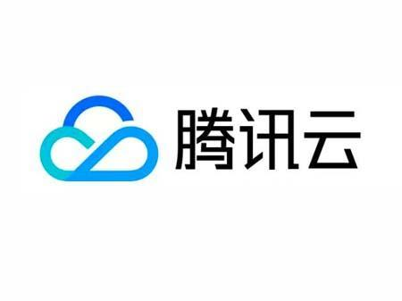
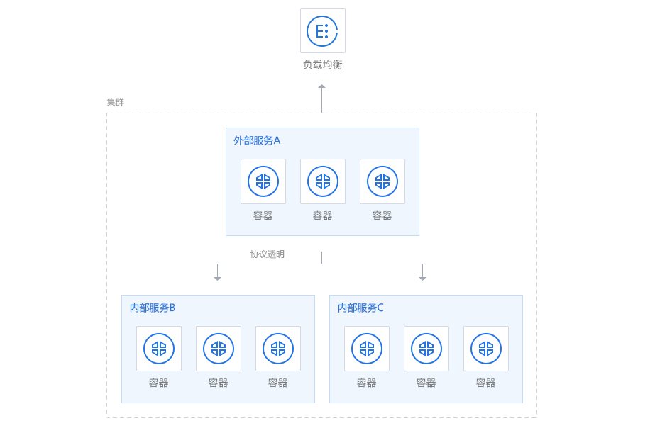
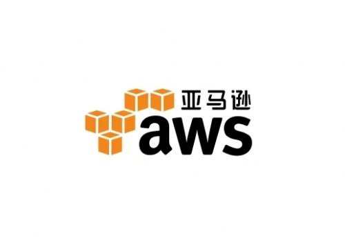
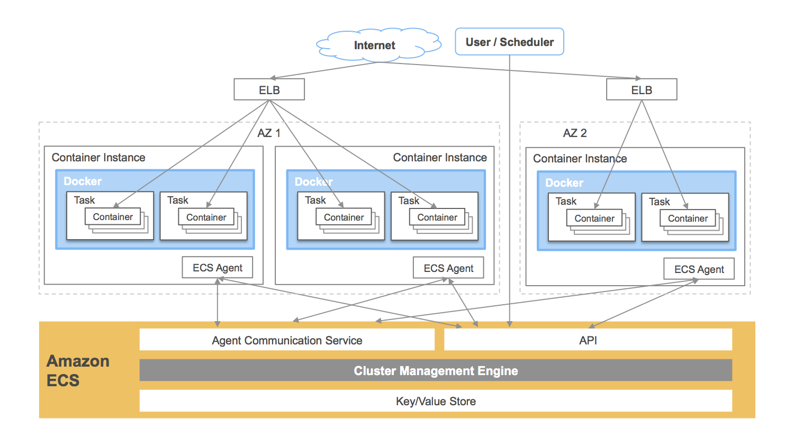

# 第十六章 容器与云计算

> **版本说明**：云平台的 Kubernetes 版本和容器服务功能更新迅速。本章示例使用通用的 API 版本（如 `apps/v1`），建议查阅各云厂商官方文档获取最新的服务版本和配置指南。

Docker 目前已经得到了众多公有云平台的支持，并成为除虚拟机之外的核心云业务。

除了 AWS、Google、Azure 等，国内的各大公有云厂商，基本上都同时支持了虚拟机服务和基于 Kubernetes 的容器云业务。有的还推出了其他服务，例如[容器镜像服务](https://cloud.tencent.com/document/product/1141)让用户在云上享有安全高效的镜像托管、分发等服务。

## 1. 简介

> **版本说明**：各云平台的容器服务版本更新频繁。本章示例适用于常见的 Kubernetes API 版本。建议访问各云厂商官方文档（如 [AWS EKS](https://aws.amazon.com/eks/)、[Azure AKS](https://azure.microsoft.com/en-us/products/kubernetes-service/)、[Google GKE](https://cloud.google.com/kubernetes-engine)、[阿里云 ACK](https://www.aliyun.com/product/ack)、[腾讯云 TKE](https://cloud.tencent.com/product/tke)）获取最新信息。

随着容器技术的普及，目前主流的云计算服务商都提供了成熟的容器服务。与容器相关的云计算服务主要分为以下几种类型：

### 1.1 容器编排托管服务

这是目前最主流的形式。云厂商托管 Kubernetes 的控制平面（Master 节点），用户只需管理工作节点 (Worker Node)。

* **优势**：降低了 Kubernetes 集群的维护成本，高可用性由厂商保证。
* **典型服务**：AWS EKS，Azure AKS，Google GKE，阿里云 ACK，腾讯云 TKE。

### 1.2 容器实例服务

这一类服务通常被称为 CaaS (Container as a Service)。用户无需管理底层服务器 (EC2/CVM)，只需提供镜像和配置即可运行容器。

* **优势**：极致的弹性，按秒计费，零运维。
* **典型服务**：AWS Fargate，Azure Container Instances，Google Cloud Run，阿里云 ECI。

### 1.3 镜像仓库服务

提供安全、可靠的私有 Docker 镜像存储服务，通常与云厂商的 CI/CD 流水线深度集成。

* **典型服务**：AWS ECR，Azure ACR，Google GCR/GAR，阿里云 ACR。

本章将介绍如何在几个主流云平台上使用 Docker 和 Kubernetes 服务。

## 2. 腾讯云

腾讯云容器服务 TKE 是腾讯云提供的 Kubernetes 托管服务，适合把容器化应用部署到云上。官方文档见 [腾讯云容器服务](https://intl.cloud.tencent.com/document/product/457)。



图 16-1：腾讯云标识

下面的示例只保留创建集群、部署应用、管理镜像和配置加速器这几类最常见操作。



图 16-2：腾讯云容器服务示意图

### 腾讯云容器服务：TKE 简介

腾讯云容器服务 (TKE, Tencent Kubernetes Engine) 是一款容器编排平台，基于原生 Kubernetes 提供，支持自动扩展、负载均衡、多可用区高可用等企业级功能。TKE 帮助开发者快速部署和管理容器化应用，消除集群运维的复杂度。

### 基本使用步骤

#### 1. 创建集群

登录腾讯云控制台，进入容器服务模块：

- 选择 “创建集群”，配置集群名称、地域和网络
- 选择节点配置（云服务器规格和数量）
- 设置 Kubernetes 版本和安全组
- 完成创建后获得集群 kubeconfig 文件

```bash
# 下载 kubeconfig 文件后，配置本地环境
export KUBECONFIG=/path/to/kubeconfig.yaml
kubectl cluster-info
```

#### 2. 部署容器应用

创建 Deployment 部署应用：

```yaml
apiVersion: apps/v1
kind: Deployment
metadata:
  name: nginx-app
spec:
  replicas: 3
  selector:
    matchLabels:
      app: nginx
  template:
    metadata:
      labels:
        app: nginx
    spec:
      containers:
      - name: nginx
        image: nginx:latest
        ports:
        - containerPort: 80
```
应用配置文件：

```bash
kubectl apply -f deployment.yaml
kubectl get pods
kubectl get svc
```

#### 3. 管理镜像

使用腾讯云容器镜像服务 (TCR) 存储和分发私有镜像：

```bash
# 登录腾讯云镜像仓库
docker login ccr.ccs.tencentyun.com -u <username>

# 标记本地镜像
docker tag my-app:latest ccr.ccs.tencentyun.com/namespace/my-app:latest

# 推送镜像到腾讯云
docker push ccr.ccs.tencentyun.com/namespace/my-app:latest
```

### 腾讯云 Docker 镜像加速器配置

如果你的账号开通了镜像加速器，可以把控制台给出的地址写入 Docker 配置。

#### Linux 系统配置

编辑 `/etc/docker/daemon.json` 文件（如果不存在则创建）：

```bash
# 创建或编辑配置文件
sudo mkdir -p /etc/docker
sudo nano /etc/docker/daemon.json
```
添加以下内容：

```json
{
  "registry-mirrors": [
    "https://mirror.ccs.tencentyun.com"
  ],
  "insecure-registries": []
}
```
重启 Docker 服务：

```bash
sudo systemctl daemon-reload
sudo systemctl restart docker
```
验证配置：

```bash
docker info | grep -A 5 "Registry Mirrors"
```

#### Windows/Mac 配置

对于 Docker Desktop，在设置界面中打开 `Docker Engine`，把上述 `registry-mirrors` 字段写入 JSON 后重启即可。

### 腾讯云容器镜像服务：TCR

TCR 提供私有镜像仓库、访问控制和镜像分发能力。一个最小示例如下：

```bash
# 登录到腾讯云 TCR
docker login ccr.ccs.tencentyun.com --username <username>

# 构建并推送镜像
docker build -t my-app:v1.0 .
docker tag my-app:v1.0 ccr.ccs.tencentyun.com/my-namespace/my-app:v1.0
docker push ccr.ccs.tencentyun.com/my-namespace/my-app:v1.0
```

#### TKE 集群中使用 TCR 镜像

配置镜像拉取凭证后，在 Deployment 中直接引用 TCR 镜像。Secret 必须创建在使用它的 namespace 中；下面示例使用 `default` namespace。

```bash
$ kubectl create secret docker-registry tcr-secret \
    --docker-server=ccr.ccs.tencentyun.com \
    --docker-username=<username> \
    --docker-password=<token-or-password> \
    --namespace=default
```

> 安全提示：在命令行直接输入密码或 token 可能进入 shell 历史记录。生产环境可先 `docker login`，再基于受保护的 `~/.docker/config.json` 创建 `kubernetes.io/dockerconfigjson` Secret，或使用云厂商提供的托管凭据集成。

```yaml
apiVersion: apps/v1
kind: Deployment
metadata:
  name: my-app-deployment
  namespace: default
spec:
  replicas: 3
  selector:
    matchLabels:
      app: my-app
  template:
    metadata:
      labels:
        app: my-app
    spec:
      imagePullSecrets:
      - name: tcr-secret
      containers:
      - name: my-app
        image: ccr.ccs.tencentyun.com/my-namespace/my-app:v1.0
        ports:
        - containerPort: 8080
        resources:
          requests:
            memory: "256Mi"
            cpu: "100m"
          limits:
            memory: "512Mi"
            cpu: "500m"
```

## 3. 阿里云

如图 16-3 所示，阿里云是国内主流云服务平台之一。


图 16-3：阿里云标识

[阿里云](https://www.aliyun.com/)创立于 2009 年，是中国较早的云计算平台。阿里云致力于提供安全、可靠的计算和数据处理能力。

[阿里云](https://www.aliyun.com/)的客户群体中，活跃着微博、虎牙、魅族、优酷等一大批明星互联网公司。在天猫双 11 全球狂欢节等极富挑战的应用场景中，阿里云保持着良好的运行纪录。

[阿里云容器服务 Kubernetes 版 ACK](https://cn.aliyun.com/product/ack) 提供了高性能、可伸缩的容器应用管理服务，支持在一组云服务器上通过 Docker 容器来进行应用生命周期管理。容器服务极大简化了用户对容器管理集群的搭建工作，无缝整合了阿里云虚拟化、存储、网络和安全能力。容器服务提供了多种应用发布方式和流水线般的持续交付能力，原生支持微服务架构，助力用户无缝上云和跨云管理。

<!-- 注意：原阿里云容器服务截图链接已失效，请参考阿里云官方文档获取最新界面截图 -->
<!-- 原链接: https://img.alicdn.com/tps/TB10yjtPpXXXXacXXXXXXXXXXXX-1531-1140.png -->

图 16-4：阿里云容器服务示意图（请访问 [阿里云容器服务 ACK 官方文档](https://help.aliyun.com/zh/ack/) 查看最新界面）

### 阿里云容器服务 ACK 简介

阿里云容器服务 Kubernetes 版 (ACK, Container Service for Kubernetes) 是一款托管式 Kubernetes 服务，基于开源 Kubernetes 构建，提供企业级的容器编排和管理能力。ACK 集成了阿里云存储、网络和安全能力，支持多种应用部署模式和持续交付流程。

### 基本使用步骤

#### 1. 创建集群

登录阿里云控制台，进入容器服务 > Kubernetes 集群：

- 点击 “创建集群”，选择集群配置
- 配置集群名称、地域、可用区和节点类型
- 选择节点规格和数量（支持弹性伸缩）
- 配置网络参数和安全设置
- 完成创建，下载 kubeconfig 文件

```bash
# 配置本地 kubectl
export KUBECONFIG=/path/to/kubeconfig.yaml
kubectl get nodes
```

#### 2. 部署容器应用

通过 Deployment 部署应用示例：

```yaml
apiVersion: apps/v1
kind: Deployment
metadata:
  name: web-server
spec:
  replicas: 2
  selector:
    matchLabels:
      app: web
  template:
    metadata:
      labels:
        app: web
    spec:
      containers:
      - name: web
        image: registry.cn-hangzhou.aliyuncs.com/myapp/web:v1
        ports:
        - containerPort: 8080
        resources:
          limits:
            memory: "512Mi"
            cpu: "500m"
```
部署应用：

```bash
kubectl apply -f deployment.yaml
kubectl get pods -o wide
kubectl logs <pod-name>
```

#### 3. 暴露服务

创建 Service 暴露应用：

```yaml
apiVersion: v1
kind: Service
metadata:
  name: web-service
spec:
  type: LoadBalancer
  ports:
  - port: 80
    targetPort: 8080
  selector:
    app: web
```
应用：

```bash
kubectl apply -f service.yaml
kubectl get svc web-service
```

### 阿里云 Docker 镜像加速器配置

为了加快从阿里云镜像源拉取官方镜像的速度，可以配置镜像加速器。阿里云为容器服务 ACK 用户提供了免费的镜像加速服务。

#### 获取加速器地址

登录阿里云容器镜像服务控制台，在 “镜像工具” > “镜像加速器” 中可获取个人的加速器地址（类似于 `https://xxxxxx.mirror.aliyuncs.com`）。

#### Linux 系统配置

编辑或创建 `/etc/docker/daemon.json` 文件：

```bash
sudo mkdir -p /etc/docker
sudo nano /etc/docker/daemon.json
```
添加或修改以下内容（替换为你的加速器地址）：

```json
{
  "registry-mirrors": [
    "https://xxxxxx.mirror.aliyuncs.com"
  ]
}
```
重新加载并重启 Docker：

```bash
sudo systemctl daemon-reload
sudo systemctl restart docker
```
验证配置生效：

```bash
docker info | grep -A 5 "Registry Mirrors"
```

#### Windows/Mac 配置

在 Docker Desktop 的 Settings 中：

1. 进入 “Docker Engine” 标签
2. 编辑 JSON 配置，添加 `registry-mirrors` 字段
3. 点击 “Apply & Restart”

#### 测试加速效果

```bash
# 从加速器拉取镜像（速度应该明显提升）
docker pull nginx:latest
time docker pull alpine:latest
```

### 阿里云容器镜像服务：ACR

阿里云容器镜像服务 (ACR, Container Registry) 是企业级的容器镜像存储和分发平台：

- **私有镜像仓库**：支持多个命名空间，细粒度权限控制
- **镜像构建**：云端编译和构建，支持自动化 CI/CD
- **镜像扫描**：自动检测镜像中的漏洞和恶意代码
- **跨地域复制**：支持镜像在多个地域的同步和加速
- **集成 ACK**：与 ACK 无缝集成，自动身份认证
- **镜像版本管理**：标签管理、镜像过期清理、保留策略

#### 完整推送/拉取示例

```bash
# 登录阿里云镜像仓库（使用 Docker 登录）
# 使用阿里云账户 ID 和 RAM 访问密钥或密码
docker login registry.cn-hangzhou.aliyuncs.com \
  --username=<阿里云账户ID>

# 拉取阿里云公开镜像
docker pull registry.cn-hangzhou.aliyuncs.com/library/nginx:latest

# 构建本地镜像
docker build -t my-app:v1.0 .

# 标记镜像为阿里云仓库地址
docker tag my-app:v1.0 \
  registry.cn-hangzhou.aliyuncs.com/myapp/my-app:v1.0

# 推送镜像到阿里云 ACR
docker push registry.cn-hangzhou.aliyuncs.com/myapp/my-app:v1.0

# 在 Dockerfile 中使用 ACR 镜像
FROM registry.cn-hangzhou.aliyuncs.com/myapp/my-app:v1.0
COPY . /app
RUN echo "已成功使用阿里云镜像"
```

#### ACK 集群中使用 ACR 镜像

在 ACK 集群中，需要先配置镜像拉取凭证（Secret），然后在 Deployment 中引用：

```yaml
apiVersion: apps/v1
kind: Deployment
metadata:
  name: web-server
  namespace: default
spec:
  replicas: 3
  selector:
    matchLabels:
      app: web
  template:
    metadata:
      labels:
        app: web
    spec:
      # 如果是私有镜像，需配置镜像拉取凭证
      imagePullSecrets:
      - name: acr-secret
      containers:
      - name: web
        image: registry.cn-hangzhou.aliyuncs.com/myapp/web:v2.0
        imagePullPolicy: IfNotPresent
        ports:
        - containerPort: 8080
        resources:
          requests:
            memory: "256Mi"
            cpu: "100m"
          limits:
            memory: "512Mi"
            cpu: "500m"
      affinity:
        # 配置 Pod 反亲和性，分散到不同节点
        podAntiAffinity:
          preferredDuringSchedulingIgnoredDuringExecution:
          - weight: 100
            podAffinityTerm:
              labelSelector:
                matchExpressions:
                - key: app
                  operator: In
                  values:
                  - web
              topologyKey: kubernetes.io/hostname
```

#### 创建镜像拉取凭证

在 ACK 集群中创建 Secret，用于拉取私有镜像：

```bash
# 避免把真实口令写入命令历史。使用临时 Docker config 并通过标准输入登录。
export DOCKER_CONFIG="$(mktemp -d)"
read -rsp "ACR token: " ACR_TOKEN; echo
printf "%s" "$ACR_TOKEN" | docker login registry.cn-hangzhou.aliyuncs.com \
  --username "<阿里云账户ID>" \
  --password-stdin

kubectl create secret generic acr-secret \
  --from-file=.dockerconfigjson="$DOCKER_CONFIG/config.json" \
  --type=kubernetes.io/dockerconfigjson

rm -rf "$DOCKER_CONFIG"
unset ACR_TOKEN DOCKER_CONFIG

# 查看创建的 Secret
kubectl get secret acr-secret
kubectl describe secret acr-secret
```

#### ACR 优势

- 在 ACK 集群中与镜像仓库无缝集成，简化身份认证
- 支持 Helm Chart 存储和版本管理，方便应用交付
- 提供完整的图形化镜像仓库管理界面
- 完整的审计日志和操作追踪功能
- 支持镜像自动扫描和漏洞报告

## 4. 亚马逊云

如图 16-5 所示，AWS 是全球主流云服务平台之一。



图 16-5：AWS 标识

[AWS](https://www.amazonaws.cn)，即 Amazon Web Services，是亚马逊 (Amazon) 公司的 IaaS 和 PaaS 平台服务。AWS 提供了一整套基础设施和应用程序服务，使用户几乎能够在云中运行一切应用程序：从企业应用程序和大数据项目，到社交游戏和移动应用程序。AWS 面向用户提供包括弹性计算、存储、数据库、应用程序在内的一整套云计算服务，能够帮助企业降低 IT 投入成本和维护成本。

在容器领域，AWS 目前主流能力可以按场景分为四类：

1. `Amazon EKS`：托管 Kubernetes 控制平面，适合标准云原生工作负载。
2. `Amazon ECS`：AWS 原生容器编排服务，适合深度集成 AWS 生态 (IAM、ALB、CloudWatch) 场景。
3. `AWS Fargate`：无服务器容器运行时，可与 EKS/ECS 结合使用，减少节点运维。
4. `Amazon ECR`：镜像仓库服务，提供私有镜像管理、扫描与访问控制。

实践建议：

* 团队已具备 Kubernetes 经验，优先选择 EKS；
* 追求更低运维复杂度且业务主要运行在 AWS，可优先 ECS + Fargate；
* 无论编排方案如何，都建议使用 ECR 统一管理镜像生命周期。



图 16-6：AWS 容器服务示意图

## 5. 多云部署策略

企业在选择容器云平台时，通常会在 AWS EKS，Azure AKS，Google GKE 以及国内的阿里云 ACK，腾讯云 TKE 之间进行权衡。

### 5.1 三大公有云 Kubernetes 服务对比

| 特性 | Google GKE | AWS EKS | Azure AKS |
| :--- | :--- | :--- | :--- |
| **版本更新** | 最快，通常是 K8s 新特性的首发地 | 相对保守，注重稳定性 | 跟随社区，更新速度适中 |
| **控制平面管理** | 全托管，自动升级，$0.10/h（有 Free Tier 抵扣）| 托管，$0.10/h | 全托管；Free 层适合开发/测试，Standard/Premium 层默认包含 Uptime SLA |
| **节点管理** | GKE Autopilot 模式完全托管节点 | Managed Node Groups 简化管理 | Virtual Machine Scale Sets |
| **网络模型** | VPC-native, 性能优秀 | AWS VPC CNI, Pod 直接获取 VPC IP | Azure CNI（消耗 IP 多）或 Kubenet |
| **集成度** | 与 GCP 数据分析、AI 服务集成紧密 | 与 AWS IAM, ALB, CloudWatch 集成深度高 | 与 Active Directory, Azure DevOps 集成好 |

### 5.2 多云部署策略

随着企业业务的扩展，单一云平台可能无法满足所有需求，多云部署成为趋势。

#### 1. 跨云灾备：Active-Passive

主要业务运行在一个云（如 AWS），数据实时复制到另一个云（如阿里云）。当主云发生故障时，流量切换到备云。

* **优点**：架构相对简单，数据一致性好控制。
* **缺点**：资源闲置浪费，切换可能有 RTO。

#### 2. 多活部署：Active-Active

业务同时在多个云上运行，通过全局流量管理 (DNS/GSLB) 分发流量。

* **优点**：高可用，就近接入提升用户体验。
* **缺点**：数据同步复杂，跨云网络延迟问题。

#### 3. 混合云

核心数据和敏感业务保留在私有云 (IDC)，弹性业务或前端业务部署在公有云。

* **工具**：Google Anthos，AWS Outposts，Azure Arc 都是为了解决混合云统一管理而生。

### 5.3 建议

* **技术选型**：尽量使用标准的 Kubernetes API，避免过度依赖特定云厂商的 CRD 或专有服务，以保持应用的可移植性。
* **IaC 管理**：使用 Terraform 或 Pulumi 等工具统一管理多云基础设施。
