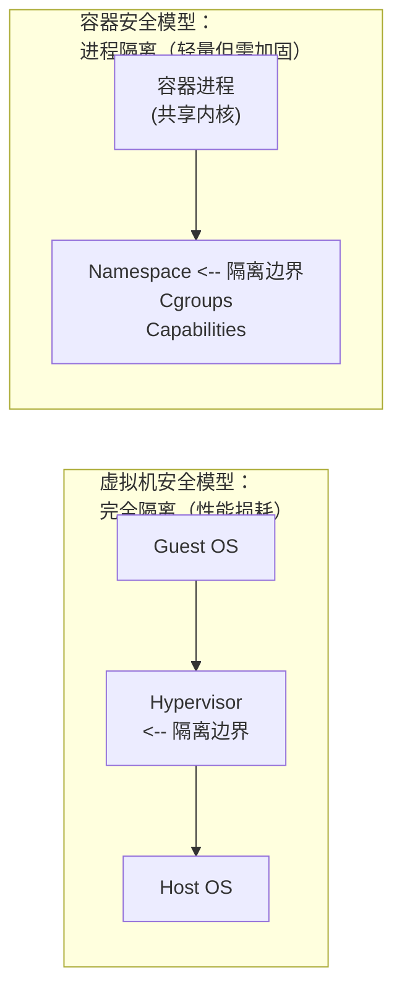

# 第十八章 安全

容器安全是生产环境部署的核心考量。本章介绍 Docker 的安全机制和最佳实践。

## 容器安全的本质

> **核心问题**：容器共享宿主机内核，隔离性弱于虚拟机。如何在便利性和安全性之间取得平衡？



## 安全扫描清单

部署前检查：

| 检查项 | 命令/方法 |
|--------|----------|
| 漏洞扫描 | `docker scout cves` 或 `trivy` |
| 非 root 运行 | 检查 Dockerfile 中的 `USER` |
| 资源限制 | 检查 `-m`, `--cpus` 参数 |
| 只读文件系统 | 检查 `--read-only` |
| 无特权模式 | 确认没有 `--privileged` |
| 最小能力 | 检查 `--cap-drop=all` |
| 网络隔离 | 检查网络配置 |
| 敏感信息 | 确认无硬编码密码 |

## 1. 内核命名空间

命名空间 (Namespace) 是 Linux 容器隔离的基础，它确保了容器内的进程无法直接干扰主机或其他容器。虽然在本书第 12 章中我们已经从底层实现的角度介绍了 Namespace，但在本节中，我们将重点探讨其 **安全意义** 及相关配置。

### 1.1 隔离的安全本质

Docker 守护进程在启动容器时，会在后台为容器创建一套独立的命名空间。命名空间提供了最基础也是最直接的隔离：

- **PID Namespace**：防止容器内的进程查看或终止宿主机或其他容器的进程。恶意攻击者即使在容器内获得了 root 权限，也无法通过 `kill` 命令影响宿主机上的关键服务。
- **NET Namespace**：每个容器都有自己独立的网络栈。如果没有显式地进行端口映射或将容器连接到同一网络，容器之间无法网络互通，从而限制了横向移动的能力。
- **MNT Namespace**：为容器提供独立的文件系统视图。这可以防止容器不经意或恶意地修改宿主机的重要系统文件（如 `/etc/passwd`）。

### 1.2 命名空间不是绝对安全的护城河

尽管命名空间提供了很好的隔离性，但我们必须认识到：**所有的容器依然共享同一个宿主机的 Linux 内核**。

这意味着，一旦宿主机的内核存在提权漏洞（如著名的 Dirty COW 漏洞），攻击者有可能通过突破 Namespace 的限制，直接在内核层面执行恶意代码，从而实现“容器逃逸”。

> [!WARNING]
> 为了缓解内核漏洞带来的威胁，生产环境务必保持宿主机 Linux 内核的及时修补与更新，或者借助诸如 gVisor、Kata Containers 等提供了独立内核的安全容器技术。同时，需要及时修补容器运行时（如 runC）的漏洞。2025 年 11 月披露的一系列 runC 容器逃逸漏洞（CVE-2025-31133、CVE-2025-52565、CVE-2025-52881）就表明，即使内核保持更新，运行时层的缺陷仍然可能导致容器隔离被突破。

通过命名空间，Docker 也能限制进程从外部环境获取信息。
例如，由于进程环境被隔离，进程在内部通常无法直接感知外部宿主机的进程和挂载命名空间。网络命名空间隔离的是网络栈；默认 bridge 网络通常允许容器主动访问外部网络，限制的是外部直接访问容器服务。若要限制出站访问，需要使用 `none` 网络、防火墙、Kubernetes NetworkPolicy 或运行时策略。

### 1.3 用户命名空间与提权防护

在所有的 Namespace 中，**User Namespace** 对安全的影响尤为关键。

在默认情况下，容器内的 `root` 用户（UID=0）就是宿主机上的 `root` 用户。如果攻击者设法突破了容器的其他隔离机制获取了宿主机的访问权限，他将拥有宿主机的最高系统权限。

通过启用 **User Namespace Remapping（用户命名空间映射）**，我们可以将容器内的 `root` 用户映射到宿主机上的一个无特权普通用户。

#### 如何配置 User Namespace

要在 Docker 服务端启用这一特性，需要修改 Docker 的配置文件 `/etc/docker/daemon.json`。

1. **设置映射策略**

编辑配置文件，添加 `userns-remap` 配置项：

```json
{
  "userns-remap": "default"
}
```
使用 `default` 值时，Docker 会自动在宿主机上创建一个名为 `dockremap` 的用户和用户组。

> **注意其代价**：官方文档明确 **containerd image store 在启用 `userns-remap` 时不可用**。
> 而本书基线是 Docker Engine v29.x，该版本新装默认就是 containerd image store，
> 12.4 节 也把它标为「强烈推荐（现代默认）」。
> 也就是说，打开 userns-remap 会让你退回旧的镜像存储后端，失去 OCI image index、
> 多架构镜像与构建溯源等能力。两者只能二选一，请按威胁模型权衡。

2. **验证子 UID 和子 GID 分配**

Docker 会通过 `/etc/subuid` 和 `/etc/subgid` 文件为 `dockremap` 分配一个高位的 UID 范围：

```bash
$ cat /etc/subuid
dockremap:165536:65536
```
这意味着：容器内的 UID `0`（root 用户）在宿主机上实际被映射成了 UID `165536`。如果是容器内的 UID `1`，对应宿主机的 `165537`，以此类推。

3. **重启 Docker 守护进程**

```bash
$ sudo systemctl restart docker
```

#### 验证映射效果

我们可以运行一个简单的容器并执行 `sleep` 命令，同时在宿主机上观察进程的所有者：

```bash
## 在容器内以 root 身份运行
$ docker run -d --name userns_test alpine sleep 3600

## 在宿主机上查看该 sleep 进程
$ ps aux | grep sleep
165536    12345  0.0  0.0   1568     4 ?        Ss   14:20   0:00 sleep 3600
```
你会发现，尽管在容器内该进程是由 root 启动的，但在宿主机上，它的属主是 `165536`（一个完全没有特权的用户）。

> [!TIP]
> 启用 User Namespace 会对容器共享宿主机数据卷（Bind Mount）产生权限影响。你需要确保映射后的高位 UID 对宿主机上的挂载目录具有合适的读写权限。

### 1.4 总结

内核命名空间从 Linux 2.6.15 版本（2006 年）被引入，十余年间，这些机制的可靠性在诸多大型生产系统中被实践验证。通过合理利用命名空间（尤其是 User Namespace），可以极大地收窄攻击面，显著提升容器部署的安全性。

## 2. 控制组

控制组 (Cgroups) 是 Linux 容器机制的另外一个关键组件。如果说命名空间 (Namespace) 决定了容器能 **看到** 什么，那么控制组就决定了容器能 **使用** 多少资源。

在安全领域中，资源的不可用性本身就是一种安全威胁。控制组负责实现资源的审计和限制，这对于抵御资源耗尽型攻击（如拒绝服务攻击 DoS）至关重要。

### 2.1 为什么资源限制关乎安全？

默认情况下，Docker 容器对系统资源的使用是没有限制的：一个容器理论上可以使用宿主机所有的 CPU 计算能力、吃光所有的内存、耗尽所有的系统 PID。

想象一下以下场景：

- 一个恶意用户向你暴露在公网的应用发起海量并发请求。
- 应用程序逻辑中存在内存泄漏漏洞。
- 黑客在入侵容器后，在里面运行了挖矿木马程序。

如果没有 Cgroups 的限制，某个容器内的异常行为（或恶意攻击）将会榨干宿主机的资源，导致宿主机上其他健康的容器甚至 Docker 守护进程自身因为 OOM（Out Of Memory）崩溃或 CPU 饥饿而停止响应。

### 2.2 核心资源限制实战

为了确保多租户平台（如公有或私有的 PaaS 平台）的稳定性，或者在生产环境防止服务级联故障，我们要养成在启动容器时 **显式声明资源上限** 的习惯。

#### 1. 内存限制

限制内存可以防止应用程序因内存泄漏或恶意载荷导致宿主机 OOM。

**关键参数：**

- `-m, --memory=""`：硬限制，容器可使用的最大内存量。
- `--memory-swap=""`：限制容器可使用的内存与 Swap 总量。

**实战示例：**

限制容器最多只能使用 512MB 内存，并且禁用 Swap（将 memory 和 memory-swap 设置成一样的值即可）：

```bash
$ docker run -d \
  --name web_app \
  --memory="512m" \
  --memory-swap="512m" \
  nginx:alpine
```
如果该容器内的应用尝试分配超过 512MB 的内存，该进程将会被内核的 OOM Killer 杀掉，但绝不会波及到宿主机的其他部分。

#### 2. CPU 限制

限制 CPU 可以防止个别计算密集型的容器垄断 CPU 时间片，保证系统的调度公平性。

**关键参数：**

- `--cpus=<value>`：指定容器可以使用的 CPU 核心数量（可以是小数）。
- `-c, --cpu-shares=0`：软限制，设置容器使用 CPU 的相对权重（默认是 1024）。

**实战示例：**

限制容器最多使用 1.5 个 CPU 核心的算力：

```bash
$ docker run -d \
  --name worker_app \
  --cpus="1.5" \
  busybox \
  md5sum /dev/urandom
```
即使上面的命令是一个死循环的哈希计算进程，容器也永远无法吃满双核 CPU 系统的全部算力。

#### 3. 进程数限制

进程炸弹（Fork Bomb）是一种典型的拒绝服务攻击方式，它通过不断 `fork()` 新进程来耗尽系统的进程表条目，导致系统无法创建任何新任务。

**关键参数：**

- `--pids-limit=<number>`：限制容器内允许创建的最大进程数。

**实战示例：**

一个常规的 Web 服务进程数通常在几十到上百之间。我们可以设定一个合理的上限来防范 Fork 炸弹：

```bash
$ docker run -d \
  --name app_service \
  --pids-limit=100 \
  python:alpine python app.py
```
当容器内的进程总数达到 100 时，任何尝试派生新进程的操作都会失败并返回 `Resource temporarily unavailable`，从而挫败相关的攻击行为。

### 2.3 最佳实践建议

在生产环境中，不仅要在单机使用 Docker 命令时设置这些参数，更应当在集群编排工具中将资源配额制度化。

例如，在 Kubernetes 中，强烈建议为每个 Pod 设置 `requests` 和 `limits`：

```yaml
resources:
  requests:
    memory: "256Mi"
    cpu: "250m"
  limits:
    memory: "512Mi"
    cpu: "500m"
```
通过 Cgroups 的资源边界控制，你可以从根本上切断一条导致整个系统雪崩的脆弱链路。这也进一步使得 Docker 以及容器技术成为了现代高可用服务的基础设施首选。

## 3. 服务端防护

Docker 守护进程（`dockerd`）是容器生命周期的核心驱动力。默认情况下，Docker 服务的运行需要极高的系统特权（root 权限），因此其安全性关系到整台宿主机的生死存亡。

如果 Docker 守护进程的访问控制没有做好，恶意攻击者可以通过 Docker API 轻易地启动一个特权容器，并将宿主机的根目录（`/`）挂载到容器中，从而完全接管服务器。

为了加强对服务端的保护，我们需要从访问控制、通信加密和权限最小化三个维度进行加固。

### 3.1 限制 API 访问

Docker 客户端（`docker` 命令）通过 REST API 与守护进程进行通信。

在早期版本中，Docker 有时会绑定在 `127.0.0.1` 的 TCP 套接字上，但这容易遭遇跨站脚本（跨协议）攻击。现在的发行版默认使用 Unix Domain Socket（`/var/run/docker.sock`）并依赖文件系统的权限控制。

#### 原则 1：决不可将无认证的 TCP 端口暴露在公网

这是最常见的 Docker 被入侵抓去挖矿的原因！绝不能在没有任何安全控制的情况下强行开启 `-H tcp://0.0.0.0:2375`。

如果业务确实需要远程访问 Docker 守护进程，**必须启用 TLS 认证机制**，让客户端和服务端互相进行证书校验。

#### 开启 TLS 认证双向加密

利用安全机制，确保只有经过授权的主机网络，并在强证书保护下进行通信：

1. 首先使用 `openssl` 或基于本地 CA 工具生成一套客户端与服务器的证书。
2. 配置 Docker 守护进程（通常是 `daemon.json` 或 `dockerd` 启动参数），指定证书路径：

```bash
dockerd \
  --tlsverify \
  --tlscacert=ca.pem \
  --tlscert=server-cert.pem \
  --tlskey=server-key.pem \
  -H=0.0.0.0:2376
```

3. 客户端想要连接时，也必须出示客户端证书。

> [!TIP]
> 配置 TLS 生成证书的完整步骤可以查阅 [Docker 官方 TLS 文档](https://docs.docker.com/engine/security/protect-access/)。在现代编排系统（如 Kubernetes）中，通常会有自动化方案管理这些凭据。

### 3.2 保护本地 Socket 访问

哪怕不开启网络端口，本地的 `/var/run/docker.sock` 也需要谨慎对待。

任何被授予该 Socket 读写权限的用户（通常被加入 `docker` 用户组），等同于拥有了对宿主机的零成本提权途径，即“无需密码的免密 `sudo` 权限”。

> [!CAUTION]
> 永远不要将不可信的普通用户加入到 `docker` 用户组中。同样，在容器编排时尽量避免将宿主机的 `/var/run/docker.sock` 直接映射给普通容器使用，这种模式被称为 Docker-in-Docker (DinD) 或 Docker-out-of-Docker (DooD)，存在极高的越权风险。

### 3.3 Rootless 模式：非特权运行

为了从根本上解决“拥有 Docker socket 就是 root”的问题，Docker 自 19.03 版本（2019 年）起提供了 **Rootless 模式**。

Rootless 模式允许在完全局限于非 `root` 用户的环境中运行 Docker 守护进程（`dockerd`）和容器。该模式利用了现代 Linux 内核的 User Namespace 技术和非特权网络命名空间实现。

#### 配置运行 Rootless Docker

要在非 root 环境中运行 Docker，需要先满足宿主机条件：安装 `newuidmap` / `newgidmap`，并在 `/etc/subuid` 与 `/etc/subgid` 中为该用户分配足够的 subordinate UID/GID。若系统级 Docker daemon 仍在运行，命令行也仍可能连到 rootful socket，因此应明确切换 Docker context 或 `DOCKER_HOST`。

1. 安装必要的依赖（通常是 `uidmap` 工具包以便系统支持 `newuidmap` 和 `newgidmap`）：
```bash
$ sudo apt-get install uidmap
```

2. 切换到一个没有任何 `sudo` 权限的普通用户（假设用户名为 `testuser`）：
```bash
$ su - testuser
```

3. 下载并检查 Docker 官方提供的 Rootless 安装脚本，确认来源和内容后再执行：
```bash
$ curl -fsSL https://get.docker.com/rootless -o install-rootless-docker.sh
$ less install-rootless-docker.sh
$ sh install-rootless-docker.sh
```

4. 配置环境变量指向新创建的私有 socket：
```bash
$ export DOCKER_HOST=unix:///run/user/1000/docker.sock
$ docker version
```
安装并暴露相应的配置后，该用户的环境将能独立启动属于他自己的 Docker Daemon。即使由于某些未知 0-Day 漏洞使得攻击者突破了容器，他们也只会受限于 `testuser` 这个非特权用户所在的有限系统环境内。

> [!NOTE]
> Rootless 模式不是无条件替代 rootful Docker。端口绑定、网络、cgroup、存储驱动和系统服务自启动能力都受发行版、内核与 systemd 用户服务配置影响；生产环境应先验证具体工作负载，并用 `loginctl enable-linger <user>` 等方式显式配置开机自启动。

### 3.4 授权插件（Authorization Plugin）与访问策略

在企业环境中，对 Docker 守护进程的访问控制往往不仅限于文件系统权限，还需要更细粒度的授权策略。**Authorization Plugin** 机制允许在 API 层级对请求进行拦截和审批。

常见的授权插件包括：

- **OPA/Conftest**：开放策略引擎，支持声明式策略定义。
- **Prisma Cloud（Twistlock）**：商业容器安全平台。
- 自定义脚本：根据请求内容（镜像、命令、用户等）做出允许/拒绝决定。

#### 配置 Authorization Plugin

在 `daemon.json` 中指定授权插件：

```json
{
  "authorization-plugins": ["myauthorizer"]
}
```

此后，Docker 守护进程会在执行任何 API 请求前，将请求转发给授权插件进行审批。

> [!CAUTION]
> 重要的安全事项：在配置 Authorization Plugin 时，务必确保插件本身的可靠性和及时更新。历史上已发现多个 AuthZ 验证绕过漏洞，可能导致攻击者绕过授权检查并获得宿主机访问权限。建议：
> - 定期审计授权插件的日志，检查是否有可疑的请求被错误允许。
> - 使用来自可信来源的授权插件，并保持其版本最新。
> - 将授权检查结果与其他安全措施（如 TLS 认证、Rootless 模式）结合使用，构建纵深防御。

### 3.5 结语

保障 Docker 服务端的安全主要是做减法：关闭不必要的网络监听点，严管 Socket 访问权限。在基础系统、网络和存储约束都验证通过后，Rootless 模式是一项值得优先评估的安全加固选择。

## 4. 内核能力机制

传统 Linux 的权限模型非常粗放：进程分为“特权进程”（以 root 用户 `UID 0` 运行）和“非特权进程”（其他 UID 运行）。这带来了一个致命问题——只要一个后台服务需要一个微小的特权（例如绑定低于 1024 的端口），就必须被赋予所有的 root 权限。一旦该服务被攻陷，系统便会全面沦陷。

为了解决这一问题，Linux 引入了 **能力机制（Capabilities）**。它将传统的全能 root 权限划分为几十个细粒度的操作能力。

### 4.1 容器内置的 Capability 白名单

在默认情况下，即便一个容器是在以 `root` 用户运行，Docker 也只为其内核授予了所有可用能力中的 **一小部分“白名单”能力**。

常见的 Linux Capabilities 包含：

- `CAP_CHOWN`: 修改文件所有者。
- `CAP_NET_BIND_SERVICE`: 绑定特权端口（即 1024 以下的端口）。
- `CAP_NET_ADMIN`: 网络管理的最高权限（例如调整路由配置，设置防火墙规则等）。
- `CAP_SYS_ADMIN`: 被誉为“Linux 内核的特权网管”，允许各种高危操作（挂载磁盘、访问敏感设备等）。

为了在 **“最小特权原则”** 的指导下加强安全，Docker 默认 **移除了** 大量可能导致容器大范围破坏宿主机的能力，例如：

* 完全禁止了任何通过 `CAP_SYS_ADMIN` 进行的核心挂载或设备操作。
* 禁止修改内核模块。
* 禁止直接访问硬件套接字。

这种“非完整”的 root 用户能保证大部分应用在拥有其所需权限的同时，把恶意行为对系统的影响降到最低。

### 4.2 实战：添加与剥夺能力

当启动一个 Docker 容器时，我们可以利用 `--cap-add`（增加特权）和 `--cap-drop`（剥夺特权）两个参数精细地控制进程环境。

#### 实战场景一：构建极限安全的 Web 靶机

假设你正在提供一个公共的 Web 容器。你不希望里面的任何恶意脚本修改进程权限或者创建设备节点，你可以通过命令先移除 **所有** 默认能力，然后再按需授权该守护进程一个仅仅能绑端口的能力。

```bash
$ docker run -d \
  --name max_secure_web \
  --cap-drop ALL \
  --cap-add NET_BIND_SERVICE \
  nginx:alpine
```
这里的 `--cap-drop ALL` 是实现“特权最小化”的最强杀手锏。此时，即便某黑客利用 0-Day 手段拿到了 Web 服务的容器 root Shell，当他试图改变任何不属于他自己的进程配置或者所有权时，系统都会报错拒绝访问。

#### 实战场景二：需要捕获网络数据包的网络实验

假设容器内的主程序是一个网络嗅探器（如 tshark 或 tcpdump），这显然不在 Docker 提供的默认白名单之内，因为该程序试图直接操纵底层网卡流量，会触发 Permission Denied。

此时，我们需要给它适当补发缺失的部分核心管理能力：

```bash
$ docker run -it --rm \
  --name network_sniffer \
  --cap-add NET_ADMIN \
  --cap-add NET_RAW \
  tshark-image /bin/bash
```
我们只授予了所需的网络管理控制（NET_ADMIN）和侦听底层套接字的权限（NET_RAW），而免去了赋予整个容器终极杀器 `--privileged` 参数。

> [!WARNING]
> 大量开发人员遇到了“权限遭到拒绝”的错误时，往往习惯性图省事添加 `--privileged` 这个核选项。但这将把 **宿主机上一切特权和所有访问设备完全投射给容器内的根用户**，其危险性等价于根本没有做隔离！请务必查明进程出错的实际原因，精准施加必要的隔离 `CAP_*` 能力。

### 4.3 总结

利用能力机制（Capabilities）是进行精细化系统级访问控制的关键一环。遵循“**白名单剥夺一切不必要权利（--cap-drop ALL）**”的极端配置并不过分，这将使得即便程序本身漏洞百出，攻击面也被死死压缩在一个几乎毫无后续伸展潜力的受限维度中。

## 5. 其他安全特性

除了上述的命名空间、控制组以及能力机制，Linux 内核与云原生生态还提供了大量安全增强功能，它们共同筑成了一道防御纵深的“马奇诺防线”。本节主要介绍强制访问控制、系统调用拦截以及自动化的容器漏洞扫描技术。

### 5.1 系统调用过滤

`Seccomp`（Secure Computing mode）是 Linux 内核的一个安全机制，用于限制进程能够发起的系统调用数量。

一个普通的 Linux 内核提供了 300 多个系统调用，而一个正常运行的容器化应用（例如 Nginx 服务）通常只会用到几十个调用，这就给攻击者留下了大量的闲置入口点来进行内核层的缓冲区溢出攻击。

Docker 默认启用了 Seccomp，并使用预置的 [默认配置文件](https://docs.docker.com/engine/security/seccomp/) 作为 allowlist：默认拒绝未显式允许的系统调用，并额外允许常见应用所需的调用。Docker 官方文档将其描述为默认禁用约 44 个系统调用（内核与 Docker 版本不同会有差异），例如与内核模块、系统重启或特权命名空间操作相关的调用。

如果你对应用的系统调用特征了如指掌，你可以为容器定制专属规则。

#### 实战：禁用 chmod 系统调用过滤

> **务必先读**：`--security-opt seccomp=<file>` 是**整体替换**默认 profile，不是在默认之上叠加。
> 如果自己写一个 `"defaultAction": "SCMP_ACT_ALLOW"` 的 blocklist，等于把上面那份
> deny-by-default 的官方 allowlist 整个丢掉——你挡住了 `chmod`，却把默认被拦下的那
> ~44 个高危调用（`unshare`、`keyctl`、`add_key`、`bpf`、`perf_event_open`、
> `init_module`、`reboot` 等）全部放行，**净效果比不加这个参数还危险**。
> 正确做法是**以官方默认 profile 为基线派生**。

先取官方默认 profile，再在它之上把 `chmod` 改成拒绝：

```bash
$ curl -fsSL -o default.json \
  https://raw.githubusercontent.com/moby/moby/master/profiles/seccomp/default.json

## 在 default.json 中找到包含 "chmod" 的那条 syscalls 记录，把它从 allow 列表中移除；
## 或追加一条更靠前的显式拒绝规则：
##   { "names": ["chmod", "fchmod", "fchmodat"], "action": "SCMP_ACT_ERRNO" }
$ cp default.json no-chmod.json && "$EDITOR" no-chmod.json
```

在启动时告诉 Docker 载入这套过滤配置：

```bash
$ docker run --rm -it \
  --security-opt seccomp=no-chmod.json \
  alpine sh

/ # chmod 777 /etc/passwd
chmod: /etc/passwd: Operation not permitted
```
应用只要被劫持进行越界尝试，其操作系统层命令便会立刻吃瘪——同时默认 profile 原有的
~44 项拦截仍然生效。

### 5.2 强制访问控制：AppArmor / SELinux

传统的 Linux 模型遵循 DAC（自主访问控制），这意味着如果一个文件被赋予了全员读写权限（`777`），普通隔离下任何人便都能修改。但 **MAC（强制访问控制）** 技术，诸如 `AppArmor`（常用于 Ubuntu/Debian）或 `SELinux`（常用于 CentOS/RHEL），可以制定比“文件所有权”更宏观且优先的策略控制模块。

在开启了上述机制的机器上：

- **AppArmor**: 在启用 AppArmor 的系统上，Docker 默认为容器加载 `docker-default` profile；如果需要自定义策略，先用 `apparmor_parser` 加载 profile，再通过 `--security-opt apparmor=<profile>` 指定。
- **SELinux**: 在启用 SELinux 集成的系统上，容器与挂载目录需要正确的 SELinux label。绑定挂载时常用 `:z` 表示多个容器共享，`:Z` 表示该挂载只给单个容器使用；不要对 `/home`、`/usr` 等系统目录随意使用 `:Z`，否则可能破坏宿主机标签。

如果想为某些受信任应用施加特定的外部强化文件策略，可以通过如下方法指派规则表：

```bash
$ docker run --rm -it \
  --security-opt apparmor=custom-nginx-profile \
  nginx

$ docker run --rm -it \
  -v "$PWD/html":/usr/share/nginx/html:Z \
  nginx
```

### 5.3 容器镜像漏洞静态扫描

现代防护的防御已经不仅仅在运行阶段，而向“左”延伸至了构建与分发时期控制。很多安全隐患并不是用户代码中的直接逻辑异常，而是打包环境或者引入库的基础 `APT` 安装层面潜伏了开源界众所周知的历史漏洞。

#### 使用 Trivy 识别风险

[Trivy](https://github.com/aquasecurity/trivy) 是由 Aqua Security 发行的一款针对容器技术的快速镜像漏洞扫描利器。在分发应用前通过它的扫描可以规避绝大多数风险。

```bash
## 如果使用本地命令行扫描容器镜像
$ trivy image alpine:3.20

2024-03-01T10:05:07.124Z	INFO	Number of language-specific files: 1
2024-03-01T10:05:07.124Z	INFO	Detecting vulnerabilities...

alpine:3.20 (alpine 3.20.0)
===========================
Total: 2 (UNKNOWN: 0, LOW: 0, MEDIUM: 1, HIGH: 1, CRITICAL: 0)

+---------+------------------+----------+-------------------+---------------+---------------------------------------+
| LIBRARY | VULNERABILITY ID | SEVERITY | INSTALLED VERSION | FIXED VERSION | TITLE                                 |
+---------+------------------+----------+-------------------+---------------+---------------------------------------+
| busybox | CVE-2022-28391   | HIGH     | 1.30.1-r3         | 1.30.1-r4     | busybox: out-of-bounds read in...     |
...
```
只要确保所有上传给私有或公共仓库分发服务的产物先被引入至 CI/CD 流水线，如果出现 `HIGH` 及 `CRITICAL` 严重的报错记录强行阻拦部署，这本身便是构建环节极其有力的自动化安全大门保障。除 Trivy 外，最新的 Docker 版本也已内置支持官方扫描利刃 **Docker Scout**。

### 5.4 容器核心层基石结语

到这里，Docker 为保障宿主和容器界限安全的几个护城河：从 **资源剥离限制**(`Cgroups`) 到 **进程/网络/身份蒙蔽**(`Namespace`)、到 **特权能力回收**(`Capabilities`) 再到 **内核强制策略拦截管制**(`Seccomp`/`AppArmor`) 已悉数交代完毕。虽然绝没有“100% 免疫网络穿刺的防线”，只要开发者牢记 **权限最小化原则** ，容器的堡垒就可以做到令攻击者望洋兴叹。

## 6. 容器镜像安全扫描与供应链安全

在 DevOps 流程中，容器镜像安全已经成为不容忽视的关键环节。从开发、构建、存储到部署，镜像的整个生命周期都需要安全防护。本节深入讨论镜像漏洞扫描、软件物料清单（SBOM）、镜像签名验证等供应链安全实践。

### 6.1 容器镜像漏洞扫描工具对比

#### Trivy - 轻量级通用扫描器

Trivy 是由 Aqua Security 开发的开源漏洞扫描器，以其轻量级、快速、准确而闻名，已成为业界标准。

**优点：**

- 零依赖，单个二进制文件
- 扫描速度快（秒级）
- 支持镜像、文件系统、Git 仓库多种扫描源
- 数据库每日自动更新
- 支持多种输出格式（JSON、表格、SBOM 等）

**安装与基本使用：**

```bash
# 安装 Trivy
curl -sfL https://raw.githubusercontent.com/aquasecurity/trivy/main/contrib/install.sh -o install-trivy.sh
less install-trivy.sh  # 先审阅脚本内容
sudo sh install-trivy.sh -b /usr/local/bin

# 扫描本地镜像
trivy image nginx:latest

# 生成 JSON 格式报告
trivy image -f json -o report.json nginx:latest

# 扫描文件系统
trivy fs /path/to/project

# 扫描 Git 仓库
trivy repo https://github.com/aquasecurity/trivy
```
**在 CI/CD 中集成：**

```bash
# 设置严重程度过滤
trivy image --severity HIGH,CRITICAL \
  --exit-code 1 \
  myregistry.com/myapp:v1.0.0
```

#### Grype - 支持多种软件包的扫描器

Grype 由 Anchore 开发，支持更广泛的软件包管理器和语言。

**优点：**

- 支持 Java、Python、Go、Ruby、JavaScript 等多种语言的依赖检测
- 与 Syft（SBOM 生成器）配合效果好
- 可自定义漏洞数据库源
- 支持离线扫描模式

**安装与使用：**

```bash
# 安装 Grype
curl -sSfL https://raw.githubusercontent.com/anchore/grype/main/install.sh -o install-grype.sh
less install-grype.sh
sudo sh install-grype.sh -b /usr/local/bin

# 扫描镜像
grype docker:nginx:latest

# 与 Syft 配合生成 SBOM
syft docker:nginx:latest -o json > sbom.json
grype sbom:sbom.json

# 扫描特定目录
grype dir:/path/to/app
```

#### Snyk - 完整的安全平台

Snyk 提供了商业级的安全扫描服务，特别适合企业环境。

**特点：**

- 支持开源漏洞、许可证扫描和修复建议
- 与多个 Git 平台深度集成（GitHub、GitLab、Bitbucket）
- 提供修复建议和自动化修复 PR
- 支持 Kubernetes 部署后安全监控

**基本使用：**

```bash
# 安装 Snyk CLI
npm install -g snyk

# 认证
snyk auth

# 扫描镜像
snyk container test docker-archive://image.tar

# 监控仓库
snyk monitor --docker
```
此外，Docker 官方提供的 **Docker Scout**（`docker scout` CLI）可以直接在 Docker Desktop 或命令行中对镜像进行漏洞扫描和依赖分析，适合日常开发流程中快速检查：

```bash
# 扫描本地镜像
$ docker scout cves myapp:latest

# 查看镜像的依赖和漏洞摘要
$ docker scout quickview myapp:latest
```

**工具对比表：**

| 特性 | Docker Scout | Trivy | Grype | Snyk |
|------|-------------|-------|-------|------|
| Docker 集成 | ✓（原生） | 需安装 | 需安装 | 需安装 |
| 零依赖 | ✗ | ✓ | ✗ | ✗ |
| 离线模式 | ✗ | ✓ | ✓ | ✗ |
| 许可证扫描 | ✓ | ✓ | ✓ | ✓ |
| 自动修复建议 | ✓ | ✗ | ✗ | ✓ |
| 开源免费 | 部分 | ✓ | ✓ | 部分 |
| IDE 集成 | ✓ | ✓ | ✓ | ✓ |

### 6.2 SBOM（软件物料清单）生成与管理

SBOM（Software Bill of Materials）是一份详细列表，记录了软件中使用的所有组件、依赖库及其版本信息。SBOM 在供应链安全中至关重要，特别是在发现新的安全漏洞时，能快速定位受影响的应用。

#### Syft - SBOM 生成工具

Syft 是 Anchore 推出的专业 SBOM 生成工具。

**安装：**

```bash
curl -sSfL https://raw.githubusercontent.com/anchore/syft/main/install.sh -o install-syft.sh
less install-syft.sh
sudo sh install-syft.sh -b /usr/local/bin
```
**生成 SBOM：**

```bash
# 从镜像生成 SBOM（多种格式）
syft docker:nginx:latest -o json > sbom.json
syft docker:nginx:latest -o spdx > sbom.spdx
syft docker:nginx:latest -o cyclonedx > sbom.xml

# 从本地文件系统生成
syft dir:/path/to/app -o json > sbom.json

# 从 OCI 镜像档案生成
syft oci-archive:image.tar -o json > sbom.json
```

#### CycloneDX 与 SPDX 格式

两种主流的 SBOM 格式：

**CycloneDX 格式示例：**

```xml
<?xml version="1.0" encoding="UTF-8"?>
<bom xmlns="http://cyclonedx.org/schema/bom/1.4" version="1">
  <components>
    <component type="library">
      <name>openssl</name>
      <version>1.1.1k</version>
      <purl>pkg:deb/debian/openssl@1.1.1k-1+deb11u5</purl>
    </component>
    <component type="library">
      <name>curl</name>
      <version>7.74.0-1.3+deb11u1</version>
      <purl>pkg:deb/debian/curl@7.74.0-1.3+deb11u1</purl>
    </component>
  </components>
</bom>
```
**SPDX 格式示例：**

```json
{
  "SPDXID": "SPDXRef-DOCUMENT",
  "spdxVersion": "SPDX-2.2",
  "creationInfo": {
    "created": "2024-03-01T12:00:00Z",
    "creators": ["Tool: syft"]
  },
  "packages": [
    {
      "SPDXID": "SPDXRef-Package-openssl",
      "name": "openssl",
      "versionInfo": "1.1.1k",
      "downloadLocation": "NOASSERTION"
    }
  ]
}
```

#### SBOM 的应用场景

**漏洞关联：**

当新的 CVE 被发现时，可快速查询受影响的应用：

```bash
# 使用 Grype 针对 SBOM 进行漏洞扫描
grype sbom:sbom.json --add-cpes-if-none
```
**合规性报告：**

将 SBOM 保存为构建产物，用于审计和合规性检查。

**依赖升级决策：**

通过分析 SBOM 中的依赖版本，制定安全升级计划。

### 6.3 镜像签名与验证

镜像签名确保镜像的来源可信且未被篡改。新项目通常优先评估 Cosign (Sigstore) 或 Notary Project 的 Notation；Docker Content Trust / Notary v1 属于历史路径。

#### Cosign - 现代签名解决方案

Cosign 是 Sigstore 项目的核心工具，支持无密钥签名，适合现代 CI/CD 流程。

**安装：**

```bash
wget https://github.com/sigstore/cosign/releases/latest/download/cosign-linux-amd64
chmod +x cosign-linux-amd64
sudo mv cosign-linux-amd64 /usr/local/bin/cosign
```
**生成密钥对（传统方式）：**

```bash
cosign generate-key-pair

# 生成 cosign.key 和 cosign.pub
```
**签名镜像：**

```bash
# 先推送镜像，再使用不可变 digest 签名
IMAGE_DIGEST="myregistry.com/myapp@sha256:<digest>"
cosign sign --key cosign.key "$IMAGE_DIGEST"

# 系统会提示输入私钥密码
```
**验证签名：**

```bash
# 使用公钥验证
cosign verify --key cosign.pub "$IMAGE_DIGEST"

# 输出结果示例
# Verification successful!
# {
#   "critical": {
#     "identity": {...},
#     "image": {...},
#     "type": "cosign container image signature"
#   },
#   "optional": {...}
# }
```
**Keyless 签名（推荐用于 CI/CD）：**

```bash
# 在 GitHub Actions 等 CI 中无需存储密钥
cosign sign --yes "$IMAGE_DIGEST"

# 验证时检查签名证书中的 OIDC 身份声明是否匹配预期 workflow 与 issuer
cosign verify "$IMAGE_DIGEST" \
  --certificate-identity https://github.com/myorg/myrepo/.github/workflows/build.yml@refs/heads/main \
  --certificate-oidc-issuer https://token.actions.githubusercontent.com
```

#### Notary Project / Notation

Notation 是 Notary Project 的 OCI 签名工具，适合希望采用 CNCF Notary Project 规范、或使用 registry/云厂商原生集成的团队。与 Cosign 类似，生产环境应围绕不可变 digest 做签名和策略校验。

```bash
# 签名已推送的镜像 digest
notation sign myregistry.com/myapp@sha256:<digest>

# 验证签名
notation verify myregistry.com/myapp@sha256:<digest>
```

#### Docker Content Trust 与 Notary v1

> **注意：DCT 退役时间线**
>
> Docker 已宣布[退役 Content Trust](https://www.docker.com/blog/retiring-docker-content-trust/)，Docker Official Images 的部分 DCT 签名证书自 2025 年 8 月起已陆续过期；根据 [Docker 官方退役说明](https://docs.docker.com/retired/)，Notary v1 服务 `notary.docker.io` 在 2026 年 7 月、8 月安排若干次 brownout（短时停服演练）之后，于 2026 年 12 月 8 日完全关闭。registry 服务商的具体节奏以其自身文档为准，不要把云厂商特定日期直接当作 Docker 全局时间线。
>
> 新项目应优先使用上文介绍的 **Cosign (Sigstore)** 或 registry 原生签名/证明能力；现有 DCT 用户应先盘点依赖、验证替代方案，再制定迁移计划。

Docker Content Trust 使用 Notary v1 实现镜像签名，是 Docker 官方的传统签名解决方案，不建议新项目采用。**自 Docker Engine 29.0 起，Docker Content Trust 已从 Docker CLI 中移除**：`docker trust` 子命令不再内置（官方仅保留为可单独构建的插件），`DOCKER_CONTENT_TRUST` 环境变量不再生效，`docker push --disable-content-trust` 也仅作为已废弃选项保留、不再有实际作用。下面的示例仅适用于 Docker Engine 28.x 及更早版本。

**历史用法示例（不建议新项目采用）：**

```bash
# 在环境中启用 DCT
export DOCKER_CONTENT_TRUST=1

# 此后所有 docker push/pull 都需要签名
docker push myregistry.com/myapp:v1.0.0

# 如果镜像未签名，操作会被拒绝

# 禁用 DCT（仅用于特定操作）
docker push --disable-content-trust myregistry.com/myapp:v1.0.0
```
**签名密钥管理：**

```bash
# 首次推送时会提示创建 Delegation Key
# 密钥存储在 ~/.docker/trust/private/root_keys/ 和 ~/.docker/trust/private/tuf_keys/

# 查看 DCT/Notary 信任数据；RepoDigests 只是内容摘要，不等于签名验证
docker trust inspect --pretty myregistry.com/myapp:v1.0.0
```

### 6.4 供应链安全最佳实践

#### 1. 基础镜像安全

```dockerfile
# ❌ 不推荐：使用 latest 标签
FROM ubuntu:latest
RUN apt-get update && apt-get install -y curl

# ✓ 推荐：固定基础镜像版本和摘要
FROM ubuntu:22.04@sha256:a6d2b38300ce017add71440577d5b0a90460d0e6e0e14...（完整 64 位哈希）
RUN apt-get update && apt-get install -y --no-install-recommends curl \
    && rm -rf /var/lib/apt/lists/*
```

#### 2. 构建时扫描

在 CI/CD 构建阶段集成安全扫描，避免在 Dockerfile 里从分支 URL 下载并执行远程安装脚本：

```bash
docker run --rm \
  -v "$PWD:/work" \
  -w /work \
  aquasec/trivy:latest \
  fs . --exit-code 1 --severity HIGH,CRITICAL
```

#### 3. 运行时镜像扫描策略

```bash
# 镜像构建完成后立即扫描
trivy image --severity HIGH,CRITICAL \
  --exit-code 1 \
  --timeout 30m \
  $IMAGE_NAME:$IMAGE_TAG

# 定期扫描已部署的镜像
trivy image --scanners vuln,misconfig registry:5000/myapp:latest
```

#### 4. 镜像仓库安全配置

**Harbor（私有镜像仓库）的安全扫描：**

Harbor 的扫描器应在管理界面的 **Interrogation Services / Scanner** 中配置；推送自动扫描通常在项目级 **Configuration** 中启用。不要把扫描策略误写成通用 `harbor.yml` 顶层字段。实际部署时应按所用 Harbor 版本文档配置 scanner、项目策略和漏洞阻断阈值。

#### 5. 政策执行

在 Kubernetes 环境中使用 Admission Webhook 强制镜像签名和扫描：

```yaml
apiVersion: admissionregistration.k8s.io/v1
kind: ValidatingWebhookConfiguration
metadata:
  name: image-security-policy
webhooks:
- name: image-security.example.com
  clientConfig:
    service:
      name: image-security-webhook
      namespace: security
      path: "/validate"
  rules:
  - operations: ["CREATE", "UPDATE"]
    apiGroups: [""]
    apiVersions: ["v1"]
    resources: ["pods"]
  admissionReviewVersions: ["v1"]
  sideEffects: None
```

### 6.5 CI/CD 中集成安全扫描

#### GitHub Actions 工作流示例

```yaml
name: Build and Scan Image

on:
  push:
    branches: [main, develop]
  pull_request:
    branches: [main]

env:
  REGISTRY: ghcr.io
  IMAGE_NAME: ${{ github.repository }}

jobs:
  build-scan:
    runs-on: ubuntu-latest
    permissions:
      contents: read
      packages: write
      security-events: write
      id-token: write

    # 注意：本示例其余 action 为便于阅读使用了可变标签（@v7 等），这与下面 Trivy 那条
    # 注释里「务必使用不可变 commit SHA」的要求并不一致——真正部署时**每一条 uses 都应
    # 钉死 40 位 commit SHA**，尤其是持有凭据的 docker/login-action 与能推镜像的
    # docker/build-push-action：标签一旦被劫持，攻击者拿到的就是本 job 的
    # packages: write 与 id-token: write 权限，可以推送恶意镜像并为其签名。
    # 本书仓库自己的 .github/workflows/ 即全部按 SHA 钉死，可作为参照。
    steps:
    - name: Checkout code
      uses: actions/checkout@v7

    - name: Set up Docker Buildx
      uses: docker/setup-buildx-action@v4

    - name: Install Cosign
      if: github.event_name == 'push'
      # cosign-installer 没有发布可移动的 v4 大版本标签，只能引用完整版本号；
      # 安装 Cosign v3+ 必须使用 v4 及以后的 installer，v3 系列只能安装 Cosign 2.x。
      uses: sigstore/cosign-installer@v4.1.2

    - name: Login to Registry
      if: github.event_name == 'push'
      uses: docker/login-action@v4
      with:
        registry: ${{ env.REGISTRY }}
        username: ${{ github.actor }}
        password: ${{ secrets.GITHUB_TOKEN }}

    - name: Build and push Docker image
      if: github.event_name == 'push'
      id: build-push
      uses: docker/build-push-action@v7
      with:
        context: .
        push: true
        tags: ${{ env.REGISTRY }}/${{ env.IMAGE_NAME }}:${{ github.sha }}
        provenance: mode=max
        sbom: true

    - name: Build Docker image for pull request scan
      if: github.event_name == 'pull_request'
      uses: docker/build-push-action@v7
      with:
        context: .
        push: false
        load: true
        tags: local/${{ env.IMAGE_NAME }}:pr

    - name: Run Trivy vulnerability scan
      # 安全提醒：2026 年 3 月 19 日 Trivy GitHub Actions 遭受供应链攻击，
      # 76 个版本标签被劫持。务必使用不可变的 commit SHA 引用，而非可变标签。
      # 使用前请到 https://github.com/aquasecurity/trivy-action/releases 核实 SHA 对应正确版本。
      uses: aquasecurity/trivy-action@57a97c7e7821a5776cebc9bb87c984fa69cba8f1 # v0.35.0
      with:
        image-ref: ${{ github.event_name == 'push' && format('{0}/{1}@{2}', env.REGISTRY, env.IMAGE_NAME, steps.build-push.outputs.digest) || format('local/{0}:pr', env.IMAGE_NAME) }}
        format: 'sarif'
        output: 'trivy-results.sarif'
        severity: 'HIGH,CRITICAL'

    - name: Upload Trivy results to GitHub Security tab
      uses: github/codeql-action/upload-sarif@v3
      with:
        sarif_file: 'trivy-results.sarif'

    - name: Generate SBOM
      uses: anchore/sbom-action@v0
      with:
        image: ${{ github.event_name == 'push' && format('{0}/{1}@{2}', env.REGISTRY, env.IMAGE_NAME, steps.build-push.outputs.digest) || format('local/{0}:pr', env.IMAGE_NAME) }}
        format: cyclonedx-json
        output-file: sbom-cyclonedx.json

    - name: Upload SBOM
      uses: actions/upload-artifact@v7
      with:
        name: sbom
        path: sbom-cyclonedx.json

    - name: Sign image with Cosign
      if: github.event_name == 'push'
      run: |
        cosign sign --yes ${{ env.REGISTRY }}/${{ env.IMAGE_NAME }}@${{ steps.build-push.outputs.digest }}
```

#### GitLab CI 工作流示例

```yaml
stages:
  - build
  - scan
  - push
  - sign

variables:
  REGISTRY: registry.gitlab.com
  IMAGE_NAME: $REGISTRY/$CI_PROJECT_PATH

build:
  stage: build
  image: docker:<version>-cli@sha256:<docker-cli-digest>
  services:
    - name: docker:<version>-dind@sha256:<docker-dind-digest>
  script:
    - docker build -t $IMAGE_NAME:$CI_COMMIT_SHA .
    - docker save $IMAGE_NAME:$CI_COMMIT_SHA > image.tar

scan:trivy:
  stage: scan
  image: aquasec/trivy:<version>@sha256:<trivy-digest>
  script:
    - trivy image --severity HIGH,CRITICAL --exit-code 1 docker-archive://image.tar
  allow_failure: false

scan:grype:
  stage: scan
  image: anchore/grype:<version>@sha256:<grype-digest>
  script:
    - grype docker-archive://image.tar

generate:sbom:
  stage: scan
  image: anchore/syft:<version>@sha256:<syft-digest>
  script:
    - syft docker-archive://image.tar -o cyclonedx > sbom.xml
  artifacts:
    reports:
      cyclonedx: sbom.xml

# 如需让 GitLab 安全面板摄取容器扫描结果，应输出 GitLab 兼容的 container_scanning 报告。

push:
  stage: push
  image: docker:<version>-cli@sha256:<docker-cli-digest>
  services:
    - name: docker:<version>-dind@sha256:<docker-dind-digest>
  script:
    - docker load < image.tar
    - echo "$REGISTRY_PASSWORD" | docker login --username "$REGISTRY_USER" --password-stdin "$REGISTRY"
    - docker push $IMAGE_NAME:$CI_COMMIT_SHA
    - DIGEST=$(docker buildx imagetools inspect "$IMAGE_NAME:$CI_COMMIT_SHA" --format '{{.Manifest.Digest}}')
    - echo "$IMAGE_NAME@$DIGEST" > image-digest.txt
  artifacts:
    paths:
      - image-digest.txt
  only:
    - main

sign:
  stage: sign
  image: gcr.io/projectsigstore/cosign:<version>@sha256:<cosign-digest>
  script:
    - cosign sign --key $COSIGN_KEY "$(cat image-digest.txt)"
  only:
    - main
```

### 6.6 常见问题与最佳实践

**Q: 扫描报告中有过时的 CVE，如何处理？**

A: 某些 CVE 可能已经被修复但数据库未更新，可以：

- 手动验证安全补丁是否已应用
- 使用工具的忽略列表功能（如 Trivy 的 `.trivyignore`）
- 定期更新扫描工具和漏洞数据库

**Q: 如何平衡镜像大小和安全性？**

A:

- 使用多阶段构建减少最终镜像大小
- 使用精简基础镜像（Alpine、Distroless）
- 定期更新依赖而不是一味求小
- 优先安全性，体积次之

**Q: 如何管理和轮换签名密钥？**

A:

- 在密钥管理系统（如 HashiCorp Vault）中存储密钥
- 定期轮换密钥（建议每 90 天）
- 使用 Keyless 签名消除密钥管理复杂性
- 保留密钥轮换的审计日志
