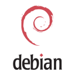

# 第二十章 实战案例 - 操作系统

## 章节概述

本章将介绍 Docker 在不同操作系统镜像场景下的实战案例。当你构建容器化应用时，选择合适的基础镜像至关重要。不同的操作系统镜像在大小、功能和性能方面各有特点，适用于不同的使用场景。本章通过具体的案例，详细讲解如何在 Docker 中使用主流操作系统镜像，包括轻量级镜像 (Busybox、Alpine) 和完整功能镜像（Debian、Ubuntu、CentOS 等）。

## 版本说明

本章示例中使用的操作系统镜像版本遵循以下原则：

- **Alpine、Debian、Ubuntu、CentOS** 等操作系统镜像采用大版本或次版本标签（如 `alpine:3.21`、`ubuntu:26.04`），避免使用 `latest` 标签确保构建的可再现性
- **OS 大版本保留**，以便获得最新的安全补丁和修复
- 在生产环境中，建议根据实际需求选择合适的版本，并定期更新以获得安全修复

## 为什么选择合适的操作系统镜像很重要

在容器化应用开发中，选择合适的基础操作系统镜像直接影响容器的大小、启动速度、安全性和运行性能。不同的镜像提供了不同的功能集和资源占用：

- **轻量级镜像** (Busybox、Alpine) - 镜像大小仅几 MB，启动快速，适合微服务、IoT 设备和对资源敏感的环境。Busybox 是最小的选择，集成了常见的 Unix 工具；Alpine 则提供了完整的包管理器，方便安装额外工具。
- **通用镜像** (Debian、Ubuntu) - 提供完整的 Linux 功能和丰富的软件生态，镜像大小通常在 80-300 MB 之间。适合需要灵活安装各种依赖和工具的应用场景。
- **企业级镜像** (CentOS、Fedora) - 基于 Red Hat 生态，广泛应用于企业环境和复杂系统应用。提供了 yum 包管理器和强大的系统管理工具。

选择镜像的关键原则是 “小而够用”——选择满足应用需求的最小镜像。这样可以减少安全漏洞表面积、加快镜像拉取和推送速度、降低存储成本，同时也使容器更便于分发和部署。

## 常用操作系统镜像对比

| 镜像 | 大小 | 包管理器 | 适用场景 | 优势 |
|------|------|--------|--------|------|
| **Busybox** | ~1 MB | 无 | 最小化工具集、initrd | 极致轻量，启动秒级 |
| **Alpine** | ~5 MB | apk | 微服务、静态应用 | 体积小，有包管理器 |
| **Debian** | ~100 MB | apt-get | 通用应用、开发环境 | 软件包丰富，稳定性强 |
| **Ubuntu** | ~80 MB | apt-get | 类似 Debian，现代化系统 | 更新频繁，用户多 |
| **CentOS** | ~200 MB | yum | 企业应用、兼容性需求 | 企业级支持，稳定性高 |
| **Fedora** | ~200 MB | dnf | 新特性需求、开发环境 | 最新技术栈，创新性强 |

## 学习目标

通过学习本章内容，你将能够：

- 理解不同操作系统镜像的特点、大小和适用场景
- 掌握在 Docker 中使用各类操作系统镜像的方法和最佳实践
- 学习如何根据实际需求选择合适的基础镜像，实现镜像优化
- 了解如何在不同操作系统容器中安装、配置和管理应用程序
- 掌握多阶段构建等高级技巧，最小化最终镜像大小
- 学会使用 Docker Compose 编排多个操作系统容器环境

## 章节内容导航

* Busybox — 超轻量级工具集镜像，适合嵌入式和最小化容器
* Alpine — 轻量级 Linux 镜像，广泛用于生产环境微服务
* Debian Ubuntu — 功能完整的通用 Linux 镜像，生态丰富
* CentOS Fedora — 企业级 Linux 镜像，适合复杂系统应用
* [本章小结](summary.md)

## 1. Busybox

### 1.1 简介

下图直观地展示了本节内容：


`BusyBox` 是一个集成了一百多个最常用 Linux 命令和工具（如 `cat`、`echo`、`grep`、`mount`、`telnet` 等）的精简工具箱，它只需要几 MB 的大小，很方便进行各种快速验证，被誉为 “Linux 系统的瑞士军刀”。

`BusyBox` 可运行于多款 `POSIX` 环境的操作系统中，如 `Linux`（包括 `Android`）、`Hurd`、`FreeBSD` 等。

### 1.2 获取官方镜像

可以使用 `docker pull` 指令下载 `busybox:latest` 镜像：

```bash
$ docker pull busybox:latest
latest: Pulling from library/busybox
5c4213be9af9: Pull complete
Digest: sha256:c6b45a95f932202dbb27c31333c4789f45184a744060f6e569cc9d2bf1b9ad6f
Status: Downloaded newer image for busybox:latest
docker.io/library/busybox:latest
```
下载后，可以看到 `busybox` 镜像只有 **2.433 MB**：

```bash
$ docker image ls
REPOSITORY                   TAG                 IMAGE ID            CREATED             VIRTUAL SIZE
busybox                   latest              e72ac664f4f0        6 weeks ago         2.433 MB
```

### 1.3 运行 busybox

启动一个 `busybox` 容器，并在容器中执行 `grep` 命令。

```bash
$ docker run -it busybox
/ # grep
BusyBox v1.22.1 (2014-05-22 23:22:11 UTC) multi-call binary.

Usage: grep [-HhnlLoqvsriwFE] [-m N] [-A/B/C N] PATTERN/-e PATTERN.../-f FILE [FILE]...

Search for PATTERN in FILEs (or stdin)

        -H      Add 'filename:' prefix
        -h      Do not add 'filename:' prefix
        -n      Add 'line_no:' prefix
        -l      Show only names of files that match
        -L      Show only names of files that don't match
        -c      Show only count of matching lines
        -o      Show only the matching part of line
        -q      Quiet. Return 0 if PATTERN is found, 1 otherwise
        -v      Select non-matching lines
        -s      Suppress open and read errors
        -r      Recurse
        -i      Ignore case
        -w      Match whole words only
        -x      Match whole lines only
        -F      PATTERN is a literal (not regexp)
        -E      PATTERN is an extended regexp
        -m N    Match up to N times per file
        -A N    Print N lines of trailing context
        -B N    Print N lines of leading context
        -C N    Same as '-A N -B N'
        -e PTRN Pattern to match
        -f FILE Read pattern from file
```
查看容器内的挂载信息。

```bash
/ # mount
overlay on / type overlay (rw,relatime,lowerdir=/var/lib/docker/overlay2/l/BOTCI5RF24AMC4A2UWF4N6ZWFP:/var/lib/docker/overlay2/l/TWVP5T5DMKJGXZOROR7CAPWGFP,upperdir=/var/lib/docker/overlay2/801ef0bf6cce35288dbb8fe00a4f9cc47760444693bfdf339ed0bdcf926e12a3/diff,workdir=/var/lib/docker/overlay2/801ef0bf6cce35288dbb8fe00a4f9cc47760444693bfdf339ed0bdcf926e12a3/work)
proc on /proc type proc (rw,nosuid,nodev,noexec,relatime)
tmpfs on /dev type tmpfs (rw,nosuid,size=65536k,mode=755)
devpts on /dev/pts type devpts (rw,nosuid,noexec,relatime,gid=5,mode=620,ptmxmode=666)
sysfs on /sys type sysfs (ro,nosuid,nodev,noexec,relatime)
tmpfs on /sys/fs/cgroup type tmpfs (ro,nosuid,nodev,noexec,relatime,mode=755)
cgroup on /sys/fs/cgroup/systemd type cgroup (ro,nosuid,nodev,noexec,relatime,xattr,release_agent=/lib/systemd/systemd-cgroups-agent,name=systemd)
cgroup on /sys/fs/cgroup/net_cls,net_prio type cgroup (ro,nosuid,nodev,noexec,relatime,net_cls,net_prio)
cgroup on /sys/fs/cgroup/freezer type cgroup (ro,nosuid,nodev,noexec,relatime,freezer)
cgroup on /sys/fs/cgroup/cpu,cpuacct type cgroup (ro,nosuid,nodev,noexec,relatime,cpu,cpuacct)
cgroup on /sys/fs/cgroup/cpuset type cgroup (ro,nosuid,nodev,noexec,relatime,cpuset)
cgroup on /sys/fs/cgroup/blkio type cgroup (ro,nosuid,nodev,noexec,relatime,blkio)
cgroup on /sys/fs/cgroup/perf_event type cgroup (ro,nosuid,nodev,noexec,relatime,perf_event)
cgroup on /sys/fs/cgroup/memory type cgroup (ro,nosuid,nodev,noexec,relatime,memory)
cgroup on /sys/fs/cgroup/devices type cgroup (ro,nosuid,nodev,noexec,relatime,devices)
cgroup on /sys/fs/cgroup/pids type cgroup (ro,nosuid,nodev,noexec,relatime,pids)
mqueue on /dev/mqueue type mqueue (rw,nosuid,nodev,noexec,relatime)
shm on /dev/shm type tmpfs (rw,nosuid,nodev,noexec,relatime,size=65536k)
/dev/vda1 on /etc/resolv.conf type ext3 (rw,noatime,data=ordered)
/dev/vda1 on /etc/hostname type ext3 (rw,noatime,data=ordered)
/dev/vda1 on /etc/hosts type ext3 (rw,noatime,data=ordered)
devpts on /dev/console type devpts (rw,nosuid,noexec,relatime,gid=5,mode=620,ptmxmode=666)
proc on /proc/bus type proc (ro,relatime)
proc on /proc/fs type proc (ro,relatime)
proc on /proc/irq type proc (ro,relatime)
proc on /proc/sys type proc (ro,relatime)
proc on /proc/sysrq-trigger type proc (ro,relatime)
tmpfs on /proc/acpi type tmpfs (ro,relatime)
tmpfs on /proc/kcore type tmpfs (rw,nosuid,size=65536k,mode=755)
tmpfs on /proc/keys type tmpfs (rw,nosuid,size=65536k,mode=755)
tmpfs on /proc/timer_list type tmpfs (rw,nosuid,size=65536k,mode=755)
tmpfs on /proc/sched_debug type tmpfs (rw,nosuid,size=65536k,mode=755)
tmpfs on /sys/firmware type tmpfs (ro,relatime)
```
`busybox` 镜像虽然小巧，但包括了大量常见的 `Linux` 命令，读者可以用它快速熟悉 `Linux` 命令。

### 1.4 相关资源

* `Busybox` 官网：https://busybox.net/
* `Busybox` 源码下载：https://busybox.net/downloads/
* `Busybox` 官方镜像：https://hub.docker.com/\_/busybox/
* `Busybox` 官方镜像仓库：https://github.com/docker-library/busybox

## 2. Alpine

### 2.1 简介

下图直观地展示了本节内容：


`Alpine` 操作系统是一个面向安全的轻型 `Linux` 发行版。它不同于通常 `Linux` 发行版，`Alpine` 采用了 `musl libc` 和 `busybox` 以减小系统的体积和运行时资源消耗，但功能上比 `busybox` 又完善得多，因此得到开源社区越来越多的青睐。在保持瘦身的同时，`Alpine` 还提供了自己的包管理工具 `apk`，可以在 [Alpine Packages](https://pkgs.alpinelinux.org/packages) 网站上查询包信息，也可以直接通过 `apk` 命令直接查询和安装各种软件。


`Alpine` 是由非商业组织维护的、支持广泛场景的 `Linux` 发行版，它特别为资深/重度 `Linux` 用户而优化，关注安全，性能和资源效能。`Alpine` 镜像可以适用于更多常用场景，并且是一个优秀的可以适用于生产的基础系统/环境。

`Alpine` Docker 镜像也继承了 `Alpine Linux` 发行版的这些优势。相比于其他 `Docker` 镜像，它的容量非常小，压缩后仅约 **5 MB**（对比 `Ubuntu` 系列镜像约 `28 MB`），且拥有非常友好的包管理机制。官方镜像来自 `docker-alpine` 项目。

目前 Docker 官方已开始推荐使用 `Alpine` 替代之前的 `Ubuntu` 作为基础镜像环境。这样会带来多个好处。包括镜像下载速度加快，镜像安全性提高，主机之间的切换更方便，占用更少磁盘空间等。

下表是官方镜像的大小比较（压缩后大小，实际数据以 Docker Hub 为准）：

```bash
REPOSITORY          TAG           COMPRESSED SIZE
alpine              latest        ~5 MB
debian              latest        ~30 MB
ubuntu              latest        ~28 MB
```

> **提示**：镜像大小会随版本更新而变化，精确值请查阅 [Docker Hub](https://hub.docker.com/) 各镜像的 Tags 页面。Alpine 的优势不仅在于体积小，还在于更少的预装包带来更小的攻击面。

### 2.2 获取并使用官方镜像

由于镜像很小，下载时间往往很短，读者可以直接使用 `docker run` 指令直接运行一个 `Alpine` 容器，并指定运行的 Linux 指令，例如：

```bash
$ docker run alpine echo '123'
123
```

### 2.3 迁移至 Alpine 基础镜像

目前，大部分 Docker 官方镜像都已经支持 `Alpine` 作为基础镜像，可以很容易进行迁移。

例如：

* `ubuntu/debian` -> `alpine`
* `python:3` -> `python:3-alpine`
* `ruby:2.6` -> `ruby:2.6-alpine`

另外，如果使用 `Alpine` 镜像替换 `Ubuntu` 基础镜像，安装软件包时需要用 `apk` 包管理器替换 `apt` 工具，如

```bash
$ apk add --no-cache <package>
```
`Alpine` 中软件安装包的名字可能会与其他发行版有所不同，可以在 `https://pkgs.alpinelinux.org/packages` 网站搜索并确定安装包名称。如果需要的安装包不在主索引内，但是在测试或社区索引中，那么可以按照以下方法使用这些安装包。

```bash
$ echo "http://dl-cdn.alpinelinux.org/alpine/edge/testing" >> /etc/apk/repositories
$ apk --update add --no-cache <package>
```
由于在国内访问 `apk` 仓库较缓慢，建议在使用 `apk` 之前先替换仓库地址为国内镜像。

```docker
RUN sed -i "s/dl-cdn.alpinelinux.org/mirrors.aliyun.com/g" /etc/apk/repositories \
      && apk add --no-cache <package>
```

### 2.4 相关资源

* `Alpine` 官网：https://www.alpinelinux.org/
* `Alpine` 官方仓库：https://github.com/alpinelinux
* `Alpine` 官方镜像：https://hub.docker.com/\_/alpine/
* `Alpine` 官方镜像仓库：https://github.com/alpinelinux/docker-alpine

## 3. Debian Ubuntu

`Debian` 和 `Ubuntu` 都是目前较为流行的 **Debian 系** 的服务器操作系统，十分适合研发场景。`Docker Hub` 上提供了官方镜像，国内各大容器云服务也基本都提供了相应的支持。

### 3.1 Debian 系统简介

下图直观地展示了本节内容：




`Debian` 是由 `GPL` 和其他自由软件许可协议授权的自由软件组成的操作系统，由 **Debian 计划 (Debian Project)** 组织维护。**Debian 计划** 是一个独立的、分散的组织，由 `3000` 名志愿者组成，接受世界多个非盈利组织的资金支持，`Software in the Public Interest` 提供支持并持有商标作为保护机构。`Debian` 以其坚守 `Unix` 和自由软件的精神，以及其给予用户的众多选择而闻名。现时 `Debian` 包括了超过 `25,000` 个软件包并支持 `12` 个计算机系统结构。

`Debian` 作为一个大的系统组织框架，其下有多种不同操作系统核心的分支计划，主要为采用 `Linux` 核心的 `Debian GNU/Linux` 系统，其他还有采用 `GNU Hurd` 核心的 `Debian GNU/Hurd` 系统、采用 `FreeBSD` 核心的 `Debian GNU/kFreeBSD` 系统，以及采用 `NetBSD` 核心的 `Debian GNU/NetBSD` 系统。甚至还有利用 `Debian` 的系统架构和工具，采用 `OpenSolaris` 核心构建而成的 `Nexenta OS` 系统。在这些 `Debian` 系统中，以采用 `Linux` 核心的 `Debian GNU/Linux` 最为著名。

众多的 `Linux` 发行版，例如 `Ubuntu`、`Knoppix` 和 `Linspire` 及 `Xandros` 等，都基于 `Debian GNU/Linux`。

#### 使用 Debian 官方镜像

Debian 是一个常用的基础镜像。


官方提供了大家熟知的 `debian` 镜像以及面向科研领域的 `neurodebian` 镜像。可以使用 `docker run` 直接运行 `Debian` 镜像。

```bash
$ docker run -it debian bash
root@668e178d8d69:/# cat /etc/issue
Debian GNU/Linux 13
```
`Debian` 镜像很适合作为基础镜像，构建自定义镜像。

### 3.2 Ubuntu 系统简介

下图直观地展示了本节内容：


`Ubuntu` 是一个以桌面应用为主的 `GNU/Linux` 操作系统，其名称来自非洲南部祖鲁语或豪萨语的 “ubuntu” 一词（官方译名 “友帮拓”，另有 “吾帮托”、“乌班图”、“有奔头” 或 “乌斑兔” 等译名）。`Ubuntu` 意思是 “人性” 以及 “我的存在是因为大家的存在”，是非洲传统的一种价值观，类似华人社会的 “仁爱” 思想。`Ubuntu` 基于 `Debian` 发行版和 `GNOME/Unity` 桌面环境，与 `Debian` 的不同在于它每 6 个月会发布一个新版本，每 2 年推出一个长期支持 **(Long Term Support，LTS)** 版本；LTS 版本通常提供 5 年标准安全维护，Ubuntu Pro/ESM 可进一步延长安全覆盖。

#### 使用 Ubuntu 官方镜像

Ubuntu 是目前最流行的 Linux 发行版之一。


下面以 `ubuntu:26.04` 为例，演示如何使用该镜像安装一些常用软件。

首先使用 `-ti` 参数启动容器，登录 `bash`，查看 `ubuntu` 的发行版本号。

```bash
$ docker run -ti ubuntu:26.04 /bin/bash
root@7d93de07bf76:/# cat /etc/os-release
PRETTY_NAME="Ubuntu 26.04 LTS"
NAME="Ubuntu"
VERSION_ID="26.04"
VERSION="26.04 LTS (Resolute Raccoon)"
VERSION_CODENAME=resolute
ID=ubuntu
ID_LIKE=debian
HOME_URL="https://www.ubuntu.com/"
SUPPORT_URL="https://help.ubuntu.com/"
BUG_REPORT_URL="https://bugs.launchpad.net/ubuntu/"
```
当试图直接使用 `apt-get` 安装一个软件的时候，会提示 `E: Unable to locate package`。

```bash
root@7d93de07bf76:/# apt-get install curl
Reading package lists... Done
Building dependency tree... Done
Reading state information... Done
E: Unable to locate package curl
```
这并非系统不支持 `apt-get` 命令。Docker 镜像在制作时为了精简清除了 `apt` 仓库信息，因此需要先执行 `apt-get update` 命令来更新仓库信息。更新信息后即可成功通过 `apt-get` 命令来安装软件。

```bash
root@7d93de07bf76:/# apt-get update
Get:1 http://archive.ubuntu.com/ubuntu resolute InRelease [256 kB]
Get:2 http://security.ubuntu.com/ubuntu resolute-security InRelease [126 kB]
...
Fetched 25.8 MB in 8s (3215 kB/s)
Reading package lists... Done
```
首先，安装 `curl` 工具。

```bash
root@7d93de07bf76:/# apt-get install curl
Reading package lists... Done
Building dependency tree
Reading state information... Done
The following additional packages will be installed:
  ca-certificates krb5-locales libasn1-8-heimdal libcurl4 libgssapi-krb5-2 libgssapi3-heimdal libhcrypto4-heimdal libheimbase1-heimdal libheimntlm0-heimdal libhx509-5-heimdal
  libk5crypto3 libkeyutils1 libkrb5-26-heimdal libkrb5-3 libkrb5support0 libldap-2.4-2 libldap-common libnghttp2-14 libpsl5 libroken18-heimdal librtmp1 libsasl2-2 libsasl2-modules libsasl2-modules-db libsqlite3-0 libssl1.1 libwind0-heimdal openssl publicsuffix
...
root@7d93de07bf76:/# curl
curl: try 'curl --help' or 'curl --manual' for more information
```
接下来，再安装 `apache` 服务。

```bash
root@7d93de07bf76:/# apt-get install -y apache2
Reading package lists... Done
Building dependency tree
Reading state information... Done
The following additional packages will be installed:
  apache2-bin apache2-data apache2-utils file libapr1 libaprutil1 libaprutil1-dbd-sqlite3 libaprutil1-ldap libexpat1 libgdbm-compat4 libgdbm5 libicu60 liblua5.2-0 libmagic-mgc libmagic1 libperl5.26 libxml2 mime-support netbase perl perl-modules-5.26 ssl-cert xz-utils
...
```
启动这个 `apache` 服务，然后使用 `curl` 来测试本地访问。

```bash
root@7d93de07bf76:/# service apache2 start
 * Starting web server apache2                                                                                                                               AH00558: apache2: Could not reliably determine the server's fully qualified domain name, using 172.17.0.2. Set the 'ServerName' directive globally to suppress this message
 *
root@7d93de07bf76:/# curl 127.0.0.1

<!DOCTYPE html PUBLIC "-//W3C//DTD XHTML 1.0 Transitional//EN" "http://www.w3.org/TR/xhtml1/DTD/xhtml1-transitional.dtd">
<html xmlns="http://www.w3.org/1999/xhtml">
  <!--
    Modified from the Debian original for Ubuntu
    Last updated: 2016-11-16
    See: https://launchpad.net/bugs/1288690
  -->
  <head>
    <meta http-equiv="Content-Type" content="text/html; charset=UTF-8" />
    <title>Apache2 Ubuntu Default Page: It works</title>
    <style type="text/css" media="screen">
...
```
配合使用 `-p` 参数对外映射服务端口，可以允许容器外来访问该服务。

### 3.3 相关资源

* `Debian` 官网：https://www.debian.org/
* `Neuro Debian` 官网：http://neuro.debian.net/
* `Debian` 官方仓库：https://github.com/Debian
* `Debian` 官方镜像：https://hub.docker.com/\_/debian/
* `Debian` 官方镜像仓库：https://github.com/tianon/docker-brew-debian/
* `Ubuntu` 官网：https://ubuntu.com
* `Ubuntu` 官方仓库：https://github.com/ubuntu
* `Ubuntu` 官方镜像：https://hub.docker.com/\_/ubuntu/
* `Ubuntu` 官方镜像仓库：https://github.com/tianon/docker-brew-ubuntu-core

## 4. CentOS Fedora

### 4.1 CentOS 系统简介

`CentOS` 和 `Fedora` 都是基于 `Redhat` 的常见 Linux 分支。传统 `CentOS Linux` 曾是企业级服务器的常用操作系统，但相关 Docker 官方镜像已停止维护；新部署通常应评估 Rocky Linux、AlmaLinux、CentOS Stream 或直接使用 RHEL/UBI 等替代方案。`Fedora` 则主要面向个人桌面用户。


CentOS（Community Enterprise Operating System，中文意思是：社区企业操作系统），它是基于 `Red Hat Enterprise Linux` 源代码编译而成。由于 `CentOS` 与 `Redhat Linux` 源于相同的代码基础，所以很多成本敏感且需要高稳定性的公司就使用 `CentOS` 来替代商业版 `Red Hat Enterprise Linux`。`CentOS` 自身不包含闭源软件。

#### 使用 CentOS 官方镜像

CentOS 官方镜像的使用非常简单。


**注意：CentOS 8 已于 2021 年 12 月 31 日停止维护 (EOL)，CentOS 7 已于 2024 年 6 月 30 日停止维护。对于新部署，推荐使用 Rocky Linux、AlmaLinux 或 CentOS Stream 等替代发行版。**

使用 `docker run` 直接运行 `CentOS 7` 镜像，并登录 `bash`。

```bash
$ docker run -it centos:7 bash
Unable to find image 'centos:7' locally
7: Pulling from library/centos
3d8673bd162a: Pull complete
Digest: sha256:a66ffcb73930584413de83311ca11a4cb4938c9b2521d331026dad970c19adf4
Status: Downloaded newer image for centos:7
[root@43eb3b194d48 /]# cat /etc/redhat-release
CentOS Linux release 7.9.2009 (Core)
```

### 4.2 Fedora 系统简介

下图直观地展示了本节内容：


`Fedora` 是由 `Fedora Project` 社区开发、红帽公司赞助的 `Linux` 发行版。它的目标是创建一套新颖、多功能并且自由和开源的操作系统。`Fedora` 的功能对于用户而言，它是一套功能完备的，可以更新的免费操作系统，而对赞助商 `Red Hat` 而言，它是许多新技术的测试平台。被认为可用的技术最终会加入到 `Red Hat Enterprise Linux` 中。

#### 使用 Fedora 官方镜像

使用 `docker run` 命令直接运行 `Fedora` 官方镜像，并登录 `bash`。

```bash
$ docker run -it fedora bash
Unable to find image 'fedora:latest' locally
latest: Pulling from library/fedora
2bf01635e2a0: Pull complete
Digest: sha256:64a02df6aac27d1200c2572fe4b9949f1970d05f74d367ce4af994ba5dc3669e
Status: Downloaded newer image for fedora:latest
[root@196ca341419b /]# cat /etc/redhat-release
Fedora release 43 (Forty Three)
```

### 4.3 相关资源

* `Fedora` 官网：https://fedoraproject.org/
* `Fedora` 官方仓库：https://github.com/fedora-infra
* `Fedora` 官方镜像：https://hub.docker.com/\_/fedora/
* `Fedora` 官方镜像仓库：https://github.com/fedora-cloud/docker-brew-fedora
* `CentOS` 官网：https://www.centos.org
* `CentOS` 官方仓库：https://github.com/CentOS
* `CentOS` 官方镜像：https://hub.docker.com/\_/centos/
* `CentOS` 官方镜像仓库：https://github.com/CentOS/CentOS-Dockerfiles
