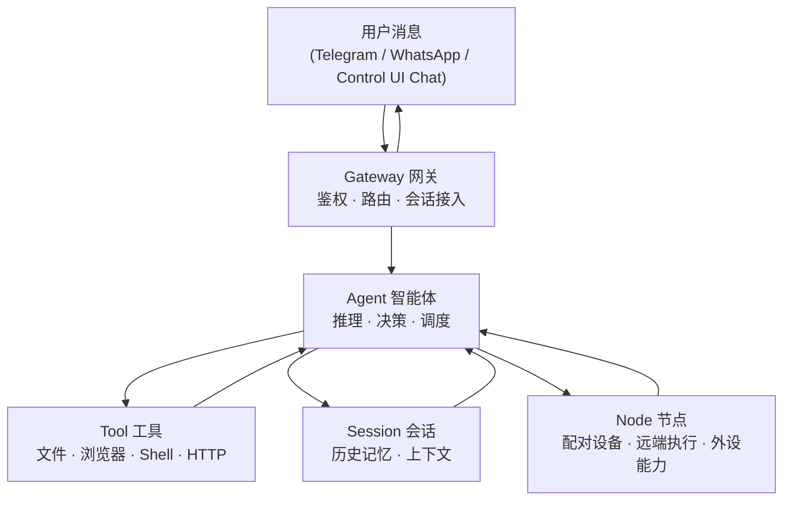

# 第一章 认识 OpenClaw

欢迎来到 OpenClaw 的世界。如果你曾经使用过 ChatGPT 或 Claude，你可能会惊叹于大语言模型的聪明才智；但当你试图让它们帮你“真正把活干完”（比如自动查收邮件、整理数据并发送到飞书群）时，很容易发现缺了一个能把 AI 与真实软件连接起来的系统框架。

**[OpenClaw](https://openclaw.ai/) 就是这样一个能够将大语言模型与真实世界连接起来，让 AI 替你自动、安全地完成复杂任务的智能体项目。**

本章以应用为先，先让你直观地感受 OpenClaw 能做什么、适合谁用、和已有工具有什么区别，最后用一张图和一张表建立核心概念的认知。技术细节留到后面再展开。

## 学习目标

完成本章的阅读后，你将能够：
1. **说清楚 OpenClaw 是什么**：能向别人解释它解决了什么问题，适合什么场景。
2. **做出选型判断**：知道在什么情况下该用 OpenClaw，什么时候用 ChatGPT 或 Zapier 更合适。
3. **认识五个核心概念**：理解 Gateway、Agent、Tool、Session、Node 的含义，为后续章节扫清沟通障碍。

---

准备好的话，让我们正式 **[开始](1.1_what_is_openclaw.md)**！

## 1. OpenClaw 是什么

你可能用过 ChatGPT，对它的聪慧印象深刻。但当你真正想让它帮你“干完一件活”时——比如每天定时检查邮件、从中提取任务清单、整理后发送给团队——你会发现一个尴尬的现实：**模型再聪明，也需要一套能连接真实工具、管理复杂流程、处理各种意外的运行系统**。

**OpenClaw 就是这样一套本地优先的个人 AI 助手系统。**

更准确地说，OpenClaw 是运行在你自己设备或服务器上的个人 AI assistant；其中 **Gateway 只是控制平面**，负责把消息、会话、工具、节点和权限边界接进同一套运行环境。它不是单纯的开发框架，也不是一组 SDK，而是一套可直接运行、可持续交互、可连接真实工具的智能体产品。

### 1.1 “智能实习生”的比喻

想象你招了一个聪慧但完全陌生的实习生，要让他独立完成复杂工作，需要什么？

- **明确的身份认证**：“你是谁，你有权限访问哪些系统？”
- **可靠的工具与权限边界**：“你可以用哪些工具，哪些操作禁止（如删除数据库）？”
- **完整的上下文记忆**：“前面说过什么，现在的状态是什么，不要忘记细节。”
- **突发情况的应对**：“系统超时了该怎么办，重要操作前要不要先问一下？”
- **完整的操作日志**：“你干了什么、为什么这么做，万一出问题好追查。”

OpenClaw 的作用正是这样：**为 AI 智能体构建一个可控、可审计、可恢复的运行环境**。它不改变 AI 本身的聪慧程度，但让这份聪慧能够被安全地、可预测地用在真实业务中。

### 1.2 OpenClaw 解决的三个让人头疼的问题

#### 问题 1：孤立的 AI 能力

大模型的基本交互模式是一问一答。用户提问 → 模型思考 → 返回答案 → 对话结束。整个过程中：

- 记忆有限且不可控——上下文窗口一满，早期指令就被“忘掉”
- 没有“手脚”——不能主动读文件、查数据库、调用真实 API
- 没有“边界”——你无法限制它删除重要数据、暴露机密信息

**OpenClaw 的解决方案**：

- 构建持久化会话（Session），让 AI 在多轮对话中保有连续上下文
- 提供工具系统（Tool），让 AI 调用真实的 API、Shell 命令、文件操作、浏览器
- 设置访问控制与黑白名单，确保 AI 只能做被授权的操作

#### 问题 2：多渠道接入与身份混乱

你可能需要在 Telegram、WhatsApp、Slack、本地 Control UI Chat 等多个入口部署同一个智能体。这时的挑战是：

- 不同渠道的消息格式不同
- 用户身份如何在多个渠道间统一？
- 如何防止越权访问（用户 A 的数据被用户 B 看到）？
- 如何在任何渠道暂停、恢复、审核正在运行的任务？

**OpenClaw 的解决方案**：

- Gateway 网关统一接收来自多个渠道的消息，格式化成统一内部表示
- 聊天渠道通过 pairing / allowlist 等机制建立可信发送者关系；而手机、桌面端、摄像头等设备能力则通过独立的 node/device pairing 接入
- 运行时未配置时，直接消息仍可能回落到主会话；但当前 onboarding / quickstart 默认会写入更偏隔离的 `session.dmScope: "per-channel-peer"`，所以新安装通常不是“所有 DM 共用主会话”
- 如果需要进一步做多用户隔离，应结合 agent 路由与会话策略；`identityLinks` 的作用是把同一用户在多渠道的身份合并到同一会话，而不是做隔离拆分
- 集中式会话管理：无论从哪个渠道发来的请求，都由同一控制平面维护会话状态

#### 问题 3：可靠性与可审计性缺失

当 AI 在生产环境中运行时，你需要：

- **容错能力**：如果模型超时、API 失败，是重试还是回退到备选方案？
- **成本管理**：多轮交互中 Token 消耗可能快速积累，导致账单意外增长
- **决策可追溯**：AI 做了什么决定、为什么这么做、结果是什么——全程有日志可查
- **人工介入口**：对关键操作（如删除、扣费）要求人工确认
- **故障恢复**：系统崩溃或中断时，任务可以从上一个完整状态恢复，而不是重新开始

**OpenClaw 的解决方案**：

- 控制平面实现故障恢复、超时管理、回退链路、熔断机制
- 用量观测与成本治理：内置用量视图和成本摘要，硬预算与告警依赖 provider 控制台、外部监控或插件治理
- 人在回路（HITL）门控：高风险操作前自动暂停，等待人工审批
- 完整的审计日志：每个决策、执行、成功/失败都有记录

### 1.3 OpenClaw 最适合什么场景

如果你的需求满足下列特征，OpenClaw 是理想的选择：

**完美契合的场景**：

- 需要多步推理与工具调用的任务（如“帮我总结邮件、提取行动项、发送给 Slack”）
- 需要跨多个渠道部署同一套智能体（Telegram + WhatsApp + 内部系统）
- 任务的输入输出格式多变，用硬编码规则容易出错
- 对可控性、可追溯性、安全性有强需求（运维、研究、内部自动化等）
- 希望在自己的设备或服务器上运行，强调本地优先与数据主权
- 能接受 CLI + 配置驱动的安装、调优和持续维护

**不太适合的场景**：

- 简单的一问一答对话 → 直接用 ChatGPT/Claude 就够了
- 编程助手需求 → Cursor 专门优化过，体验更好
- 业务流程完全规则化、不需要模糊推理 → Zapier/n8n 硬编码规则更高效
- 不能接受任何自部署成本 → 用 Dify/Coze 这样的云托管方案更方便

接下来，[1.2 节](1.2_scenarios_comparison.md)会用一张表详细对比 OpenClaw 与其他工具的区别，[1.3 节](1.3_concepts.md)会用一张图与一张表介绍五个核心概念。如果你迫不及待想动手，可以直接跳到[第二章](../02_setup/README.md)的安装与配置。

## 2. 竞品对比与选型建议

你可能会问：市面上已经有 ChatGPT、Cursor、Zapier 这么多工具了，为什么还需要 OpenClaw？

这一节用一张表帮你快速做出选型判断。

### 2.1 与主流工具的对比

| 工具 | 核心定位 | 与 OpenClaw 的关键区别 |
|---|---|---|
| **ChatGPT / Claude（托管式对话产品）** | 对话、应用/连接器集成、托管式 AI 工作台 | ChatGPT/Claude 是产品化的托管方案，侧重产品内体验与集成生态。OpenClaw 更强调**本地优先、多渠道入口、细粒度权限控制与本地工具执行** |
| **Cursor** | 针对编程场景深度优化的 AI 助手 | 专才系统，开箱即用。OpenClaw 是**构建各类 AI 助手的通用底座**，适合非固定的业务场景 |
| **Zapier / n8n** | 基于硬编码规则的自动化工作流 | 规则固定，遇到格式偏差容易中断。OpenClaw 借助 LLM 的推理能力，**能更灵活地处理变化的输入格式与突发情况** |
| **Dify / Coze 等可视化平台** | 可视化 AI 应用构建与编排 | 更偏工作台/可视化编排体验；OpenClaw 更强调**长期运行的个人 assistant、本地工具边界、多渠道接入与会话控制** |
| **OpenAI Responses API / Conversations API** | 云端 agent 构建原语 | 官方当前推荐新项目优先使用的 OpenAI agent 原语。OpenClaw 则是**模型无关、运行在你自己环境中的本地优先 assistant 系统** |
| **LangChain / AutoGen / Microsoft Agent Framework** | 构建智能体的开发框架 | 需要大量编写代码组装。OpenClaw 偏向**开箱即用的运行时**，内置网关、多渠道、记忆管理，适合个人/小团队快速落地。注：AutoGen 自 2026 年起进入维护模式（仅 bug fix / 安全补丁），新项目建议使用其继任者 Microsoft Agent Framework（2026-04-03 发布 1.0，融合了 AutoGen 与 Semantic Kernel） |

> **选型建议**：如需个人学习、通用问答或直接使用托管集成 → ChatGPT/Claude；如需编程助手 → Cursor；如需在**自有服务器上构建可连接真实工具、可控权限边界、可多渠道接入的智能体** → OpenClaw。

### 2.2 Token 成本要有清醒认识

OpenClaw 的每次交互都会消耗模型 API 的 Token。与简单的一问一答不同，一次多步任务通常需要 2–5 轮 API 调用，每轮都包含系统提示、工具定义和历史消息，因此 **Token 成本会显著高于普通对话**。实际倍数取决于任务复杂度、上下文长度和挂载的工具数量。

控制成本的基本原则：

- 只挂载当前场景需要的工具，减少每轮的工具定义开销
- 合理配置会话重置，防止历史消息无限膨胀
- 简单任务优先用更便宜、更快的模型；复杂推理再切到更强的模型层级
- 优先选择你已经接入、且供应商当前仍推荐的新模型系列，而不是长期写死某一家供应商的旧型号

更根本的原则是明确业务边界——**只在需要自然语言理解、模糊决策或多步推理的环节使用智能体**，其余部分用确定性代码实现。

详细的 Token 成本分析见[第十四章 性能与成本优化](../14_performance_cost/README.md)。

## 3. 核心概念速览

在深入使用之前，只需记住 5 个名字：**Gateway、Agent、Tool、Session、Node**。

图 1-1：五个核心概念及其关系

| 概念 | 一句话说清楚 |
|---|---|
| **Gateway（网关）** | 系统的“门”，负责接受来自各渠道的消息、验证身份、维护连接状态，并把请求送入控制面 |
| **Agent（智能体）** | 真正“干活”的单元，调用大模型思考，决定下一步该用哪个工具，并把结果整理后回复 |
| **Tool（工具）** | Agent 的“手”，具体执行操作——比如读一个文件、打开一个网页、调用一个 API |
| **Session（会话）** | Agent 的“记忆本”，把多轮对话的历史保存下来，让 AI 记得“之前说过什么” |
| **Node（节点）** | 通过 WebSocket 接入 Gateway 的设备或执行端点，用于承载摄像头、屏幕、通知、远端执行等外设能力 |

### 3.1 它们之间的包含关系

在当前设计中，核心链路是 **Gateway → Agent → Tool / Session**。Node 是可选的外设或执行端点——只有当你接入摄像头、手机、远端执行能力等设备时，这些设备才会通过 Node 参与到 Agent 的调度链中。用一句话概括：

> **Gateway → Agent → Tool / Session（Node 按需接入）**
>
> 网关接入消息与控制面，智能体完成推理与调度，工具和会话分别承担执行与上下文；Node 只在设备能力或远端执行场景中出现。

### 3.2 一条消息的极简旅程

当你在 Telegram 里对机器人说“帮我查一下今天的天气”，会发生什么？

1. 消息先到达 **Gateway**——它验证你的身份，确认你有权限使用这个服务。
2. Gateway 将这条消息送入合适的 **Agent** 和对应 **Session**——让系统知道“该由谁处理”和“要不要带上历史上下文”。
3. **Agent** 读取 **Session** 里的历史记录（你昨天问过的城市），然后调用天气查询 **Tool**。
4. Tool 返回天气数据，Agent 把结果整理成人话，沿着 Gateway → Telegram 的路径回复给你。

如果这次任务还需要调手机摄像头、读取桌面通知或在远端设备上执行动作，相关能力会通过 **Node** 暴露给 Agent。

整个过程可能只需要几秒钟，但背后涉及鉴权、路由、推理、工具调用、上下文管理五个环节——这正是后续各章逐一展开的内容。

### 3.3 概念与章节映射

读完本节，你已经认识了五个核心角色。它们各自在哪里被深入讲解？

| 概念 | 深入章节 | 你会学到什么 |
|---|---|---|
| Gateway | [第九章](../09_gateway_protocol/README.md) | 控制平面架构、WebSocket 协议、事件幂等、设备配对 |
| Agent | [第十章](../10_agent_loop/README.md) | Agent Loop 内核、提示词装配、工具执行、流式输出 |
| Tool | [第五章](../05_tools_skills/README.md) | 内置工具、技能与插件、工具策略与沙箱 |
| Session | [第六章](../06_context_memory/README.md) | 会话与状态持久化、上下文窗口、记忆与压缩策略 |
| Node | [第九章](../09_gateway_protocol/README.md) | 配对设备、远端执行端点与设备能力接入 |

---

记住这五个名字就够了，本书后面会逐章深入讲解每个概念的配置和工作原理。

想深入了解架构细节？请参见 [9.1 架构全景与五平面框架](../09_gateway_protocol/9.1_architecture_overview.md) 和 [10.1 请求流转与分层排障](../10_agent_loop/10.1_request_lifecycle.md)。

## 4. 典型应用场景

在 1.1 中我们了解了 OpenClaw 能做什么，在 1.2 中做了竞品对比。现在来看看它在真实世界中到底怎么用——先总览适合与不适合的场景，再用四个具体故事来感受。

### 4.1 适合做什么，不适合做什么

| 适合做什么 | 不适合做什么 |
|---|---|
| **跨渠道统一入口**：在 Telegram、WhatsApp、飞书等聊天工具里直接调度 AI | **纯对话问答**：只想聊天就用 ChatGPT 或 Claude，不需要架设网关 |
| **本地执行与数据主权**：数据留在自有服务器上，适合内网运维、敏感文档处理 | **零运维的托管服务**：不想自己部署维护的团队，托管 SaaS 更省心 |
| **带权限防护的内部工具链**：连接知识库和基础设施，用网关拦截越权指令 | **大规模企业级多租户**：当前版本偏向个人或小团队，企业场景建议评估专业平台 |
| **长时间运行的自动化任务**：Cron 定时 + Webhook 触发，7×24 小时常驻运行 | **毫秒级实时系统**：LLM 推理需要秒级响应，高频交易、实时游戏不适合 |
| **复杂多步工具编排**：文件、Shell、HTTP、浏览器、数据库等数十种工具灵活组合 | **逻辑固定的简单自动化**：“收到邮件→转发到 Slack”这种用 Zapier 更高效 |

有了这个大致的判断框架，接下来看四个具体场景。

### 4.2 个人 ChatOps 中枢

**一句话概括**：在手机聊天窗口里指挥家里的服务器干活。

想象你早上在地铁上，掏出手机对 Telegram 机器人说：“总结一下我今天的关键邮件，告诉我日程有没有冲突。”

几秒后，OpenClaw 回复了一条整理好的消息——它在你家那台小服务器上查了邮箱、看了日历、把结果汇总成人话发回来。你全程没有打开电脑，没有登录任何网页。

这个场景之所以适合 OpenClaw，是因为它需要**跨工具组合**（邮箱 + 日历）、**异步执行**（你发完消息就可以放下手机）、以及**数据与工具执行可留在自有设备**。但任务内容是否发送给第三方，取决于你配置的模型、OAuth 和检索服务；只有本地模型与本地索引配置才能避免相关内容外发。

### 4.3 家庭或实验室自动化网关

**一句话概括**：把树莓派变成一个能听懂人话的 7×24 值班员。

你在树莓派上跑着几个 Docker 容器——博客、下载器、智能家居网关。你配了一条定时规则：每天上午 9 点，OpenClaw 自动巡检一次。

如果一切正常，它不打扰你；如果发现磁盘快满了（90%），它会通过 Telegram 发一条告警。需要重启容器？它不会擅自动手——系统会弹出一个确认请求，等你回复“确认”才执行。

这里用到了 OpenClaw 的定时调度（Cron）、本地工具执行（如 `exec` / `process` 一类执行能力）、以及审批闸门（Exec Approval）。如果要跨机器执行，通常还会结合 paired node 或远端执行能力一起接入。你可以用自然语言临时加任务，比如“查一下最近三天的网络延迟趋势”，不需要每次都手写脚本。

### 4.4 可审计的个人知识与记忆系统

**一句话概括**：让 AI 帮你记笔记，但笔记本在你自己手里。

你是一个研究者，每天和 OpenClaw 讨论学术课题。所有对话默认都会以本地会话记录保存下来（基础转录以 JSONL 为主）；如果你再接入记忆、归档或笔记工具，还可以额外生成 Markdown 形式的整理笔记，而且整个过程都不必依赖云端托管。

你还可以配置一个按周运行的后台任务，把这周的冗长对话“浓缩”成几页结构化笔记。这些笔记再配合向量索引、记忆插件或版本管理工具使用后，你就能问“过去一个月我在 X 课题上的思路是怎么演进的”，系统也能检索到相关内容，甚至借助 git diff 这类外部工具对比思路变化轨迹。

> [!NOTE]
> 这里描述的是 **OpenClaw + 定时任务 + 本地检索/索引 + 版本管理** 的组合方案，而不是“安装后默认自带”的单一原生能力。OpenClaw 负责会话、自动化入口和工具执行边界；向量索引、笔记归档和版本对比通常仍需要你接入本地工具、脚本或外部组件。

在本地模型与本地索引配置下，数据可以保持在自有设备内；输出格式也可以采用开放的纯文本，换了电脑拷贝过去就能继续用。

### 4.5 安全研究与智能体沙箱实验

**一句话概括**：用 OpenClaw 当靶子，测试 AI 安全防护到底靠不靠谱。

OpenClaw 的安全模型明确把 Prompt Injection、SSRF、审批绕过等攻击列为研究点。这意味着它很适合当实验靶场，但不应把官方表述误读成“这些攻击默认都会被完全拦住”。

安全研究人员可以在隔离的虚拟机里部署 OpenClaw，模拟一个企业场景（比如财务智能体能访问数据库和邮件），然后尝试用各种手段诱导智能体做越权操作。OpenClaw 提供多层缓解与审计点——例如凭证隔离、信任链验证、审批闸门、结构化日志——研究人员可以借此观察每层防护的有效性与残余风险。

这种“设计时就考虑了被攻击”的态度，让 OpenClaw 成为验证智能体安全机制的理想平台；但同样要记住，官方 threat model 仍把其中一部分残余风险标成高危。
