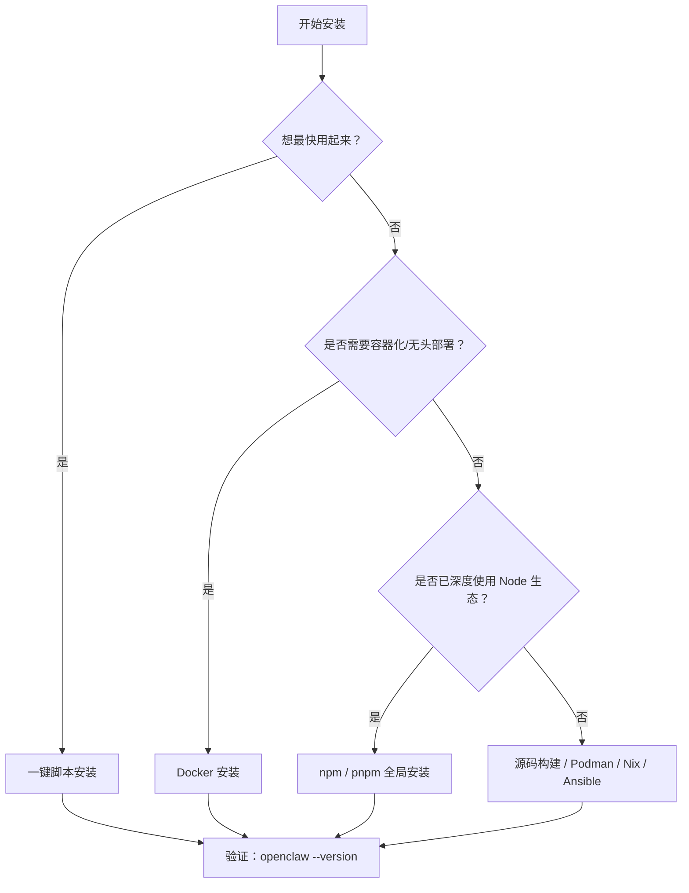
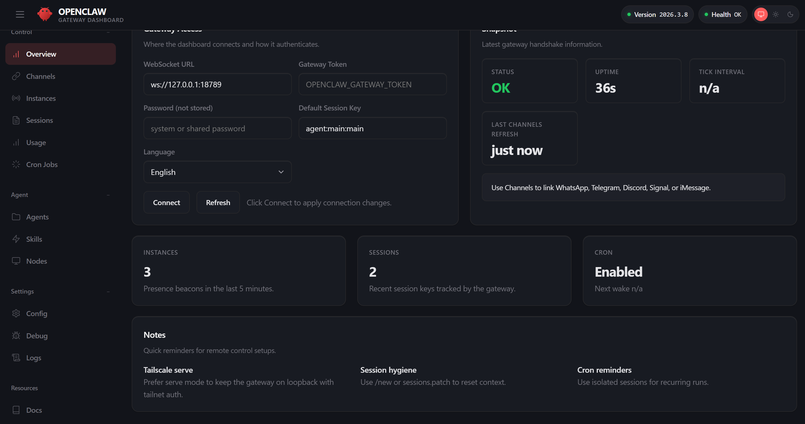
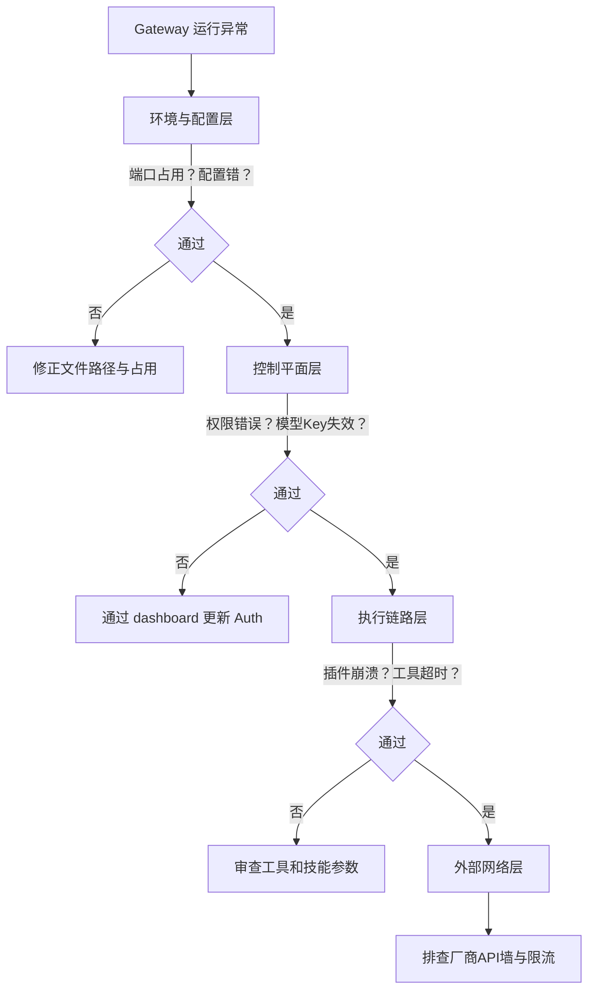

# 第二章 环境准备与安装部署

第一章向你介绍了 OpenClaw 的核心概念与应用场景。现在，该是把它装进你的电脑了。

本章分为四个步骤：（1）确认系统满足最小要求，（2）选择合适的安装方式并完成安装，（3）通过向导进行首轮配置，（4）验证所有基础链路正常工作。这些步骤看似机械，但都有设计意图——比如为什么推荐先跳过“搜索引擎”和“渠道”配置，那是因为初装时任何一个失败的扩展都会拖累整个流程。通过系统化的准备步骤、完整的安装流程与验收测试，你能够在自己的环境中可靠地运行 OpenClaw，为后续章节的实践奠定坚实基础。

## 学习目标

完成本章的阅读后，你将能够：
1. **准备环境**：验证本地环境符合 OpenClaw 的运行要求。
2. **顺利安装**：使用官方工具完成完整的安装与初始化流程。
3. **验证可用性**：通过标准的诊断命令确认系统正常运行。
4. **建立基线**：为后续章节的实战应用打好基础。

**适用范围**

本指南适用于 macOS、Linux 及 Windows（建议使用 WSL2）环境。在生产级部署中，强烈建议采用 Linux 主机搭配 Docker，并辅以反向代理、进程守护程序以及严格的最小权限账号策略。

## 1. 系统要求与运行前检查

> **预计耗时**：5–10 分钟

在正式安装 OpenClaw 之前，确认环境满足最小要求是必要的投入。本节按照**必须、强烈建议、可选增强**的三层逻辑组织检查清单，你可以从第一层快速验证，遇到问题时再回头补齐后续层级。这样的分层设计既能让新手快速上手，也不会让初装者被过多细节压垮。

### 1.1 环境与硬件要求

安装前请核对以下依赖：

1. **操作系统**：macOS、绝大多数 Linux 发行版（推荐 Ubuntu 24.04 LTS），以及 Windows（原生 PowerShell 或 WSL2 均受支持，其中 WSL2 通常更稳定）。
2. **Node.js**：官方支持 **Node 24.16+ 或 26.1+**（`package.json` 的 engines 为 `>=24.16.0 <25 || >=26.1.0`），其中 **Node 26 是推荐默认运行时**；官方 CI 与 Linux 安装脚本使用 Node 24 LTS。**Node 22、23、25 不受支持**：Node 22.23.x、24.15.0、25.9.0 与 26.0.0 自带的 `node:sqlite` 会在内嵌 NUL 字符处静默截断文本，24.16.0 与 26.1.0 才修复，所以早先支持的 Node 22 与 25 都被移出了支持线。可通过 `node --version` 确认；官方安装脚本会自动检测并补齐 Node，手动管理运行时时应优先使用 Node 26。
3. **内存**：最低 **4 GB**；如需运行[浏览器工具](../05_tools_skills/5.4_browser_nodes.md)，推荐 **8 GB 及以上**。
4. **模型认证方式**：至少准备一种可用的模型认证路径，例如 API Key、OAuth，或供应商支持的 setup-token / CLI 复用途径。
5. **包管理器（可选）**：全局安装可使用 `npm`、`pnpm` 或 `bun`；源码构建需要 `pnpm`。

> [!WARNING]
> **内存过低会导致很多问题。** 服务器在执行自动升级、运行浏览器或处理长上下文任务时，容易出现 OOM 导致进程卡死。省下的费用远不抵后续排障成本。

### 1.2 网络连通性验证

OpenClaw 重度依赖远端 API，网络状况直接决定可用性：

1. **安装期**：确保能拉取 npm registry 或 docker.io，必要时配置 HTTP 代理及镜像源。
2. **运行期**：必须能连通所选 LLM 供应商的接口；接入 Telegram 等海外渠道须能无阻碍访问对应平台。

快速连通性验证：

```bash
# 安装期：npm registry
curl -sS -m 5 -o /dev/null -w "npm registry: %{http_code}\n" https://registry.npmjs.org/

# 运行期：模型供应商 API（以 OpenAI 为例）
curl -sS -m 10 -o /dev/null -w "llm provider: %{http_code}\n" https://api.openai.com/v1/models \
  -H "Authorization: Bearer $OPENAI_API_KEY"
# 200 表示鉴权通过；401/403 网络通但鉴权失败，仍可判断连通性
```

### 1.3 权限与系统时间

1. **系统时间漂移**：系统时间仍应同步，主要影响 TLS、OAuth/供应商 token 过期判断和日志排障；Gateway 本地鉴权使用 token/password/device/bootstrap/trusted-proxy 等模式，不是 JWT 时间偏移校验。生产环境务必启用时间同步服务（`chrony` / `systemd-timesyncd` / `ntpd` 均可）。
2. **运行账号权限**：OpenClaw **无需 root 权限**，使用普通用户账号并分配必要目录读写权限即可。

### 1.4 账号与密钥整备

安装前预先备好以下物料，存入密码管理器或环境变量，切勿硬编码进代码：

- **核心物料**：至少一种可用的模型认证材料（如 API Key、OAuth 账号，或供应商要求的 setup token）。
- **渠道物料**：Telegram Bot Token（向 [@BotFather](https://t.me/BotFather) 申请）或其他渠道凭证（如飞书 App Secret）。

> [!CAUTION]
> 绝对不要把 API Token 硬编码在测试脚本中，或通过聊天软件发送给他人。推荐使用环境变量管理。

详细的环境排查脚本见[附录：环境自检工具](../appendix/env_check.md)。

## 2. 安装 OpenClaw

> **预计耗时**：10–20 分钟（取决于安装方式和网速）

本节介绍如何在你选择的环境中安装 OpenClaw。我们为首次用户推荐**一键安装脚本**，原因有三：首先它自动处理依赖与版本选择，避免你被 npm 版本冲突困扰；其次它最快获得可工作的系统；第三，如果后来你发现需要容器化或源码定制，可以先跑通这条路，再迁移到其他方式。这样的顺序避免了初装就掉进“工具选择困境”。

### 2.1 推荐安装方式：一键安装脚本

最简单快捷的安装方式是执行官方的一键安装脚本。

**前置检查**

执行脚本前，请先快速确认：

- 你已经读过[第 2.1 节系统要求](2.1_requirements.md)，并通过了**必须项**的检查（Node.js 版本、网络连通性）
- 网络访问 `openclaw.ai` 无阻碍（某些内网或企业 WiFi 需配置 HTTP 代理；如不确定，运行 `curl -v https://openclaw.ai/install.sh` 测试）
- 如在 WSL 环境，确认已启用 WSL2（而非 WSL1），可用 `wsl --list --verbose` 查看

**开始安装**

> 安全提示：以下是官方快速安装路径。受管控环境建议先下载脚本并审阅内容，或采用官方手动/npm 安装路径，避免直接执行未审阅的远程脚本。

macOS / Linux：

```bash
curl -fsSL https://openclaw.ai/install.sh | bash
```

如果只想安装 CLI、暂时跳过 onboarding，可使用：

```bash
curl -fsSL https://openclaw.ai/install.sh | bash -s -- --no-onboard
```

**Windows (PowerShell)**

在 PowerShell 中运行以下命令：

```powershell
iwr -useb https://openclaw.ai/install.ps1 | iex
```

如需跳过 onboarding，可用官方脚本参数：

```powershell
& ([scriptblock]::Create((iwr -useb https://openclaw.ai/install.ps1))) -NoOnboard
```

### 2.2 验证安装结果

安装后建议立即做一次最小验证（确保命令可用且 PATH 正确，更多 CLI 命令见[附录 E 命令速查表](../appendix/command_cheatsheet.md)）：

```bash
openclaw --version
openclaw --help
```

如果验证失败，不要立即重复安装。先确认命令究竟安装到了哪个运行环境，以及该环境的全局 npm 目录是否在 PATH 中。OpenClaw 支持 Node 24.16+ 或 26.1+，新安装推荐 Node 26，Node 22、23、25 不受支持；版本和 PATH 规则以[官方 Node.js 安装说明](https://docs.openclaw.ai/install/node)为准。

#### macOS / Linux / WSL（POSIX shell）诊断

在**执行安装的同一个 shell 环境**中依次运行：

```bash
node --version
npm prefix -g
command -v openclaw
printf '%s\n' "$PATH"
openclaw doctor
openclaw gateway status
```

`npm prefix -g` 返回 `<npm-prefix>`；在 macOS、Linux 和 WSL 中，可执行文件通常位于 `<npm-prefix>/bin`。如果 `command -v openclaw` 没有结果，且 PATH 中没有这个目录，把下面一行加入当前 shell 的 `~/.zshrc` 或 `~/.bashrc`：

```bash
export PATH="$(npm prefix -g)/bin:$PATH"
```

保存后关闭并重新打开终端，再运行上述诊断。也可以在当前会话执行 `rehash`（zsh）或 `hash -r`（bash）刷新命令缓存。不要一边在 macOS/Linux 主机安装、一边在 WSL 中寻找命令；它们拥有不同的 Node、npm prefix 和 PATH。

#### Windows PowerShell 诊断

原生 Windows 安装应在新的 PowerShell 窗口中运行：

```powershell
node --version
$npmPrefix = npm prefix -g
$npmPrefix
Get-Command openclaw -ErrorAction SilentlyContinue
$env:Path -split ';'
$env:Path -split ';' -contains $npmPrefix
openclaw doctor
openclaw gateway status --json
```

Windows 直接把 `<npm-prefix>` 加入 PATH，不追加 `/bin`。如果上面的 `-contains` 返回 `False`，在“设置 → 系统 → 环境变量”中把 `$npmPrefix` 的实际值加入用户 PATH，然后重新打开 Windows Terminal 或 PowerShell；已经打开的终端不会自动读取新 PATH。

#### Windows Hub 与 WSL2 的路由边界

Windows 上有三条独立路径：Windows Hub、本机 PowerShell CLI/Gateway、手动安装在某个 WSL2 发行版中的 Gateway。先选定一条，再在对应环境诊断：

- Windows Hub 的“本地设置”会创建应用自有的 `OpenClawGateway` WSL 发行版并自动配对，不会修改你已有的 Ubuntu 发行版。此路径优先在 Hub 的 Command Center 和 Connections 中检查连接、配对和 Gateway 状态。
- PowerShell 原生安装使用 Windows 的 Node、npm prefix 和 PATH；不要用 WSL 的 `command -v` 判断它是否成功。
- 手动 WSL2 安装必须在安装所在的同一发行版运行诊断。从 PowerShell 先用 `wsl --list --verbose` 确认名称，再把 `<DistroName>` 替换为真实名称：

```powershell
wsl -d <DistroName> -- openclaw doctor
wsl -d <DistroName> -- openclaw gateway status
```

Windows 主机通常可通过 `localhost` 访问 WSL2 内监听的服务；跨机器连接不能把 `127.0.0.1` 当作远端 Gateway 地址，必须使用客户端可达的 URL，并同时检查绑定地址和防火墙。具体选择与故障入口见 [OpenClaw Windows 官方指南](https://docs.openclaw.ai/platforms/windows)；WSL NAT、mirrored networking 和端口转发规则见 [Microsoft WSL 网络文档](https://learn.microsoft.com/windows/wsl/networking)。

### 2.3 替代安装方式

如果一键脚本不适用于你的环境，以下是其他安装方式。

> [!TIP]
> **首次部署只选一条路径跑通。** 如果你的目标只是先成功进入 Dashboard 并完成首轮对话，不要同时比较 npm、Docker、源码和运维化方案。最短成功路径永远优先，其余路径留到你确认需要容器化、自托管或定制化时再看。

如果你不确定该选哪一种，可以先按下面的决策树判断：



图 2-1：OpenClaw 安装方式选择决策树

#### 1. 使用 npm 安装

如果你熟悉 Node 生态，或者需要在特定流程中进行精确版本控制，也可以直接使用 `npm`、`pnpm` 或 `bun` 进行全局安装。

```bash
# npm 全局安装（npm 12 默认拦截包的生命周期脚本，
# 会跳过 OpenClaw 的 preinstall/postinstall，需用 --allow-scripts= 显式放行；
# 注意是等号形式，写成空格会被当成第二个待装包名。
# npm 11.15 及更早没有这个选项，命令要去掉该参数）
npm install -g openclaw@latest --allow-scripts=openclaw

# pnpm 全局安装（approve-builds -g 曾在 pnpm 11.0 被移除，自 11.24 起已恢复；
# 在 pnpm add -g 上直接传 --allow-build=openclaw 仍是安装时一次性放行构建脚本的写法）
pnpm add -g --allow-build=openclaw openclaw@latest
```

建议：测试与生产环境不要长期依赖 `latest`。更稳妥的做法是固定到明确版本，并把版本号写进交付文档与回归清单。

```bash
npm install -g openclaw@<version> --allow-scripts=openclaw
```

#### 2. Docker 安装

适合容器化、无头部署或需要隔离网关环境的场景。官方文档把 Docker 作为**可选安装路径**；如果你只是在本机快速跑通，普通安装流程通常更直接。

**前置要求**：Docker Desktop 或 Docker Engine（含 Docker Compose v2），内存不低于 [2.1](2.1_requirements.md) 的最低要求（4 GB）。

**快速安装（推荐）**：在 **OpenClaw 源码仓库根目录** 执行自动化脚本（不是本书仓库根目录），会自动完成镜像构建、引导向导、启动网关并生成 Token：

```bash
./scripts/docker/setup.sh
```

可通过环境变量自定义行为，例如启用沙箱，并在构建时包含指定的 bundled plugin helpers：

```bash
export OPENCLAW_SANDBOX=1
export OPENCLAW_EXTENSIONS="diagnostics-otel matrix"
./scripts/docker/setup.sh
```

也可使用官方预构建镜像跳过本地编译：

```bash
export OPENCLAW_IMAGE="ghcr.io/openclaw/openclaw:latest"
./scripts/docker/setup.sh
```

官方 Docker 文档强调：上面的 setup 脚本会先做 onboarding，把 gateway token 写入 `.env`，再启动 `openclaw-gateway`。如果你只想跳过本地编译，可以保留 `OPENCLAW_IMAGE`，继续走同一脚本。

**手动安装**：如果不使用自动化脚本，可在 OpenClaw 源码仓库根目录依次执行以下命令。它更适合已经明确需要自定义镜像或拆开各步骤调试的读者，不是首次安装的推荐起点：

```bash
docker build -t openclaw:local -f Dockerfile .
docker compose run --rm --no-deps --entrypoint node openclaw-gateway dist/index.js onboard --mode local --no-install-daemon
docker compose run --rm --no-deps --entrypoint node openclaw-gateway dist/index.js config set gateway.mode local
docker compose run --rm --no-deps --entrypoint node openclaw-gateway dist/index.js config set gateway.bind lan
docker compose run --rm --no-deps --entrypoint node openclaw-gateway dist/index.js config set gateway.controlUi.allowedOrigins '["http://localhost:18789","http://127.0.0.1:18789"]' --strict-json
docker compose up -d openclaw-gateway
```

> [!NOTE]
> 官方文档里，`openclaw-cli` 是网关启动后的后置工具容器。对首次 Docker setup 来说，应先用 `openclaw-gateway` 容器完成 onboarding 和配置写入，再启动 gateway。

**安装后验证**：浏览器访问 `http://127.0.0.1:18789/`，从 `.env` 文件获取 Token 并在控制台 Settings 的鉴权字段中粘贴。可通过健康检查端点确认网关状态：

```bash
curl -fsS http://127.0.0.1:18789/healthz
curl -fsS http://127.0.0.1:18789/readyz
```

本书仓库不包含上述 Docker 部署脚本与容器文件，更多配置选项详见 [官方 Docker 安装指南](https://docs.openclaw.ai/install/docker)。

#### 3. 其他方式（源码构建、Podman、Nix、Ansible）

适用于开发定制或特定运维场景，请参阅 [官方安装文档](https://docs.openclaw.ai/install) 获取对应指引。

### 2.4 环境变量与路径覆盖

与路径覆盖直接相关的核心环境变量如下（尤其适用于多实例或非标准部署）：

- `OPENCLAW_HOME`：设置内部路径解析的主目录。
- `OPENCLAW_STATE_DIR`：覆盖可变状态存储目录。
- `OPENCLAW_CONFIG_PATH`：覆盖配置文件路径。

除此之外，当前官方文档还明确了环境变量加载顺序：进程环境 > 当前工作目录 `.env` > `~/.openclaw/.env` > Ubuntu 默认状态目录兼容回退 `~/.config/openclaw/gateway.env` > `openclaw.json` 的 `env` 块 > 可选 shell 导入（`OPENCLAW_LOAD_SHELL_ENV=1`）。因此，不要把这里误解成“OpenClaw 只认识这三个环境变量”。

详见 [官方环境变量文档](https://docs.openclaw.ai/help/environment)。

### 2.5 版本升级与治理

要升级到新版本，当前推荐先使用官方更新入口，它会识别安装方式、拉取目标版本、运行 `doctor` 并重启 Gateway：

```bash
openclaw update
```

重新运行安装脚本，或通过 npm、pnpm、bun 重新安装 `openclaw@<version>` / `@latest`，仍可作为恢复或手动升级路径。手动替换包之后，应立即重启 Gateway，并执行 `openclaw doctor`、`openclaw health` 等验收命令，避免旧进程继续使用已替换的包文件。

升级策略的目标不是单纯用上新版本，而是确保升级可验证、可回滚（版本号规则与配置迁移详见[附录 版本映射与升级指南](../appendix/version_mapping.md)）：

- 先回归再升级：每次升级后，至少覆盖 `health`、`status`、渠道探针与模型探针。
- 出问题先回滚：如果新版本异常，直接全局安装上一稳定版本（例如 `npm install -g openclaw@<旧版本号>`），再做差异定位。

> **踩坑实录：Node 版本引发的诡异症状**
>
> 一位社区用户报告 `openclaw` 安装成功但启动时持续报 `SyntaxError: Unexpected token`。排查三小时后发现系统默认 Node 是 v16（通过 `nvm` 遗留），远低于 OpenClaw 当前的官方支持线（Node 24.16+ 或 26.1+）；新安装推荐 Node.js 26，官方 CI 与 Linux 安装脚本使用 Node 24。教训：安装前务必执行 `node -v` 确认版本，尤其是使用 nvm 或 volta 等版本管理器的环境。

## 3. 初始化向导与首轮配置

> **预计耗时**：5–10 分钟

安装完毕后，OpenClaw 需要了解三件事：你的部署环境（单机还是服务器）、模型供应商（Claude、OpenAI、还是本地模型）、以及工作目录位置。初始化向导会逐一询问这些问题，帮你生成一份可工作的 `openclaw.json` 配置。

本节贯彻一个核心哲学：**优先完成可工作的最小配置，再按需增强**。我们推荐的“黄金路径”是保守的——几乎所有选项都推荐“先跳过”，原因是初装时任何一个扩展配置失败都可能导致整个流程卡住。对于大多数人，先把基础链路验证可用（模型能回复、控制台能访问），再从容地逐个启用搜索、渠道、技能，这样的节奏体验会好很多。

### 3.1 运行初始化向导

执行以下命令启动向导。`openclaw onboard --install-daemon` 是当前较完整的一条初始化路径：它既完成交互式 onboarding，也会尝试安装托管 Gateway 服务（如 macOS 的 LaunchAgent、Linux/WSL2 的 systemd 用户服务，Windows 则优先尝试 Scheduled Tasks）。

```bash
openclaw onboard --install-daemon
```

当前官方 CLI 还提供 `openclaw setup` 这一条更“轻量”的初始化命令，用于先创建 `openclaw.json` 和工作区；如果要从 `setup` 入口进入同一套交互式引导，可使用 `openclaw setup --wizard`。换句话说，`setup` 负责“初始化配置与工作区”，`onboard` 负责“完整交互式引导”；本章聚焦首次上手，因此仍以 `openclaw onboard` 作为主线。

> **提示**：带与不带 `--install-daemon` 参数的主要区别在于是否自动配置系统的**后台守护进程**：
> - **带参数**（推荐）：不仅写入配置文件（默认 `~/.openclaw/openclaw.json`）并初始化智能体工作区目录（默认 `~/.openclaw/workspace`），还会自动注册并安装系统后台服务（如 macOS 的 LaunchAgent 或 Linux 的 systemd），保障 Gateway 服务在机器重启后也在后台持续运行，适合长期使用。
> - **不带参数**（仅运行 `openclaw onboard`）：完成引导和配置写入，但不会安装系统后台服务。更适合本地临时试用；本地健康检查通常要求已有 Gateway 正在运行，必要时先另开终端执行 `openclaw gateway run`。

### 3.2 向导配置项解析与避坑指南

在向导的系列提问中，实测验证出的一条对排错压力最小的“黄金路径”如下：

1. **Onboarding mode** 选 `QuickStart`：让你以最小配置量快速跑起来。默认绑定在本地 `127.0.0.1:18789` 并且关闭 Tailscale 外部暴露。
2. **模型与 Auth (Model/Auth)**：建议绑定 Anthropic API Key 或 OpenAI。若使用其他兼容供应商，可根据提示输入。
3. **搜索引擎 (Search provider)**：用于赋予 Agent 联网搜索的能力（如检索最新文档、新闻等）。向导会列出当前支持的搜索引擎选项（具体列表随版本更新，以向导实际显示为准）。如果暂时不想配置，也可以选择 `Skip for now`，但不配置会影响需要实时网络验证的任务。
4. **技能配置 (Skills)**：用于挂载官方或社区提供的基础能力包（例如专门处理版本控制的 `github`，或是针对游戏分发的 `gog`，以及常用的 `clawhub` 等）。为保证初始化环境干净，**强烈建议首次配置时选择 `Skip for now`**，等基础链路验证可用后，再根据需要通过控制台按需挂载特定的技能，从而避免一上来因为某个扩展包解析失败导致整个流程卡住。
5. **工作区 (Workspace)**：默认生成在 `~/.openclaw/workspace`，用于存放 Agent 的核心数据。建议保持默认。
6. **渠道 (Channels)** 选 `Skip for now`：这是极大降低挫败感的关键。先把自带的 Dashboard（控制台）验证可用，确认大模型和基础环境都没问题，后续再从容配置飞书或 WhatsApp 等渠道。

向导结束时会自动进行 Health check（健康检查）。如果使用 `--install-daemon`，它会走托管 Gateway 安装与启动路径；如果不使用该参数，应把它理解为“完成配置并在已有本地 Gateway 上校验链路”，而不是一律帮你安装或启动常驻后台服务。

> **注意**：如果初始化时未使用 `--install-daemon` 参数，后续在关闭终端或重启电脑后，通常需要你自行确保本地 Gateway 处于运行状态（例如手动运行 `openclaw gateway run` 或另行启动托管服务）。完成引导后，最快的首轮对话入口是 `openclaw dashboard`。

### 3.3 工作区产物概览

向导结束后，OpenClaw 会初始化默认工作区 `~/.openclaw/workspace`。但这里要区分“首次 bootstrap 时种下的文件”和“之后按需读取或按需生成的文件”，不能把它们都理解成首次一定存在、且每轮都会等量注入。

```text
~/.openclaw/workspace/
├── AGENTS.md        # 工作区常驻指令
├── BOOTSTRAP.md     # 首次运行仪式文件（完成后删除）
├── IDENTITY.md      # 智能体身份信息
├── USER.md          # 用户档案与偏好
├── SOUL.md          # bootstrap 过程可补写的人格/风格文件
├── TOOLS.md         # 工具注册与配置
├── HEARTBEAT.md     # 心跳巡检清单
├── MEMORY.md        # 长期记忆索引（可选）
├── skills/          # 当前工作区的技能目录（可选）
└── memory/          # 会话或 hook 写入的记忆文件目录（可选）
```

更准确地说，这些文件不应被一概理解成“都会在每轮会话里等量注入”。按当前官方文档，它们的语义分别是：

- `AGENTS.md`、`SOUL.md`、`TOOLS.md`、`IDENTITY.md`、`USER.md`、`HEARTBEAT.md`、`BOOTSTRAP.md`、`MEMORY.md`：这些属于工作区 bootstrap 识别的核心文件；是否存在、是否有内容、是否在当前场景下注入，要看具体运行路径。
- `IDENTITY.md` 与 `USER.md`：在 bootstrap ritual 中创建或更新，用于定义智能体与用户侧的稳定上下文。
- `BOOTSTRAP.md`：只为全新工作区创建的一次性首跑仪式文件，用完即可删除。
- `BOOT.md`：不是默认 bootstrap 文件，也不是常规 prompt 注入文件；只有文件存在且启用 bundled `boot-md` hook 时，才会在 Gateway startup 阶段执行。
- `HEARTBEAT.md`：Heartbeat 的专用清单文件；文件存在时属于 workspace/bootstrap prompt 文件，轻量 heartbeat 模式会只保留它而跳过其他 workspace bootstrap 文件。
- `memory/`：记忆或 hook 写入目录，属于运行期数据面，不应理解成“每轮自动等量加载”。
- `MEMORY.md`：可选的长期记忆索引，更适合沉淀稳定事实。
- `skills/`：当前工作区的技能目录；`openclaw skills install` 默认也会把技能装到当前工作区的 `skills/` 下。

各文件的详细职责、读取时机与加载策略将在后续章节展开：人格配置见[第 3 章](../03_minimal_loop/README.md)，心跳与定时任务见[第 8 章](../08_automation_ops/8.3_heartbeat.md)，上下文管理见[第 6 章](../06_context_memory/README.md)。

> [!TIP]
> 这些文件都是普通 Markdown，可以随时用任何编辑器修改。若你修改了 `AGENTS.md`、`SOUL.md` 等工作区指令文件，通常从下一次新会话开始生效；无需把“是否生效”理解成必须重启 Gateway。

### 3.4 首轮验收标准

如果使用了 `--install-daemon`，向导结束后 Gateway 通常已经在后台运行；如果没有安装守护进程，请先手动启动本地 Gateway。下一步是通过 Dashboard 完成首轮对话验证，详见[第三章](../03_minimal_loop/README.md)。

在此之前，建议通过自带的诊断工具进行环境检查：

```bash
# 检查 Gateway 运行状态
openclaw gateway status

# 执行体检验证配置
openclaw doctor
```

在诊断通过后，说明“模型与基础控制链路”已经打通。下一节将详细介绍如何对运行在后台的 Gateway 进行监控、日志排查与深度可用性验证。

下一节入口：[2.4 守护进程与可用性验收](2.4_gateway_service.md)

## 4. 守护进程与可用性验收

> **预计耗时**：5–10 分钟

安装完成后，你有两种运行 OpenClaw 的方式：（1）每次手动在终端启动，或（2）让它在后台自动启动并在进程崩溃时自动恢复。生产环境必然选择第二种，但即使在个人开发机上，守护进程化也能大幅降低使用摩擦——不用每天重启电脑时都记得手动启动一遍。本节介绍如何通过 `--install-daemon` 配置这个自动启停机制，以及如何验证系统基础链路是否完全畅通。

### 4.1 启动前检查与前台试运行

如果未安装守护进程，或需要进行临时调试，可以直接在前台运行 Gateway：

```bash
# 在前台启动 Gateway，并在控制台实时输出日志
openclaw gateway run --port 18789
```

当前 Gateway 默认要求配置中存在 `gateway.mode=local` 才会启动；`openclaw onboard --mode local`、`openclaw onboard --install-daemon` 或 `openclaw setup` 通常会写入这个字段。临时开发或救援场景可加 `--allow-unconfigured` 绕过启动保护，但它不会修复配置文件，正式环境应优先修复缺失的 `gateway.mode`。

配置与体检：让错误在最外层暴露

```bash
openclaw doctor
```

若体检提示配置文件未加载或语法错误，请优先回看配置路径与格式。环境变量如 `OPENCLAW_HOME` 与 `OPENCLAW_CONFIG_PATH` 也可以用来覆盖默认路径。

### 4.2 后台服务管理与状态查看

当你通过 `--install-daemon` 模式部署后，OpenClaw 可以直接通过自带的 CLI 工具来管理后台状态，无需额外安装如 `pm2` 这类的第三方进程管理工具。配置变更后的常规动作优先使用 `openclaw gateway restart`；在 macOS 上不要把 `gateway stop` 和 `gateway start` 机械串联成“重启”。只有明确使用 `openclaw gateway stop --disable` 时，才表示持久禁用 LaunchAgent 自动拉起。

```bash
# 查看 Gateway 当前的后台运行状态与关键端口
openclaw gateway status
```

如果进程状态显示异常，可以按系统平台去检查对应的后台日志。

> **提示**：不同环境自动注册的服务名称可能不同，Linux/WSL2 的托管安装默认使用当前用户的 `openclaw-gateway.service`，多 profile 场景可能是 `openclaw-gateway-<profile>.service`。优先通过 CLI 包装命令检查；需要 systemd 时可执行 `systemctl --user status openclaw-gateway.service`。

建议在服务确认运行后，进一步确认 Gateway 的控制面运行：

```bash
openclaw logs --limit 200

# 可选：实时跟随结构化日志
openclaw logs --follow --json
```

如果日志中出现反复重启或鉴权失败等信号，应先停下来做分层排查。

### 4.3 最小可用性验证清单

验证 Gateway 功能无需依赖任何外部渠道集成。请依次执行以下检查项，确保本地基础链路完整可用：

1. **CLI 可用性检查**

```bash
openclaw --version
```

确认 OpenClaw CLI 已正确安装。

2. **配置与依赖检查**

```bash
openclaw doctor
```

输出应无 ERROR 级别警告，所有关键依赖已就位。

3. **进程健康检查**

```bash
openclaw health --json
```

返回一份健康快照或探针结果即可视为通过。不同版本的字段结构可能不同，验收时不要把它当成固定 JSON 契约来写死；重点确认整体状态正常、没有关键错误，并且本地 Dashboard 可以连上。

4. **后台服务运行确认**

```bash
openclaw gateway status
```

确认后台守护进程正在运行，端口已绑定。

5. **控制台可访问性检查**

```bash
openclaw dashboard
```

浏览器自动打开控制台界面。如未自动打开，通常需要手动访问本机控制台地址，并按当前版本的鉴权方式补入 gateway token。



图 2-2：Dashboard 首次验收时的控制台入口

6. **模型响应能力检查**

在 Dashboard 控制台对话框中输入“你好”，确认收到来自 LLM 的正常回复。这证明了从进程加载到推理引擎的完整链路畅通。

7. **日志正常性检查**

```bash
openclaw logs --limit 10
```

确认日志输出中不存在 ERROR 级别条目。如有报警级别日志，应参考 2.4.4「分层排查架构概览」逐步定位。

---

完成以上验证后，本地基础链路已确认可用。渠道接入（如 Telegram、WhatsApp、飞书等）的配置与验证将在[第七章](../07_multi_agent/README.md)展开。

### 4.4 分层排查架构概览

当首跑失败时，按以下四层“由近到远”的路径进行快速定位：



后续的高级配置（含模型替换与渠道接入）可参阅第 4 到 7 章。
