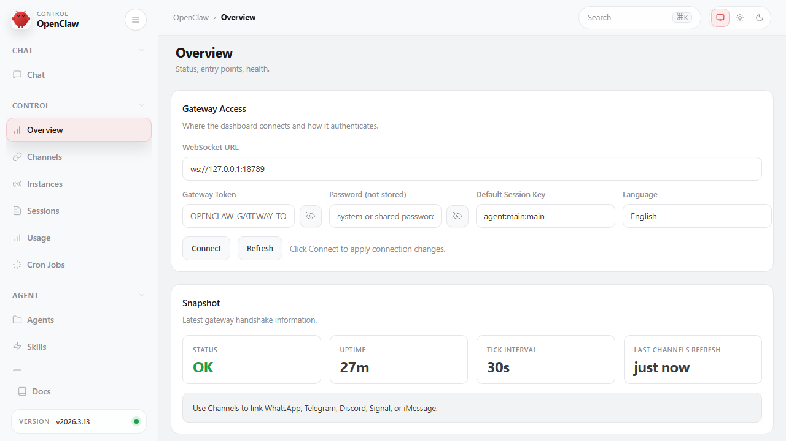
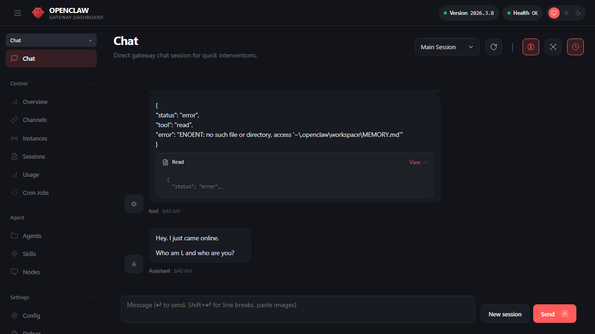
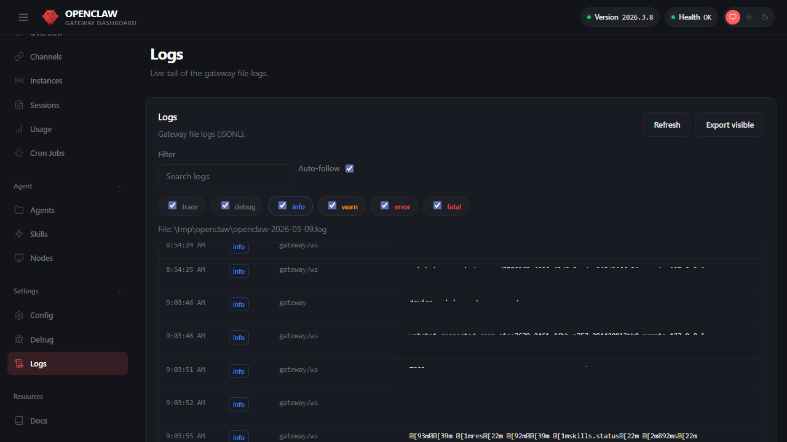
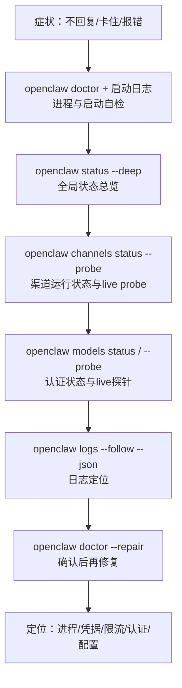
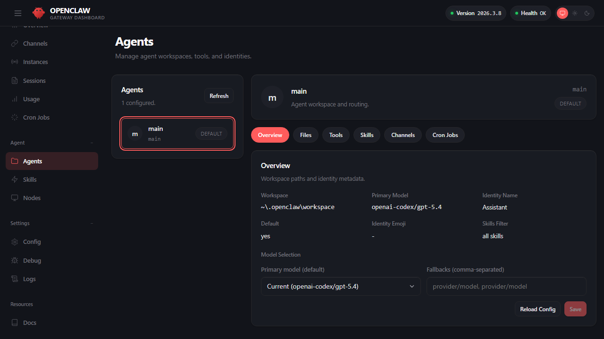

# 第三章 快速上手与首轮对话实战

安装完成了，系统也验证可用了。现在该真正使用它了。但从“安装成功”到“能放心地在生产环境用”之间，还隔着一些关键认知：

- OpenClaw 如何回答问题？一句话输入是怎样一步步转化成智能体的回复的？
- 出了问题怎么办？不是“重启试试”，而是有系统的排查方法
- 怎样定义“机器人的个性和边界”？写指令的时候什么是有效的

本章建立可复验的“本地最小闭环基准线”：先用 Dashboard 的 Chat 页面验证本地主链路可用，掌握诊断命令与固定排障顺序；再固化初始指令的目标与格式；最后理解本地访问边界。通过本章，你将获得第一个可工作的 OpenClaw 实例，并为后续深入学习建立扎实基础。

**这章学完能做什么**

- 自信地在 Dashboard 进行首轮对话，并理解每一个步骤
- 用诊断命令定位问题，而不是盲目猜测
- 写出清晰、可执行的初始指令，让智能体理解你的需求边界

## 学习目标

完成本章的阅读后，你将能够：
1. **快速验证**：用 Dashboard 的 Chat 页面验证本地对话基线。
2. **自我诊断**：掌握四层诊断顺序与常用排障命令。
3. **编写指令**：设计清晰、可执行的初始指令与角色定义。
4. **理解边界**：理解设备批准机制与默认访问控制策略。

## 前置条件

- 已完成[第二章](../02_setup/README.md)的安装与首跑验证。
- 可打开本机浏览器访问 Dashboard 的 Chat 页面（远程环境需端口转发）。

## 1. 控制台与 Chat 快速上手

本节以官方 Web 端为准建立最小闭环：先用 CLI 确认网关健康，再用 Dashboard 打开 Control UI 的 Chat 页做一次最小交互验证，并把“新设备访问需要批准”这类常见拦截纳入排障路径。目标是让渠道接入之前就具备一条稳定、可复验的本地基准线，以验证核心功能正常运行。

### 1.1 为什么先从 Dashboard 与 Chat 开始

外部渠道接入会引入大量外部变量：平台限流、回调重试、网络抖动、群聊噪声等。先用本地 Dashboard 的 Control UI Chat 验证主链路，有两个直接收益。

- 把问题分层：如果本地 Control UI Chat 能正常运行，外部渠道失败更可能是渠道配置或平台侧问题。
- 建立证据链：本地交互更容易复现，日志与 trace 更完整。

官方建议的桌面端入口是 Dashboard，通常运行在 `http://127.0.0.1:18789/` 等本地地址。

### 1.2 打开 Dashboard：端口、入口与常见拦截

Dashboard（Control UI）是 OpenClaw 的 Web 管理中心。根据当前源码与官方文档，左侧栏稳定的一级分组仍是 **`Chat`、`Control`、`Agent`、`Settings`**，另外底部有独立的 `Docs` 外链入口。下面先给出当前常见页面，再聚焦本章最常用的几个页面。

> [!TIP]
> **第一次跑通时，只需要记住 3 个页面：** `Chat` 用来做最小交互，`Overview` 用来确认网关健康，`Logs` 用来对照排障。其余页面先知道它们存在即可，不必在首轮验收前逐个理解。

#### 左侧导航结构

**Chat**——对话交互入口。

- **Chat**（`/chat`）：Control UI 的浏览器对话窗口。支持会话选择、新建会话、agent filter、模型与 thinking session override，以及流式输出。右上角的显示开关可展示 assistant thinking / working 输出，但不应理解成直接暴露模型内部推理链。Focus Mode 用于隐藏导航栏专注对话。本章把浏览器入口称为 Control UI Chat；官方 WebChat 文档还会同时覆盖原生 macOS/iOS 聊天 UI 以及共享的会话投影语义。

**Control**——运行状态与运维监控。

- **Overview**（`/overview`）：网关总览页。上方为 Gateway Access 连接信息（WebSocket URL、Token、Session Key、语言设置），下方为 Snapshot 快照卡片（Status、Uptime、Tick Interval 等）。排障时从此页面确认网关健康状态。
- **Instances**：当前界面中的实例视图，用于查看当前连接到控制面的实例状态。
- **Sessions** 页面（路由 `/sessions`）：活跃会话键与每会话默认值管理页。可查看最近活跃的 `session key`、Token 用量与 `thinking` / `verbose` / `reasoning` 等覆盖项。详见[第六章 6.1 会话模型](../06_context_memory/6.1_sessions.md)。
- **Usage**：当前界面中的用量视图，用于查看系统的资源或调用用量汇总。
- **Cron Jobs**（`/cron`）：定时任务管理。支持查看、新增、启用/禁用和手动触发定时任务。详见[第八章 8.2 定时任务](../08_automation_ops/8.2_cron_jobs.md)。

**Agent**——智能体配置与能力管理。

- **Agents**（`/agents`）：智能体配置中心。左侧为智能体列表，右侧为详情面板。进入某个智能体后，内部提供子面板切换：Overview（身份与模型选择、回退模型配置）、Files（展示当前 `agents.files.list` 返回的工作区指令文件）、Tools（工具目录与 allow/deny 策略控制）、Skills（已安装技能开关与工作区技能管理）、Channels（渠道绑定）、Cron（智能体级定时任务）。详见[第四章](../04_config_models/README.md)和[第五章](../05_tools_skills/README.md)。
- **Skills**（`/skills`）：全局技能管理。安装、启用/禁用技能包，更新 API 密钥。详见[第五章 5.3 技能与插件](../05_tools_skills/5.3_skills_plugins.md)。
- **Nodes**（`/nodes`）：设备与节点管理。查看已配对设备、批准待配对设备、管理执行审批。详见[第九章 9.5 渠道配对](../09_gateway_protocol/9.5_pairing_trust.md)。
- **Dreaming**（`/dreaming`）：记忆整理与 dreaming 相关状态页。入口是稳定的 Agent 标签页，页面内容和状态取决于 dreaming 配置与运行时状态。

**Settings**——系统配置、通信、外观、自动化、基础设施、智能体设置与调试入口。

- **Config**（`/config`）：配置编辑器。以当前 UI 支持的表单或源码视图查看和编辑 `openclaw.json`，并在保存时进行配置校验。详见[第四章 4.1 配置体系](../04_config_models/4.1_config_system.md)。
- **Channels**（`/channels`）：渠道状态与配置的设置详情页，不是 Control 分组的根级页面。当前可见卡片会随内置渠道、外部插件和启用状态变化。详见[第七章](../07_multi_agent/README.md)。
- **Communications / Appearance / Automation / Infrastructure / AI & Agents**：分别收纳通信、界面、自动化、基础设施与智能体相关设置；其中 AI & Agents 对应 `/ai-agents`，具体命名和是否显示以当前 UI 文案为准。
- **Debug**（`/debug`）：调试工具。当前更贴近“status/health/models/heartbeat 快照 + Event Log + 手动 RPC 调用”的综合调试页，而不是通用的事件重放中心。
- **Logs**（`/logs`）：实时日志查看器。读取网关日志文件，支持过滤、关键词搜索与自动跟随。排障时对比日志与交互输出。
- **Docs**：文档入口。当前源码里它作为侧边栏底部的外链入口出现，不属于 `Settings` 组内的 tab。

> **版本说明**：Dashboard 当前采用分组导航；可见分组为 `Chat`、`Control`、`Agent`、`Settings`，另外侧边栏底部还有独立的 `Docs` 外链入口。具体子页面名称和是否显示会继续演进，请以当前 UI 文案为准。

本章主要用到 **Chat**（交互验证）、**Overview**（健康检查）和 **Logs**（排障对比）三个页面。按当前分组，它们分别位于 `Chat`、`Control` 和 `Settings`。

如果你是第一次打开 Dashboard，先认清 Overview 页面最省时间。下面这张图展示了左侧导航、Gateway Access 连接信息和 Snapshot 快照卡片的典型布局。



图 3-1：Dashboard Overview 总览页示意

操作步骤建议如下。

1. 先确认服务健康。

```bash
openclaw health --json
```

2. 打开 Dashboard。

```bash
openclaw dashboard

# 或直接在网关机器上打开：
# http://127.0.0.1:18789/
```

默认情况下，Dashboard 运行在 `http://127.0.0.1:18789/`。

常见拦截：**不是所有首次访问都需要人工批准。** 若你是在网关机器上通过 `127.0.0.1` / `localhost` 直连浏览器，本地 loopback 访问通常会自动批准；Tailnet 或局域网中的新浏览器/新设备则更可能进入待批准状态。若 Dashboard 提示设备待批准，可按官方流程列出并批准设备（命令与字段以实际版本为准，参考 onboarding 指南）。

```bash
openclaw devices list
openclaw devices approve <requestId>
```

批准前建议重新运行 `openclaw devices list`，因为待批准请求的 `requestId` 会随重试或重新打开页面变化。

### 1.3 Control UI Chat 的交互与流式：看得见的过程更容易排障

Control UI Chat 的关键价值在于把过程暴露出来：模型请求是否发出、工具是否被提议与执行、输出是否在流式返回。对排障而言，最重要的是把每次交互与日志里的 trace 对齐。

操作建议：开启结构化日志并在 Dashboard 的 Chat 界面对比流式输出。

先看 Chat 页面，确认自己找对了最小交互入口。



图 3-2：Control UI Chat 对话界面示意

Chat 页面提供了完整的交互视图：对话输入区、流式输出区（包含用户输入、assistant thinking / working 输出、工具调用请求与返回结果），以及右上角的会话选择器和模型切换器。部署 OpenClaw 后，点击左侧 Chat 分区即可进入；不要把 UI 中的 thinking 展示等同于模型内部不可见推理链。

```bash
openclaw logs --follow --json
```

如果你更习惯先看证据，再回到对话窗口定位问题，也可以直接打开 Dashboard 的 Logs 页面。



图 3-3：Logs 实时监控界面示意

### 1.4 最小闭环测试用例

建议用可复验的测试用例验证最小闭环，而不是随意发问。

**测试用例 1：健康链路确认**

- 动作：先执行 `health`，再打开 Dashboard。
- 预期正常输出：看到一份可解析的健康快照或探针结果，且整体状态正常。
- 注意：`health` 的 JSON 字段会随版本变化，不建议把它写死为某个固定 schema。
- Dashboard 访问成功，无设备待批准提示。

**测试用例 2：最小交互**

- 动作：在 Control UI Chat 输入 `请只输出一个 JSON：{"pong": true}`。
- 预期正常输出：
  ```text
  {"pong": true}
  ```
- 注意：以下日志示例仅为示意性参考。当前文件日志更稳定的字段是 `time`、`message`、`session_id`、`channel`、`agent_id`、`traceId` 与 `spanId` 等，CLI 的 `openclaw logs --json` 会输出 `type=="log"` 记录，并保留 `raw` 便于回看原始 JSONL。真正排障时应以本机结构化日志的实际字段为准。
- 对应日志片段（结构化日志，JSONL 每行一条 JSON）：
  ```jsonl
  {"time":"2026-03-06T10:30:45.123Z","session_id":"sess_abc123","traceId":"t-abc123","message":"chat request received"}
  {"time":"2026-03-06T10:30:47.456Z","session_id":"sess_abc123","traceId":"t-abc123","spanId":"s-reply","message":"assistant response sent"}
  ```

**测试用例 3：流式输出可验证**

- 动作：输入 `请分 5 步输出一个排障计划，每步不超过 20 字`。
- 预期正常输出（流式返回）：
  ```text
  1. 确认服务健康 ✓
  2. 检查渠道连接状态 ✓
  3. 查询最近日志错误 ✓
  4. 验证模型权限与配额 ✓
  5. 隔离问题根源 ✓
  ```
- 预期日志表现：
  - 实际事件名以 `openclaw logs --json` 和 agent stream 输出为准，重点观察 `assistant`、`tool`、`lifecycle`、`error`、`command_output` 等流。
  - 若延迟 >5s，先查看是否有工具调用、模型等待或供应商限流相关日志，不要假定存在固定的分块发送事件。
  - 若完全卡住，查看是否有 `error` 或 `timeout` 事件。

## 2. 常用诊断命令与日志排障

排障核心思路：先确认进程与网关是否存活，再逐层验证渠道、模型依赖，最后通过日志定位具体错误。

> 完整命令参数与进阶排障流程见[附录 E 命令速查表](../appendix/command_cheatsheet.md)和[附录 C 排障检查清单](../appendix/troubleshooting_checklist.md)。

### 2.1 四层诊断顺序与辅助动作

本章建议把排障主链路固定为“四层诊断”：**进程/网关 → 渠道 → 模型 → 日志**。其中 `status --deep` 与 `doctor --repair` 为两个关键辅助动作：前者用于补充全局视图，后者用于在证据明确后做修复，而不是一上来就盲修。

| 诊断层级 | 命令 | 检查目标 |
|---------|------|----------|
| **第一层：进程与网关** | `openclaw doctor` + 启动日志 | 进程能否拉起、配置是否损坏、依赖是否缺失 |
| **第二层：渠道** | `openclaw channels status --probe` | 渠道运行状态与 live probe |
| **第三层：模型** | `openclaw models status` / `--probe` | 认证状态与 live provider 探针 |
| **第四层：日志** | `openclaw logs --follow --json` | 定位具体错误、trace 与上下文 |
| **辅助动作 1：全局视图** | `openclaw status --deep` | 当前状态加渠道 live probe |
| **辅助动作 2：修复工具** | `openclaw doctor --repair` | 在确认问题后执行引导式修复 |



图 3-4：四层诊断顺序与辅助命令

### 2.2 命令示例

**命令 1：健康检查**

```bash
openclaw health --json
```

`openclaw health --json` 通常会返回顶层 `ok` 与若干嵌套健康信息；不同版本字段结构会变化，不要把 `status: "ok"`、`errors` 等字段当成固定契约。验收时重点看整体是否健康、是否还有关键错误即可。

**命令 2：状态总览**

```bash
openclaw status --deep
```

一次性查看状态并对渠道做 live probe。它适合作为第二步的总览入口：如果这里已经显示渠道掉线，就不应先去改提示词或工作流；供应商用量与配额快照应使用 `openclaw status --usage`。

**命令 3：渠道探针**

```bash
openclaw channels status --probe
```

`channels status --probe` 是当前更稳妥的渠道 live 检查入口，用来确认 Gateway 可达时各渠道账号的运行状态、传输状态和探针结果。`channels capabilities` 更适合后续查看渠道能力、权限范围和联调提示；若需要更深的端到端验证，应结合结构化日志和实际渠道消息一起判断，而不要把单一探针命令写成固定契约。

**命令 4：模型探针**

```bash
openclaw models status
openclaw models status --check
openclaw models status --probe
```

`--check` 用于发现缺失、过期或即将过期的认证档案；`--probe` 会实际探测已配置 provider 的 live auth。若探针返回认证或限流错误，再结合供应商后台配额与结构化日志判断是密钥失效、额度耗尽还是上游故障。

**命令 5：跟踪日志**

```bash
openclaw logs --json --limit 500
```

结构化输出便于用 `jq` 过滤。优先用有界快照按 `level` 与 `message` 判断是认证、限流、超时还是 allowlist 类故障：

```bash
openclaw logs --json --limit 500 \
  | jq -r 'select(.type=="log") | select((.level=="error") or ((.message // "")|test("auth|rate|timeout|blocked|allowlist";"i"))) | .message'
```

**命令 6：自动修复与诊断配置**

```bash
openclaw doctor --repair
```

自动检测并修复常见配置问题。建议配合脱敏配置使用：

```javascript
{
  logging: {
    level: "info",
    // 脱敏固定开启，无需（也不能）再写 redactSensitive
    redactPatterns: ["sk-[A-Za-z0-9]{16,}"],
  }
}
```

### 2.3 快速判断路径

- `health` 失败 → 检查进程与端口，查配置语法与权限。
- `status --deep` / `channels status --probe` 发现渠道异常 → 检查渠道凭据、网络连接与网关可达性；再用 `channels capabilities` 查看能力与权限提示。
- `models status` 显示认证或模型配置异常 → 检查 API Key、OAuth 过期或缺失；需要 live provider 证据时再运行 `models status --probe`。

排障时不建议先改提示词或工作流；先把依赖与证据链确认下来。

> **踩坑实录：健康检查 “ok” 但消息不通**
>
> `openclaw health --json` 返回 `ok: true`，但 Telegram 消息始终无回复。原因是渠道链路与进程健康不是同一层：进程仍在跑，不代表消息已经真正送达。对渠道问题，先用 `channels status --probe` 查看 live 状态，再用 `channels capabilities` 确认能力与权限提示，最后结合实际消息回放和结构化日志做端到端排查，才是更稳妥的诊断路径。

## 3. 初始指令与智能体角色配置

初始指令是面向运行时的契约，核心包含三类信息：**目标收敛**（处理什么问题）、**边界声明**（禁止什么行为）、**格式约束**（输出什么结构）。指令越像可执行规范，系统越稳定；写成文学化口吻往往引入歧义，使模型在关键时刻无法可靠遵循。

> 多智能体路由下的进阶指令设计见[第七章](../07_multi_agent/README.md)；工具权限的配合配置见[第五章 5.2](../05_tools_skills/5.2_tool_policy.md)。

### 3.1 最小指令模板

第一次部署从这个三要素模板开始，足以让智能体稳定运行：

```text
你是 [角色名称]。遵守以下规则：
1. 只处理与 [领域] 相关的问题，其他问题回复"超出职责范围"
2. 输出必须包含：结论（一句话）→ 具体内容 → 验证方式
3. 不确定时明确说明，不编造信息
```

### 3.2 在工作区文件中设置指令

当前版本更推荐把指令写进 **工作区核心文件**，而不是依赖单一 JSON 字段。最常见的入口是 Dashboard 的 **Agent → Agents → Files**，或者直接编辑工作区中的 `AGENTS.md`、`SOUL.md`、`TOOLS.md`、`IDENTITY.md`、`USER.md` 与 `HEARTBEAT.md`。`BOOTSTRAP.md` 只会出现在全新工作区初始化场景，`MEMORY.md` 属于可选记忆文件，不是默认 scaffold 的核心文件。

在 Dashboard 的 **Agent** 分组下，`Agents` 页面也可以可视化管理这些设定：



图 3-5：Agents 可视化配置

```markdown
# AGENTS.md

你是工作助手。回答时遵守以下规则：
1. 只处理工作相关问题，超出范围时明确拒绝
2. 输出必须包含：结论 → 具体步骤 → 验证方式
3. 不确定时说明未知点，不编造命令与配置键

# SOUL.md

语气保持直接、克制、工程化；高风险操作先给回滚方案。
```

多智能体路由场景建议：把“入口治理”写到入口智能体的 `AGENTS.md`，把“领域知识与工具使用”写到领域智能体自己的工作区文件里，减少单条指令承担过多职责。

### 3.3 好指令 vs 坏指令

| 维度 | ❌ 坏（模糊） | ✅ 好（可检查） |
|------|-------------|----------------|
| 目标 | “你是一个友善的助手，尽力帮助用户” | “只处理 K8s 运维问题；其他问题回复'超出职责范围'” |
| 边界 | “请小心使用危险命令” | “禁止输出 kubectl delete；如需执行必须先给出回滚方案并等待确认” |
| 输出 | “请尽量详细地回答” | “必须包含四段：结论→命令（带注释）→验证方式→失败处理” |

避免把安全边界只写在指令里——真正的边界由工具策略与沙箱约束提供确定性兜底，详见 [5.2 工具策略](../05_tools_skills/5.2_tool_policy.md)。

### 3.4 验证指令是否生效

用固定测试集覆盖边界问题与失败场景，再用日志确认智能体行为：

```bash
openclaw status --deep
openclaw logs --follow --json
```

观察到模型偏离指令时，优先检查路由绑定、工具策略或渠道门控是否导致上下文变化，再回到工作区文件做最小修改。指令迭代建议与配置一同纳入版本控制。

> [!NOTE]
> 个人助理场景下，OpenClaw 还支持用 SOUL.md 文件定义智能体的沟通风格与个性化表现，详见[6.2 上下文构建与窗口预算](../06_context_memory/6.2_context_building.md)。

## 4. 本地访问边界与设备批准

在开始接入外部渠道之前，先理解 OpenClaw 的本地访问控制机制。本节只讨论“谁能访问你的智能体”这个最基本的问题；更完整的渠道入口治理（私聊策略、群聊门控、多渠道分流）将在[第七章](../07_multi_agent/README.md)详细展开。

### 4.1 设备批准：最小信任边界

OpenClaw 默认对远程或新设备采用“先拦截、后批准”的策略。通过 `127.0.0.1` / `localhost` 直连的本地 loopback 浏览器通常会自动批准；Tailnet、局域网、新浏览器配置文件或缺少设备身份的客户端首次连接 Dashboard / Control UI Chat 时，更可能被暂时拦截，直到管理员显式批准。

操作闭环：

1. 列出待批准设备：

```bash
openclaw devices list
```

2. 批准指定待处理请求：

```bash
openclaw devices approve <REQUEST_ID>
```

3. 若需要撤销已批准设备的访问权限：

```bash
openclaw devices remove <DEVICE_ID>
```

如果你只是要撤销某台设备持有的某个角色令牌，而不是删除整台设备记录，则使用更细粒度的写法：

```bash
openclaw devices revoke --device <DEVICE_ID> --role <ROLE>
```

设备批准机制是 OpenClaw 的最小信任边界——即使智能体的指令和工具配置都没有限制，未经批准的设备也无法与之交互。理解这个机制是后续配置渠道级安全策略的基础。

### 4.2 私聊与群聊的默认行为

在推荐基线下，OpenClaw 对私聊和群聊可以按下面的方式收敛：

- **私聊**：建议采用 `pairing` 策略，陌生用户需要先申请配对，管理员批准后才能对话。这是更安全的推荐基线。
- **群聊**：建议先收敛为 `allowlist` 或等价白名单策略，而不是默认当作所有实例都关闭或开放。是否再叠加提及门控，应按你的渠道能力和业务场景决定。

```javascript
{
  channels: {
    telegram: {
      dmPolicy: 'pairing',        // 私聊先走配对批准
      groupPolicy: 'allowlist',   // 群聊先收敛到白名单
      groups: {
        "<group_id>": {
          requireMention: true,
          groupAllowFrom: ["<admin_user_id>"],
        },
      },
    },
  },
}
```

> [!TIP]
> 本章只需要理解“推荐基线”即可。`groupPolicy: "allowlist"` 只有配合 `groups` 和允许的发送者策略后才会放行群聊命令；DM pairing 不会自动授权群聊命令。私聊的四种策略（pairing/allowlist/open/disabled）、群聊的三道门槛（群组开关/提及门控/能力收敛）以及多群组上下文隔离方案，将在[第七章 多渠道分发与多智能体协作](../07_multi_agent/README.md)中详细讨论。

### 4.3 快速排障：设备批准与消息触发

当遇到“消息不触发”或“访问被拒”时，按以下顺序检查：

1. **区分配对类型**：Control UI、节点或设备用 `openclaw devices list` 查看设备状态；渠道私聊配对用 `openclaw pairing list <channel>` 和 `openclaw pairing approve <channel> <CODE>`。
2. **渠道运行状态是否正常**：`openclaw channels status --probe` 先确认 live 状态，再用 `openclaw channels capabilities` 查看能力、权限和联调入口。
3. **日志中的拦截原因**：用有界日志快照搜索 `approval`、`pairing request`、`blocked`、`allowlist`、`dmPolicy`、`groupPolicy`。

```bash
# 快速定位拦截原因
openclaw logs --json --limit 500 \
  | jq -r 'select(.type=="log") | select((.message + " " + .raw)|test("approval|pairing request|blocked|allowlist|dmPolicy|groupPolicy";"i")) | .message'
```

若本地 Control UI Chat 能正常交互但外部渠道消息不触发，问题通常出在渠道配置而非设备批准。此时应参考[第七章](../07_multi_agent/README.md)的渠道接入指南。
