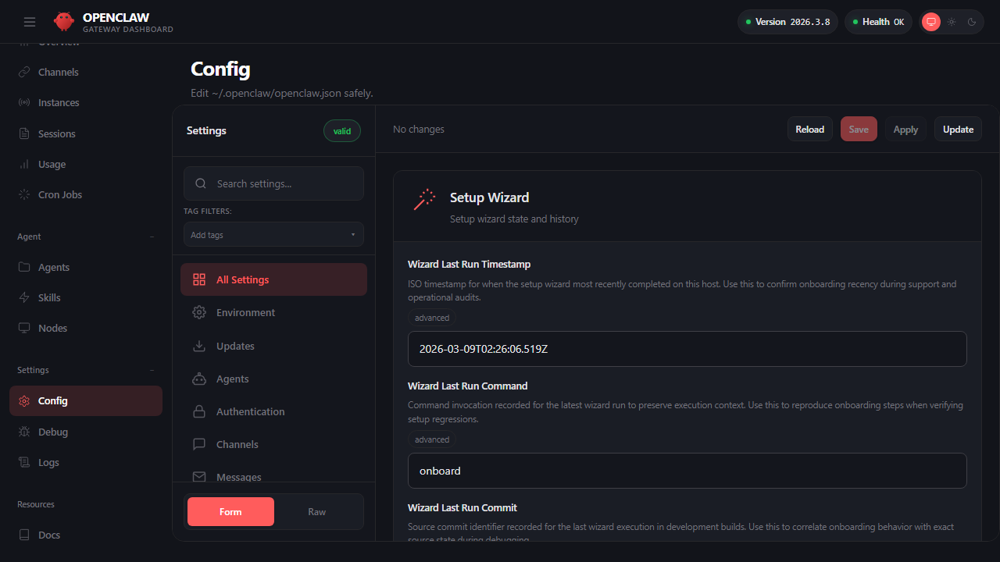
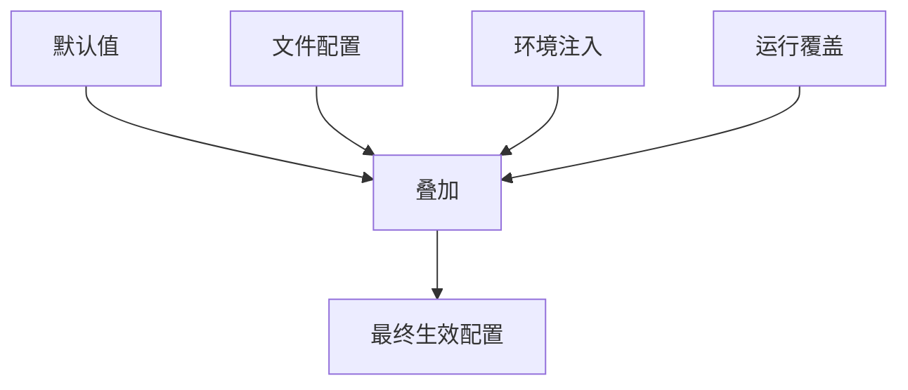
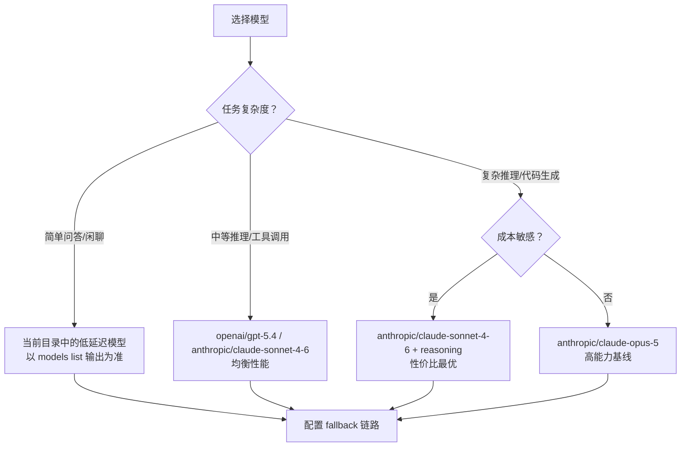

# 第四章 配置体系与模型治理

在[第二章](../02_setup/README.md)中，`openclaw onboard` 向导已经帮你完成了模型与认证的最小接入——内置供应商的密钥已写入 auth-profiles，默认模型已可用。但“能用”和“能放心地长期用”之间还隔着几步。

本章的目标不是重复“接入”，而是把接入**治理化**：这意味着：

- **配置可解释**：三个月后，你能清楚地说出“为什么当前用的是这个模型”，而不是“我也忘了怎么配的”
- **认证可轮换**：API Key 泄露了，或者企业要求定期轮换，你能在 10 分钟内无缝切换到备用 Key，不中断服务
- **选型有依据**：需要在 Claude、当前 OpenAI 旗舰模型、本地模型之间选择，你有一个四维框架（成本、质量、延迟、可靠性）来评估
- **故障可回退**：主模型或主 provider 出现故障时，系统能按显式 fallback 链切换到可用备选，而不是整个服务瘫痪

读完本章后，你应能独立回答三个问题：当前配置从哪里生效、当前模型为什么被选中、当前失败时系统会如何退化。

## 学习目标

完成本章的阅读后，你将能够：
1. **理解配置**：快速定位配置的优先级与生效规则。
2. **治理认证**：区分内置供应商的默认路径与自定义供应商的显式配置路径，掌握密钥注入与安全轮换。
3. **做出决策**：基于质量、成本、延迟与可靠性做出合理的模型选择。
4. **规划容错**：设计基本的故障转移链路，提高系统稳定性。

## 1. openclaw.json 结构与配置优先级

本节系统梳理 OpenClaw 配置体系的执行链路，包括配置的具体来源、优先级判断、覆盖规则及审计机制。核心目标是确保系统的任何运行时行为均可追溯至确定的输入配置，并提供验证最终生效参数的具体方法。

### 1.1 配置是什么：把系统行为写成可追溯输入

OpenClaw 的配置不是“参数集合”，而是系统行为的输入。把行为写进配置的意义在于：同一套系统在不同机器、不同渠道、不同账号下运行时，行为仍可被复现与解释。

从系统链路看，配置至少决定三类结果：

- 入口结果：哪些消息能进入系统，哪些消息会被拒绝或忽略。
- 执行结果：任务由哪个 Agent 处理、会调用哪些工具、输出如何回注到会话，必要时再接入外部节点能力。
- 治理结果：权限边界、审计与故障处理策略是否能在异常时稳态运行。

实践中最常用的主配置文件位于 `~/.openclaw/openclaw.json`（常用配置模板见[附录 B 配置模板与样例](../appendix/config_templates.md)）。除了直接编辑文件，在 Control UI 的 **Config** tab 中也可以分类浏览与修改当前的运行配置：



图 4-1：Config 全局配置视图

生产环境中，配置必须满足：可解释（能定位到字段与来源），可追溯（变更有记录且可回滚）。

安全配置示例如下，比起单纯的“开关”，更推荐用完整的 JSON 结构来定义行为：

```json5
{
  "gateway": {
    "port": 18789,
    "auth": {
      "mode": "token",
      "token": "${OPENCLAW_GATEWAY_TOKEN}"
    },
    "controlUi": {
      "allowedOrigins": [
        "http://localhost:18789",
        "http://127.0.0.1:18789"
      ]
    }
  },
  "channels": {
    "telegram": {
      "enabled": true,
      "dmPolicy": "pairing",
      "groupPolicy": "allowlist"
    }
  },
  "messages": {
    "ackReactionScope": "group-mentions"
  }
}
```

这里的关键点是：**鉴权方式由 `gateway.auth` 决定，配对与设备批准是控制面行为，不应再混写成旧版的 `requirePairing` 风格开关。**

### 1.2 作用域拆分：Gateway、Agent、渠道、工具各自控制什么

很多“配置不生效”并非优先级问题，而是写错了作用域。最稳的做法是先把配置按职责拆成四层，再讨论覆盖：

- Gateway 级：连接、鉴权、配对、路由与状态治理等控制平面行为。
- Agent 级：默认工作区、任务策略、能力组合方式（模型/工具/记忆如何协作）。
- 渠道级：渠道凭据与访问边界，例如 Telegram 令牌、WhatsApp 允许来源等。
- 工具级：工具启用、最小权限、超时与回执规范（工具输出如何进入上下文）。

一个实用判断法：

- 入口相关的“谁能触发”属于渠道级或 Gateway 级。
- “怎么做事、用什么能力”属于 Agent 级与工具级。
- “失败时怎么办、如何审计”通常横跨 Gateway/工具两层，但落点不同。

### 1.3 优先级模型：默认值、文件、环境注入、运行覆盖如何叠加

无需依赖实现细节，也能用一个稳定模型理解优先级：越接近运行时，优先级越高。常见来源包括：

1. 默认值：程序内置，保证系统至少能启动（例如 Gateway 默认端口 18789）。
2. 文件配置：`~/.openclaw/openclaw.json` 的 JSON5 内容。
3. 环境注入：配置字符串字段里写成 `${VAR_NAME}` 的占位符，会在运行时从解析环境读取真实值（典型用于密钥、令牌等敏感信息）。只有大写字母名 `[A-Z_][A-Z0-9_]*` 才会被替换；缺失或为空的变量会在加载时报错，可用 `$${VAR}` 转义为字面量。环境装载要区分阶段：配置加载会先处理 dotenv（当前工作目录 `.env`、`~/.openclaw/.env` 等），再处理配置里的 `env` block；运行时还可能合并 shell / daemon 提供的 environment。不要把 dotenv、`config.env` 与 shell env 写成一条简单线性优先级。
4. 运行覆盖：启动时的命令行参数等临时覆盖（例如启动时使用 `--port 19091`），用于一次性实验与快速回滚。

下面的示意图表达“叠加而非替换”的关系：



图 4-2：配置优先级叠加模型

同一字段可能在多处出现，最终值取决于覆盖来源，而不是“文件里谁写在后面”。因此治理配置时要避免重复定义同一语义的字段，尤其是跨环境复制时最容易留下残留覆盖。

### 1.4 生效证据：如何证明“最终生效值”

把“配置生效”落到证据链，才能形成稳定排障方法。推荐按顺序收集四类证据：

- 路径证据：确认输出 `Loading config from ~/.openclaw/openclaw.json`。
- 内容证据：关键字段的脱敏快照。用 `openclaw status --deep` 核对关键配置是否被加载（例如默认智能体、模型选择、渠道策略与工具策略的概要），并结合配置文件内容形成“字段 → 行为”的对应表。
- 运行证据：日志必须解释“为什么拒绝”。例如：`[Channel/WhatsApp] Message rejected: sender +19999999999 not in allowFrom list`。
- 行为证据：用一个可复现实验验证字段是否生效。

可复现实验应尽量选择“二值结果”。例如：

- 渠道白名单：从未授权号码发送消息，期望被拒绝；从授权号码发送消息，期望被接收。
- 工具策略：触发被断言禁用的工具，期望日志打印 `Tool 'execute_shell' denied by policy: minimum clearance level required`。

如希望把证据链做得更“二值化”，可以把验收命令固定为一组最小集合：先 `doctor` 确认配置可读、再 `status --deep` 确认加载、最后用 `logs --follow --json` 回放一次具体链路（见第 3 章诊断与附录 E 的命令速查）。

## 2. 模型供应商接入与认证方式

在[第二章](../02_setup/2.3_onboarding.md)中，`openclaw onboard` 向导已经帮你完成了内置供应商的密钥绑定，模型已经可以调用。本节的目标不是重复“接入”，而是讲清楚三件事：什么时候需要显式写 `models.providers`、什么时候不需要；密钥如何安全注入与轮换；以及如何用标准化命令验收接入状态。

### 2.1 三条路径：你真的需要 models.providers 吗？

OpenClaw 的内置供应商（OpenAI、Anthropic、Moonshot 等）已经发布了默认的模型目录（default catalog）。多数内置 provider 在通过 `openclaw onboard` 完成认证后，密钥会写入 `~/.openclaw/agents/<agentId>/agent/auth-profiles.json`，通常无需手动编写 `models.providers`；但也要注意，部分 provider / onboarding 流程仍可能把 provider 配置同步写入 `openclaw.json`。

更准确地说，只有在以下情况下你通常需要显式写 `models.providers`：

- **覆盖内置供应商的默认行为**：需要自定义 baseURL、请求头或模型列表时。
- **接入自定义/自托管供应商**：如自建代理或自托管端点；OpenRouter、Ollama 已有 provider 文档/插件路径，通常只有在定制端点或模型目录时才需要手写 `models.providers`。

一个常见误区是把多凭据轮换写进 `models.providers`。灰度发布、profile 顺序或多 key 候选应走 auth profiles 与 `auth.order`；只有 provider 明确支持的静态凭据环境变量才适合直接依赖环境注入（详见 4.2.5）。

换句话说，对大多数用户而言，onboard 完成后只需要在 `agents.defaults.model` 中指定模型标识即可：

```javascript
{
  // 内置供应商已通过 onboard 认证，无需 models.providers
  agents: {
    defaults: {
      model: {
        primary: "openai/gpt-5.5",
      },
    },
  },
}
```

模型标识统一使用 `provider/model` 格式，斜杠前的 `provider` 来自内置/插件模型目录或显式 `models.providers` 自定义 provider；auth profiles 与环境变量只提供认证材料，不注册 provider。需要特别注意的是：**provider path 与运行时不是同一层概念**。OpenAI agent 模型统一使用 `openai/*` 模型引用；ChatGPT/Codex 订阅 OAuth 通过 Codex/OpenAI auth profile 与运行时表达，旧配置中的 `openai-codex/*` 模型引用应使用 `openclaw doctor --fix` 迁移到 `openai/*`。常见的命名形态（以下名称仅为格式示例，实际可用模型以 `openclaw models list`、`openclaw models status --probe` 和各供应商官方目录为准）：

- `openai/gpt-5.4`、`openai/gpt-5.4-pro`
- `openai/gpt-5.5`（可配合 Codex 订阅 OAuth 或 OpenAI API Key）
- `anthropic/claude-sonnet-4-6`、`anthropic/claude-opus-4-6`
- `anthropic-vertex/claude-sonnet-4-6`（通过 Google Cloud Agent Platform 调用 Claude）
- `moonshot/kimi-k2.6`（`moonshotai` 是历史/兼容别名）
- `zai/glm-5`
- `chutes/<模型名>`（Chutes 平台，支持 OAuth 和 API Key 两种认证）
- `xai/grok-4.3`；若使用 Grok 4.20 beta，应写完整 beta 模型 ID，例如 `xai/grok-4.20-beta-latest-reasoning`

### 2.2 需要显式配置的场景与示例

以下示例面向**确实需要** `models.providers` 的场景：自定义 provider、代理后的 OpenAI-compatible 端点、或需要显式维护模型目录的部署。如果你使用的是内置供应商且 onboard 已完成认证，可直接跳到 4.2.4 了解密钥注入的高阶形式。

**1. 自定义代理 provider**

当需要将模型请求走自建代理或 OpenAI-compatible 端点时，`models.providers.<id>` 至少要提供 `baseUrl` 和 `models`，并按实际后端选择 `api`：

```javascript
{
  models: {
    providers: {
      "custom-proxy": {
        baseUrl: "https://my-proxy.internal/v1",
        apiKey: "${CUSTOM_PROXY_API_KEY}",
        api: "openai-completions",
        models: [
          {
            id: "team-fast",
            name: "Team Fast Model",
            input: ["text"],
            contextWindow: 128000,
            contextTokens: 96000,
            maxTokens: 32000,
          },
        ],
      },
    },
  },

  agents: {
    defaults: {
      model: {
        primary: "custom-proxy/team-fast",
      },
    },
  },
}
```

> [!NOTE]
> 如果只是想更换内置供应商的密钥，不要用只有 `apiKey` 的 `models.providers` 覆盖。优先使用 onboarding / `models auth` 写入 auth profiles，或使用当前 provider 支持的环境变量。

**2. Anthropic Vertex（通过 Google Cloud Agent Platform 调用 Claude；平台已由 Vertex AI 更名，provider 标识仍是 `anthropic-vertex`）**

认证方式：GCP 服务账号或 Application Default Credentials
常用模型标识应以你当前版本的 `openclaw models list`、`openclaw models status --probe` 输出和 Anthropic / Google Cloud 官方目录为准，不建议在文档里长期写死具体快照名。

```javascript
{
  // 认证走 GCP Application Default Credentials、服务账号或 onboarding 生成的认证档案；
  // 不要把 region/projectId 当作仅含元数据的 models.providers 覆盖来写。
  agents: {
    defaults: {
      model: {
        primary: "anthropic-vertex/<当前可用的 Claude 模型标识>",
      },
    },
  },
}
```

> [!TIP]
> Anthropic Vertex 适用于已有 GCP 基础设施的团队：流量走 Google 内网，可利用 GCP 的 IAM 权限体系和 VPC 网络策略，且计费合并到 GCP 账单中。

**3. 自托管 Ollama**

baseUrl：`http://localhost:11434`
常用模型标识：`ollama/gpt-oss:20b`、`ollama/qwen2.5-coder:32b` 等（取决于本地拉取了哪些模型，选型与显存需求见 [16.3.2](../16_claude_ecosystem/16.3_other_ecosystems.md)）

> [!WARNING]
> 不要使用 `http://localhost:11434/v1` 这样的 OpenAI-compatible 路径——官方明确指出这会破坏工具调用，让模型把工具 JSON 当普通文本输出。应直接使用 Ollama 原生 API 地址。

```javascript
{
  models: {
    providers: {
      ollama: {
        baseUrl: "http://localhost:11434",
        apiKey: "ollama-local",
        api: "ollama",
        models: [
          {
            id: "gpt-oss:20b",
            name: "GPT-OSS 20B",
            input: ["text"],
            cost: { input: 0, output: 0, cacheRead: 0, cacheWrite: 0 },
            contextWindow: 128000,
            maxTokens: 8192,
          },
        ],
      },
    },
  },

  agents: {
    defaults: {
      model: {
        primary: "ollama/gpt-oss:20b",
      },
    },
  },
}
```

> 这里的 `contextWindow` 只是 OpenClaw 侧的模型容量提示，不等于 Ollama 服务端一定为本次运行分配了同样大的 runtime context；实际值受 VRAM、`OLLAMA_CONTEXT_LENGTH`、Modelfile 与 `params.num_ctx` 影响，详见 [16.3.2](../16_claude_ecosystem/16.3_other_ecosystems.md)。

### 2.3 OpenRouter

baseUrl：`https://openrouter.ai/api/v1`
API 适配器：`openai-completions`
环境变量：`OPENROUTER_API_KEY`
常用模型标识示例：`openrouter/<provider>/<model>`。具体模型名应以 OpenRouter 当前目录与本地 `models list` / `models status --probe` 输出为准。

环境变量设置：

```bash
export OPENROUTER_API_KEY="sk-or-xxx..."
```

配置示例（OpenRouter 已有 provider 插件和 onboarding 入口，通常只需要认证与模型选择；不要写只有 `apiKey`/`baseUrl`、没有 `models` 的 `models.providers.openrouter` 覆盖）：

```javascript
{
  agents: {
    defaults: {
      model: {
        primary: "openrouter/<provider>/<model>",
      },
    },
  },
}
```

### 2.4 密钥注入：${} 插值与 SecretRef 凭据管线

配置支持在字符串字段里写 `${VAR_NAME}`，或是使用 `SecretRef` 对象。推荐把密钥放进环境变量或密钥系统，在配置里不写任何明文：这样配置文件可入库、可审计、可复现，且避免了密钥意外落盘。

**1. 基本形式：`${}` 环境变量插值**

内置供应商优先通过环境变量、onboarding 或 `models auth` 进入 auth profiles；这里展示最常见的环境变量形式：

```bash
# 方式 A：直接 export
export OPENAI_API_KEY="..."

# 方式 B：写入 ~/.openclaw/.env 或项目目录下的 .env
OPENAI_API_KEY="..."
```

> [!NOTE]
> OpenClaw 在启动时会遵循优先级读取环境变量，规则为：`进程真实环境变量` > `当前目录 .env` > `~/.openclaw/.env`。**注意：`.env` 文件中的定义不会覆盖已经存在于进程中的同名环境变量。**

**2. 高阶形式：使用 SecretRef 对接统一凭据管线**

针对生产级部署，OpenClaw 提供了统一的 Secrets 管线。你不仅限于使用环境变量，而是可以使用 `SecretRef` 形式安全加载，这使你可以对接各类 secrets provider，并结合 `openclaw secrets` 体系进行管理与依赖性审计。

SecretRef 只适用于当前 schema 明确支持的静态凭据字段；OAuth profile material 等运行期认证材料不接受 SecretRef。写入前建议用 `openclaw config set --dry-run` 或 `openclaw security audit` 验证。SecretRef 支持三种 `source` 类型：

- `"env"`：从环境变量读取（最常用）
- `"file"`：从文件路径读取内容
- `"exec"`：执行命令并取其标准输出

```javascript
{
  secrets: {
    providers: {
      default: { source: "env" },
    },
  },
  models: {
    providers: {
      "custom-proxy": {
        baseUrl: "https://my-proxy.internal/v1",
        api: "openai-completions",
        // 方式 1：从环境变量读取
        apiKey: { source: "env", provider: "default", id: "CUSTOM_PROXY_API_KEY" },
        models: [
          {
            id: "team-fast",
            name: "Team Fast Model",
            input: ["text"],
            contextWindow: 128000,
            contextTokens: 96000,
            maxTokens: 32000,
          },
        ],
      },
    },
  },
}
```

> [!WARNING]
> **配置自写的落盘风险**：如果系统允许外部（如 AI）修改配置文件或执行了不当的同步行为，普通的内联 `${VAR_NAME}` 配置有极低概率在重写时被错误解引用而变成明文写回磁盘。而使用 `SecretRef` 对象语义则能严格隔离数据链路，有效避免误操作。

注意：
- 结构化日志与诊断输出不打印明文密钥。
- 验证时请使用 `openclaw security audit`、`models status` 和必要时的 `models status --probe`。

### 2.5 多密钥与认证档案：为轮换与灰度预留结构

当前 OpenClaw 不使用 `models.providers.*.keys` / `keyId` 作为运行时多密钥接口。同一 provider 的多凭据应通过 auth profiles、`auth.order`、或 provider 支持的环境变量 key 列表表达。建议把“新增凭据”与“切换默认顺序”拆成两个动作：先新增并小流量验证，再调整 `auth.order` 或环境变量顺序，最后吊销旧密钥。

配置示例（认证档案顺序，只保存路由元数据，密钥仍在 `auth-profiles.json` 或 SecretRef 中）：

```javascript
{
  auth: {
    profiles: {
      "openai:primary": {
        provider: "openai",
        mode: "api_key",
      },
      "openai:secondary": {
        provider: "openai",
        mode: "api_key",
      },
    },
    order: {
      openai: ["openai:primary", "openai:secondary"],
    },
  },
}
```

不要把 `<PROVIDER>_API_KEYS`、`<PROVIDER>_API_KEY_1` 或 `OPENCLAW_LIVE_<PROVIDER>_KEY` 这类名字当作所有 provider 都支持的通用候选池接口。生产轮换更稳的路径是新增 auth profile、调整 `auth.order`，并用 provider 文档明确支持的环境变量或 SecretRef 注入静态凭据。轮换建议：不要在故障窗口直接“替换同一个环境变量的值”，那会让排障证据变得不可追溯；更稳的是新增一把凭据、调整 profile 顺序、保留旧凭据一段观测窗口后再回收。

### 2.6 接入验收：用 models status 做可观测验证

配置完成后用一组最小命令做验收（只看结果，不靠感觉）：

```bash
openclaw doctor
openclaw models status
openclaw models status --probe
openclaw status --deep
```

- `doctor` 失败：先修复“配置可读”与“运行依赖”，不要先调提示词或工作流。
- `models status` 显示异常：优先检查认证档案是否缺失、OAuth 是否过期、环境变量是否存在、`${}` 占位符的变量名是否拼对。
- `models status --probe` 失败：再检查 provider live auth、上游连通性、模型名是否仍可用。
- `status --deep` 中看不到预期的 provider/model：优先回看层级（`models.providers` 与 `agents.defaults.model` 是否写在正确位置）。

### 2.7 速率限制与配额管理

上游模型供应商通常对 API 调用实施速率限制（rate limit），OpenClaw 需要妥善处理这些限制，避免请求失败或服务中断。

**上游 429 响应处理**

当 OpenClaw 收到上游供应商返回的 HTTP 429（Too Many Requests）时，当前主路径不是在同一个 key 上按 1s/2s/4s 长时间阻塞等待，而是把对应 auth profile 标记为冷却，再按预算尝试同 provider 的下一个 profile；预算耗尽或错误类型适合切换时，进入模型 fallback 链路（见 4.4）。

默认冷却梯度通常是 30 秒、60 秒，之后最高到 5 分钟；具体窗口为内置策略（`auth.cooldowns.*` 并不存在于配置 schema 中），由错误分类和 profile 状态共同决定。结构化日志会记录冷却、profile rotation 与 fallback 决策，便于事后分析与告警配置。

**配置速率限制策略**

当前公开配置面不提供 `models.providers.*.rateLimit` 这类本地主动限流字段。模型侧限流治理应分成三层处理：

1. **OpenClaw 内部**：依赖 auth-profile 冷却、同 provider profile rotation、内置的 rate-limited profile 轮换策略与模型 fallback。
2. **供应商侧**：设置供应商账单限额、项目配额、组织级 rate limit 或 key 级权限。
3. **入口侧**：在反向代理、队列、插件或业务网关中做请求整形、排队与熔断。

具体冷却与轮换由内置策略和错误类型决定；默认 overloaded / rate-limit 路径只做有限次数的同 provider profile rotation，预算耗尽后可进入模型 fallback 链路。

**多供应商 Fallback 规避单点限流**

最稳健的做法是为关键服务配置多个供应商，在单一供应商频繁限流时自动切换到次要供应商。见 4.4 关于 fallback 链路的详细说明。

```javascript
{
  agents: {
    defaults: {
      model: {
        primary: "openai/gpt-5.5",
        fallbacks: [
          "anthropic/claude-sonnet-4-6",
        ],
      },
    },
  },
}
```

如果你走的是 ChatGPT/Codex 订阅 OAuth，当前配置仍应使用 `openai/*` 模型引用，由 Codex/OpenAI auth profile 与运行时表达订阅认证；历史配置中的 `openai-codex/*` 模型引用属于兼容路径，应通过 `openclaw doctor --fix` 迁移。关键不是复用某段历史配置，而是**要和当前模型目录、auth profile 与运行时选择保持一致**。这样即便主链路因限流而暂时不可用，请求也能自动降级到次级模型或备用供应商，保证服务连续性。

> **踩坑实录：环境变量“明明设了却读不到”**
>
> 一个常见的部署陷阱：在 `.bashrc` 中 export 了 `ANTHROPIC_API_KEY`，但 OpenClaw 以 systemd 服务启动时读不到。原因是 systemd 不会加载用户 shell profile。解决方案：在 systemd unit 文件中用 `EnvironmentFile=/etc/openclaw/env` 显式指定，或使用 `openclaw secrets configure` 把密钥写入 SecretRef 体系。

## 3. 模型选择与默认策略

本节围绕 `agents.defaults.model` 讲清模型选择的落点：默认主模型如何设定；不同智能体如何覆盖默认值；在工具调用与长上下文场景下选型要额外关注哪些能力约束。最后给出一组基于 `models status` 与用例回归的验证方法，把选型从“感觉”变成“可对比”。

### 3.1 决策维度：质量、成本、延迟、可靠性

模型选择不要只看效果。对可运行系统，至少需要同时考量以下四个维度：

- 质量：完成度、事实性、工具调用对齐。
- 成本：单位请求成本与失败成本。
- 延迟：平均与尾延迟。
- 可靠性：失败率、限流频率、抖动恢复时间。

**具体例子：三个典型业务场景的选型对比**

| 业务场景 | 质量需求 | 延迟容忍 | 成本敏感度 | 推荐策略 |
| --- | --- | --- | --- | --- |
| 客服系统 | 中（标准问答） | 低（用户在线等待） | 高（每条消息计费） | 轻量/低延迟模型为主；具体 ID 以 `openclaw models list --all` 为准，大模型兜底 |
| 数据分析助手 | 高（复杂推理） | 中（可等 30 秒） | 中 | 大模型为主（如 `openai/gpt-5.5` 或 `anthropic/claude-sonnet-4-6`），关注上下文窗口 |
| 定时巡检报告 | 高（结构化输出） | 高（离线异步） | 低 | 大模型为主，失败后自动重试而非降级 |

以此表为参考，客服场景中，把当前目录里可用的低延迟模型设为 `primary`，并把 `openai/gpt-5.5` 或 `anthropic/claude-sonnet-4-6` 放进 `fallbacks`，能在控制成本的同时保证复杂问题不崩；而内部分析场景则相反，应把大模型作为主力。若预算优先，可把 `openai/gpt-5.4` 标为成本型备选。

四维必然冲突。工程上更稳的做法是先固定默认主模型，再通过回退链路兜底，而不是频繁手动换模型。

**模型选择决策树**

下图展示了从任务复杂度出发，进行模型选择与 fallback 配置的完整决策流程：



使用此决策树的步骤：

1. **评估任务复杂度**：确定你的使用场景属于简单问答、中等推理还是复杂推理与代码生成。
2. **选择主模型**：沿着对应分支找到推荐模型。
3. **配置 fallback 链路**：为主模型配置至少一个降级模型，见 4.4。

示例配置（中等推理场景）：

```javascript
{
  agents: {
    defaults: {
      model: {
        primary: "openai/gpt-5.4",
        fallbacks: [
          "anthropic/claude-sonnet-4-6",
        ],
      },
    },
  },
}
```

示例配置（复杂推理、成本敏感场景）：

```javascript
{
  agents: {
    defaults: {
      model: {
        primary: "anthropic/claude-sonnet-4-6",
        fallbacks: [
          "openrouter/anthropic/claude-sonnet-4-6",
          "openai/gpt-5.4",
        ],
      },
    },
  },
}
```

### 3.2 默认主模型：agents.defaults.model.primary

默认主模型建议写在 `agents.defaults.model.primary`，并把它当作“系统基线”而不是“随手开关”：先固定默认值，再通过回退链路兜底（见 4.4），避免频繁手动切换导致证据链断裂。

```javascript
{
  agents: {
    defaults: {
      model: {
        primary: "openai/gpt-5.4",
      },
    },
  },
}
```

### 3.3 针对单个智能体覆盖：agents.entries

当不同智能体承担不同任务时，可以在 `agents.entries` 中覆盖模型选择，使其与工具策略、工作区隔离一起演进。

```javascript
{
  agents: {
    entries: {
      assistant: {
        model: {
          primary: "openai/gpt-5.4",
        },
      },
      fast: {
        model: {
          primary: "<provider/low-latency-model>",  // 轻量模型占位，替换为本地 models list 输出
        },
      },
    },
  },
}
```

### 3.4 模型目录覆盖：agents.defaults.models

`agents.defaults.model` 决定默认主模型与 fallback 链；`agents.defaults.models` 是按完整 provider/model id 索引的单模型运行覆盖面，当前只适合覆盖 `alias`、`params`、`agentRuntime` 与 `streaming`。上下文窗口、成本元数据与可见模型目录仍应来自 provider/model catalog 或真实用量测量；如果要新增自定义 provider 或模型目录，应在 `models.providers.<provider>.models[]` 中声明。

```javascript
{
  agents: {
    defaults: {
      model: { primary: "openai/gpt-5.4" },
      models: {
        "anthropic/claude-sonnet-4-6": {
          params: { context1m: true },
        },
        "<provider/low-latency-model>": {
          alias: "fast-review",
          streaming: true,
          params: { reasoningEffort: "low" },
        },
      },
    },
  },
}
```

### 3.5 与上下文和工具的耦合点

选型时建议额外检查三类约束。

- 上下文窗口：是否能承载目标任务的上下文体积。
- 工具调用能力：是否能稳定遵循工具签名与输出契约。
- 输出格式：是否能稳定输出结构化结果，便于后续审计与回放。

如果系统大量依赖工具回执与结构化回注，模型的“格式合规率”通常比纯问答更重要。

### 3.6 验证方法：探针加回归用例

操作示例：先确认模型可用，再跑最小用例回归。

```bash
openclaw models status
openclaw models status --probe
```

当更换 `primary` 或调整回退链路时，建议固定一组用例回归，至少包含：

- 事实性用例。
- 工具型用例。
- 多轮上下文用例。

把回归结果与成本、延迟一起记录，才能避免“看似更聪明但更不稳定”的回归。

## 4. 故障转移基础：回退链路与恢复策略

本节介绍回退链路的配置方法、触发时机及其与重试机制的联动关系。配置的核心在于利用 `agents.defaults.model.primary` 和 `agents.defaults.model.fallbacks` 设定主模型及按优先级排列的回退目标。此外，本节还将提供一套基于“故障注入与观测”的验证方案，确保持续可用性与回退机制的真实生效。

### 4.1 故障分类：把错误映射为动作

回退的关键不是“失败就换”，而是“不同失败用不同动作”。建议把错误先按“可操作性”分三类：

- **配置/鉴权类（快速失败）**：例如 401/403、密钥缺失、字段写错层级。应快速失败并给出可操作指引；不要在同一条链路里盲目重试放大故障窗口。
- **瞬时故障类（有界重试）**：例如短暂超时、抖动、偶发 5xx。可重试，但必须设预算（次数与总耗时）。
- **持续不可用类（触发回退）**：例如持续限流（429）、供应商长时间不可用、网络侧持续失败。应尽快切到回退目标以维持连续性。

把三类错误混在一起会导致两种反效果：该快速失败的问题被无意义重试拖垮；该回退的问题没有及时切流。

### 4.2 回退配置：agents.defaults.model.fallbacks

最小可用写法是：主模型 + 顺序回退列表。系统会在主模型失败且错误类型适合回退时，按顺序尝试备选模型。

```javascript
{
  agents: {
    defaults: {
      model: {
        primary: "openai/gpt-5.4",
        fallbacks: [
          // 回退：跨供应商模型（常用于应对上游或网络侧持续故障）
          "anthropic/claude-sonnet-4-6",
        ],
      },
    },
  },
}
```

建议按“连续性优先但要可解释”来排序：越靠前的回退目标越应该稳定、可用、并且成本与质量波动可接受。OpenAI agent 模型引用使用 `openai/*`；ChatGPT/Codex 订阅 OAuth 由 Codex/OpenAI auth profile 与运行时表达，历史 `openai-codex/*` 模型引用应通过 `openclaw doctor --fix` 迁移。不要把模型引用、认证 profile 和运行时混成一层配置。

需要注意覆盖语义：`agents.defaults.model.fallbacks` 是全局默认链；agent、session、cron job 或工具 payload 中的显式 fallback override 会替换默认链，显式空数组可用于禁用全局 fallback。如果只覆盖 primary 而没有覆盖 fallback，运行时仍可能在没有显式 override 的路径上把配置 primary 追加为恢复候选，用于主链路恢复探针。

### 4.3 与重试联动：避免故障窗口内放大

回退链路要和重试一起设计，否则会出现“重试拖死”或“无声切换”。

- **有界重试**：限制最大次数与总时长，避免在不可用窗口里把队列与成本放大。
- **回退优先级**：把更稳的备用模型放在更前面；同供应商与跨供应商各留一条兜底。
- **可观测恢复**：当主链路恢复后再切回，避免反复抖动导致输出质量与成本不可预测。

### 4.4 Auth-profile 级冷却：同供应商多账号的内置轮转

除了跨模型的 `fallbacks` 链路，OpenClaw 还在 **同一 provider 内** 维护一套 auth-profile 轮转机制。当一个密钥或账号触发失败后，系统会自动切到同 provider 的下一个可用凭据，而不立即跨模型跳转。

冷却梯度：

| 失败次数 | 冷却时长 |
|---|---|
| 1 | 30 秒 |
| 2 | 1 分钟 |
| 3+ | 5 分钟（上限） |

billing 相关禁用（如 402 结算失败）有独立梯度：从 5 小时起步，每次失败翻倍，上限 24 小时；24 小时未出错则自动重置。

更准确地说，`auth-profiles.json` 负责保存 secrets / profiles，本轮转里的冷却、禁用与最近可用顺序等运行时状态应以 `auth-state.json` 为准。更多 auth 级可靠性机制见第 11 章。

### 4.5 验证方法：故障注入与对账

回退不是写进配置就算完成，必须验证它真的会触发，并且能被对账。

1. **基线**：`models status` 显示认证档案没有缺失或过期；再用 `models status --probe` 验证主/备 provider 的 live auth 与网络可用性。
2. **观测**：跟随结构化日志，确保你能看到回退决策事件（当前常见事件名为 `model_fallback_decision`，并包含 `fallbackStep*` 等字段）。
3. **注入**：人为制造“主链路失败、备链路仍可用”的条件（例如临时撤销主链路密钥或触发主模型限流）。
4. **对账**：确认日志里出现回退事件，并且命中目标与 `fallbacks` 顺序一致。

操作示例（观测窗口）：

```bash
openclaw models status
openclaw models status --probe
openclaw logs --follow --json
```
