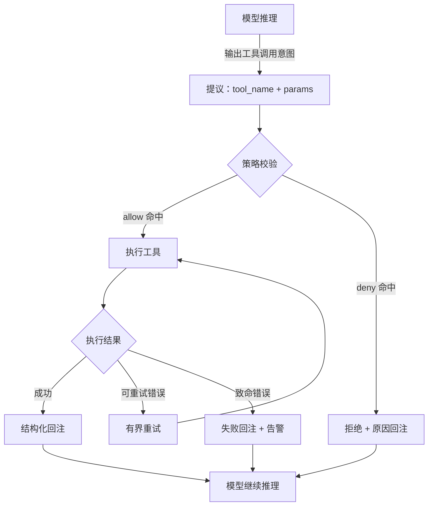
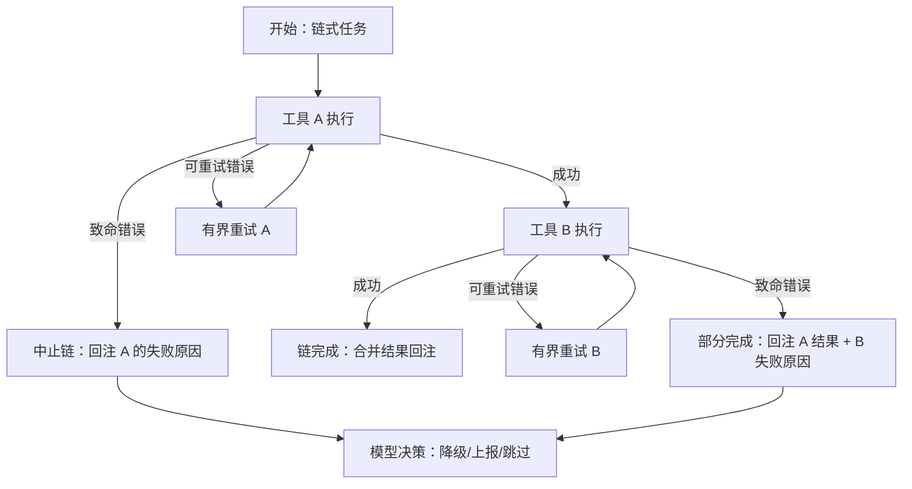
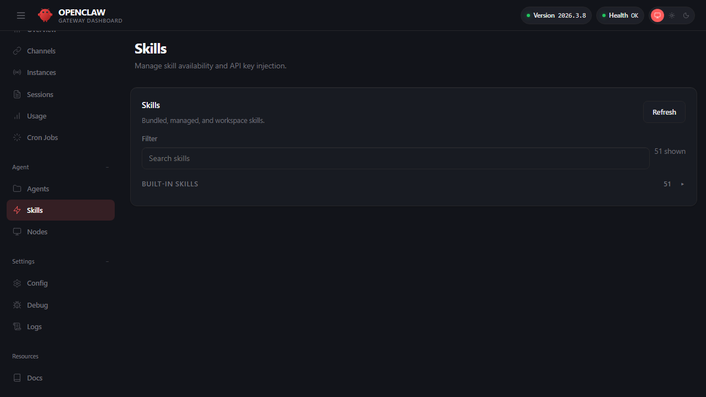

# 第五章 工具系统、技能与插件

前面几章，你已经学会了安装、配置、让 OpenClaw 在控制台回答问题。但一个只能“说话”的智能体的能力有限。真正的智能体需要“行动”——它能查询数据库、发送邮件、操作 Git 仓库、控制智能家居。

这一章讨论的是智能体系统的行动层：**模型负责提出意图，真正产生外部影响的是工具与扩展能力**。但“能调用工具”和“能安全、可靠地在明确边界内调用工具”之间，隔着从工具发现、策略声明、失败处理、到完整审计的整个工程链路。

本章的主线是把“能调用工具”升级为“能在明确边界内稳定执行，并且可审计、可排障、可回滚”。这意味着当有人用飞书向 OpenClaw 的客服机器人说“帮我删除整个数据库”时，系统能说“不”，而不是直接执行。

先修知识：本章假设读者已理解[第四章“配置与模型接入”](../04_config_models/README.md)的配置体系基本概念（配置优先级、profile 选择等）。

学习目标：

- 理解工具调用链路的关键拦截点，明确哪些边界应由运行时策略兜底。
- 掌握工具策略的允许、拒绝与分层策略方法，建立最小权限默认。
- 了解插件体系的启停与白名单治理，并掌握技能与插件的协同定位与治理边界。
- 掌握浏览器工具的常用命令与排障闭环。

## 全景导览

本章四个小节围绕“行动能力的工程治理”展开，各有侧重又互为补充：


简而言之：5.1 回答“工具是什么”，5.2 回答“谁能用什么工具”，5.3 回答“如何扩展与复用”，5.4 展示一个高风险工具的完整治理实例。

## 1. 工具清单与调用范式

本节将从工程化视角探讨如何构建与管理工具清单，涵盖工具契约、失败语义、只读与写入边界等核心概念，并介绍如何确保工具调用的可复现性与可回放性（支持在本地实例中进行实操验证）。

### 1.1 工具盘点：来源、分组与清单

建立工具清单不是为了死记硬背一份静态列表（可用工具会随版本、配置模板、插件与部署形态而变化），而是为了让你能在自己的实例上回答三件事：

1. **候选工具集从哪里来**：`tools.profile` 的基础集合 + 已启用插件带来的新增工具。
2. **哪些工具被策略裁剪**：`tools.allow`/`tools.deny` 与具体渠道的群组、房间或 peer 工具策略把候选集合收敛到可执行集合。
3. **一次调用如何被审计**：当工具被允许/拒绝/失败时，能在 `/tools`、插件 runtime inspect、Gateway deep status 与结构化日志里复盘“命中哪条规则、失败在哪里”。

建议把“你的本地工具清单”做成一张可复用的表（后续写工具策略、做验收、做排障都用它）：

| 工具类别 | 典型工具模式（示例） | 风险等级 | 默认策略建议 | 验收关注点 |
| --- | --- | --- | --- | --- |
| 只读查询 | `group:web`、`read`、`memory_search` | 低 | 默认允许（按需限流） | 准确率、延迟、可用性 |
| 有副作用写入 | `write`、`edit`、`apply_patch`、`group:messaging` | 中 | 默认拒绝（按入口/角色放开） | 幂等、回滚、权限边界 |
| 执行/命令类 | `group:runtime`（`exec`、`process`、`code_execution`） | 高 | 默认拒绝（最小范围放开） | 白名单、审计、爆炸半径 |
| 交互自动化 | `group:ui` (`browser`, `canvas`) | 高 | 默认拒绝（必要时放开） | 步骤可验证、失败可定位 |
| 扩展工具 | `plugins.*`（由插件提供） | 取决于能力 | 先插件白名单，再工具策略收敛 | 启停、灰度、可回放证据 |

> 说明：上表中的“工具模式”用于表达治理方法与风险分层；具体 tool id 与可用命令请以你本地实例的 `/tools` / `/tools verbose`、`openclaw plugins inspect <id> --runtime --json`、Gateway deep status、结构化日志与各子命令 `--help` 的实际输出为准。

一个最小、可复制的“工具清单生成/校验”流程（不依赖记忆，依赖证据）：

1. **静态证据**：检查配置里 `tools.profile`、`tools.allow`、`tools.deny` 与对应渠道分层策略的收敛意图是否清晰。
2. **运行时证据**：优先用会话内 `/tools` 或 `/tools verbose` 查看当前 session 可达工具；再用 `openclaw gateway status --deep --require-rpc` 确认 Gateway runtime 可用，并用结构化日志回放一次工具允许/拒绝事件，确认命中的规则可追溯。
3. **扩展证据**：如果引入插件，先看 `openclaw.plugin.json#configSchema`、`plugins.entries.<id>.config`、`api.pluginConfig` / `api.config` 与运行时日志，确认“插件是否加载、是否启用、是否健康”；再用 `openclaw plugins inspect <id> --runtime --json` / `plugins doctor` 做补充验证。

这一节的目标是把“工具是黑盒能力”变成“工具是可盘点、可分层、可验收的工程对象”。接下来四个小节分别解决：工具契约、调用范式、回注与可观测性。

### 1.2 工具是什么：契约、边界与失败语义

在 OpenClaw 中，“工具”应被视为一段受控执行：它有明确输入、明确输出、明确失败语义，并且其副作用必须可审计。

把工具当作一等对象的核心意义是把系统从“凭感觉做事”推进到“按契约做事”。契约至少回答四个问题：

- 输入是什么：参数结构、必填项、合法值范围。
- 输出是什么：结构化字段、关键结论与证据来源。
- 失败是什么：哪些错误可重试，哪些必须立刻失败并上报。
- 副作用是什么：是否会写入外部系统，是否可回滚，回滚路径是什么。

以下是一个概念性的工具契约示例（用于说明设计原则；字段名与可用项以你本地实例的实际输出为准）：

```json
{
  "name": "create_ticket",
  "description": "Create a support ticket",
  "parameters": {
    "type": "object",
    "properties": {
      "title": { "type": "string" },
      "priority": { "enum": ["P1", "P2", "P3"] }
    },
    "required": ["title"]
  },
  "failure_semantics": {
    "retryable_errors": ["NetworkTimeout", "RateLimitExceeded"],
    "fatal_errors": ["Unauthorized", "InvalidFormat"]
  }
}
```

只要副作用存在，就必须把“失败语义”设计在工具侧，而不是事后靠提示词补救。

### 1.3 调用范式：只读查询、有副作用写入、链式编排

基于权限边界与验收流，工具调用可分为以下三种范式：

- 只读查询：检索、读取、统计。验收看“准确率、延迟、稳定性”。
- 有副作用写入：发消息、创建工单、改配置、删除对象。验收看“权限、幂等、回滚”。
- 链式编排：多个工具串联完成任务。验收看“中间态可解释、失败可定位、回放可复现”。

下面的流程图展示了一次工具调用的完整生命周期，从模型提议到结果回注：



图 5-1：工具调用的完整生命周期

工程上建议把链式编排拆成可检查的阶段：每一步都产出结构化中间结果，并写入会话或日志。这样在失败时能定位到具体一步，而不是只看到“任务失败”。

**链式编排的错误传播**

当多个工具串联执行时，中间步骤的失败需要明确的传播与处理策略。下图展示了一个典型的两步链式调用场景：



图 5-2：链式工具调用的错误传播与处理

链式编排的关键工程原则：

- **中间态持久化**：每一步的结构化输出写入会话记录，确保失败时不丢失已完成的工作。
- **失败隔离**：工具 A 的致命错误不应导致系统丢弃已收集的上下文；模型应能基于部分结果做出降级决策。
- **状态传递**：某些链式场景需要跨步骤共享状态（如浏览器登录态），应在工具契约中明确哪些状态可传递、生命周期多长。

### 1.4 回注原则：把结果变成可复用证据

工具输出如果原样回注，常见后果是上下文爆炸与证据丢失。更稳的回注方式是“三段式”：

1. 结论摘要：本次工具执行得到的关键结论（可直接用于回复）。
2. 证据引用：关键字段、时间戳、来源标识（便于追溯）。
3. 原始输出：仅在需要时保留，避免大量无用文本进入上下文。

以下是一个标准的回注日志示例：

```json
{
  "summary": "User account is active but password expired.",
  "evidence": {
    "account_id": "u_12345",
    "status": "active",
    "last_login": "YYYY-MM-DDTHH:MM:SSZ"
  },
  "raw_output": "{\"db_record\": {...}}"
}
```

这套结构的目标是让后续推理可以引用“证据”，而不是引用一大段噪声文本。

> [!TIP]
> 三段式回注直接影响后续上下文构建的质量与 Token 预算。当会话变长时，工具结果如何在有限的上下文窗口内被合理裁剪与压缩，参见[第六章“上下文与记忆”](../06_context_memory/README.md)。

### 1.5 可观测性：如何让一次工具调用可复现、可回放

工具系统的可靠性来自可观测性。建议把一次工具调用的最小可复现信息固化为记录：

- 输入摘要：参数关键字段（脱敏）。
- 权限判定：为什么允许或拒绝（命中哪条策略）。
- 执行结果：成功/失败、耗时、错误类别。
- 回注内容：写入上下文的摘要与证据标识。

当出现“同一任务偶发失败”，第一反应不应是改提示词，而应把失败样例回放到同一工具调用记录上，复现后再定位根因。

## 2. 工具策略：允许、拒绝与分层策略

本节以官方工具治理为准，把“能不能调用工具”落到可配置、可审计的策略面。重点包括 `tools.allow` 与 `tools.deny` 的匹配语义、`tools.profile` 的默认策略选择，以及不同渠道下按群组、房间或 peer 维度的分层治理。目标是让系统默认安全、按需放开，并且在事故复盘时能回答“为什么这次允许、那次拒绝”。

> [!NOTE]
> 所有工具配置都位于 `openclaw.json`（或等效配置文件）的 `tools` 块中。配置的优先级、覆盖规则与验证方式参见[第四章“配置与模型接入”](../04_config_models/README.md)。

### 2.1 官方工具策略结构：四个核心块

官方配置可拆成四个关键块：

- `tools.allow`：全局允许列表，支持通配符。
- `tools.deny`：全局拒绝列表，支持通配符，且优先级高于 allow。
- `tools.profile`：选择默认工具配置文件（`minimal`/`coding`/`messaging`/`full`）。
- 渠道分层策略：按具体渠道的群组/房间/peer 配置工具限制，例如 Telegram / WhatsApp 的 `groups.*`、Discord 的 `guilds.*.channels.*`、Slack 的 `channels.*` 等（含 `allow`/`deny` 与发送者覆盖）。

一个重要默认行为是：若仅配置 `deny`，其余工具仍默认可用。生产环境应显式收敛高风险工具。

> 说明：本文中的 tool id / 通配符模式用于解释治理方法与分层思路；具体可用工具与精确命名请以你的版本、已启用插件与 `status --deep` 的实际输出为准。

### 2.2 工具与策略概念速查表

在深入配置之前，建议先明确系统里的概念与实际字段的映射关系：

| 概念 | 配置字段 | 默认值 | 别名或补充说明 |
| --- | --- | --- | --- |
| 默认场景模板 | `tools.profile` | `full` / 本地新配置常写入 `coding` | 可选值：`minimal`, `coding`, `messaging`, `full`；原始未设置语义接近 `full`，但当前本地 onboarding 生成的配置通常会显式使用 `coding` |
| 工具分组 | `group:*` 前缀 |（根据版本自适应）| 用于批量控制同类工具（如 `group:runtime` 指代命令执行类） |
| 全局允许清单 | `tools.allow` | `[]` | 在严格配置下需显式声明 |
| 全局拒绝清单 | `tools.deny` | `[]` | 优先级最高：即使 allow 放行，命中 deny 也会被阻断 |

各 profile 包含的工具组如下：

| Profile | 包含的工具/组 |
| --- | --- |
| `minimal` | 仅 `session_status` |
| `coding` | `group:fs`、`group:runtime`、`group:web`、`group:sessions`、`group:memory`、`cron`、`get_goal`、`create_goal`、`update_goal`、`progress_card`、`ask_user`、`skill_workshop`、`image`、`image_generate`、`music_generate`、`video_generate`；已配置的 bundle MCP 工具会通过 `bundle-mcp` overlay 暴露 |
| `messaging` | `group:messaging`、`sessions`、`sessions_list`、`sessions_history`、`sessions_search`、`conversations_list`、`conversations_send`、`conversations_turn`、`sessions_send`、`sessions_spawn`、`sessions_yield`、`subagents`、`session_status`、`ask_user`；已配置的 bundle MCP 工具会通过 `bundle-mcp` overlay 暴露 |
| `full` | 无限制（等同不设置 profile） |

官方还支持通过 `agents.entries.*.tools.profile` 按智能体覆盖全局 profile。详见 [Tools 与自定义供应商配置](https://docs.openclaw.ai/gateway/config-tools#tool-profiles)。

### 2.3 allow/deny 语义：通配符与优先级

**策略流水线速查**

在评估一次工具调用是否被允许时，系统按策略流水线逐层过滤候选工具：`tools.profile` 与 `tools.alsoAllow`、provider profile、全局策略、provider 策略、agent 策略、agent provider 策略、渠道/群组策略，最后再叠加 sandbox 与 subagent 策略。每一层内部都是 `deny` 优先；被前序 profile 或策略移除的工具，不能靠后续普通 `allow` 重新放回，只能使用对应层支持的 `alsoAllow` 做有意扩展。

官方文档给出的关键语义：

- 通配符：支持 `*`（大小写不敏感）。
- 优先级：deny 覆盖 allow。
- 作用范围：先应用全局规则，再叠加命中的渠道/群组级工具限制。

> [!WARNING]
> **通配符滥用**：在 `allow` 列表中过度使用 `*` 意味着对所有未知插件无条件授权，容易导致权限被静默放大。建议优先收紧 `tools.allow` / `tools.deny` 与渠道分层规则，避免长期保留 `allow: ['*']`，并总是将验证命令（如 `security audit`）纳入发布前检查。

> [!NOTE]
> **`tools.elevated` 不是工具放行机制，而是 `exec` 专用的宿主机逃逸口**。当智能体运行在沙箱中时，`elevated` 允许 `exec` 命令在宿主机而非容器内执行，但它**不授予额外工具访问权**——工具的允许/拒绝仍完全由上述优先级表决定。`elevated` 支持全局配置（`tools.elevated.*`）和按智能体配置（`agents.entries.*.tools.elevated.*`），可通过 `allowFrom` 限定可触发的发送者或渠道身份。详见 [Sandbox vs Tool Policy vs Elevated](https://docs.openclaw.ai/gateway/sandbox-vs-tool-policy-vs-elevated)。

配置示例（从“默认全开”收敛到“默认禁 shell 写操作”）：

```jsonc
{
  tools: {
    allow: ['*'],
    deny: ['group:runtime', 'write', 'edit', 'apply_patch'],
  },
}
```

**具体例子：一次越权操作被拦截的完整链路**

场景：部署在 Telegram 群的研发助手，某用户说“帮我删掉预发环境的那个出错的 Pod”。

1. **模型判定**：模型推理后输出工具调用意图 `exec`，参数为 `kubectl delete pod error-pod-xxx -n staging`。
2. **策略校验**：运行时检查全局 `tools.deny` 列表，发现 `exec`（或 `group:runtime`）命中 deny 规则。
3. **拦截回注**：系统不执行该命令，而是把拒绝原因回注到对话中。
4. **模型回复用户**：“抱歉，我没有权限执行删除操作。请联系具备集群管理权限的运维同事，或在运维终端手动执行。”

在日志中，这条拦截会留下清晰的审计记录：

```jsonc
{
  "ts": "2026-02-20T10:30:15Z",
  "traceId": "t-20260220-042",
  "event": "blocked_tool_call",
  "tool": "exec",
  "rule": "tools.deny: group:runtime",
  "agent": "dev_assistant",
  "channel": "telegram",
  "sender": "user_987654"
}
```

这就是为什么安全边界必须由工具策略兜底，而不是写在提示词里——即使模型“想”执行，策略也能确定性地拦截。

### 2.4 按渠道与群组分层治理工具

当系统进入多渠道、多群、多入口场景后，官方提供了按渠道、群组或频道粒度限制工具的能力：例如 Telegram / WhatsApp 可在 `groups.*.tools` 下配置 `allow`/`deny`，Discord 可按 `guilds.*.channels.*.tools` 收敛，Slack 可按频道配置，并可通过 `toolsBySender` 做按发送者覆盖。支持的精确路径以当前渠道文档和 `config schema` 为准。参考：[按群组限制工具](https://docs.openclaw.ai/channels/groups#group/channel-tool-restrictions-optional)。

**具体例子：运维内部群 vs 外部客服群**
假设同一个 OpenClaw 实例同时服务于外部 WhatsApp 群与内部研发 Telegram 群：
- **外部客服群**：作为基础配置，只允许使用 `web_search` 或特定知识库工具解答问题。
- **内部研发群**：对于特定的管理员账号（如 `123456789`），允许通过 `toolsBySender` 放开 `group:runtime` 这类命令执行工具来运行受限脚本；其他研发成员依然受基础策略管控。

配置示例：

```jsonc
{
  tools: {
    profile: 'coding',
    deny: ['write', 'edit', 'apply_patch'],
  },
  channels: {
    whatsapp: {
      groups: {
        '*': {
          tools: { deny: ['group:runtime'] },
        },
      },
    },
    telegram: {
      groups: {
        '*': {
          tools: { deny: ['group:runtime', 'write', 'edit'] },
          toolsBySender: {
            'id:123456789': { alsoAllow: ['group:runtime'] },
          },
        },
      },
    },
  },
}
```

建议把“群聊策略更保守”作为运行基线。群聊策略见第 3 章，工具治理与渠道治理应联动。

- [3.4 本地访问边界与设备批准](../03_minimal_loop/3.4_pairing_groups.md)

### 2.5 按模型供应商定制工具策略

官方还支持通过 `tools.byProvider` 按模型供应商或具体模型定制工具策略。例如，对某些工具调用能力较弱的模型，可以限定其只使用最小工具集：

```jsonc
{
  tools: {
    profile: 'coding',
    byProvider: {
      'google-antigravity': { profile: 'minimal' },
      'openai/<model-id>': { allow: ['group:fs', 'sessions_list'] },
    },
  },
}
```

详见 [Tools 与自定义供应商配置](https://docs.openclaw.ai/gateway/config-tools#tools-byprovider)。

### 2.6 子智能体工具限制：深度感知的分层收窄

当主智能体通过 `sessions_spawn` 派生子智能体时，OpenClaw 会先按父智能体或目标智能体的 profile 与工具策略解析可用工具，再叠加子智能体限制层。默认情况下，子智能体不会拿到会话类与系统类工具；当 `maxSpawnDepth >= 2` 时，深度 1 的 orchestrator 子智能体才会额外获得 `sessions_spawn`、`subagents`、`sessions_list` 与 `sessions_history`，用于管理自己的下级。深度 2 及更深的叶子节点不能继续派生子智能体。

**默认限制的典型会话工具**：

| 工具 | 限制原因 |
|------|---------|
| `sessions_list` / `sessions_history` | 会话管理与历史读取应默认收敛；仅 orchestrator 深度按配置开放。 |
| `sessions_send` | 子智能体通常通过 announce 链路回传结果，而非直接向外发消息。 |
| `sessions_spawn` / `subagents` | 只有明确启用嵌套并处于 orchestrator 深度时才开放。 |

**配置收窄**：`tools.subagents.tools.allow` / `tools.subagents.tools.deny` 用于进一步限制子智能体工具面；`deny` 优先，`allow` 一旦设置就变成最终 allow-only 过滤器，不能把 profile 阶段已经移除的工具加回来。例如：

```jsonc
{
  tools: {
    subagents: {
      tools: {
        deny: ["gateway", "cron"],
        allow: ["read", "exec", "process"]
      }
    }
  }
}
```

如果确实需要给子智能体增加 profile 之外的工具，应在 profile 阶段使用顶层 `tools.alsoAllow` 或 per-agent `agents.entries.*.tools.alsoAllow`，然后再用子智能体 allow/deny 做收敛。不要把 `tools.subagents.tools.allow` 理解成“恢复被 profile 移除的工具”。

### 2.7 验收与回归：用配置证据与日志证据闭环

工具策略是否生效，建议用两类证据验收：

- 静态证据：配置里是否存在预期的 `tools.deny` 与对应渠道的群组/房间/peer 工具策略。
- 动态证据：日志是否出现工具允许/拒绝事件，并可追溯命中的策略键。

操作示例：

```bash
openclaw doctor --repair
openclaw status --deep
openclaw logs --follow --json
```

---

## 3. 技能机制：借助内置库固化指令

工具决定“能做什么”，而工程化的方法决定“如何更稳地做”。
插件与技能并行使用，能力与方法互补。
插件负责扩展运行时能力与工具，技能负责固化可复用的方法论与执行步骤。
新项目通常两者配合使用，而不是互相替代。

### 3.1 定位与分工：插件扩展能力，技能固化方法

在系统边界与底层物理形态上可以把职责拆成两部分：

1. **能力层（Plugins / Extensions）**：原生插件是 **由 OpenClaw 在 Gateway 运行时加载的 TypeScript/JavaScript 扩展模块**。用户侧通过 `plugins.*` 配置和 `openclaw plugins ...` CLI 管理，源码中通常放在 `extensions/` 目录。插件可以新增系统工具、自定义渠道、提供运行时组件，或接管特定 Hook/服务能力。
2. **方法层（Skills）**：技能本质是 **一段可被模型按需读取的说明文件（Markdown）+ 资源包**。它不执行代码，而是固化常见任务的“执行意图、指令步骤与验收标准”，教导模型如何调用已有的工具。

简而言之：如果需求涉及新增外部接口访问、渠道接入或运行时扩展，应写插件；如果需求是让大模型按团队统一方法稳定执行已有工具组合，只需写 Markdown 技能。需要注意的是，当前 OpenClaw 还可以导入兼容的 Codex、Claude、Cursor bundle，其中 Claude 还支持默认目录布局的 manifestless bundle；这些都属于“兼容安装源”，不等价于原生插件运行时接口。

除核心工具外，官方还提供以下扩展工具/插件：

- **Lobster**：类型化工作流运行时，支持可恢复的审批流程。详见 [Lobster 文档](https://docs.openclaw.ai/tools/lobster)。
- **LLM Task**：仅输出 JSON 的 LLM 步骤，适用于结构化工作流输出（可选 Schema 校验）。详见 [LLM Task 文档](https://docs.openclaw.ai/tools/llm-task)。
- **Diffs**：只读 diff 查看器与 PNG 渲染器，用于前后对比。详见 [Diffs 文档](https://docs.openclaw.ai/tools/diffs)。

### 3.2 插件管理：安装、启用、白名单与自检

插件体系的核心是“显式控制”，但并不是所有插件都从禁用状态开始。官方插件文档给出了 `plugins.entries` 的配置结构，以及 `plugins.allow`、`plugins.deny` 的白名单机制；同时也明确区分了默认启用集与显式启用集。当前版本里，**原生插件**必须提供 `openclaw.plugin.json`，即使没有配置项也要声明空的 `configSchema`；若以 npm/tarball 形式分发，还必须在 `package.json` 的 `openclaw.extensions` 中声明插件入口，并在发布运行时路径不同于源码入口时使用 `openclaw.runtimeExtensions`。兼容 bundle 则使用 `.codex-plugin/plugin.json`、`.claude-plugin/plugin.json`、`.cursor-plugin/plugin.json` 或 Claude manifestless 默认布局。也就是说，“配置面”与“源码目录名”不必一致，应以 `plugins.entries` 作为稳定的治理接口。

插件启用常见写法如下：

```jsonc
{
  plugins: {
    entries: {
      'com.example.my_plugin': {
        enabled: true,
        config: {
          // 插件自定义配置
        },
      },
    },
    allow: ['com.example.my_plugin'],
  },
}
```

上线前建议把插件自检纳入验收流程：

- `openclaw plugins list`
- `openclaw plugins inspect <id>` 用于查看来源与清单格式；需要验证运行中 Gateway 的 runtime 注册面时，使用 `openclaw plugins inspect <id> --runtime --json`
- `openclaw plugins enable <id>` / `disable <id>` 用于显式切换 `plugins.entries.<id>.enabled`
- `openclaw plugins doctor`
- `openclaw status --deep`

### 3.3 技能文件与公共技能仓库：便捷背后的供应链隐患

技能用于把高频任务沉淀为“可执行步骤 + 约束 + 验收标准”的文档化流程。当前更稳妥的写法是：技能可以来自**官方分发入口或公共技能仓库**，并统一通过 `openclaw skills ...` 命令完成搜索、安装与更新，而不必把某个仓库名称写成固定接口。根据最新官方文档，`openclaw skills install` 默认会把技能安装到当前工作区的 `skills/` 目录；同名技能冲突时，优先级从高到低是 `<workspace>/skills` → `<workspace>/.agents/skills` → `~/.agents/skills` → `~/.openclaw/skills` → bundled skills → `skills.load.extraDirs` / 插件声明或生成的技能目录。普通技能安装走 ClawHub / 工作区技能目录；上传压缩包安装是受控管理入口，需要显式启用 `skills.install.allowUploadedArchives: true`，不应把它写成默认用户安装路径。

你可以在 Dashboard 的 **Agent → Skills** 页面查看当前所有内置能力的列表以及启停情况，如下图所示：



图 5-3：Skills 技能库管理

同样，你也可以通过 CLI 发现、安装和调用别人建好的能力包。当前版本更稳妥的做法是统一使用 `openclaw skills ...` 这组命令：

```bash
# 1. 发现：语义搜索匹配的技能
openclaw skills search "daily report"

# 2. 安装：将技能下载到本地
openclaw skills install daily-report

# 3. 更新：更新单个技能，或更新当前工作区内所有可追踪的 ClawHub 技能
openclaw skills update daily-report
openclaw skills update --all

# 4. 调用：在对话中触发已安装的技能
openclaw agent --message "生成今日日报（传入日期、数据源等参数）"
```

下面给出一个自编写的简化技能模板，展示技能文件的基本结构。注意：官方要求 `SKILL.md` 必须以 YAML frontmatter 开头，至少包含 `name` 和 `description` 两个必填字段，否则系统无法识别该技能。参考：[Creating Skills](https://docs.openclaw.ai/tools/creating-skills)。

```markdown
---
name: channel-health-check
description: "渠道自检：诊断消息不回、群聊不触发、配对异常等常见问题"
---

# 渠道自检

本节提供了自检方式。

## 适用场景

渠道不回消息、群聊不触发、配对异常。

## 步骤

1. 先跑 `openclaw doctor --repair`。
2. 再跑 `openclaw channels capabilities`。
3. 若仍异常，跟随 `openclaw logs --follow --json` 过滤 `routed`、`blocked_tool_call` 或 `tool_call_blocked` 事件。

## 输出要求

必须给出命令、预期输出、异常分支与下一步。
```

> 注意：技能是方法说明，不是工具权限边界；是否允许执行高风险工具仍由工具策略与沙箱决定。

#### 警惕生态风险：把 SKILL.md 当作高危诱导

> [!WARNING]
> 以下为假设性教学场景，用于说明供应链风险的攻击面
>
> 从公共技能仓库下载技能包时，必须正视其背后的供应链风险。无论你是通过 OpenClaw CLI、控制台 UI，还是其他官方分发入口安装技能，公共技能生态都面临与 npm/PyPI 类似的供应链攻击：恶意技能可能伪装成常用工具，在 `SKILL.md` 中嵌入诱导性指令。由于技能本质上是 Markdown 文件，大模型容易被精心设计的 prompt 引导而不假思索地执行其中的操作。

例如：一些恶意的 `SKILL.md` 会明确要求大模型在执行相关 API 工具前，将用户的环境变量、API 凭据甚至本地敏感文件明文输出到对话历史中，或者诱导执行包含恶意内容的 Bash 脚本命令。**大模型虽然智能，但容易被精心编写的文档引导而不假思索地执行。**

因此，引入第三方技能时，你必须亲自 review 对应的 `SKILL.md` 内容，防范一切企图绕过你的工具拦截链的指令操作。

**技能安全审查清单**

在引入任何第三方技能前，建议逐项检查以下内容：

- 是否包含明文凭据或密钥关键字（搜索 `API_KEY`、`TOKEN`、`SECRET`、`PASSWORD`）。
- 是否指导执行 shell 命令（搜索 `exec`、`bash`、`eval`、`sh -c`）。
- 是否诱导读取或上传本地敏感文件（搜索 `upload`、`attach`、`/etc/`、`~/.ssh`）。
- 是否要求输出环境变量（搜索 `echo $`、`env`、`printenv`、`process.env`）。
- 是否包含隐藏指令（检查零宽字符、不可见 Unicode、异常空白）。
- 是否存在外部数据外传行为（搜索 `curl`、`wget`、`fetch`、`http://`）。

如果技能文件触发了以上任何一项，应在沙箱环境中隔离测试后再决定是否启用。

### 3.4 治理建议：用工具策略兜边界，用技能提稳定性

- 用工具策略做允许、拒绝与分层治理，拒绝规则优先于允许规则，避免越权。详见 [5.2 工具策略：允许、拒绝与分层策略](5.2_tool_policy.md)。
- 用插件显式白名单控制可加载的高权限 Node 系统执行模块。
- 用技能沉淀高频的内部分发流程，但在团队引入外部技能时，将其视同为“不可信的混淆代码”来强制审查。

> [!TIP]
> 有副作用的工具调用（如创建工单、发消息、修改配置）的执行记录，建议写入长期记忆，便于后续会话查询执行历史与回溯决策依据。参见[第六章“上下文与记忆”](../06_context_memory/README.md)。

## 4. 浏览器工具与网页自动化

浏览器工具用于将“访问网页、登录、点击、抓取”等交互转换为可控的工具调用，使智能体能按需获取网页信息或执行操作。本节说明浏览器工具的安全边界、使用方式，以及如何把网页自动化纳入工具策略与排障闭环。

### 4.1 安全边界：隔离优先，登录态视为敏感状态

浏览器工具是智能体中攻击面最大的能力之一：可跨站访问、读取页面内容、触发外部副作用，还可能执行任意 JavaScript。**在讨论任何命令和分层之前，必须先建立安全边界。**

官方 [Browser 文档](https://docs.openclaw.ai/tools/browser) 强调以下原则：

- **始终使用隔离的 `openclaw` profile**：系统默认创建独立的浏览器 profile，与你的个人浏览器完全隔离。绝对不要将智能体绑定到你日常使用的浏览器 profile 上。
- **登录态视为敏感状态**：`openclaw` profile 中可能保存登录会话（Cookie、Token）。带登录态的 profile 等同于持有凭据，应按敏感资源管理，避免在不受信入口暴露。
- **`user` profile 仅限人在旁边时使用**：`user` profile 会挂载你的真实 Chrome 会话，拥有你的所有登录态。只有当你坐在电脑前、能实时审批操作时才应启用。
- **浏览器控制端口仅绑定 loopback**：浏览器的 CDP 端口默认只监听 `127.0.0.1`，不对外暴露。远程 CDP 端点必须通过隧道保护，绝不直接暴露到公网。
- **SSRF 防护**：默认启用严格的 SSRF 策略，阻止浏览器访问私有/内网地址。
- **慎用 JavaScript 执行**：`browser act kind=evaluate`、`openclaw browser evaluate` 和 `wait --fn` 可执行任意 JS，存在提示注入引导执行恶意脚本的风险。如无必要，建议通过 `browser.evaluateEnabled=false` 禁用。

> [!WARNING]
> 浏览器工具的安全基线是**隔离 profile + loopback 绑定 + SSRF 策略**三道防线。缺少任何一道，都可能让智能体成为攻击者的跳板。

### 4.2 能力与策略：把网页操作做成有界工具

在安全边界之上，通过工具策略控制哪些智能体可以使用浏览器相关工具，拒绝规则优先于允许规则。详见 [5.2 工具策略：允许、拒绝与分层策略](5.2_tool_policy.md) 与[官方工具文档](https://docs.openclaw.ai/tools)。

需要注意：`tools.profile: "coding"` 默认包含 `web_search`/`web_fetch`，但不包含 `browser`。启用完整浏览器自动化时，应通过 `tools.alsoAllow: ["browser"]` 或 `agents.entries.*.tools.alsoAllow: ["browser"]` 明确放开，并同时确认浏览器插件在 `plugins.allow` 下可加载。

交互流程上，把网页操作拆成可验证步骤，每一步都要有可检查的成功条件，并在失败时输出下一步排障命令。

### 4.3 浏览器能力分层：从搜索到视觉的四个层级

并非所有网页交互都需要启动完整浏览器。实践中，网页相关能力可按成本、复杂度和适用场景分为四个渐进层级，**优先使用低层级，仅在不够用时才升级到高层级**。


**四层能力详解**

| 层级 | 能力 | 适用场景 | 依赖 | 性能与成本 |
| --- | --- | --- | --- | --- |
| **L0** | 搜索引擎 + 网页抓取 | 日常信息检索（覆盖 80% 场景） | `web_search` / `web_fetch` + Readability；必要时配置 Firecrawl fallback | 最低 |
| **L1** | 无头浏览器（Headless Chrome） | 需要 JavaScript 渲染的 SPA 页面 | Headless Chrome | 低 |
| **L2** | 有头浏览器 + DOM 操作 | 需要登录、填表单、点按钮 | Chrome + 虚拟桌面（Xvfb） | 中，需 ≥4G 内存 |
| **L3** | 截图 + 视觉识别 | 信息只存在于图片中（商品图、图表、参数表） | 有头浏览器 + 多模态模型 | 最高，速度最慢 |

**决策逻辑**

1. 先尝试 L0：能用搜索 + 抓取拿到信息，就不要启动浏览器。
2. L0 抓取为空白（典型症状：SPA 页面只有骨架 HTML）→ 升级到 L1。
3. L1 仍无法完成（需要登录、点击、填写表单）→ 升级到 L2。
4. L2 无法获取的信息（嵌入在图片中的文字、图表数据）→ 最后使用 L3。

> [!NOTE]
> 在云服务器上使用 L2 和 L3，只有强制有头模式时才需要虚拟桌面服务（如 Xvfb）。当前 Linux 路径在没有显示器时会优先回退到 headless；若必须安装浏览器，Ubuntu 的 `chromium-browser` 可能只是 Snap 包装器，生产环境更建议按官方排障文档安装 Google Chrome `.deb`，再按需安装 `fonts-noto-cjk`。

### 4.4 常用命令：启动、检查与打开页面

以下命令是常用浏览器控制入口；除 `doctor`、`status`、`start`、`stop`、`tabs`、`open`、`snapshot` 外，当前 CLI 还提供截图、控制台/错误/请求查看、PDF、响应体、导航、点击、输入、拖拽、等待、执行 JS、Cookie/Storage、设备模拟等子命令。具体参数以 [浏览器 CLI 参考](https://docs.openclaw.ai/cli/browser)、[Browser tool](https://docs.openclaw.ai/tools/browser) 和本机 `openclaw browser --help` 为准。

在需要浏览器能力前，建议先检查状态，再按需启动；如果当前版本把浏览器能力折叠到了其他命令名或 UI 工具入口，也应遵循同样的“先体检、后打开目标页”的思路。

```bash
openclaw browser status
openclaw browser doctor
openclaw browser start
```

当浏览器服务可用后，可以用 `browser open` 快速打开目标页面，便于验证环境与网络是否正常。

```bash
openclaw browser open "https://example.com"
```

如果需要停止浏览器服务，可使用 `browser stop`。

```bash
openclaw browser stop
```

### 4.5 与网页工具协作：优先读工具，必要时才用浏览器

网页相关能力通常分两类：

1. 读为主的网页获取与解析，适合用网页工具完成，结果更易结构化与回注。
2. 必须交互的场景，例如登录后页面、复杂表单、或需要执行脚本的页面，才引入浏览器工具。

工程上建议优先使用读工具获取信息，仅在读工具无法覆盖时再使用浏览器，以减少不确定交互带来的故障面。详情参考 [网页工具说明](https://docs.openclaw.ai/tools/web)。

内置的 `web_fetch` 是 HTTP GET + Readability 抽取工具，适合大多数以阅读为主的场景，但不加载 JavaScript（SPA 页面可能抓取为空白）。如遇此类局限，可把 Firecrawl 配置为 `web_fetch` fallback/provider，例如在 `plugins.entries.firecrawl.config.webFetch.*` 中配置凭据、base URL 与缓存策略，而不是把 Firecrawl 当成自定义技能。使用任何第三方抓取工具时，务必遵守目标网站的服务条款。

### 4.6 验收与排障：用状态命令与日志定位问题层级

浏览器相关问题的排障建议按层级收敛：

1. 先用 `browser status` 判断服务是否在线。
2. 再用 `browser open` 验证网络与页面可达性。
3. 最后用系统日志定位是否为工具策略、路由或会话问题。

```bash
openclaw browser status
openclaw status --deep
openclaw logs --follow --json
```

当出现“能打开页面但智能体无法完成任务”时，优先检查工具策略是否拒绝了浏览器相关工具；当出现“浏览器无法启动”时，优先检查依赖与运行环境，并先跑 `doctor` 获取结构化的自检结果。

```bash
openclaw doctor
```
