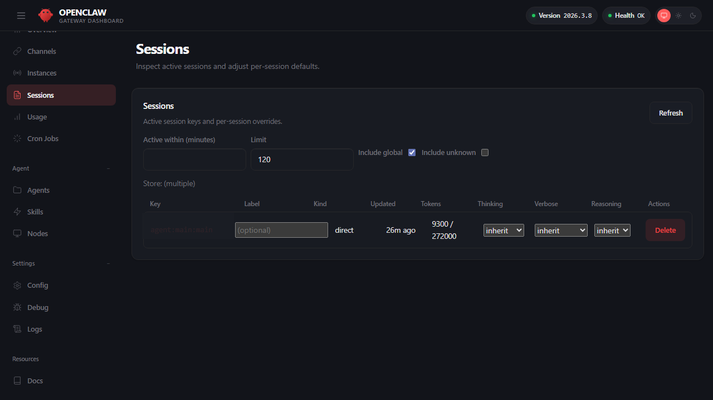
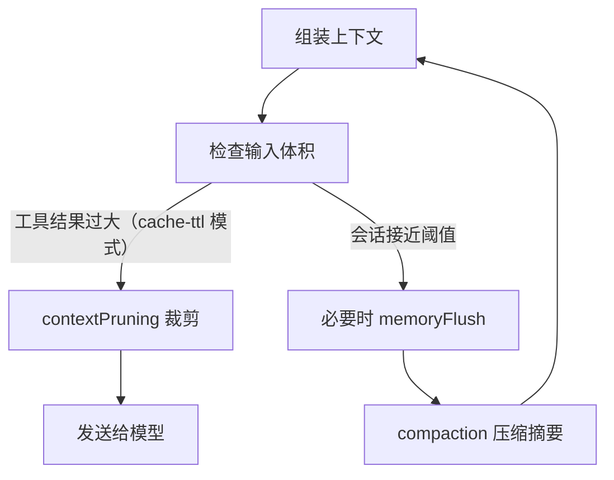

# 第六章 会话、上下文与记忆

到目前为止，你的 OpenClaw 能回答单轮问题了。但真正的对话是一系列交互，而不是孤立的问答：用户说“帮我分析这个表格”，然后跟进“对，按这个条件过滤一下”，再说“把结果发给我的经理”。这一系列交互需要：

- **会话**来追踪“谁在和谁说话”，确保小张和小李的对话不会混淆
- **上下文**来高效地把之前的信息（表格内容、用户偏好）提示给模型，而不是每次都从头开始
- **记忆**来让智能体记住重要信息，比如“小张喜欢按价格排序”“我们公司用 Slack 而不是 Teams”

这三样东西看似简单，但在生产环境中的设计有很多陷阱。比如：

- 同一个用户的多个独立任务应该隔离在不同会话，还是合并在一个大会话里？
- 一个月前的对话记录还需要保留吗？保留的话成本会不会爆炸？
- 上下文窗口只有 200k token，要怎样优先级排序才能既有信息又不超预算？

本章的主线就是回答这些问题：**会话用于定义状态归属，上下文用于在 Token 预算内组织可用信息，记忆用于跨会话长期沉淀事实与偏好**。三者共同决定系统的可复现性、可观测性与可运维性。通过本章，你将学会如何在有限的资源约束下，让智能体保持长期的、可预测的、可复现的对话能力。

## 学习目标

完成本章的阅读后，你将能够：
1. **设计会话**：为不同场景设计合理的会话隔离与标识策略。
2. **组织上下文**：按优先级分层注入信息，在 Token 预算约束下保持高信噪比。
3. **建立记忆**：设计长期记忆机制，让智能体记住重要信息并能可靠检索。
4. **管理成长**：通过裁剪与压缩，让长期会话保持高效且可回放。

## 1. 会话模型与状态持久化

本节介绍 OpenClaw 的会话（Session）管理机制，主要包含三个核心环节：会话作用域的划分、重置策略的设定，以及会话状态的持久化与排障。通过合理的配置，开发者能够将“串话”、“重复执行”和“状态恢复失败”等隐患，转化为可配置、可观测的工程实践。

### 1.1 会话作用域：先把会话键划清楚

OpenClaw 的会话行为由 `session` 相关配置共同决定，但实际排障时比字段名更重要的是：**一条消息最终会落到哪个 session key**。当前官方模型强调的是主会话、群聊/线程隔离、以及按渠道或账号拆分，而不是要求读者先死记某个单独的 `session.scope` 字段。

典型选择思路：

- 私聊与个人助理：优先确认 direct chat 是否折叠进主会话，还是按账号拆出独立会话。
- 群聊、线程、话题场景：优先确认是否按线程或话题隔离，避免不同讨论串共用上下文。
- 多渠道触达同一用户：只有在明确需要共享上下文时，才建立跨渠道的映射关系；默认应先保持隔离。

可以通过 Dashboard 的 **Control → Sessions** 页面直观管理活跃的会话及其 Token 消耗情况，如下图所示：



图 6-1：Sessions 会话管理与用量

在深入排障前，先把以下三个概念分清：

| 概念 | 当前应如何理解 |
| --- | --- |
| 主会话（main） | 私聊最常见的归并目标。很多部署会把 direct chat 折叠进 `agent:<agentId>:main` 这条主会话。 |
| 渠道/线程隔离 | 群聊、线程、话题和多账号接入通常会拆出独立 session key，避免上下文串线。 |
| 每会话覆盖 | Dashboard 的 Sessions 页优先展示活跃 session key、模型、上下文预算、Token 用量等信息；是否额外显示 `thinking`、`verbose`、`reasoning` 等覆盖项，应以当前版本 UI 为准。 |

当前更实用的验收方式不是背配置片段，而是回答下面三个问题：

1. 这条消息是落入主会话，还是被拆成独立的群聊/线程会话？
2. 这个 session key 是按渠道、账号、线程还是话题隔离出来的？
3. 当前会话是否叠加了额外的 per-session 覆盖项？

验收点：能解释一条消息最终会落到哪个 `sessionKey`，并且能在日志与会话存储中找到对应记录。

### 1.2 重置策略：将重置规则化，避免手动干预

长时间运行后，会话会积累历史与上下文偏差。官方支持按时间窗或空闲时长重置，也支持通过 `/new` 主动切断历史。实际字段名与层级会继续演进，因此本书更关注**重置策略本身**，而不是把某组字段名写成不可变接口。参考：[会话生命周期](https://docs.openclaw.ai/concepts/session#session-lifecycle)。

常见做法是：

- 为主会话设置更长的空闲重置窗口。
- 为群聊、线程或临时任务会话设置更短的重置窗口。
- 把 `/new` 作为人工切断历史的兜底手段。

验收点：在重置窗口内，会话能按预期断开历史，且不会误删正在执行的高风险作业。

### 1.3 消息队列模式概览

消息在会话中的排队方式会影响实际体验。当前 OpenClaw 配置中可接受的队列模式是 `steer`、`followup`、`collect` 和 `interrupt` 四种。核心区分在于：`collect` 合并消息后再处理；`steer` 把新消息注入正在运行的会话以调整方向；`followup` 把新消息作为后续任务排队；`interrupt` 则中断当前运行并处理最新输入。

配置示例：

```jsonc
{
  messages: {
    queue: {
      mode: "collect",
      debounceMs: 1000,
      cap: 20,
      drop: "summarize",
    },
  },
}
```

队列模式的完整参数、按渠道差异化配置与并发控制语义，详见第十章 10.3 节。

### 1.4 DM 会话隔离：安全边界速览

当 OpenClaw 面向多个不受信用户开放 DM 私聊时，需要理解隔离的两层含义：会话层面（Token 窗口、历史记录、上下文）**并不是默认按用户隔离**；当前默认更偏向“所有 DM 共享主会话以保持连续性”，只有在显式配置 `session.dmScope` 或 `session.identityLinks` 等策略后，才会按用户、渠道或跨渠道映射进行更细粒度拆分。DM pairing 只决定某个 sender 是否允许进入渠道，不会自动把该 sender 分配到独立会话。与此同时，宿主机资源（文件系统、Shell）仍是共享的，若工具策略未做沙箱限制，用户依然可能间接访问全局信息。

> **安全模式推荐做法**：面向多 untrusted 用户时，必须禁止 `group:runtime` 等高危工具，并将文件读写限制在独立沙箱内。详情参见 11.4 节防护栏与[官方 Security 文档](https://docs.openclaw.ai/gateway/security#dm-session-isolation-multi-user-mode)。

### 1.5 会话状态的双层存储机制

OpenClaw 的会话状态数据默认按智能体存储在 `~/.openclaw/agents/<agentId>/sessions/` 目录下。官方允许用 `session.store` 覆盖 `sessions.json` 文件路径；transcript 文件会放在该 store 文件的同级目录。根据底层设计，会话状态分为两层分开存储：

- **Session Store (`sessions.json`)**：主要存储会话的元数据（如 `sessionId`、Token 计数、压缩次数等）。这部分数据是轻量级的，即便由于意外被手动修改，也能被 Gateway 安全重建。
- **Transcript (`<sessionId>.jsonl`)**：追加式的对话历史记录（JSONL 格式）。包含了原始消息、工具调用记录以及压缩后的摘要内容。

配置示例：

```jsonc
{
  session: {
    store: "~/.openclaw/agents/{agentId}/sessions/sessions.json",
  },
}
```

建议：把 `session.store` 所在目录纳入备份与审计范围；但不要把敏感内容原样同步到不可信位置，必要时启用脱敏或最小化日志。

> [!TIP]
> **避坑：`/new` 命令会让你失去记忆吗？**
> 很多新手误以为执行 `/new` 命令会让当前的 AI 助手完全“失忆”。实际上，reset 会为同一个 `sessionKey` 创建新的 `sessionId`，让后续对话写入新的 transcript；如果启用了 bundled `session-memory` hook，它还会在 `/new` / `/reset` 时读取上一段近期消息，并默认写入 `<workspace>/memory/YYYY-MM-DD-HHMM.md`，只有启用 `llmSlug` 时才会生成描述性文件名。磁盘上持久化的记忆文件（如 `MEMORY.md` 或 `memory/*.md`）依然存活，是否被新会话加载取决于当前 memory / hook 配置。

### 1.6 排障案例：跨渠道串话的排查过程

**具体例子：用户 A 在 Telegram 私聊提问，却收到了另一条会话里的上下文**

某天运维收到反馈：“我问的是部署问题，但机器人回复了一段关于财务报表的内容。”排查过程如下：

1. **定位会话键**：在日志中筛选用户 A 的请求，确认它本应落到某条独立的 DM session key。
2. **检查归并规则**：发现当前部署把多个 direct chat 错误地折叠进同一条主会话，或把账号/渠道边界配得过宽，导致不同来源共享了历史。
3. **根因确认**：并不是模型“记错了”，而是 session key 归并规则过于宽泛，导致不同对话被折叠进了同一上下文。
4. **修复**：收紧 direct chat 的归并粒度，必要时按渠道、账号或线程拆分，并通过 `status --deep` 和 Sessions 页复核新的 session key 分布。

**排障教训**：大多数“串话”都不是推理问题，而是 session key 设计问题。先看 key 怎么生成，再看历史怎么压缩，效率最高。

### 1.7 排障命令：用状态与日志定位串话与重置异常

当出现“串话”“突然忘记上下文”“一直不重置”等问题，优先用系统自检与结构化日志定位。

```bash
# 查看整体状态（--deep 会做更深的探测）
openclaw status --deep

# 抓取最近日志快照，按需加上 --json 便于 jq 过滤
openclaw logs --limit 500 --json
```

操作示例：在日志中筛选同一会话键的事件流，确认是否出现“多个来源被错误折叠进同一会话”。字段名以实际日志为准。

```bash
openclaw logs --limit 500 --json | jq -r 'select(.type=="log") | (.raw | fromjson? // {}) | select((.session_id // .sessionKey // "")=="agent:main:whatsapp:dm:+15555550123") | [(.time // .ts), .traceId, .event, .from] | @tsv' | tail
```

如果直接读取 Gateway 的 `runtime.log` JSONL 文件，不要套用 CLI 的 `.type` 包装，也不要从 `.raw` 再解析；文件日志通常直接暴露 `session_id`、`traceId` 等顶层字段。

## 2. 上下文构建与窗口预算

本节讲“怎样把信息组装成模型能高效消费的输入”。上下文由工作区、技能、会话历史与工具回执共同组成；重点在注入顺序、预算分配与结构化回注——而裁剪（Pruning）和压缩（Compaction）的具体参数与机制统一收在 6.4 节。

### 2.1 上下文组成：四层信息源

在 OpenClaw 中，工作区是上下文的第一来源。官方记忆机制明确了几个关键文件的用途：系统提示、技能、工作区说明、长期记忆与每日日志。参考：[记忆](https://docs.openclaw.ai/concepts/memory)。

一次模型调用的上下文按注入顺序可分为四层：

| 层级 | 来源 | 典型体积 | 生命周期 |
|------|------|----------|----------|
| 1. 系统身份与项目上下文 | AGENTS.md、SOUL.md、TOOLS.md、IDENTITY.md、USER.md、HEARTBEAT.md、BOOTSTRAP.md、紧凑技能清单与运行时元数据 | 1-3K token | 按当前 gate 与会话状态注入 |
| 2. 工作区知识 | MEMORY.md、每日日志、检索/召回结果 | 0.5-2K token | 按会话、工具或 active-memory 条件动态注入 |
| 3. 对话历史 | 用户消息与助手回复 | 随会话增长 | 受裁剪与压缩控制 |
| 4. 工具回执 | 工具调用的原始返回 | 单次可达数十 K | 最先被裁剪的对象 |

上下文的工程挑战并不在“有没有信息”，而在“信息是否以可用形态被注入”。典型反模式是把大量工具原始输出长期堆在会话里，导致成本、时延与注意力稀释一起失控。

### 2.2 注入顺序与优先级原则

上下文组装遵循“身份先于知识，知识先于历史，历史先于工具”的优先级。当总预算紧张时，牺牲顺序为：旧工具回执 → 早期对话轮次 → 工作区知识 → 系统身份（不可牺牲）。

工程建议：

- **身份层锁定预算**：AGENTS.md / SOUL.md / TOOLS.md / IDENTITY.md / USER.md / HEARTBEAT.md / BOOTSTRAP.md、运行时元数据和紧凑技能清单的体积应在设计时控制；它们是否注入受当前 gate 与会话状态影响，完整 `SKILL.md` 指令按需读取，不属于默认固定上下文。
- **工具回注结构化**：把关键字段与摘要回注进会话，把全量输出落盘为证据引用。避免将整个 API 响应作为工具结果留在上下文中。
- **检索按需注入**：memory-core 默认更偏向注入工具使用指导；真实召回通常由模型调用 `memory_search` / `memory_get`，或由 active-memory 在满足条件时加入 preprompt。`memory_recall` 只属于 LanceDB 等替代记忆插件的工具面，不要假设每轮 assemble 都会自动执行一次 `memory_search`。

### 2.3 窗口预算的实践规则

Token 预算的分配没有万能公式，但以下经验值可作为起点：

- **系统身份**：预留 10-15% 的窗口给固定指令。
- **工作区知识**：预留 5-10%，按相关性排序后截断。
- **对话历史 + 工具回执**：剩余 75-85%，由裁剪（Pruning）和压缩（Compaction）机制动态管理。

当出现“工具已调用但模型忽略结果”时，优先检查工具回注是否被裁剪清除（参见 6.4.3），而不是直接修改提示词。

### 2.4 验证命令：确认上下文组装符合预期

操作示例：观察系统状态与模型侧错误分布，确认上下文组装是否引入异常。

```bash
openclaw status --deep
```

操作示例：统计裁剪相关事件或占位符出现频率，判断是否过度裁剪。日志字段以实际实现为准。

```bash
cat runtime.log | rg "Old tool result content cleared" | wc -l
```

### 2.5 可插拔上下文引擎

OpenClaw 的上下文管理已不再是硬编码的单一实现，而是抽象为**上下文引擎**（Context Engine）接口。内置的 `legacy` assemble 路径更接近 pass-through，compact 会委托内建摘要能力；session pruning 仍由会话维护逻辑运行，不应把它理解成 `legacy` 引擎专属能力。插件可以注册自定义引擎来替换上下文的组装、摄入、压缩和子智能体传递逻辑。

上下文引擎的生命周期方法包括：

- **assemble**：在每次模型调用前，将会话历史按 token 预算组装为有序消息列表。引擎可以在此阶段注入检索结果、调整消息顺序或插入系统提示词片段。
- **ingest / ingestBatch**：每轮对话后将新消息摄入引擎存储，供后续 assemble 使用。
- **compact**：当上下文接近预算时压缩历史，可实现摘要、合并或外部向量化等策略。
- **maintain**：在引导、成功轮次或压缩后执行转录维护，通过运行时提供的 `rewriteTranscriptEntries()` 安全地修改会话 DAG。
- **afterTurn**：轮次结束后的持久化和后台决策钩子。

通过 `plugins.slots.contextEngine` 配置项可以将自定义引擎绑定到指定的插件。当引擎声明 `ownsCompaction: true` 时，运行时会将压缩决策完全委托给该引擎，不再触发内置的自动压缩流程。这为需要深度定制上下文策略的场景（如 RAG 增强、长期记忆向量化、领域特定的摘要算法）提供了无侵入的扩展点。

## 3. 记忆机制：写入、检索与失效

本节以官方记忆系统为准讲清“记忆存在哪里、如何被检索、如何避免污染”。OpenClaw 的长期记忆以工作区文件为中心，并配套向量索引与内置记忆工具（例如 `memory_search`、`memory_get`）。掌握这些机制后，才能把记忆从“越积越乱”变成“可维护资产”。

### 3.1 双层记忆结构：MEMORY.md 与每日日志

根据官方设计，OpenClaw 的记忆基于“文件即真相（files are the source of truth）”的思想存储于工作区，主要由两层组成：

- **长期记忆（`MEMORY.md`）**：存放精选持久化偏好、配置决定与沉淀经验，放在工作区根目录。
  - **安全与隐私边界**：更稳妥的说法是，`MEMORY.md` 主要面向主会话/私密上下文使用；但它的自动注入范围会受具体 session 类型、bootstrap 缩减规则与版本实现影响，不应写成“绝不会进入群聊”这样的绝对规则。
- **每日日志（`memory/YYYY-MM-DD.md`）**：存放阶段性项目进展、当天的探讨细节。当前实现更接近“作为 startup context / bare `/new`、`/reset` 的首轮 prelude 读取最近 N 天”，默认常见值是“今天加昨天”，但这不是所有会话、所有轮次都无条件固定执行的规则。

这种设计的工程意义是：把“可复用事实”与“过程噪声”分开，让事后的检索与上下文注入保持清爽的信噪比。

### 3.2 写入规则与时机：仅记录有价值的事实

官方关于“何时写入记忆”的 **最佳实践** 建议如下：
- **写入 `MEMORY.md`**：记录高价值的用户偏好、重要决策或稳定状态配置。
- **写入 `memory/YYYY-MM-DD.md`**：记录频繁但阶段性的开发操作、项目调试进度的日常流水。
- **立即写入**：无论何时，当用户明确表达“记住这个（remember this）”时，第一时间将该条目持久化。

此外，记忆写入最常见的失败是 **将推测当作事实**。我们建议把写入规则收敛为以下硬约束：
- **稳定**：跨会话复用，短期不易过期。
- **可追溯**：必须来自工具明确回执或有显式确诊依据，而不是基于大模型的一句猜测推理。
- **可纠错**：允许随时撤销更新替换，拒绝将错误信息永久固化。

**实战防坑：坏记忆与好记忆**

- ❌ **坏记忆（模型的主观推测或短时情绪记录）**：“用户今天好像心情不好，且遇到了一个难以排查的 Node.js OOM BUG。”这种文字明天就失效了，且浪费 Token。
- ✅ **好记忆（客观、可追溯的事实与参数配置）**：“用户偏好默认在工作流脚本中使用 Python。当前生产 Kubernetes 集群为 `prod-cluster-us`，且需使用指定服务账号运维（来源：2 月 20 日会话）。”

操作示例：在 `MEMORY.md` 用结构化小节记录事实，并附带来源与更新时间；在 `memory/YYYY-MM-DD.md` 记录过程性日志。

```md
## 部署区域

- 结论：生产环境部署在 us-east-1
- 来源：变更单 CHG-12345
- 更新时间：YYYY-MM-DD
```

### 3.3 检索机制：混合向量搜索与精确读取

针对存储的内容（`MEMORY.md` 加上 `memory/**/*.md`）中的各类碎片，官方记忆工具提供了两种主流检索方式：

- **记忆搜索：`memory_search`**— 默认采用 **混合搜索算法（BM25 加上向量相似度）**，将数据切成小块（400 token/分块并设置小额重叠带）。返回带详细文件路径和行号的查询片段。
- **精确读取：`memory_get`** — 基于已有依据读取内容，精确命中特定行，防止信息污染。

**常见配置陷阱：embedding API 密钥依赖**

`memory_search` 的语义检索能力通常需要独立的 embedding 供应商（默认走 OpenAI，也可显式改为 Gemini、Voyage、Mistral、Bedrock、Ollama 或本地 GGUF 等）。即使主对话模型使用的是 Claude，也常常需要额外配置 embedding 能力。这里有一个**容易踩反的分叉**：**缺少 embedding 并不总是等于记忆搜索完全失效，但也不总是会静默降级**——`memory.search.provider` 未设置、写成 `"auto"`、显式写成 `"none"`（有意只用关键词）或 `"local"` 时，检索会退化到 lexical / keyword 路径，只是相关性与跨表述匹配明显下降；而一旦**显式指定**了某个远端 provider（如 `openai`、`gemini`、`ollama`）却在请求时不可用，`memory_search` 会直接报告记忆不可用（fail closed），而不是悄悄给你一份关键词结果。请在 `openclaw.json` 中确认 embedding 相关配置是否就绪，并通过日志或 `doctor` 观察索引与 provider 状态。

**可调的是结果闸门，不是混合权重**

记忆搜索的配置面统一收在顶层 `memory.search`（按智能体覆盖走 `agents.entries.*.memory.search`）。混合检索本身常开，向量与关键词的权重、recency 衰减半衰期与 MMR 多样性系数都是内建的固定实现，**没有对外暴露的权重旋钮**；当前 `memory.search.query` 下可调的只有两项：

```jsonc
{
  memory: {
    search: {
      query: {
        maxResults: 6,    // 注入前返回的最大命中数
        minScore: 0.35    // 命中所需的最低相关性分数
      }
    }
  }
}
```

想收紧噪音就压 `maxResults` 或抬 `minScore`，而不是去找“把向量权重调高一点”的字段。

操作要点：检索结果永远要遵循少而精的逻辑。把大量候选项一股脑子全灌入上下文，只会起到让模型“盲目重视全体噪音”的副作用。

### 3.4 索引构建管线：从文件保存到可检索

混合检索的前提是索引已就绪。OpenClaw 的索引管线在文件落盘后自动运行，无需手动触发。从使用者角度只需知道两件事：

- **延迟约 2 秒**：文件保存后系统自动重建索引，期间有防抖机制避免高频写入导致重复构建。
- **验收方法**：修改任意记忆文件后，等待约 2 秒，用 `memory_search` 检索刚写入的关键词。如果能命中则索引管线正常工作；如果结果只有关键词命中、没有明显语义召回，再优先检查 embedding provider 配置（见 6.3.3）。

> [!NOTE]
> **可选深潜：索引管线内部实现**
>
> 对于需要排查“改了文件却检索不到”问题的开发者，以下是管线的内部流程：
>
> 1. **监听与防抖**：系统使用 Chokidar 对 `MEMORY.md` 和 `memory/*.md` 实时监听，设置 1.5 秒防抖延迟——文件连续变化时，只有最后一次保存后 1.5 秒静默期过后才启动索引。
> 2. **分块策略**：文件内容按约 400 token 为单位分块，相邻块保留 80 token 重叠区域，防止关键语义被切断。
> 3. **向量生成与存储**：每个文本块送入 embedding 模型（默认 `text-embedding-3-small`，1536 维），结果存入本地 SQLite 数据库。当前核心表包括 `files`、`chunks`、`chunks_fts`，以及可选的 `embedding_cache`；embedding 数据保存在 `chunks.embedding` 等字段中。

### 3.5 失效与清理：让记忆有生命周期

长期系统一定会遇到“事实过期”。建议为每条记忆补齐“来源/更新时间/有效期”，并定期做一次复核：

- 过期条目标注失效或迁移到每日日志。
- 新事实覆盖旧事实时保留变更链。
- 对冲突事实显式标注冲突点，避免模型自行选择。

> [!TIP]
> 踩坑实录：记忆搜索“语义检索退化”之谜
>
> 配好了 Anthropic API Key 就认为配置完毕，却发现 `memory_search` 的效果一直很差。调试后才发现：记忆搜索的高质量语义检索通常需要**独立的 embedding 能力**（OpenAI、Gemini、Voyage 或本地 provider），与主对话模型的密钥相独立。没有 embedding 时，未指定 provider 的配置往往会退化为关键词检索而不是完全报错；但如果你**显式**指定了一个远端 provider 而它不可用，记忆搜索会直接判为不可用，好让坏配置暴露出来。建议配置后用 `openclaw doctor` 或相关状态命令验证 embedding provider 状态。

## 4. 压缩与裁剪：折叠与丢弃策略

本节是长会话治理的参数与机制的唯一参考来源。6.2 节讲“怎样把信息组装进上下文”，本节讲“当上下文涨到放不下时怎么办”。两套可配置机制分别是：工具结果裁剪（Pruning，由 `agents.defaults.contextPruning` 控制，裁掉旧工具结果以降低模型输入体积）与会话压缩（Compaction，由 `agents.defaults.compaction` 控制，在会话接近阈值时生成摘要并在必要时先刷新长期记忆）。两者配合，才能在长会话中同时保证可用性与可回放性。

### 4.1 核心概念辨析：压缩 vs 裁剪

在处理上下文爆炸的问题上，新手很容易混淆 OpenClaw 设计上的这两套方案。它们的本质差异体现在“是否被持久化”与“生命周期触点”上：

- **上下文裁剪（Pruning，由 `contextPruning` 控制）**：
  发生在 **大语言模型调用前**，系统为了降低单次请求负荷、减轻算力或缓存失效而临时舍弃极度老旧的工具执行结果。它 **不会修改任何磁盘历史文件**，仅作用于内存数据结构。
- **会话压缩（Compaction，由 `compaction` 控制）**：
  发生在 **会话接近承载容积上限前**。把前面冗长繁杂的对话内容折叠成精华的概要（摘要），并 **持久化回写到 `JSONL` 追踪日志中**，属于物理折叠以使得新数据继续流畅滚动。

官方相关参考资料解释：
- 工具结果裁剪：[会话裁剪与 contextPruning 配置](https://docs.openclaw.ai/concepts/session-pruning)
- 压缩概念：[Compaction](https://docs.openclaw.ai/concepts/compaction)

> [!IMPORTANT]
> 上下文裁剪（Pruning）目前主要围绕 `mode: "cache-ttl"` 工作，并且在 Anthropic 路径上通常最先体现出价值；但它并不等于“只对 Anthropic 生效”。当前配置面允许在非 Anthropic 提供方上显式启用 `contextPruning`。会话压缩（Compaction）则是更通用的长会话控制机制。两者虽然互补，但互不依赖。

### 4.2 触发流程：先裁剪工具，再压缩会话

下面展示一个典型的触发顺序。



图 6-2：裁剪与压缩的典型触发顺序

### 4.3 工具结果裁剪：参数与内部机制

了解裁剪的主要参数有助于在生产环境中精细调优——比如调整保护多少条最近的助手回复、在什么体积阈值触发裁剪等。`agents.defaults.contextPruning` 的主要默认参数：

| 参数 | 默认值 | 说明 |
|------|--------|------|
| `mode` | `"cache-ttl"` | 裁剪模式 |
| `ttl` | `"5m"` | 缓存 TTL |
| `tools` | `{allow, deny}` | 按工具名限定裁剪范围（是 allow/deny 两个列表，不是逐工具覆盖表） |
| `hardClear.enabled` | `true` | 是否启用硬清除 |
| `hardClear.placeholder` | `"[Old tool result content cleared]"` | 硬清除后回填的占位文本 |

裁剪分**两阶段**执行：第一阶段（softTrim）把超长工具结果截为“头 1500 字符 + `...` + 尾 1500 字符”；第二阶段（hardClear）用占位符 `[Old tool result content cleared]` 替换整个结果。

**三个关键的安全约束**（源码中的硬编码规则）：

- **图片块先替换再继续裁剪**：包含图片块的工具结果不会原样保留；当前实现会先把图片替换成占位文本，然后该消息仍可能继续进入 soft-trim 或 hard-clear。
- **引导消息保护**：第一条用户消息之前的所有内容（SOUL.md、USER.md 等身份读取）不参与裁剪。
- **工具名过滤**：通过 `tools.deny` 的 glob 模式排除不参与裁剪的工具结果；`tools.allow` 是“允许被裁剪”的 allowlist，不是排除列表。

**Token 估算**：源码使用 `CHARS_PER_TOKEN_ESTIMATE = 4` 作为基础估算（英文约 4 字符 ≈ 1 token），并通过 CJK-aware 估算器把中文等非拉丁文本按更接近 1 字符 ≈ 1 token 的方式放大后再计算；图片按 `IMAGE_CHAR_ESTIMATE = 8000` 字符计入预算。这意味着一张图片约占 2000 token 的预算。

上述几项在 v2026.8.1 的配置面收敛中已退役（`keepLastAssistants`、`softTrimRatio`、`softTrim.*` 等写进配置会被 `config validate` 拒绝），相应行为改为内置固定：保护最近若干条助手回复、软裁剪只作用于超过约 4,000 字符的工具结果并保留头尾各约 1,500 字符、硬清除的最小工具结果约 50,000 字符。这些数值仍有助于理解机制，但不再是可调项。

验收点：

- 长会话输入体积稳定，成本与时延不随时间线性上升。
- 裁剪不会破坏关键证据段，回放一致性可接受。

### 4.4 压缩中的标识符保护与安全过滤

压缩（Compaction）的本质是让 LLM 对历史对话生成摘要。但 LLM 在总结时存在一个危险倾向：**无意中篡改不透明标识符**——把 UUID 缩短、把 API Key 部分省略、把 URL 参数丢弃。这在后续工具调用中会导致难以排查的隐藏错误。

源码（`compaction.ts`）中内建了 **标识符保护指令**（`IDENTIFIER_PRESERVATION_INSTRUCTIONS`），在每次压缩摘要请求中注入：

> “Preserve opaque identifiers exactly as written, including UUIDs, hashes, IDs, hostnames, IPs, ports, URLs, and file names.”

该指令有三种策略模式：`“strict”`（默认，始终注入）、`“off”`（不注入）、`“custom”`（使用自定义指令）。

**分批摘要策略**：当对话过长无法一次性摘要时，系统通过 `splitMessagesByTokenShare()` 将消息按 token 占比均匀切分为 N 段（默认 2 段），对每段独立摘要后再合并。合并阶段有专门的指令要求保留活跃任务状态、批处理进度（如“5/17 已完成”）、用户最后的请求、决策理由和待办事项，并优先保留近期上下文。

**工具结果安全过滤**：在压缩前，`stripToolResultDetails()` 会剥离所有工具结果中的 `details` 字段。源码注释明确指出：“toolResult.details can contain untrusted/verbose payloads; never include in LLM-facing compaction.” 这防止了不可信的工具输出（如 stderr、HTTP 头）进入摘要提示词，既节省 token 又避免潜在的提示注入。

**超大消息降级**：如果单条消息超过上下文窗口的 50%（`isOversizedForSummary`），会被排除在摘要之外并插入说明（如 `[Large assistant (~45K tokens) omitted from summary]`）。如果摘要整体失败，系统会逐步降级：先排除超大消息重试，最后回退到纯文本记录。

### 4.5 预压缩记忆刷新机制

OpenClaw 在执行压缩之前，会先尝试让智能体主动保存关键信息。这里的 `softThresholdTokens` 更准确地说是“提前量”而不是单独那条阈值线：实际触发点取决于 `contextWindowTokens - effectiveReserveTokens - softThresholdTokens`，其中 `effectiveReserveTokens` 可能被 `reserveTokensFloor` 抬高。当系统判断上下文逼近这一触发线时，会在正式压缩前插入一个**后台智能体回合**，让模型有机会将重要内容归档到持久存储。

这个预压缩流程分六步执行：
1. **持续监控**：实时追踪当前会话的 token 消耗量。
2. **触发软警报**：当剩余预算逼近内置预留额度与 `softThresholdTokens` 共同定义的提前量时，启动预压缩流程（预留额度已内置固定，`reserveTokensFloor` 已退役）。
3. **注入指令**：向模型发送“上下文即将被压缩，请保存关键信息”的内部指令。
4. **归档落盘**：智能体执行记忆存储动作，将关键上下文写入持久文件（如 `memory/YYYY-MM-DD.md`）。
5. **后台确认**：智能体回复 `NO_REPLY` 特征字符串收尾，该回复不会显示给用户，整个过程对前端透明。
6. **正式压缩**：记忆安全落盘后，系统再执行常规的压缩与折叠清理。

预压缩 memory flush 默认启用。只有需要关闭、调整 `softThresholdTokens` / `prompt`，或指定 `memoryFlush.model` 时才需要显式配置：
```jsonc
{
  agents: {
    defaults: {
      compaction: {
        // 注意：reserveTokensFloor 与 memoryFlush.prompt 已在 v2026.8.1 退役，
        // 写进配置会被 config validate 拒绝；预留额度与刷写提示词均已内置固定
        memoryFlush: {
          // 默认启用；需要关闭时才设置 enabled: false
          softThresholdTokens: 4000 // 提示提前静默执行的量级线
        }
      }
    }
  }
}
```

注意：若全局安全设计对工作目录权限施加限制（设为不可写，如 `workspaceAccess: "ro"` 或 `"none"`），这套智能的记忆刷新流程也会自动跳过。

### 4.6 排障命令：优先查看状态，其次查看日志与裁剪事件

操作示例：先用状态命令确认系统是否处于可用状态，再用日志观察裁剪与压缩是否在高峰期被频繁触发。

```bash
openclaw status --deep
openclaw logs --limit 500 --json
```

操作示例：统计工具结果裁剪触发是否过于频繁。日志字段以实际实现为准。

```bash
cat runtime.log | rg "Tool result trimmed" | wc -l
```
