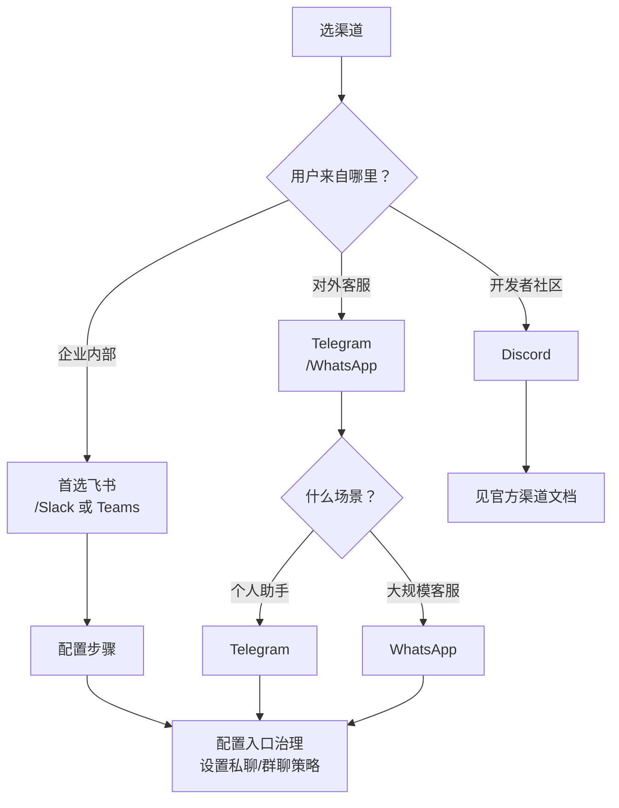
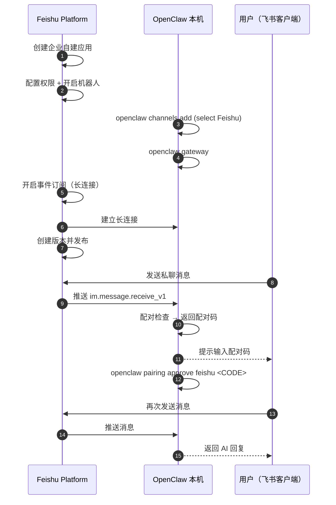
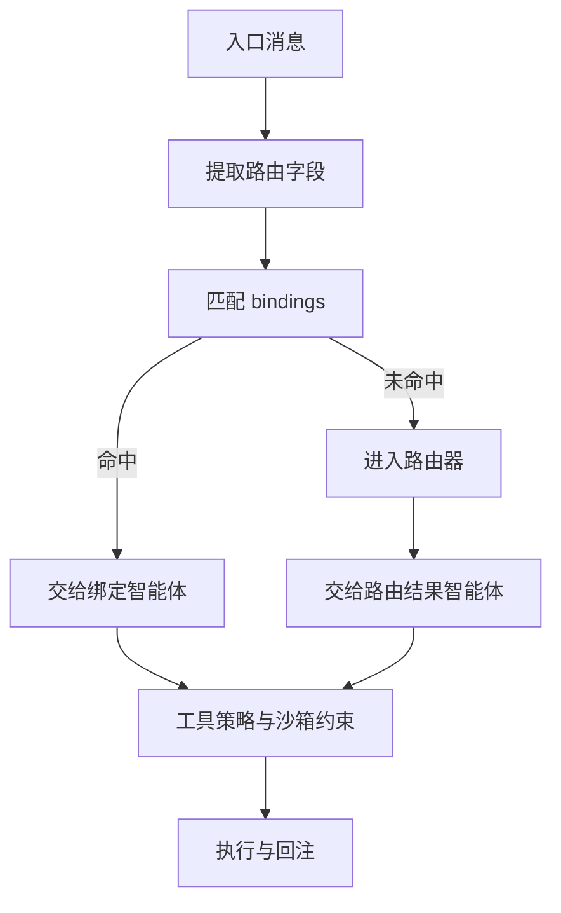
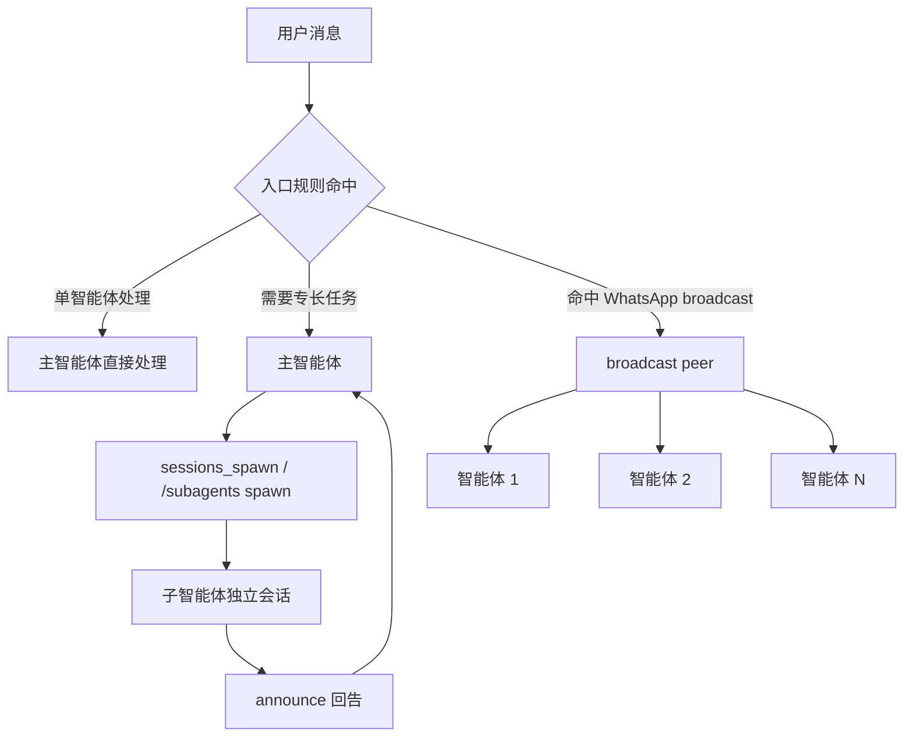

# 第七章 多渠道分发与多智能体协作

前几章，你已经把 OpenClaw 装在了本地，学会了在 Dashboard 对话框里聊天。现在，你要把它扩展到真实的生产环境——让它在 Telegram、WhatsApp、飞书企业群里工作，或者分拆成多个专业智能体各司其职。

当入口从单渠道扩展到多渠道、多群与多对端后，系统最常见的问题不是模型能力不足，而是边界不清：谁负责处理、哪些入口允许触发、哪些能力属于高风险、出现问题如何回放定位。这就是为什么本章高度关注“治理”而不只是“集成”。

本章的主线是把多渠道与多智能体做成可管理系统：

- 渠道策略负责收敛触发面（哪些人、哪些群可以触发）。
- 路由绑定负责收敛所有权（哪个智能体接管哪个入口）。
- 工具策略与沙箱约束负责收敛可执行边界（什么操作允许做）。

**学完这章你能做什么**

- 自信地把 OpenClaw 接入 Telegram、WhatsApp 或飞书，而不只是“跟着文档复制粘贴”
- 设计出符合自己业务的渠道隔离策略（比如客服和内部运维分开走不同账号）
- 设置多个智能体，每个专注于不同的领域或用户群，通过路由框架自动分发请求

## 1. 渠道接入与入口治理

当你的 OpenClaw 从本地开发扩展到真实生产环境时，首先面临的决策是：该接入哪些渠道？是 Telegram 的私聊机器人、WhatsApp 的 24 小时客服、还是飞书企业群助手？不同渠道有着完全不同的用户心理、安全风险与交互模式。本节会帮你理清这些选择。

**渠道选择决策树**

下面的决策树可以快速帮你判断优先级：



本节以 Telegram 与 WhatsApp 为例，走通从凭据配置到消息收发的接入思路，然后讲解多账号隔离策略。需要特别说明的是：**本次 live 审计实例只实际验证了 Telegram**；WhatsApp 部分保留为基于官方文档整理的接入说明，使用前应在你自己的环境里再次复验。飞书接入因为涉及开放平台授权，单独放在 7.2。

### 1.1 入口治理的第一原则：私聊与群聊分开

不管接哪个渠道，入口治理都从两个策略字段开始：`dmPolicy`（私聊）和 `groupPolicy`（群聊）。两者独立配置，互不干扰。

建议以“谨慎起步”为默认：群聊只在被 @ 时响应，私聊收敛到允许列表或配对审批。

### 1.2 Telegram：机器人令牌与私聊、群聊策略

**为什么选 Telegram**

Telegram 最适合两类场景：（1）个人开发者或小团队的私聊助手——既不需要企业级权限流程，也不受防火墙限制；（2）开源社区的技术讨论组——API 开放，易于二次开发，用户群体对机器人友好。如果你的场景不是这两类，就应该直接跳过 Telegram，选更适合的渠道。

**接入方式**

Telegram 渠道基于机器人令牌接入（对应 [Telegram Bot API](https://core.telegram.org/bots/api)；Bot API changelog 已在 2026-08-24 发布 **10.3**；`sendMessageDraft` 最早在 9.3 加入，9.5 于 2026-03-01 放开所有 bot 使用，10.0 允许传空文本）。`dmPolicy` 支持 `pairing`、`allowlist`、`open`、`disabled` 四种选项，建议以白名单和提及门控作为安全起步。详见 OpenClaw 官方文档：[https://docs.openclaw.ai/channels/telegram](https://docs.openclaw.ai/channels/telegram)。

示例配置：

```jsonc
{
  channels: {
    telegram: {
      botToken: '${TELEGRAM_BOT_TOKEN}',
      dmPolicy: 'allowlist',
      allowFrom: ['tg:987654321'],
      groupPolicy: 'allowlist',
      groupAllowFrom: ['tg:987654321'],
      groups: { '*': { requireMention: true } },
    },
  },
  messages: {
    groupChat: {
      mentionPatterns: ['@openclaw'],
    },
  },
}
```

### 1.3 WhatsApp：优先收敛触发面

**为什么选 WhatsApp**

WhatsApp 拥有庞大的全球用户基数，特别是在欧洲、拉丁美洲、亚洲市场。选择 WhatsApp 的人通常有一个明确的商业目标：大规模客服或 B2C 业务助手。相比 Telegram 需要用户主动查阅，WhatsApp 用户对消息提醒的反应更敏感，所以适合对响应时间有要求的场景。但同时，WhatsApp 的触发面更大，风险也更高，所以入口治理必须更严格。

**接入方式**

WhatsApp 渠道运行在自身账号上，触发面天然更大。以下内容以官方文档和常见部署方式为依据整理，**并非本次审计实例的 live 复验结果**。官方推荐尽量使用专用号码；个人号码加 `selfChatMode: true` 是受支持的回退模式：

- **专用号码（推荐）**：为 OpenClaw 使用独立的 WhatsApp 身份，DM 策略更清晰。
- **个人号码回退**：将 `selfChatMode` 设为 `true`，并将个人号码加入 `allowFrom`。

详见官方文档：[https://docs.openclaw.ai/channels/whatsapp](https://docs.openclaw.ai/channels/whatsapp)。

示例配置：

```jsonc
{
  channels: {
    whatsapp: {
      dmPolicy: 'pairing',
      allowFrom: ['+15555550123'],
      groupPolicy: 'allowlist',
      groupAllowFrom: ['+15555550123'],
      groups: { '*': { requireMention: true } },
    },
  },
  messages: {
    groupChat: {
      mentionPatterns: ['@openclaw'],
    },
  },
}
```

配对流程建议纳入运维验收：

```bash
openclaw pairing list whatsapp
openclaw pairing approve whatsapp <CODE> --notify
```

### 1.4 多账号隔离：把外部入口与内部入口拆开

多账号的价值不在“多开”，而在隔离：把外部支持入口与内部运维入口拆到不同账号，让不同入口具备不同的门控策略。WhatsApp 支持通过 `accounts` 字段提供多账号配置：

```jsonc
{
  channels: {
    whatsapp: {
      accounts: {
        support: {
          dmPolicy: 'pairing',
          allowFrom: ['+15555550123'],
          groupPolicy: 'allowlist',
          groupAllowFrom: ['+15555550123'],
          groups: { '*': { requireMention: true } },
        },
        ops: {
          dmPolicy: 'allowlist',
          allowFrom: ['+15555550999'],
          groupPolicy: 'allowlist',
          groupAllowFrom: ['+15555550999'],
          groups: { '*': { requireMention: true } },
        },
      },
    },
  },
}
```

登录不同账号：

```bash
openclaw channels login --channel whatsapp --account support
```

多账号落地后，建议在日志与告警中把账号标识作为一等维度，便于审计与责任归因。

### 1.5 验收与排障：先探针后回放

渠道相关问题的排障顺序建议固定为三步：

1. **自检与状态**：用 `doctor` 与 `status --deep` 确认依赖与配置被加载。
2. **渠道检查**：用 `channels capabilities` 确认当前渠道能力与配置入口正常。
3. **链路回放**：用结构化日志按 `traceId` 回放一次请求链路。

```bash
openclaw doctor
openclaw status --deep
openclaw channels capabilities
openclaw logs --follow --json
```

常见问题速查：
- **群聊不触发**：优先检查 `groups.*.requireMention` 与 `messages.groupChat.mentionPatterns`。
- **越权执行**：优先检查工具策略是否默认拒绝高风险工具组。
- **群聊误触发**：检查提及门控与允许列表。

对于管理员账号、关键群或固定业务号码，建议进一步用路由绑定固定接管——这是下一节 7.3 路由基础 的主题。

## 2. 飞书专项接入指南：让它能在群里陪你聊天

接通飞书不仅需要配置 OpenClaw 侧，还需要在飞书开放平台完成一系列授权。很多新手在第一步“长连接订阅”就会失败。本节将详细梳理一条尽量稳妥的“端到端”飞书接入流。

> [!NOTE]
> 本节主要依据当前官方接入文档与经验流程整理。**本次 live 审计实例并未实际配置飞书渠道**，因此这里的页面顺序、字段名和平台按钮文案仍应在你自己的飞书环境中复验。

### 2.1 整体时序与防坑预警

提示：飞书接入会引入外部平台变量。若你仍在搭建本地基准环境，建议先完成第三章的基础配置并稳定复验后，再开始本节操作。

常见失败点速查（建议先过一遍再动手）：

- 长连接订阅失败：优先确认已经先在 OpenClaw 里运行 `openclaw channels add` 并选择 Feishu 完成渠道绑定，同时让 Gateway 处于运行态；否则飞书后台的长连接配置可能保存失败。
- 消息不触发：先检查群聊是否启用、是否要求 @、群是否在允许列表；再回看日志是否命中门控规则。
- 私聊要先配对：若启用了配对策略，首次私聊通常会先得到配对码，批准后才会进入正常对话。

不管你接的是哪家平台，基本都遵循同一条流水线，但 **飞书有个极为容易出错的步骤顺序**：

1. ✅ **飞书侧**：创建应用 -> 配置权限 -> 开启机器人能力
2. ✅ **OpenClaw 侧**：运行 `openclaw channels add`，在向导中选择 Feishu 并填写 App ID/App Secret
3. ✅ **OpenClaw 侧**：启动 Gateway（`openclaw gateway` 或 `openclaw gateway status` 确认已运行）
4. ✅ **飞书侧**：回到平台开启“事件订阅（长连接）”并添加事件
5. ✅ **飞书侧**：创建版本并发布应用

如下的时序图展示了飞书接入的端到端交互流程：



图 7-1：飞书接入的端到端交互流程

**血的教训**：最容易踩坑的不是“先发布还是先订阅”，而是**在 OpenClaw 还没配置 Feishu 渠道、Gateway 也没跑起来时，就去飞书后台开启长连接**。这时“事件订阅”页往往会直接保存失败。发布应用仍然是上线前的必做步骤，但它不是长连接保存失败的唯一前置条件。

### 2.2 在飞书开放平台配置应用

1. 打开[飞书开放平台开发者后台](https://open.feishu.cn/app)，创建企业自建应用，在“凭证与基础信息”页获取 `App ID` 和 `App Secret`。
2. **权限配置（批量导入推荐）**：点击左侧“权限管理属性”，选择“批量导入权限”，粘贴以下内容避免遗漏：

```json
{
  "scopes": {
    "tenant": [
      "aily:file:read",
      "aily:file:write",
      "application:application.app_message_stats.overview:readonly",
      "application:application:self_manage",
      "application:bot.menu:write",
      "cardkit:card:read",
      "cardkit:card:write",
      "contact:user.employee_id:readonly",
      "corehr:file:download",
      "event:ip_list",
      "im:chat.access_event.bot_p2p_chat:read",
      "im:chat.members:bot_access",
      "im:message",
      "im:message.group_at_msg:readonly",
      "im:message.p2p_msg:readonly",
      "im:message:readonly",
      "im:message:send_as_bot",
      "im:resource"
    ],
    "user": [
      "aily:file:read",
      "aily:file:write",
      "im:chat.access_event.bot_p2p_chat:read"
    ]
  }
}
```

这组 scope 与当前官方 Feishu/Lark 页面中的批量导入示例保持一致，覆盖文本消息、群聊、卡片、资源和部分文件/组织信息能力。若你的机器人只做文本私聊或群聊回复，应在飞书租户审批前按实际功能收窄可选文件、文档、卡片和组织类权限；后续启用文件、Drive 评论或知识库工作流时再补充申请。

3. 在“应用能力”中找到 **机器人** 卡片并开启。
4. 先不要急着发布，继续完成 OpenClaw 侧的渠道配置与长连接订阅；版本创建与发布放到 7.2.4「开启事件订阅并在飞书进行第一次对话」 一并完成。

### 2.3 在 OpenClaw 侧完成绑定

当前 Feishu / Lark 渠道在新版 OpenClaw 中随主包内置；较旧构建或自定义安装如果提示缺少 Feishu 插件，再手动安装 `@openclaw/feishu`。首选路径是使用渠道添加向导，在向导中选择 Feishu 并填写 App ID/App Secret；本地构建若仍暴露 `channels login --channel feishu`，可把它视为兼容入口，而不是首选路径：

```bash
# 仅在旧构建或自定义安装提示缺少 Feishu 插件时执行
openclaw plugins install @openclaw/feishu

openclaw channels add
```

> [!NOTE]
> **诊断入口**：如果不确定插件是否已安装，用 `openclaw doctor --fix` 或 `openclaw plugins list` 检查；不要假设普通安装包已经内置 Feishu 运行时代码。

- 首选扫码流程完成授权和配置。
- 若向导提示无法扫码创建，再输入收集好的 `App ID` 与 `App Secret`。
- 对国内版选择 `domain: "feishu"`；全球版 Lark 选择 `domain: "lark"`。自定义端点应使用完整 `https://...` URI，不要写裸域名。
- 建议初次接入时：**群聊先选 disabled，后续配置通了再更改**。

配置完毕后查看连通性：

```bash
openclaw channels list
openclaw gateway status
```

### 2.4 开启事件订阅并在飞书进行第一次对话

1. 先在终端启动网关：`openclaw gateway`。
2. 回到飞书开发者后台的“事件与回调”页面，**开启长连接**，并添加事件 `im.message.receive_v1`（接收消息）。
3. 确认事件订阅保存成功后，再到“版本管理与发布”里创建版本并发布应用。
4. 去飞书电脑端搜索你的机器人，发送一句私聊“你好”。
5. 如果你启用了配对策略，此时会收到一个配对码（Pairing code）。复制这段码并在终端执行 `openclaw pairing approve feishu <CODE>` 完成批准。
6. 如果仍然没有回复，优先检查 `openclaw gateway status` 和 `openclaw logs --follow`，确认长连接已建立、事件已进入网关。

## 3. 路由基础：从单智能体到多智能体

路由解决的不是“模型能不能做”，而是“这条消息应该交给哪个智能体接管，以及它被允许做什么”。本节以 openclaw 的多智能体路由为主线，说明路由决策链、绑定规则的优先级、以及如何用可观测手段把路由做成可回放、可审计、可排障的工程能力。

### 3.1 路由要解决的核心问题：所有权、权限与状态隔离

在多智能体系统里，一条消息进入后必须尽快确定三件事：由谁处理（所有权）、能做什么（工具与权限）、状态写到哪里（会话与记忆）。如果不把这三件事拆清楚，就会出现两类常见故障：

1. 责任不清：多个智能体同时响应或互相覆盖状态，导致输出不一致。
2. 越权执行：低可信入口触发高风险工具，故障从“答错一句话”升级为“写错一条数据”。

openclaw 通过多智能体路由与路由绑定机制实现“由谁接管”的确定性路由，并把“能做什么”交给工具策略与沙箱约束去兜底。路由层最重要的目标是把消息的处理权稳定地收敛到一个确定的智能体上，然后让后续执行落在可控边界内。WhatsApp 的广播组是一个明确例外：当来源对端配置了 `broadcast[peerId]` 时，消息在通过入口门控后会 fan-out 给配置的多个 agent，并跳过单一绑定/默认 agent 路径。相关概念与配置细节见官方文档的多智能体路由与绑定说明：[多智能体概念](https://docs.openclaw.ai/concepts/multi-agent)、[路由规则](https://docs.openclaw.ai/channels/channel-routing)。

### 3.2 决策链：先路由绑定后路由，路由绑定命中时直接接管

openclaw 的典型决策链可以概括为“先匹配路由绑定，再进入路由器”。路由绑定用于把某些来源的消息稳定地交给指定智能体处理，从而减少模型分类的不确定性。官方文档明确了路由绑定的优先级与用途，并给出了基于 `channel`、`accountId`、`peer`（含 `kind` 与 `id`）等字段的匹配方式。路由绑定命中时，系统会直接将消息交给绑定的智能体处理。[多智能体概念](https://docs.openclaw.ai/concepts/multi-agent)

为了把这条链路讲清楚，下面用一个简化流程图刻画路由的关键分叉点。



图 7-2：多智能体路由中“绑定优先”的关键分叉

工程上建议把高风险或高确定性的入口优先落到绑定里，把需要意图理解的入口交给路由器。

### 3.3 路由绑定落地：用最小规则把高风险入口固定到受控智能体

路由绑定的好处是把“路由正确性”从概率问题变成规则问题。官方文档的配置结构中，`bindings` 是**顶层数组**（与 `agents`、`channels` 同级），每条路由绑定通过 `agentId` 指向目标智能体，通过 `match` 对象描述匹配条件。下面的示例展示了“渠道与对端绑定到特定智能体”的配置形态。在实际工程中，建议把涉及写入或外部副作用的能力都集中在少量受控智能体内，然后只给这些智能体配置严格的工具允许列表，工具策略的写法详见 5.2 工具策略：允许、拒绝与分层策略。

```jsonc
{
  // bindings 是顶层数组，不嵌套在 agents 内
  bindings: [
    {
      agentId: "work",
      match: {
        channel: "whatsapp",
        peer: { kind: "direct", id: "+15551234567" },
      },
    },
    {
      agentId: "work",
      match: {
        channel: "telegram",
        peer: { kind: "direct", id: "987654321" },
      },
    },
  ],

  agents: {
    entries: {
      work: {
        name: "工作助手",
        workspace: "~/.openclaw/workspace-work",
        agentDir: "~/.openclaw/agents/work/agent",
      },
    },
  },
}
```

> [!WARNING]
> `bindings` 必须写在配置文件的**顶层**，不能嵌套在 `agents.entries` 的某个智能体对象内。嵌套写法不会被识别，导致路由绑定静默失效。

当系统规模增长到“多账号、多群、多入口”时，建议把路由绑定策略拆成两层：

1. 入口层路由绑定：按 `channel`、`peer`、`accountId` 绑定到入口智能体，负责治理触发规则与上下文预处理。
2. 任务层路由：入口智能体再将任务分发给领域智能体，或使用子智能体并行处理。子智能体机制见 [https://docs.openclaw.ai/tools/subagents](https://docs.openclaw.ai/tools/subagents)。

验证路由绑定是否生效时，不建议靠“发消息看看”。更可靠的做法是先用命令查看路由绑定清单，再用探测命令确认渠道状态：

```bash
openclaw agents bindings
openclaw channels capabilities
```

#### 完整多智能体路由配置示例

下面展示一个真实场景配置：一个团队同时使用 Telegram 和 WhatsApp，需要根据消息来源与风险等级将任务路由到不同智能体。

**场景描述**
- `assistant`：默认助手，处理日常问题，无外部工具权限
- `devops`：运维智能体，绑定特定 Telegram 群组（DevOps-team），拥有 `exec`（执行命令）和 `ssh`（远程连接）工具
- `writer`：写作智能体，绑定特定 WhatsApp 对端（产品编辑），拥有 `document`（文档编辑）工具，无执行权

**完整配置**

```jsonc
{
  agents: {
    entries: {
      assistant: {
        default: true,                    // 标记为默认智能体
        name: "默认助手",
        workspace: "~/.openclaw/workspace-assistant",
        agentDir: "~/.openclaw/agents/assistant/agent",
        model: "anthropic/claude-sonnet-4-6",
        tools: { allow: ["group:fs", "group:web"], deny: ["group:runtime"] },
      },
      devops: {
        name: "运维智能体",
        workspace: "~/.openclaw/workspace-devops",
        agentDir: "~/.openclaw/agents/devops/agent",
        model: "anthropic/claude-sonnet-4-6",
        tools: { allow: ["group:runtime", "group:fs", "group:web"] },
        sandbox: { mode: "all", scope: "agent" },
      },
      writer: {
        name: "写作智能体",
        workspace: "~/.openclaw/workspace-writer",
        agentDir: "~/.openclaw/agents/writer/agent",
        model: "anthropic/claude-sonnet-4-6",
        tools: { allow: ["group:fs", "group:web"], deny: ["group:runtime"] },
      },
    },
  },

  // bindings 是顶层数组，按 match 条件将消息路由到指定 agentId
  bindings: [
    {
      agentId: "devops",
      match: {
        channel: "telegram",
        peer: { kind: "group", id: "-1001234567890" },  // DevOps-team 群组 ID
      },
    },
    {
      agentId: "writer",
      match: {
        channel: "whatsapp",
        peer: { kind: "direct", id: "+8615600000000" },  // 产品编辑对端号码
      },
    },
  ],

  channels: {
    telegram: { enabled: true },
    whatsapp: { enabled: true },
  },
}
```

**路由绑定优先级与匹配顺序**

官方文档明确了路由绑定命中时的优先级顺序（最具体的规则优先匹配）。当一条消息进入时，系统按以下顺序尝试匹配：

1. **Peer match**（精确对端匹配）：`peer: { kind, id }` 完全匹配，优先级最高。用于 DM 或已知固定对端的场景。
2. **parentPeer match**（线程继承匹配）：匹配父级消息的对端，用于线程路由继承。
3. **Peer 通配匹配**：某个 `peer.kind` 下写成 `peer: { kind, id: "*" }`，匹配该类型的全部对端。
4. **guildId + roles**（Discord 角色匹配）：同时匹配 Discord 服务器 ID 与角色列表。
5. **guildId**（Discord 服务器匹配）：仅匹配 Discord 服务器 ID。
6. **teamId**（Slack 工作区匹配）：匹配 Slack 的 workspace ID。
7. **accountId match**（账号匹配）：匹配特定渠道账号实例；在多账号场景下，应优先显式写出 `accountId`，避免把默认账号误当成全渠道规则。
8. **Channel-level match**（渠道级回退）：仅当 `accountId: "*"` 时，匹配该渠道下所有账号。若省略 `accountId`，只匹配该渠道的默认账号。
9. **Fallback**（默认智能体）：当所有绑定都未命中时，使用 `agents.entries` 中标了 `default: true` 的智能体，若无则取第一个条目；再无显式 agent 时回退到 `main`。

> [!NOTE]
> 当一条绑定中包含多个 match 字段时，所有字段都必须同时满足（AND 语义）。第一条命中的绑定即生效，后续不再检查。

在上面的示例中，来自 DevOps-team 群的消息会优先命中 `devops` 的对端绑定，来自产品编辑号码的消息会优先命中 `writer` 的对端绑定，其他来源的消息默认路由到标记了 `default: true` 的 `assistant`。

**验证路由绑定加载与优先级**

```bash

# 查看所有智能体及其路由绑定
openclaw agents bindings

# 查看特定智能体的路由绑定详情
openclaw agents bindings --agent devops

# 用结构化日志验证路由决策；按关键字过滤交给 jq、rg 或 Select-String
openclaw logs --follow --json
```

### 3.4 可观测与防失控：把路由原因写进日志

多智能体系统的排障难点在于“看起来像模型问题，实际上是路由与策略问题”。建议从一开始就把两类信息写进可检索日志：

1. 路由原因：命中哪个绑定或路由器为什么选择该智能体。
2. 执行边界：该智能体当次请求使用了哪些工具策略与沙箱约束。

openclaw 提供了结构化日志与诊断能力，便于在控制台或日志流中回放链路。排障时可先用 `status` 与 `logs` 定位是否为配置、配对或渠道状态问题，再回到路由策略本身做收敛：

```bash
openclaw status --deep
openclaw logs --follow --json
```

工程层面还需要显式防止路由环路。如果允许智能体之间互相转交任务，建议实现跳数限制或链路去重，并在日志里记录链路标识；当同一条链路反复在智能体间往返时，直接中止并返回可操作的错误提示。

### 3.5 工作区、记忆与会话状态：理解“隔离”的真实边界

路由把消息收敛到正确的智能体后，真正决定“它看到什么、写到哪里”的是**工作区**与**状态目录**。根据官方 FAQ，OpenClaw 的长期记忆本质上就是工作区里的 Markdown 文件，而会话历史与运行状态则保存在 `$OPENCLAW_STATE_DIR`（默认 `~/.openclaw`）下的每智能体目录中。

```text
~/.openclaw/                               # 状态目录（默认）
├── agents/
│   ├── main/
│   │   └── sessions/
│   └── work/
│       └── sessions/
└── credentials/

~/.openclaw/workspace-main/                # main 智能体工作区
├── AGENTS.md
├── MEMORY.md
└── memory/
    └── 2026-03-22.md

~/.openclaw/workspace-work/                # work 智能体工作区
├── AGENTS.md
├── MEMORY.md
└── memory/
    └── 2026-03-22.md
```

这意味着多智能体“隔离”至少有两层：

- **工作区隔离**：每个智能体可配置独立 `workspace`，其 `AGENTS.md`、`MEMORY.md`、`memory/YYYY-MM-DD.md` 等文件彼此独立。
- **会话状态隔离**：每个智能体的会话历史、会话元数据与运行状态存放在 `~/.openclaw/agents/<agentId>/sessions/` 下，不会混写到别的智能体名下。

但这里要强调一个容易误解的点：**工作区不是硬沙箱**。官方 FAQ 明确指出，工作区只是默认 cwd 和记忆锚点；如果没有开启沙箱，工具依然可以访问宿主机上的其他绝对路径。因此，多智能体环境里要把“路径分离”和“安全隔离”分开看待：

- 路由与 `workspace` 解决“默认读写落点”的问题。
- `agents.defaults.sandbox` 或每智能体 `sandbox` 配置才解决“能否越界访问”的问题。

工程建议是把这三件事始终一起设计：先用绑定确定所有权，再用独立工作区分离记忆与提示文件，最后用沙箱和工具策略把跨目录、跨工具、跨会话的越界路径堵住。

## 4. 协作模式：子智能体与广播组

在 7.3 节中，我们解决的是“消息先交给谁”。本节继续往下走，回答两个工程问题：当单个智能体不够用时，如何把任务委派给别的智能体；当同一条消息需要多个智能体同时给出视角时，如何在不串话的前提下并行处理。OpenClaw 当前把这两类协作能力分成了两条线：**子智能体**负责“派一个新会话出去做事再回报”，**广播组**负责“同一入口同时触发多个智能体”。

为了避免把这两条线混在一起，可以先看整体关系图：



图 7-3：子智能体委派与广播组并行的关系总览

### 4.1 子智能体：用 `sessions_spawn` 派生独立会话

OpenClaw 的子智能体能力对应的真实运行接口是 `sessions_spawn`。官方文档把它定义为：在**隔离会话**里启动一次子智能体运行，并在完成后把结果回告给请求者所在的聊天通道。

真实可用的关键参数包括：

- `task`：子任务文本，必填。
- `agentId`：目标智能体 ID；是否允许跨 agent 派生，由 `agents.entries.*.subagents.allowAgents` 控制。
- `model`、`thinking`：覆盖子智能体的模型与思考强度。
- `runTimeoutSeconds`：子任务超时时间。
- `thread`、`mode`：在支持线程绑定的渠道里请求 thread-bound 交付。
- `cleanup`：运行后删除还是保留子会话。
- `sandbox`：`inherit` 或 `require`，用于限制子会话是否必须在沙箱下运行。
- `attachments`：内联附件支持，由 `tools.sessions_spawn.attachments.*` 控制。

运行时约束也要写清楚：

- 子智能体总是从一个新的 `agent:<agentId>:subagent:<uuid>` 会话启动。
- 子智能体默认继承“全工具集减去 session/system 工具”，可用 `tools.subagents.tools.allow/deny` 进一步收窄；嵌套 orchestrator 只恢复必要的 `sessions_spawn`、列表与历史类工具。
- 默认只启用一层派生；若把 `agents.defaults.subagents.maxSpawnDepth` 调到 2，则 depth-1 子智能体可继续派生，depth-2 叶子子智能体仍不能再调用 `sessions_spawn`。
- 子智能体会在 `agents.defaults.subagents.archiveAfterMinutes` 设定的时间后自动归档，默认 60 分钟。

手工排障或演示时，可以用 slash command 观察派生过程：

```bash
/subagents spawn <agentId> <task>
/subagents list
/subagents log <id>
/subagents kill <id|all>
```

适合子智能体的典型场景，是“主智能体判断意图，子智能体执行专长任务”。例如入口助手负责理解用户是在报故障、问退款，还是要查日志；真正做日志检索、订单核验、配置检查的，是能力边界更窄、工具权限更受控的子智能体。

### 4.2 广播组：让同一条消息触发多个智能体

广播组和子智能体不同。它不是“派一个新任务出去”，而是对**同一个入站 peer** 同时运行多个智能体。官方文档主要以 WhatsApp peer 为例；当前源码也支持 Feishu/Lark 群 peer 的 broadcast dispatch，但仍应按具体渠道实现与版本验证。

配置方法是真实存在的顶层 `broadcast` 字段：

- `broadcast.strategy`：`parallel` 或 `sequential`。
- `broadcast.<peerId>`：目标 WhatsApp peer 对应的智能体 ID 数组。

其中键的含义也很明确：

- 群聊键使用 WhatsApp group JID，例如 `120363403215116621@g.us`。
- 私聊键使用 E.164 电话号码，例如 `+15551234567`。

```jsonc
{
  broadcast: {
    strategy: "parallel",
    "120363403215116621@g.us": ["reviewer", "writer"],
    "+15551234567": ["assistant", "logger"],
  },
}
```

广播组不会绕过门控规则。它只有在“OpenClaw 本来就应该响应这条消息”的前提下才生效，例如群聊提及门控、允许列表、渠道激活条件都已经通过。命中广播组后，系统不再只选一个智能体，而是对配置里的所有智能体分别运行。

和广播组配套需要理解的是“共享什么、隔离什么”：

- **隔离的**：每个智能体有自己的 session key、会话历史、工作区、工具策略和记忆文件。
- **共享的**：同一个 peer 的近期群上下文缓冲区会被各广播智能体共同看到。

这意味着广播组适合“多视角评审”“多角色协作回复”这类需求，但不适合拿来模拟单条消息跨渠道扩散。

### 4.3 消息队列与回告：`messages.queue` 和 announce step

协作一旦并发起来，最先出问题的通常不是模型，而是消息重叠、重复回复和回告打架。OpenClaw 把这部分拆成两层：

1. **入站消息队列**：控制同一会话内多条消息如何排队。
2. **子智能体 announce step**：控制子任务完成后如何把结果回给请求者。

真实存在的队列配置是 `messages.queue`，而不是额外的“Announce Queue”协议。官方文档定义了以下队列模式：

- `steer`：尽量把新消息注入当前运行；Pi 会在当前 assistant 轮工具调用结束后、下一次 LLM 调用前交付待注入消息，Codex app-server 则收到一次批量 `turn/steer`。
- `followup`：不注入当前轮，等当前轮结束后把每条消息作为后续 agent turn 排队。
- `collect`：不注入当前轮，把兼容的排队消息在静默窗口后合并成一次后续 followup；跨渠道或跨 thread 的消息会分开排空以保留路由。
- `interrupt`：中止当前会话的 active run，然后处理最新消息。

当前默认模式是 `steer`，默认防抖约为 `500ms`。

配套键包括：

- `messages.queue.mode`
- `messages.queue.cap`
- `messages.queue.drop`
- `messages.queue.byChannel`
- `messages.queue.debounceMsByChannel`

```jsonc
{
  messages: {
    queue: {
      mode: "collect",
      // 注意：全局 debounceMs 已从 messages.queue 退役（写了会被 config validate 拒绝），
      // 全局防抖改在 messages.inbound.debounceMs；按渠道仍用下面的 debounceMsByChannel
      cap: 20,
      drop: "summarize",
      byChannel: {
        discord: "collect",
        whatsapp: "steer",
      },
    },
  },
}
```

如果想按会话临时改行为，OpenClaw 还支持真实的 `/queue` 命令：

```bash
/queue collect
/queue collect debounce:2s cap:25 drop:summarize
/queue reset
```

子智能体完成后，系统会执行一轮 **announce step**。这一步不是自由扩展协议，而是已有固定语义：

- 子智能体完成后，结果回投到请求者所在聊天通道。
- 如果 announce 回复精确等于 `ANNOUNCE_SKIP`，则保持静默。
- 回告会被规范化为稳定事件块，至少包含运行状态、结果内容与后续回复指令；其中状态来自运行时结果，而不是模型自由生成。
- 如果没有可见的最终文本，系统会回退到经清洗后的最近一次 tool/toolResult 内容作为结果主体。

### 4.4 配置骨架：最小可用的协作组合

下面给出一个与当前 OpenClaw 配置形态一致的骨架示例：默认助手可以派生 `reviewer` 与 `writer`，所有子智能体都走收窄后的工具集；某个 WhatsApp 群命中广播组后，同时触发 `reviewer` 与 `writer`。

```jsonc
{
  agents: {
    defaults: {
      subagents: {
        archiveAfterMinutes: 60,
        runTimeoutSeconds: 120,
      },
    },
    entries: {
      assistant: {
        default: true,
        workspace: "~/.openclaw/workspace",
        subagents: { allowAgents: ["reviewer", "writer"] },
      },
      reviewer: {
        workspace: "~/.openclaw/workspace-reviewer",
      },
      writer: {
        workspace: "~/.openclaw/workspace-writer",
      },
    },
  },

  tools: {
    subagents: {
      tools: {
        deny: ["group:runtime"],
      },
    },
    sessions_spawn: {
      attachments: {
        enabled: true,
        maxFiles: 5,
      },
    },
  },

  messages: {
    queue: {
      mode: "collect",
      debounceMs: 1000,
      cap: 20,
      drop: "summarize",
    },
  },

  broadcast: {
    strategy: "parallel",
    "120363403215116621@g.us": ["reviewer", "writer"],
  },
}
```

这个组合表达了三条非常实用的工程原则：

1. 子智能体允许列表要显式写死，不要默认放开 `["*"]`。
2. 子智能体的工具范围应比主智能体更窄，而不是更宽。
3. 广播组只给少数明确 peer 使用，否则很容易把单条消息放大成多条并发响应。

### 4.5 验收与排障：先验证路由，再验证并发，再验证回告

多智能体协作排障时，建议固定为三层：

1. **入口是否命中正确 agent**：先检查绑定与广播规则。
2. **并发是否按预期排队**：再检查 `messages.queue` 模式。
3. **子任务结果是否回告成功**：最后看 announce step 与结构化日志。

常用命令可以收敛为：

```bash
openclaw agents list --bindings
openclaw channels capabilities
openclaw status --deep
openclaw logs --follow --json
```

如果出现“只触发了一个智能体”，先核对该 peer 是否在 `broadcast` 里；如果出现“子智能体做完了但主聊天没看到结果”，优先在日志里搜索 announce 相关条目，并确认模型没有返回 `ANNOUNCE_SKIP`。

### 4.6 本节小结

OpenClaw 的协作能力不是一团泛化的“多智能体编排”，而是几项边界清楚的真实机制：

- `sessions_spawn` 负责启动隔离子会话并在完成后回告。
- `broadcast` 负责在 WhatsApp 指定 peer 上同时运行多个智能体。
- `messages.queue` 负责管理同一会话里的入站并发。

把这三者分清楚，才能在设计协作系统时明确回答三个问题：谁来做、怎么并发、结果回到哪里。
