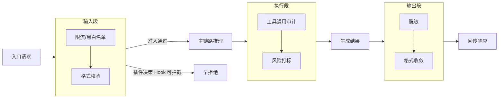
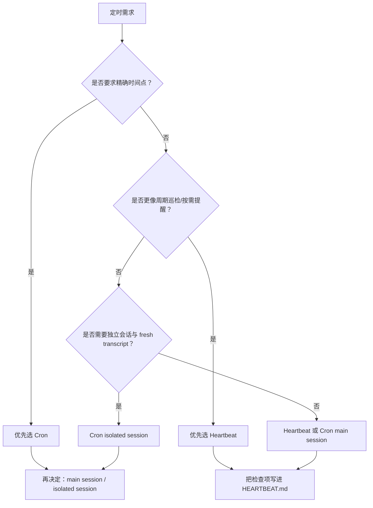
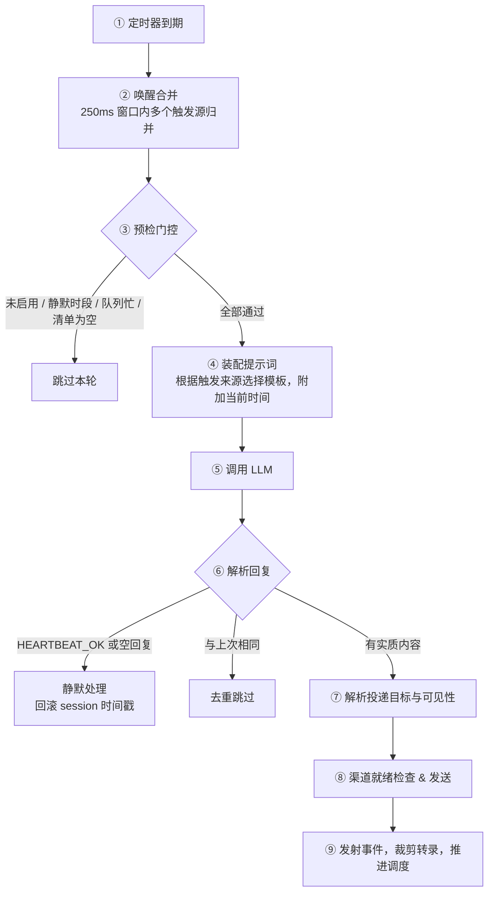
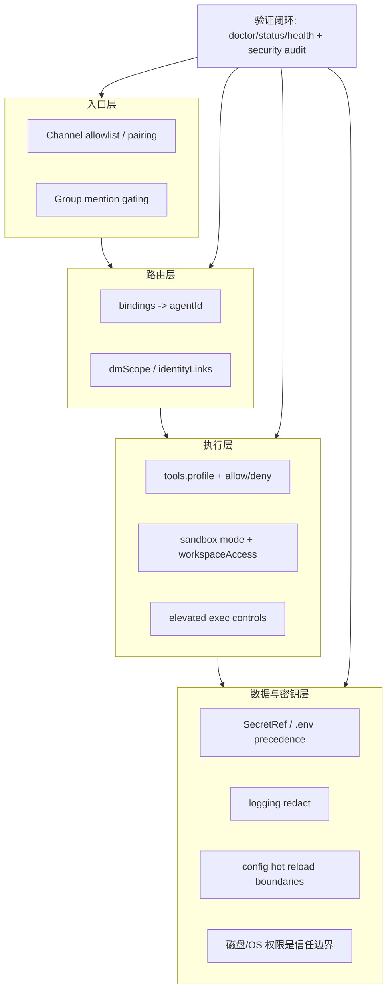

# 第八章 自动化与运维安全实践

前面几章，你已经学会了在本地开发、多渠道接入、配置管理。现在，你的 OpenClaw 要升级到“后台 7×24 无人值守”的状态。这一步看似简单（加一个 cron？），但实际上涉及架构级别的决策：哪些任务该在哪个时间点执行，失败时如何自愈，以及如何确保数月后出了问题还能快速定位根因。

本章的核心哲学是“在架构层面内建治理能力，而不是在业务逻辑里硬编码补丁”。这意味着：

**一个简洁的决策框架胜过一百行 if-else。** 本章首先帮你定位 Cron（精确时间点任务）、Heartbeat（周期性巡检）、Task Flow（可追踪任务流）与 Standing Orders（长期指令）的选择逻辑；后续小节重点展开 Hooks、Cron、Heartbeat、远程访问与安全基线，Task Flow 和 Standing Orders 作为选型边界引用官方专题文档。

长期可运行需要在架构层面将以下五个维度的治理能力内建：

- **可插入的生命周期治理（Hooks）**：在 Gateway、session、agent、message 等具体事件上解耦并注入自定义的过滤、审计与管控逻辑，避免业务代码的无限膨胀。
- **可调度的无人值守作业（Cron Jobs）**：对于“每天下午 3 点生成报告”“每周一发送摘要”这类**精确时间**要求的任务，用 Cron 定义，确保幂等与失败自愈。
- **周期性感知与主动通知（Heartbeat）**：对于“每 30 分钟检查一遍邮箱，有紧急邮件就通知我”这类**按需触发**的巡检，用 Heartbeat 机制，让一轮轮询批量处理多个检查项，而不是每个检查项都写独立的 Cron。
- **可审计的安全基线体系**：摆脱单纯“事后翻查日志”的窘境，建立基于“事件、主体、动作、证据”四元组的结构化审计模型，让系统的每一次关键写入都可溯源、可复盘。
- **可运维的远程访问控制**：在“可达”与“不暴露”之间找到平衡，通过零信任架构重塑远程入口，建立强身份认证、最小权限分配与可快速吊销的应急响应通道。

## 学习目标

完成本章的阅读后，你将能够：
1. **设计生命周期**：在关键节点注入自定义逻辑，扩展系统能力。
2. **实现自动化**：设计安全、可预期的定时作业。
3. **保障安全**：通过零信任原则管理远程访问。
4. **建立审计**：让系统的每一个重要操作都可追溯。

## 1. Hooks 生命周期与事件切入点

本节讨论 Hooks 的工程落点：把治理逻辑从主执行链解耦出来，并保证 Hook 自身不会成为新故障源。先从 OpenClaw 提供的具体 Hook 能力入手，再展开设计模式与稳定性约束。

### 1.1 Hooks 的职责边界

Hooks 适合承载横切能力，而不是业务主流程。常见场景包括：

- 输入治理：限流、黑白名单、格式校验。
- 执行观测：工具调用审计、风险打标、策略记录。
- 输出治理：脱敏、格式收敛、审计补充字段。

边界原则：Hook 负责“治理与观测”，主链负责“任务推进”。

### 1.2 OpenClaw 的 Hook 机制与当前配置入口

在当前版本中，Hook 是 Gateway 内部事件上的目录式扩展点。Hook 包含 `HOOK.md` 与 `handler.ts`，可来自 OpenClaw bundled、插件、托管安装目录或 workspace 目录；启用、检查和诊断入口统一走 `openclaw hooks`。

常用命令包括：

- `openclaw hooks list`
- `openclaw hooks info <hook>`
- `openclaw hooks check`
- `openclaw hooks enable <hook>`
- `openclaw hooks disable <hook>`

也就是说，当前版本更稳妥的理解方式是：**Hook 是 Gateway 生命周期中的可发现切入点，配置层的 `hooks.internal.entries` 只是一部分启用状态，不应被理解成“当前版本只有固定两个内置项”**。是否存在更多 entry、附加目录加载或安装记录，应以本地版本的 `openclaw hooks list`、`config schema`、`--help` 与官方文档为准。

当前实例可直接观察到的最小配置形态如下：

```jsonc
{
  hooks: {
    internal: {
      enabled: true,
      entries: {
        "session-memory": { enabled: true },
        "boot-md": { enabled: true }
      }
    }
  }
}
```

此外，OpenClaw 的工具策略（`tools.deny`/`tools.allow`，详见 5.2）和结构化日志事件（`openclaw logs --follow --json`）提供了补充性的治理与观测能力，与 Hook 机制协同工作。

> [!NOTE]
> Hook 加载取决于是否启用、配置或开启广泛发现。排障时先用 `openclaw hooks list/info/check` 确认实际发现与启用状态，再结合 `doctor` 与结构化日志定位问题。

### 1.3 事件切入模型：先按官方事件定位，再映射治理职责

OpenClaw 的内部 Hook 不是固定的“输入 / 执行 / 输出”三段枚举，而是围绕具体事件触发。当前内部事件包括 `command:new`、`command:reset`、`command:stop`、`command`、`session:compact:before`、`session:compact:after`、`session:patch`、`agent:bootstrap`、`gateway:startup`、`gateway:shutdown`、`gateway:pre-restart`、`message:received`、`message:transcribed`、`message:preprocessed`、`message:sent`。工程上仍可把治理职责映射为输入治理、执行观测、输出治理三类，但排障和配置时要回到本机 `openclaw hooks list/info/check` 输出的真实事件名。



图 8-1：Hooks 在主链路三段生命周期中的切入点

| 阶段 | 目标 | 禁止事项 |
| --- | --- | --- |
| 输入段 | 降噪、准入校验；若使用插件决策 Hook，可早拒绝 | 长耗时外部调用、不可逆写入 |
| 执行段 | 记录关键决策、风险拦截 | 改写核心业务状态 |
| 输出段 | 脱敏和格式治理 | 临时扩权、绕过策略放行 |

### 1.4 稳定性约束：超时、降级、幂等

Hook 本身必须受约束，否则会拖垮主链。

- 超时上限：每个 Hook 都要有独立超时，超时后按策略降级。
- 失败语义：内部 Hook 返回 `void`，主要通过追加消息或修改事件内容做观测/补充，异常会被记录且不应阻断后续 handler；需要 block、cancel、override 或 require approval 时，应使用支持决策结果的 typed plugin hooks。
- 幂等要求：重试情况下不得产生重复外部副作用。

对审计类内部 Hook，建议保持轻量并告警；对合规拦截类逻辑，应使用插件决策 Hook，并显式设计 block / fail-open / fail-closed 语义。

### 1.5 结构化事件：保证可审计与可回放

建议所有 Hook 事件使用统一结构，最少包含：时间、链路、阶段、动作、结果。

```jsonc
{
  "ts": "YYYY-MM-DDTHH:MM:SSZ",
  "traceId": "t-YYYYMMDD-001",
  "stage": "input",
  "hook": "rate_limit_guard",
  "event": "rejected",
  "reason": "rate_limit_exceeded"
}
```

### 1.6 验收与排障

上线后建议固定做两类检查：

1. 正常流量：确认 Hook 不引入明显时延。
2. 异常流量：确认拦截和降级行为符合预期。

```bash
openclaw status --deep
openclaw logs --json --limit 500 \
  | jq -r 'select(.type=="log") | (.raw | fromjson? // {}) | .event // empty' \
  | sort | uniq -c | sort -nr | head
```

> 注意：实际字段名请以 `logs --json` 输出为准。建议验收前先“不带过滤规则”打印一条原始日志，明确具体的日志字段结构，再运用 `jq` 过滤。

## 2. 定时作业设计与调度策略

本节聚焦于**精确时间点**的无人值守作业。典型场景包括：每天下午 3 点生成日报、每周一早上 9 点发送周报、每个月 1 号跑一遍成本清算。这些任务的共同点是“必须在这个时间执行，不能晚也不能早”。OpenClaw 为此提供了两层定时能力：

- **内建 Cron**（Gateway 原生调度，零外部依赖）：推荐大多数情况使用
- **外部 Crontab 集成**（宿主机级调度）：当需要与已有运维流水线对接时使用

无论用哪一层，核心目标都不是“定时触发一次”，而是“重复执行也不会失控”——这意味着幂等性、失败恢复、可观测性的完整设计。

> [!NOTE]
> **命令名已改主叫法**：官方现以 `openclaw automations` 为这套调度能力的主命令，`openclaw cron` 保留为别名，下面每一条子命令两种拼法都可用。本节沿用 `cron` 拼法以便与 Cron 表达式的语境对齐，看官方文档时按 `automations` 检索即可。
>
> 内建 Cron 的具体命令与事件名可能随版本演进：以 `openclaw automations --help`、`openclaw automations status` 与结构化日志的实际输出为自证入口；`openclaw status --deep` 适合做通用 Gateway 状态补充。

**Cron vs Heartbeat：首轮判断逻辑**

如果你拿不准该选 Cron 还是 Heartbeat，这里只做**首轮分流**：**优先问“是否要求精确时间点”**。如果是，用 Cron；如果不是（比如“只要每半小时检查一遍是否有新工单，有就通知”），用 Heartbeat。更细的会话、上下文和模型差异，统一放到 8.3.8 Heartbeat vs Cron 再展开，避免同一问题在两节里重复讲两遍。



图 8-2：Cron 与 Heartbeat 的首轮选型分流图

### 2.1 内建 Cron：Gateway 原生调度

OpenClaw 内建了 Cron 调度器，支持标准五段式 cron 表达式，也支持带秒字段的六段式写法，并可配合 `--at` 创建一次性定时提醒。作业在 Gateway 进程内执行，无需配置宿主机的 crontab 或 systemd timer。

当前运行时将作业定义与执行状态分开保存：`jobs.json` 保存作业定义，`jobs-state.json` 保存最近触发、运行与失败状态。所有执行都会生成后台 task/run 记录，便于 `cron runs` 回看；一次性 `--at` 作业成功后会自动删除，避免长期残留。周期作业可用 `--every` 或 cron 表达式创建；`--tz` 控制墙上时间解释；默认调度会做 top-of-hour staggering，确需整点执行时再显式使用 `--exact` 或调整 `--stagger`。

当前 CLI 需要先区分两类 payload：

- **主会话任务**：使用 `--system-event`，通常配合 `--session main`，由主会话心跳链路执行。
- **隔离任务**：使用 `--message`，通常配合 `--session isolated`，在专用 `cron:<jobId>` 会话里运行；CLI 创建的隔离 `agentTurn` 作业默认使用 `announce` 回退投递，只有显式使用 `--no-deliver` 或改写 delivery 配置时才会静默。

**创建定时作业：**

```bash
# 主会话任务：工作日 9:00 注入系统事件，并立即唤醒心跳处理
openclaw cron add --name "daily_standup_event" \
  --cron "0 9 * * 1-5" \
  --session main \
  --system-event "从 Slack 和 Jira 拉取昨日进展，生成站会摘要并写回主会话" \
  --wake now

# 隔离任务：一次性提醒，在独立会话里执行并主动投递摘要
openclaw cron add --name "review_reminder" \
  --at "2026-06-23T15:00:00" \
  --session isolated \
  --message "提醒：下午 3 点代码评审" \
  --announce
```

> [!NOTE]
> 以上命令参数以实际 CLI 版本为准。使用 `openclaw automations --help`（或别名 `openclaw cron --help`）确认当前可用的参数格式。当前版本对**不带时区**的 `--at` 时间按 UTC 解释；若要按本地墙上时间理解，应显式传入 `--tz <IANA 时区>`。

**管理与巡检：**

```bash
openclaw cron list              # 查看所有已注册作业及下次触发时间
openclaw cron status            # 查看 cron 调度器健康度
openclaw cron show <jobId>      # 查看单个作业详情
openclaw cron run <jobId>       # 默认强制排队执行并立即返回；加 --due 才保持“到期才执行”
openclaw cron enable <jobId>    # 启用指定作业
openclaw cron disable <jobId>   # 禁用指定作业
openclaw cron edit <jobId> --no-deliver
openclaw cron runs --id <jobId> # 查看指定作业的执行历史
openclaw cron remove <jobId>    # 移除指定作业（rm/remove/delete 等别名按当前 CLI 为准）
openclaw status --deep          # 通用 Gateway 状态补充
```

内建 Cron 作业支持 `main`、`isolated`、`current`、`session:<id>` 等会话目标（详见 8.3.8 选型决策树）：

- **主会话模式**（`--system-event` / `--session main`）：作业通过系统事件注入主会话，由心跳链路执行，共享完整上下文，默认属于“静默任务”而不是主动通知。
- **隔离会话模式**（`--message` / `--session isolated`）：作业在独立的 `cron:<jobId>` 会话和 fresh transcript 中执行，不继承 ambient conversation routing/context；安全偏好、显式模型或认证覆盖仍可能按配置带入。runner 是否回退投递结果，要看 `announce` / `webhook` / `none` 配置，同时 agent 也可能在作业内部主动使用 `message` 工具发送消息。
- **当前/固定会话模式**（`--session current` / `--session session:<id>`）：创建时绑定当前活跃会话，或固定到显式持久 session key，适合需要持续累积同一任务上下文的作业。

隔离作业还会走 watchdog 与浏览器清理路径，避免一个长任务长期占用会话、浏览器或执行资源。手动 `cron run` 返回只表示作业已入队；是否真的运行、失败或被跳过，应继续用 `openclaw cron runs --id <jobId>` 对账。

### 2.2 外部 Crontab 集成

当需要与已有运维流水线（Ansible、Terraform、CI/CD）对接，或者作业逻辑涉及宿主机层面操作（文件清理、日志轮转、备份）时，可以使用宿主机的 crontab 或 systemd timer 来编排，通过 CLI 调用 OpenClaw。

```bash
# crontab 条目
0 9 * * 1-5 /opt/openclaw/jobs/daily_standup.sh >> /var/log/oc_jobs/standup.log 2>&1
```

外部调度时，幂等与防重入需要由调用方自行保证（见 8.2.3、8.2.4）。

### 2.3 四个工程约束：幂等、防重入、可观测、可恢复

无论使用内建 Cron 还是外部 Crontab，生产环境中的定时任务至少要满足：

- 幂等：重复执行不产生重复副作用。
- 防重入：上一次未完成时不能并发冲突。
- 可观测：每次执行有状态、耗时和错误分类。
- 可恢复：失败后有明确重试与人工接管路径。

内建 Cron 在 Gateway 层面已经内置了部分防重入保护（同一 jobId 不会并发执行）。外部 Crontab 则需要自行实现，常用方案是带 TTL 的分布式锁：

```bash
# 获取锁成功才执行任务
redis-cli SET oc_job_lock:daily_report "<instance_id>" NX EX 600
```

释放锁时要校验锁持有者，避免误删其他实例锁。

### 2.4 幂等键与失败分流

**幂等键**：推荐以“作业名 + 窗口开始时间”作为键，保证同一调度窗口内重试不产生重复副作用。

```text
idempotency_key = "daily_report:v2:" + window_start_ts
```

**失败分流**：错误应按类型分流：

- 瞬时错误（超时、503、限流）：有界重试，指数退避。
- 配置错误（401/403、参数错误）：立即终止并告警。
- 数据冲突（写入不一致）：冻结任务并触发人工介入。

不应将所有失败都作为“重试”来处理。

### 2.5 运行验收与日常巡检

建议把定时作业纳入固定巡检。

```bash
openclaw cron list
openclaw cron status
openclaw status --deep
openclaw logs --follow --json
```

验收时重点看三项：

1. 是否出现重入。
2. 是否出现重复副作用。
3. 失败后是否能在规定时间内恢复或升级处理。

> [!TIP]
> 踩坑实录：定时任务的“幽灵执行”
>
> 设置了每天 9:00 的站会摘要任务，但偶尔会在 9:00 和 9:03 各执行一次。排查发现是 Gateway 重启时 cron 调度器重新加载，如果重启时间恰好在任务触发窗口内，就会产生重复执行。解决方案：在任务逻辑中加入幂等检查（如检查今天是否已发送过摘要），或使用 `openclaw cron list` 确认任务状态后再重启。

## 3. Heartbeat 心跳机制：周期性巡检与主动通知

上一节讨论的是面向精确时间点的 Cron 作业；本节介绍 OpenClaw 内建的另一个调度原语——**Heartbeat（心跳）**。心跳解决的是另一类问题：

你有 5 个不同的信息源需要定期检查（邮箱、待办、日历、Slack、监控面板）。如果用 Cron，就得写 5 个独立的定时作业，每个都要配置失败重试、去重、日志。但实际上，这 5 个检查经常没有内容，只会白白消耗 API token。

Heartbeat 的解决方案是：系统按固定间隔（比如 30 分钟）唤醒一次智能体，智能体按一个检查清单（HEARTBEAT.md）逐一扫描这 5 个源，只有当至少有一个源有需要关注的事项时，才发送一条通知。这样既能及时感知变化，又能避免信息轰炸和无谓的 token 消耗。

**简化版：Cron 用于“必须在某个时刻做的事”，Heartbeat 用于“需要定期检查但有内容才通知的事”。**

> [!TIP]
> 不确定选 Heartbeat 还是 Cron？快速判断：需要精确时间 → Cron；需要周期性感知并按需通知 → Heartbeat。详细对比见 8.3.8 选型决策树。

### 3.1 核心概念

Heartbeat 是网关层面的**周期性智能体轮次**：系统按固定间隔触发一次智能体检查。当前官方文档给出的默认间隔通常是 `30m`；当检测到 Anthropic OAuth/token 认证模式（包括复用 Claude CLI）时，默认间隔是 `1h`，也可通过 `agents.defaults.heartbeat.every` 或单个 agent 的 `heartbeat.every` 覆盖。默认情况下心跳运行在主会话中，但也可以通过 `isolatedSession: true` 改为每次使用全新的会话。默认投递目标是 `target: "none"`，也就是心跳可以只更新内部状态而不外发；如果希望投递到最近渠道，必须显式设置 `target: "last"`。智能体读取当前 agent workspace 中的 `HEARTBEAT.md` 清单，检查收件箱、日历、待办等状态，然后做出两种回应之一：

- **无事发生**：回复 `HEARTBEAT_OK`，网关将其视为确认信号并按当前可见性设置静默处理。
- **有事需要关注**：返回告警文本，网关按 `target`、`to`、`accountId` 和渠道可见性规则决定是否投递到指定渠道。

这意味着你无需为每个周期性检查写单独的 Cron 作业——一个心跳轮次可以批量处理多个巡检项，且仅当存在需要关注的事项时才发送消息，天然避免信息轰炸。

### 3.2 完整生命周期：从定时器到消息投递

下图展示了心跳从定时器触发到消息投递的完整链路。排障时按图定位故障发生在哪一步，是最快的切入方式。



图 8-3：心跳从定时器触发到消息投递的完整链路

几个关键设计决策值得注意：

- **定时器是 per-agent 的。** 每个智能体独立维护自己的心跳间隔和上次执行时间，多智能体场景下各自按自己的节奏心跳，不会相互阻塞。
- **唤醒合并防止风暴。** 多个触发源（定时器到期、Cron 事件、exec 完成）可能在短时间内同时请求心跳，系统会自动归并为一次执行。
- **会话模式可切换。** 默认使用主会话；若开启 `isolatedSession: true`，则每次心跳都在全新会话里运行，避免把完整历史带入巡检。
- **忙碌时会推迟。** 如果当前 agent 有 cron 运行、队列任务或后台子任务仍在活动，心跳会优先 defer / skip，避免与正在执行的任务抢上下文和工具资源；可用 `skipWhenBusy` 收敛子智能体或嵌套运行时的心跳。

<a id="heartbeat-ok-context"></a>

### 3.3 HEARTBEAT_OK 协议与上下文模式

心跳的文本回退协议很简单：智能体读取 `HEARTBEAT.md` 后，如果无事发生回复 `HEARTBEAT_OK`（网关静默丢弃）；有事需要关注则回复告警文本（网关投递到渠道）。在支持工具的心跳轮次中，OpenClaw 也可能强制启用 `heartbeat_respond`，由结构化工具结果决定是否通知；此时工具结果优先于文本回退。

心跳轮次注入的上下文取决于 `lightContext` 配置：

| 模式 | 注入的文件 | 适用场景 |
|------|-----------|---------|
| **完整模式**（默认） | AGENTS.md、SOUL.md、TOOLS.md、IDENTITY.md、USER.md、HEARTBEAT.md、BOOTSTRAP.md、MEMORY.md 等已存在的 bootstrap 文件 | 需要完整上下文做判断 |
| **轻量模式**（`lightContext: true`） | **仅 HEARTBEAT.md** | 巡检清单明确，不需要其他上下文，节省 token |

默认提示词可通过 `heartbeat.prompt` 完全替换（注意是替换而非合并）。若启用 `isolatedSession: true`，主对话历史不会注入到心跳轮次；若只想保留 `HEARTBEAT.md`，可配合 `lightContext: true` 进一步压缩上下文。

> [!NOTE]
> 关于 HEARTBEAT_OK 的精确解析规则、提示词模板和内部标记机制，见 8.3.9 参考：内部机制。

### 3.4 配置详解

最小配置只需保留默认值即可工作。完整配置如下：

```jsonc
{
  agents: {
    defaults: {
      heartbeat: {
        every: "30m",                // 默认通常为 30m；Anthropic OAuth/setup-token 模式下当前默认值为 1h；"0m" 禁用
        model: "<provider/low-cost-model>", // 可选：替换为当前目录中实际可用的低成本模型
        prompt: "Read HEARTBEAT.md if it exists...", // 自定义提示词（完全替换，非合并）
        target: "none",              // "none" | "last" | 具体渠道名
        to: "+15551234567",          // 渠道内的具体接收者
        accountId: "ops-bot",        // 多账号渠道的账号 ID
        directPolicy: "allow",      // "allow" | "block"（屏蔽私聊投递）
        lightContext: false,         // true 时只注入 HEARTBEAT.md，减少 token 消耗
        isolatedSession: false,      // true 时每次心跳使用全新会话，不复用主对话历史
        activeHours: {               // 活跃时段限制
          start: "09:00",            // HH:MM，闭区间
          end: "22:00",              // HH:MM，开区间；"24:00" 表示午夜
          timezone: "Asia/Shanghai"  // "user" | "local" | IANA 时区
        }
      }
    }
  }
}
```

#### 作用域与优先级

心跳配置有两个维度的层叠：

**智能体维度：** `agents.defaults.heartbeat` 设置全局默认；`agents.entries.*.heartbeat` 为特定智能体覆盖。一旦任何一个智能体声明了 `heartbeat` 块，**只有那些声明了的智能体**才会运行心跳。

**渠道可见性维度：** `channels.defaults.heartbeatVisibility` → `channels.<channel>.heartbeatVisibility` → `channels.<channel>.accounts.<id>.heartbeatVisibility`（旧名 `heartbeat` 已改名，`openclaw doctor --fix` 会自动迁移），按从宽到窄的顺序覆盖，控制 `showOk`、`showAlerts`、`useIndicator` 三个开关。

#### 多智能体配置示例

```jsonc
{
  agents: {
    defaults: {
      heartbeat: { every: "30m", target: "none" }
    },
    entries: {
      main: { default: true },             // 无 heartbeat 块 → 不运行心跳
      ops: {
        heartbeat: {                         // 只有 ops 智能体运行心跳
          every: "1h",
          target: "telegram",
          to: "12345678:topic:42",
          accountId: "ops-bot"
        }
      }
    }
  }
}
```

### 3.5 HEARTBEAT.md 清单与活跃时段

#### 心跳清单

`HEARTBEAT.md` 是放在智能体工作区根目录下的一个可选文件，充当心跳巡检清单。默认提示词会指示智能体读取并严格执行它；若同时启用 `lightContext: true`，它还会成为唯一保留下来的工作区引导文件。

```markdown
# Heartbeat 巡检清单

- 扫描收件箱，有紧急邮件则摘要通知
- 检查未来 2 小时的日历事件
- 如果有后台任务完成，汇报结果
- 如果空闲超过 8 小时，发送一条简短问候
```

设计要点：

- **保持精简。** 默认语义更接近“提示模型去读这个文件”；若同时启用 `lightContext: true`，它才更接近唯一保留的工作区引导文件。无论哪种模式，清单越长，token 成本越高。
- **不要把空文件规则理解得过死。** 如果 `HEARTBEAT.md` 仅含空行和 Markdown 标题（如 `# Heading`），普通空心跳通常会被跳过以节省 API 调用；但带事件的运行路径并不应简单理解成“空文件就一定不执行”。
- **智能体可以自我修改。** 你可以在正常对话中让智能体更新 `HEARTBEAT.md`，也可以在心跳提示词中写上“如果清单过时，自行更新”。
- **不要放敏感信息。** API Key、电话号码等不应出现在此文件中——它会成为提示词的一部分。

#### 活跃时段

`activeHours` 在心跳触发前做时区感知的过滤，支持跨午夜的窗口。不在窗口内的心跳被跳过，日志记录原因 `quiet-hours`。

常见模式：

| 目标 | 配置 |
|------|------|
| 工作时间才心跳 | `activeHours: { start: "09:00", end: "18:00" }` |
| 全天候运行 | 不设 `activeHours`（默认行为） |
| 避免深夜打扰 | `activeHours: { start: "08:00", end: "24:00" }` |

> [!WARNING]
> `start` 和 `end` 不能相等（如 `08:00` 到 `08:00`），这会被视为零宽度窗口，心跳将永远被跳过。

### 3.6 渠道可见性与事件系统

#### 可见性控制

可见性控制决定了心跳消息是否真正发送到渠道：

```jsonc
{
  channels: {
    defaults: {
      heartbeat: {
        showOk: false,        // 默认不发 HEARTBEAT_OK 确认
        showAlerts: true,     // 默认发送告警内容
        useIndicator: true,   // 默认发射 UI 指示器事件
      },
    },
    telegram: {
      heartbeat: {
        showOk: true,         // Telegram 上也显示 OK 确认
      },
    },
    whatsapp: {
      accounts: {
        work: {
          heartbeat: {
            showAlerts: false, // work 账号不接收告警
          },
        },
      },
    },
  },
}
```

当三个开关都关闭时，外部可见性会降到最低；是否完全跳过该轮次以及日志形态，建议以当前版本的实际日志输出为准。

#### 事件系统

每次心跳执行都会发射事件，供 UI 和监控消费：

| status | 含义 | 触发场景 |
|--------|------|---------|
| `sent` | 消息已投递 | 告警内容成功发送到渠道 |
| `ok-empty` | 空回复 | LLM 无输出，可选发送 HEARTBEAT_OK |
| `ok-token` | Token 确认 | 回复仅含 HEARTBEAT_OK，已剥离 |
| `skipped` | 跳过 | alerts-disabled / duplicate / quiet-hours / no-target 等 |
| `failed` | 失败 | LLM 调用或投递过程出错 |

指示器类型映射：`ok-empty` / `ok-token` → `“ok”`（绿色）；`sent` → `“alert”`（黄色）；`failed` → `“error”`（红色）。在 Dashboard（Control UI）的 `Settings -> Debug` 页面中，可以看到最近的心跳事件 JSON 快照。

### 3.7 手动触发与系统事件

不必等待下一个心跳周期，可以立即触发：

```bash
# 立即唤醒心跳
openclaw system event --text "检查是否有紧急的跟进项" --mode now

# 等到下一个心跳周期再处理
openclaw system event --text "检查项目状态" --mode next-heartbeat
```

如果多个智能体配置了心跳，`--mode now` 会按当前版本的心跳选择规则触发对应智能体的心跳。

系统事件不仅限于手动——Cron 作业和异步命令（exec）完成时也会产生事件，心跳会在下一次触发时自动纳入处理。系统会检查待处理的事件队列，针对不同事件类型生成专属提示词（如 Cron 提醒内容会被直接嵌入提示词体内，见 8.3.3「HEARTBEAT_OK 协议与上下文模式」）。

### 3.8 Heartbeat vs Cron：选型决策树

前面的 8.2 节 已经给出“精确时间点 vs 周期巡检”的首轮分流。本节不再重复那一层，而是只补充**会话模式、上下文装配与模型控制**这三个更细的差异，帮助你在两者都可行时做最终判断。

```text
需要在精确时间点运行？
  是 → 用 Cron
  否 → 继续…

需要与主会话隔离？
  是 → Heartbeat 可启用 `isolatedSession: true`；若同时还需要精确时间点与独立运行历史，优先用 Cron（isolated session）
  否 → 继续…

可以和其他周期性检查合并？
  是 → 用 Heartbeat（添加到 HEARTBEAT.md）
  否 → 用 Cron

是一次性提醒？
  是 → 用 Cron + --at
  否 → 继续…

需要不同的模型或思考深度？
  是 → 用 Cron（isolated）+ --model/--thinking
  否 → 用 Heartbeat
```

**最佳实践：二者配合使用。** Heartbeat 处理日常周期性巡检（收件箱、日历、通知），一个轮次批量完成多项检查；Cron 处理需要精确时间的独立作业（日报、周会回顾、定点提醒）。这样既减少 API 调用次数，又保证关键作业的时间精度。

| 维度 | Heartbeat | Cron（main session） | Cron（isolated session） |
|------|-----------|---------------------|------------------------|
| 会话 | 主会话（默认）/ 可设 `isolatedSession` | 主会话（通过系统事件） | `cron:<jobId>` 独立会话 |
| 上下文 | 默认完整历史；`isolatedSession: true` 时为 fresh session、无 prior conversation history | 完整历史 | fresh transcript/session；不继承 ambient conversation history，安全偏好与显式模型/认证覆盖可能带入 |
| 模型 | 可覆盖 | 主会话模型 | 可覆盖 |
| 输出 | 非 OK 才投递 | 心跳提示词 + 事件 | 默认 announce 摘要 |
| 时间精度 | 近似（受队列负载影响） | 精确（支持五段式，亦可用六段式秒字段） | 精确 |
| Token 开销 | 一个轮次处理多项检查 | 加入下次心跳（无额外轮次） | 每作业一个完整轮次 |

#### 成本控制建议

心跳运行的是完整的智能体轮次，不加控制的话 token 消耗可观。几个降本手段：

- **精简 HEARTBEAT.md**：清单越短，每次注入的 token 越少。
- **使用 `lightContext: true`**：心跳轮次只注入 `HEARTBEAT.md`，不加载完整的工作区引导文件。
- **使用便宜的模型**：通过 `heartbeat.model` 为心跳指定更经济的模型（如 Haiku），核心对话仍用高端模型。
- **设置 `target: "none"`**：如果只需要内部状态更新而不需要外发消息，跳过投递流程。
- **启用 `skipWhenBusy`**：当 cron、子智能体或嵌套任务仍在运行时跳过本轮心跳，降低队列争用。
- **拉长间隔**：将 `every` 调到 `1h` 或更长，可以显著减少调用次数；如果你使用的是 Anthropic OAuth/setup-token，当前默认值本来就是 `1h`。
- **限制活跃时段**：夜间跳过心跳可以省下约 1/3 的调用量。

### 3.9 参考：内部机制

本小节整理心跳的内部实现细节，适用于排障源码或开发 OpenClaw 插件时参考，日常配置和使用可跳过。

#### 唤醒合并与优先级

系统用 250ms 的合并窗口将多个触发源归并为一次执行，按优先级保留最高等级的唤醒原因：ACTION > DEFAULT > INTERVAL > RETRY。

#### 提示词模板

**常规心跳（定时器到期）：**

```text
Read HEARTBEAT.md if it exists (workspace context). Follow it strictly.
Do not infer or repeat old tasks from prior chats.
If nothing needs attention, reply HEARTBEAT_OK.
Current time: <YYYY-MM-DD HH:MM> (Asia/Shanghai) / <HH:MM> UTC
```

尾部时间行自动追加，格式固定为 `Current time: [本地时间] ([时区]) / [UTC时间] UTC`。

**Cron 事件触发：**

```text
A scheduled reminder has been triggered. The reminder content is:
[Cron 事件的提醒文本]
Handle this reminder internally. Do not relay it to the user unless
explicitly requested.
Current time: ...
```

**异步命令（exec）完成触发：**

```text
An async command you ran earlier has completed. The result is shown in
the system messages above. Handle the result internally. Do not relay
it to the user unless explicitly requested.
Current time: ...
```

#### isHeartbeat 标记的调用链效应

心跳轮次通过 `isHeartbeat: true` 标记传递给整个调用链：

| 环节 | 效应 |
|------|------|
| 模型选择 | 可使用 `heartbeat.model` 覆盖默认模型 |
| 引导上下文 | `lightContext: true` 时切换为轻量过滤（仅 HEARTBEAT.md） |
| 工具错误告警 | 可通过配置抑制工具错误告警，避免干扰心跳判断 |
| 转录裁剪 | 回复 HEARTBEAT_OK 后裁剪 transcript，避免上下文污染 |

#### HEARTBEAT_OK 解析规则

| 位置 | 行为 |
|------|------|
| 回复**开头或结尾** | 被识别为确认 token，剥离后若剩余文本 ≤ `ackMaxChars`（默认 300），整条回复被丢弃 |
| 回复**中间** | 不做特殊处理，视为普通文本 |
| 非心跳轮次中出现 | 开头/结尾的 `HEARTBEAT_OK` 被静默剥离并记录日志；仅含此 token 的消息被丢弃 |

系统还会处理 LLM 偶尔添加的格式标记——`<b>HEARTBEAT_OK</b>` 和 `**HEARTBEAT_OK**` 都会被正确识别和剥离。

#### 系统提示词注入

心跳协议说明只会在满足多个条件时进入系统提示词：目标是默认 agent、该 agent 的心跳策略启用、心跳 cadence 有效、`includeSystemPromptSection` 未设为 `false`，且当前提示词模式不是 `"minimal"`。`lightContext: true` 会限制心跳上下文和 bootstrap 内容，但不会自动移除这段系统提示；需要省略心跳协议说明时，应设置 `heartbeat.includeSystemPromptSection: false`、关闭对应 agent 的心跳策略或关闭心跳 cadence。

## 4. 远程访问：SSH、内网穿透与零信任

本节讨论 OpenClaw 远程运维的目标：在保证可达性的前提下，尽量减少暴露面，并提供可快速吊销的访问机制。

> [!NOTE]
> OpenClaw 已提供远程访问相关能力，包括 loopback Gateway WebSocket、SSH 隧道/远程默认配置、`gateway.mode: "remote"` / `gateway.remote.*`，以及可选的 OpenClaw 托管 Tailscale Serve/Funnel。隧道、零信任和凭据管理仍属于基础设施风险面，需要在宿主机和网络层面做最小暴露与可吊销设计。

### 4.1 入口原则：管理面默认不公网暴露

远程运维首先要控制入口暴露面。

- 不把管理端口长期暴露在公网。
- 管理面与业务面分离，避免同一入口承载高权限操作和对外业务流量。
- 访问链路必须可审计，能追溯“谁在何时做了什么”。

### 4.2 推荐拓扑：专用通道优先

**默认安全路径：SSH 隧道或 Tailscale Serve**

1. **SSH 隧道（Port Forwarding）**。对于仅需命令行排障或偶尔打开 Web 控制台的场景，通过堡垒机或跳板机进行 `ssh -L 18789:localhost:18789 user@host` 转发，实现安全轻量的本地访问。零额外依赖，是最通用的安全路径。
2. **Tailscale Serve（推荐）**。更准确的理解是：保持 Gateway 绑定 loopback，再由 `tailscale serve` 代为向 Tailnet 内部转发 Dashboard。它的核心价值不是“先暴露再限制”，而是“默认仍不公网暴露，只在受信网络内转发访问”，因此很适合长期运维场景。

**需要额外论证的例外路径：**

3. **Tailscale Funnel（公网暴露）**。与 Serve 不同，`tailscale funnel` 会把服务暴露到公网。只有在确实需要外部系统（如 Webhook 回调、第三方 CI/CD 触发）访问 Gateway 时才应启用；OpenClaw 管理的 Funnel 路径当前要求 `gateway.auth.mode: "password"`，应把“公网暴露 + 密码认证 + 最小化入口”视为一整套方案，而不是只补一条浏览器来源限制。
4. **临时端口转发（仅非 Serve/Funnel 场景）**。若确需直接绑定非环回（non-loopback）地址暴露 Dashboard，真正的第一道护栏应是 Gateway 认证（token、password 或明确的 trusted-proxy 身份边界）；`gateway.controlUi.allowedOrigins` 只解决浏览器来源约束，不应被理解为主要安全边界。

> [!WARNING]
> Serve 和 Funnel 的安全边界完全不同：Serve 仅限 Tailnet 内部访问，Funnel 对公网开放。如果不确定，选 Serve。

> [!NOTE]
> 使用 `openclaw gateway status --url ...`、`gateway call --url ...` 等显式 URL 参数时，CLI 不会回退读取配置或环境里的隐式凭据；必须同时传入 `--token` 或 `--password`。这是为了避免把本地凭据误发到非预期远端。

`gateway.remote.token` / `gateway.remote.password` 是远程 CLI 或客户端连接目标 Gateway 时使用的客户端凭据，不是服务端侧的认证策略本身。启用 Tailscale Serve 身份头时，Serve identity header 可用于 Control UI / WebSocket 的受信代理身份判断；HTTP API 面（如 Gateway API、工具调用或 Responses 兼容入口）仍应按 Gateway 正常 auth 规则传递 token/password 或其他受信凭据。

远程浏览器或远程节点接入时，还要区分“控制面地址”和“执行主机身份”：CLI 的 `--url` 只指定要连哪个 Gateway，不代表该 Gateway 会自动信任本机浏览器、节点或 shell 执行环境。生产环境应显式配置节点配对、设备身份和可审计的执行入口。

无论选型如何，核心是“先建受信网络，再放行管理操作”。

### 4.3 身份与权限：最小权限和短期凭据

远程访问建议采用：

- 禁用密码登录，使用密钥或证书认证。
- 按角色分配最小权限，不共用管理员账号。
- 使用短期凭据并定期轮换，降低泄露后影响范围。

### 4.4 文件同步方案：把远程成果拿回来

当 OpenClaw 部署在云服务器时，智能体整理的素材、报告、代码等成果都存储在远程硬盘上。工程实践中，推荐建立可控的文件双向同步机制，将“云端工作区”无缝映射到本地：

**1. rclone 远程挂载（强烈推荐）**

通过 `rclone mount` 将服务器上的工作区目录直接挂载为 Mac/Linux 本地磁盘。
- **优点**：免费、实时、原生支持，无需在服务器端安装同步守护进程（走原生 SFTP）。
- **优化参数经验**：默认挂载较慢且易断，建议增加 `--vfs-cache-mode full`（利用本地缓存提速读写）、`--sftp-connections 8`（增加并发数）、`--sftp-idle-timeout 0`（防止超时断联）。

**2. 坚果云等企业云盘同步**

在服务器与本地同时安装客户端，指定工作区目录进行双向同步。
- **优点**：搭建门槛极低，开箱即用。
- **缺点**：如果智能体高频读写或生成大量临时文件，容易耗尽同步流量池；冲突解决机制对开发者不够透明。

**3. 轻量级网盘服务（File Browser）**

如果只需要手机端偶尔查看文件，不需要重度编辑，可以在服务器裸起一个基于 Web 的文件浏览器（如 [File Browser](https://filebrowser.org/)），通过浏览器随时访问、下载生成的报告。需配合 8.4.1 的安全入口原则使用。

### 4.5 浏览器远程接管：节点主机与 KasmVNC

当前更推荐的远程浏览器路径是：在真正运行浏览器的机器上启动 OpenClaw node host，让 Gateway 通过已配对节点代理浏览器动作。这样浏览器控制流量仍留在受信网络内，通常不需要为了浏览器自动化开启 Funnel。KasmVNC 更适合处理验证码、二次确认或需要人工临时接管的场景。

当智能体在云端运行 L2（有头浏览器）进行自动化操作时，经常会遇到复杂验证码（如滑块、行为验证）或需要二次确认。如果仅依赖截图（L3），往往无法成功突破这些安全策略。

实践中，可以在服务器安装基于 Web 的远程桌面服务（如 [KasmVNC](https://kasmweb.com/)）。
1. 当智能体遭遇验证码界面时，通知用户。
2. 用户通过本地浏览器连接 KasmVNC，接管云端鼠标与键盘。
3. 协助智能体通过验证码后，关闭连接，智能体继续执行后续工具流程。

这种“平时无人干预，受阻时人工接管”模式是在自动化与安全性之间的一种实用平衡。

### 4.6 应急机制：可快速吊销与隔离

发生凭据泄露或可疑访问时，优先执行：

1. 吊销受影响凭据或设备信任。
2. 收敛入口策略，必要时临时阻断管理通道。
3. 回放审计日志，确认影响范围并复验恢复。

应急动作要预先演练，避免事故时临时决策。

### 4.7 基线巡检命令

下面命令可用于快速巡检主机远程访问基线。

```bash
# 检查 SSH 认证方式
sshd -T | grep -E 'passwordauthentication|pubkeyauthentication'

# 检查是否存在非本地监听端口
lsof -nP -iTCP -sTCP:LISTEN | grep -Ev '127\.0\.0\.1|localhost|::1|\[::1\]' || echo "No public listeners"
```

巡检建议固定在发布后和变更后执行，并与 `doctor/status` 输出一起归档。

## 5. 安全基线与审计流程

安全基线的目标不是写一份“配置清单”，而是把高风险能力关进确定性的边界里，并让每一次关键决策都可追溯、可复盘。本节基于 OpenClaw 官方安全与配置文档，给出一套可落地的安全与审计完整流程：分层边界怎么划、审计事件怎么记、密钥怎么注入、以及如何用自检命令把基线变成可验证流程。

### 5.1 纵深防御：把边界分层，并让每层都可验证

OpenClaw 的官方安全模型建立在 **“个人助手模型（trusted operator boundary）”** 的基础假设上。它并不原生提供抵抗恶意多租户的硬隔离。如果在未经硬性安全保护的情况下把网关暴露给外界，系统的信任链会非常脆弱。

特别注意：共享 secret token / password 鉴权的 Gateway HTTP 面（如 `/v1/chat/completions`、`/v1/responses`、`/tools/invoke`）应视为受信 operator 入口；一旦持有共享密钥，就不能依赖更窄的 `x-openclaw-scopes` 来实现多租户隔离。

在智能体系统里，风险来源不是单一入口，而是“入口渠道 + 路由 + 工具 + 密钥 + 记忆”的组合链路。纵深防御的最小可行分层可以拆为四层，并为每层定义可验证的控制点：

1. **入口层**：渠道门控、群聊触发规则、允许列表与提及规则。建立 **极其保守的默认执行面**：建议把非主会话（如群聊）默认全部压入沙箱（Docker Sandbox），甚至设置 `workspaceAccess=none` 或只读。这样能极大降低由于 `allowFrom` 或 `dmPolicy` 配置扩大而导致的凭据被越权抓取的风险。
2. **路由层**：用绑定优先把高风险入口固定到受控智能体，避免把路由正确性变成概率问题。详见 7.3 路由基础。
3. **工具层**：用工具策略做允许、拒绝与分层策略，拒绝规则优先于允许规则，避免因配置叠加导致越权。详见 5.2 工具策略：允许、拒绝与分层策略。
4. 运行与数据层：把密钥改为环境注入（详见 4.2 模型供应商接入与认证方式），开启日志脱敏，把诊断输出落盘到可管控路径，并控制保留期与访问权限。

**安全分层与验证证据链示意：**



图 8-4：安全分层与验证证据链示意

验证这些分层是否真正生效，优先使用系统自检与状态探测，而不是先在生产入口“试一试”。另外，hooks 入口也应纳入基线：默认不要允许外部请求自带 `sessionKey`；如确需放开，也要通过 `allowedSessionKeyPrefixes` 把可写入的 session key 约束在受控前缀内。推荐的最小验证组合如下：

```bash
openclaw doctor
openclaw status --deep
openclaw channels capabilities
openclaw models status
openclaw models status --probe
openclaw secrets audit  # 请以实际 CLI 版本为准
openclaw security audit  # 请以实际 CLI 版本为准
openclaw security audit --deep  # live Gateway probes + 插件安全采集
```

> **注意**：某些 CLI 命令（如 `openclaw secrets audit` 和 `openclaw security audit`）的可用性取决于版本。若命令不存在，请查阅当前版本的官方文档或使用 `openclaw --help` 确认可用命令。

普通 `security audit` 偏 cold/read-only 配置检查；`--deep` 会增加 live Gateway probes 和插件拥有的安全 collector。Hooks 入口也要检查：`hooks.token` 必须是非空、强随机值，并且不能复用 `gateway.auth.token`，当前安全审计会把 token 复用或过短作为风险项报告。

### 5.2 审计事件四元组：把因果链写成结构化记录

审计的核心是回答四个问题：谁在何时通过什么入口做了什么，以及系统为什么允许或拒绝。为了避免日志沦为无法检索的文本堆，建议把关键动作统一抽象为结构化审计事件，并固定四个字段维度：

1. 主体：用户、对端标识、渠道账号，以及被路由到的智能体标识。
2. 动作：工具名称、参数摘要、目标资源标识。
3. 依据：命中的绑定、命中的工具策略规则、以及拒绝原因。
4. 结果：成功、失败、被拒绝、需要人工确认。

OpenClaw 支持输出结构化日志，并提供日志跟随能力。排查“为何被拒绝”或“为何路由到某智能体”时，可先跟随日志流，再按字段过滤。下面给出一个示例，用于从 JSON 日志中抽取与路由和工具调用相关的事件摘要。

```bash
openclaw logs --follow --json | jq -c 'select(.type=="log") | (.raw | fromjson? // {}) | select(.event=="routed" or .event=="tool_call" or .event=="blocked_tool_call" or .event=="tool_call_blocked") | {ts:(.time // .ts), traceId, spanId, event, agentId:(.agentId // .agent_id), channelId, peerId, tool, reason}'
```

> **注意：实际字段名请以 `logs --json` 输出为准。** 当前结构化链路字段使用 `traceId` / `spanId` 这类 camelCase 命名；验收前仍建议先“不带过滤规则”打印一条原始日志，再运用 `jq` 过滤。

如果发现“同一入口在不同时间触发了不同能力”，优先检查是否存在多账号配置、群聊策略差异、或工具策略叠加导致的边界漂移。

### 5.3 密钥与爆炸半径：用环境注入与最小权限降低损失上限

密钥治理的目标是限制泄露后的可用范围与可用时间。OpenClaw 的配置支持将密钥以 `${VAR}` 甚至 `SecretRef` 对象形式获取，避免把明文密钥写进配置文件或落盘在代码仓库中。

> [!NOTE]
> OpenClaw 会从进程环境变量、当前目录 `.env`、以及 `~/.openclaw/.env` 读取变量引用，且遵循 **“`.env` 不覆盖已有环境变量”** 的优先级规则。

下面示例展示了常见的密钥注入形态：可使用简单的插值，或是依赖统一的 `SecretRef` 对象形态将它对接凭据管线。实际部署时建议为不同环境配置不同的 provider / id。

```jsonc
{
  secrets: {
    providers: {
      default: { source: "env" }
    }
  },
  models: {
    providers: {
      "custom-proxy": {
        baseUrl: "https://my-proxy.internal/v1",
        api: "openai-completions",
        apiKey: { source: "env", provider: "default", id: "OPENAI_API_KEY_STAGING" },
        models: [{ id: "team-fast", name: "Team Fast Model", input: ["text"] }]
      }
    }
  }
}
```

爆炸半径控制通常需要三条硬规则：

1. 入口隔离：群聊与私聊使用不同的策略与默认智能体，避免低可信入口直接触发写入能力。
2. 权限隔离：高风险工具只允许出现在少数受控智能体的工具组里，并通过拒绝规则兜底。
3. 密钥隔离：不同能力使用不同密钥或不同权限范围的凭据，避免“一个密钥通吃全系统”。

### 5.4 反面案例：智能体自改配置导致的故障循环

即使做好了上述隔离，如果没有对核心配置文件（如 `openclaw.json`）做好读写防护，仍可能发生严重的工程灾难。

> [!CAUTION]
> **警惕智能体配置自我修改失效**：在真实案例中，有用户赋予了智能体全局文件系统的读写权限。当系统出现故障时，智能体触发了“自我修复”幻觉，开始修改自己的 `openclaw.json`。
>
>
> 由于它并不完全理解参数格式，改错了配置。OpenClaw 监测到配置变更后自动重启，刚启动又抛出配置错误崩溃。随后如果由进程守护再次拉起，就会陷入无限报错循环。最糟糕的情况是消耗大量的日志空间或调用配额。

**防护建议：**

1. 生产环境中，**不要关闭进程的用户级权限限制**。运行 OpenClaw 的用户账号不应该对配置文件所在的目录具有写入权限（可以由部署流水线或其他专门的账号管理）。
2. 控制配置热重载边界及行为。在调整前，请参考官方设定：

| 概念 | 配置字段 | 默认值 | 别名或补充说明 |
| --- | --- | --- | --- |
| 配置热重载模式 | `gateway.reload.mode` | `hybrid` | 可选值：`hybrid`（默认，自动判断热重载或重启）、`hot`、`restart`、`off`。`debounceMs` 默认 300ms。旧版可能提及的 `autoRestartOnConfigChange` 为不存在或弃用的字段。 |

在 `openclaw.json` 中可设置 `gateway.reload.mode: 'hot'` 或是设为 `'off'` 完全关闭文件监听。这能避免“修改后立即引发系统频繁异常重启”。
3. 用文件系统与执行层限制保护配置路径，例如 `tools.fs.workspaceOnly`、`tools.exec.applyPatch.workspaceOnly`、部署账号权限和只读挂载；`tools.deny` 只能拒绝工具名或工具组，不适合写成路径级 ACL。
4. 如果确实需要修改配置并排障，推荐使用传统的运维配置下发方案，而不是让 OpenClaw 自己修改自己。

### 5.5 演练与回归：把安全基线变成可重复的验证循环

安全基线如果不演练，就会在变更中失效。建议把验证拆成三类：

1. 自检回归：每次发布与配置变更后，固定跑一组命令，确保核心链路可用且边界未漂移。
2. 故障注入：在受控环境中故意引入无效密钥、断网、或渠道不可用，观察系统是否给出明确的错误与降级路径。
3. 事件响应：发现疑似泄露或越权后，按“检测/分级/指派 owner/止血/修复/发布验证/复盘”的流程推进，而不是只做本地 key 轮换。

自检回归可以从最小组合开始：

```bash
openclaw doctor
openclaw health --json
openclaw status --deep
openclaw security audit --deep  # live Gateway probes + 插件 collector
openclaw secrets reload
```

> **版本提示**：`openclaw secrets reload` 和 `openclaw security audit` 命令的名称和参数在不同版本可能有差异。如果命令执行失败，请使用 `openclaw --help` 或查阅当前版本文档获取正确的命令语法。

当发现异常时，先用 `doctor` 与 `status` 定位是配置、依赖还是运行时状态，再根据日志中的 `traceId` 做回放定位。对于涉及敏感信息的日志与诊断输出，务必结合官方安全建议开启脱敏与屏蔽环境变量输出，避免把“排障数据”变成新的泄露通道。相关建议见 OpenClaw 官方文档的安全章节。
