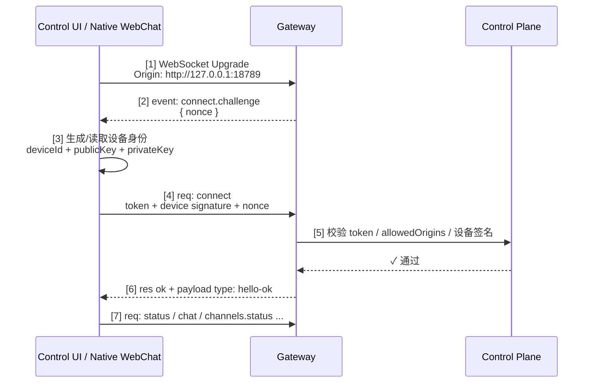
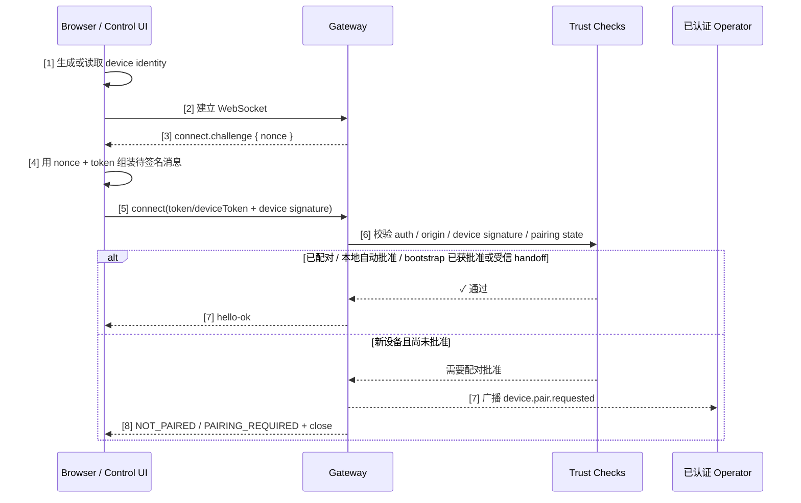

# 第九章 Gateway 控制平面与协议机制

本章切换到系统内核视角，讨论 OpenClaw Gateway 的控制平面职责、连接生命周期、事件一致性与设备配对及信任建立。通过本章，你将理解一个健壮的 Gateway 如何通过精心设计的协议与状态机，让分布式智能体系统变得“可预测、可恢复、可审计”。

理解这一章的价值在于：同样的模型能力，在不同控制平面设计下会呈现完全不同的稳定性与安全性。

## 学习目标

完成本章的阅读后，你将能够：
1. **理解架构**：从控制平面的视角看 Gateway 的整体设计。
2. **掌握协议**：理解 WebSocket 连接的完整生命周期。
3. **保障一致性**：设计事件驱动系统中的幂等与一致性机制。
4. **建立信任**：通过设备配对与密钥管理建立安全的信任基础。

## 1. 架构全景与五平面框架

Gateway 的核心职责是通过多层次的协议与策略，把分布式的多渠道请求统一纳入可控、可审计的运行框架中。本节先用 OpenClaw 官方模块边界建立“源码里实际长什么样”的基础认知，再引入**五平面架构**（Five-Plane Harness Model）作为本书的观察视角，帮助读者从控制、数据、上下文、信任与可观测性五个维度理解系统。

> **说明：** 以下“五平面”框架是本书为便于读者理解而提出的分析模型，并非 OpenClaw 项目的官方架构术语。实际源码按模块（gateway、agents、config、hooks 等）组织，并不显式划分为五个平面；因此后文凡涉及“五平面”，都应理解为**本书的解读框架**，而不是 OpenClaw 官方文档中的固定分层。

### 1.1 用五平面观察 Gateway

OpenClaw 的运行时架构可从五个正交的平面来理解，每个平面负责系统的一个关键维度：

| 平面 | 职责 | 核心机制 |
|------|------|--------|
| **控制平面**（Control） | 请求编排、重试超时、步骤调度、HITL 门控 | 策略配置、故障决策、权限检查 |
| **数据平面**（Data） | 工具执行、沙箱隔离、连接器、I/O 管理 | 副作用隔离、异步执行、流式传输 |
| **上下文平面**（Context） | 会话状态、记忆机制、压缩总结、制品日志 | 生命周期管理、存储策略、版本控制 |
| **信任平面**（Trust） | 认证/授权、用户同意、审计日志、策略执行 | 密钥治理、访问控制、问责链 |
| **可观测性平面**（Visibility） | 链路追踪、指标采集、评估量化、调试工具 | 遥测数据、性能分析、根因分析 |

这五个平面相互独立但紧密协作，共同确保系统的**安全性、可靠性、可审计性与可优化性**。

### 1.2 控制平面职责详解

**控制平面**是 Gateway 的“大脑”，负责：

1. **请求入口治理**：认证连接、归属校验、路由决策
2. **编排与调度**：决定步骤执行顺序、并发度、重试策略
3. **故障恢复**：触发超时、执行回退、决定熔断
4. **人在回路（HITL）**：在需要人工审批的步骤前设立门控，暂停执行并等待授权
5. **权限与策略**：检查请求是否被允许、受约束资源是否可达

控制平面不能理解成“纯被动路由器”。Gateway 负责路由、认证、队列与控制，并暴露一组 RPC handler / execution surface；真正的模型调用、工具副作用和节点侧执行仍由 runner、插件或 node host 等运行时处理。也就是说，控制面拥有执行入口的编排权，但不应把模型/工具工作都混写成 Gateway 本体亲自完成。

### 1.3 数据平面与工具执行

**数据平面**负责实际的 I/O 与副作用执行：

- **工具调用隔离**：在启用 `agents.defaults.sandbox` 或智能体级 sandbox 后，按 agent / session / shared scope 隔离高风险执行；沙箱默认不是“每个工具调用一个容器”
- **连接器管理**：通过 MCP（Model Context Protocol）或自定义连接器对接外部系统
- **流式输出**：支持流式返回大型结果（如日志、文件内容），避免内存溢出
- **异步执行**：长运行工具不阻塞控制平面，通过回调或轮询汇报结果

### 1.4 上下文平面与状态管理

**上下文平面**维护会话的运行状态与记忆：

- **会话状态**：为每个用户维护独立的上下文窗口，包括消息历史、工具结果、系统变量
- **压缩与总结**：当上下文超过预算时，采用 `compaction`（压缩关键信息）或 `summarization`（生成摘要）来回收空间
- **制品与日志**：存储执行过程中的中间结果与决策日志，便于复盘与审计

### 1.5 信任平面与安全保障

**信任平面**是安全的“根基”，包括：

- **身份认证**：验证连接身份（设备配对、Gateway token/password、deviceToken/bootstrapToken、trusted-proxy/Tailscale 身份头与设备签名）；OAuth 属于模型供应商认证，不是 Gateway WS 连接认证主路径
- **授权与访问控制**：每个操作都需检查是否被允许（工具黑白名单、模型限制等）
- **用户同意机制**：对高风险操作要求显式同意，支持条件同意（如限时、限额）
- **审计日志**：记录每个决策、允许与拒绝事件，形成完整的问责链

### 1.6 可观测性平面与系统诊断

**可观测性平面**为整个系统提供“透视镜”：

- **链路追踪**：从请求入口到最终响应，跟踪每一步的执行状态与耗时
- **指标与日志**：采集 Token 消耗、延迟分布、错误率等关键指标
- **根因分析**：通过关联多个平面的信息，快速定位故障点（如：控制平面超时 + 数据平面工具耗时 = 根本原因）
- **调试工具**：提供交互式诊断命令、脱敏诊断导出和状态刷新能力，帮助定位链路问题；不要把它理解成稳定的本地 replay / 场景复现协议

### 1.7 平面间的协作举例

以一个“获取用户信息并验证操作”的请求为例：

1. **控制平面**：检查请求来源是否认证（信任平面）→ 检查用户权限（信任平面）
2. **上下文平面**：加载该用户的会话上下文（之前的指令与结果）
3. **控制平面**：根据历史与当前请求决定是否需要人工审批（HITL 门控）
4. **数据平面**：执行“获取用户信息”工具，从外部系统拉取数据
5. **上下文平面**：将工具结果存入会话状态
6. **可观测性平面**：记录全链路耗时、Token 消耗、访问权限等

这个协作确保了请求的**可控性、可追溯性与安全性**。

### 1.8 为什么五平面架构重要

将系统分为五个正交的平面具有以下优势：

- **清晰职责边界**：每个平面的职责独立，便于理解与演进
- **独立扩展**：可以独立优化某个平面（如性能、安全性）而不影响其他平面
- **可组合性**：新的运行时配置或扩展可以只关注某一两个平面
- **故障隔离**：一个平面的故障不必导致整个系统的级联失败
- **审计友好**：每个平面都有清晰的输入-输出-日志，便于合规与复盘

在后续章节中，我们会深入每个平面的具体实现：
- 第 9.2 节详解控制平面的职责与设计模式
- 第 11 章重点关注信任平面的密钥管理与审计
- 第 14 章从可观测性平面出发，优化性能与成本

## 2. 控制平面职责与边界

Gateway 的控制平面是整个 OpenClaw 系统的“决策中枢”。本书为了分析清晰，会把策略裁决、路由、鉴权与执行效果分开讨论；但当前 Gateway 进程与 WebSocket 协议同时承载控制面、节点传输以及多类执行/查询 RPC，不能把它理解为严格的进程级或协议级隔离。本节详解这些职责的分析边界。

### 2.1 五大职责及其边界

控制平面的职责可归纳为五类，它们按时间顺序贯穿整个请求生命周期：

#### 1. 连接认证与归属验证

**机制**：
- **认证**：通过 gateway token/password、deviceToken/bootstrapToken、trusted-proxy/Tailscale 身份头与设备签名确认“你是谁”
- **归属**：通过配对记录、设备身份、role/scopes 与 sessionKey/agent routing 映射请求到具体的用户/Agent
- **隔离**：确保租户数据严格隔离，不存在越权访问

**边界**：
- ✅ 做：验证身份、检查配对状态、映射到会话
- ❌ 不做：把模型推理、工具副作用与用户数据访问混同为认证决策本身；实际 Gateway 协议仍会承载相关 RPC 与结果上报

#### 2. 路由与分发

**机制**：
- **静态路由**：基于渠道、用户属性的确定性映射（如“Slack 消息由 Slack 助手处理”）
- **动态路由**：基于消息内容、优先级、负载的智能分发（如“紧急问题转向 escalation_agent”）
- **策略路由**：支持条件规则、优先级队列、负载均衡

**边界**：
- ✅ 做：匹配规则、选择目标 Agent、决定优先级队列
- ❌ 不做：修改消息内容、决定 Agent 的响应方式

#### 3. 会话与状态管理

**机制**：
- **会话生命周期**：创建→活跃→冻结/超时→过期
- **状态持久化**：会话索引与 transcript 等关键状态写入本地 session store；不要把它理解成“每个控制平面决策都有事务日志”
- **并发控制**：同一会话的请求进行排序与互斥，避免竞态

**边界**：
- ✅ 做：管理会话生命周期、持久化状态、控制并发
- ❌ 不做：决定上下文压缩策略（由上下文平面负责）

#### 4. 策略执行与约束检查

**机制**：
- **工具黑白名单**：此 Agent 允许/禁用哪些工具
- **成本预算**：当前会话是否超出 Token 预算、速率限制
- **用户同意机制**：高风险操作是否获得用户显式同意
- **HITL 门控**：某些步骤是否需要人工审批前执行

**边界**：
- ✅ 做：检查黑白名单、速率限制、成本预算、同意状态、HITL 门控
- ❌ 不做：把工具副作用写进策略判断；工具执行与结果回注仍通过运行时和 Gateway 协议协同完成

#### 5. 故障恢复与熔断策略

**机制**：
- **超时与重试**：配置单步超时与重试次数
- **回退链路**：触发高成本模型失败时，切换到低成本模型
- **熔断**：连续失败超过阈值时，自动拒绝新请求，避免级联故障
- **降级策略**：当核心依赖不可用时，是否返回降级响应还是直接失败

**边界**：
- ✅ 做：决定重试策略、触发回退链路、执行熔断
- ❌ 不做：改变模型推理过程、自行执行工具（由 Agent Loop 负责）

### 2.2 控制平面的设计模式：分层审批

在生产环境中，控制平面的决策往往需要多层审核，以确保安全性与可追溯性。典型的分层审批模式包括：

```text
请求到达
    ↓
[第一层] 认证与配对检查 ← 信任平面：密钥有效？配对有效？
    ↓
[第二层] 路由与优先级检查 ← 控制平面：这条消息应转向哪个 Agent？
    ↓
[第三层] 策略约束检查 ← 信任平面：工具黑白名单、用户同意、HITL 门控
    ↓
[第四层] 资源预算检查 ← 可观测性平面：是否超出 Token 预算、速率限制？
    ↓
[批准] → 转向 Agent Loop 执行
```

每一层都有**明确的决策规则与失败路径**，任何一层的拒绝都意味着请求被终止并返回相应的拒绝原因（供审计与调试）。

### 2.3 控制平面与数据平面的分析边界

为了提高系统的可维护性与安全性，本书建议在设计和排障时把控制平面的决策职责与数据平面的执行效果分开看待；这是一条工程分析边界，而不是当前实现中的硬隔离承诺。

**控制平面视角（侧重决策）**：
- 检查请求是否被允许
- 决定路由与优先级
- 触发重试/回退
- 暂停 HITL 门控

**数据平面视角（侧重执行效果）**：
- 执行工具调用
- 运行模型推理
- 处理流式输出
- 管理沙箱隔离

**通信方式**：
- Gateway WebSocket 协议承载控制面与节点传输，既有设备、日志、模型、会话等查询 RPC，也有发送消息、流式事件和运行结果上报。
- 更稳妥的说法是：策略裁决应有清晰证据链，执行结果应可审计回放；不要把“分析边界”误写成“两个独立进程或两套互不触达的协议”。

### 2.4 实际配置示例

在当前 OpenClaw 的 `openclaw.json` 中，控制平面更常见的是下面这种结构（根据本次审计实例整理，字段仍应以 `config.schema` 与官方文档为准）：

```jsonc
{
  "auth": {
    "profiles": {
      "openai:default": {
        "provider": "openai",
        "mode": "oauth"
      }
    }
  },
  "agents": {
    "defaults": {
      "model": {
        "primary": "openai/<model-id>"
      },
      "maxConcurrent": 4,
      "subagents": {
        "maxConcurrent": 8
      }
    },
    "list": [
      {
        "id": "main",
        "model": {
          "primary": "openai/<primary-model-id>",
          "fallbacks": ["openai/<fallback-model-id>"]
        },
        "tools": {
          "profile": "coding"
        }
      }
    ]
  },
  "channels": {
    "telegram": {
      "enabled": true,
      "dmPolicy": "pairing",
      "groupPolicy": "allowlist"
    }
  },
  "gateway": {
    "port": 18789,
    "auth": {
      "mode": "token"
    },
    "controlUi": {
      "allowedOrigins": ["http://127.0.0.1:18789", "http://localhost:18789"]
    }
  },
}
```

与早期资料常见的 `agents.default`、顶层 `policies`/`resilience` 相比，当前配置更强调：

- `auth.profiles`：认证档案与 provider 绑定。
- `agents.defaults` / `agents.entries`：默认模型与特定智能体覆盖。
- `gateway.auth` / `gateway.controlUi.allowedOrigins`：控制面访问鉴权与来源校验。
- 渠道侧的 `dmPolicy` / `groupPolicy`：把入口治理直接写进渠道配置。

## 3. 连接生命周期：握手、认证与心跳

OpenClaw Gateway 通过 WebSocket 长连接与远端设备进行持久通信。本节深入 WebSocket 连接的完整生命周期，包括握手、认证令牌交换、心跳保活、异常恢复，以及这些机制如何确保分布式系统中的可靠性。

### 3.1 为什么是 WebSocket

相比 HTTP 的请求-响应模式，WebSocket 长连接有三个优势：

1. **双向通信**：服务器可以主动推送消息给客户端（如“有新任务”、“请求批准”）
2. **低延迟**：无需每次都建立新连接、协议握手，延迟更低
3. **连接复用**：一条连接上可以并行处理多个逻辑流

### 3.2 WebSocket 握手与认证流程

当前 Control UI / 原生 WebChat 的握手不再是旧资料里常见的 `pairing_token -> session_token -> HELLO/HELLO_ACK` 两阶段流程，而是包含以下关键步骤：（1）WebSocket Upgrade 建立传输层连接，（2）Gateway 发出 **`connect.challenge`** 事件携带 `nonce`，（3）客户端生成/读取设备身份，（4）客户端用 `nonce` 签名后发送 `connect` RPC，（5）控制平面校验 token / allowedOrigins / 设备签名，（6）Gateway 响应连接成功，（7）客户端发送业务请求。只有第（6）步通过后，连接才真正进入可用状态。



图 9-1：WebSocket 握手与 challenge-response 认证流程

这个流程里，控制面会同时检查三类边界：

- **Gateway 连接凭据**：由 `gateway.auth.mode` 与连接来源决定，可包括 token、password、deviceToken、bootstrapToken、trusted-proxy、Tailscale Serve 身份头或显式 `none`。
- **Origin 白名单**：由 `gateway.controlUi.allowedOrigins` 控制。
- **设备身份签名**：要求客户端使用 challenge 中的 `nonce` 对连接载荷签名。

本次 live 日志里最典型的拒绝原因就是：

- `CONTROL_UI_ORIGIN_NOT_ALLOWED`
- `CONTROL_UI_DEVICE_IDENTITY_REQUIRED`

换言之：**WebSocket Upgrade 只是传输层建立，真正的认证发生在 challenge 之后的 `connect` RPC**。

### 3.3 当前令牌与设备身份的分工

按照当前 live 行为，Control UI 链路更像是“五类认证材料”协同，而不是“长期 pairing_token + 短期 session_token”的固定组合：

| 材料 | 生命周期 | 用途 |
|------|---------|------|
| **Gateway Token / Password** | 可轮换 | 常见于首次接入，证明调用者具备控制面访问权限 |
| **已签发的 `deviceToken`** | 已配对设备可复用 | 让已批准设备在重连时优先复用既有设备信任 |
| **`bootstrapToken`** | 引导期短生命周期 | 某些首次配对 / token handoff 场景下的过渡材料 |
| **设备身份（deviceId + publicKey + privateKey）** | 本地长期保存 | 证明“这就是之前见过的同一设备” |
| **Challenge Nonce** | 单次握手有效 | 防重放，要求每次连接都重新签名 |

在浏览器/Control UI 场景里，设备身份通常保存在本地存储中；连接时先收到 `connect.challenge`，再用其中的 `nonce` 生成签名，最后把 `device.id`、`publicKey`、`signature`、`signedAt` 一起发给 Gateway。

Control UI 首连常见的是“共享 token/password + 设备签名 + nonce”，而已批准设备的重连则可能优先复用 Gateway 曾签发的 `deviceToken`。

这意味着当前排障重点也发生了变化：

- 不是先查“session_token 有没有过期”，而是先查 `Origin`、共享密钥 / `deviceToken`、设备签名链与 `nonce` 是否同时满足。
- 如果 token 正确但仍连接失败，往往是 `allowedOrigins`、配对批准状态，或设备身份签名链路没有通过。

### 3.4 心跳与保活机制

在长连接中，网络中间件（代理、防火墙）可能因为空闲一段时间而主动断开连接。心跳机制用来防止这种“无辜掉线”。

当前 Gateway 的保活逻辑可以拆成两层：服务端发送 WebSocket ping，并按策略广播 `tick`；客户端根据 `hello-ok.policy.tickIntervalMs` 维护连接活性。TypeScript Gateway client 会把任意事件或响应作为 liveness 信号；只有在连接空闲、没有未完成请求，并且超过约 `2 * tickIntervalMs` 没有任何活动时，才会以 `4000 "tick timeout"` 关闭连接并触发重连。Swift/OpenClawKit 与浏览器 Control UI 的 watchdog 行为并不完全相同，下面只是 TS 客户端的概念化伪代码：

```javascript
if (pendingRequests === 0 && now - lastActivityTime > tickIntervalMs * 2) {
  client.close(4000, "tick timeout");
  reconnect();
}
```

### 3.5 异常恢复与重连策略

设备与 Gateway 的连接可能因为多种原因断开：网络抖动、设备重启、Gateway 升级等。OpenClaw 设计了智能重连机制。

#### 重连的退避策略

设备应遵循指数退避（exponential backoff）：

```python
attempt = 0
while not connected:
    delay = min(
        base_delay * (exponential_base ** attempt),
        max_delay
    )
    attempt += 1
    wait(delay)
    try_connect()
```

典型参数：

- `base_delay` = 1 秒
- `exponential_base` = 2
- `max_delay` = 30 秒

#### 重连后的状态恢复

重连后，设备不需要从头推送所有状态；客户端应按当前协议重新握手、接收快照或刷新状态，并根据事件 `seq` / `stateVersion` 判断本地视图是否需要重取。当前公开协议不承诺“从任意检查点无缝恢复所有未完成会话”，书中不应把 PostgreSQL、checkpoint replay 或跨小时自动续跑写成稳定能力。

实践上，重连验收应关注三件事：连接是否重新认证成功、快照是否能反映当前 Gateway 状态、断线期间的外部副作用是否能通过日志或会话记录对账。

### 3.6 连接与会话的关键差异

初学者常混淆“连接”与“会话”的概念。这里澄清一下：

| 维度 | 连接（Connection） | 会话（Session） |
|-----|-----------------|--------------|
| **作用** | 传输通道 | 状态容器 |
| **生命周期** | WebSocket 连接建立 → 断开 | 用户任务开始 → 完成/超时 |
| **绑定关系** | 通常 1 连接携带 1 个设备身份；受信后端/控制路径可例外，设备也可重连 | 1 会话 ↔ 多个连接（设备可重连） |
| **中断后** | 连接丢失，设备需重连 | 会话历史可重新加载；未完成模型/工具工作需按幂等性复核或重试 |
| **数据存储** | 内存中（连接信息） | 会话历史、transcript 与可持久化的工具结果；不等同于任意任务 checkpoint |

### 3.7 本节小结

1. **握手阶段**：当前 Control UI 先收到 `connect.challenge`，再通过带 `nonce` 的签名 `connect` RPC 完成真正认证。
2. **认证机制**：当前关键材料是共享密钥 / `deviceToken` / 可能的 `bootstrapToken`、`gateway.controlUi.allowedOrigins` 与设备身份签名链，而不是旧资料里那种固定的 `pairing_token + session_token` 描述。
3. **心跳保活**：公开 keepalive 语义以 `hello-ok.policy.tickIntervalMs`、`tick` 与连接活动状态为准；客户端可以按实现再发额外保活流量，但不应把协议写死成固定 PING/PONG 或“只看 tick”。
4. **异常恢复**：指数退避重连、快照刷新与会话历史重载可提升连续性，但不承诺从任意检查点恢复未完成任务。
5. **概念区分**：连接是传输层，会话是业务层；设备可重连，外部副作用和中断中的工具执行必须通过日志或幂等重试对账。

## 4. 事件幂等与一致性保障

在分布式系统中，网络是不可靠的：消息可能丢失、延迟、重复。OpenClaw 当前公开协议把幂等重点放在有副作用方法的 `idempotencyKey`、事件中的 `seq` / `stateVersion` 以及客户端重取快照上，而不是承诺整个数据平面与控制平面都具备统一的 at-least-once 交付语义。本节深入事件驱动系统中的一致性问题与解决方案。

### 4.1 为什么重复、丢失和未知状态都要处理

网络请求有三种可能的结果：

| 结果 | 含义 | 设备侧感受 |
|-----|------|----------|
| **Success** | 服务器收到且处理成功 | 收到 `type:"res"`、`ok:true` 与 `payload` |
| **Failure** | 服务器收到但处理失败 | 收到 `type:"res"`、`ok:false` 与 `error` |
| **Unknown** | 请求可能丢失，或成功了但响应丢失 | 超时，不知道发生了什么 |

当遇到“Unknown”时，调用方很可能会选择**重试**：

```text
发送 event_A (version=1)
  ↓
超时，无响应
  ↓
重试 event_A (version=1)
  ↓
收到 SUCC
```

问题来了：如果第一次请求其实成功了，第二次重试会导致 `event_A` 被再次提交。从服务器的视角，它看到了同一个副作用意图，需要识别出这是重复，而不是两个不同的操作；如果中间事件丢失，客户端还需要通过 `seq` gap 触发快照刷新。

### 4.2 幂等性的三个层次

1. **天然幂等**：PUT/GET/DELETE 类操作，多次执行结果不变
2. **条件幂等**：附带 `idempotencyKey`，服务器识别重复请求；重复请求可能返回已完成的缓存结果，也可能返回正在处理的 acknowledgement / 状态提示，而不是再次执行副作用
3. **非幂等**：需分布式锁或单步提交机制确保只执行一次

### 4.3 幂等密钥

当前更准确的说法是：**OpenClaw 协议 schema 中部分会产生副作用的 RPC 明确要求 `idempotencyKey`；另一些方法把该字段设为可选或由服务端生成，具体以当前 schema 为准**。字段名采用 camelCase；至于服务端内部如何落盘、是否跨进程共享去重记录，属于实现细节，不应直接写成公开协议承诺。下面的 JSON 是**概念伪代码**，不是当前 Gateway 的真实 WS 帧：

```json
{
  "type": "conceptual-side-effect-call",
  "sessionKey": "agent:main:main",
  "toolName": "send_email",
  "result": { "email_id": "msg_456" },
  "idempotencyKey": "ack_device001_req001"
}
```

工程上，一个常见实现模式是维护幂等记录：

```javascript
idempotency_table[idempotency_key] = {
  "status": "success",
  "result": { ... },
  "timestamp": 1711100000,
  "expires_at": 1711200000
}
```

处理流程：

```python
received_request = parse(message)
key = received_request.idempotencyKey

if key in idempotency_table:
    # 重复请求
    cached = idempotency_table[key]
    if cached.status == "success":
        return cached.result  # 返回缓存结果，不再执行
    elif cached.status == "processing":
        return ack("still_processing")  # 仍在处理，让调用方等待或刷新
    elif cached.status == "failure":
        return error("previous_failure")  # 上次失败，返回同样的错误
else:
    # 新请求，执行并记录
    idempotency_table[key] = { "status": "processing" }
    try:
        result = execute(received_request)
        idempotency_table[key] = { "status": "success", "result": result }
        return result
    except Exception as e:
        idempotency_table[key] = { "status": "failure", "error": e.msg }
        return error(e.msg)
```

幂等密钥的 TTL 管理属于实现层：

- **保留期**：是否保留 24 小时、7 天或更短窗口，应由具体实现权衡请求重试窗口与存储成本
- **清理策略**：可以由后台定时任务删除超过 TTL 的条目，也可以使用带过期机制的存储；但这些都不应写成当前公开协议里的固定配置键

### 4.4 事件顺序保障

在消息可能乱序的网络中，必须明确定义“事件顺序”的含义。

#### 顺序保障的三个级别

| 级别 | 定义 | 成本 | 适用场景 |
|-----|------|------|--------|
| **无序** | 事件可以任意顺序执行 | 最低 | 多个独立工具调用 |
| **会话级序列化** | 同一会话内的事件必须按顺序执行 | 中等 | 大多数任务（对话、工具链） |
| **全局顺序** | 所有用户的所有事件按全局时间戳排序 | 最高 | 财务交易、审计日志 |

对 OpenClaw 当前实现，更稳妥的表述是：

- **副作用去重**：协议要求调用方为指定方法提供 `idempotencyKey`，以便服务端识别重试与重复提交。
- **事件序列**：广播事件里的 `seq` 更接近“客户端观测序列”，用于发现丢事件、重复消费或刷新时机；它不是公开承诺的“服务端按会话维护乱序缓冲并自动重组”的协议。
- **出现缺口时**：客户端应把 `seq` gap 当成“本地状态可能不可信”的信号，重新获取快照或刷新状态，而不是假设 Gateway 一定会 replay 中间事件。

**关键点**：`idempotencyKey` 负责**去重与重试安全**，`seq` 更偏向**观测与刷新触发**；两者的职责不要混写。

### 4.5 一致性保障的多层设计

OpenClaw 通过以下四层降低分布式系统中的不一致风险：

- **层 1：协议级幂等**——幂等密钥识别重复请求，`seq` 仅作为客户端观测游标帮助发现缺口
- **层 2：会话存储与锁**——会话索引和 transcript 以本地文件状态为主，配合会话锁降低并发写冲突；不要把它写成数据库事务回滚保证
- **层 3：应用级约束**——工具执行前检查结果是否已存在，配合会话锁防止并发冲突
- **层 4：审计与恢复**——结合方法级去重状态、session transcript、任务状态与日志，便于事后验证和恢复；不要假设存在覆盖所有去重与执行事件的统一完整操作日志

### 4.6 本节小结

1. **幂等密钥**：识别重复请求，返回缓存结果或 in-flight acknowledgement，而不是重复执行
2. **序列号**：更适合作为 socket 级观测游标，用于发现 gap 与触发刷新；`sessions.send` 这类接口在调用方省略 key 时可由服务端生成 UUID，但跨重试幂等仍应由调用方显式传入稳定 key
3. **缺口处理**：发现 gap 时优先刷新快照 / 重取状态，而不是假设 Gateway 会自动重排或补齐
4. **事务与审计**：存储与应用层的约束提升最终一致性，但不等同于跨组件事务保证

## 5. 渠道配对与本地信任建立

分布式系统中最基础的问题是“你是谁，我凭什么信任你”。OpenClaw 仍然需要解决这个问题，但在当前版本里，**控制面访问**与**外部渠道配对**已经是两条需要分开理解的链路。本节重点解释当前控制面如何建立本地设备信任，以及这与历史上常见的 DM 配对方案有什么区别。

### 5.1 配对的必要性

无论是浏览器打开 Control UI，还是远端节点尝试接入 Gateway，系统都必须回答四个问题：

1. 这个调用者是否持有合法的控制面凭据？
2. 这个请求是否来自被允许的来源（Origin）？
3. 这是不是之前见过的同一台设备？
4. 如果设备或令牌泄露，能否立即吊销并重建信任？

这就是配对与信任链的意义。

### 5.2 当前控制面的信任引导过程

在最近的实现中，Control UI / 原生 WebChat 的主流程已经不再是“DM 临时码 + `POST /pairing/complete`”。当前更准确的理解方式是：

1. 浏览器或客户端本地生成/保存一份设备身份（`deviceId`、`publicKey`、`privateKey`）。
2. Gateway 建立 WebSocket 后主动下发 `connect.challenge`。
3. 客户端用 challenge 中的 `nonce` 对连接载荷签名，再发送 `connect` RPC。
4. Gateway 同时检查：
   - `gateway.auth` 中的 token/password 是否通过；
   - 当前 `Origin` 是否在 `gateway.controlUi.allowedOrigins` 中；
   - 设备签名是否和 `nonce` 匹配。
5. 如果设备尚未被批准，Gateway 会进入 `pairing required` / `device.pair.requested` 分支；只有在 loopback auto-approve 或部分已显式信任的场景下，才可能直接进入已知设备集合。后续同一设备再连接时，则依靠 `deviceId + publicKey + deviceToken + 签名` 维持信任连续性。

这意味着当前控制面的“配对”更像是**设备身份注册 + challenge-response 验证**，而不是把 DM 临时码作为主要入口。

### 5.3 当前控制面配对/信任建立时序



图 9-2：控制面设备身份信任建立时序

关键的信任转移如下：

1. 调用者持有有效的 gateway token 或 password。
2. 浏览器/客户端能从被允许的 Origin 发起连接。
3. 设备能对 challenge 中的 `nonce` 做正确签名，证明它持有之前生成的私钥。
4. Gateway 接受该设备身份，并把它纳入后续可识别设备集合。

### 5.4 当前控制面与历史 DM 配对的区别

早期资料里常见的 **DM 配对**（Direct Message Pairing）并不是完全无效，但它批准的是渠道 sender，不是远端设备或节点身份。远端节点/设备通常走 setup code、bootstrap token 与 Gateway device pairing；阅读旧资料时，务必区分下面两类流程：

| 流程 | 更适合的场景 | 当前应如何理解 |
|------|-------------|----------------|
| Control UI 设备身份 + challenge-response | 本地浏览器、原生 WebChat、控制台访问 | 当前控制面的主路径 |
| DM 临时码 / 配对码 | 渠道用户身份引导，例如控制“谁可以和机器人私聊” | 渠道侧 sender 配对能力，不是远端节点或 Control UI 设备身份的默认启动路径，也不会替代 `session.dmScope` 的会话隔离配置 |
| Setup code / bootstrap token | 远端节点、headless node 或需要节点预授权的接入 | 内置 QR/setup-code bootstrap 偏向 node 引导；非本地 Control UI/浏览器访问应先配置 allowed origins 与 token/password、Tailscale 或 trusted-proxy，再走设备身份与批准流程 |

如果你在日志里看到的是 `CONTROL_UI_ORIGIN_NOT_ALLOWED`、`CONTROL_UI_DEVICE_IDENTITY_REQUIRED` 这类错误，问题通常不在“有没有 DM 配对码”，而在 **Origin 白名单、gateway token 或设备签名链**。

### 5.5 令牌轮换与吊销

设备令牌、设备身份和控制面访问令牌的安全性都需要定期维护。

#### 令牌轮换

用户可以主动轮换设备令牌或重新建立设备身份绑定：

- Gateway 生成新的 device token，或要求设备重新完成 challenge-response 绑定。
- 客户端更新本地保存的 device token / identity 关联信息。
- 即使旧令牌被窃取也无法再用；整个过程是否需要重新审批，以当前版本策略为准。

#### 令牌吊销

如果设备丢失或被侵害，应立即吊销：

- **立即生效**：`devices revoke --device <id> --role <role>` 会吊销该 role 的 device token，不等待设备重连。
- **不等于删除配对记录**：吊销 token 会阻止该 token 重连；如需移除设备信任记录，应使用 `devices remove <deviceId>`。
- **留下审计痕迹**：记录吊销时间与原因，便于事后审查。

### 5.6 本节小结

1. **信任引导**：Gateway 必须同时验证控制面凭据、来源和设备身份。
2. **当前控制面流程**：设备身份生成 → `connect.challenge` → 带 nonce 的签名 `connect` → Gateway 验证通过。
3. **多渠道与多设备**：一个用户可以在多个渠道、多个设备上部署，每个都有独立的身份标识。
4. **生命周期管理**：令牌轮换（定期更新）、吊销（紧急停用）、审计（完整日志）。
5. **流程区分**：DM 临时码主要治理渠道 sender 身份；远端节点或控制面设备接入应看 setup code / bootstrap token 与设备签名链。
