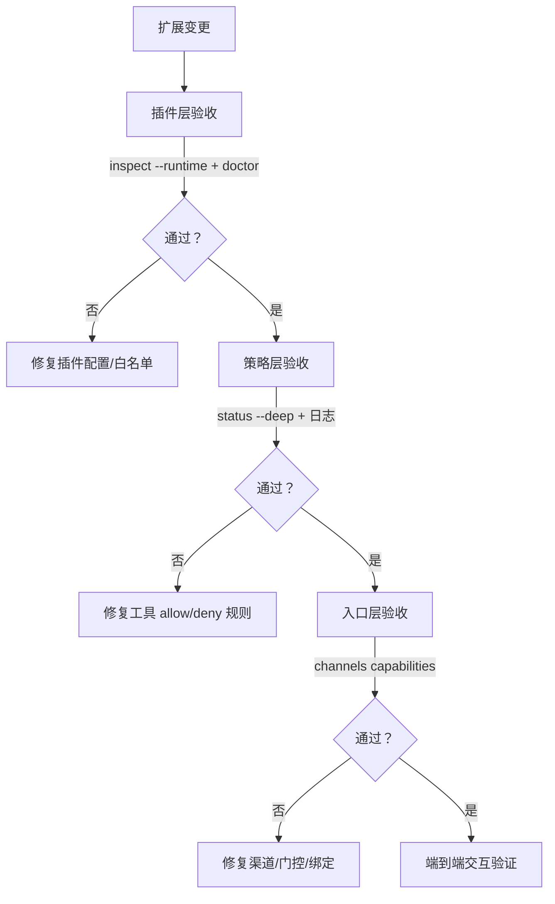
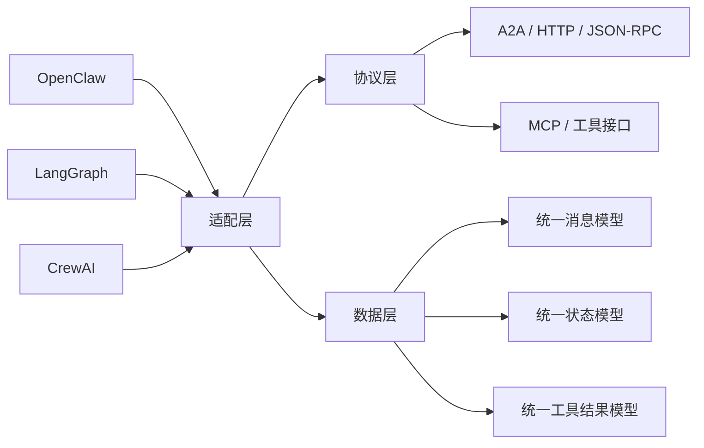

# 第十二章 插件扩展与生产落地

本章回答如何把 OpenClaw 用成长期可演进的平台能力。主线是插件体系与工具治理：插件如何启停与白名单化，工具如何纳入策略约束，扩展如何通过自检、探针与日志做成可回放完整流程，并最终形成可上线、可回滚的生产落地方案。通过本章，你将学会如何在保持稳定性的前提下，灵活地扩展 OpenClaw 的能力。

> [!NOTE]
> **与第五章的关系**：[第五章](../05_tools_skills/README.md)从使用者视角介绍工具系统的通识基础（工具分类、策略语义、技能与插件的协同定位）；本章从扩展开发者视角深入插件的工程机制（Hook 架构、生命周期、Manifest 校验），并聚焦生产落地（灰度上线、监控告警、部署检查清单、回滚流程）。如果你尚未阅读第五章，建议先了解工具策略的基本概念再进入本章。

## 学习目标

完成本章的阅读后，你将能够：
1. **开发插件**：理解插件开发的整个工程体系。
2. **编写工具**：设计安全、可控的自定义工具。
3. **测试扩展**：建立完整的测试与调试流程。
4. **上线部署**：从开发到生产的完整交付流程。

## 1. 插件开发体系：自定义扩展的工程机制

扩展能力的工程化关键不是“能不能加功能”，而是“扩展是否可控、可审计、可回滚”。OpenClaw 当前仍以插件体系作为扩展主入口：原生插件可以引入新的工具、渠道、模型供应商或运行时组件，并通过显式启用与白名单机制收敛风险；同时系统也能发现并导入兼容的 Codex、Claude、Cursor bundle，其中 Claude 支持默认目录布局的 manifestless bundle。需要特别区分的是：用户侧配置与 CLI 仍统一使用 `plugins.*` / `openclaw plugins ...`，而源码与发行产物中常会看到 `extensions/` 目录这一实现形态。本节基于最新官方文档与源码说明原生插件的核心结构、兼容 bundle 的边界，以及一组可用于验收的命令。

### 1.1 插件是什么：长驻进程内的 TypeScript/JavaScript 模块

与仅提供文本提示思路的技能（Skills）截然不同，**原生插件本质是运行在 Gateway 进程内的 TypeScript/JavaScript 扩展模块**。它们通过运行时加载器动态装入，可直接挂载自定义 Agent tools、注册聊天渠道、实现后台轮询服务，甚至接管特定 Hook 或 HTTP/RPC 能力。

官方文档对原生插件的定位、能力范围与加载方式给出了完整说明。其中最核心的安全与工程设计在于引入了 **`openclaw.plugin.json`** 清单文件。它声明插件 `id`、`configSchema`、`contracts.tools`、可选 `uiHints` 等元数据；运行时 `api.registerTool()` 注册的工具应与 manifest 中声明的工具所有权保持一致。系统在渲染配置表单或首轮校验时，**无需执行第三方插件代码**，直接通过清单文件进行 JSON Schema 验证。这避免了未经审查的代码自动执行的风险。同时也要注意，最新版本并不只有这一种插件格式；对兼容 bundle，OpenClaw 会识别 `.codex-plugin/plugin.json`、`.claude-plugin/plugin.json`、`.cursor-plugin/plugin.json` 以及 Claude manifestless 默认布局，并按兼容层规则导入可承接的能力。

如果插件通过 npm 包、压缩包等形式分发，发布包应在 `package.json` 的 `openclaw.extensions` 中声明插件入口列表；发布包的运行时文件路径可用 `openclaw.runtimeExtensions` 指向构建后的 JavaScript，并会在显式声明后受到校验。外部 ClawHub code plugin 还应维护 `openclaw.compat.pluginApi` 与 `openclaw.build.openclawVersion` 等兼容/构建元数据；`pluginSdkVersion`、`minHostVersion` 则更多是兼容提示，不能替代运行时校验。分工明确：`openclaw.plugin.json` 负责“这是什么插件、怎么配”的元数据声明，`package.json#openclaw.extensions` / `package.json#openclaw.runtimeExtensions` 负责“源码入口与发布运行时代码入口在哪里”的打包指引。

工程上建议把插件当作严肃的代码级系统依赖对待：

1. 插件版本进入版本控制与发布流程。
2. 插件的 `openclaw.plugin.json` 严格约束参数，不合规清单在 Gateway 启动期直接拒载。
3. 打包分发时维护 `package.json` 中的 `openclaw.extensions`，并在发布产物路径不同于源码入口时维护 `openclaw.runtimeExtensions`，避免安装后找不到入口。
4. 插件的工具与副作用被工具策略与白名单彻底约束绑定。

### 1.2 配置与启用：entries、enabled、config 与 load.paths

插件的启用通过 `plugins.entries` 声明。这里应优先把 **manifest 中的插件 ID** 视为权威键，而不是想当然地把 npm 包名当作最终配置键。即便源码目录常命名为 `extensions/<id>/`，对用户稳定暴露的治理接口仍是 `plugins.entries.<id>`。每个条目包含启用开关与插件自定义配置；CLI 层的 `openclaw plugins enable <id>` / `disable <id>` 本质上也是切换 `plugins.entries.<id>.enabled`。官方文档还提供了 `allow`、`deny`、`load.paths` 等字段的完整写法：[https://docs.openclaw.ai/tools/plugin](https://docs.openclaw.ai/tools/plugin)。需要补充的是：workspace 来源插件默认关闭，而 bundled plugin 遵循内建 default-on 集合，不应把“所有插件默认禁用”写成绝对规则。

下面示例展示了完整骨架：白名单准入 + 本地路径加载 + 启用插件并传入配置。

```jsonc
{
  plugins: {
    enabled: true,
    allow: ['my-plugin'],           // 白名单：仅允许列出的插件加载
    deny: ['untrusted-plugin'],     // 黑名单：deny 优先于 allow
    load: {
      paths: ['~/Projects/my-plugin'], // 本地开发中的插件目录
    },
    entries: {
      'my-plugin': {
        enabled: true,
        config: {
          // 插件自定义配置
        },
      },
    },
  },
}
```

为了降低供应链风险，建议配合白名单机制只允许经过审计的插件生效。

### 1.3 安全边界：插件白名单与工具策略协同

插件引入的是能力，能力的使用边界仍应由确定性的策略系统兜底。官方插件文档提供了 `plugins.allow` 与 `plugins.deny` 的白名单机制；官方工具文档提供了工具的允许、拒绝与分层策略机制，并强调拒绝规则优先：

- 插件白名单：[https://docs.openclaw.ai/tools/plugin](https://docs.openclaw.ai/tools/plugin)
- 工具治理：[https://docs.openclaw.ai/tools](https://docs.openclaw.ai/tools)

实践中建议采用“双层收敛”：

1. 先用 `plugins.allow` 收敛可加载插件集合。
2. 再用工具策略把插件提供的工具按风险分组，并在默认档案中拒绝高风险组。

进而可以将“扩展可用性”与“扩展可执行性”拆开管理，避免某个插件被安装后立即具备不受控副作用。

**具体例子：Jira 插件的灰度上线流程**

假设团队开发了一个 Jira 集成插件 `jira-sync`（npm 包名 `@yourteam/jira-sync`），能让智能体查询和创建工单。安全的上线路径如下：

1. **阶段一：白名单准入** ——只在 `plugins.allow` 中添加该插件，但在 `tools.deny` 中拒绝其写入工具，先只允许查询功能：

```jsonc
{
  plugins: {
    allow: ['jira-sync'],
    entries: { 'jira-sync': { enabled: true } },
  },
  tools: {
    deny: ['jira.create*', 'jira.update*', 'jira.delete*'],
  },
}
```

2. **阶段二：小范围放开写入** ——在内部 Telegram 群中，通过 `toolsBySender` 只允许管理员触发创建工单：

```jsonc
{
  channels: {
    telegram: {
      groups: {
        '*': {
          toolsBySender: {
            'id:admin_id_001': { alsoAllow: ['jira.create*'] },
          },
        },
      },
    },
  },
}
```

3. **阶段三：全量放开** ——在内部验证 2 周无异常后，移除 `tools.deny` 中的 Jira 写入限制，但保留审计日志与幂等键。

### 1.4 Hook 架构：插件的核心运行机制

插件的真正力量不在于“注册工具”，而在于 **Hook（钩子）系统**——插件通过在执行管线的关键节点注册钩子函数来拦截、修改或观测系统行为。书中这一节讨论的是**原生 OpenClaw 插件的 Hook 运行时**；兼容 bundle 中的 hooks 只会映射到 OpenClaw 可以安全承接的那一部分，不应把 bundle 文档里的任意钩子语义直接等同为 OpenClaw 原生运行时。

**常用钩子摘要**（不是完整列表；以当前 `docs/plugins/hooks` 和类型定义为准）：

#### 智能体生命周期钩子

| 钩子名称 | 执行模式 | 典型用途 |
|----------|----------|----------|
| `before_model_resolve` | 修改型 | 覆盖模型/供应商选择 |
| `agent_turn_prepare` | 修改型 | 在一次 agent turn 前准备上下文 |
| `before_prompt_build` | 修改型 | 注入上下文与系统提示词 |
| `before_agent_reply` | claim 型 | 可返回 `{ handled: true }` 合成或静默本轮回复 |
| `before_agent_finalize` | 修改/检查型 | 最终回答检查、补充处理或终止前清理 |
| `model_call_started` / `model_call_ended` | 观测型 | 观测模型调用生命周期 |
| `llm_input` | 观测型 | 审计 LLM 精确输入 |
| `llm_output` | 观测型 | 审计 LLM 精确输出 |
| `agent_end` | 观测型 | 分析已完成会话 |
| `before_compaction` | 观测型 | 观测或标注消息压缩过程（前置） |
| `after_compaction` | 观测型 | 观测或标注消息压缩过程（后置） |

#### 消息处理钩子

| 钩子名称 | 执行模式 | 典型用途 |
|----------|----------|----------|
| `message_received` | 观测型 | 消息到达后的旁路处理（即发即忘） |
| `inbound_claim` | claim 型 | 让插件按 first-claim-wins 规则接管入站消息 |
| `message_sending` | 修改型 | 修改或取消待发消息 |
| `reply_dispatch` | claim / dispatch 决策型 | 决定是否接管或改写回复投递目标；需要重写 outbound dispatch 时优先看 `before_dispatch` |
| `message_sent` | 观测型 | 消息发送后的确认 |
| `before_message_write` | 同步型 | JSONL 写入前的同步阻断 |

#### 工具调用钩子

| 钩子名称 | 执行模式 | 典型用途 |
|----------|----------|----------|
| `before_tool_call` | 修改型 | 拦截或修改工具参数 |
| `after_tool_call` | 观测型 | 观测工具执行结果 |
| `tool_result_persist` | 同步型 | 链式修改持久化消息 |

#### 子智能体钩子

| 钩子名称 | 执行模式 | 典型用途 |
|----------|----------|----------|
| `subagent_spawning` | 顺序型 | 配置线程绑定 |
| `subagent_delivery_target` | 顺序型 | 解析路由目标 |

#### 网关生命周期钩子

| 钩子名称 | 执行模式 | 典型用途 |
|----------|----------|----------|
| `gateway_start` | 观测型 | 网关启动时触发 |
| `gateway_stop` | 观测型 | 网关停止时触发 |

非 bundled 插件若需要读取完整 conversation 内容，通常还需要显式配置 `plugins.entries.<id>.hooks.allowConversationAccess=true`。涉及终端、审批或安装前控制的 hooks（如 `before_install`）也有各自门控，不能只看函数名判断权限。

**五种执行模式**：

- **观测型**（Void Hooks）：**并行执行**，不能修改状态，用于审计与旁路处理（如 `llm_input`、`message_sent`）。
- **修改型**（Modifying Hooks）：**按优先级顺序执行**（高优先级先执行），但并非所有修改结果都会作为下一钩子的输入；`before_tool_call` / `message_sending` 等会把多个 handler 的返回合并应用，只有 `tool_result_persist`、`before_message_write` 等特定同步 hooks 才是真正链式传递。
- **claim 型**：按优先级执行，首个返回 `handled: true` 的 handler 获胜并短路后续 handler。`inbound_claim` 和 `before_agent_reply` 都属于这类语义；不要用它们实现“多个插件依次改写最终答案”的需求。
- **顺序型**：与修改型类似按优先级链式执行，但专用于子智能体路由场景——如 `subagent_spawning`（配置线程绑定）和 `subagent_delivery_target`（解析路由目标），每个钩子可以补充或覆盖路由决策。
- **同步型**：在热路径上同步执行，系统会检测并拒绝意外的异步处理器。包括 `tool_result_persist`（链式修改持久化消息）和 `before_message_write`（JSONL 写入前的同步阻断）。

**全局 Hook Runner**：Gateway 启动时创建单例 Hook Runner，所有执行路径通过它统一调度。多数观测型钩子失败后会记录日志并继续运行；但 `before_tool_call` 这类守卫钩子可以 fail-closed，在必要时阻断被保护的操作。

**插件注册钩子的方式**：

```typescript
// 推荐：类型化 API
api.on("before_tool_call", (event, ctx) => {
  if (event.toolName === "dangerous_tool") {
    return { block: true, blockReason: "该工具在此会话中被禁止" };
  }
  return { params: { ...event.params, audited: true } };
}, { priority: 10 });

// 遗留：无类型 API
api.registerHook("hook_name", handler, { entry, register: true });
```

**结果合并策略**因钩子类型而异：`before_model_resolve` 采用首个非空结果获胜；`before_prompt_build` 拼接上下文与系统提示词；`before_tool_call` 合并参数与阻断状态但不会把上一个 handler 的修改作为下一个 handler 的输入；`message_sending` 首个取消操作获胜。

**渠道插件**是一种特殊插件类型，通过 `api.registerChannel()` 注册，可提供 15+ 种适配器接口（配置、网关、出站、消息处理等）。渠道插件深度集成子智能体路由——通过 `subagent_spawning` 钩子配置每会话的线程绑定，通过 `subagent_delivery_target` 钩子解析消息路由目标。

**插件加载的完整生命周期**：

1. **发现**：从 `plugins.load.paths`、workspace plugins、global plugins、bundled plugins 等来源收集候选插件；同 ID 的 workspace 插件在显式启用或 allowlist 后可有意 shadow bundled copy，duplicate 诊断用于提示来源冲突。
2. **校验**：读取 `openclaw.plugin.json` 清单，验证配置是否符合 JSON Schema。
3. **入口解析**：按插件目录或 `package.json#openclaw.extensions` / `package.json#openclaw.runtimeExtensions` 解析入口，并执行边界检查。
4. **注册**：同步调用插件的 `register(api)` 函数，插件通过 API 注册工具、钩子、渠道、服务、HTTP 路由等。
5. **激活**：所有插件注册完成后，构建 `PluginRegistry`，初始化全局 Hook Runner。
6. **运行**：在每个钩子点，系统通过 Hook Runner 调度已注册的处理器。

对应的生命周期可以简化为下面这张图：


图 12-1：插件从发现到运行期调度的生命周期

### 1.5 插件市场与 Bundle 兼容

除了手动在 `load.paths` 中指定本地路径外，OpenClaw 还支持从 ClawHub / marketplace 来源一键安装，也支持直接安装本地路径、压缩包与 npm 规格。ClawHub 是 OpenClaw 发行与发现的主路径；`--marketplace` 更适合 Claude-compatible marketplace 或 bundle 来源。对原生插件来说，最核心的识别文件仍是 `openclaw.plugin.json`；对兼容 bundle 来说，OpenClaw 会额外识别 `.codex-plugin/plugin.json`、`.claude-plugin/plugin.json`、`.cursor-plugin/plugin.json` 与 Claude manifestless 默认布局等入口。

当前官方 CLI 支持多种市场来源：Claude 已知 marketplace 名称、本地 marketplace 根目录或 `marketplace.json`、GitHub 仓库简写，以及 git URL。远程 marketplace 中的插件条目必须留在克隆出来的 marketplace 仓库内，并使用相对路径来源；不应把 HTTP(S)、绝对路径或二次 git 源写进远程 manifest。`--pin` 只适用于 npm 安装，不适用于 `--marketplace`。依赖安装发生在显式 install / update / doctor repair 流程中，而不是普通运行时隐式执行。写书时不应把某一种来源写成唯一官方形态。

安装方式：

```bash
# 从市场安装指定插件
openclaw plugins install <插件名>@<市场名>

# 列出市场中所有可用插件
openclaw plugins marketplace list <市场名>

# 更新已追踪插件
openclaw plugins update <id-or-npm-spec>
openclaw plugins update --all
```

此外，OpenClaw 可以发现并安装兼容的 **Codex、Claude 和 Cursor bundle**。系统会尝试把 bundle 中的技能、命令、settings 以及部分 hooks/agents 信息映射到 OpenClaw 可承接的能力面，但这种映射是“尽力兼容”而不是“逐字段等价”。根据当前官方插件 CLI 文档，已经明确说明会在 `inspect` / `doctor` 输出里展示被识别出的 bundle 能力，其中并非所有能力都会自动接入运行时执行。

> [!NOTE]
> Bundle 兼容性是选择性的：技能文件（如 `SKILL.md`）通常最容易映射；但涉及特定框架 API、运行时命令模型或平台专属 hooks 的部分，可能只会被部分加载，甚至被安全策略直接跳过。建议安装后通过 `openclaw plugins inspect <id>` 查看识别出的 bundle capabilities，再用 `openclaw plugins doctor` 排查加载错误、manifest/discovery 诊断与兼容性提示。

### 1.6 验收与排障：用插件诊断与状态深查做成完整流程

插件相关问题不应靠“对话试出来”。官方 CLI 提供了插件列表与诊断命令，可用于上线前验收与线上排障：[https://docs.openclaw.ai/cli/plugins](https://docs.openclaw.ai/cli/plugins)。

建议把以下命令固定为插件变更后的最小验收集：

```bash
openclaw plugins list
openclaw plugins inspect my-plugin
openclaw plugins inspect my-plugin --runtime --json
openclaw plugins doctor
openclaw gateway status --deep --require-rpc
```

当插件加载失败时，优先看 `plugins doctor`、`plugins inspect` 与 `gateway status --deep --require-rpc` 输出；当插件加载成功但行为异常时，再结合 `inspect --runtime --json` 和结构化日志按 `traceId` 回放单次链路。`openclaw plugins enable <id>` / `openclaw plugins disable <id>` 只更新配置并刷新 cold registry；要让已运行 Gateway 的 live runtime surfaces 生效，应显式重启或重载 Gateway，并用 `openclaw plugins inspect <id> --runtime --json` 与 `openclaw gateway status --deep --require-rpc` 复验。

```bash
openclaw logs --follow --json
```

## 2. 自定义工具：把副作用关进可控边界

自定义工具的难点不在“写一个函数”，而在“如何把副作用做成可控、可审计、可回滚的工程能力”。在 OpenClaw 中，插件负责引入工具能力，工具策略负责收敛可执行边界，多智能体与沙箱工具负责把高风险动作隔离在受控执行域。本节聚焦工具扩展的落地方法，强调配置层面的确定性约束与可验证的验收路径。

### 2.1 自定义工具的最小原则：输入可验证，输出可回放

将工具纳入系统之前，应先明确三项契约：

1. 输入约束：参数必须可验证，避免把“自由文本”直接作为高风险工具参数。
2. 输出约束：输出必须结构化，避免回注导致上下文膨胀。
3. 副作用边界：写操作必须具备幂等或对账路径，失败时必须给出人工核查步骤。

这些约束不依赖模型能力，属于工具设计的确定性底线。

#### 工具设计的常见反例

以下三个反例说明为什么上述约束缺一不可：

**反例一：把自由文本直接作为 shell 命令参数**

某个数据导出工具接受用户提供的表名作为参数，不做校验直接嵌入 SQL 查询字符串。攻击者可以注入 `; DROP TABLE users; --` 导致数据丢失。约束“输入可验证”要求参数必须通过白名单或正则模式验证，不允许自由文本直接参与高风险操作。

**反例二：工具输出未结构化，回注导致上下文膨胀**

某个日志查询工具输出整个日志文件的原始内容，模型无法解析，被迫通过多轮补全请求来理解结果。最终模型上下文中充斥大量冗余日志，导致后续推理变慢且易出错。约束“输出结构化”要求工具必须预先过滤与聚合，只返回关键字段，例如：`{ "error_count": 5, "latest_error": "...", "affected_services": [...] }`。

**反例三：写操作缺乏幂等键，重试导致重复创建**

某个工单创建工具没有实现去重逻辑，当网络超时导致重试时，系统会多次创建相同的工单。即使模型检测到重复，也无法自动回滚，最终需要人工清理。约束“副作用可回滚”要求写操作必须支持幂等键（如请求 ID）或显式提供回滚步骤（如“删除工单 ID 10001”）。

### 2.2 把工具接入工具策略：分层规则与拒绝优先

工具治理应落在工具策略层。官方文档给出了工具的允许、拒绝与按渠道/群组分层限制机制，并强调拒绝规则优先：[https://docs.openclaw.ai/tools](https://docs.openclaw.ai/tools)。

下面示例展示了一个常见写法：全局先禁止宿主机运行时工具，再在不同入口上决定是否继续收紧文件写能力。不要把某个工具放进全局 `deny` 后再指望后续 `toolsBySender` 把它恢复；拒绝规则优先。

```javascript
{
  tools: {
    profile: 'coding',
    deny: ['group:runtime'],
  },
  channels: {
    telegram: {
      groups: {
        '*': {
          tools: { deny: ['write', 'edit', 'apply_patch'] },
        },
      },
    },
    discord: {
      groups: {
        ops: {
          tools: { deny: ['group:runtime'] },
        },
      },
    },
  },
}
```

这样，Telegram 群入口只能读取和检索，Discord 的 `ops` 组仍可使用 `coding` profile 中未被拒绝的文件写工具，但两类入口都不能调用宿主机运行时工具。当某个请求触发了写工具但被拒绝时，日志应给出明确拒绝原因，便于追溯是策略拒绝还是参数不合法。

#### 工具注册的 TypeScript 签名

OpenClaw 插件使用 TypeScript 进行工具注册。常见写法是注册 tool object；需要运行时上下文或延迟构造时也可以注册 tool factory。参数 schema 通常使用 `Type.Object()`（基于 TypeBox，一个用于生成 JSON Schema 的类型构建库），执行逻辑通过 `execute(id, params)` 方法实现。以下示例展示了一个符合官方签名的工具注册流程，包含参数约束、错误处理与结构化返回：

```typescript
import { Type } from "@sinclair/typebox";

api.registerTool({
  name: "create_ticket",
  description: "Create a support ticket with validation",
  parameters: Type.Object({
    title: Type.String({ minLength: 5, maxLength: 200 }),
    category: Type.Union([
      Type.Literal("bug"),
      Type.Literal("feature"),
      Type.Literal("ops"),
    ]),
    priority: Type.Number({ minimum: 1, maximum: 5 }),
    assignee_id: Type.String({ pattern: "^[0-9a-f]+$" }),
  }),
  async execute(id, params) {
    // 执行层（带错误处理）
    try {
      const ticket = await ticketService.create({
        title: params.title,
        category: params.category,
        priority: params.priority,
        assignee_id: params.assignee_id,
        idempotency_key: id, // 用工具调用 ID 作为幂等键
      });

      // 结构化返回
      return {
        content: [{ type: "text", text: `Ticket ${ticket.id} created` }],
        details: {
          ticketId: ticket.id,
          status: ticket.status,
          createdAt: ticket.createdAt,
        },
      };
    } catch (err) {
      return { content: [{ type: "text", text: "internal error" }] };
    }
  },
});
```

关键点：(1) 参数 schema 使用 TypeBox 的 `Type.Object()` 声明，由框架在调用前自动校验，无需在 execute 中重复验证；(2) `execute(id, params)` 的 `id` 是框架分配的调用标识，可直接用作幂等键；(3) 返回值遵循 `AgentToolResult`，面向模型的内容放在 `content`，结构化追踪字段放在 `details`，不要把 `success` 视为必需顶层字段；(4) 每个 `api.registerTool(...)` 注册的工具还必须在 `openclaw.plugin.json` 的 `contracts.tools` 中声明；可选工具需要注册时传 `{ optional: true }`，并同时设置 `toolMetadata.<tool>.optional: true`。

### 2.3 工具版本管理与生命周期

生产环境的工具不能无限迭代。需要建立明确的版本管理与弃用策略，确保已部署的智能体行为不会因工具变更而破裂。

OpenClaw 官方目前未内置工具版本管理机制，但以下工程实践可以帮助团队自行管理工具的演进与弃用。推荐做法如下：

1. 工具定义中声明向后兼容性。当参数、返回值或行为变化时，应明确标记是否兼容。
2. 弃用期设置在 180 天以上。当某个工具版本进入弃用期时，应显式警告并给出升级窗口。
3. 记录工具调用链路上的版本号，便于追溯行为差异。

以下是一种团队自行维护的版本追踪方案示例（非官方配置格式，仅作工程参考）：

```javascript
// 团队内部的工具版本追踪文件（如 tool-versions.json），用于文档化管理
{
  tools: [
    {
      id: 'query_database',
      versions: {
        '1.0': {
          status: 'deprecated',
          params: ['query', 'timeout'],
          deprecatedAt: '2026-01-15',
          sunsetsAt: '2026-07-15',
          migrateToVersion: '1.1',
        },
        '1.1': {
          status: 'active',
          params: ['query', 'timeout', 'schema'],
        },
      },
    },
  ],
}
```

在工具调用日志中记录所选版本，便于定位是因版本差异导致的行为不一致：

```bash
openclaw logs --follow --json | jq -c 'select(.type=="log") | (.raw | fromjson? // {}) as $raw | select(($raw|tostring)|contains("query_database")) | {time, level, subsystem, raw:$raw}'
```

当前工具策略按工具名、glob 或分组匹配，并不解析内置的 `tool@version` 语法。需要版本级策略时，应把版本编码进不同工具名或插件配置，再用现有工具策略控制允许与拒绝。

### 2.4 工具组合与编排：多工具协作的确定性约束

单个工具的幂等性保证不足以处理复杂任务。当多个工具需要协作时，工具之间的依赖关系、执行顺序与数据流必须显式声明，而不是依赖模型的“推理”。

定义工具编排脚本时，建议采用声明式依赖图：

1. 显式声明工具调用的前置条件与后置验证。
2. 工具输出必须经过验证才能作为下一工具的输入。
3. 失败原子性：某工具失败时的回滚路径必须预先计划。

> [!NOTE]
> 下面是团队自定义编排层的伪配置，用于说明依赖图设计，不是当前 OpenClaw 内置 schema。需要运行时编排时，优先参考当前 Task Flow / Lobster 等官方能力或在插件中实现自己的工作流执行器。

```javascript
{
  tools: {
    orchestration: {
      workflows: [
        {
          id: 'deploy_service',
          steps: [
            {
              tool: 'validate_config',
              params: { config_path: '/config.yaml' },
              required: true,
              onFailure: 'abort',
            },
            {
              tool: 'build_image',
              params: { source: '/src', tag: 'service:latest' },
              requires: ['validate_config'],
              requiredOutputSchema: { passed: 'boolean' },
            },
            {
              tool: 'push_registry',
              params: { image: 'service:latest', registry: 'internal' },
              requires: ['build_image'],
              requiredOutputSchema: { imageId: 'string' },
            },
            {
              tool: 'deploy_canary',
              params: { image: 'service:latest', replicas: 1 },
              requires: ['push_registry'],
              onFailure: 'rollback_to:previous_image',
            },
          ],
        },
      ],
    },
  },
}
```

工具编排执行时，每步的输入输出都应被记录在日志中，便于后续重放与定位：

```bash
openclaw logs --follow --json | jq -c 'select(.type=="log") | (.raw | fromjson? // {}) as $raw | select(($raw|tostring)|contains("deploy_service")) | {time, level, subsystem, message, raw:$raw}'
```

### 2.5 高风险工具的隔离执行：多智能体沙箱工具

对于涉及代码执行、文件写入或系统操作的高风险工具，建议配合多智能体沙箱工具将执行域隔离出来。官方文档给出了沙箱工具的能力边界与认证配置，并指出认证配置文件位于 `~/.openclaw/agents/<agentId>/agent/auth-profiles.json`：[https://docs.openclaw.ai/tools/multi-agent-sandbox-tools](https://docs.openclaw.ai/tools/multi-agent-sandbox-tools)。

工程上建议采用“少数智能体拥有写能力”的模式：

1. 大多数入口智能体只允许读工具与诊断命令。
2. 少数运维智能体在明确入口与审计前提下允许沙箱写工具。

这与第 7 章的入口绑定与路由策略配合使用，可以把越权风险收敛到可计算范围。

#### 沙箱工具的认证配置

沙箱工具执行高风险操作时必须基于明确的认证身份。认证配置文件 `~/.openclaw/agents/<agentId>/agent/auth-profiles.json` 定义了沙箱环境中可用的认证凭证与权限边界，确保写工具只能在授权范围内执行。例如，可以为某个运维智能体配置 SSH 密钥或 API Token，使其只能操作指定的基础设施资源，而读工具则不受认证限制。这种认证隔离配合前述的工具策略拒绝规则，形成多层防御。

### 2.6 验收与排障：先看策略加载，再看单次调用链

自定义工具上线后的验收建议固定为两步：

1. 配置验收：用 `openclaw config get tools --json` 和对应渠道配置路径确认声明式策略已加载，再用 `openclaw sandbox explain --agent <id> --json` 查看实际沙箱/工具策略。
2. 行为验收：用结构化日志观察工具调用与拒绝事件，确保拒绝规则生效。

```bash
openclaw config get tools --json
openclaw sandbox explain --agent <id> --json
openclaw logs --follow --json
```

如果发现工具被误允许，优先回到工具策略检查 deny 与渠道/群组级策略限制；如果发现工具执行失败，优先区分外部依赖故障与参数不合法，再决定是否允许有界重试。

## 3. 测试与调试：把扩展做成可回放的工程完整流程

扩展工程最难的不是写代码，而是把变更做成可验证、可回滚、可定位。插件、工具策略与渠道策略叠加后，任何一个环节的偏差都可能表现为“智能体不工作”。本节给出一套面向 OpenClaw 的扩展测试与调试流程，强调用官方自检与探针命令建立证据链，而不是靠对话猜测。

### 3.1 验收范围：分层验证而不是一次性端到端

建议把扩展验收拆成三层，按层级逐步合并。下面的流程图展示了分层验收的推荐路径：



图 12-2：扩展变更后的分层验收路径

1. 插件层：插件是否被加载、配置是否通过校验、白名单是否生效。
2. 策略层：工具策略是否按预期允许或拒绝，拒绝原因是否可见。
3. 入口层：渠道是否在线、门控是否生效、绑定是否命中。

这种分层的好处是定位快：当端到端失败时，先用每层的自检命令把范围收敛，再回到具体变更点。

### 3.2 最小自检命令：先 doctor，再 status，再各类探针

官方 CLI 提供了自检、状态与诊断命令。建议将下面这组命令作为扩展变更后的最小验收集：

- 自检：[https://docs.openclaw.ai/cli/doctor](https://docs.openclaw.ai/cli/doctor)
- 状态：[https://docs.openclaw.ai/cli/status](https://docs.openclaw.ai/cli/status)
- 插件：[https://docs.openclaw.ai/cli/plugins](https://docs.openclaw.ai/cli/plugins)
- 渠道：[https://docs.openclaw.ai/cli/channels](https://docs.openclaw.ai/cli/channels)
- 模型：[https://docs.openclaw.ai/cli/models](https://docs.openclaw.ai/cli/models)

```bash
openclaw doctor
openclaw gateway status --deep --require-rpc
openclaw plugins doctor
openclaw plugins inspect my-plugin --runtime --json
```

> [!NOTE]
> 上述四条命令为官方 CLI 已稳定支持的自检命令。若还要继续确认渠道能力或模型可用性，可再看 `channels capabilities`、`models status` / `models status --probe`；相关参数与输出仍应以 `openclaw --help` 和官方文档为准。

当这些命令中任意一项失败，优先修复失败项，而不是继续做端到端交互。

### 3.3 快照测试：配置与行为的基线对比

扩展变更后，最容易出现的问题是“配置改了，但预期结果变了”。快照测试通过保存已知良好的配置与行为输出作为基线，在每次变更后对比快照，快速发现回归。

快照包含两部分：配置快照与行为快照。配置快照应记录工具策略、插件配置、渠道策略的当前完整状态；行为快照应记录典型请求的响应输出与工具调用序列。

```bash
# 生成当前状态快照（先用当前版本稳定支持的文本或 JSON 输出）
openclaw status --deep > snapshots/status-baseline.txt
openclaw plugins list > snapshots/plugins-baseline.txt
openclaw plugins doctor > snapshots/plugins-doctor-baseline.txt
```

> [!NOTE]
> 这里的重点是“为当前版本保存一份可比较的基线”，而不是依赖某个固定的 `--format json` 参数名。如果你的 CLI 明确支持 JSON 输出，当然优先保存 JSON；如果不支持，就保存当前版本能稳定导出的文本结果，再通过脚本做结构化比对。

行为快照则需通过实际对话交互生成。由于 `openclaw invoke` 尚不是官方稳定命令，建议通过脚本向已配置的渠道发送测试消息，并从结构化日志中捕获响应：

```bash
# 从日志中提取最近的工具调用事件作为行为基线
openclaw logs --json | jq -c 'select(.type=="log") | (.raw | fromjson? // {}) as $raw | select(($raw|tostring)|contains("tool")) | {time, level, subsystem, raw:$raw}' \
  | tail -20 > snapshots/behavior-baseline.json
```

快照对比脚本应检查以下内容：

1. 工具允许集合是否变化（是否意外放开或禁止了工具）。
2. 工具调用序列是否改变（是否因插件或策略改动导致调用顺序变化）。
3. 关键输出字段是否改变（版本号、返回值结构等）。

```bash
#!/bin/bash
# scripts/snapshot-diff.sh
# 用法：bash scripts/snapshot-diff.sh ./snapshots ./snapshots-new

set -u

if [ "$#" -ne 2 ]; then
  echo "Usage: $0 <baseline-dir> <current-dir>" >&2
  exit 2
fi

BASELINE=$1
CURRENT=$2
failed=0

compare_snapshot() {
  local label=$1
  local file=$2

  echo "=== ${label} Diff ==="
  if diff -u "$BASELINE/$file" "$CURRENT/$file"; then
    echo "PASS: ${label} unchanged"
  else
    echo "FAIL: ${label} changed"
    failed=1
  fi
}

compare_snapshot "Config Snapshot" "status-baseline.txt"
compare_snapshot "Plugin Snapshot" "plugins-baseline.txt"
compare_snapshot "Plugin Doctor" "plugins-doctor-baseline.txt"

exit "$failed"
```

在 CI/CD 流程中，快照对比应作为部署前的强制门控：变更必须通过快照校验或明确增加新的快照基线。

### 3.4 回放定位：按 traceId 还原一次请求链路

扩展相关的调试建议以“回放”而不是“猜测”为核心。做法是：

1. 在复现问题时记录 `traceId`。
2. 跟随 JSON 日志并按 `traceId` 过滤，观察路由、工具拒绝、插件诊断等关键事件。

```bash
openclaw logs --follow --json | jq -c 'select(.type=="log") | (.raw | fromjson? // {}) as $raw | select(($raw|tostring)|contains("<TRACE_ID>")) | {time, level, subsystem, message, raw:$raw}'
```

如果日志显示工具被拒绝，应回到工具策略检查拒绝规则；如果日志显示插件未加载或配置无效，应优先看 `plugins doctor` 的诊断输出。

### 3.5 自动化测试流水线：CI/CD 中的扩展验证

扩展变更应纳入 CI/CD 流程，把手工验收自动化。推荐的流水线设计包括：配置校验、快照对比、沙箱集成测试、灰度部署。

下面是一个典型 CI 配置示例（以 GitHub Actions 为例）：

```yaml
name: Extension Verification

on: [push, pull_request]

jobs:
  verify:
    runs-on: ubuntu-latest
    steps:
      # 步骤 1: 配置校验（使用官方稳定命令）
      - name: Validate Plugin Configuration
        run: |
          openclaw doctor
          openclaw plugins doctor
          openclaw gateway status --deep --require-rpc
          openclaw plugins inspect my-plugin --runtime --json

      # 步骤 2: 快照对比
      - name: Run Snapshot Tests
        run: |
          openclaw status --deep > /tmp/status-baseline.txt
          openclaw plugins list > /tmp/plugins-baseline.txt
          openclaw plugins doctor > /tmp/plugins-doctor-baseline.txt
          bash scripts/snapshot-diff.sh ./snapshots /tmp

      # 步骤 3: 单元测试（插件 SDK 注册契约）
      - name: Unit Tests
        run: |
          pnpm test -- plugins/my-plugin/**/*.test.ts

      # 步骤 4: loader-backed smoke test（验证 manifest + runtime 注册）
      - name: Integration Tests
        run: |
          pnpm test -- plugins/my-plugin/loader-smoke.test.ts

      # 步骤 5: 灰度模拟
      - name: Canary Simulation
        run: |
          bash tests/canary/simulate-rollout.sh --dry-run
```

> [!NOTE]
> 上述流水线中的 `openclaw doctor`、`openclaw plugins doctor`、`openclaw gateway status --deep --require-rpc` 与 `openclaw plugins inspect my-plugin --runtime --json` 为当前更适合插件 runtime 验证的组合。部署步骤（如灰度发布）因团队基础设施而异，此处仅展示验证阶段的参考结构。

每个步骤失败都应停止流程，防止错误配置进入生产。关键的集成测试脚本应覆盖：

1. 单个工具的输入验证与输出结构。
2. 工具被正确拒绝的场景（工具策略与访问控制）。
3. 多工具编排的依赖与执行顺序。
4. 工具调用日志的可追溯性。

集成测试需通过渠道发送消息并从结构化日志中验证结果。以下是一个基于日志验证的集成测试脚本示例：

```bash
#!/bin/bash
# tests/integration/test-tool-chains.sh
# 通过日志验证工具调用行为，而非直接调用 CLI 子命令

set -euo pipefail

TMP_DIR="$(mktemp -d)"
LOG_FILE="$TMP_DIR/openclaw-test.log"
LOG_PID=""

cleanup() {
  if [ -n "$LOG_PID" ]; then
    kill "$LOG_PID" 2>/dev/null || true
    wait "$LOG_PID" 2>/dev/null || true
  fi
  rm -rf "$TMP_DIR"
}
trap cleanup EXIT

echo "=== Test 1: 启动 Gateway 并收集日志 ==="
openclaw logs --follow --json > "$LOG_FILE" &
LOG_PID=$!
for _ in {1..10}; do
  [ -s "$LOG_FILE" ] && break
  sleep 1
done

echo "=== Test 2: 验证工具策略加载 ==="
# 从 status 输出中确认 deny 规则已生效
openclaw status --deep | grep -q "deny" || {
  echo "FAIL: Tool deny rules not found in status"
  exit 1
}
echo "PASS: Tool deny rules loaded"

echo "=== Test 3: 验证插件加载状态 ==="
openclaw plugins doctor || {
  echo "FAIL: Plugin doctor reported issues"
  exit 1
}
echo "PASS: All plugins healthy"

echo "=== Test 4: 检查日志中的工具拒绝事件格式 ==="
# 在运行本检查前，先通过策略层探针或手工交互触发一次已知会被拒绝的工具调用；
# 这里仅验证拒绝事件是否包含必要字段（traceId、spanId、tool、reason）。
echo "请在 30 秒内触发一次预期会被拒绝的工具调用..."
deadline=$((SECONDS + 30))
found=0
while [ "$SECONDS" -lt "$deadline" ]; do
  if jq -e 'select(.type=="log") | (.raw | fromjson? // {}) | select((.event=="blocked_tool_call" or .event=="tool_call_blocked") and .traceId and .spanId and .tool and .reason)' "$LOG_FILE" >/dev/null 2>&1; then
    found=1
    break
  fi
  sleep 1
done

if [ "$found" -ne 1 ]; then
  echo "FAIL: no structured tool blocked event found"
  exit 1
fi
echo "PASS: Tool denial events are structured"

echo "All integration tests passed."
```


### 3.6 灰度与回滚：用显式开关把风险降到可控范围

扩展上线建议采用灰度策略：

1. 配置层面保留显式启停开关，例如插件条目中的 `enabled`。
2. 白名单收敛到最小集合，先覆盖少量入口或少量对端。
3. 发生异常时先回滚开关与白名单，再回滚代码版本。

官方插件文档说明了如何通过 `enabled` 快速启停插件，并通过白名单控制可用范围：[https://docs.openclaw.ai/tools/plugin](https://docs.openclaw.ai/tools/plugin)。

## 4. 生产落地蓝图：扩展可控化

扩展进入生产后，风险主要来自三处：扩展本身引入的新能力、配置叠加后的边界漂移、以及排障时的不可回放。本节给出一套面向 OpenClaw 的生产落地蓝图，强调把插件、工具策略、密钥注入、日志脱敏与验收命令固化为流程，让扩展的生命周期可控、可审计、可回滚。

### 4.1 发布与回滚：配置即代码，启停即开关

生产落地建议把扩展拆为两类变更并分别治理：

1. 代码变更：插件版本升级，进入常规发布流程。
2. 配置变更：插件启停、白名单、工具策略与渠道策略，进入配置发布流程。

官方插件体系支持通过 `enabled` 显式启停插件，并通过 `plugins.allow` 与 `plugins.deny` 收敛可加载范围：[https://docs.openclaw.ai/tools/plugin](https://docs.openclaw.ai/tools/plugin)。

实践中建议把“回滚”设计为优先级最高的动作：出现异常时先停插件或收敛白名单，再回滚版本，减少故障扩散。

### 4.2 安全基线：白名单、拒绝优先与密钥环境注入

扩展能力的安全边界建议采用三层收敛：

1. 插件白名单：只允许经过审计的插件加载。
2. 工具策略：默认拒绝高风险工具组，拒绝规则优先。
3. 密钥注入：所有密钥用 `${VAR}` 或 `SecretRef` 从环境变量或密钥系统注入，避免明文入库。

相关机制在官方安全与配置文档中有明确说明：

- 安全建议：[https://docs.openclaw.ai/gateway/security](https://docs.openclaw.ai/gateway/security)
- 配置参考：[https://docs.openclaw.ai/gateway/configuration](https://docs.openclaw.ai/gateway/configuration)
- 工具治理：[https://docs.openclaw.ai/tools](https://docs.openclaw.ai/tools)

为了避免排障数据成为新的泄露通道，建议启用日志脱敏与屏蔽环境变量输出，并把诊断输出落到受控路径。

### 4.3 可靠性与降级：把不可用变为可用

扩展进入生产后，最常见的不可用来自上游依赖与模型供应商。建议将降级能力前置为配置：

- 结合重试策略，对瞬时错误做有界重试，并对不可重试错误快速失败：[https://docs.openclaw.ai/concepts/retry](https://docs.openclaw.ai/concepts/retry)。
- 结合模型故障切换，为关键智能体配置回退链路，避免单点供应商故障：[https://docs.openclaw.ai/concepts/model-failover](https://docs.openclaw.ai/concepts/model-failover)。

同时应将结构化日志与告警联动，确保回退与降级发生时可被快速感知与定位。

### 4.4 生产部署检查清单

在扩展正式发布到生产环境前，需要通过一份完整的部署检查清单，确保配置、依赖与回滚方案都已到位。

**配置验证**

1. 确保所有敏感配置（API 密钥、凭证等）已通过 `${VAR}` 或 `SecretRef` 从环境变量或密钥系统中注入，不存在明文凭证
2. 验证插件白名单 `plugins.allow` 与黑名单 `plugins.deny` 配置正确，只加载经过审计的插件
3. 检查工具策略：高风险工具（Shell、Exec、网络访问等）的拒绝规则优先，确认 `tools.deny` 覆盖了不必要的能力
4. 确认日志脱敏配置生效，日志输出中不会暴露凭证、密钥、敏感参数

**依赖检查**

1. 列出扩展所依赖的所有外部服务（模型供应商、数据库、API 服务等）
2. 为每项依赖配置降级链路或故障转移策略：
   - 多模型供应商：配置模型故障转移（Model Failover）
   - 数据库：验证连接超时与重试策略已配置
   - 第三方 API：验证限流（Rate Limit）与熔断（Circuit Breaker）规则已生效
3. 预留隔离措施：若某个依赖故障，确认整个智能体不会完全瘫痪，而是降级到有限功能

**回滚计划**

1. 为扩展编制详细的回滚 Runbook，包含以下场景：
   - 插件版本导致的故障：回滚至上一个稳定版本，或直接禁用插件（通过 `enabled: false`）
   - 配置错误：逐项验证并改正配置，优先修复 Deny 规则而非移除 Allow 规则
   - 密钥失效：按照 11.1 密钥轮换流程应急切换
2. 准备一个快速回滚命令脚本：
   ```bash
   # 快速禁用有问题的插件（以 jira-sync 为例）
   openclaw config set plugins.entries.jira-sync.enabled false
   # 插件/Hook 配置变更后显式重启或 reload Gateway，不要假设原地热重载已经生效
   openclaw gateway restart
   ```
3. 验证回滚操作本身不会引入新的风险或导致数据不一致

### 4.5 生产环境监控：关键指标与告警阈值

扩展上线后，需要建立完整的观测体系，持续监控系统的健康状态。

**关键性能指标（KPI）**

1. **模型调用延迟与成功率**：
   - 监控平均响应时间（P50/P95/P99），设定告警阈值（如 P99 > 30s 时告警）
   - 监控调用成功率，设定阈值（如成功率 < 95% 时告警）
   - 监控按不同 provider、agent、node 维度的延迟分布，快速定位瓶颈

2. **工具执行性能**：
   - 记录每个工具的执行耗时与失败率
   - 对于“写工具”（如数据库更新、API 调用），监控事务一致性与幂等性验证是否通过
   - 对于外部 API 调用，监控限流（Rate Limit）触发频率，若频繁触发应考虑扩容或优化调用策略

3. **资源占用**：
   - 监控 Gateway 进程的 CPU、内存与网络 I/O 占用
   - 监控本地存储空间使用（特别是 Session 日志与向量索引存储），设定告警（如磁盘 > 85% 满时）
   - 监控运行时的事件循环延迟（Event Loop Lag）、活跃句柄数与连接数，检测是否有泄漏

4. **错误与异常**：
   - 分类监控不同类型的错误：认证失败、限流、超时、业务逻辑错误等
   - 对于重点智能体，设定关键错误的告警机制（如写操作失败、Approval 被拒绝等）
   - 定期回顾错误日志，识别新出现的错误模式

**告警规则示例**

```yaml

rules:
  # 模型调用成功率 < 95%（5分钟窗口），立即告警
  - alert: ModelCallSuccessRate < 0.95
    for: 5m
    action: notify via slack, email

  # P99 延迟 > 30 秒（10分钟窗口），升级告警
  - alert: ModelCallLatencyP99 > 30s
    for: 10m
    action: notify ops team, trigger auto-scaling

  # 磁盘使用 > 85%，预警性告警
  - alert: DiskUsagePercent > 0.85
    for: 30m
    action: notify for cleanup

  # 模型供应商限流频繁触发，表示流量超过配额
  - alert: RateLimitExceeded > 10 per hour
    for: 15m
    action: notify for capacity review
```

**日志收集与回放**

1. 启用结构化日志输出（JSON 格式），便于日志聚合系统（如 ELK/Loki）与指标采集系统（如 Prometheus）的处理
2. 配置日志脱敏规则，在落地日志前删除或掩码敏感信息
3. 为关键操作（如写工具调用、Approval 审批、密钥轮换）设置审计日志，独立存储与长期保留
4. 在故障发生时，快速定位相关日志窗口：
   ```bash
   # 持续跟随 Gateway 结构化日志
   openclaw logs --follow --json
   ```


### 4.6 运维与验收清单：把“能跑”变成“可证明”

建议将以下命令作为生产环境的日常验收与排障入口，并在扩展发布或配置变更后强制执行：

```bash
openclaw doctor
openclaw health --json
openclaw status --deep
openclaw plugins doctor
openclaw channels capabilities
openclaw models status
openclaw models status --probe
openclaw logs --follow --json
```

广播组适合 WhatsApp 等入站消息的同 peer 多智能体 fan-out：一条用户消息触发多个 agent 并行处理，然后按配置汇总或分别响应。它不是通用的对外通知群发/批量投递机制；生产中的外发通知应优先用显式 `message` 工具、渠道投递配置、webhook 或业务队列实现，并严格限制触发入口。

## 5. 主流框架互操作性指南

讨论互操作时，最容易犯的错误是先罗列框架清单、协议名称和迁移步骤，却没有先回答一个更根本的问题：**为什么要互操作，而不是选定一个框架一路做下去**。本节先建立这个判断框架，再解释互操作的架构层次、三种典型落地模式，以及 OpenClaw 与其他框架在系统边界上的本质差异。

### 5.1 为什么需要互操作

单一框架通常更简单，但在以下场景里，互操作是合理的工程选择：

- **渐进迁移**：企业已有 LangGraph、CrewAI 或自研 Agent 系统，不可能一次性迁到 OpenClaw。
- **能力复用**：希望保留旧系统里的工作流、工具封装或 Agent 资产，而不是全部重写。
- **系统解耦**：把“生产入口治理”和“复杂推理编排”拆给不同系统，各自发挥长项。

互操作真正解决的问题，不是“把所有框架接在一起看起来更高级”，而是让系统在迁移期、混合部署期和多团队协作期保持连续性。如果只是单个新项目、单一团队、单一部署目标，优先选定一个框架往往更划算。

### 5.2 互操作的三层架构

要把互操作讲系统，最关键的是把它拆成三层：**适配层、协议层、数据层**。不同框架之间并不是直接“互相调用”，而是先经过适配层，把能力对齐到共同的协议与数据模型上。



图 12-3：跨框架互操作的三层架构

三层分别负责的事情不同：

- **适配层**：处理“某个框架怎么接进来”。例如把 LangGraph 的状态机运行、CrewAI 的任务代理、OpenClaw 的会话与工具调用映射到统一入口。
- **协议层**：处理“通过什么通道通信”。常见形态包括 A2A、HTTP/JSON-RPC、MCP 或本地运行时桥接。
- **数据层**：处理“双方到底交换什么”。没有统一消息、状态和工具结果模型，协议再标准也会互相误解。

### 5.3 三种典型落地模式

真正落地时，互操作通常不会是抽象的“任意互联”，而是落在下面三种模式之一。

#### 1. 本地嵌入式互操作

这种模式下，多个框架运行在同一进程或同一宿主环境中，通过适配器直接调用。

- 适用：实验环境、同一团队维护、低网络开销需求。
- 优点：延迟低、调试直接、协议转换少。
- 代价：部署边界不清晰，升级耦合度高。

#### 2. 远程服务式互操作

这种模式下，OpenClaw 与其他框架通过 HTTP、JSON-RPC、gRPC 或 A2A 等协议跨进程或跨主机通信。

- 适用：团队边界明确、需要独立部署与扩缩容。
- 优点：系统边界清楚，服务可独立演进。
- 代价：网络延迟、鉴权、重试与幂等问题都会浮出水面。

#### 3. 外部框架桥接式互操作

这种模式下，OpenClaw 不直接“理解”外部框架，而是通过桥接层统一做消息规范化、工具转译和状态同步。

- 适用：已有异构系统，需要平滑接入而非彻底重写。
- 优点：迁移成本可控，旧系统资产能保留。
- 代价：适配层会变成新的复杂点，协议漂移和调试复杂度上升。

如果从工程治理角度看，这三种模式的差别不在“技术栈”，而在**边界在哪里定义**：是定义在进程内、服务间，还是适配层本身。

### 5.4 OpenClaw 与其他框架的关键差异

理解互操作的前提，不是背框架功能表，而是看清它们各自优化的目标。

| 维度 | OpenClaw | LangGraph | CrewAI |
|------|----------|-----------|--------|
| 主要目标 | 生产入口治理与可靠运行 | 灵活编排与状态控制 | 快速构建高层工作流 |
| 核心优势 | 多渠道、权限治理、运行审计 | 条件分支、图式流程、可组合性 | 易上手、任务组织直观 |
| 典型短板 | 深度图式编排不如专用框架灵活 | 生产治理与渠道接入要自己补 | 大规模工程治理能力较弱 |

从互操作角度，最重要的不是“谁更强”，而是**保留各自强项**：

- OpenClaw 适合做生产入口、会话治理、权限收敛和工具边界控制。
- LangGraph 适合做复杂条件分支、状态图式编排和研究型工作流。
- CrewAI 更适合高层任务编排和快速验证多角色协作。
- [Symphony](https://github.com/openai/symphony) 是 OpenAI 的外部 engineering preview，可作为“项目看板驱动编码智能体”的参考；它不属于 OpenClaw 的内置互操作面，也不应与 OpenClaw、LangGraph、CrewAI 作为同级运行框架直接对比。

这也是为什么互操作不应该变成“所有东西都迁到同一抽象里”。更好的做法是：让 OpenClaw 管生产边界，让其他框架保留它们在编排或工作流上的专长。

LangGraph 的 `conditional_edges` 与 OpenClaw 的路由，就是一个典型对比：

- LangGraph 偏函数式决策，优势是灵活。
- OpenClaw 偏配置式决策，优势是可审计、可版本化、可治理。

如果你的系统同时需要这两者，最合理的不是选边站，而是明确“谁负责入口决策，谁负责内部编排”。

### 5.5 协议与数据模型：A2A 只是其中一种选择

很多互操作讨论一上来就讲 A2A，容易让人误以为它是唯一正统路径。实际上，A2A 只是协议层的一种选择。

当前常见的协议层方案包括：

- **A2A**：适合标准化 Agent-to-Agent 发现与通信。OpenClaw 已内置 A2A 渠道插件，按 A2A 1.0 的 JSON-RPC 绑定对外提供公开 Agent Card 发现与带鉴权的文本任务提交，也可反向给已配置的 peer agent 发消息。
- **HTTP / JSON-RPC**：实现门槛低，适合服务式桥接。
- **MCP**：可暴露 tools、resources 和 prompts；在 OpenClaw 中，`mcp serve` 还可把 routed channel conversations 桥接给 MCP 客户端，`mcp list/show/set/unset` 则管理运行时要消费的外部 MCP server 定义。
- **本地运行时桥接**：适合单机或嵌入式集成，省去网络协议开销。

不管采用哪种协议，数据层都需要统一最小模型。下面是一个足够实用的统一消息骨架：

```typescript
interface UnifiedAgentMessage {
  agent_id: string;
  content: string;
  message_type: "text" | "tool_call" | "error";
  metadata: Record<string, unknown>;
  source_framework: "openclaw" | "langgraph" | "crewai";
}

interface UnifiedAgentState {
  agent_id: string;
  current_task: string;
  context: Record<string, unknown>;
  tool_results: Record<string, unknown>;
  message_history: Array<{ role: string; content: string }>;
  metadata: Record<string, unknown>;
}
```

这里真正重要的，不是字段长什么样，而是统一三件事：

- 消息如何表示
- 状态如何表示
- 工具结果如何表示

没有这三件事，所谓“协议兼容”通常只停留在传输层，到了业务层还是会崩。

### 5.6 迁移路径与决策建议

如果已经决定做互操作，迁移顺序建议固定成下面这条路径：

1. **先判定是否真的需要互操作**：如果单框架足够，就不要引入额外复杂度。
2. **先搭适配层，再谈协议细节**：先把边界收敛清楚，再决定用 A2A、MCP 还是 HTTP。
3. **先统一最小数据模型，再扩字段**：优先确保消息、状态、工具结果可对齐。
4. **先做单 Agent 验证，再做多 Agent 编排**：不要一开始就做全链路混合编排。
5. **最后才做性能与发布决策**：延迟、吞吐、重试、故障恢复都应在验证后评估。

迁移前尤其要问清楚四个问题：

- 这个系统是为了渐进迁移，还是为了长期双栈共存？
- 边界放在哪一层最稳定：入口层、协议层，还是适配层？
- 哪一侧负责权限与治理，哪一侧负责编排与推理？
- 多一层适配带来的复杂度，是否值得换来资产复用？

最后给一个实用判断：

- **该做互操作**：已有历史系统、跨团队共建、需要保留专长框架、生产入口必须治理。
- **不该做互操作**：单团队新项目、需求明确、系统规模不大、性能和调试复杂度更重要。

因此，互操作不是默认选项，而是一种有明确收益、也有明确代价的系统设计决策。
