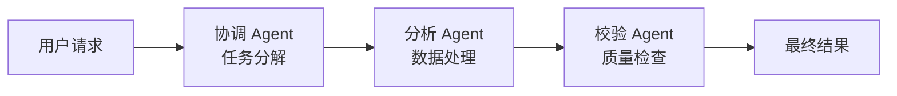
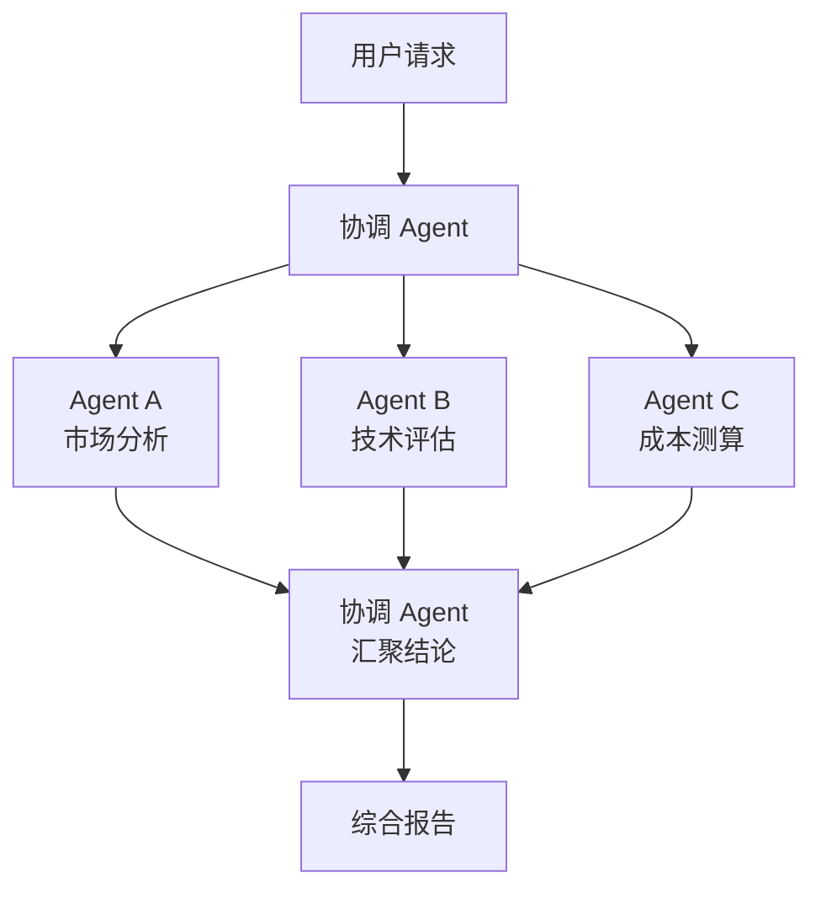

# 第十六章 与主流 AI 生态集成

本章介绍 OpenClaw 与主流 AI 模型生态的集成实践，涵盖 Anthropic Claude、OpenAI、以及以 Ollama 为代表的本地模型。第四章已讲清模型供应商接入和 Fallback 配置的基础用法，本章在此基础上聚焦各生态的特有能力、接入要点，以及在 OpenClaw 中统一管理多生态模型的实践模式。

## 1. Claude 模型接入与 MCP 生态集成

本节讲清 OpenClaw 如何与 Claude 模型家族对接，以及如何通过 MCP 协议将外部数据源和工具接入智能体。模型供应商接入的基础配置已在 [4.2 模型供应商接入与认证方式](../04_config_models/4.2_provider_access.md) 中详述，模型选择与 Fallback 链路见 [4.3](../04_config_models/4.3_model_selection.md) 和 [4.4](../04_config_models/4.4_failover.md)。本节在此基础上，聚焦 Claude 生态特有的集成要点。

### 1.1 Claude 模型家族速览

Anthropic 的 Claude 模型长期按能力与成本分为三个系列（2026-06-09 起，新一代 Fable 5 / Mythos 5 位于这三档之上；两者曾于 2026-06-12 被暂停访问，官方模型页此后已恢复 Fable 5 为正常提供、Mythos 5 为受限可用）：

| 系列 | 定位 | 上下文（当前 OpenClaw 侧） | 备注 |
|------|------|---------------------------|------|
| **Haiku 4.5** | 低延迟、低成本 | 200K | 适合高频低成本场景；支持 Extended Thinking（非 Adaptive） |
| **Sonnet 4.6** | 均衡性价比 | Anthropic 官方能力为 1M；OpenClaw 当前 direct API 路径仍通过 `params.context1m: true` 显式请求，且凭据需具备资格 | OpenClaw 当前默认走 adaptive thinking |
| **Opus 4.6** | 强推理能力 | Anthropic 官方能力为 1M；OpenClaw 当前 direct API 路径仍通过 `params.context1m: true` 显式请求，且凭据需具备资格 | OpenClaw 当前默认走 adaptive thinking |
| **Sonnet 5** | Sonnet 5.5 之前的 Sonnet 档型号（2026-06-30 发布），官方已列入 legacy | 1M 默认开启 | Adaptive Thinking 默认开启；手动 Extended Thinking 返回 400 |
| **Sonnet 5.5** | Sonnet 档当前型号（2026-09-28 发布，`claude-sonnet-5-5`） | Anthropic 官方发布规格为 1M、128K 输出；OpenClaw 可用性以当前 provider/model catalog 为准 | Adaptive Thinking 默认开启；不接受 `type: "disabled"`，关掉动手前的思考改用 `between_tools` |
| **Opus 4.7** | Opus 4.8 前代强推理模型 | 1M 默认开启 | thinking 细节以当前 provider/model catalog 为准 |
| **Opus 4.8** | Opus 5 之前的 Opus 档模型，官方已列入 legacy | Anthropic 官方默认 1M；OpenClaw 可用性以当前 provider/model catalog 为准 | 默认 `effort=high`，thinking 细节以当前 provider/model catalog 为准 |
| **Opus 5** | Opus 5.5 之前的 Opus 档型号（2026-07-24 发布），官方已列入 legacy | Anthropic 官方发布规格为 1M、128K 输出；OpenClaw 可用性以当前 provider/model catalog 为准 | Adaptive Thinking；Claude API 与 Claude Code 上默认 `effort=high`，不支持手动 Extended Thinking |
| **Opus 5.5** | Opus 档当前型号（2026-09-22 发布，`claude-opus-5-5`），官方建议不确定时的默认起点 | Anthropic 官方发布规格为 1M、128K 输出；OpenClaw 可用性以当前 provider/model catalog 为准 | Adaptive Thinking 常开（不可关闭）；默认 `effort=medium` |
| **Fable 5** | 发布时的新一代旗舰（2026-06-09 GA，$10/$50）；曾于 2026-06-12 短暂暂停访问，此后已恢复；**2026-09-01 起由 Fable 5.1（`claude-fable-5-1`）接替，官方模型页已把 Fable 5 移入 legacy** | Anthropic 官方发布规格为 1M、128K 输出；OpenClaw 可用性以当前 provider/model catalog 为准 | Adaptive Thinking 常开（不可关闭）；同日发布的 Mythos 5 仅限受邀（Project Glasswing 受限可用） |

> **注意**：模型的具体版本号、上下文窗口大小、定价与访问状态会随 Anthropic 的产品迭代而更新，请以 [Anthropic 官方文档](https://platform.claude.com/docs/en/models/overview) 为准。本书示例中的模型标识符（如 `anthropic/claude-sonnet-4-6`）仅反映撰写时的最新版本。

### 1.2 在 OpenClaw 中配置 Claude

OpenClaw 使用 `provider/model` 格式的模型标识符。对于 Anthropic 内置供应商，通过 `openclaw onboard` 完成认证后无需手动写 `models.providers`，只需在 `agents.defaults.model` 中指定即可：

```jsonc
{
  agents: {
    defaults: {
      model: {
        primary: "anthropic/claude-sonnet-4-6",
        fallbacks: [
          "<provider/low-cost-model>",
        ],
      },
    },
  },
}
```

> **生产建议**：低成本或快照模型的具体 ID 变化较快，应以当前 `openclaw models list --all`、`models status --probe` 与 Anthropic 官方模型目录为准；不要把旧示例里的日期后缀当成通用规则。

需要显式配置 `models.providers` 的场景主要是自定义 provider 或代理端点：

- **走自建代理**：将 Anthropic 请求转发到内部代理服务器。
- **手工维护私有模型目录**：显式声明 `baseUrl`、`api` 与 `models`。

通过 Google Cloud Agent Platform（原 Vertex AI）调用 Claude 时，通常使用 `anthropic-vertex/claude-sonnet-4-6` 这样的模型标识，并通过 GCP ADC、`GOOGLE_APPLICATION_CREDENTIALS`、服务账号或 metadata server credentials 提供凭据；`anthropic-vertex` 不是普通 API key onboarding 路径。多凭据轮换或限流回退更应使用 auth profiles、`auth.order` 或 GCP 侧凭据治理，不要把通用环境变量候选池写成 Vertex 的主接口。

自建代理场景的配置示例：

```jsonc
{
  models: {
    providers: {
      anthropic: {
        apiKey: "${ANTHROPIC_API_KEY}",
        baseUrl: "https://my-proxy.internal/anthropic/v1",
        api: "anthropic-messages",
        models: [{ id: "claude-sonnet-4-6", name: "Claude Sonnet 4.6" }],
      },
    },
  },
}
```

### 1.3 Claude 特有的能力与配置要点

Claude 模型有一些区别于其他供应商的特性，在 OpenClaw 中使用时需要特别关注：

**扩展上下文窗口**：Anthropic 当前官方能力表中，Claude Sonnet 4.6 与 Opus 4.6 都属于 1M context window 模型；但 OpenClaw 当前 direct API 路径仍通过 `params.context1m: true` 显式请求，并要求凭据具备长上下文资格。更稳妥的做法是同时参考 Anthropic 官方能力说明与本机 `openclaw models list --provider anthropic` 的 catalog。

**扩展思考与自适应思考**：Anthropic 同时提供 Extended Thinking 与 Adaptive Thinking 两类能力，但 OpenClaw 当前最稳定、最明确的默认语义是：**Claude 4.6 系列在未显式指定 thinking level 时默认走 adaptive thinking**。如果你要强制某个模型使用特定 thinking 形态，先以当前 Anthropic 文档与 OpenClaw provider 文档为准，再决定是否覆盖默认行为，而不是把整条 Claude 产品线写成一个固定支持矩阵。

thinking 内容的显示通过 `display` 参数控制，支持 `"summarized"` 或 `"omitted"`，默认值取决于具体 Claude 模型；例如 Sonnet 4.6 / Opus 4.6 与 Opus 4.7 的默认行为不同。所有思考 tokens 均计入 API 消耗。该功能与 OpenClaw 的提示词装配机制兼容。

**工具调用对齐**：Claude 对工具调用（Tool Use）的支持与 OpenClaw 的工具系统天然兼容。Claude 会以结构化 JSON 格式返回工具调用请求，OpenClaw 的 Agent Runtime 自动解析并分发到对应工具。对于需要人工审批的敏感工具调用（如 `exec`），审批流程与 [9.2.4](../09_gateway_protocol/9.2_control_plane.md) 中描述的 Gateway 审批机制一致。

### 1.4 MCP 服务器集成

MCP（Model Context Protocol）是 Anthropic 主导的开放协议，用于标准化 AI 模型与外部数据源、工具之间的通信。OpenClaw 通过内置的 MCP 客户端支持接入 MCP 服务器，使智能体能够访问文件系统、数据库、代码仓库等外部资源。

#### MCP 在 OpenClaw 中的标准与兼容接入方式

| 接入方式 | 通信方式 | 适用场景 |
|----------|----------|----------|
| **stdio** | 标准输入/输出 | 本地 MCP 服务器，如文件系统、Git |
| **HTTP（Streamable HTTP）** | HTTP 请求/响应，支持流式 | 新远程 MCP 服务、API 网关、云服务 |
| **SSE（旧兼容）** | Server-Sent Events | 兼容旧版远程 MCP；新远程服务优先 Streamable HTTP |

#### 配置示例

以下是在 OpenClaw 中接入 MCP 服务器的典型配置：

```jsonc
{
  // OpenClaw 管理的 MCP 服务器位于顶层 mcp.servers
  mcp: {
    servers: {
      // GitHub 官方 MCP 服务器（stdio 方式；也可使用官方容器形态）
      github: {
        command: "docker",
        args: [
          "run",
          "-i",
          "--rm",
          "-e",
          "GITHUB_PERSONAL_ACCESS_TOKEN",
          "ghcr.io/github/github-mcp-server",
        ],
        env: {
          GITHUB_PERSONAL_ACCESS_TOKEN: "${GITHUB_PAT}",
        },
      },
      // 远程 MCP 服务器（Streamable HTTP 方式）
      "custom-api": {
        url: "https://api-gateway.internal/mcp",
        transport: "streamable-http",
        headers: {
          Authorization: "Bearer ${CUSTOM_API_TOKEN}",
        },
      },
    },
  },
}
```

> **注意**：MCP 服务器的配置格式以 OpenClaw 官方文档为准。社区 MCP 服务器列表和接入指南参见 [MCP 官方仓库](https://github.com/modelcontextprotocol)。

#### MCP 与 OpenClaw 内置工具的关系

OpenClaw 自身的内置工具（文件系统、Shell、浏览器等）通过 Tool Policy 管控（见 [5.2](../05_tools_skills/5.2_tool_policy.md)），与 MCP 服务器提供的工具是**并行存在**的两套能力。区别在于：

- **内置工具**：由 Agent Runtime 直接执行，受 Tool Policy 和沙箱策略约束，延迟最低。
- **MCP 工具**：通过 MCP 协议与外部进程通信，适合接入第三方服务、数据库、自定义 API 等 OpenClaw 未内置的能力。

两者可以在同一个智能体中共存。Agent 的模型推理阶段会同时看到内置工具和 MCP 工具的列表，由模型决定调用哪个。

### 1.5 多供应商混合部署

OpenClaw 不绑定单一模型供应商。在生产环境中，常见的做法是混合使用多家供应商以提升可用性和成本效益。Claude 在这一架构中通常作为高质量推理的主力或兜底：

| 策略 | 主模型 | Fallback | 适用场景 |
|------|--------|----------|----------|
| Claude 主力 | `anthropic/claude-sonnet-4-6` | `openai/gpt-5.5` | 重视推理质量 |
| 成本优先 | 当前目录中的低延迟模型 | `anthropic/claude-sonnet-4-6` | 高并发低成本 |
| 跨供应商冗余 | `anthropic/claude-sonnet-4-6` | `anthropic-vertex/claude-sonnet-4-6` | 同模型跨区域容灾 |

Fallback 链路的配置方式和行为详见 [4.4 故障转移基础](../04_config_models/4.4_failover.md)。

---

## 2. 多智能体协作与编排模式

本节讲清在 OpenClaw 中如何用多个智能体协同完成复杂任务。当前官方语义里，多智能体的核心不是“Node 级路由”，而是 **`agentId`、`accountId` 与 `bindings`** 三个原语：每个 `agentId` 代表一套独立的工作区、认证档案和会话存储；每个 `accountId` 代表某个渠道上的一个账号实例；`bindings` 负责把进入 Gateway 的消息确定性路由到目标智能体。人格、长期边界和团队规则主要沉淀在各自工作区文件（如 `AGENTS.md`、`SOUL.md`、`USER.md`）里，而不是依赖单个内联 `systemPrompt` 字段。

> **澄清**：Anthropic 提供了 Agent SDK（原 Claude Code SDK），用于构建自定义智能体应用。本节不讨论 Agent SDK 本身的用法，而是聚焦 OpenClaw 原生的多智能体配置与协作模式。如需了解 Agent SDK，请参见 [Anthropic 官方文档](https://code.claude.com/docs/en/agent-sdk/overview)。

---

### 2.1 多智能体的架构选择

在 OpenClaw 中实现多智能体协作，最常见的是两条路径：

| 路径 | 机制 | 适用场景 |
|------|------|----------|
| **绑定路由（Bindings）** | Gateway 根据 `channel/accountId/peer` 等匹配规则把消息路由到不同 `agentId` | 业务域隔离、多账号承载、不同渠道人格分流 |
| **Agent 级委托** | 主 Agent 将子任务交给其他 Agent 或外部能力处理 | 任务分解、专家协作、质量校验 |

两者可以组合使用：Gateway 先用 `bindings` 把请求送到合适的业务智能体，业务智能体再把细分任务委托给其他专家智能体或工具。

### 2.2 通过 bindings 实现多智能体分工

最简单的多智能体模式是通过 `agents.entries` 和 `bindings` 实现业务分工。每个 Agent 使用独立工作区和会话存储，Gateway 根据渠道账号、会话对端或群组等条件将消息路由到对应 Agent：

```jsonc
{
  agents: {
    entries: {
      support: {
        default: true,
        name: "Support",
        workspace: "~/.openclaw/workspace-support",
        agentDir: "~/.openclaw/agents/support/agent",
        model: { primary: "<provider/low-cost-model>" },
      },
      ops: {
        name: "Ops",
        workspace: "~/.openclaw/workspace-ops",
        agentDir: "~/.openclaw/agents/ops/agent",
        model: { primary: "anthropic/claude-sonnet-4-6" },
      },
      analyst: {
        name: "Analyst",
        workspace: "~/.openclaw/workspace-analyst",
        agentDir: "~/.openclaw/agents/analyst/agent",
        model: { primary: "anthropic/claude-opus-4-6" },
      },
    },
  },
  bindings: [
    { agentId: "support", match: { channel: "whatsapp", accountId: "support" } },
    { agentId: "ops", match: { channel: "telegram", accountId: "ops" } },
    {
      agentId: "analyst",
      match: {
        channel: "discord",
        peer: { kind: "group", id: "123456789012345678" },
      },
    },
  ],
  channels: {
    whatsapp: {
      accounts: {
        support: {},
      },
    },
    telegram: {
      accounts: {
        ops: {
          botToken: "${TELEGRAM_BOT_TOKEN_OPS}",
        },
      },
    },
  },
}
```

> **注意**：当前多智能体配置强调“每个 Agent 一套工作区文件和状态目录”。像客服语气、运维边界、分析报告模板这类差异，推荐分别写进各自工作区的 `AGENTS.md`、`SOUL.md`、`USER.md`，而不是把所有人格差异都塞进同一段内联提示词。

路由规则由 `bindings` 定义，按 `channel`、`accountId`、`peer`、`guildId`、`teamId` 等维度做确定性匹配。多账号与绑定规则的完整细节见 [第七章多渠道分发](../07_multi_agent/README.md)。

### 2.3 三种协作编排模式

当任务复杂到单个 Agent 无法独立完成时，需要多 Agent 协作。以下三种模式覆盖了大多数生产场景：

#### 模式一：串联（顺序委托）

前一个 Agent 的输出作为后一个 Agent 的输入，适用于有明确前后依赖的流水线。



图 16-1：串联协作模式

典型场景：用户提交研究请求 → 协调 Agent 分解为子任务 → 分析 Agent 执行数据分析 → 校验 Agent 检查结果质量 → 返回最终报告。

实现方式：协调 Agent 通过 `sessions_spawn` 或 `/subagents spawn` 发起后台子任务；`/subagents spawn` 立即返回 run id，`sessions_spawn` 返回 `runId` / `childSessionKey`，完成后由 OpenClaw push / announce 结果。只有在 ACP/acpx backend 已安装、启用并可用时，才应使用 `sessions_spawn({ runtime: "acp" })`；默认 Codex 路径应走原生 Codex app-server `/codex`，OpenAI agent 模型标识使用 `openai/*`，ChatGPT/Codex OAuth 由 Codex/OpenAI auth profile 与运行时表达。

#### 模式二：并联（同步扇出）

多个 Agent 同时处理独立的子任务，最后汇聚结果。适用于子任务之间没有依赖的场景。



图 16-2：并联协作模式（扇出-汇聚）

典型场景：评估一个技术方案 → 同时从市场、技术、成本三个角度分析 → 汇总为综合评估报告。

#### 模式三：路由分发（入口分类 + 专家转接）

根据请求内容动态选择最合适的专家 Agent 处理，类似于“智能前台”。与 `bindings` 负责的静态入口分发不同，这一步发生在某个入口 Agent 已经接住请求之后，由它再决定是否把任务转给更专业的 Agent。

实现方式：入口 Agent 使用轻量模型（如 Haiku）快速分类请求意图，然后将任务转交给对应的专家 Agent。这种模式的好处是路由策略可以随对话上下文动态调整，而不受静态入口绑定的限制。

### 2.4 Agent 委托的工程约束

多 Agent 协作在工程上需要注意以下约束：

**Token 预算控制**：每次 Agent 委托都会消耗额外 token。原生子 Agent 默认 isolated，只接收任务文本；只有显式 `context: "fork"` 或 thread-bound 默认 fork 时才继承请求方 transcript。深层嵌套委托会导致成本快速增长。建议委托深度不超过 2 层，并在协调 Agent 的提示词中明确指定“不要进一步委托”。

**超时与中断**：子 Agent 的执行时间可能较长（特别是涉及工具调用时）。需要为委托设置合理的超时，并处理超时后的降级策略（如返回部分结果或提示用户稍后查看）。超时配置与 Agent Loop 的工具执行机制相关，详见 [10.5](../10_agent_loop/10.5_tool_execution.md)。

**上下文传递**：委托时传递给子 Agent 的上下文应精简到必要信息，避免将完整对话历史传入。过大的上下文不仅浪费 token，还可能导致子 Agent 偏离指定任务。

**审计追溯**：每次 Agent 委托应在审计日志中记录委托链路（谁委托了谁、传入什么任务、返回什么结果），便于故障排查和成本归因。这与 [9.2.3](../09_gateway_protocol/9.2_control_plane.md) 的证据链要求一致。

### 2.5 与 Claude Agent SDK 的互补关系

Anthropic 的 Agent SDK 和 OpenClaw 的多智能体机制解决的是不同层面的问题：

| 维度 | OpenClaw 多智能体 | Claude Agent SDK |
|------|-------------------|------------------|
| **定位** | 运行平台：管理 Agent 的生命周期、路由、连接、安全 | 开发框架：定义 Agent 的行为逻辑和编排规则 |
| **模型绑定** | 多供应商（Anthropic、OpenAI、Moonshot 等） | 仅 Claude 模型 |
| **部署形态** | Gateway + Agent Runtime 长驻进程 | 嵌入应用代码，按需启动 |
| **工具管理** | Tool Policy + 沙箱 + MCP | MCP 原生支持 |
| **适用场景** | 需要多渠道接入、安全管控、持久会话的生产系统 | 需要精细编排逻辑的独立应用 |

在实际项目中，两者可以互补：用 Agent SDK 开发复杂的编排逻辑，然后通过 MCP、ACP/acpx 外部 harness，或受信插件注册 agent harness 接入，借助 OpenClaw 的渠道接入、安全审批和会话管理能力服务终端用户；不要把它表述成可直接塞进 `agents.entries` 的普通 OpenClaw Agent。

---

## 3. OpenAI 与本地模型集成

OpenClaw 不绑定单一 AI 供应商。除 Claude 外，OpenAI 与以 Ollama 为代表的本地模型也是生产环境中常见的接入选择。本节介绍这两类生态的接入方式和典型配置，以及与 Claude 组合使用的混合策略。

### 3.1 OpenAI 模型接入

OpenClaw 通过不同 provider path、auth profile 与 runtime 接入 OpenAI 相关生态。OpenAI agent 模型引用使用 `openai/*`；ChatGPT/Codex 订阅 OAuth 由 Codex/OpenAI auth profile 与运行时表达，历史 `openai-codex/*` 模型引用应通过 `openclaw doctor --fix` 迁移。不要把历史兼容的 `codex/*`、OpenAI Platform API 路径和 Codex 订阅路径混写。当前模型版本、别名和价格变化很快；长期配置应以 `openclaw models list`、`models status --probe`、OpenAI 官方 Models/Pricing 页和目标 OpenClaw 版本为准。

#### 基础配置

```jsonc
{
  // API Key 走 OPENAI_API_KEY、onboarding 或 auth profiles。
  agents: {
    defaults: {
      model: {
        primary: "openai/gpt-5.5",
        fallbacks: ["anthropic/claude-sonnet-4-6"],
      },
    },
  },
}
```

#### 使用 Azure OpenAI

企业用户通常通过 Azure OpenAI Service 调用 GPT 模型。当前 OpenClaw 的 `models.providers.openai.baseUrl` Azure resource 形态只适用于图像生成路径；聊天 / Responses 使用 `azure-openai-responses/<deployment>` 或 onboarding 生成的专用 Azure provider 配置。不要把 API Key 模式下的 `openai/*` 片段原样照抄到 Azure 聊天环境。

```jsonc
{
  models: {
    providers: {
      "azure-openai-responses": {
        apiKey: "${AZURE_OPENAI_API_KEY}",
        baseUrl: "https://your-resource.openai.azure.com/openai/v1",
        api: "azure-openai-responses",
        models: [{ id: "<deployment>", name: "Azure GPT deployment" }],
      },
    },
  },
  agents: {
    defaults: {
      model: { primary: "azure-openai-responses/<deployment>" },
    },
  },
}
```

#### OpenAI 接入要点

| 能力 | 说明 |
|------|------|
| **工具调用** | Function Calling 与 OpenClaw 工具系统兼容，格式自动转换 |
| **结构化输出** | `response_format: { type: "json_schema" }` 可配合 OpenClaw 输出解析 |
| **o 系列推理模型** | `openai/o3` 等推理模型对提示层级更敏感（注意 `o3` 快照已公告将于 2026-12-11 从 API 下线，新接入应改用当前推理档模型）；稳定角色、策略与边界约束优先放在 developer message，任务细节留在 user message |
| **Embeddings** | OpenAI Embeddings API 可通过 MCP 服务器或自定义工具接入 |

> **注意**：OpenAI 模型版本与定价以 [OpenAI Models](https://developers.openai.com/api/docs/models) 和 [OpenAI Pricing](https://openai.com/api/pricing/) 为准。本书示例中的模型标识符仅反映撰写时的版本。

#### OpenAI Agent 栈的覆盖边界

OpenAI 官方 agent 栈通常涉及 Responses API、Agents SDK、内置工具/函数调用、tracing 与 guardrails 等组件。本节只讲 OpenClaw 的 OpenAI provider 接入和混合模型路由，不等同于完整介绍 OpenAI 原生 agent 平台；需要直接构建 OpenAI 原生 agent 时，应回到 OpenAI Agents SDK 与 Responses API 文档确认当前接口。

### 3.2 本地模型：Ollama 接入

Ollama 是主流的本地模型运行平台，支持 Llama、Mistral、Qwen、DeepSeek 等开源模型。本地部署的优势是数据不出本地网络、无 API 调用费用，适合对隐私敏感或网络受限的场景。

#### 接入原理

OpenClaw 当前推荐先通过 `openclaw onboard` / 模型发现路径识别 Ollama，再按需补充手工 provider 配置。不要把 OpenClaw 指向 `http://localhost:11434/v1` 这样的 OpenAI-compatible 路径；OpenClaw 官方文档明确警告，这会破坏 OpenClaw 的原生工具调用适配，让模型把工具 JSON 当普通文本输出。只有在自定义 endpoint、离线发现失败或需要固定私有模型目录时，才手工维护下面这种原生 `baseUrl` provider：

```jsonc
{
  models: {
    providers: {
      ollama: {
        baseUrl: "http://localhost:11434",
        apiKey: "ollama-local", // 本地/LAN Ollama 通常不需要真实 bearer token；这里只是本地标记
        api: "ollama",
        models: [
          {
            id: "gpt-oss:20b",
            name: "GPT-OSS 20B",
            input: ["text"],
            cost: { input: 0, output: 0, cacheRead: 0, cacheWrite: 0 },
            contextWindow: 128000,
            maxTokens: 8192,
          },
        ],
      },
    },
  },
  agents: {
    defaults: {
      model: {
        primary: "ollama/gpt-oss:20b",
      },
    },
  },
}
```

这里的 `contextWindow` 是 OpenClaw 侧用于提示词预算和压缩决策的模型容量提示，不等于 Ollama 服务端一定为本次运行分配了 128K runtime context。原生 Ollama 默认 runtime context 会受 VRAM、应用设置、`OLLAMA_CONTEXT_LENGTH`、Modelfile 或 `params.num_ctx` 影响；需要长上下文时应显式配置并用实际 prompt 测试确认。

#### 启动 Ollama 并拉取模型

```bash
# 安装 Ollama（macOS）
brew install ollama

# 启动服务
ollama serve

# 拉取模型（以 GPT-OSS 20B 为例）
ollama pull gpt-oss:20b

# 验证服务
curl http://localhost:11434/api/tags
```

#### 本地模型选型参考

| 模型 | 参数量 | 适用场景 | 显存需求 |
|------|--------|----------|----------|
| `llama3.1:8b` | 8B 级 | 快速问答、通用助手 | ~6GB |
| `llama3.3:70b` | 70B | 高质量通用推理 | 取决于量化，通常需要高显存 |
| `gpt-oss:20b` | 20B | 通用推理、工具调用 | ~16GB+（模型文件约 14GB；实际以 `ollama show` 与量化为准） |
| `qwen2.5-coder:32b` | 32B | 代码生成、代码审查 | ~20GB |
| `deepseek-r1:32b` | 32B | 复杂推理、代码生成 | ~20GB |

> 实际显存占用取决于量化精度（Q4/Q8 等），以 `ollama show <model>` 输出为准。

### 3.3 多生态混合策略

在实际生产中，不同任务对模型能力和成本的要求不同，混合使用多生态模型可以兼顾质量与效率。

#### 典型混合配置

```jsonc
{
  agents: {
    entries: {
      chat: {
        // 通用对话：用本地模型降低成本
        model: {
          primary: "ollama/gpt-oss:20b",
          fallbacks: ["openai/gpt-5.4"],
        },
      },
      dev_assistant: {
        // 复杂推理与代码生成：用 Claude Sonnet
        model: {
          primary: "anthropic/claude-sonnet-4-6",
          fallbacks: ["openai/gpt-5.4"],
        },
      },
      classifier: {
        // 高并发轻量任务：替换为当前目录中实际可用的低延迟模型
        model: {
          primary: "<provider/low-latency-model>",
        },
      },
    ],
  },
}
```

#### 混合策略选型参考

| 策略 | 主模型 | Fallback | 适用场景 |
|------|--------|----------|----------|
| 隐私优先 | 本地（Ollama） | `anthropic/claude-sonnet-4-6` | 敏感数据不出本地 |
| 成本优先 | 本地（Ollama） | 当前目录中的低延迟模型 | 高并发、低复杂度 |
| 质量优先 | `anthropic/claude-sonnet-4-6` | `openai/gpt-5.5` | 推理质量要求高 |
| 离线兜底 | `anthropic/claude-sonnet-4-6` | 本地（Ollama） | 网络不稳定环境 |

Fallback 链路的触发条件和行为详见 [4.4 故障转移基础](../04_config_models/4.4_failover.md)。

### 3.4 统一管理多生态模型

无论接入哪家供应商，OpenClaw 的模型管理界面提供统一视图。可通过以下命令查看当前所有已配置模型的状态：

```bash
openclaw models status --probe
```

建议在混合部署中：
1. 为每个供应商配置独立的 `apiKey` 环境变量，避免密钥混用。
2. 对本地模型定期运行探针，确认 Ollama 服务存活。
3. 将各供应商的配额告警阈值统一纳入监控，防止某一路径静默失效。
