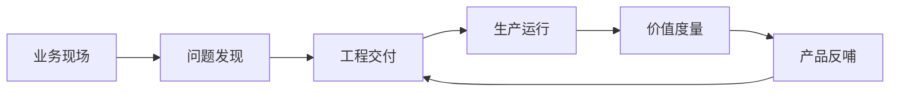
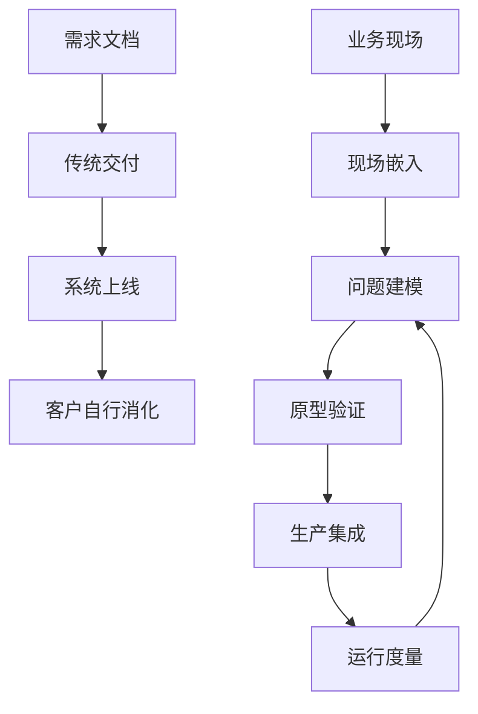
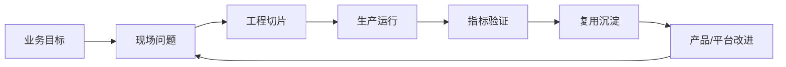

# 第一章 FDE 的角色边界

FDE，Forward Deployed Engineering，本书译作“前线部署工程”。理解 FDE，不能只从岗位名称入手，也不能把它简单归入售前、咨询、实施或客户成功。FDE 的关键在于“前线”和“工程”同时成立：工程师进入真实业务现场，面对不完整信息、遗留系统、权限约束、组织流程和生产风险，把一个模糊但高价值的问题推进为可运行、可观测、可治理、可复用的系统。

Palantir 的实践将这一角色广泛带入行业视野，并把 FDE [描述为一种产品开发范式](https://www.palantir.com/docs/foundry/architecture-center/overview)：工程师嵌入客户环境，与核心工程团队协同，把现场反馈持续转化为平台能力。近年来，FDE 已不再只是某家公司的组织语言。OpenAI 将 FDE [定义为嵌入复杂组织的前沿 AI 部署能力](https://openai.com/index/openai-launches-the-deployment-company/)，用于识别高影响场景、重构工作流并形成可持续系统；Anthropic 的招聘材料也要求这类角色[嵌入战略客户、交付 AI 应用，并反馈可重复部署模式](https://job-boards.greenhouse.io/anthropic)——注意岗位名称本身就在漂移：Anthropic 公开招聘板上，Forward Deployed 命名的岗位与 Applied AI Architect 系列并存，且命名岗位曾一度归零、其后又重新挂出，读者应按职责而非名称对照，核验日期见[快变事实核验表](../appendix/volatile_facts.md)。

本章回答五个问题：FDE 为什么出现；它如何改变传统软件交付的边界；它与解决方案架构师、售前工程师、SRE、平台工程师、专业服务、客户成功等相邻角色如何分工；如何用价值闭环和成功指标判断 FDE 是否真正有效；以及哪些常见反模式会让“看起来像 FDE”的工作实际偏离 FDE 的核心责任。

读完本章，读者应能用清晰边界描述 FDE：它不是“万能救火队”，而是把客户现场、工程系统、产品路线和业务结果连接起来的一种高密度工程角色。

## 1. FDE 为何出现

### 1.1 企业软件的最后一公里

传统企业软件的核心假设，是产品能力可以被抽象成通用模块，再通过配置、培训和实施完成落地。但在高复杂度组织中，真正困难的部分往往不在“功能是否存在”，而在功能能否穿过真实现场：数据分散在 ERP、CRM、MES、数据仓库、表格和人工流程中；权限、审计、合规和网络边界限制了集成方式；一线用户的目标又常常不是“使用一个系统”，而是缩短审批、降低停机、提升周转、减少风险暴露。软件交付因此出现结构性缺口：产品团队离现场太远，咨询团队离代码太远，实施团队离产品路线太远。

FDE 正是为填补这个缺口而出现。Palantir 把 FDE [描述为持续开发平台和产品的方法](https://www.palantir.com/docs/foundry/architecture-center/overview)：工程师尽可能接近问题，与核心工程团队整合现场反馈并交付新能力。OpenAI 也说明 FDE [用于把前沿模型带入复杂生产环境](https://openai.com/index/openai-launches-the-deployment-company/)，而不是停留在演示和试点。换言之，FDE 出现的根因不是岗位包装，而是企业技术价值从“买到软件”转向“让软件进入工作流并产生可度量结果”。

| 传统断点 | 现场表现 | FDE 的介入点 |
| --- | --- | --- |
| 产品抽象过强 | 标准功能无法覆盖业务例外 | 把例外提炼为可复用模式 |
| 实施只管上线 | 上线后无人对结果负责 | 连接交付指标与业务指标 |
| 咨询缺少工程闭环 | 方案停在蓝图或 PPT | 直接构建、验证、上线 |
| 客户反馈传递慢 | 产品路线滞后于现场变化 | 将现场信号反馈给核心工程 |

### 1.2 FDE 与 AI 的共同演进

FDE 不是生成式 AI 出现后才被发明的岗位，但它的发展长期与企业数据、分析、AI 和业务流程数字化交织在一起。早期 FDE 解决的是数据、分析、模型和业务流程之间的断裂：数据分散在多个系统，业务规则藏在现场经验里，模型或应用只有进入真实流程后才知道是否有效。Palantir 的 [Architecture Center](https://www.palantir.com/docs/foundry/architecture-center/overview) 把 FDE 描述为让工程团队贴近问题、整合现场反馈并持续交付能力的方法，同时其平台架构已经把 AIP、Foundry 和 Apollo 放在同一个企业操作系统视角下，服务于 AI、数据、应用和持续交付。

生成式 AI 进一步放大了这种角色需求。大模型能力本身不是完整生产系统；它必须接入企业数据、权限、工具、流程、评测、监控和人工复核机制。NIST 在 [AI Risk Management Framework](https://www.nist.gov/itl/ai-risk-management-framework) 中强调，可信性考虑应纳入 AI 产品、服务和系统的设计、开发、使用与评估；这意味着 AI 项目不能只靠一次模型调用完成。OpenAI 也把 FDE 的重点[放在生产系统、复杂约束、治理、合规和工作流重构上](https://openai.com/business/the-openai-deployment-company)。Accenture 与 Microsoft 的 2026 年 practice 则将 FDE [用于帮助企业把 AI 从想法推进到生产](https://newsroom.accenture.com/news/2026/accenture-launches-microsoft-forward-deployed-engineering-practice-to-help-organizations-scale-ai-across-the-enterprise)。

FDE 的确立已不再局限于科技公司与咨询机构。2026 年 7 月，北京市在《北京市加快智能体引领发展若干措施》（京发改〔2026〕1185 号）第三条中提出[通过前沿部署工程师（FDE）等模式创新加速智能体应用落地](https://www.beijing.gov.cn/zhengce/zhengcefagui/202607/t20260723_4781085.html)，把这一角色从企业实践上升为地方产业政策中的具名范式，为本书关于软件交付重心迁移的判断提供了外部印证。

因此，AI 与 FDE 的关系不是单向因果，而是相互推动：AI 提供新的能力上限，FDE 负责把能力接入现场约束并变成可运行系统；现场部署暴露的数据、权限、评测和流程问题，又反过来塑造模型、平台和产品路线。到 AI Agent 阶段，这种关系更明显。Palantir 的 [AI FDE](https://www.palantir.com/docs/foundry/ai-fde/overview) 已把“前线部署工程”的部分工作抽象为可对话、可调用工具、受权限约束、可审计的交互式 Agent；这不是替代人类 FDE，而是说明 FDE 沉淀出的现场闭环正在成为 AI 平台能力的一部分。

因此，FDE 的出现可以理解为软件交付的重心迁移：从交付许可证，迁移到交付运行能力；从交付功能清单，迁移到交付业务结果；从一次性项目，迁移到现场学习、平台沉淀和产品反哺。它要求工程师既能写代码，也能理解组织约束；既能快速原型，也能守住生产质量；既能响应客户现场，也能拒绝不可维护的定制陷阱。

## 2. 从软件交付到现场嵌入

### 2.1 交付对象从系统变成工作流

软件交付曾经主要围绕“系统上线”组织：需求确认、方案设计、开发测试、部署培训、验收移交。这个模式适合边界清晰、流程稳定、变化较慢的项目。但 FDE 面对的往往是开放问题：为什么产线停机没有被提前发现？为什么客户流失信号分散在多个系统？为什么 AI 助手在演示中可用，进入真实审批流后却无法通过权限、审计和责任边界？此时，交付对象不再只是一个应用，而是端到端工作流。

现场嵌入意味着工程师必须进入流程发生的位置。Palantir 将 FDE [描述为围绕客户现场持续开发平台能力的产品开发范式](https://www.palantir.com/docs/foundry/architecture-center/platforms/)。OpenAI 设有专门的 Forward Deployed Engineering 团队，其[岗位说明](https://openai.com/careers/forward-deployed-engineer-%28fde%29-sf-san-francisco/)同样强调 FDE 负责从原型走向稳定生产，并把现场反馈传回产品和研究团队（单条招聘 req 会随招聘周期下线，届时从 [OpenAI 招聘搜索](https://openai.com/careers/search/)按团队名检索即可）。这些描述共同指向同一件事：FDE 不只是把软件“送达客户”，而是在客户运行环境中发现问题、改造流程、交付系统，并让组织能够持续使用。

#### 综合示例：制造企业如何降低非计划停机

以下示例说明 FDE 如何把“预测停机”这类模糊目标，拆成可验证的现场闭环。项目动作和指标口径为教学设定；涉及制造维护能力的外部事实，仅引用 NIST 公开资料。

**背景**：某制造企业希望降低关键设备的非计划停机。历史维护方式主要依赖固定周期点检、班组经验和事后维修，传感器数据、MES 工单、备件记录和人工点检表分散在不同系统中。NIST 也把[监测、诊断和预测](https://www.nist.gov/el/enhancing-maintenance-strategies-manufacturing-operations)列为减少非计划停机、优化计划停机的重要能力。

**现场约束**：产线不能为了试点频繁停机；部分老设备只有低频采样或人工录入数据；维修班组更信任可解释的异常原因，而不是单一风险分数；模型告警如果过多，会挤占排班和备件资源；任何自动建议都必须保留人工确认和审计记录。

**FDE 动作**：FDE 先选一类瓶颈设备做最小闭环，而不是直接建设全厂预测平台。第一步把停机事件、维修工单、传感器窗口和班组备注对齐成统一事件时间线；第二步与维修主管共同定义“可采取行动的告警”，例如连续多个采样窗口超过示例阈值才触发检查；第三步上线只读看板和工单建议，不直接自动停线；第四步把误报、漏报、人工处理结果回写为评测样本，并把通用的数据对齐、告警解释和工单回写能力沉淀为模板。

**取舍**：团队牺牲了短期模型覆盖率，换取告警可信度和班组采用率；暂缓复杂端到端自动化，先保证数据血缘、权限、审计和人工复核闭环；没有把每台设备的特殊规则都写成定制代码，而是把设备差异限制在特征配置和阈值配置中。

**指标结果**：可用示例指标包括：目标设备告警精确率达到试点阈值后再扩大范围；误报率低于班组可承受阈值；从异常出现到维修确认的时间缩短；关键工单中包含模型解释和人工处置结果的比例提升；可复用模板覆盖下一类设备时所需改动减少。这里的数值应由项目基线和客户风险偏好定义，不能用外部案例数字替代现场验证。

### 2.2 嵌入不是无边界驻场

现场嵌入不等于长期驻场外包，也不等于客户提出什么就做什么。FDE 的专业边界在于把现场知识转化为工程判断：哪些是必须适配的领域约束，哪些是历史包袱；哪些定制会创造长期价值，哪些只会制造维护债；哪些问题应由产品平台承接，哪些应由客户流程调整解决。这个判断必须建立在事实之上，包括数据样本、用户路径、权限模型、故障记录、成本结构和上线风险。

从工程方式看，现场嵌入要求 FDE 同时维护两个节奏。第一是现场节奏：快速理解语境，尽早做出可运行切片，降低客户对“黑箱交付”的不确定感。第二是产品节奏：把局部需求抽象成平台能力、模板、组件、接口或文档，避免每个客户都形成孤岛。DORA 指标强调软件交付应当[安全、快速、有效](https://dora.dev/guides/dora-metrics/)；FDE 需要在此基础上再补一层现场结果指标，例如流程耗时、人工干预率、采用率、业务异常恢复时间和可复用资产数量。只有当现场交付与平台沉淀同时发生，FDE 才区别于传统实施。

## 3. FDE 与相邻角色的分工

### 3.1 相邻角色不是上下级替代

FDE 容易被误解为“更会写代码的售前”或“更懂业务的实施”。这种理解会让团队把所有模糊问题都推给 FDE，最终造成范围失控。更准确的看法是：FDE 位于产品、工程、客户现场和业务结果之间，是一个高耦合接口角色；它不替代相邻角色，而是在不确定性最高、反馈最短、责任最难切分的阶段承担整合责任。

解决方案架构师通常负责目标架构、集成路径和技术选型；售前工程师负责价值展示、可行性说明和商业推进；专业服务负责实施计划、迁移、配置和客户化交付；SRE 关注服务可靠性、容量、故障响应和 SLO；平台工程师关注内部开发者平台、自助能力和标准化底座。Google SRE Book 强调，SLI、SLO 和 SLA 应围绕[用户关心的服务行为](https://sre.google/sre-book/service-level-objectives/)来定义；这类框架对 FDE 很重要，但 FDE 的职责还包括在现场把业务语义、产品能力和运行指标连接起来。

| 角色 | 主要责任 | 成功信号 | 与 FDE 的关系 |
| --- | --- | --- | --- |
| 售前工程师 | 证明方案可行，支持成交 | 客户理解价值并进入采购 | FDE 接手高不确定性交付验证 |
| 解决方案架构师 | 设计总体架构和集成路径 | 架构可落地、风险清晰 | FDE 用现场反馈校准架构 |
| 专业服务 | 按计划实施、迁移、配置 | 项目按范围上线 | FDE 处理非标准、高反馈闭环工作 |
| SRE | 保障服务可靠性和响应 | SLO 达标、故障可控 | FDE 把现场运行要求转成可靠性需求 |
| 平台工程师 | 建设可复用平台能力 | 团队自助交付效率提升 | FDE 将现场模式沉淀给平台 |
| AI 工程师 | 实现模型、检索、工具调用和 AI 应用能力 | AI 功能可靠交付并可评测 | FDE 负责把 AI 能力接入现场数据、权限、流程和生产指标 |
| 客户成功 | 推动采用和续约 | 使用率、满意度、扩展收入 | FDE 提供可验证的工程价值证据 |

### 3.2 交接边界示例

清晰交接不是把责任甩给下游，而是让相邻角色知道“已经验证了什么、还剩什么风险、谁继续负责”。FDE 交接时应优先交付可执行产物，而不是只交付会议纪要。

| 交接方向 | 交接产物 | 边界说明 |
| --- | --- | --- |
| 售前到 FDE | 已确认的业务目标、采购承诺范围、关键利益相关人、演示假设、已暴露风险、不能承诺的事项 | 售前交接的是问题空间和商业边界，不是把演示原型当成生产方案 |
| FDE 到产品 / 核心工程 | 现场模式、产品缺口、可复用组件候选、失败样本、路线图建议、不可泛化边界 | FDE 交接的是经过现场验证的学习，不是把客户原话直接变成产品需求 |
| FDE 到平台工程 / SRE | 运行架构、部署方式、SLO / SLI 建议、告警规则、容量假设、回滚方案、权限与审计要求、已知故障模式 | FDE 交接的是已在现场验证过的运行需求和复用候选，不是长期代管生产系统 |
| FDE 到客户成功 | 已上线工作流、采用基线、关键用户清单、培训材料、业务指标看板、未关闭的流程风险、扩展机会证据 | FDE 交接的是可证明价值和采用抓手，不是续约话术或客户关系的替代品 |

### 3.3 FDE 的核心边界

FDE 的边界可以用三句话描述。第一，FDE 对“从问题到生产可用”的工程闭环负责，而不是只对某个功能模块负责。第二，FDE 对“现场事实进入产品学习”负责，而不是把客户需求原样堆进路线图。第三，FDE 对“价值可证明”负责，而不是只对系统上线负责。

这也意味着 FDE 必须学会拒绝。不能为了短期满意度绕过安全和审计；不能把所有客户流程缺陷都用代码补丁掩盖；不能把一次性脚本包装成平台能力；不能在没有运行责任人的情况下交付生产自动化。Anthropic 的招聘材料也强调这类角色需要[在战略客户中交付 AI 应用、并把可重复部署模式反馈给产品工程团队](https://job-boards.greenhouse.io/anthropic)，其 Applied AI Architect 岗位更把「保持安全与可靠性标准」写进职责描述。这正说明 FDE 的专业性不在“做更多事”，而在高约束场景下做正确的取舍。

## 4. 价值闭环与成功指标

### 4.1 价值闭环从业务结果开始

FDE 的价值不能只用交付物数量衡量。写了多少接口、搭了多少看板、上线了多少模型，都只是中间产物。真正的价值闭环从业务结果开始：某个流程是否缩短，某类风险是否降低，某项人工判断是否更稳定，某个生产瓶颈是否被持续监控并可快速处置。OpenAI 强调 FDE 会[与业务领导、运营人员和一线团队一起识别 AI 的最大影响点](https://openai.com/index/openai-launches-the-deployment-company/)，重构关键工作流，并把收益转化为持久系统。这里的关键词不是“演示”，而是“持久系统”。

一个完整的 FDE 闭环至少包含五步：发现现场高价值问题；构建最小可运行切片；进入真实权限、数据和流程；用可观测指标验证结果；把可重复模式沉淀到产品、平台、模板或方法论。速度与稳定性可参考 [DORA 的软件交付指标](https://dora.dev/guides/dora-metrics/)，但 FDE 还必须引入业务侧指标和采用侧指标。否则团队可能交付得很快，却没有改变任何关键运营结果。

### 4.2 指标要覆盖速度、质量、采用和复用

FDE 指标设计要避免两个极端：只看业务结果会忽略工程健康，只看工程指标会忽略客户价值。合理的指标组合应覆盖四层。第一是交付速度，例如从问题确认到首个可用切片的时间、从代码合并到生产可用的时间。第二是运行质量，例如错误率、恢复时间、SLO 达成率、数据新鲜度、模型评测通过率。第三是采用效果，例如目标用户周活跃、关键流程覆盖率、人工干预率、用户绕行率。第四是复用沉淀，例如可复用组件数、模板采用次数、产品缺口关闭率、现场反馈进入路线图的比例。

| 指标层 | 典型问题 | 可用指标 |
| --- | --- | --- |
| 速度 | 多快能从模糊问题到可运行切片 | 首次价值时间、变更前置时间、部署频率 |
| 质量 | 系统能否稳定、安全、可治理地运行 | SLO、失败恢复时间、变更失败率、审计覆盖 |
| 采用 | 用户是否真的把它纳入工作流 | 活跃用户、流程覆盖率、人工干预率、留存 |
| 复用 | 现场经验是否转化为组织能力 | 模板复用、平台能力沉淀、产品反馈关闭率 |

每个指标都要有最小契约：口径、数据源、采样窗口、owner、目标值、护栏指标和退出条件。没有这些字段时，指标只是叙事材料，不能用于验收、扩面或投资判断。

对 AI 场景，还要加入治理指标。按 [NIST AI RMF](https://www.nist.gov/itl/ai-risk-management-framework) 的组织方式，AI 风险管理可以拆成 Govern、Map、Measure、Manage 等功能。FDE 在现场交付 AI 系统时，必须把评测、权限、日志、人工复核、漂移监控和事故处理纳入成功标准。一个项目只有在业务结果、工程质量、采用效果和复用沉淀上形成闭环，并在 AI 场景补齐治理指标，才可以说 FDE 交付完成。

### 4.3 误用指标与反例

指标一旦脱离业务语境，就会把 FDE 推向错误行为。常见反例包括：只看功能交付数量，导致团队追求接口、看板和脚本数量，却没有验证流程耗时或风险暴露是否下降；只看模型离线准确率，忽略权限、延迟、人工复核和误报成本，最终无法进入生产；只看部署频率，鼓励频繁发布现场补丁，却没有同步降低变更失败率；只看活跃用户，掩盖用户被迫登录但仍在线下绕行的事实；只看复用组件数量，把一次性客户规则包装成平台能力，增加长期维护债。

因此，FDE 需要为每个指标配一个反指标或护栏。首次价值时间要同时观察质量回退和返工率；流程覆盖率要同时观察绕行率和人工升级率；模型通过率要同时观察误报、漏报和人工复核负担；复用率要同时观察配置复杂度和下一个现场的接入成本。好的指标组合不奖励“看起来忙”，而奖励可验证的业务结果、可运行的工程质量和可复制的组织能力。

## 5. FDE 反模式

FDE 的边界讨论容易停留在“应该做什么”。但在现场实践中，更具识别价值的是“看起来像 FDE、实际不是 FDE”的反模式。下面五类是企业 AI 与复杂软件落地中最常见的退化形态，它们的共同特征是把短期满意度放在长期工程能力之前。

### 5.1 驻场化：没有退出机制

FDE 进入客户现场是为了形成可运行系统和可复制能力，而不是常驻执行客户日常任务。一旦项目缺乏退出判据，工程师会逐渐替客户运维、出报表、解释告警、临时改配置，最终变成低成本的内部人员。**识别信号**：客户依赖具体某位 FDE 才能完成发布或排障；撤场计划被反复推迟；交付物中没有沉淀给客户运维或平台团队的资产。

### 5.2 定制陷阱：一次性客户分支

为了快速响应现场，FDE 容易把客户特殊规则直接写进主干，或长期维护一份客户专属分支。短期看起来高效，长期会让每个客户成为独立产品线，平台能力无法收敛。**识别信号**：同一能力存在多份相似但互不复用的实现；客户需求无法通过配置、模板或扩展点表达；产品团队不再从现场反馈中得到可泛化的输入。

### 5.3 影子 SRE：接管运维而非赋能

AI 系统和数据管道上线后，FDE 容易因为最熟悉系统而被默认拉去值班、处理告警、做容量调整。这会让客户运维与平台团队失去成长机会，也让 FDE 失去推进下一轮交付的时间。**识别信号**：值班轮值表上长期挂着 FDE 的名字；告警处置 runbook 只在 FDE 的脑子里；客户运维讲不清服务边界和回滚步骤。

### 5.4 PPT 顾问化：输出方案文档而非系统

当现场推进遇到组织阻力，FDE 容易退回到“多写文档、多开评审”的舒适区，把交付简化为蓝图、方案和路线图。文档本身没有错，但若不伴随可运行切片、真实数据验证和生产化路径，FDE 与传统咨询没有差别。**识别信号**：阶段交付物中没有代码、数据或可运行环境；评审决议长期停留在“待立项”；业务指标基线和验收阈值始终缺位。

### 5.5 演示模型化：只证明模型会回答

企业 AI 项目中，FDE 还容易被拉向“先做一个很惊艳的 demo”。模型在精选样例上回答得好，不代表系统能进入真实生产。若数据权限、工具边界、评测集、审计日志、人工复核和回滚路径没有建立，演示越成功，后续风险越容易被低估。**识别信号**：项目只展示模型输出，不展示证据来源、权限判断和失败路径；离线准确率被当作上线门槛；没有把真实用户修改、拒绝和事故样本回流到评测集。
