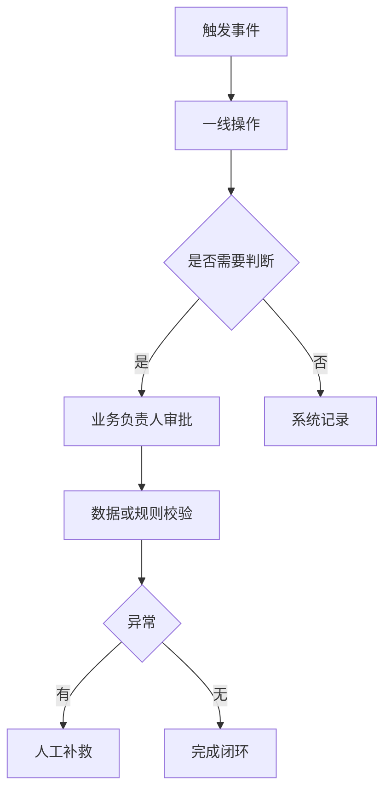
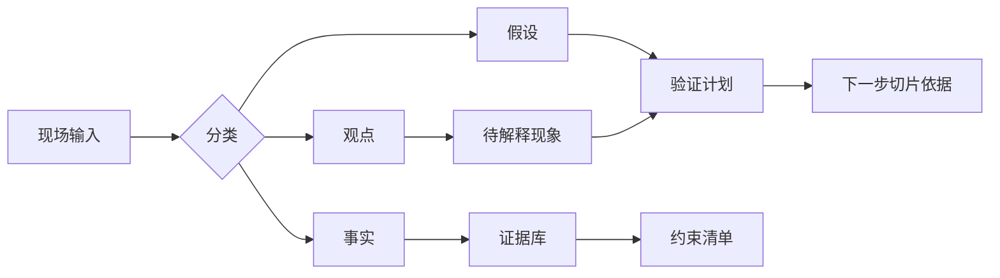
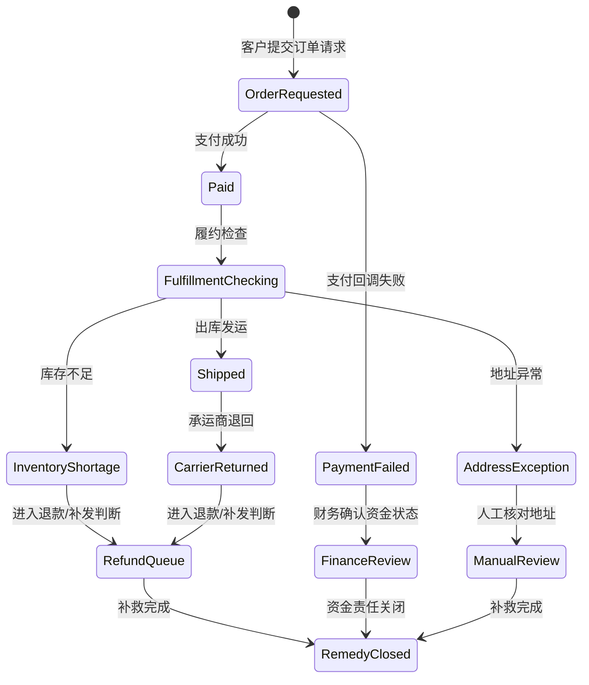
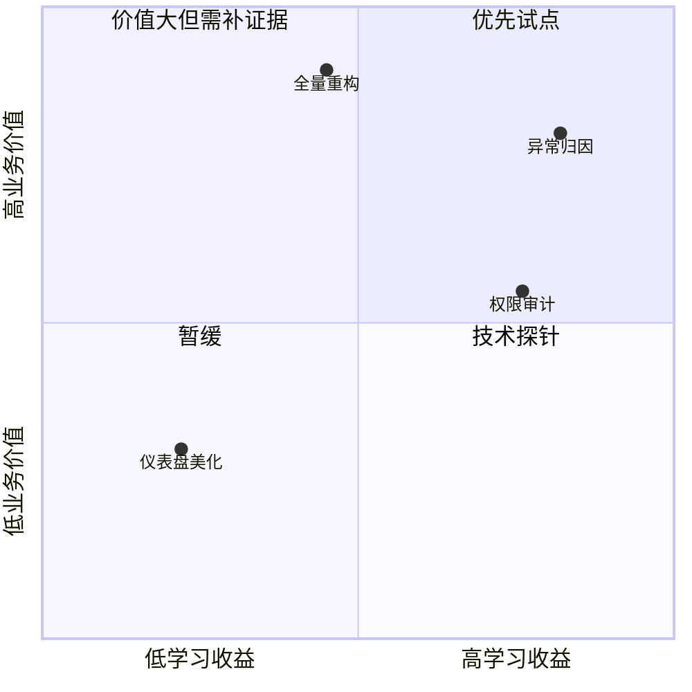
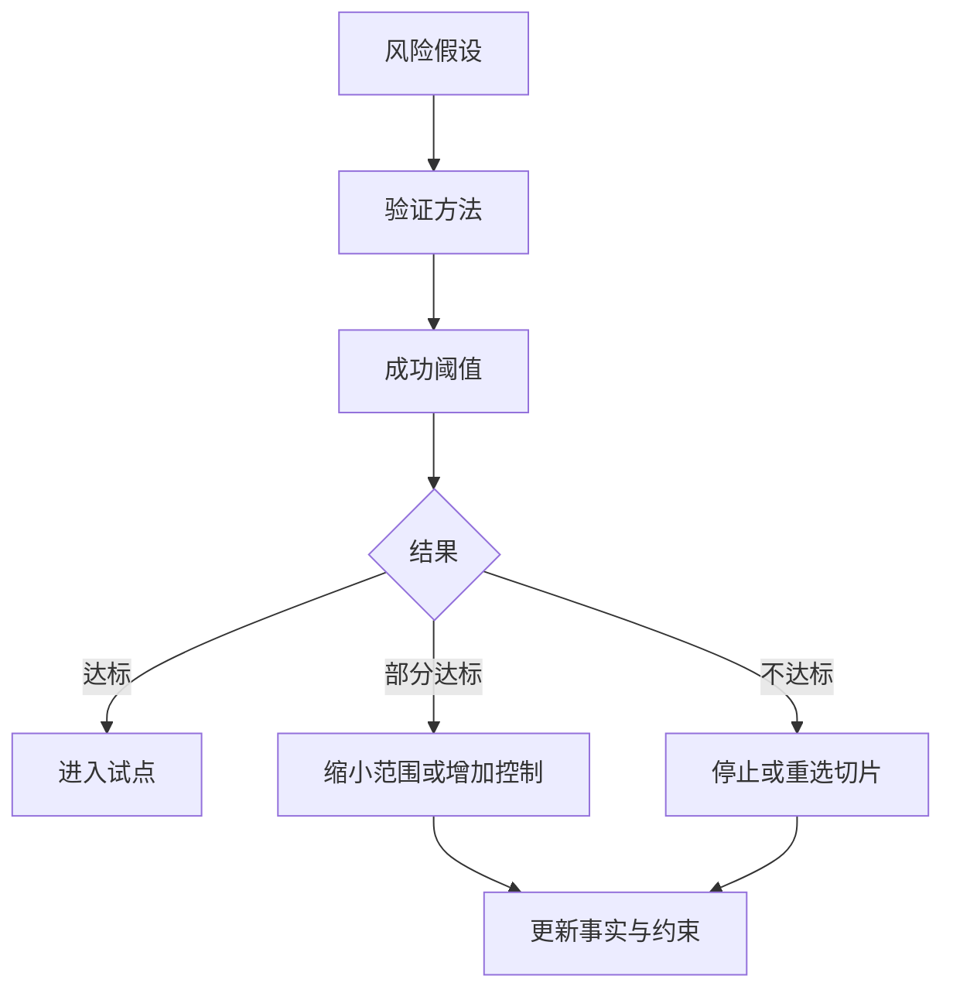

# 第二章 现场问题发现

FDE 的第一项硬功夫，不是马上提出架构图、排期表或原型界面，而是在真实现场发现可被工程化的问题。现场问题通常不会以“需求”的形式自然出现。它们分散在例会纪要、Excel、审批流、异常工单、口头规则、历史系统、权限边界和组织惯性里；同一个词在销售、运营、法务、财务、数据团队之间也可能指向不同含义。FDE 进入现场后，必须先把这些片段还原成事实、约束、流程、风险和价值假设。

发现问题时，FDE 不能只听业务愿望，还要观察交付系统本身是否具备快速、可靠、可验证的改变能力；Google Cloud 将持续交付、测试自动化、可观测性、松耦合架构等实践整理为 [DORA 能力模型](https://docs.cloud.google.com/architecture/devops)，并把它们与软件交付和组织表现关联起来。早期风险判断也应支撑具体应对措施，NIST 在 [SP 800-30 Rev.1](https://csrc.nist.gov/pubs/sp/800/30/r1/final) 中也这样定位风险评估。

本章给出一条从现场进入到验证计划的路径：先建立业务场景入口，再收集事实和约束，随后统一领域语言并建立流程模型，进一步切分需求、排序优先级，最后把风险假设转化为可执行的验证计划。它不是一套重文档流程，而是一套降低误判成本的工程动作。发现阶段的产物还要明确数据授权、隐私边界、运行责任和下一章所需的最小系统边界输入。

后续章节会用多个综合案例复用同一条“现场发现 -> 架构边界 -> 试点 -> 生产化 -> 运维复盘”的证据链。读者不需要把案例行业视为连续剧情，而应关注每个阶段新增了哪些证据、门禁和运行责任，以及这些产物如何在附录模板中收敛。

| 阶段 | 主要问题 | 产物 |
| --- | --- | --- |
| 场景进入 | 现场为什么需要改变 | 目标、角色、成功信号 |
| 事实收集 | 当前系统怎样运行 | 证据、约束、未知项 |
| 领域建模 | 大家是否在说同一种语言 | 术语表、流程图、边界 |
| 需求切片 | 第一刀切在哪里 | 候选切片、优先级、验收条件、不做事项 |
| 风险验证 | 最大不确定性是什么 | 假设清单、实验、退出条件、人工接管和运行边界 |

## 1. 业务场景进入

### 1.1 从请求进入，而不是从方案进入

FDE 进入现场时，常见入口是一句看似明确的请求：做一个 AI 助手、替换一套报表、把审批自动化、把分散数据接到一个平台。成熟的进入方式不是立即接受请求，而是把请求还原成业务场景：谁在什么时刻遇到什么阻塞，阻塞造成什么损失，当前为什么无法靠流程、培训或已有系统解决。这样做不是拖慢进度，而是避免把工程能力用在错误层级的问题上。

业务场景进入应先确认三类事实。第一是触发事件，例如监管要求、交付瓶颈、成本上升、客户流失或一线人员无法及时决策。第二是受影响角色，包括直接操作者、审批者、数据维护者、系统管理员和最终负责业务结果的人。第三是可观察信号，例如处理时长、返工率、人工核对量、缺陷率、等待队列、异常升级次数。DORA 在 [DevOps capabilities](https://dora.dev/capabilities/) 中强调能力改进需要围绕交付和组织表现展开；FDE 的现场进入也应从系统级结果出发，而不是从单点功能出发。

贯穿案例可以从“异常订单归因”开始。以下为合成、脱敏的教学样例，数字只用于说明方法，不代表真实客户数据，也不代表可外推的行业基准。原始请求是：“给运营做一个智能工具，自动解释为什么订单失败。”FDE 不应马上设计聊天界面，而要把请求拆成现场入口：

| 入口项 | 现场记录 |
| --- | --- |
| 原始请求 | 运营希望在订单异常后自动看到失败原因和下一步动作 |
| 受影响角色 | 客服需要回复客户，运营主管需要分派处理，仓配团队需要确认库存和履约状态，财务需要确认退款责任，数据团队需要维护异常口径 |
| 基线指标 | 每周约 1,200 笔异常订单；人工归因中位时长 18 分钟；约 23% 需要跨部门二次确认；客户首次回复时限为 30 分钟 |
| 现场证据 | 经授权后的最小样本：异常工单样本、订单请求状态、支付交易事件、履约与库存日志、退款审批记录、运营日报；客服聊天记录只抽取与异常原因相关的脱敏片段 |
| 证据边界 | 不导出全量原始数据；样本范围、敏感字段、脱敏方式、访问人、保留期限和删除方式由业务、数据、安全/合规负责人确认 |
| 确认人 | 运营主管确认业务损失和验收口径，数据负责人确认证据来源，安全/合规负责人确认访问和脱敏边界，FDE 负责把这些输入转成可验证工程问题 |
| 第一轮问题陈述 | 运营团队无法在服务时限内稳定判断异常订单的主要原因，导致客服回复延迟和跨部门返工；下一轮要验证订单请求状态、支付交易事件、履约单状态、退款案件状态、失败原因和补救动作是否有可复查的数据证据 |

这份记录的作用，是把“做智能工具”改写成可执行的现场流程：先抽取异常订单样本，再追踪每个样本从创建、支付、库存、履约、退款到客服回复的证据链，最后判断哪些原因可以由系统自动归因，哪些仍需要人工确认。

### 1.2 建立最小现场地图

最小现场地图不追求完整企业架构，而是画出“工作如何发生”。它是粗粒度定位图，不替代后续的领域状态机或接口设计。它至少包含业务目标、触发条件、参与角色、关键系统、数据流向、决策点和失败后的补救路径。FDE 在第一次现场访谈后，就应能回答：如果今天什么都不改，问题会继续在哪里累积；如果只改一个环节，收益是否会被下游瓶颈抵消。

| 进入问题 | 需要的证据 | 错误信号 |
| --- | --- | --- |
| 为什么现在要做 | 业务事件、指标变化、外部压力 | 只有高层口号 |
| 谁真正受影响 | 角色清单、操作记录、审批链 | 只听单一赞助人 |
| 当前怎么完成 | 系统截图、工单、日志、表格 | 只看流程图不看现场 |
| 成功如何判断 | 基线指标、验收阈值 | 只有“体验更好” |

现场地图可以用一张轻量表收敛，不必一开始画完整架构图：

| 地图字段 | 最低记录内容 |
| --- | --- |
| 业务目标 | 要改善的业务结果、当前基线、受影响时间窗 |
| 触发条件 | 谁在什么事件后开始处理，事件来自哪个系统或人工动作 |
| 角色与责任 | 操作者、审批者、数据 owner、系统 owner、安全/合规确认人、最终业务 owner |
| 系统与数据 | 读哪些系统、写哪些系统、哪些字段敏感、哪些数据只能看不能导出 |
| 决策点 | 哪些判断由规则、模型、人工经验或制度决定 |
| 异常与补救 | 出错后谁发现、谁接手、是否有 SLA、是否有审计记录 |
| 未知项 | 还缺什么证据、谁负责补齐、下一轮何时验证 |

进入阶段的结论应保持克制：不是“我们要做某系统”，而是“我们已确认某类角色在某流程中存在可观察损失，下一步要收集事实并识别约束”。这句话越具体，后续架构和交付越不容易漂移。

还要明确进入阶段的边界。FDE 可以帮助客户澄清问题、验证风险和设计交付路径，但不能替客户跳过责任确认。若业务负责人无法说明指标基线，系统负责人无法说明数据来源，安全团队无法说明权限要求，工程团队就不应把这些空白默认为“以后再补”。进入现场的第一项产物，往往不是原型，而是一份简短的问题陈述和证据清单：什么已经确认，什么只是判断，什么必须在下一轮调研中被验证。

## 2. 事实收集与约束识别

### 2.1 把观点、事实和假设分开

现场访谈中最危险的混合物，是把“大家都这么说”当成事实。FDE 需要把输入拆成三层：事实是可复查的证据，例如日志、单据、权限配置、接口文档、SLA、审计记录、历史事故；观点是人的判断，例如“系统很慢”“流程很乱”；假设是尚未验证的因果关系，例如“慢是因为数据库性能不足”。三者都重要，但不能混放在同一列里。

事实收集应覆盖业务、数据、系统和组织四个方向。业务事实说明工作量、周期、价值和异常类型；数据事实说明字段含义、来源、更新频率、质量问题和保留策略；系统事实说明接口、权限、部署、容量、依赖和可观测性；组织事实说明决策权、变更窗口、合规要求和运维边界。事实收集本身不是目的，它要服务于后续的范围、风险和验证决策，而不是堆积材料；无法被引用进决策的事实，应在下一轮调研中精简或验证。

可执行的事实表应记录字段，而不只是写结论。最低字段包括：结论、性质、主题、来源、时间、负责人、数据边界、可信度、是否可复查、下一步验证动作。性质用于区分事实、观点和假设；主题用于标注业务、数据、系统、组织、合规或口径冲突。可信度可以用“高、中、低”表达：高表示证据来自系统记录或可重复查询；中表示来自授权样本、截图或多人一致陈述；低表示来自单人判断或无法复查的会议记忆。下表仍为教学样例记录，日期和指标用于展示写法。

| 结论 | 性质 | 主题 | 来源 | 时间 | 负责人 | 数据边界 | 可信度 | 是否可复查 | 下一步验证动作 |
| --- | --- | --- | --- | --- | --- | --- | --- | --- | --- |
| 异常订单人工归因中位时长约 18 分钟 | 事实 | 业务 | 最近两周工单导出和处理时间戳 | 2025-12-01 | 运营分析师 | 脱敏工单 ID 和时间戳 | 中 | 是 | 抽样 50 单核对工单时间和客服回复时间 |
| “库存不足”是主要失败原因 | 假设 | 数据 | 运营主管访谈 | 2025-12-01 | FDE | 不含客户身份信息 | 低 | 否 | 对照库存系统日志和订单失败码 |
| 失败订单必须先由客服联系客户 | 事实 | 组织约束 | 客服操作规范和主管确认 | 2025-12-02 | 客服主管 | 仅引用制度条款 | 中 | 是 | 检查操作规范是否覆盖退款和补发两种路径 |
| 支付失败和履约失败都被报表记为失败 | 事实 | 口径冲突 | 运营日报、财务退款表 | 2025-12-02 | 数据负责人 | 聚合报表，不导出客户明细 | 高 | 是 | 建立状态映射表并让运营、财务共同确认 |

### 2.2 约束不是阻碍，而是设计输入

约束可分为硬约束和软约束。硬约束包括法律合规、数据驻留、身份权限、预算上限、上线窗口、外部系统 API 限制和已有平台标准。软约束包括团队技能、组织偏好、历史债务、供应商关系、审批习惯和变更接受度。硬约束决定边界，软约束影响路径。忽略硬约束会导致方案不可上线，忽略软约束会导致方案无人采用。

| 类型 | 示例 | 核查方式 | 对设计的影响 |
| --- | --- | --- | --- |
| 业务事实 | 月处理量、峰值时段、返工率 | 报表、工单、抽样记录 | 决定收益基线 |
| 数据事实 | 字段来源、缺失率、口径冲突 | 数据字典、查询、血缘 | 决定建模可信度 |
| 系统约束 | 认证方式、接口限流、部署环境、版本兼容、超时和错误码 | 文档、配置、日志、沙箱调用 | 决定集成方案 |
| 组织约束 | 审批链、值班能力、变更窗口 | 访谈、制度、历史发布记录 | 决定交付节奏 |
| 隐私与合规约束 | 敏感字段、访问授权、保留期限、审计要求 | 数据分级、授权记录、合规评审 | 决定样本边界和脱敏方式 |

证据采集本身也要受控。FDE 不应因为“调研需要”而默认获取全量导出、客户聊天原文或生产截图；更稳妥的做法是先定义样本目的、最小字段、访问角色、脱敏规则和删除时间，再采集可复查证据。若某条证据必须依赖临时权限，应记录授权人、到期时间和审计位置，避免发现阶段留下新的影子数据资产。

观点、事实和假设冲突时，不要在会上用职位或声音大小裁决。处理顺序应固定：先保留原话并标注类型，再寻找可复查证据；如果事实之间冲突，优先比较来源系统、时间范围、抽样口径和字段定义；如果观点与事实冲突，把观点改写成待解释现象，例如“运营感觉失败率上升”，再用同一时间窗的数据验证；如果假设与事实冲突，假设必须降级、缩小或废弃。没有证据前，只能形成“下一步验证动作”，不能进入需求承诺。

本节的产物不是一份冗长调研报告，而是一张可追溯的事实表：每条结论都能指向来源，每个未知项都有负责人和下一步验证动作，每个约束都能说明必须满足、可协商或仍待确认。这样，后续需求讨论就不会在记忆和立场之间打转。

## 3. 领域语言与流程建模

### 3.1 先统一语言，再讨论系统

复杂现场中，许多冲突并不是技术冲突，而是语言冲突。“客户”“订单”“风险”“已完成”“失败”“审核通过”这些词，在不同部门可能对应不同对象、状态或责任。FDE 如果不先统一领域语言，就会把术语歧义固化进数据库、API、权限模型和报表口径，后期修正代价极高。

领域语言的目标不是编一本百科词典，而是让关键概念在当前交付边界内可操作、可验证、可被不同角色共同使用。Martin Fowler 在 [Bounded Context](https://martinfowler.com/bliki/BoundedContext.html) 中解释，领域模型可作为开发者和领域专家沟通的统一语言；当组织变大，不同群体会自然形成不同词汇，因此必须显式划分上下文。对 FDE 来说，术语表、状态机、事件流和上下文边界，比一次性大而全的数据模型更可靠。

在“异常订单归因”案例中，术语冲突通常会先暴露在“订单”“完成”“失败”这几个词上：

| 术语 | 运营部门含义 | 财务部门含义 | 工程落点 |
| --- | --- | --- | --- |
| 订单 | 客户提交后需要履约的业务请求，未支付也可能进入运营队列 | 已支付并产生应收或退款责任的交易记录 | 拆成“订单请求”“支付交易”“履约单”，禁止一个“订单状态”覆盖全部含义 |
| 完成 | 客户收到商品或补救动作结束 | 款项结清，退款或扣款责任关闭 | 状态机中区分“已送达”“已补救”“已结清” |
| 失败 | 需要人工介入的异常，例如库存不足、地址错误、承运商退回 | 支付失败、退款失败或对账失败 | 数据字典中为失败原因建立枚举，并记录来源系统和责任部门 |

落地时，不要要求两个部门放弃自己的词，而是把词放入边界上下文：运营上下文关注履约和补救，财务上下文关注资金和责任。跨上下文报表必须显式映射状态，例如“支付失败”不等于“履约失败”，“已送达”也不等于“已结清”。这一步应进入状态机和数据字典，否则后续归因模型会把不同失败混成一个标签。

一张简化的上下文图可以先用表格表达：

| 上下文 | Owner | 核心对象 | 事实源 | 关键事件 | 跨上下文映射 |
| --- | --- | --- | --- | --- | --- |
| 客服上下文 | 客服主管 | 客户会话、回复时限、工单升级 | 客服系统 | 客户催办、工单升级、首次回复 | 只引用脱敏会话片段，不作为失败原因权威来源 |
| 运营上下文 | 运营主管 | 异常订单、补救动作、处理队列 | 运营工单系统 | 异常进入队列、补救完成 | 映射支付、履约、退款状态后生成一级原因 |
| 履约上下文 | 仓配负责人 | 履约单、库存占用、承运商状态 | WMS、承运商接口 | 库存不足、出库失败、承运商退回 | 向运营提供履约失败证据，不处理退款责任 |
| 财务上下文 | 财务负责人 | 支付交易、退款案件、对账状态 | 支付和退款系统 | 支付失败、退款失败、对账完成 | 区分资金失败和履约失败 |
| 数据上下文 | 数据负责人 | 状态映射、指标口径、数据质量规则 | 数据平台 | 字段变更、口径确认 | 维护跨上下文报表和归因口径 |

### 3.2 用流程模型暴露隐藏规则

流程建模应从真实工作流开始，而不是从系统菜单开始。2.1 的现场地图只回答“工作在哪里发生”，本节要进一步回答“状态如何变化、事件从哪里来、规则由谁维护”。先记录事件顺序，再标出角色、系统、数据和决策点，最后补充异常路径。异常路径尤其重要，因为现场价值往往不在“正常单据如何流转”，而在“出错时谁发现、谁补救、谁承担结果”。流程图画完后，FDE 要追问每个判断节点：规则来自制度、经验、模型、人工裁量，还是历史系统的默认行为。

| 状态或事件 | 来源系统 | Owner | 需要澄清的规则 |
| --- | --- | --- | --- |
| 支付回调失败 | 支付系统 | 财务负责人 | 是否算运营异常，是否需要客服联系 |
| 库存不足 | WMS / 库存服务 | 仓配负责人 | 是真实缺货、锁库冲突，还是数据延迟 |
| 地址异常 | 订单系统 / 客服系统 | 运营主管 | 是否允许客服修正，是否需要客户确认 |
| 承运商退回 | 承运商接口 / 履约系统 | 仓配负责人 | 退回后补发、退款和责任归属如何判定 |
| 退款队列进入 | 退款系统 / 工单系统 | 运营与财务共同确认 | 哪些原因可进入第一批切片，哪些必须人工复核 |

| 建模对象 | 关键问题 | 交付价值 |
| --- | --- | --- |
| 术语 | 同一个词是否有多种含义 | 避免口径冲突 |
| 状态 | 对象从哪里来、到哪里去 | 明确系统边界 |
| 事件 | 什么动作改变状态 | 连接流程与日志 |
| 规则 | 判断条件由谁维护 | 决定配置化或代码化 |
| 异常 | 出错后如何补救 | 识别真实成本 |

领域建模完成后，应产生一个轻量但严格的“共同语言包”：核心术语、状态定义、事件清单、上下文边界和未决歧义。任何需求切片进入实现前，都要能回到这套语言中解释自己，否则它很可能只是某个角色的局部愿望。

共同语言包还应进入工程资产，而不是停留在会议白板上。术语可以写入数据字典，状态可以写入测试用例，事件可以写入日志规范，规则可以映射到配置或代码负责人。这样做的好处是，后续每一次变更都能被问到同一个问题：它是否改变了领域语言，是否跨越了边界上下文，是否需要同步用户、数据、权限和报表口径。

## 4. 需求切片与优先级

### 4.1 切片围绕价值闭环，而不是功能清单

需求切片的目标，是找到最小但完整的价值闭环。一个好的切片应包含明确用户、触发场景、输入数据、关键规则、输出结果、验收条件和运行边界；它可以很小，但不能只是一段中间能力。例如“接入审批 API”不是完整切片，“让运营主管在异常订单进入退款队列后 10 分钟内看到原因、建议动作和审计记录”才更接近可验证的业务切片。这里的 10 分钟不是行业基准，而是为了在 30 分钟客户首次回复时限内给客服补救动作预留时间的教学阈值。

切片应从用户视角说明目标、价值和验收条件，可参考 Atlassian 对 [user stories](https://www.atlassian.com/agile/project-management/user-stories) 的写法。范围排序还需要持续涌现的改进清单和清晰目标，这一点也能从 [Scrum Guide 2020](https://scrumguides.org/scrum-guide.html) 对 Product Backlog 与 Product Goal 的定义中得到支撑。FDE 可以借鉴这些原则，但不能机械套模板；现场项目的切片必须同时考虑业务价值、技术可行性、数据可得性、合规风险和组织可采用性。FDE 的责任是提供证据、工程约束和风险排序依据，最终优先级应由业务或产品负责人确认。

候选切片不应从功能清单里凭空挑选，而应从前面几类发现产物推导出来：

| 来源 | 推导问题 | 候选切片示例 |
| --- | --- | --- |
| 现场地图 | 哪个角色承受了最大可观察损失 | 先覆盖退款队列运营主管的异常归因 |
| 事实表 | 哪个问题已有足够证据可验证 | 先处理证据链完整的支付失败和退款失败 |
| 领域模型 | 哪个状态或事件最容易形成闭环 | 围绕“进入退款队列”建立原因、证据和建议动作 |
| 风险清单 | 哪个不确定性最大且能快速学习 | 先做离线回放，不自动通知客户或写回资金系统 |
| 约束清单 | 哪些数据、权限或组织边界不可跨越 | 只读脱敏样本，所有高风险样本人工确认 |

### 4.2 用多维排序替代单一优先级

现场中“优先级最高”的需求，常常只是声音最大的需求。FDE 应帮助团队把排序拆成多个维度：价值、紧迫性、风险降低、学习收益、依赖复杂度、上线成本和可逆性。第一批切片不一定选择最大价值项，而应选择能最大幅度降低不确定性、同时形成可见价值的项。尤其在 AI、数据和跨系统集成场景中，早期切片应优先验证数据质量、权限边界、人工接管和评测标准。

| 切片候选 | 业务价值 | 学习收益 | 风险 | 依赖 | 决策依据 | 建议 |
| --- | --- | --- | --- | --- | --- | --- |
| 退款队列异常归因 | 高 | 高 | 中 | 日志、工单系统 | 影响首次回复时限，且证据链可抽样验证 | 先做 |
| 全量流程重构 | 很高 | 中 | 高 | 多部门、多系统 | 价值大但跨越过多上下文，无法快速验证 | 延后 |
| 只做仪表盘美化 | 低 | 低 | 低 | 报表系统 | 不能减少归因和补救决策时间 | 不优先 |
| 权限审计闭环 | 中 | 高 | 中 | IAM、审计日志 | 直接影响试点能否使用真实样本 | 并行验证 |

图中的数值是教学示意，表示团队把业务价值和学习收益主观校准到 0-1 区间后的排序结果；真实项目应保留评分依据、置信度、时间窗口和决策参与人。若排序出现争议，FDE 应回到证据和风险，而不是替业务 owner 拍板。

切片的最终表达应包括一句用户故事、一组验收条件、一组不做事项和一个退出条件。不做事项非常关键，它保护团队不被“顺便也做”吞没；退出条件则说明如果数据、权限或采用率不达标，何时停止、转向或缩小范围。

| 切片字段 | 示例 |
| --- | --- |
| 用户 | 退款队列运营主管 |
| 用户故事 | 作为退款队列运营主管，我希望在异常订单进入队列后看到主要原因和证据，以便决定补救动作 |
| 触发 | 新增异常订单进入退款队列后 10 分钟内 |
| 输入 | 订单请求状态、支付交易事件、履约单状态、库存日志、退款案件状态 |
| 输出 | 一级失败原因、证据链接、建议补救动作、审计记录 |
| 验收阈值 | 影子运行中不低于 85.0% 样本能从系统证据复现一级原因；运营主管能在 10 分钟内完成原因确认或人工升级；高风险样本全部进入人工确认 |
| 高风险触发 | 金额超过业务阈值、涉及敏感数据、证据缺失、建议动作不可逆、客户影响高或跨合规边界 |
| 数据边界 | 只读脱敏样本；不导出客服原文；审计记录保留访问人、时间、字段范围和用途 |
| 不做事项 | 不自动回复客户，不自动退款，不覆盖非退款队列 |
| 退出条件 | 连续两轮样本验证无法达到证据覆盖阈值，或权限/合规负责人不同意试点范围 |
| 负责人 | 运营主管负责业务验收和优先级确认，数据负责人负责证据口径，安全/合规负责人负责数据边界，FDE 负责工程验证 |

### 4.3 匹配采用形态：先问该不该用智能体

切片切好、排序排完，还剩一个容易被跳过的问题：交付这个切片的最小形态是什么。现场客户常把需求直接说成“做一个智能体”，但 2.1.1 已经提醒，成熟的做法不是照单接下这个机制，而是把它还原成业务场景，避免把工程能力用在错误层级的问题上。形态选择就是这条原则在切片阶段的落点：同一个价值闭环，可以用固定规则、一张报表、一段确定性自动化、一个受约束的工作流，或最后才是一个能自己规划下一步的智能体来实现，越往后越灵活，也越贵、越难验证。Anthropic 在 [building effective agents](https://www.anthropic.com/engineering/building-effective-agents) 中区分 workflow 与 agent，同样建议优先使用简单、可组合的模式，只在确有必要时才引入自主性。

FDE 可以把选形态的判断压成四问，每一问都指向更简单的一端，只有四问都落在“需要判断”的一侧，才值得考虑智能体。

| 判断 | 现场要问的问题 | 倾向的形态 |
| --- | --- | --- |
| 流程能否画成清晰步骤 | 路径是否稳定、可枚举，分支是否有限 | 能画清 → 规则或确定性自动化 |
| 判断点是否真的不可预测 | 分支是否多且输入无法提前穷举，价值是否在判断而非吞吐 | 可预测 → 自动化；确实不可预测 → 才考虑智能体 |
| 出错的爆炸半径有多大 | 最坏一步是否不可逆、是否动钱或碰敏感数据 | 代价高、难回滚 → 收窄到自动化加人工确认 |
| 合规是否会介入 | 是否需要逐步可解释、可审计、可留痕 | 会介入 → 确定性形态，别把决策交给概率系统 |

以本章的退款队列异常归因切片为例：它的路径基本可枚举（拉取几类状态与事件、按规则匹配出一级原因），价值在于把归因的吞吐做上去而非做一次开放式判断，因此确定性自动化加一次受约束的模型调用（只用来读非结构化备注）就够了，不需要一个能自己决定要不要退款、要不要通知客户的智能体。表中的四问和倾向都是本书的建议性判据，不是行业基准；真实项目应结合现场证据校准。

这一问背后是一条现场反复验证的经验：把需求过度放大成智能体，往往在演示阶段最惊艳，却在上线数周后开始失控，而一次可见的越权动作就足以让客户信任崩塌；这正是 1.5.5 演示模型化反模式在需求阶段的对应判断。选更重的形态，等于提前把 2.5 中 AI/Agent 风险的验证负担（模型编造、工具越权、过度代理权）和 9.4.5 的失败模式一起买下。因此 FDE 的默认动作是：先自动化，能确定就不概率化；若切片确实需要智能体，其受控实现见 9.4，人机协同与操作边界见 9.5，长期的代理化交付趋势见 16.1，但都建立在“该不该用”这一问已经在切片阶段答清楚的前提上。

## 5. 风险假设与验证计划

### 5.1 把风险写成可验证假设

风险管理在现场发现阶段不是合规附录，而是交付设计的一部分。FDE 应避免写“存在数据风险”“存在上线风险”这类空泛句子，而要把风险改写成可验证假设：如果某数据源缺失率超过阈值，模型建议不可用于自动决策；如果关键系统只允许夜间变更，试点节奏必须改成离线回放；如果一线人员不信任建议结果，系统应先提供解释和人工确认，而不是自动执行。

风险假设最终要服务于应对措施选择；NIST 在 [SP 800-30 Rev.1](https://csrc.nist.gov/pubs/sp/800/30/r1/final) 中也这样定位风险评估。OWASP 的 [Threat Modeling](https://owasp.org/www-community/Threat_Modeling) 可作为安全提问框架，用来识别、沟通和理解威胁及缓解措施，并建议回答“正在做什么、哪里会出错、准备怎么做、做得是否足够好”。FDE 可以借鉴这组问题，而不是把它机械扩展成万能模板：业务、数据、集成、可靠性、合规、采用和运营风险都需要写成可验证假设，但每类风险的 owner、证据和失败动作不同。若切片包含 LLM 或 Agent，还应参考 OWASP [LLM Top 10 2025](https://genai.owasp.org/llm-top-10/) 和 [Agentic AI Threats and Mitigations](https://genai.owasp.org/resource/agentic-ai-threats-and-mitigations/) 检查提示注入、敏感信息泄露、向量/嵌入弱点、过度代理权和工具越权等风险。

### 5.2 验证计划要能改变决策

验证计划只有在能改变决策时才有价值。每个实验都应说明验证对象、方法、样本、成功阈值、失败动作和负责人。例如，数据质量验证可抽样检查关键字段缺失率和冲突率；集成验证可用沙箱 API 测试认证、限流、幂等、超时、错误码和生产/沙箱差异；采用验证可观察一线用户是否愿意在真实任务中使用原型；安全验证可用威胁建模识别资产、信任边界和缓解措施；运行验证则要确认最小 SLI/SLO、告警 owner、trace/correlation ID、降级路径和人工接管时限。

以“异常订单归因”为例，第一轮实验可以限定为退款队列内的离线回放，不接入生产自动决策。下列阈值是教学样例，用于展示如何写清决策边界，不是行业标准：

| 实验项 | 设计 |
| --- | --- |
| 验证对象 | 系统证据是否足以支持退款队列异常订单的一级原因归因 |
| 样本量 | 从最近两周进入退款队列的异常订单中分层抽样 200 单，覆盖支付失败、库存不足、地址异常、承运商退回、退款失败五类候选原因；若某类不足 20 个有效样本，应降低自动化承诺或单独标注样本不足 |
| 方法 | FDE 和运营各自独立标注原因；再用订单请求状态、支付交易事件、履约单状态、库存日志和退款案件状态复核；冲突样本进入联合复盘 |
| 通过阈值 | 证据覆盖率不低于 85.0%；人工标注与证据复核一致率不低于 80.0%；每类原因至少有 20 个有效样本；高风险样本 100% 进入人工确认 |
| 部分达标 | 证据覆盖率在 70.0%-84.9%，或人工一致率低于 80.0% 但问题集中在少数原因；只允许缩小范围、增加人工复核或补采证据 |
| 失败阈值 | 可复查证据覆盖率低于 70.0%，或任一高频原因无法定位来源系统，或跨部门对“失败”定义无法形成状态映射 |
| 通过后的决策 | 进入小范围影子运行，只给运营主管展示原因、证据和建议动作，不自动通知客户 |
| 失败后的决策 | 停止智能归因界面设计，先补日志字段、状态字典或人工标注流程；必要时把切片缩小到单一失败类型 |

| 风险类别 | 假设示例 | 验证方式 | 失败动作 |
| --- | --- | --- | --- |
| 数据 | 关键字段缺失率低于 5% | 抽样查询、血缘核对 | 改为人工补录或缩小场景 |
| 隐私 | 样本不需要导出客服原文或个人敏感字段 | 数据分级、脱敏复核、访问审计 | 缩小样本、改用合成数据或停止实验 |
| 集成 | 核心 API 支持试点吞吐且错误语义稳定 | 沙箱压测、错误码、幂等、重试和超时测试 | 增加缓存、异步队列或重选切片 |
| 合规 | 试点不触碰受限数据或不可授权动作 | 数据分级、权限审查、法务/合规确认 | 改用脱敏或合成数据 |
| 采用 | 一线用户愿意在真实任务中使用 | 影子运行、访谈、行为日志 | FDE 提供证据和工程影响，业务负责人决定改界面、改流程或停止 |
| AI / Agent | 模型不会在证据缺失时编造原因，工具调用不越权 | 引用一致性评测、提示注入红队、工具权限负例、拒答/升级测试 | 降级为人工辅助、限制工具权限或停止自动建议 |
| 安全 | 新入口不扩大攻击面 | 威胁建模、控制清单 | 增加认证、审计和限权 |
| 可靠性与运营 | 影子运行期间告警、trace、人工接管和降级路径可用 | 演练、可观测性检查、值班确认 | 暂停试点，先补监控、runbook 和 owner |

本节结束时，FDE 应得到一份短而硬的验证计划：哪些假设证据基础最薄弱，如何在最短时间内验证，什么结果允许继续，什么结果必须停止。它把“项目风险”转化为工程节奏，也为下一章的系统边界和架构取舍提供依据。

### 5.3 发现阶段的退出判据

发现阶段不是无限延长的调研期。当下列判据同时满足时，团队可以从“认识问题”进入“构建原型”。在写原型代码前，还应把这些发现产物带到下一章的最小系统边界讨论中，避免原型一开始就跨错责任边界。

- 风险假设已按业务、数据、隐私、集成、合规、采用、AI/Agent、安全和可靠性等类别完成分类，并标注脆弱程度；
- 至少一项最脆弱的假设已通过一次实验取得证据，证据可复查；
- 业务负责人、数据负责人和安全/合规负责人对范围、约束和不做事项达成一致并留痕；
- 已选定一个最小切片，其用户、价值、验收阈值和失败动作都能写成一句话，可进入原型；
- 不可外推的边界已明确，包括不进入的流程、不接触的数据、不承诺的指标和不替代的现有系统；
- 最小运行边界已明确，包括告警 owner、人工接管条件、审计字段、trace/correlation ID、降级或回滚触发条件。

任一条未满足，应回到事实、约束或验证计划补齐，而不是带着模糊前提进入工程阶段。
