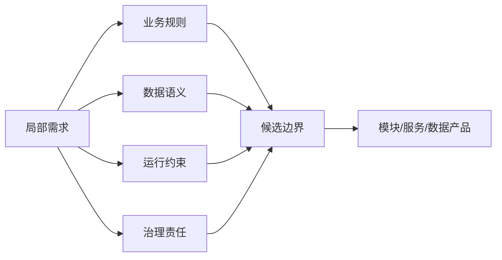
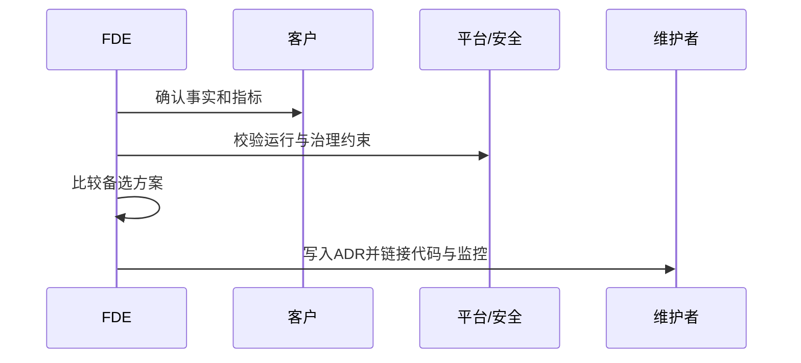
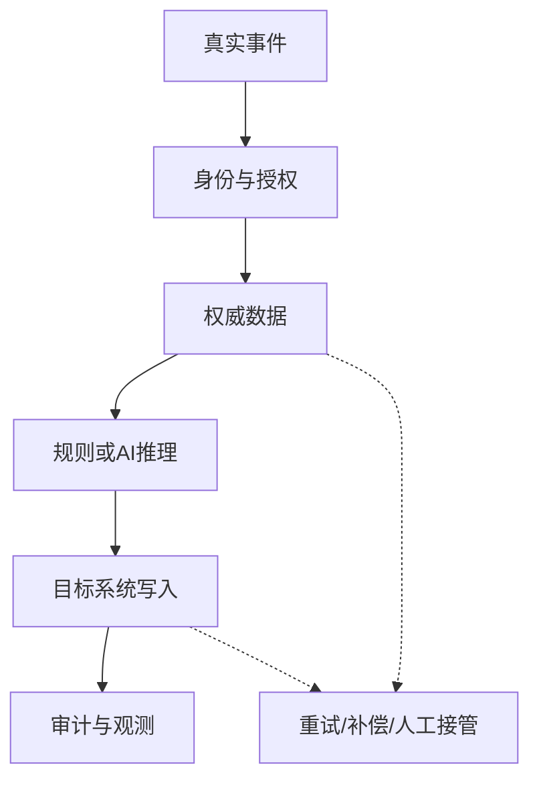
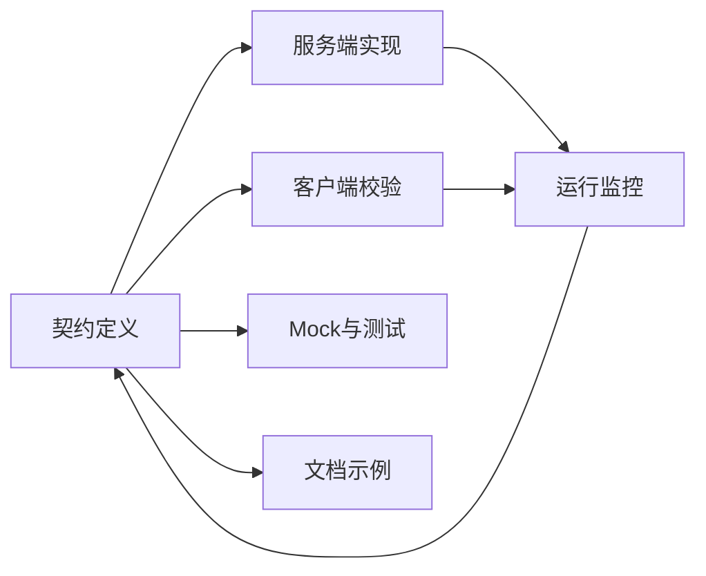
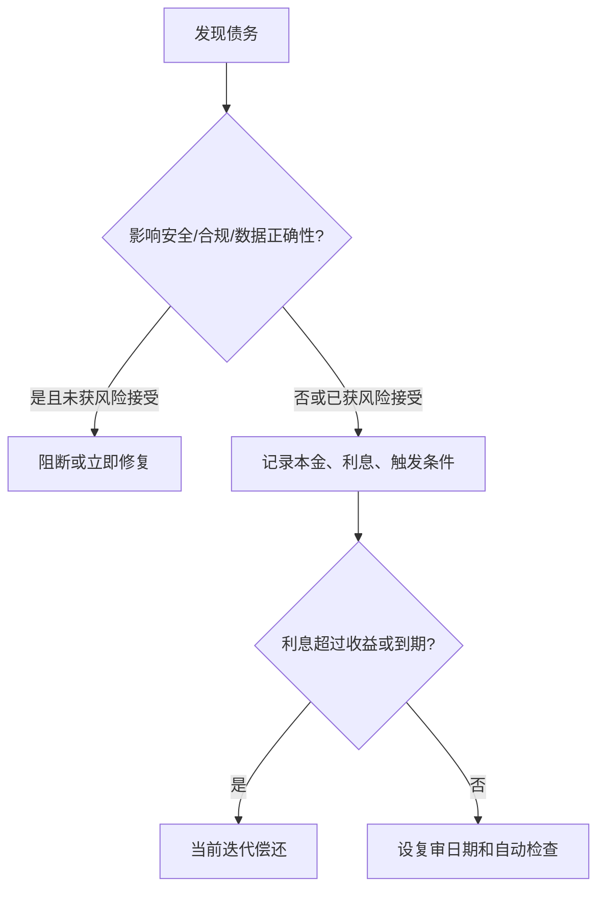

# 第三章 系统思维与架构取舍

前线部署工程师进入现场后，最容易被局部需求牵引：一个报表、一个审批流、一个模型调用、一次数据同步，看似都是可以独立完成的小任务。但真实企业系统从来不是孤立功能的集合，而是业务目标、组织分工、数据语义、权限边界、运行约束和演进成本共同作用的结果。本章讨论如何把现场发现转化为系统边界，如何记录架构取舍，如何让集成、接口和技术债管理成为交付节奏的一部分。

本章借用 [ISO/IEC/IEEE 42010:2022](https://www.iso.org/standard/74393.html) 中关于架构描述的基本思想：架构描述应围绕系统、利益相关方、关注点、视角和模型组织。对 FDE 来说，这不是为了写厚重文档，而是为了让现场团队、客户团队、平台团队和未来接手者对同一个系统形成可验证的共识。

上一章产出的现场地图、事实与约束清单、领域语言包、需求切片和验证计划，是本章架构判断的输入。它们应被转化为系统边界、ADR、集成验收、契约和债务清单；这些产物再进入下一章的原型、试点和生产化门禁。本章采用“制造业库存异常 Agent”作为独立架构案例，用它演示如何把发现阶段的证据收敛成可交付的系统设计。

| 小节 | 核心问题 | 交付产物 |
| --- | --- | --- |
| 3.1 | 需求应该停在什么边界内 | 系统边界、责任划分、外部依赖 |
| 3.2 | 为什么选择这条架构路径 | ADR、取舍记录、复盘依据 |
| 3.3 | 如何优先解决集成风险 | 集成路径、失败模式、可观测接口 |
| 3.4 | 接口如何支持长期演进 | 接口、事件、数据与工具契约 |
| 3.5 | 技术债何时可接受、何时必须偿还 | 债务清单、利息指标、治理节奏 |
| 3.6 | 如何把本章产物交给后续交付 | 本章小结、交付门禁输入 |

| 第二章产物 | 第三章对应动作 | 第四章交付用途 |
| --- | --- | --- |
| 现场地图 | 划分系统边界、责任和外部依赖 | 明确小队协作和升级路径 |
| 事实与约束清单 | 写入 ADR 背景、约束、备选方案和复审条件 | 作为阶段退出和变更评审依据 |
| 领域语言包 | 固化事件、状态、字段和接口契约 | 保持原型、试点和生产口径一致 |
| 需求切片 | 选择最薄可运行集成路径 | 定义试点范围和验收样例 |
| 验证计划 | 转成集成验收、契约测试和债务触发条件 | 决定继续、暂停、回滚或扩面 |

读完本章，读者应能在现场交付中回答三个问题：第一，系统边界为什么这样划；第二，关键架构决策的代价和替代方案是什么；第三，如何让今天的快速交付不阻断明天的生产化、扩展和治理。

## 1. 从局部需求到系统边界

### 1.1 从功能请求看到系统责任

FDE 接到的需求常以局部功能出现：一个报表、一个审批流、一次数据同步、一个模型调用。若只按工单拆分，系统会变成临时脚本和点对点接口的集合。边界设计的第一性原理不是“这次要写多少代码”，而是“哪些状态、规则、数据责任和运行约束必须一起变化”。边界划错，后续每次变更都会穿透多个团队、数据库和权限域。

边界识别可以借用 [ISO/IEC/IEEE 42010](https://www.iso.org/standard/74393.html) 的架构描述思想：系统、利益相关方、关注点和视角要被显式表达。放到现场交付，边界识别应先回答五类关注点：业务价值流如何闭环，数据事实由谁拥有，运行失败如何恢复，权限和审计由谁负责，数据分类、保留和合规约束是否允许这样流动。能同时回答这些问题的边界，才是可维护的工程单元。

### 1.2 用责任、数据和变化频率划线

边界设计要避开两种极端：每个按钮都拆成服务，会让集成成本超过收益；所有规则都堆进“大平台”，会让长期演进失去局部性。更稳妥的做法是按责任、数据所有权和变化频率划线：一起变化的规则靠近，不同 SLA、不同权限模型、不同审计责任、不同数据处理目的的能力隔离。



Team Topologies 对平台团队、流对齐团队、使能团队和复杂子系统团队的划分提醒我们：架构边界最终会变成沟通路径和认知负担。Atlassian 对 [Team Topologies](https://www.atlassian.com/devops/frameworks/team-topologies) 的说明中，平台团队的目标是让流对齐团队更自治地交付。FDE 也应把身份、审计、数据接入、部署流水线沉淀为平台能力，把业务差异留给最接近场景的团队。

还要区分三类沉淀路径。若能力被多个场景反复使用、接口稳定、运维责任清楚，可平台化；若它带有可销售或可复制的业务语义、需要路线图和支持承诺，可产品化；若它依赖客户特有政策、一次性集成、低复用数据清洗或客户自有知识产权，就应保持项目特定，避免把噪声抽象进平台或产品。

### 1.3 贯穿案例：用 Agent 处理制造业库存异常

某制造企业提出需求：“库存数量异常时，让 Agent 自动判断原因并推动处理。”本章中的 Agent 指受控的业务编排服务：它可以使用模型或规则完成归因、摘要、建议和工具调用，但动作范围由系统契约、权限和人工审批限制。若把它当成一个聊天入口，系统边界会落在提示词和页面；若从责任出发，边界会变成一条跨库存、生产、采购、工单和权限系统的业务闭环。

需求入口应先被拆成可验证的触发源：仓库盘点差异、生产领料失败、采购到货少收、ERP 安全库存告警、人工在工单中标记“疑似异常”。这些入口不一定属于同一个服务，但它们都指向同一个业务事实：某个物料、批次、仓库、时间窗口内的可用库存和系统记录不一致。

候选边界可以先列三种，再用数据和权限收敛：

| 候选边界 | 适用条件 | 风险 |
| --- | --- | --- |
| 报警聚合模块 | 只做提醒和分派 | 无法负责处置闭环 |
| 库存异常 Agent 服务 | 负责异常归因、建议、工单编排 | 必须清楚哪些库存事实不能写 |
| 库存域核心服务 | 库存规则和写入都在同一团队 | 容易把 Agent 推理和核心交易耦合 |

更稳妥的边界通常是“库存异常 Agent 服务”：它读取库存、采购、生产和工单数据，生成异常归因和处置建议，创建或更新处理工单，但不直接改写权威库存。库存数量、批次状态、库位余额仍由 ERP 或 WMS 拥有；Agent 拥有的是异常事件、归因记录、建议版本、人工确认结果和处置编排状态。这样既能形成业务闭环，又避免 AI 推理越过交易系统的所有权边界。

权限边界也要前置定义。Agent 可读取的字段应按角色最小化：仓库主管可看本仓库明细，采购可看供应商和到货差异，生产计划可看领料影响，财务成本字段默认不可见。异步事件进入后，还要说明下游读取使用谁的权限：触发用户、岗位角色、仓库范围、服务账号还是经过授权的委托身份，并记录策略版本。写操作只允许落到异常工单、通知和审批建议；若需要调整库存，必须转成人工审批或调用库存域已暴露的受控接口。审批状态至少包含待审批、通过、拒绝、过期和升级，记录审批人、原因、有效期、覆盖阈值和可回滚动作。审计日志至少记录触发事件、读取的数据范围、模型或规则版本、建议内容、人工确认人、最终动作、幂等键和证据快照引用。

部署单元应跟运行责任一致。可拆成一个异常事件接入器、一个归因与建议服务、一个工单编排器和一组只读数据适配器；它们可在同一仓库或同一服务内起步，但生产化前要有独立的配置、密钥、监控和回滚边界。若客户网络隔离严格，数据适配器可以部署在客户内网，归因服务只接收脱敏后的异常上下文。

验收信号不要只看“Agent 是否能回答”。更关键的是：一个真实异常能从入口进入，带着业务键和 trace ID 穿过数据读取、归因、建议、工单、人工确认和审计；重复事件不会创建重复工单；无权限字段不会进入提示词或日志；核心库存写入仍由库存域完成；运维面板能看到异常量、自动归因率、人工改判率、工单关闭时长、失败重试结果和人工覆盖原因。

### 1.4 边界验收

| 检查项 | 可接受信号 | 风险信号 | 处理动作 |
| --- | --- | --- | --- |
| 责任 | 一句话说明负责什么 | 需要大量例外才能解释 | 指定唯一 owner 和升级路径 |
| 数据 | 写入方和读取方清楚 | 多系统同时写同一事实 | 选定权威写入方，其他系统改为读模型或派生视图 |
| 变化 | 常见变更局限在边界内 | 小需求牵动跨团队发布 | 拆出独立配置、契约或适配层 |
| 权限与合规 | 权限、审计、数据分类、保留和出境边界可说明 | 依赖共享账号、人工导出或未确认数据用途 | 暂停写动作，补齐信任边界和安全/法务确认 |
| 外部依赖 | 依赖方、SLA、降级路径和接管责任清楚 | 下游不可用时只能人工猜测 | 记录降级策略、接管 owner 和恢复条件 |

边界不是一次会议的结论，而是随验证推进而收敛的工程假设。早期可用模块、数据表、队列主题表达；生产化前必须落实到仓库、部署单元、权限模型、信任边界、监控面板和交接文档。边界越清楚，架构取舍越能围绕事实讨论。

## 2. 架构决策记录

### 2.1 记录为什么

现场交付中的架构争议，往往不是“选 A 还是 B”，而是三个月后没人记得为什么排除了 C。FDE 环境尤其容易丢失上下文：客户政策变化、数据权限临时放开、供应商接口不稳定、上线窗口被压缩、模型能力快速迭代。若只留下最终代码，后来者只能从实现倒推意图，甚至把临时绕路误认为长期架构。

ADR 可按 Martin Fowler 的 [Architecture Decision Record 介绍](https://martinfowler.com/bliki/ArchitectureDecisionRecord.html) 理解为：记录并解释单个架构相关决策的短文档。这个定义适合 FDE：ADR 不应成为大而全的设计说明，而应捕捉“难以轻易逆转、影响多个模块或团队、带来明显取舍”的决定，例如是否采用事件驱动集成、是否接入客户私有模型、是否允许同步调用跨越安全域。

### 2.2 最小 ADR

常见 ADR 模板通常包含状态、背景、决策和后果。本书建议 FDE 在现场交付中再补上备选方案、复审条件、风险接受人和回滚边界。状态说明它是提议、接受、废弃还是被替代；背景说明事实来源、利益相关方、质量属性和约束；决策用明确语句表达选择；备选方案说明为什么不选；后果同时写收益、代价和新增风险；复审条件说明什么变化会触发重看。已接受的 ADR 不应被静默改写；若事实变化导致决策失效，应新增一条替代 ADR，并链接旧记录。



ADR 的价值在于降低“重新争论成本”。当新成员质疑为什么不用某个流行框架时，ADR 可以说明当时的网络隔离、审计要求、运维能力和迁移窗口。当业务方要求快速加功能时，ADR 可以指出容量假设和可扩展边界。讨论因此从“谁说了算”变成“哪些事实变化了”。

现场时间被压缩时，可以先写一条 5 分钟 ADR，后续再补细节。

| 字段 | 最小写法 |
| --- | --- |
| 决策 | 选择什么，不选择什么 |
| 约束 | 哪些事实、指标、合规或运行条件驱动这个选择 |
| 替代方案 | 至少一个被排除方案及原因 |
| 风险接受 | 谁接受剩余风险，是否客户可见 |
| 回滚边界 | 哪些状态、数据、配置或模型版本可回退，哪些不可逆 |
| 复审触发 | 哪个指标、日期、政策或依赖变化会触发重看 |

### 2.3 ADR 示例：库存异常处理该用事件驱动还是同步调用

**状态：接受。**

**背景。** 库存异常处理 Agent 需要接收 WMS 盘点差异、ERP 安全库存告警、生产领料失败和人工工单标记。异常处置通常需要读取多系统数据、生成归因建议、创建工单并等待人工确认。客户现场存在接口限流、网络分区和人工审批窗口；本案例假设业务要求异常进入系统后 5 分钟内可见，30 分钟内形成可处理工单，但不要求触发方同步等待归因完成。这个数值来自案例设定，真实项目应由现场指标和客户承诺决定。

**备选方案。**

| 方案 | 优点 | 代价 |
| --- | --- | --- |
| 全同步调用 | 调用链直观，入口系统可立即得到结果 | 调用方被 Agent、数据源和工单系统的延迟共同拖慢，失败时容易产生跨系统半完成状态 |
| 事件驱动 | 入口系统只发布异常事件，Agent 异步归因和编排，天然支持重试与削峰 | 需要事件契约、幂等键、死信队列和可观测链路 |
| 批处理轮询 | 对老系统侵入小，实施快 | 实时性差，重复处理和遗漏检测成本高 |

**决策。** 采用事件驱动作为主路径：各入口系统发布 `InventoryAnomalyDetected` 事件，事件必须包含异常类型、物料、仓库、批次或批次不适用标记、业务时间窗口、来源系统、幂等键和 trace ID。库存异常 Agent 订阅事件后异步读取上下文、生成归因建议并创建或更新工单。对无法发布事件的遗留系统，允许短期批处理适配器把变更转成同一事件契约；不允许入口系统同步等待 Agent 完成归因。

**后果。** 收益是入口系统解耦、失败可重试、突发异常可削峰、人工审批和模型推理延迟不会阻塞核心交易。代价是必须建设事件契约治理、重复事件去重、死信处理、延迟监控和跨系统 trace。事件平台还必须明确投递语义、保留与重放窗口、分区与顺序保证、schema registry owner、死信 owner、补数和回放规则。新增风险是消费者滞后导致异常处理延迟，所以需要监控事件积压、归因耗时、死信数量和工单创建失败率。

**风险接受与回滚。** 业务 owner 接受“事件进入后异步归因”的用户体验风险；平台 owner 接受事件总线和监控的运行责任。回滚边界是关闭 Agent 消费者、暂停自动创建工单、回到只读建议或人工处理队列；已经创建的工单必须通过状态机补偿，不能直接删除审计记录。

**复审条件。** 若 95% 异常需要 30 秒内同步返回处置结果，或客户平台不允许部署事件总线，或事件投递延迟连续两周超过业务窗口，应复审决策。上述阈值是案例假设，真实项目应写入客户承诺或 SLO 来源。若库存域提供稳定的受控调整接口，也应复审 Agent 是否可从“建议和工单编排”扩展到“自动提交待审批调整”。

### 2.4 贴近系统

| 决策类型 | 触发记录 | 复审信号 |
| --- | --- | --- |
| 系统边界 | 影响团队责任或数据所有权 | 需求频繁跨边界变更 |
| 集成方式 | 同步、异步、批处理之间取舍 | 延迟或一致性假设失效 |
| 安全与隐私 | 信任边界、权限、密钥、审计、脱敏、数据保留 | 合规要求或数据用途变化 |
| 平台依赖 | 采用云服务、开源组件或供应商能力 | SLA、价格、锁定风险变化 |
| 可靠性承诺 | 可用性、延迟、恢复时间、降级方式 | SLO 或客户承诺变化 |
| 产品化路径 | 项目特定、平台能力、产品能力之间取舍 | 多个场景重复出现同一能力 |

ADR 应与代码、接口和运行证据放在同一条链路中。关键模块、API、数据管道或部署环境应能找到对应决策；ADR 也应链接需求切片、验证结果、威胁模型、性能测试、OpenAPI 或事件 schema、事故复盘和客户 owner 确认。判断标准很简单：未来维护者若需要知道“当时为什么这样做”，就写。

## 3. 集成优先的设计原则

### 3.1 风险在连接处

企业现场很少缺少单点工具，真正的困难通常发生在连接处：身份系统与业务系统权限口径不同，主数据平台与报表系统更新频率不同，供应商 API 的错误语义不稳定，批处理任务和实时工作流争夺同一份状态。FDE 若先做漂亮原型、最后再补集成，常会发现原型最顺畅的路径恰好绕开了生产环境最硬的约束。

集成优先不是一次接完所有系统，而是优先验证跨边界事实：哪些身份可以调用，哪些字段是权威来源，失败能否重试，幂等键放在哪里，审计日志能否还原责任。云厂商框架可作为检查清单，但不应被当成固定不变的完整列表：运行卓越、安全、可靠性、性能效率、成本优化和可持续性可参考 [AWS 的 Well-Architected Framework](https://docs.aws.amazon.com/wellarchitected/latest/framework/the-pillars-of-the-framework.html)；运行卓越、安全、隐私与合规、可靠性、成本和性能等维度也可参考 [Google Cloud 的架构框架](https://docs.cloud.google.com/architecture/framework)。FDE 应让这些维度先落在集成路径上，而不是停留在架构评审表格里。

### 3.2 最薄可运行路径

集成设计应从“最薄可运行路径”开始。这里的“薄”指业务范围薄，不是生产约束薄。选择一条真实业务流，包含真实身份、真实数据、真实权限、真实错误和真实审计；功能覆盖面可以小，但关键约束不能被模拟掉。例如库存异常 Agent 可先只覆盖一个仓库和一个异常类型，但必须使用生产等价身份和真实权限模型，读取真实库存源，写入受控试点租户、沙箱、影子工单或带人工确认的真实工单系统，并在失败时留下可追踪记录。未通过验收前，不应直接触发不可逆的生产动作。



这条路径是未来生产系统的脊柱。围绕它扩展时，新增场景只是在已验证的身份、数据、写入、审计和观测机制上增加分支。这样最早暴露的是系统性风险，而不是等功能堆满后才发现基础连接不可用。

时间压力很大时，FDE 可以把现场动作压缩成三步：前 30 分钟确认不可逆写入、真实 owner 和必须停下来的风险；前 60 分钟选出一条生产等价薄路径，写下身份、数据源、写入目标和回滚边界；前 120 分钟完成一次真实事件穿透或明确阻塞证据。若 owner、权限、回滚或审计任一项无法确认，就不应把演示路径升级为试点路径。

### 3.3 工程约束

| 原则 | 现场问题 | 工程约束 |
| --- | --- | --- |
| 真实身份优先 | 测试账号绕过权限 | 使用生产等价权限模型 |
| 权威数据优先 | 报表口径冲突 | 标注权威来源（source of truth）与延迟 |
| 失败路径优先 | 接口失败导致脏状态 | 设计重试、补偿和人工接管 |
| 可观测优先 | 无法定位跨系统故障 | 统一 trace ID、业务键和审计字段 |

| 集成失败模式 | 必要控制 | 验收证据 |
| --- | --- | --- |
| 超时 | 超时预算、重试上限、熔断和降级 | 超时测试能触发明确错误、告警和降级 |
| 重复投递 | 幂等键、去重记录、重复事件监控 | 同一事件重放只更新同一业务对象 |
| 权限拒绝 | 明确错误码、审计、最小权限修正流程 | 越权请求被拒绝且能定位请求主体和策略版本 |
| 部分写入 | 补偿动作、状态机、人工接管 | 人工队列 owner、补偿动作和终态可查询 |
| 数据延迟 | 新鲜度指标、延迟告警、只读降级 | 过期数据进入降级路径，不生成高置信动作 |
| 下游不可用 | 队列缓冲、死信、回放和业务通知 | 死信 owner、重放窗口、重放命令和业务通知路径清楚 |

### 3.4 集成验收

发现阶段的风险假设进入架构阶段后，应变成可执行控制。以库存异常 Agent 为例，集成验收至少要回答下表。

| 验收问题 | 应落到的具体值 |
| --- | --- |
| 谁能触发 | 触发系统、调用身份、授权主体、仓库或租户范围 |
| 事件怎样到达 | 投递语义、发布确认、保留时间、重放窗口、checkpoint 或 outbox 规则 |
| 状态怎样推进 | 新建、归因中、待人工确认、已派单、已关闭、已拒绝、需补偿等状态和 owner |
| 失败谁接管 | DLQ owner、人工队列 owner、升级路径、最长等待时间 |
| 如何回滚 | 关闭消费者、暂停写入、回到只读建议、补偿已创建工单的规则 |
| 如何扩面 | 从一个仓库/异常类型扩到更多范围时必须重新验证的契约和指标 |

FDE 的架构能力不在于画出复杂拓扑，而在于把系统接起来后仍能解释、运行和演进。只要真实集成路径成立，功能扩展就有稳定基础；若它不成立，再多局部功能也只是暂时可看的孤岛。

## 4. 可演进接口与契约

### 4.1 接口是承诺

在 FDE 项目中，接口不只是技术调用方式，而是组织之间的承诺。API、事件主题、数据表、文件格式或模型工具调用，一旦被其他团队依赖，就形成契约。契约含糊，调用方会靠猜测实现；变化没有治理，生产系统会在意外处断裂。接口设计的核心不是“今天调用成功”，而是“明天变化时仍保护消费者”。

HTTP API 的契约表达可借鉴 [OpenAPI Specification](https://spec.openapis.org/oas/latest)：它用与编程语言无关的接口说明，使人和工具无需读取源码或抓包即可理解服务能力。这个思想可推广到所有集成形式：契约应表达输入、输出、错误、权限、幂等、版本和弃用策略。AI 工具调用还要说明副作用和安全拒绝边界。

### 4.2 面向演进

可演进接口遵循三条原则：新增可选字段、枚举扩展、事件附加元数据，不破坏旧消费者；删除字段、改变语义、收紧权限、修改错误码，必须有版本、迁移窗口和消费者清单；文档、mock、测试和监控基于同一份契约，而不是各自维护。

| 契约元素 | 应说明的内容 | 破坏性变化示例 |
| --- | --- | --- |
| 数据结构 | 字段类型、必填性、枚举、单位 | 必填字段新增 |
| 行为语义 | 幂等、排序、一致性、重试结果 | 覆盖变为追加 |
| 错误模型 | 错误码、可重试性、人工处理 | 认证与权限错误混用 |
| 生命周期 | 版本、弃用、迁移期限 | 无通知删除旧接口 |



可复制的契约模板应至少包含以下字段。

| 字段 | 用途 |
| --- | --- |
| owner / consumer | 明确提供方、消费者和升级联系人 |
| schema / version | 记录 schema 引用、主次版本和兼容策略 |
| 权限 | 说明授权主体、委托关系、数据范围、策略版本和拒绝条件 |
| 数据安全 | 标注数据分类、保留期限、脱敏要求、日志/提示词暴露边界 |
| 错误模型 | 区分可重试、死信、越权、人工复核等错误 |
| 幂等 | 定义幂等键来源、覆盖范围和重复处理规则 |
| 投递语义 | 说明顺序、重放窗口、checkpoint、死信 owner 和补数规则 |
| 弃用窗口 | 写清通知方式、迁移期限、最后支持日期 |
| mock 来源 | 说明 mock 由契约生成或校验，避免手写漂移 |
| 契约测试 | 记录消费者测试、提供方验证和运行监控指标 |

### 4.3 小型契约示例：库存异常事件

以库存异常处理 Agent 为例，入口系统发布事件，Agent 消费事件并创建或更新异常工单。契约可以先保持小，但必须把兼容性和失败语义写清楚。

```json
{
  "eventType": "InventoryAnomalyDetected",
  "schemaRef": "inventory.anomaly.v1.1",
  "producerVersion": "wms-adapter@2.4.0",
  "tenantId": "tenant-acme-mfg",
  "partitionKey": "WH-01:SKU-10086",
  "idempotencyKey": "wms:COUNT_MISMATCH:WH-01:SKU-10086:BATCH-9:2025-12-01T10:00:00Z/2025-12-01T10:30:00Z",
  "traceId": "0f6a8d7c2e3b4a910f6a8d7c2e3b4a91",
  "occurredAt": "2025-12-01T10:15:00Z",
  "businessWindow": {
    "start": "2025-12-01T10:00:00Z",
    "end": "2025-12-01T10:30:00Z"
  },
  "authorization": {
    "subjectType": "service-account-with-delegation",
    "delegatedRole": "warehouse-supervisor",
    "scope": ["warehouse:WH-01"],
    "policyVersion": "inventory-policy@2025-11"
  },
  "sourceSystem": "WMS",
  "warehouseId": "WH-01",
  "sku": "SKU-10086",
  "batchNo": "BATCH-9",
  "anomalyType": "COUNT_MISMATCH",
  "quantityDelta": -12,
  "unit": "EA",
  "severity": "HIGH",
  "links": {
    "sourceRecord": "wms://cycle-count/CC-7788",
    "evidenceSnapshot": "evidence://inventory-anomaly/INV-20251201-0007"
  }
}
```

字段兼容规则应写成可测试约束，而不是写成自然语言承诺。

| 规则 | 含义 | 测试 |
| --- | --- | --- |
| 未知字段 | 消费者应忽略未知字段，新增字段默认可选 | 示例事件附加随机字段后仍可消费 |
| 稳定字段 | `eventType`、`tenantId`、`warehouseId`、`sku`、`anomalyType`、`occurredAt`、`idempotencyKey`、`schemaRef`、`traceId`、`sourceSystem` 不得在同一主版本内删除或改义；`batchNo` 仅在物料或领域受批次管理时必填 | 缺失必填字段进入死信；非批次物料必须有“批次不适用”规则 |
| 分区与顺序 | `schemaRef` 标识契约版本，`producerVersion` 用于事故复盘，`partitionKey` 决定下游分区与局部顺序保证 | 同一仓库和物料的事件按约定分区 |
| 枚举扩展 | `anomalyType` 允许增加新值，消费者遇到未知枚举时降级为 `UNKNOWN` 并转人工队列 | 未知枚举样例进入人工复核 |
| 单位 | 数量字段必须由 `unit` 明确给出，不能靠客户默认单位推断 | 缺失单位被拒绝或转人工 |
| 时间窗口 | 业务窗口必须由 `businessWindow` 或明确窗口规则表达，不能只埋在幂等键里 | 同一窗口重复事件产生同一业务对象 |

错误模型也属于契约。消费者处理失败时至少应区分下列类型。

| 错误 | 含义 | 处理 |
| --- | --- | --- |
| `RETRYABLE_UPSTREAM_TIMEOUT` | 读取上下文超时 | 自动重试，超过预算后告警 |
| `INVALID_EVENT_CONTRACT` | 必填字段缺失或类型错误 | 进入死信并通知来源系统 |
| `FORBIDDEN_DATA_SCOPE` | 事件要求读取越权数据 | 拒绝、审计并要求权限复核 |
| `STALE_EVIDENCE` | 关键库存或工单快照超过新鲜度窗口 | 只读降级或转人工 |
| `CONFLICTING_EVIDENCE` | ERP、WMS、MES 或工单事实冲突 | 进入人工复核，不自动归因 |
| `UNSUPPORTED_CAUSE` | 现有规则或模型无法支持该异常原因 | 记录新类别，转人工队列 |
| `UNTRUSTED_PROMPT_CONTENT` | 自由文本或外部链接包含可疑指令 | 隔离为不可信内容，不进入系统指令 |
| `MANUAL_REVIEW_REQUIRED` | 数据足够但置信度或影响级别需要人工确认 | 创建人工复核工单 |

幂等键由来源系统生成，并覆盖“来源系统、仓库、物料、批次或批次不适用标记、异常类型、业务时间窗口”。Agent 使用幂等键保证重复投递只更新同一异常记录或工单，不创建重复工单。若来源系统无法生成稳定键，适配器必须在发布事件前补齐，不能把去重责任留给人工处理。生产者还要说明 checkpoint、发布确认、回放窗口和补数规则，否则只能避免重复，不能证明不会漏事件。

弃用窗口要写入契约生命周期。比如 `quantityDelta` 计划从整数改为小数字段时，可先新增 `quantityDeltaDecimal` 并双写一段迁移窗口；当消费者监控显示旧字段已无读取并经过约定观察期后，才能宣布下一主版本删除。具体窗口不应套用固定天数，应按消费者数量、发布周期、客户合规要求和回滚能力决定。弃用通知应列出受影响消费者、迁移示例、最后支持日期和回滚方式。

消费者 mock 与契约测试必须同步。消费者 mock 由同一份事件契约生成或校验，示例事件不能手写后长期漂移。每次契约变更都要同时更新 mock 示例、消费者契约测试和提供方验证：消费者证明自己能处理新增可选字段、未知枚举、错误模型和重放样例；提供方证明实际发布事件满足必填字段、类型、幂等键、授权字段、时间窗口和弃用窗口要求。读取库存上下文的 API、创建工单的命令接口和 Agent 工具调用也要有契约，至少说明新鲜度、一致性、分页、授权、幂等和副作用。

### 4.4 契约测试

契约不能只靠评审守住。Pact 文档把 [consumer-driven contract testing](https://docs.pact.io/) 描述为由消费者写出期望交互、提供方再验证这些交互的机制。它把“谁依赖了什么行为”变成可运行证据。HTTP API 可以用请求/响应交互验证；事件和数据契约则需要 schema 校验、样例语料、生产者验证、消费者回放和运行监控共同支撑。

| 测试层 | 库存异常事件应覆盖 |
| --- | --- |
| producer validation | 发布前校验必填字段、授权字段、业务时间窗口、幂等键和 schema 版本 |
| consumer replay | 用样例事件重放新增可选字段、未知枚举、重复投递、乱序和死信场景 |
| error fixtures | 覆盖越权、证据冲突、过期快照、不可信文本、低置信度和不支持原因 |
| mock drift check | mock 与契约样例来自同一来源，不能由消费者长期手写 |
| runtime monitor | 监控契约错误率、未知枚举量、死信量、旧字段读取和消费者版本 |

契约测试不替代端到端测试，也不证明业务流程完整正确；它主要证明跨边界交互仍满足消费者假设。因此应覆盖高价值调用、关键错误路径和兼容性约束。FDE 交付时，应把契约、mock、测试、监控和迁移说明作为同一交付包，避免“代码能跑、契约已漂移”的隐性失败。

## 5. 技术债管理

### 5.1 技术债的边界

现场交付常在时间压力下做取舍：先用手工配置接通权限，先把数据落到临时表，先用同步调用替代事件流，先把模型提示写在配置里。这些选择不一定错误。技术债的关键不在于“有没有不完美”，而在于团队是否有意识地借用了未来维护成本来换取当前学习速度或交付窗口。

CMU 软件工程研究所对 [technical debt](https://www.sei.cmu.edu/library/managing-technical-debt-in-complex-software-systems/) 的定义强调：短期方便的设计或构造方式，会创造一个使未来同类工作成本更高的技术上下文；若能管理，某些债务可加速探索，若不识别和管理，则会增加开发与维护成本。本书采用更严格的治理口径：缺陷、安全漏洞、无人负责的脚本和错误数据口径，不能被轻描淡写地称为债务。只有被明确记录、限期、有人接受风险、并且有偿还触发条件的取舍，才可作为技术债管理；否则就是需要修复或升级的质量风险。

### 5.2 本金、利息、触发条件

FDE 的技术债管理不能只列“代码需要重构”。债务项必须说明它阻碍什么业务变化、增加什么运行风险、影响哪些团队，以及不偿还会产生什么利息。例如“库存同步任务没有幂等键”的利息是重复写入和人工清账；“RAG 索引没有血缘记录”的利息是无法解释答案来源；“权限映射写死在配置中”的利息是每次组织调整都要工程师介入。单项债务模板应包含位置、债务描述、本金、利息指标、风险级别、偿还触发、偿还动作、负责人、风险接受人、到期日期、是否阻断生产、客户可见风险和对应的自动检查或人工复审。

| 债务类型 | 典型表现 | 利息指标 | 偿还触发 |
| --- | --- | --- | --- |
| 架构债 | 边界错位、循环依赖 | 跨团队变更次数 | 新场景无法局部交付 |
| 数据债 | 口径不清、血缘缺失 | 对账工时、数据事故 | 进入生产运营 |
| 安全例外债 | 被批准且限期的临时账号、过宽权限 | 例外数量、审计缺口 | 合规评审或到期日 |
| 运维债 | 无告警、手工部署 | MTTR、夜间介入 | SLA 提升 |
| AI 债 | 提示散落、评测缺失 | 回归失败、人工复核率 | 模型升级 |



### 5.3 债务样例

库存异常 Agent 的一个可接受债务项可以这样记录。

| 字段 | 示例 |
| --- | --- |
| 位置 | `wms-batch-adapter` 的事件发布路径 |
| 债务描述 | 暂时用轮询适配器生成库存异常事件，尚未接入 WMS outbox |
| 当前收益 | 不改造 WMS 即可验证一个仓库的异常闭环 |
| 未来利息 | 可能漏掉短时间内创建后撤销的异常；补数时需要人工比对 |
| 风险级别 | 中；不允许进入全量生产 |
| 偿还触发 | 试点超过两个仓库、事件漏报率超过阈值、或准备接入自动库存调整 |
| 偿还动作 | 接入 outbox 或变更日志，补齐 checkpoint、发布确认和回放测试 |
| 负责人 / 风险接受人 | FDE 技术负责人 / 客户 WMS owner |
| 到期日期 | 试点结束前 |
| 自动检查 | 每日比对 WMS 异常数和已发布事件数，差异进入人工复核 |

### 5.4 AI 债的常见形态

AI 原生 FDE 项目会引入一类不同于传统架构、数据或运维债的“AI 债”。这类债务常在原型阶段看起来成本很低，但随着模型、数据、工具和安全策略版本演进，维护成本可能快速上升。常见形态包括：

- **提示词漂移**：提示词散落在代码、配置和实验笔记中，没有版本、负责人和评测基线，模型升级后效果难以归因。
- **评测集衰减**：评测样本只在原型阶段构造一次，未随业务真实分布更新，导致回归通过但生产质量下降。
- **向量索引重建成本**：嵌入模型、切分策略或元数据 schema 变更时缺少增量重建路径，每次升级都需全量重算，停机和成本失控。
- **工具版本绑定**：Agent 调用的工具签名、错误码或副作用未被契约化，工具升级时 Agent 行为静默退化。
- **模型供应商更换成本**：提示、上下文格式、Token 计费、安全策略和评测指标紧耦合到单一供应商，切换或多供应商策略需要重写整条链路。

这些债务都应进入 3.5.2 的本金/利息/触发条件清单，并在评测、监控和发布流程中配置对应的自动检查或人工复审。

### 5.5 嵌入交付节奏

技术债最怕只在复盘会上承认、从不进入计划。SEI 关于 [识别技术债条目](https://www.sei.cmu.edu/library/managing-technical-debt-identify-technical-debt-items/) 的资料可用于启发团队建立债务条目和影响记录。FDE 可用轻量字段管理：位置、原因、当前收益、未来利息、风险级别、偿还动作、负责人、风险接受人和复审日期。

Thoughtworks 对 [fitness function-driven development](https://www.thoughtworks.com/en-gb/insights/articles/fitness-function-driven-development) 的说明指出，适应度函数能持续反馈系统是否符合架构目标。放到 FDE 场景，可把关键债务转成检查：接口必须有契约测试，数据管道必须有质量规则，生产服务必须有 SLO 指标，AI 提示变更必须跑回归评测。目标不是无债，而是债务可见、可量化、可复审。

进入原型时，债务可以帮助团队快速学习；进入试点时，每个债务都必须有 owner、到期日和客户可见风险；进入生产化时，阻断安全、数据正确性、运行恢复和责任转移的债务必须偿还或由有权负责人正式接受。若一个债务无法说明谁接受、何时复审、如何检测利息，它不应留在债务清单里，而应升级为交付风险。
