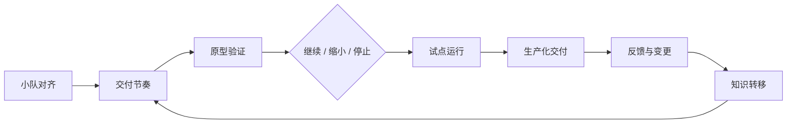
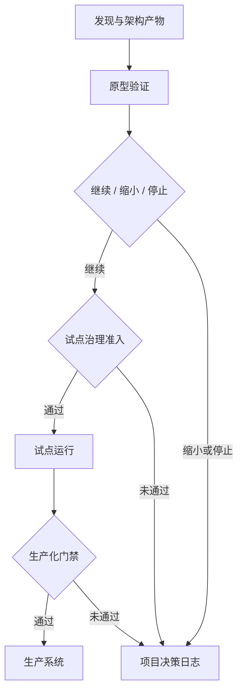
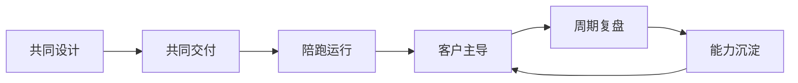

# 第四章 交付节奏与团队协作

前线部署工程的难点不只在技术实现，还在把现场不确定性转化为可持续交付的组织节奏。本章讨论 FDE 团队如何从“能做出一个方案”走向“能让客户组织稳定采用一个系统”：先明确小队模型与角色协同，再建立交付节奏与决策节拍，然后把原型、试点、生产化拆成不同风险阶段，随后建立反馈循环、变更管理和知识转移机制。

贯穿案例：假设 FDE 小队要为客户上线“AI 工单分流助手”，系统需要读取客服工单、识别问题类型、推荐处理队列，并在低置信度或高风险场景下升级给人工坐席。首批试点只覆盖退款队列和账号异常队列，目标是降低人工初分耗时，同时不能让高价值客户、投诉升级或合规敏感工单被自动误导。后续各节会复用这个案例说明角色边界、决策节拍、阶段退出标准、反馈记录和撤场验收，而不是只停留在抽象流程。

DORA 的[交付指标框架](https://dora.dev/guides/dora-metrics/)将软件交付表现拆为吞吐量与稳定性相关指标，强调指标要用于持续改进，而不是用于跨团队排名；Google SRE Workbook 的[发布工程实践](https://sre.google/workbook/canarying-releases/)则说明，自动化、可回滚、小批量发布能降低生产风险。FDE 项目同样需要这两类视角：既要快速学习，也要控制真实业务影响。

本章的核心判断是：交付节奏不是会议频率，也不是项目管理模板，而是团队对价值、风险、责任和学习速度的共同约束。

## 1. 小队模型与角色协同

### 1.1 小队不是临时人力池

FDE 小队的价值来自跨职能闭环，而不是把工程师、产品经理、客户经理和架构师临时拼在一起。这种小队观与 [Atlassian 对敏捷团队的定义](https://www.atlassian.com/agile/teams)一致：跨职能、协作、持续改进和价值交付；Scrum Team 围绕产品目标自管理的要求也可参考 [Scrum Guide 2020](https://scrumguides.org/docs/scrumguide/v2020/2020-Scrum-Guide-US.pdf)。FDE 现场的复杂度更高，因为团队不仅要写代码，还要进入客户流程、理解权限边界、处理遗留系统、回应安全与合规要求。因此，小队模型首先要回答三个问题：谁代表业务结果，谁对工程质量负责，谁能决定上线边界。

典型 FDE 小队可以采用“现场负责人、产品/领域负责人、交付工程、平台/安全、客户业务 Owner、客户数据 Owner、客户运维 Owner”的轻量结构。现场负责人负责把模糊诉求转成可验证目标，产品/领域负责人维护用例优先级和验收语义，交付工程负责实现、集成、测试和可观测性，平台/安全角色负责环境、权限、审计和生产约束，客户侧 Owner 负责业务签收、数据授权、运行接手与决策升级。角色可以一人多帽，但责任不能混在一起；一旦“谁说了算”和“谁承担结果”不清楚，需求变更会变成情绪协商，生产事故也会变成互相解释。

| 角色 | 主要责任 | 关键产出 | 不应承担的事 |
| --- | --- | --- | --- |
| FDE 现场负责人 | 价值目标、范围取舍、客户沟通 | 成功指标、风险清单、决策记录 | 单独替客户做业务决策 |
| 领域/产品负责人 | 用例切片、验收口径、优先级 | 用户旅程、验收样例、变更说明 | 把所有需求直接塞进迭代 |
| 交付工程师 | 系统实现、集成、测试、发布 | 可运行系统、自动化检查、运行手册 | 绕过客户权限与治理流程 |
| 平台/安全角色 | 环境、身份、审计、合规约束 | 权限模型、部署约束、证据链 | 只在上线前被动审批 |
| 客户业务 Owner | 资源协调、业务确认、内部推广 | 业务签收、培训对象、运营安排 | 把 FDE 当外包执行队 |
| 客户数据 Owner | 数据授权、用途确认、数据质量责任 | 数据访问审批、字段口径确认、保留策略 | 把取数授权交给工程师临场判断 |
| 客户运维 Owner | 生产窗口、值班接手、运行升级 | 发布窗口、值班路径、运维接手记录 | 只在撤场时被动接收系统 |

### 1.2 用 RACI 管住协作边界

小队协同需要低成本的责任表达，可以借鉴 Microsoft Cloud Adoption Framework 的 [RACI 责任对齐](https://learn.microsoft.com/en-us/azure/cloud-adoption-framework/organize/raci-alignment)：明确 Responsible、Accountable、Consulted、Informed，即执行者、最终负责者、被咨询者和需知会者。FDE 项目尤其适合用 RACI 管住跨组织事项：数据接入、生产发布、权限开通、模型评测、变更审批、运维交接都不应只靠群聊推进。

实际落地时，RACI 不应被做成一张无人维护的大表，而要绑定到少数高风险活动。例如，生产发布只能有一个 Accountable，安全团队可以是 Consulted 或 Responsible，但不能在事故发生后才被告知；客户业务负责人可以对业务验收 Accountable，但不能对底层技术债负责。RACI 的目的不是制造层级，而是缩短等待时间：当问题出现时，团队知道找谁确认事实、找谁做取舍、找谁执行修复、找谁接收通知。对 FDE 来说，高效的小队不是所有人参与所有事，而是每个关键决策都有清晰的最小参与集合。

以“AI 工单分流助手”为例，小型 RACI 可以只覆盖上线前后最容易卡住的事项。表中的 R 表示执行负责，A 表示最终负责，C 表示需要咨询，I 表示需要知会。

| 事项 | FDE 现场负责人 | 领域/产品负责人 | 交付工程师 | 平台/安全角色 | 客户业务 Owner | 客户数据 Owner | 客户运维 Owner |
| --- | --- | --- | --- | --- | --- | --- | --- |
| 数据接入 | C | C | R | C | I | A | I |
| AI 行为资产变更 | C | A | R | C | C | C | I |
| 生产发布 | C | C | R | C | C | I | A |
| 事故升级 | R | I | R | C | A | C | C |
| 业务验收 | C | R | I | I | A | I | I |

这张表不替代流程说明，但能提前消除两类常见误解：数据接入不是工程师私自拿数，业务验收也不是客户业务 Owner 临时看一眼演示。每个事项都应有且只有一个 A；如果同一项出现多个 A，说明决策边界还没有谈清楚。客户数据 Owner 对授权、用途、字段口径和保留策略负责，客户运维 Owner 对生产运行窗口、值班路径和接手能力负责，FDE 则负责把执行证据和风险选项讲清楚。

表中的“AI 行为资产变更”包括模型版本、提示词、分流规则、评测阈值、检索索引和工具 schema 等会改变系统行为的资产。若变更同时改变数据用途、供应商边界、权限模型或合规风险，它不能只按产品行为变更处理，必须进入治理门，由客户数据 Owner、平台/安全角色或法务按职责给出阻断意见。

## 2. 交付节奏与决策节拍

### 2.1 节奏服务于决策

交付节奏不是会议数量，而是让关键事实在正确时间到达正确责任人。FDE 项目常跨越客户业务、数据、平台、安全、运维和供应商团队，如果只靠即时聊天推进，团队会在两类地方失速：一类是小问题没人负责，另一类是高风险事项没有足够证据就被推进。节奏设计要回答三个问题：哪些事项每天同步，哪些事项每周决策，哪些事项必须触发升级。

对 AI 工单分流助手来说，节奏应围绕真实交付风险设计，而不是围绕团队内部习惯设计。试点期间每日需要看误分流、低置信度升级、人工改派和用户反馈；每周需要决定是否扩展队列、调整提示词或规则、补充评测样本；上线前必须确认数据用途、权限、回滚、告警和客户接手证据。每个节奏都要有明确产物，否则会议只是同步情绪。

| 节奏 | 参与角色 | 主要问题 | 必要产物 | 升级触发 |
| --- | --- | --- | --- | --- |
| 每日试点检查 | FDE、交付工程、领域/产品负责人、试点用户代表 | 昨天是否出现误分流、阻断、成本或体验异常 | 反馈队列更新、阻断项 Owner、当天处理决定 | 高风险误分流、敏感数据暴露、核心链路不可用 |
| 每周价值与风险评审 | FDE 现场负责人、客户业务 Owner、客户数据 Owner、客户运维 Owner、平台/安全角色 | 是否继续、缩小、停止或扩面 | 指标窗口、风险清单、项目决策日志 | 指标无改善、同类风险连续复现、权限或合规边界变化 |
| 试点扩面评审 | 客户业务 Owner、领域/产品负责人、交付工程、平台/安全角色 | 是否从一个队列扩到更多用户或更多工单类型 | 扩面范围、回退路径、通知对象、观察窗口 | 新队列数据口径不清、人工接管能力不足 |
| 发布准备评审 | 交付工程、平台/安全角色、客户运维 Owner、客户业务 Owner | 是否具备生产发布条件 | 门禁证据、回滚演练、告警 Owner、客户签收 | 任一必选门禁缺证据 |
| 自治复盘 | 客户业务 Owner、客户运维 Owner、FDE、培训/支持负责人 | 客户是否能独立使用、排障和改进 | 运行资产维护人、培训计划、遗留风险接受 | 客户仍依赖 FDE 执行常规操作 |

### 2.2 决策记录分层

不是所有决定都应该写成架构决策记录。第 3 章的 ADR 适合记录系统边界、接口契约、数据所有权、关键依赖和技术债取舍；本章的项目决策日志则记录继续、暂停、缩小范围、扩面、接受风险、变更窗口和撤场条件。二者可以互相引用，但不要混成一个文件：如果试点失败是因为权限模型不能支持最小权限，应补 ADR；如果只是决定把试点从三个队列缩到一个队列，应写项目决策日志。

项目决策日志的最小字段应包括：决策日期、决策人、背景证据、选项、决定、影响范围、后续动作、复核日期。这样，当客户后来问“为什么没有继续推进自动分流”或“为什么先上线退款队列”，团队能用证据还原判断，而不是依赖个人记忆。

## 3. 原型、试点与生产化

### 3.1 三个阶段解决三类问题

FDE 交付常被误解为“先做一个 PoC，再补工程化”。这种路径容易失败，因为原型、试点、生产化解决的是不同问题。原型回答“这个方向是否值得继续”，试点回答“真实用户和真实流程是否能跑通”，生产化回答“组织是否能长期、安全、可观测地运行”。如果把三者混成一个阶段，团队会在原型里过度建设，或把试点系统直接推上生产，最后既慢又危险。

本节承接第 2 章的现场地图、事实与约束、领域语言、需求切片和验证计划，也承接第 3 章的系统边界、ADR、集成路径、接口契约和技术债清单。进入原型前，团队至少应知道正在验证哪个业务切片、哪些事实仍是假设、哪些边界不能被临时绕过。进入试点前，真实数据、真实用户和有限权限必须先通过轻量治理准入，不能等生产化时才补隐私、审计和数据用途审批。

原型阶段应压缩范围，优先验证最高不确定性的假设：数据是否可得、模型输出是否可接受、接口是否能打通、业务用户是否真的改变工作方式。试点阶段要引入真实用户、真实数据子集、权限控制、失败恢复和运营指标，同时保留最小自动化检查、可回退路径和必要遥测。生产化阶段则必须补齐可维护性、自动化构建、自动化测试、发布回滚、审计、监控、成本治理和交接机制，并按 [Google SRE Workbook 发布工程章节](https://sre.google/workbook/canarying-releases/)所强调的方式落实自动化、可回滚和小批量变更。这些不是“大公司仪式”，而是把现场实验变成生产系统的最低工程纪律。

如果交付物以容器形式进入客户环境，试点前至少要固定基础镜像版本、构建命令、镜像仓库、制品哈希、扫描结果和回滚镜像标签；生产化前还要补齐签名、SBOM、运行用户、健康检查、资源请求与限制。Dockerfile、镜像仓库、卷、网络、Compose 和 Buildx 的基础操作可配合《Docker 从入门到实践》学习；本书关注这些对象如何进入部署证据和客户交接责任。

下表阈值是 AI 工单分流助手的示例下限，不是通用行业基准。实际项目应按业务量、长尾风险、季节性高峰、合规要求和人工接管能力调整。

| 阶段 | 核心问题 | 输入 | 退出标准 |
| --- | --- | --- | --- |
| 原型 | 假设是否成立 | 关键场景、样例数据、最小接口、最高风险假设 | 50 条脱敏样例能完成端到端分流演示；失败样例、成本估算、继续/停止结论和决策人记录到项目决策日志；至少有可重复演示脚本和关键错误样例 |
| 试点准入 | 真实数据能否合规进入受控流程 | 数据用途、字段分级、用户范围、权限方案、保留期 | 客户数据 Owner 确认用途和保留策略；反馈单脱敏规则、访问范围、审计方式和删除责任明确；试点用户与培训对象已确认 |
| 试点 | 真实流程是否可用 | 真实用户、受控数据、有限权限、回退路径、最小遥测 | 连续 2 周覆盖一个业务队列；人工改派率、低置信度升级量、平均处理时长、单位工单成本和用户反馈有基线与方向性变化；严重误分流有记录、回退路径和客户复核 |
| 生产化 | 是否可长期运行 | 完整权限、运维约束、合规要求、运行资产 | 关键路径 SLI/SLO、测量窗口、告警责任人、自动化回归、回滚时限、灰度范围、成本预算和客户签收记录齐备；客户运维至少完成 1 次发布或回滚演练 |

阶段退出标准要写成可验证句子，而不是“效果不错”“用户满意”这类描述。对于 AI 工单分流助手，原型阶段可以只看样例链路和继续投资判断；试点阶段必须看真实用户是否愿意使用、人工覆盖是否可控；生产化阶段则要看告警、回滚、权限、审计和客户接手动作是否全部可执行。

### 3.2 未达标时的决策分支

如果 AI 工单分流助手在任一阶段未达到退出标准，团队不应直接“再试一轮”或带病推进，而要按事先约定的失败分支处理。

| 未达标信号 | 默认动作 | 升级条件 | 记录位置 |
| --- | --- | --- | --- |
| 数据证据不足 | 收敛到单一队列、单一字段或单一失败类型，补齐字段口径 | 关键字段无法授权或质量长期不可用 | 项目决策日志；若改变数据边界，补 ADR |
| 模型置信度不稳 | 降级为人工辅助建议，扩大失败样本和评测集 | 连续两轮同一任务低于阈值，或误分流影响高风险客户 | 评测记录、反馈单、项目决策日志 |
| 用户不愿进入真实流程 | 回到第 2.1 节重做场景和基线确认 | 业务 Owner 无法安排试点用户或运营窗口 | 项目决策日志 |
| 权限、合规或成本不可外推 | 停止扩面，提出停止、缩小或更换切片选项 | 需要客户发起人接受风险或调整目标 | 风险清单、治理记录、项目决策日志 |

FDE 应该用证据而非情绪说明哪些假设被证伪、为什么继续投入会放大风险、备选路径的成本与收益是什么，并把决议、责任人和后续动作写入项目决策日志。若决策改变系统边界、接口契约、数据所有权或长期技术债，则同步补充第 3 章定义的 ADR。

### 3.3 生产化是一次重新设计

从原型到生产不是把代码“加固一下”，而是重新审视系统边界。原型在隔离环境中可以接受手工导入的脱敏或合成数据、一次性演示账号、离线脚本和临时提示词；一旦接触真实客户系统或真实客户数据，即使仍处于试点前，也应使用可追责的命名身份、短期凭证和限定数据范围。生产系统必须有身份边界、数据血缘、错误处理、版本管理和可审计行为。尤其在 AI 原生 FDE 项目中，原型阶段的“效果不错”并不代表生产可用。生产化要回答：模型失败时谁接管，用户误操作能否撤销，敏感数据是否进入不该进入的上下文，输出是否有评测基线，成本峰值是否受控。

从 [DORA 交付指标](https://dora.dev/guides/dora-metrics/)看，团队应把变更前置时间、部署频率、失败部署恢复时间、变更失败率和部署返工率放在一起观察，而不是只追求速度。FDE 生产化也应同时看速度与稳定性：小批量发布让团队快速学习，质量门禁和回滚路径让失败影响可控。第 6 章会展开流水线、制品、GitOps、IaC 和发布策略；本章只定义交付阶段中谁负责、何时必须具备证据、缺证据时如何阻断或降级。

| 门禁 | 检查时点 | 最终负责角色 | 必要证据 | 不通过时动作 |
| --- | --- | --- | --- | --- |
| 工程门 | 原型到试点、试点到生产 | 交付工程师 | ADR、接口契约、技术债清单、自动化构建、关键测试、依赖清单、镜像 digest、SBOM/扫描结果、回滚脚本、AI 行为资产版本清单 | 补测试、缩小范围或降级为人工辅助 |
| 运行门 | 试点扩面、生产发布 | 客户运维 Owner | 监控、告警、容量、运行手册、演练记录、灰度范围、暂停/回滚触发条件 | 暂停扩面，补运行资产 |
| 治理门 | 真实数据试点前、生产发布前、数据用途变化时 | 客户数据 Owner | 权限矩阵、审计字段、数据用途与保留策略、脱敏规则、反馈数据访问范围、供应商数据边界 | 限制真实数据、禁止写动作或改为离线验证 |
| 业务门 | 试点开始、扩面、生产接手 | 客户业务 Owner | 培训对象、支持流程、验收指标、人工接管规则、风险接受和退出条件 | 继续试点、重新切片或停止 |

## 4. 反馈循环与变更管理

### 4.1 反馈必须进入工程系统

现场反馈如果只停留在会议纪要、聊天记录或客户情绪里，就无法驱动稳定交付。FDE 需要把反馈分成四类：事实反馈、价值反馈、可用性反馈和风险反馈。事实反馈来自日志、指标、链路追踪、任务完成率和错误样例；价值反馈来自业务指标、节省时间、减少返工和决策质量；可用性反馈来自用户操作路径、培训问题和支持工单；风险反馈来自权限、合规、模型误用和生产事故。四类反馈的处理方式不同，不能都归入“需求变更”。

反馈循环可以借鉴 [DORA 指标指南](https://dora.dev/guides/dora-metrics/)的提醒：用指标观察交付系统随时间的变化，同时警惕把指标当成目标导致行为扭曲。FDE 的反馈循环也应避免单一指标崇拜。部署频率上升但客户不会用，不是成功；试点满意度高但生产失败率高，也不是成功。更稳妥的方法是建立“证据到决策”的闭环：每条重要反馈都要关联来源、影响范围、决策人、处理方式和验证结果。这样，团队既能快速响应现场变化，也能保护系统不被零散意见拖成不可维护的定制堆积。

| 反馈类型 | 证据来源 | 处理动作 | 验证方式 |
| --- | --- | --- | --- |
| 事实反馈 | 日志、指标、错误样例 | 修复缺陷或补观测 | 回归测试、指标恢复 |
| 价值反馈 | 业务 KPI、人工耗时、采用率 | 调整优先级或范围 | 前后对比、用户访谈 |
| 可用性反馈 | 培训问题、工单、操作路径 | 改流程、改界面、补文档 | 任务完成率、支持量下降 |
| 风险反馈 | 审计、安全评审、事故复盘 | 加控制、降权限、改发布策略 | 审计证据、演练结果 |

AI 工单分流助手进入试点后，可以用统一反馈单承接会议意见、工单样例、监控告警和业务验收意见。反馈单不是新的数据湖，涉及工单内容、截图、日志片段或模型 trace 时，必须先做脱敏、最小化、访问控制和保留期约束。建议字段如下：

| 字段 | 填写要求 | 示例 |
| --- | --- | --- |
| 反馈 ID / 状态 | 记录唯一编号、创建时间、更新时间、当前状态 | FB-2025-1201-018；处理中 |
| 来源 | 记录反馈来自用户、日志、指标、审计、事故复盘还是业务评审 | 试点坐席反馈 |
| 证据 | 附上脱敏后的工单编号、截图、日志片段、指标窗口或复现步骤 | 工单 2025-12-01-018 被分到错误队列 |
| 影响范围 | 说明影响的用户、队列、数据范围、时间窗口和是否触达生产 | 只影响退款队列，过去 2 天出现 3 次 |
| 优先级 | 按业务影响和风险分级，而不是按提出者级别排序 | 高：会导致客户等待超时 |
| 敏感级别 | 标记是否包含个人信息、商业敏感、审计数据或模型 trace | 含客户联系方式，已脱敏 |
| 反馈类型 | 记录这是缺陷、改进、风险控制还是范围变更 | 缺陷修复 |
| 变更等级 | 若需要变更，标记标准、普通、紧急或无需变更 | 普通变更 |
| AI 版本上下文 | 涉及 AI 行为时记录模型、提示词、规则、评测集、检索索引或 trace ID | prompt v12，eval refunds-v3，trace tr-88 |
| 关联指标 | 记录受影响的业务、运行、采用或风险指标 | 平均处理时长、误分流率、人工升级率 |
| 决策人 | 明确谁能决定修复、延后、拒绝或改变范围 | 领域/产品负责人 |
| 处理负责人 | 明确谁负责推动处理，不把责任停留在会议结论 | FDE 与运营分析师共同处理 |
| 关联对象 | 关联产品待办项、变更单、事故编号、回归用例或评测集版本 | CHG-17，eval case refund-042 |
| 目标日期 | 给出预期完成或复核日期 | 2025-12-08 前完成回归 |
| 处理方式 | 记录缺陷修复、提示词调整、规则调整、培训补充、范围变更或不处理 | 增加退款关键词规则并补回归样例 |
| 回归资产 | 说明是否沉淀为测试、评测、运行手册或培训材料 | 新增 eval case refund-042，更新运行手册 FAQ |
| 验证结果 | 说明用什么证据证明处理有效 | 20 条退款样例回归通过，试点队列 3 天未复现 |
| 关闭条件 | 说明何时可以关闭，不把“已回复”当成关闭 | 客户业务 Owner 确认验收通过，监控窗口满 3 天 |
| 关闭审批人 | 记录最终确认人和日期 | 客户业务 Owner，2025-12-09 |

反馈进入工程系统后要有路由规则。高优先级不一定等于紧急变更，但只要同时满足高业务影响、高数据或权限风险、不可逆写动作、无法回滚、业务高峰期影响或安全合规触发，就必须升级为普通或紧急变更。低风险反馈可以进入产品待办，高风险反馈必须关联变更单、事故记录或评测集版本，避免“已经记下来了”变成实际未处理。

### 4.2 变更管理要服务交付，而不是阻断交付

在传统企业里，变更管理常被理解为审批流程；在 FDE 项目里，它应首先是风险分级和学习机制。ITIL 4 Change Enablement 强调通过合适的风险评估、授权和排期增加成功变更；安全配置管理则可参考 [NIST SP 800-128](https://csrc.nist.gov/pubs/sp/800/128/upd1/final) 对规划、识别并实施安全配置、控制配置变更和持续监控的框架。两者共同指向一个原则：变更不是越少越安全，失控的变更才危险。

FDE 可以把变更分成标准变更、普通变更和紧急变更。标准变更是低风险、可重复、已评估并预授权的动作，例如非敏感展示文案、已批准目录内的只读配置或培训材料更新；普通变更需要影响分析、测试证据和发布窗口，例如调整核心工作流、修改权限模型、升级模型版本、调整提示词或重建检索索引；紧急变更用于生产中断或重大风险修复，但必须限制爆炸半径、限定临时授权时限，并事后补齐记录和复盘。只读报表字段只有在字段分级、访问受众和数据暴露面不变时，才可进入标准变更目录。

| 变更类型 | 判定条件 | 单一变更权威 | 必要证据 | 观察窗口 / 补救 |
| --- | --- | --- | --- | --- |
| 标准变更 | 低风险、可重复、已有预批准目录和复审周期 | 预批准目录 Owner | 操作记录、目录编号、回滚步骤、影响说明 | 1 个工作日或下一次例行检查；目录定期复审 |
| 普通变更 | 影响核心流程、权限、AI 行为资产、生产配置、数据范围或成本阈值 | 按影响域指定一个客户业务、数据或运维 Owner | 影响分析、测试结果、评测报告、回滚方案、通知对象、实施窗口 | 至少覆盖一个业务高峰或约定窗口；失败时暂停扩面或回滚 |
| 紧急变更 | 生产中断、重大安全风险或合规风险，且等待普通流程会扩大损害 | 事故指挥人指定的客户责任人 | 事故编号、变更原因、执行记录、风险接受、恢复验证、客户签收、事后复盘 | 立即监控，24 小时内复核；补普通变更单和行动项 Owner |

风险分级应至少看六个维度：业务影响、发生可能性、紧急度、可逆性、数据/权限影响、业务高峰影响。对 AI 工单分流助手，队列规则调整可能是标准变更，模型版本切换通常是普通变更，误分流导致大面积客户超时才可能进入紧急变更。紧急通道不能用于扩大数据范围、放宽权限、绕过评测或长期保留临时配置；这些动作即使在事故中执行，也必须有时限、回收责任人和事后普通变更单。

变更管理的颗粒度要与系统风险匹配：客户现场早期可以轻量，但一旦进入生产数据、生产用户和自动化执行，变更记录、审批依据、回滚方案和通知对象就必须完整。好的变更流程让小改动更快，让大改动更清楚，让事故后的学习不会丢失。

## 5. 知识转移与客户自治

### 5.1 交付完成的标志是客户能独立运行

FDE 不是把系统交给客户后退出，也不是长期替客户操作系统。真正的交付完成，是客户团队能够理解系统边界、独立处理常见问题、判断何时升级支持，并能基于业务变化提出有质量的下一轮需求。知识转移因此不是最后一周的培训课，而是从项目第一天开始的共同建造过程。客户参与需求澄清、验收样例、运行手册和事故复盘，本身就是能力建设。

组织采用新系统不是“通知一下”就会发生；个人层面的改变可参考 Prosci 方法论中的 [Prosci ADKAR® Model](https://www.prosci.com/methodology/adkar)，它把改变拆为 Awareness、Desire、Knowledge、Ability、Reinforcement。FDE 可以把这个模型转成客户自治路径：先让相关人员知道为什么要改变，再让关键角色愿意参与，然后传授如何操作，接着在真实流程中练到能独立完成，最后用制度、指标和复盘把新行为固定下来。这里的“客户”也不只是业务用户，还包括平台、运维、安全、数据治理、培训和管理层。只培训终端用户而不培训运维与治理角色，会导致系统上线后没人敢改、没人会查、没人能恢复。

| ADKAR 阶段 | FDE 知识转移动作 | 重点角色 | 可观察证据 |
| --- | --- | --- | --- |
| Awareness | 说明业务痛点、旧流程成本、系统边界 | 业务、运维、安全、数据治理、管理层 | 各角色能复述目标和不做事项 |
| Desire | 让业务负责人参与优先级和验收，明确个人收益和风险 | 业务 Owner、试点用户、主管 | 试点用户愿意投入真实流程，主管愿意安排运营窗口 |
| Knowledge | 提供操作、配置、故障处理、反馈提交流程和治理材料 | 坐席、主管、运维、安全、数据 Owner | 用户能按手册完成任务，运维能解释告警 |
| Ability | 陪跑生产任务、误分流纠正、低置信度处理和异常升级 | 一线用户、客户运维、支持团队 | 客户能独立处理常见事件并提交有效反馈 |
| Reinforcement | 建立采用率、人工绕行率、支持工单趋势、例会和复盘节奏 | 业务 Owner、运营负责人、培训负责人 | 新流程持续使用，复盘行动项有 Owner 和复核日期 |

如果某个角色卡住，不能只用“再培训一次”解决。业务用户卡在 Desire，通常要重新解释收益和风险；运维卡在 Ability，通常要补手册、权限和演练；安全或数据治理卡在 Awareness，通常说明系统边界、数据用途或审计证据没有讲清楚。按角色诊断阻力，知识转移才不会变成泛泛培训。

### 5.2 自治能力需要产品化沉淀

客户自治不是把所有内部细节暴露给客户，而是把可交付能力产品化。FDE 团队应沉淀四类资产：运行资产、学习资产、治理资产和演进资产。运行资产包括部署说明、监控面板、告警规则、回滚步骤和支持分级；学习资产包括用户手册、培训材料、常见问题、演示数据和操作练习；治理资产包括权限矩阵、审计说明、数据处理边界和变更流程；演进资产包括路线图、已知限制、决策记录和待验证假设。

这些资产要沿用 4.1 的 RACI 思路绑定维护责任人，而不是只交付文件。每份文档、每个看板、每条运行手册都要有客户侧维护人、复核周期和更新触发条件，否则它们会很快变成历史快照。FDE 撤场前最重要的不是“把文档交付完”，而是验证客户能否使用这些资产完成一次真实操作：新增用户、处理失败任务、回滚一次配置、解释一条告警、完成一次小版本发布。只有当客户能完成这些动作，系统才从供应商依赖转为组织能力。

| 资产类型 | 典型内容 | 必须绑定的责任 |
| --- | --- | --- |
| 运行资产 | 监控面板、告警规则、运行手册、回滚步骤 | 客户运维 Owner、复核周期、演练记录 |
| 学习资产 | 用户手册、培训材料、FAQ、练习数据 | 客户培训负责人、新人上手流程、效果检查 |
| 治理资产 | 权限矩阵、审计说明、数据处理边界、变更流程 | 客户数据 Owner、平台/安全角色、复核日期 |
| 演进资产 | 路线图、已知限制、项目决策日志、待验证假设 | 客户业务 Owner、产品待办维护人 |

### 5.3 撤场验收清单

撤场验收不是项目结束会议，而是确认客户已经能独立运行、治理和演进系统。对于 AI 工单分流助手，FDE 小队应让客户在真实或准生产环境中完成以下检查，并把证据归档到交付记录中。

| 验收项 | 等级 | 客户责任人 | 合格证据 | 复核 / 豁免 |
| --- | --- | --- | --- | --- |
| 业务签收 | 必选 | 客户业务 Owner | 已签收的验收样例、指标窗口、遗留问题清单；坐席或主管能独立处理低置信度、误分流和人工接管 | 签收日期；遗留问题 Owner |
| 运行接手 | 必选 | 客户运维 Owner | 客户运维独立讲解监控面板、告警处置路径、近期变更和回滚入口 | 下一次演练日期 |
| 权限与审计 | 必选 | 客户数据 Owner / 平台安全 Owner | 权限矩阵、审计样例、日志保留期、完整性保护、检索责任、敏感数据处理说明 | 复核周期；审计抽查负责人 |
| 发布与回滚 | 必选 | 客户运维 Owner | 客户主导完成一次小版本发布或回滚演练，记录触发条件、执行人、验证方式 | 演练日期；失败补救动作 |
| 事故升级 | 必选 | 客户业务 Owner | 值班联系人、升级时限、沟通模板、事故编号规则、复盘负责人和行动项 Owner | 下一次联系人复核日期 |
| 知识资产 | 必选 | 客户培训负责人 | 文档清单、维护责任人、新人上手流程、培训效果检查和下一次复核日期 | 材料复核周期 |
| 后续演进 | 必选 | 客户业务 Owner | 路线图、项目决策日志、风险接受、暂缓项和客户确认的取舍说明 | 复核会议日期 |
| 提示词资产 | 条件必选 | 领域/产品负责人 | 提示词仓库访问权、版本说明、评测样本、回滚版本和变更审批人 | 下一次回归日期 |
| 评测样本 | 条件必选 | 领域/产品负责人 / 客户数据 Owner | 评测集版本、构造方式、刷新周期、数据来源和脱敏规则；验收样例已映射到可执行评测样本 | 刷新责任人和日期 |
| 模型供应商 | 条件必选 | 客户运维 Owner / 采购负责人 | 客户独立账户与计费、密钥归属客户、数据保留或零保留配置、区域、SLA、模型弃用通知、价格变更和降级演练 | 供应商复核日期；退出计划 |
| 成本治理 | 条件必选 | 客户财务 / 运维 Owner | 成本看板、预算阈值、单位工单成本、告警接收人和异常成本处置手册 | 月度复核日期 |

只有当必选项都有客户侧责任人和可复核证据，条件必选项要么完成、要么有客户签字的豁免记录，FDE 才应从“主导交付”转为“按需支持”。如果客户仍依赖 FDE 执行发布、解释告警或判断事故等级，撤场就只是形式完成，系统还没有真正进入客户自治。

撤场标准还要匹配运营模型。客户自运维时，客户应能独立发布、回滚、排障和复盘；联合运维时，要明确 FDE 或供应商的 L2/L3 响应窗口、缺陷修复、安全补丁和模型供应商故障边界；供应商托管时，客户至少应掌握业务验收、数据授权、成本治理、审计取证和升级路径。自治不是所有客户都做同样的运维动作，而是每个责任边界都有 Owner、证据和升级路径。

