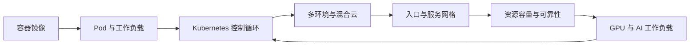
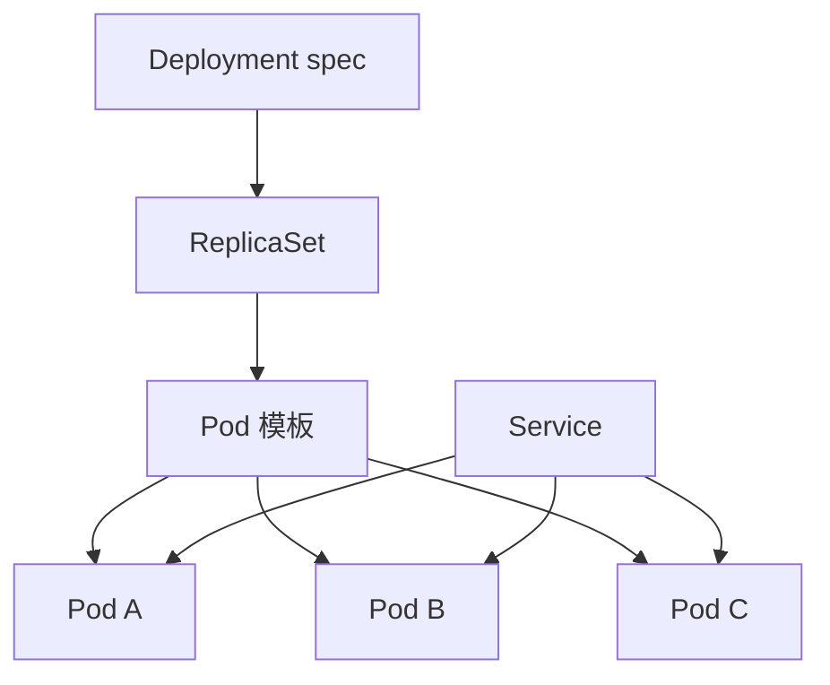
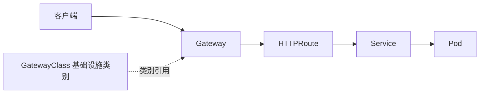

# 第五章 云原生运行底座

第四章讨论了原型、试点和生产化的交付门槛；本章展开其中的运行底座。前线部署工程进入真实客户环境后，问题会从“能否实现”转向“能否稳定运行、持续变更并被可靠治理”。云原生不是把应用放进容器的同义词。CNCF 对[云原生计算](https://github.com/cncf/toc/blob/main/DEFINITION.md)的定义强调在公有云、私有云和混合云等计算环境中，以可编程、可重复的方式开发、构建和部署工作负载，并形成安全、韧性、可管理、可持续、可观测的松耦合系统。本章把这个定义落到 FDE 的运行底座：容器提供可复制的交付单元，Kubernetes 提供声明式调度与控制循环，多环境治理处理客户现场差异，入口与网格统一服务通信边界，容量与可靠性把系统从“可启动”推进到“可运营”，GPU 与 AI 工作负载补齐生成式应用所需的异构资源调度与推理服务底座。

本章的核心判断是：云原生运行底座的价值不在工具清单，而在统一抽象。FDE 团队需要把镜像、部署、网络、身份、容量、观测和恢复能力设计成可以被审查、自动化和迁移的工程资产。这样，客户现场的差异不会变成每次交付的手工例外，生产运行中的风险也不会只依赖个人经验。

## 1. 容器与运行时

### 1.1 容器是交付单元，不是轻量虚拟机

容器首先解决的是运行环境一致性。Kubernetes 将[容器镜像](https://kubernetes.io/docs/concepts/containers/)定义为包含应用代码、运行时、应用与系统库以及默认配置的可运行软件包；同一镜像在不同节点上启动，应尽量得到同样的行为。对 FDE 来说，这一点比“启动速度快”更重要：客户现场常有内网仓库、受控主机、审计代理和不同操作系统基线，只有把依赖、启动命令、端口、健康检查和非敏感默认配置固化到镜像与清单中，团队才能把交付问题从“某台机器怎么配”转成“某个版本是否可复现”。

容器也有边界。镜像应该不可变，运行中不应进入容器手工改代码；变更应通过新镜像、新标签和新发布流程完成。状态不应偷偷写进容器层，而应进入卷、对象存储、数据库或外部服务。日志应写到标准输出或受管日志路径，避免只有登录节点才能诊断。安全上，镜像越小、权限越少、启动用户越明确，越容易在客户的镜像扫描、准入策略和运行时限制中通过。

本节把容器放在部署工程的证据链中讨论。若需要复习镜像、容器、仓库、Dockerfile、数据卷、网络和 Buildx 的基础操作，可配合《[Docker 从入门到实践](https://yeasy.gitbook.io/docker_practice/)》第二至第十章阅读；FDE 现场更关心的是这些对象是否能被版本固定、扫描、签名、复现、回滚和交接。

| 设计项 | 推荐做法 | 反例 |
| --- | --- | --- |
| 镜像版本 | 使用不可变标签或摘要绑定发布 | `latest` 直接进生产 |
| 配置 | 环境变量、Secret、ConfigMap 分层注入 | 把客户密码写入镜像 |
| 状态 | 外置到受管存储或数据服务 | 写入容器本地文件后依赖重启保留 |
| 诊断 | 标准输出、健康探针、可观测埋点 | 只靠 SSH 进容器排障 |

### 1.2 运行时是节点与工作负载之间的契约

Kubernetes 不直接“执行镜像”，而是通过容器运行时在节点上创建和管理容器。官方文档列出 containerd、CRI-O 以及其他实现 [Container Runtime Interface](https://kubernetes.io/docs/concepts/containers/cri/) 的运行时。节点侧通常包含 kubelet、容器运行时和 kube-proxy；Kubernetes 通过把容器放入 Pod 并调度到[节点](https://kubernetes.io/docs/concepts/architecture/nodes/)来运行工作负载。因此，运行时选择会影响镜像拉取、沙箱隔离、cgroup 资源限制、日志路径、存储驱动和节点故障表现。需要补充的是，dockershim 已在 Kubernetes v1.24 移除，客户现场仍在以 Docker 作为运行时的集群应优先迁移到 containerd 或 CRI-O，避免后续版本升级与安全补丁断档。

在客户环境中，运行时还承担合规分层。普通 Web 服务可以使用默认运行时；需要更强隔离的租户、插件执行器或不可信代码，可以通过 [RuntimeClass](https://kubernetes.io/docs/concepts/containers/runtime-class/) 指定不同运行时配置，以在性能和安全之间取舍。FDE 团队不应把运行时差异留到上线日处理，而要在环境基线中记录：支持哪些架构、镜像仓库如何认证、是否允许特权容器、是否启用只读根文件系统、运行时日志如何采集。容器化交付的成熟标志，是任意一个服务都能从镜像、清单和运行时约束中重建，而不是依赖一份口头的服务器配置手册。

## 2. Kubernetes 核心对象

### 2.1 声明式对象与控制循环

Kubernetes 的关键抽象不是某个命令，而是对象模型。按照 [Kubernetes 对象文档](https://kubernetes.io/docs/concepts/overview/working-with-objects/)的表述，对象通常包含 `spec` 和 `status`：`spec` 描述期望状态，`status` 反映当前状态，控制平面持续驱动当前状态接近期望状态。FDE 团队要把这种模型当成生产沟通语言：需求不是“到机器上启动三个进程”，而是“声明一个工作负载、三个副本、资源请求、健康检查、滚动更新策略和服务暴露方式”。

Pod 是最小可调度计算单元，可以包含一个或多个共享网络与存储上下文的容器，但 [Pod](https://kubernetes.io/docs/concepts/workloads/pods/) 本身是相对短暂、可替换的实体。通常不应手工管理单个 Pod，而应使用控制器表达意图：Deployment 适合无状态服务，StatefulSet 适合有状态副本，DaemonSet 适合每个节点都要运行的日志、网络、存储、设备或安全代理，Job/CronJob 适合一次性或定时任务。用于应用工作负载时，控制器可通过 [Deployment](https://kubernetes.io/docs/concepts/workloads/controllers/deployment/) 管理一组 Pod，并为 Pod 和 ReplicaSet 提供声明式更新。这个抽象让 FDE 可以把发布、回滚、扩缩容和故障替换交给控制器，而不是把值班手册写成一串手工命令。

### 2.2 服务发现、配置与对象边界

工作负载被控制器替换后，访问入口不能绑定 Pod IP。Kubernetes 用 [Service](https://kubernetes.io/docs/concepts/services-networking/service/) 为一个或多个 Pod 暴露稳定访问入口，目标是让应用不必引入陌生的服务发现机制。实践中，Service 常用标签选择后端 Pod，EndpointSlice 记录可达端点，调用方使用稳定服务名访问。迁移或混合云场景还会遇到 selectorless Service、手工管理的 EndpointSlice 或 ExternalName；这些对象可以把外部依赖纳入同一套服务发现口径，但也要求明确 owner、DNS/TLS 责任和健康检查方式。标签与选择器因此成为治理边界，标签也用于[组织和选择对象](https://kubernetes.io/docs/concepts/overview/working-with-objects/labels/)。

配置对象同样需要边界。ConfigMap 适合非敏感配置，Secret 适合凭据类数据，但二者都不应成为无审计的运行时补丁箱；生产环境还要启用 etcd 静态加密、最小 RBAC、外部 Secret Store 或 CSI Secret Store。命名空间适合隔离环境、团队或租户；ServiceAccount 表达工作负载身份，Role、ClusterRole、RoleBinding、ClusterRoleBinding 表达授权边界；NetworkPolicy 决定 Pod 间通信策略，但只有在 CNI/网络插件实现支持时才生效，且默认没有全局 deny。FDE 的交付物应把这些对象作为一个整体审查：Deployment 决定如何运行，Service 决定如何被发现，配置与身份决定能访问什么，网络策略决定能和谁通信。只有对象边界清楚，后续的 GitOps、准入控制、审计和事故复盘才有稳定依据。

现场基线还要记录版本能力，而不是把新特性当作默认能力。这类能力必须按 GA 版本记录：sidecar 容器（`SidecarContainers`）在 v1.33 GA，Dynamic Resource Allocation 核心在 v1.34 GA，in-place Pod resize（`InPlacePodVerticalScaling`）在 v1.35 GA，image volume source（`ImageVolume`）在 v1.36 GA；各自的 alpha/beta 子特性仍在不同阶段（特性阶段的复核节奏见[快变事实核验表](../appendix/volatile_facts.md)）。写「已稳定」而不写版本，对停留在旧版本的客户集群就是假话。它们是否可用于生产还取决于客户集群版本、发行版、运行时、准入策略和团队运维能力。更稳妥的交付方式，是把这些能力写成基线检查表：能力名称、目标用途、最低版本、运行时/插件要求、失败回退方案、是否允许进入生产。这样，读者不会把一条 Kubernetes release note 误认为现场默认可用的交付承诺。

### 2.3 有状态与存储边界

并不是所有工作负载都适合 Deployment。缓存、消息队列、搜索索引、关系数据库副本、工作流引擎和许可证服务，往往需要稳定身份、稳定存储和有序启停。对于这类应用，可以用 [StatefulSet](https://kubernetes.io/docs/concepts/workloads/controllers/statefulset/) 这类管理有状态应用的工作负载 API，承载需要持久存储或稳定网络身份的应用。FDE 在客户现场要先判断“状态是否应该进集群”：如果状态来自托管数据库、对象存储或客户既有中间件，Kubernetes 只需要保存连接契约；如果状态必须随服务交付，就要把 StatefulSet、PVC、StorageClass、备份恢复和迁移流程一起设计，而不是只补一个卷挂载。

Kubernetes 通过 [PV/PVC](https://kubernetes.io/docs/concepts/storage/persistent-volumes/) 把存储供给方与使用方分开：PV 是集群中的存储资源，PVC 是用户对存储的请求，PV 生命周期独立于使用它的 Pod。管理员可提供的存储类别由 [StorageClass](https://kubernetes.io/docs/concepts/storage/storage-classes/) 描述，不同类别可以映射到质量等级、备份策略或其他平台策略。现场交付时，应用清单不应硬编码某个云盘产品名，而应声明容量、访问模式、性能等级和是否允许扩容；环境覆盖再把这些要求映射到客户的块存储、文件存储、分布式存储或本地高性能盘。

一个脱敏案例是：同一套事件审计服务在公有云使用托管块存储，客户内网使用 CSI 对接的企业 SAN，测试环境使用低成本文件存储。三者都暴露 `fast-retain`、`standard-delete` 两类 StorageClass 名称，但背后的 IOPS、快照能力、回收策略、扩容限制和多可用区能力完全不同。团队如果只验证 Pod 能启动，生产迁移时会遇到快照不可用、扩容要停机、跨节点挂载失败或恢复时间超出窗口等问题。正确口径是把存储差异写入对象契约：哪些 PVC 必须 `Retain`，哪些可以随环境销毁；哪些卷允许在线扩容，哪些需要维护窗口；哪些数据可以从上游重放，哪些必须纳入备份。

备份恢复和数据迁移必须按对象边界设计。备份不是简单复制 `/data`，而是要定义一致性点、快照触发方式、密钥与配置版本、恢复顺序、恢复演练频率和 RPO/RTO。迁移也不能只搬数据文件：要先冻结写入或开启双写，校验源端和目标端 schema、索引、权限、时区、字符集和序列号，再按灰度读流量、双读比对、切写入口、保留回滚快照的顺序执行。FDE 交付清单中，StatefulSet 解决的是有序身份与挂载，PVC/StorageClass 解决的是资源申请与平台供给，备份恢复解决的是失败后如何回到可信状态，数据迁移解决的是状态如何跨环境安全移动；这四者缺一项，现场运行底座都不完整。

## 3. 多环境与混合云

### 3.1 多环境不是复制集群

FDE 项目常同时面对开发、测试、预生产、生产、客户内网、专有云和公有云托管环境。多环境治理的目标不是让每个环境完全相同，而是让差异被显式建模。按 [CNCF 云原生定义](https://github.com/cncf/toc/blob/main/DEFINITION.md)，公有云、私有云和混合云都属于云原生计算环境，关键在于以可编程、可重复的方式部署工作负载。换言之，环境差异可以存在，但不能只存在于某个人的记忆、某台跳板机的脚本或某个客户群聊中。

最稳妥的做法是把“通用基线”和“环境覆盖”拆开。通用基线描述镜像、端口、探针、配置键名、资源字段、服务账户、网络依赖和观测约定；环境覆盖描述域名、证书、存储类、节点池、外部服务地址、地域、合规开关、具体副本数、资源大小和容量上限。这样，开发环境可以少副本、低资源，生产环境可以高可用、强审计，但二者仍共享同一套对象语义。FDE 团队在客户现场最容易犯的错误，是为了赶进度直接复制一份清单再手工改字段；短期看快，长期会制造无法解释的漂移。

| 层次 | 应保持一致 | 可按环境变化 |
| --- | --- | --- |
| 应用契约 | 端口、健康检查、配置键名、指标语义 | 副本数、资源大小 |
| 平台契约 | 命名空间、身份、网络策略模式 | 节点池、存储类、入口域名 |
| 运维契约 | 日志字段、告警含义、发布流程 | 阈值、值班升级路径 |

### 3.2 混合云的核心是控制面、数据面与信任边界

混合云不是“哪里便宜跑哪里”，而是把工作负载放到合适的位置，同时保持控制、观测和恢复能力。客户数据驻留、低延迟接入、既有系统依赖、专线质量、许可证限制和监管审计，都会决定某个服务应运行在本地、私有云还是公有云。FDE 设计时要先画清边界：控制面在哪里，谁能下发变更；数据面跨哪些网络，延迟和带宽是否可承受；信任根在哪里，证书、身份和密钥如何轮换；故障时是否允许降级到单环境运行。

Kubernetes 本身提供一致的对象 API，但多集群并不会自动带来一致运维。跨集群发布需要版本矩阵，跨网络调用需要入口、DNS、证书和防火墙策略，跨云观测需要统一资源标签和追踪上下文。Istio 等网格方案提供多集群安装与东西向网关模式，例如官方的[多集群安装指南](https://istio.io/latest/docs/setup/install/multicluster/primary-remote_multi-network/)展示了不同网络中的 primary-remote 拓扑；但网格不能替代环境治理，具体数据面选型应放到 5.4 的入口与网格边界中判断。成熟的混合云方案应把“哪些能力跨环境统一、哪些能力本地自治、哪些故障允许隔离”写进架构决策，而不是等故障发生后再争论流量应该切到哪里。

### 3.3 现场案例：从公有云托管迁到客户内网

一个典型迁移场景是：风险评分服务最初运行在公有云托管 Kubernetes，依赖云厂商镜像仓库、托管证书、托管数据库、托管消息队列和公网对象存储。客户上线后要求核心请求不出内网，FDE 团队需要把同一服务迁到客户数据中心的 Kubernetes 集群，同时保留发布、观测和回滚能力。

迁移的第一步是冻结基线清单。基线只描述应用不随环境变化的契约：Deployment 或 StatefulSet 类型、容器镜像名、启动参数、端口、探针、资源字段、ServiceAccount、RBAC、Service、NetworkPolicy、指标端点、日志字段和告警语义。环境覆盖只描述现场差异：命名空间、域名、证书 Secret、镜像仓库前缀、StorageClass、节点选择器、外部依赖地址、副本数、资源大小、容量上限、合规开关和是否启用调试入口。这样做的目的，是让“同一服务”在两个环境中仍能被同一套审查规则理解。

| 迁移对象 | 公有云托管口径 | 客户内网覆盖 | 验收证据 |
| --- | --- | --- | --- |
| 入口 | 公网 DNS、托管证书、云负载均衡器 | 内网 DNS、企业 CA、客户负载均衡器 | 证书链、路由规则、访问日志和回滚入口 |
| 制品 | 云镜像仓库、托管密钥 | 内网仓库、拉取凭据、代理和 CA 根证书 | digest 一致、拉取成功、准入扫描通过 |
| 依赖 | 托管数据库、消息队列、对象存储 | 客户标准中间件或专有云实例 | 协议、超时、错误码、幂等和容量压测记录 |
| 边界 | 允许公网出口 | 默认拒绝公网出口，只开放白名单 | 依赖清单、DNS/SNI 复核、流日志和断网演练 |

第二步是替换进入和分发链路。公有云环境原来使用托管证书和公网 DNS，客户内网改为企业 CA 签发证书、内网 DNS 解析到客户负载均衡器，证书轮换由客户 PKI 流程触发。镜像从公有云仓库同步到客户内网 Harbor 或同等仓库，清单只改镜像仓库前缀，不改镜像 tag 和 digest 口径。拉取凭据、CA 根证书、代理配置和网络出口白名单必须在预生产先验收，否则问题会在发布窗口暴露为 `ImagePullBackOff`、TLS 握手失败或依赖超时。

第三步是替换外部依赖。托管数据库改为客户内网数据库或专有云实例，消息队列改为客户标准中间件，对象存储改为内网 S3 兼容服务，短信、邮件、身份认证和审计接口改为客户已有平台。替换时不能只改 URL，还要比对协议版本、TLS 要求、超时、重试、连接池、限流、字段长度、错误码和幂等语义。对评分服务这类在线链路，迁移前应做双读比对：同一批脱敏请求同时打到旧环境和新环境，只允许解释清楚的误差进入切流。若服务存在写入，还要先决定冻结写入、双写、事件重放、补偿同步或单向切写中的哪一种，并定义切写后的对账窗口；否则入口回滚并不等于数据状态可以回滚。

回滚条件要在切流前写清楚。若 30 分钟内 P95 延迟连续两个窗口高于基线 30%，错误率超过 0.5%，核心依赖超时超过约定阈值，审计日志缺字段，或双读差异超过业务容忍范围，应停止扩大流量并回退 DNS 或网关权重。回滚不是把 Pod 删除，而是回到最后一个经验证的入口、镜像、配置和数据读写组合；如果已经发生写入切换，还要明确是否允许从旧环境继续读、是否需要补偿同步、是否冻结写入口。

迁移收益也要用对象口径表达。迁到客户内网后，核心请求不再经过公网出口，客户审计链路闭合，数据驻留边界清楚，依赖延迟从跨网不确定变成本地可测，发布差异从手工文档收敛为环境覆盖。代价是客户平台能力差异会暴露得更直接：证书、DNS、镜像仓库、存储、监控和中间件都需要现场验收。FDE 的价值不是保证所有环境一样，而是让每个差异都有对象、负责人、验证方法和回滚条件。

## 4. 入口治理与服务网格

### 4.1 入口治理从 Ingress 走向 Gateway API

网络治理要先接住 Kubernetes 的基础对象，再讨论入口和网格。Service 提供稳定访问名，EndpointSlice 表达后端端点，集群 DNS 让服务名可解析，CNI 决定 Pod 网络和 NetworkPolicy 是否真正生效。这一层不清楚时，Gateway API 或服务网格只会把问题包到更复杂的控制面里。FDE 在现场应先确认四件事：服务名是否稳定、端点 owner 是否清楚、默认拒绝策略是否落地、入口日志和后端 trace 是否能关联。

入口是客户、伙伴系统和内部调用进入平台的第一道生产边界。早期 Kubernetes 常用 Ingress 描述 HTTP 入口，但 Kubernetes 官方文档已经推荐 Gateway API，并说明 Ingress API 已冻结、不再继续扩展。复杂现场往往需要更清楚的角色分离：平台团队管理网关基础设施，应用团队管理路由规则，安全团队管理 TLS、策略和审计。Kubernetes 的 [Gateway API](https://gateway-api.sigs.k8s.io/docs/introduction/) 面向 L4 和 L7 路由，并已将 Gateway、GatewayClass、HTTPRoute 推进到 Standard Channel。它的价值不只是“新版本 Ingress”，而是把基础设施拥有者和应用拥有者的职责拆开。

现场还必须检查是否依赖 `ingress-nginx`。Kubernetes SIG Network 和 Security Response Committee 于 2025-11-11 公开发表退役声明（[Ingress NGINX Retirement](https://kubernetes.io/blog/2025/11/11/ingress-nginx-retirement/)），2026-03 起 Ingress NGINX 项目正式退休，不再发布 bugfix、安全补丁或其他更新。仍使用它的客户应规划迁移到 Gateway API 实现或其他受维护入口控制器，而不是只把现有 Ingress 规则原样保留。迁移清单至少要盘点注解、snippet、rewrite、auth、rate limit、TLS、WAF、body size、timeout、错误页、访问日志字段和回滚入口；其中 snippet 与控制器私有注解通常不能机械翻译成 Gateway API 对象，需要逐条确认替代实现和风险接受。

在 FDE 项目中，入口治理要回答四类问题。第一，外部请求从哪个域名、证书和负载均衡器进入；第二，请求按主机、路径、头或权重路由到哪个服务；第三，认证、限流、跨域、超时和请求体大小在哪里生效；第四，入口日志和追踪如何串到后端服务。Gateway API 可以把 GatewayClass、Gateway、HTTPRoute 等对象分层表达，减少所有规则都堆进一个控制器注解的脆弱做法。入口迁移的交付证据不应只是“路由可访问”，还要包括 DNS/TLS owner、认证与限流生效点、旧入口回滚路径、错误响应样例、访问日志字段和 trace 贯通截图。

### 4.2 服务网格治理东西向流量

入口解决南北向流量，服务网格解决服务之间的东西向流量。在 Istio 的[服务网格](https://istio.io/latest/about/service-mesh)模型中，网格作为基础设施层提供零信任安全、可观测性和高级流量管理；其[流量管理](https://istio.io/latest/docs/concepts/traffic-management/)能力覆盖超时、重试、熔断、故障注入、A/B 测试、金丝雀和按比例流量切分。厂商中立的 traces、metrics、logs 采集与导出可参考 [OpenTelemetry](https://opentelemetry.io/docs/)，适合把网格、入口和应用埋点串成统一证据链。这些能力对 FDE 很有价值，因为客户现场的依赖系统通常不稳定，发布窗口也有限。

但服务网格不能被当成默认答案。Istio 的传统 Sidecar 模式将代理注入每个 Pod，能力完整但资源占用与升级成本较高；[Ambient 模式](https://istio.io/latest/docs/ambient/)把 L4 安全覆盖与 L7 策略处理拆开，`ztunnel` 负责节点侧安全覆盖，`waypoint proxy` 承担需要 L7 语义的策略和路由，具体作用范围取决于配置。两种模式都会引入数据面复杂度，mTLS、证书轮换、代理资源消耗、协议识别和故障定位都需要运维能力。网格适合服务数量多、跨团队调用复杂、安全和审计要求高、需要精细流量治理的场景；对少量服务、简单入口、团队尚未建立可观测体系的项目，先用 Gateway、Service、NetworkPolicy 和应用级超时重试可能更稳。FDE 的判断标准应是：网格是否减少了业务代码中的通信治理负担，是否提升了故障隔离和审计能力，是否有足够团队能力维护它。若答案不成立，网格会把网络问题从“不可见”变成“更难解释”。

## 5. 资源、容量与可靠性

### 5.1 资源请求是调度语言，容量规划是业务语言

Kubernetes 的资源模型把容量从机器规格转成工作负载声明。按[资源管理文档](https://kubernetes.io/docs/concepts/configuration/manage-resources-containers/)的语义，调度器依据容器 `requests` 判断 Pod 能否放到节点上，kubelet 和运行时依据 `limits` 执行 CPU、内存等限制。CPU limit 通常表现为节流，内存 limit 超出时可能触发 OOM 终止。对 FDE 团队而言，`requests` 不是随手填的 YAML 字段，而是向平台声明“这个服务最低需要多少资源才能可靠运行”；填得过低会导致节点过载和尾延迟抖动，填得过高会降低集群利用率并抬高客户成本。

容量规划不能只看 Pod 数。它要从业务流量、峰值窗口、单请求成本、外部依赖延迟、批任务并发、数据增长和故障冗余倒推资源需求。生产环境至少要区分基线容量、峰值容量和故障容量：基线覆盖日常负载，峰值覆盖业务活动或批处理窗口，故障容量覆盖一个可用区、一个节点池或一个关键依赖退化后的剩余服务能力。

| 容量输入 | 需要转化为 | 常见风险 |
| --- | --- | --- |
| QPS 与并发 | 副本数、连接池、队列长度 | 平均值掩盖峰值 |
| 单请求 CPU/内存 | requests 与 limits | 压测样本不代表真实数据 |
| 外部依赖延迟 | 超时、重试、熔断预算 | 重试放大故障 |
| 故障假设 | 预留容量、PDB、拓扑分布 | 正常时够用，故障时不可用 |

### 5.2 可靠性来自约束组合，不来自单个开关

可靠性设计要把调度、扩缩容、健康检查、发布和观测串起来。Kubernetes 的 [Pod](https://kubernetes.io/docs/concepts/workloads/pods/) 探针由 kubelet 周期性执行，可通过 exec、TCP 或 HTTP 等方式判断容器状态；就绪探针决定服务是否应接收流量，存活探针决定是否需要重启。探针过松会让故障实例继续服务，过紧会在短暂抖动时制造重启风暴。FDE 应把探针语义写成业务可解释的条件，例如“依赖配置已加载且本地缓存可读”比“进程端口打开”更适合承载生产流量判断。

扩缩容也要遵守稳定性边界。HorizontalPodAutoscaler 会根据观测指标周期性调整目标工作负载规模，这一点可参考 [HPA 文档](https://kubernetes.io/docs/concepts/workloads/autoscaling/horizontal-pod-autoscale/)；它可以使用 CPU、内存或自定义指标，但扩容速度、冷启动时间和指标延迟必须纳入设计。除 HPA 外，[VerticalPodAutoscaler](https://github.com/kubernetes/autoscaler/tree/master/vertical-pod-autoscaler) 可根据历史使用量给出或应用资源建议，但应用模式、Pod 重建、与 HPA 使用同一资源指标时的冲突都要单独评估；[KEDA](https://keda.sh/) 可基于事件源（队列长度、Kafka lag、Prometheus 查询、定时表达式等）做细粒度扩缩容。[拓扑感知路由（Topology Aware Routing）](https://kubernetes.io/docs/concepts/services-networking/topology-aware-routing/)偏向同区域端点，拓扑分布约束控制副本分布；二者可以降低跨区流量成本和尾延迟，但不是硬性的可用区隔离保证。NUMA 或 GPU 拓扑应放到 DRA、Topology Manager 或设备拓扑调度语境中处理。PodDisruptionBudget 主要约束自愿驱逐，不能保证节点故障、可用区故障、内存压力驱逐或控制面异常时仍保留同样副本数；它必须与拓扑分布、节点亲和性、优先级、驱逐策略和故障演练一起使用。调度、抢占和[驱逐](https://kubernetes.io/docs/concepts/scheduling-eviction/)应分开治理。生产可靠性最终取决于一组约束是否一致：资源声明让调度可信，探针让流量入口可信，副本和拓扑让故障隔离可信，观测让问题可发现，发布策略让错误可回退。

### 5.3 容量压测案例：把资源配置和业务结果连起来

一个客户现场的订单查询服务，初始目标是稳定承载 800 QPS，P95 延迟不超过 180 ms，并在单可用区不可用时通过降级策略保留约 60% 查询能力。第一次压测使用 3 个副本，每个 Pod 设置 `requests: 250m CPU / 512Mi`、`limits: 1 CPU / 1Gi`。结果在 500 QPS 后 P95 升到 260 ms，HPA 看到的 CPU 利用率接近 80% 目标但尚未稳定扩容，单 Pod 内存稳定在 620 Mi 左右，部分请求在外部库存接口上排队。问题不是“副本不够”这么简单，而是 CPU 与内存 request 低于真实工作集，节点装箱和缓存压力让尾延迟先于 CPU 指标恶化，单一 CPU HPA 信号也无法表达外部依赖排队。

调整时先把业务目标转成对象约束。每个 Pod 的 `requests` 调整为 `600m CPU / 768Mi`，`limits` 调整为 `1500m CPU / 1536Mi`，避免短峰值被过早 CPU 节流，也避免内存超过工作集后被 OOM。HPA 最小副本数设为 6，最大副本数设为 15，CPU 目标利用率从 80% 降到 60%，并增加基于入口 QPS 与外部库存接口等待队列的自定义指标，让扩容更接近业务压力。PDB 设为 `minAvailable: 5`，约束通过 Eviction API 发生的节点维护等自愿驱逐期间的可用副本；滚动发布本身还要受 Deployment 或 StatefulSet 的更新策略、`maxUnavailable` 和就绪门槛约束。PDB 不是可用区故障保证。拓扑分布约束按可用区和节点双层设置，要求同一可用区或同一节点不集中承载全部副本；Kubernetes 的[拓扑分布约束](https://kubernetes.io/docs/concepts/scheduling-eviction/topology-spread-constraints/)可控制 Pod 在区域、可用区、节点等故障域之间的分布。

第二轮压测把流量从 400 QPS 阶梯提升到 1200 QPS，并分别模拟一个节点维护窗口和一个可用区停止接收新流量。结果在 1000 QPS 时稳定 9 个副本，P95 延迟降到 145 ms，CPU 平均利用率约 58%，单 Pod 内存约 700 Mi，滚动发布期间可用副本保持在 6 个以上；单可用区隔离后，剩余两个可用区保留 6 个副本，并触发库存接口缓存降级。代价是基线成本上升：最小副本从 3 到 6，单 Pod request 提高后节点预留容量增加，夜间低谷的空闲资源更多。团队接受这个取舍，因为客户的主要成本不是多一个节点池配额，而是发布、维护或局部故障期间订单查询抖动造成的业务损失。

最终交付不只记录“压测通过”，而是记录容量边界：日常 800 QPS 使用 6 到 7 个副本，活动峰值 1200 QPS 需要 9 到 11 个副本；若外部库存接口 P95 超过 300 ms，服务自身扩容不能解决尾延迟，必须启动依赖降级或缓存策略；若客户要求把成本再降 15%，可以下调最小副本或 request，但必须接受故障窗口内的可用副本减少。容量压测的价值在于把 QPS、P95、CPU、内存、requests/limits、HPA、PDB、拓扑分布、故障演练和成本约束绑定成一组可复测的生产假设。

## 6. GPU 与 AI 工作负载

### 6.1 把 GPU 当成调度资源，而不是物理特权

传统“拿到一台带 GPU 的机器登录跑脚本”在客户现场不可持续：模型版本、CUDA 驱动、镜像、推理服务和监控会很快漂移成无法复现的状态。FDE 团队应先把 AI 工作负载翻译成容量模型：峰值并发、输入/输出 token、上下文长度、KV cache、冷启动时间、批大小、延迟 SLO、降级模型和成本上限。只有这些业务约束清楚，GPU 才能被声明、配额和审计，而不是变成少数人手里的一组物理机器。

Kubernetes [Dynamic Resource Allocation (DRA)](https://kubernetes.io/docs/concepts/resource-management/dynamic-resource-allocation/) 核心已在 v1.34 GA（`DynamicResourceAllocation` 特性门控自该版本起默认开启并锁定），核心对象包括 `DeviceClass`、`ResourceClaim`、`ResourceClaimTemplate` 和 `ResourceSlice`，适合把 GPU、RDMA 网卡等异构资源纳入声明式申请与调度；但 DRA core 稳定不等于所有 GPU 共享、拓扑、重分配能力都稳定可用，现场仍要按 Kubernetes 版本、发行版、云厂商和驱动栈核验支持度。在旧集群或成熟生产路径上，仍常用 [NVIDIA Device Plugin](https://github.com/NVIDIA/k8s-device-plugin) + [GPU Operator](https://docs.nvidia.com/datacenter/cloud-native/gpu-operator/latest/) 作为底座，负责驱动安装、容器运行时配置、节点标签和健康检查。新集群可评估 NVIDIA DRA Driver 路径；按 NVIDIA GPU Operator 当前文档，由 Operator 通过 `GPUCluster` 资源统一管理 DRA，前提是 Kubernetes v1.34.2 及以上且集群提供 `resource.k8s.io` 的 DeviceClass API、NVIDIA Driver 580 及以上、容器运行时启用 CDI，并且集群里不能同时存在走传统 Device Plugin 的 `ClusterPolicy`；节点标签由 Operator 自动分配。这条路径只用于新安装，不支持从独立部署的 DRA driver 或 `ClusterPolicy` 原地迁移，还要处理已知运维限制；若还要同时使用 `nvidia.com/gpu` 这类传统扩展资源申请，则依赖 `DRAExtendedResource` 特性门控——它自 Kubernetes v1.36 起默认开启（Beta）、v1.37 GA，更早的版本才需要手动打开。**不要照抄 GPU Operator 版本号**：该页面只随最新版滚动（撰写时为 v26.7.1），并不给出最低版本，而带版本号的旧文档路径会直接 404，无法回查。NVIDIA DRA Driver 的 GPU allocation 与 ComputeDomain 支持状态并不相同，生产采用前必须确认所用 GPU Operator 版本文档中的 GA、Technology Preview 和平台限制。

单卡共享上，可以用 [MIG](https://docs.nvidia.com/datacenter/tesla/mig-user-guide/) 把 A100/H100/H200 物理切成多个具备独立内存和算力的实例，适合稳定的小模型多租户；可以用 time-slicing 让多个 Pod 分时共享同一 GPU；也可以用 [MPS](https://docs.nvidia.com/deploy/mps/index.html) 让多个进程共享同一 GPU 上下文，适合峰值不重叠的批推理。三者不能互相替代：MIG 偏硬隔离，time-slicing 不提供显存或故障隔离，NVIDIA Device Plugin 路径下 MPS 与 time-slicing 互斥，且 MPS 不支持 MIG-enabled 设备；MPS 对 GPU、驱动和运行时配置更敏感，生产采用前必须按 NVIDIA Device Plugin/GPU Operator 当前文档核验。

### 6.2 推理服务与流量治理

模型部署不只是“跑起来”，要把扩缩容、灰度、可观测和成本绑定到对象上。Kubernetes 上的推理服务控制面可参考 [KServe](https://kserve.github.io/website/) 的 CRD 抽象（`InferenceService`）；按 KServe v0.20 文档，常见部署模式是 Knative 与 Standard，后者使用 Kubernetes Deployment、Service、Ingress 和 HPA，更容易接入标准 Kubernetes 工具链，但 Standard 模式不支持 HTTP scale-from-zero，HPA 也主要依赖 CPU、内存或自定义指标，按并发/RPS 的 serverless 弹性通常属于 Knative/KPA 或推理网关能力。运行时层面，[vLLM](https://docs.vllm.ai/) 凭借 PagedAttention、连续批处理和 prefix cache，是生成式 LLM 的常见开源推理引擎；[TensorRT-LLM](https://nvidia.github.io/TensorRT-LLM/) 在 NVIDIA 平台上提供更深的内核优化。二者都应按模型类型、硬件、上下文长度、批策略和版本支持现场压测，而不是按工具名预设答案。

LLM 流量与传统 HTTP 不同：单请求 token 数量差异大、长连接 streaming、调度需要考虑 KV cache 命中。Kubernetes 社区的 [Gateway API Inference Extension](https://gateway-api-inference-extension.sigs.k8s.io/) 正在把推理网关、模型路由和端点选择纳入 Gateway API 生态；其 GitHub README 也说明 EPP、InferenceObjective、InferenceModelRewrite 和 BBR 等包已迁往 llm-d 相关仓库，原仓库继续承载轻量 EPP、InferencePool API 和一致性测试。FDE 可把它视为推理入口的标准化方向，但必须核验所用控制面、API 版本、实现成熟度、发行版支持和迁移关系。

| 层次 | 典型对象 | 现场验收问题 |
| --- | --- | --- |
| 硬件与节点 | GPU 节点池、MIG/MPS、NVLink/RDMA | 拓扑、驱动、隔离和故障重启是否可控 |
| 调度与配额 | Device Plugin、DRA `DeviceClass`/`ResourceClaim`/`ResourceClaimTemplate`/`ResourceSlice` | 资源申请、配额、健康状态和回退路径是否可审计 |
| 推理服务 | InferenceService、Deployment、ServingRuntime | 灰度、扩缩容、模型版本和回滚是否对象化 |
| 推理入口 | Gateway、HTTPRoute、InferencePool、EPP | 路由、限流、优先级和 trace 是否能关联到模型版本 |

### 6.3 镜像、权重与缓存分发

模型权重往往达到几十 GB，与传统镜像分发策略不匹配。可行的做法有几条：把权重打入 [OCI Artifact](https://github.com/opencontainers/image-spec/blob/main/manifest.md) 并在支持 image volume source 的集群中以只读卷挂载，避免与应用镜像耦合；使用 [Dragonfly](https://d7y.io/) 或 [Spegel](https://github.com/spegel-org/spegel) 之类的 P2P 加速，在客户内网集群中减少仓库压力；对超大模型，预先下发到节点本地 NVMe 或共享高性能存储，并通过 `nodeSelector`/拓扑感知调度让 Pod 优先落到已缓存节点。Kubernetes v1.36 在 2026-04 发布说明中已将 image volume source 标记为 stable，但运行时、发行版和客户安全策略支持仍需核验。无论哪种方案，权重都必须有版本、哈希与签名，并与 SBOM/AIBOM（见 8.6）一起进入供应链证据。

### 6.4 与现场交付的接口

GPU 工作负载放进集群后，仍要回到 FDE 的常规清单：节点池规格与配额（含 NVLink/RDMA 拓扑）、监控（DCGM Exporter、GPU 利用率、显存、PCIe/NVLink 错误）、容量规划（峰值并发 token/s、KV cache 内存、批大小）、回滚与降级（小模型兜底、限流、人工切断）。当客户讨论“买几张卡”时，FDE 的价值是把它翻译成一组对象：`InferenceService` 副本数、`ResourceClaim`、StorageClass、Gateway 路由权重、SLO 与成本预算，使 GPU 投入与业务结果可被审计。
