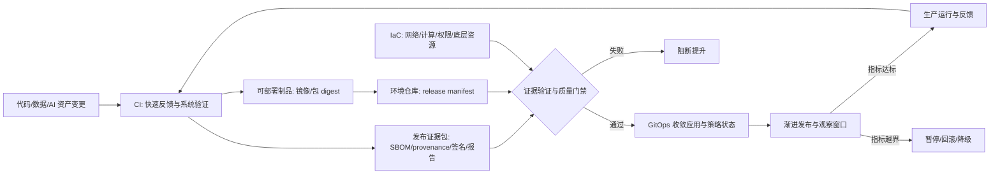
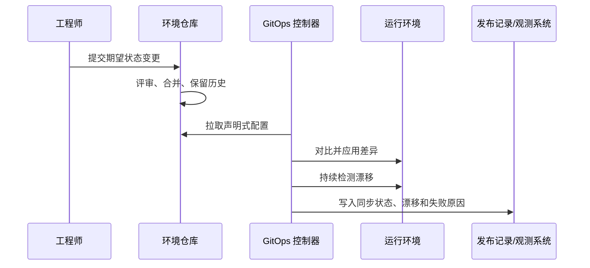
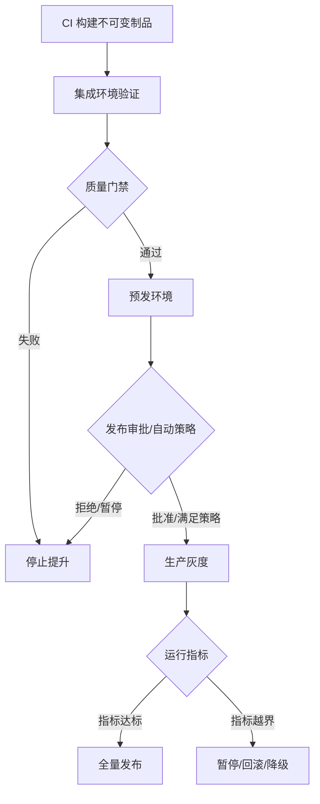

# 第六章 自动化交付流水线

自动化交付流水线的目标不是把手工命令搬进工具，而是把“从变更到生产”的关键判断变成可重复、可审计、可回滚的工程系统。对 FDE 来说，这条流水线还要适应客户现场：客户自有基础设施、受限网络、离线镜像仓库、监管发布窗口、客户安全团队审批、运维接管和不能依赖供应商临时登录的回滚路径。

一个成熟团队会把可部署制品和发布证据分开管理：镜像或包按 digest 固化，SBOM、provenance（来源证明）、签名、测试报告、扫描结果、发布单和验收证据作为证据包绑定到同一个 digest。环境变更不直接由个人终端执行，而是通过基础设施即代码、环境仓库、GitOps 控制器、发布门禁和运行观测形成一条证据链。

本章从五个层面展开。6.1 讨论持续集成与持续交付如何建立最短反馈回路，并产出现场可验证的制品包；6.2 说明 GitOps 为什么把 Git 作为期望状态的协作边界，同时补齐运行态审计；6.3 讨论基础设施即代码如何把网络、计算、权限和客户环境从“经验资产”变成“版本化资产”；6.4 聚焦环境提升、回滚和变更可追溯；6.5 将发布策略、质量门禁、数据/AI 资产、SLSA 与 SBOM 放到同一条发布控制线上。



本章采用的基线来自官方资料：OpenGitOps 定义的四项 GitOps 原则、HashiCorp Terraform 对 IaC 工作流和 state 的描述、SLSA v1.2 Build Track / Source Track 及 build provenance 格式、CISA/NTIA 对 SBOM 的定义，以及 Kubernetes、Argo CD、Flux 和 Argo Rollouts 对滚动、同步、漂移、金丝雀和蓝绿发布的实践说明。

## 1. 持续集成与持续交付

### 1.1 从提交到可部署制品和证据包

持续集成的本质是缩短集成风险暴露时间：每一次变更都尽早与共享主线集成，并在合并前或合并时由自动构建、单元测试、集成测试、静态检查和安全扫描给出反馈。按 [GitLab 对 CI/CD 的概括](https://about.gitlab.com/topics/ci-cd/)，流水线自动化构建、测试和部署步骤；其中持续交付强调“已验证代码随时可部署”，持续部署则进一步取消常规人工发布动作。

在前线部署工程中，CI 的输出不应只是“测试通过”。更稳妥的模型是区分两类产物：第一类是可部署制品，例如容器镜像或包，必须以 digest 固定；第二类是发布证据包，包括提交号、构建参数、依赖清单、SBOM、provenance（来源证明）、签名、测试报告、安全扫描结果、发布说明和验证策略。后续环境提升只提升同一个不可变制品，并用证据包解释为什么它可以进入下一个环境。

### 1.2 流水线分层

一条稳健流水线通常分为快速反馈层、系统验证层和发布准备层。快速反馈层阻止明显错误进入主干；系统验证层运行更昂贵的集成、契约、迁移、性能、安全和 AI/数据回归测试；发布准备层负责生成制品、签名、SBOM、SLSA build provenance、AIBOM/ML-BOM、评测报告和发布元数据。供应链安全能力可按 [SLSA v1.2 规范](https://slsa.dev/spec/v1.2/)描述：Build Track 的 L1 要求 provenance 存在，L2 要求托管构建平台生成并签名 provenance，L3 要求 hardened build platform；Source Track 则把版本控制、变更历史、source provenance、持续技术控制和双人评审纳入来源可信度。

| 层次 | 目标 | 典型门禁 | 输出 |
| --- | --- | --- | --- |
| 快速反馈 | 保护主干 | 编译、单测、格式、依赖锁文件、基础 SAST、秘密扫描、prompt/schema 快检 | 可合并信号 |
| 系统验证 | 证明行为 | 集成、契约、迁移、性能基线、安全测试、数据质量、RAG/工具/eval 回归 | 质量报告 |
| 发布准备 | 固化证据 | 镜像 digest、签名、SBOM、provenance、AIBOM/ML-BOM、漏洞/VEX、评测报告 | 发布证据包 |

源码门禁也要成为证据的一部分。受保护分支或标签、CODEOWNERS 或双人评审、工作流文件变更强制评审、不可绕过的状态检查、source revision attestation 或 VSA（可用时）应进入发布门禁。发布系统不仅要知道“哪个镜像通过了测试”，还要知道它来自哪个仓库、哪个 commit、哪个 ref、哪个工作流身份和哪些评审控制。

### 1.3 端到端流水线案例

以一个支付回调服务为例，工程师向主干提交 `a1b2c3d` 后，流水线不应只执行“构建成功”这一个动作，而应产出一组可以被后续环境复用和验证的证据。第一步是源码门禁：格式、单元测试、依赖锁文件检查、SAST 和秘密扫描应尽量前移到合并前；阻断项需要明确，非阻断项也必须有期限的修复单或风险豁免。

第二步是构建容器镜像。构建系统使用按 digest 固定的基础镜像，例如 `FROM base@sha256:...`，语言依赖使用 lockfile 或 checksum，构建工具链和关键下载物进入 provenance 的 `resolvedDependencies` 或 materials。输出推送为 `registry.example.com/payments/callback@sha256:...`，后续部署只引用 digest，不引用 `latest` 或可变分支名。

第三步是生成供应链证据。构建系统应生成 SBOM 和 provenance，并把 schema、粒度、生成上下文和敏感构建参数处理方式写入发布元数据。SLSA 的 [build provenance 说明](https://slsa.dev/spec/v1.2/build-provenance)将其视为描述制品构建方式的可验证信息，连接 subject 制品与 builder、构建输入和构建过程。第四步是签名：使用 Sigstore Cosign 等工具对镜像 digest 和 attestation 签名；签名、SBOM、provenance、测试报告、漏洞扫描报告和评测报告作为 sidecar 或 attestation 绑定到同一个 subject digest，并进入制品库或证据仓库。

部署前还要验证这些证明，而不是只归档。门禁应把 attestation 与预先固定的信任策略比对：最低 SLSA 级别、可信 builder ID、canonical source repo、允许的 ref/tag 规则、预期 `buildType`、允许的 `externalParameters`、证书 identity/issuer、签名链、predicate/schema、source revision 和 materials 清单。只验证“签名存在”不够；错误 workflow、非授权 fork 或异常构建参数生成的制品也必须被拒绝。

流水线运行时凭证要独立治理。不要把长期云凭据、registry 凭据或客户生产凭据常驻 CI；优先使用 OIDC/federated short-lived token、job token 最小权限、environment-scoped secrets、受控 runner、日志和 artifact 脱敏，以及 break-glass 凭证轮换。客户现场的 Kubernetes Secret、外部 secret store、KMS/HSM 和客户自有审批链，应由运行环境控制，不应混入构建证据包。

### 1.4 现场可验证制品包

FDE 交付给客户或客户平台团队的不是“构建脚本”，而是可在客户环境验证的制品包。最低内容包括：制品 digest、SBOM、provenance、签名或离线验证 bundle、验证策略、扫描报告、许可证/依赖 allowlist、发布说明、回滚 digest、客户 registry 同步清单、AIBOM/ML-BOM（AI 工作负载适用）、eval 报告和 trace 样本摘要。制品包不得包含客户密钥、明文配置或必须回连供应商环境才能验证的假设；受限网络或离线环境要能通过本地镜像仓库、固定信任根和离线 bundle 完成验证。

这条流水线的阻断规则必须明确。编译、测试或扫描失败，可以保留临时 debug 输出，但不能发布为 release candidate、不能签名为可部署版本、不能写入环境仓库、不能进入提升链路。SBOM 缺失、provenance 缺失、签名失败、制品库上传失败或可信策略校验失败，必须停止在提升前；漏洞策略命中阻断级别时，必须先修复或走有负责人、有效期和补偿动作的风险豁免。

### 1.5 交付而非脚本集合

流水线不是脚本仓库，而是组织交付契约。每个阶段都应有清晰输入、输出和责任边界：源码进入构建阶段，产出不可变制品；制品进入验证阶段，产出质量和供应链证据；质量证据进入发布阶段，产出环境变更记录。反模式是同一脚本既拉代码、又改配置、又直接操作生产，这会破坏审计与回滚。成熟做法是让 CI 负责验证和制品生产，让 CD 或 GitOps 控制环境收敛；生产变更只引用已发布 digest，事故复盘才能把运行版本、测试证据和审批记录对应起来。

## 2. GitOps 与声明式交付

### 2.1 Git 作为期望状态边界

GitOps 不是“用 Git 存部署脚本”，而是把系统期望状态写成声明式配置，并让运行环境持续向该状态收敛。按 [OpenGitOps](https://opengitops.dev/) 的四项原则，系统期望状态必须声明式表达；期望状态以不可变、版本化、保留完整历史的方式存储；软件代理自动从来源拉取声明；代理持续观察实际状态并尝试应用期望状态。

这组原则把交付权力从个人终端迁移到可审计的提交历史中。但 Git 可靠记录的是“期望状态”的变更与审批，不自动覆盖所有运行事实。实际环境里的执行结果、控制器重试、人工热修、漂移、暂停同步和客户现场例外，还需要控制器事件、集群审计日志、发布记录和变更单补齐证据链。

### 2.2 Pull 模型与漂移修复

传统推送式 CD 常由外部流水线持有集群凭据并主动执行命令。GitOps 更偏向 pull 模型：集群内控制器读取 Git 中的目标状态，然后对比实际状态并执行收敛。这个方向减少了外部系统直接写生产的权限，也让环境漂移更容易暴露。GitOps 首先适合 Kubernetes 这类声明式控制面；在其他系统中，只有当目标状态、差异检测、权限边界和回滚语义都能清晰表达时，才适合采用同样模式。



环境仓库不应只保存镜像 tag。最小对象集通常包括 workload、Service、Gateway/HTTPRoute、ServiceAccount/RBAC、NetworkPolicy、resources/HPA/PDB、PVC/StorageClass 引用、观测标签、admission policy 和 release manifest。对 AI 或数据工作负载，release manifest 还应记录 `prompt_version`、`eval_suite`、`retrieval_index_version`、`tool_schema_version`、`model_route_policy_version`、`safety_policy_version`、数据契约版本、回滚版本和已批准报告 URI，使第 10 章的评测与第 12 章的运行观测能够读取同一组版本字段。

### 2.3 与 CI/CD 的边界

GitOps 并不替代 CI。CI 负责把源码变成可信制品，执行测试、扫描、签名和 SBOM 生成；GitOps 负责把“环境应运行哪个制品、以什么配置和策略运行”声明出来，并让环境收敛。两者的接口应是不可变制品引用和 release manifest，例如容器镜像 digest、配置版本、策略版本和证据链接，而不是可变标签。对多团队组织而言，GitOps 的价值还在于职责分离：应用团队提交环境意图，平台团队通过策略、控制器和审计日志保障变更边界。

一个常见结构是拆分应用仓库和环境仓库。应用仓库保存业务源码、Dockerfile、测试和流水线定义；CI 合并主干后构建镜像，输出 `imageDigest=registry.example.com/payments/callback@sha256:7f...`。环境仓库保存声明式部署状态，例如：

```text
environments/
  dev/payments-callback/kustomization.yaml
  staging/payments-callback/kustomization.yaml
  prod/payments-callback/kustomization.yaml
  prod/payments-callback/release-manifest.yaml
policies/
  admission/signature-policy.yaml
clusters/
  prod/flux-kustomization.yaml
```

提升到预发环境时，流水线或发布机器人只打开一个 PR，把 `environments/staging/payments-callback/release-manifest.yaml` 中的镜像从旧 digest 改成新 digest，并附上提交号、镜像签名、SBOM、provenance、测试报告和验证结果。PR 合并后，GitOps 控制器拉取环境仓库，发现期望状态变化，再把集群同步到新 digest。按 [Argo CD 的自动同步文档](https://argo-cd.readthedocs.io/en/stable/user-guide/auto_sync/)，自动同步可以让流水线通过提交环境仓库完成部署，而不需要直接持有集群写凭据；状态查询、暂停和手工同步仍应走受控 API 或只读权限。

回滚也要遵守同一条边界。若应用由自动同步的 GitOps 控制器管理，直接在集群里执行 `kubectl rollout undo`、手工改 Deployment 或用控制器 UI 回滚 live state，可能很快被 Git 中的期望状态覆盖；Argo CD 文档也明确自动同步开启时不能对 Application 执行常规 rollback。正常回滚应通过环境仓库 PR 把 release manifest、镜像 digest、配置版本或流量权重恢复到已批准版本。直接操作集群只能作为 break-glass，并且必须有暂停同步、TTL、审批、审计、补 PR 和恢复收敛的记录。

### 2.4 工具语义与客户现场例外

自动同步不等于默认纠正所有漂移。在 Argo CD 中，Git 目标状态变化可以触发自动同步，但 live cluster 手工漂移需要 `automated.selfHeal=true` 才会自动修正；删除类变更需要启用 prune。Flux Kustomization 则按 `.spec.interval` 调谐并通过 server-side apply dry-run 检测和纠正漂移，删除旧资源由 `.spec.prune` 控制。

暂停同步也要按工具区分。Argo CD standalone Application 可通过 `spec.syncPolicy.automated.enabled=false` 暂停自动同步；若 Application 由 ApplicationSet 生成，直接改子 Application 的 `spec.syncPolicy.automated` 可能无效，应在 ApplicationSet/template/generator 层控制。Flux 的 [Kustomization](https://fluxcd.io/flux/components/kustomize/kustomizations/) 支持通过 `.spec.suspend` 暂停调谐；恢复同步时可使用 Flux 的 [resume kustomization 命令](https://fluxcd.io/flux/cmd/flux_resume_kustomization/)。

FDE 使用 GitOps 时，还必须设计例外流程。客户现场可能出现紧急补丁、断网环境、监管冻结窗口或生产事故，完全自动收敛并不总是合理。成熟做法是为暂停同步、人工批准、临时漂移和事后补提交设置规则：谁能触发，持续多久，留下哪些证据，何时恢复到 Git 中的期望状态。断网或冻结窗口内，应明确客户现场本地 Git 镜像、签名发布包或变更单中哪一个是临时权威源；恢复连接后必须在限定时间内把差异补回环境仓库 PR，并记录现场 revision、制品 digest、审批人和过期时间。

| 对象 | 推荐所有权 | 关键规则 |
| --- | --- | --- |
| 应用源码仓库 | 供应商或产品团队 | 只产出制品和证据，不直接写客户生产 |
| 部署模板仓库 | 平台团队或双方共管 | 复用基线、策略和运行对象模板 |
| 客户环境仓库 | 客户平台/运维团队主控 | 生产期望状态、审批和审计以客户为准 |
| 离线 Git 镜像 | 客户安全边界内 | 固定同步频率、签名校验和差异回填 |
| GitOps 控制器凭据 | 客户运行环境 | 最小权限、命名空间边界和审计日志 |
| break-glass 权限 | 客户 incident 流程 | 有负责人、TTL、补 PR 和事后复盘 |

GitOps 的目标不是消灭所有人工判断，而是让人工判断可见、可控、可追责。

## 3. 基础设施即代码

### 3.1 把环境变成可版本化资产

基础设施即代码将网络、计算、存储、权限、负载均衡、DNS、Kubernetes 资源乃至 SaaS 配置写成可审查文件。HashiCorp 将 Terraform [定义为](https://developer.hashicorp.com/terraform/intro)用可读配置文件定义云和本地资源，并以一致工作流构建、变更和版本化这些资源；其核心流程包括 Write、Plan、Apply 三步。这背后的工程意义是把环境从“某个人知道怎么点控制台”转为“团队可以评审、复现、回滚和审计的版本化资产”。在前线部署场景中，IaC 让基础设施变更进入同一条审计线，帮助缩小故障排查范围，区分代码、配置和基础设施变更的影响。

Terraform/OpenTofu 偏声明式配置与 state 管理，Pulumi 用通用编程语言表达资源图，Crossplane 则把外部基础设施纳入 Kubernetes 控制面。选型重点不是“用哪个 CLI”，而是 state 与机密如何保管、provider 生态与客户私有云是否对齐、谁负责升级、漂移修复和合规口径。

| 模型 | 典型工具 | 审查方式 | 主要风险 |
| --- | --- | --- | --- |
| 配置与 state | Terraform/OpenTofu | plan、policy、state lock | state 泄露、plan 与 apply 不一致 |
| 编程语言资源图 | Pulumi | preview、stack policy、secrets provider | 抽象过度、代码副作用、stack state 泄露 |
| Kubernetes 控制面 | Crossplane | GitOps PR、dry-run、admission、ProviderConfig RBAC | 控制器自动覆盖热修、provider 权限过宽 |

### 3.2 Plan 是变更审查，不是形式步骤

IaC 最大的风险不是工具语法，而是把 `apply` 当成自动执行命令。真正有价值的是 plan：它把“我要改什么资源、创建什么、删除什么、替换什么”显式展示出来，让评审者在执行前判断影响面。Terraform 的 [plan 命令](https://developer.hashicorp.com/terraform/cli/commands/plan)会预览拟议变更，也可以用 `-out=FILE` 保存稍后传给 `terraform apply` 的不透明 plan 文件；官方文档同时提醒，plan 文件可能以明文保存敏感数据。因此生产流程应在 pre-apply 阶段保存同一份加密 plan，对原始 plan 文件计算 hash，另导出脱敏 JSON 给 Sentinel、OPA 或等价策略和人工评审使用，并把审批绑定到原始 plan hash。apply 只能执行已审批的同一份原始 plan；脱敏 JSON 只能用于评审，不能作为执行来源。policy 失败默认阻断，break-glass 必须留下负责人、有效期、补偿动作和复审触发。

Terraform 会维护 state 作为真实基础设施与配置之间的映射；state 因此必须被保护、加密、锁定并纳入备份。Terraform 文档提醒，state 和 plan 文件可能包含敏感值；因此 state、saved plan、plan JSON、CI 日志和 drift 报告都应按敏感资产处理。禁止把密钥写入 tfvars 或普通配置；使用远端加密 backend、锁、最小权限、短保留期和客户控制的 KMS。Pulumi 要使用 secret config 和合适的 secrets provider；Crossplane 要关注 Kubernetes Secret 加密、External Secrets 或云 KMS，并限制 ProviderConfig 的读取和使用范围。

生产环境的 plan 审查尤其要关注会替换数据库、重建网络、调整 IAM、删除存储或改变公网入口的操作。例如，一个 plan 显示生产数据库实例会被 `replace`，原因是修改了不可原地变更的参数；另一个 plan 给运行时角色增加 `s3:*` 和 `iam:PassRole`；第三个 plan 删除日志存储桶。这三类都不能直接批准，因为它们分别触及数据持久性、权限边界和审计证据。

评审标准应写成可执行规则。可以允许的变更包括：新增只读监控权限；扩容节点池但不改变网络入口；给已有数据库打开删除保护；创建新存储桶且默认加密、阻止公开访问、生命周期策略明确。应拒绝的变更包括：无备份验证的数据库替换；生产写权限使用通配符，或向不受限资源授予 `iam:PassRole`；删除未完成保留期的日志、备份或客户数据桶；关闭审计、加密、网络隔离或删除保护。应拆分的变更包括：数据库引擎大版本升级、网络重分段、IAM 权限模型重构、大规模桶清理和跨区域复制切换。

### 3.3 模块化、版本固定与漂移管理

IaC 需要模块化，但不需要过度抽象。稳定、跨团队复用的网络、集群、数据库和观测组件适合封装模块；业务高度变化的参数则应保持显式。生产 IaC 必须固定模块、provider、CLI/runtime、Pulumi package 和 Crossplane provider/CRD 版本；提交 lockfile；升级作为独立变更，先在非生产环境验证 plan、preview、reconcile 和策略结果。

漂移管理要按工具边界设计。Terraform/OpenTofu 可用定期 read-only plan 或 `-refresh-only` 识别漂移，人工决定回写代码、import/adoption、恢复远端资源或接受例外；生产环境不应自动 apply 漂移修复。Crossplane 默认会把受管资源拉回 `forProvider` 期望状态，事故热修前需要暂停 reconcile、调整 `managementPolicies`、切到 observe-only 或明确删除策略，事后再恢复。成熟团队会把 IaC 与 GitOps 结合：底层基础设施由 IaC 管理，集群内应用与策略由 GitOps 收敛，二者通过清晰输出变量、release manifest 和权限边界连接。

| 领域 | 代码化对象 | 核心风险 | 推荐控制 |
| --- | --- | --- | --- |
| 网络 | VPC、子网、路由、入口 | 中断、暴露面扩大 | plan 审查、策略即代码、变更窗口 |
| 计算 | VM、节点池、自动伸缩 | 容量不足、成本激增 | 配额、预算、容量测试 |
| 数据 | 数据库、缓存、存储桶 | 数据丢失、不可逆删除 | 删除保护、备份验证、restore 演练 |
| 权限 | IAM、密钥、角色绑定 | 越权、横向移动 | 最小权限、短期凭证、密钥轮换 |

### 3.4 FDE 现场 IaC 案例

假设客户要求在私有云中新增一条只读数据接入链路。FDE 不应在控制台临时点资源，而应先 import/adopt 已有网络和安全组，确认资源所有权，再提交 IaC 变更：新增只读 IAM 角色、网络出口规则、审计日志桶和数据库只读连接。PR 阶段运行 fmt、validate、静态策略和 speculative plan；pre-apply 阶段生成 saved plan，脱敏后给客户安全团队审阅，并把 plan hash、审批人、风险接受和回滚边界写入发布记录。apply 后输出连接端点、角色 ARN、证书引用和策略版本，交给环境仓库的 release manifest，由 GitOps 控制应用侧配置。若客户环境断网，plan、provider 版本、制品 digest 和验证报告应随离线变更包一起交付，并在恢复连接后补齐中央记录。

## 4. 环境提升与回滚

### 4.1 提升同一个制品和同一份发布清单

环境提升的核心原则是“提升制品，不是重建制品”。同一提交在 CI 中构建出不可变镜像或包，测试、预发和生产都引用同一个 digest；环境差异通过配置、密钥引用、容量、策略和流量规则表达，而不是重新编译。按 [CISA/NTIA 的 SBOM 资料](https://www.ntia.gov/page/software-bill-materials)，SBOM 是软件组件清单，可用于提高供应链透明度；在提升过程中，SBOM、签名和来源证明应随制品一起传播，而不是在生产前临时补齐。

同一个镜像 digest 并不足以保证发布可复现。每次提升还应有 release manifest：制品 digest、配置版本、secret reference 版本、IaC/GitOps revision、SBOM/provenance digest、迁移 changeset、数据契约版本、AI 资产版本、质量门禁结果和回滚候选版本。release manifest 描述“这个版本是什么”；promotion record 描述“谁在何时把它提升到哪个环境、基于哪些证据、接受了哪些例外”。两者不应混成一份可随意改写的发布单，否则回滚时无法区分制品身份和环境决策。



### 4.2 回滚是一种预设计能力

回滚不能等事故发生后再设计。在 [Kubernetes Deployment 更新文档](https://kubernetes.io/docs/tasks/run-application/update-deployment-rolling/)描述的机制里，Deployment 可以查看 rollout history，并使用 `kubectl rollout undo` 回滚到上一版本或指定 revision；同时 `maxUnavailable` 和 `maxSurge` 控制滚动更新期间不可用和额外创建的 Pod 数量。这个能力的边界也要写清楚：Deployment revision history 存在于旧 ReplicaSet 中，默认保留 10 个，`revisionHistoryLimit=0` 会禁用回滚；`rollout undo` 只回滚 Pod template，不回滚 ConfigMap、Secret、IaC 资源、外部依赖、消息语义或数据库状态。若工作负载由 GitOps 自动同步管理，`kubectl rollout undo` 还可能被期望状态重新覆盖；常规回滚应改环境仓库中的 digest、配置或流量权重，命令式回滚只作为有时限的事故处置。

因此，回滚对象至少要拆成五类。应用制品可回到上一 digest；配置和特性开关可回到上一版本；基础设施变更需要 IaC plan 或手工恢复流程；流量入口可 failback 到旧环境；数据损坏通常需要前滚修复、恢复流程和业务补偿。只有在制品、配置、schema、消息、外部副作用和数据写入都兼容时，自动回滚才是安全动作；不可逆数据变更只能自动暂停或降级，并进入人工处置。

### 4.3 数据库迁移与数据回滚边界

数据库是最常见的回滚阻塞点。破坏性 schema 变更应按 expand/contract 设计，而不是与应用发布绑成一个不可逆动作。下表给出本书建议的最小决策框架：

| 阶段 | 允许动作 | 失败优先处理 | 禁止动作 |
| --- | --- | --- | --- |
| expand | 新增可空列、新表、新索引、影子字段 | 回滚应用或禁用迁移 | 删除旧列、改变旧语义 |
| 双写 | 同时写旧结构和新结构 | 前滚修复新路径或进入补偿队列 | 把补偿队列视为成功状态 |
| 兼容读取 | 新结构优先，缺失回退旧结构 | 切回旧读取路径并保留双写 | 隐藏回退比例和差异 |
| 切流 | 主读写路径切到新结构 | 切回旧读取路径并修复数据 | 关闭补偿和对账 |
| contract | 删除旧字段、旧索引或旧表 | 依赖备份、事件流或审计设计前滚恢复 | 未验证备份前删除旧结构 |

双写必须定义工程控制：原子边界或 outbox/CDC 策略、幂等键、对账 checksum/count、补偿队列 SLO、告警和明确的 single source of truth。contract 前必须有删除前快照、可测试 restore 路径、保留窗口和数据导出/校验；普通审计日志不能被默认视为完整备份，只有被设计和演练为可回放来源的事件流或日志才能承担恢复职责。

### 4.4 提升策略的审计线

环境提升需要一条连续审计线：哪个提交生成了哪个制品，经过哪些测试，谁批准进入哪个环境，生产运行了多久，是否触发过回滚。手工审批可以保留，但必须基于机器可读证据。最低发布证据字段包括：commit、artifact digest、SBOM digest、provenance/attestation 验证结果、配置/IaC revision、迁移 changeset 与 checksum、测试和门禁结果、审批人身份、例外 owner/expiry、canary 观察窗口指标、回滚决策、时间戳和不可变留存位置。

FDE 现场还要补客户维度：客户 UAT 证据、发布窗口 owner、供应商访问过期时间、客户运维权限、沟通路径、rollback operator、外部依赖冻结、接管包更新和发布后证据交接。未演练的回滚路径不能视为生产可用能力。

## 5. 发布策略与质量门禁

### 5.1 从一次性发布到渐进发布

发布策略决定风险如何暴露。滚动发布逐批替换实例，适合无状态服务和向后兼容变更；蓝绿发布保留两套环境，通过切换入口快速完成发布和回退；金丝雀发布先把少量真实流量导向新版本，再根据指标逐步扩大。Argo Rollouts 的 [Canary 文档](https://argoproj.github.io/argo-rollouts/features/canary/)将 canary 描述为把新版本释放给一小部分生产流量，并允许通过 `setWeight`、`pause` 等步骤声明推进过程；其 [BlueGreen 策略](https://argo-rollouts.readthedocs.io/en/stable/features/bluegreen/)则通过 active service 与 preview service 支持新旧版本切换。策略选择不应追求时髦，而要匹配业务可观测性、容量成本和回滚需求。

| 策略 | 前置条件 | 观测门禁 | 回滚/暂停动作 | 不适用信号 |
| --- | --- | --- | --- | --- |
| 滚动发布 | 无状态、兼容变更、足够副本 | 5xx、P95、资源饱和、关键业务错误 | 停止 rollout，回到上一 digest | 低副本、强状态、不可兼容 schema |
| 蓝绿发布 | 可承担双环境成本，入口可切换 | 绿环境健康、合成流量、依赖检查 | 入口切回蓝环境 | 数据写入已不可逆、双环境状态难同步 |
| 金丝雀发布 | 有流量治理和可观测指标 | 错误率、延迟、业务指标、告警、样本量 | abort、暂停放量、切回稳定版本 | 低流量且样本不足、指标不可归因 |
| 特性开关（Feature Flag） | 双路径可测试，默认值安全 | flag 状态、目标人群、业务与安全指标 | 关闭 flag、降级或限制人群 | 长期无人负责、状态组合不可控 |

### 5.2 发布策略选择案例

策略选择要从失败模式倒推，而不是从工具能力出发。假设一个结算 API 有 40 个无状态实例、依赖同一数据库、每分钟都有真实交易。若本次只是修复日志字段，且接口契约和数据库都向后兼容，滚动发布最合适：资源成本最低，失败时按批次停止并回滚到上一镜像 digest。若本次重构入口网关或 TLS 终止层，蓝绿发布更合适：先让绿环境完整接入配置、证书、健康检查和合成流量，再切换入口；失败时把入口切回蓝环境。若本次改动支付路由、风控规则或清结算阈值，金丝雀发布更合适：先给单一区域或低风险商户流量，观察错误率、延迟、拒付率、人工审核量和告警，再逐步扩大。

金丝雀不能只写“先 1% 再逐步扩大”。一个可执行策略至少要写清楚阶梯、窗口、样本、阈值和失败动作，例如 `1% -> 5% -> 25% -> 50% -> 100%`，每步要求最短观察时间、最低请求量、P95/5xx/业务指标阈值、自动 abort 条件和人工 promotion 条件。没有 traffic router 时，副本比例只能近似权重；低副本服务不适合精细百分比金丝雀。

很多 FDE 现场系统不是高流量 SaaS，而是单客户、低流量、高风险工作流。此时 canary 可以按租户、站点、班次、用户角色、审批队列或只读影子模式推进：例如只开放给一个工厂产线、一个分析师小组或一类低风险工单。成功门禁不只看请求量，还要看客户操作员确认、人工复核负担、业务例外数量、支持路径可用性和客户 owner 接受。

并非所有变更都应靠发布策略承担风险。数据库不可逆迁移、权限模型重构和消息语义变化，应先通过 expand/contract、影子读写、回放验证和特性开关降低风险，再进入滚动、蓝绿或金丝雀。特性开关适合把“代码部署”和“能力开放”拆开，但每个 flag 都要记录 owner、类型（release/experiment/ops/permission）、默认 fail-safe 值、目标人群、审批人、监控指标、自动回退条件、过期时间和删除代码的 Definition of Done。长期无人负责的 flag 会变成隐性分支和审计风险。

### 5.3 质量门禁要覆盖产品、数据、AI 与供应链

质量门禁不只是测试通过率。发布前门禁应覆盖功能正确性、性能退化、错误率、容量、依赖漏洞、许可证、镜像签名、SBOM、SLSA provenance 和变更审批。SLSA Build Track 可按 L1 provenance exists、L2 hosted build platform signed provenance、L3 hardened builds 组织门禁，避免把 provenance 是否存在、谁生成签名、构建平台抗篡改能力混成一个指标。2021 NTIA 基线之后，机器可处理格式、自动化和更成熟的软件透明度实践可参考 CISA 的 [2025 Minimum Elements for SBOM](https://www.cisa.gov/resources-tools/resources/2025-minimum-elements-software-bill-materials-sbom)；至本书最近一次核验时（日期见快变事实核验表），CISA 官方页面仍将其标注为 draft/request for comment，因此应作为待复核草案，而不是强制门禁来源。

数据产品也必须进入发布门禁。数据契约版本、schema diff、freshness/SLA、P0-P3 质量规则、血缘影响、消费者通知、回填/重放计划和回滚条件，应和应用制品同样进入 release manifest。否则第 7 章的数据管道、质量和语义层会在交付链路中失去版本边界。

AI 资产是同一发布证据模型的扩展。本节只定义发布门禁需要读取的证据接口；评测构造见第 10 章，安全威胁与 AIBOM/ML-BOM 见第 8 章，RAG/索引管道见第 7 章。prompt 模板、工具 schema、eval set、红队样本、RAG 文档快照、向量索引版本、模型卡、系统卡和人工复核规则都可能改变生产行为，不能只存在于控制台或个人笔记中。

| 资产 | 最低门禁 | 失败处理 |
| --- | --- | --- |
| 数据产品 / 数据管道 | 契约版本、schema diff、质量结果、血缘影响、回填/重放计划 | 禁止提升或限制到影子环境 |
| AIBOM / ML-BOM | 优先使用客户工具链支持的 ML-BOM/标准 BOM 表达模型、数据、权重、工具、依赖和运行环境；若内部使用 AIBOM 术语，应说明它是交付清单而非替代标准 | 禁止进入生产证据包 |
| 提示词 / system instruction | 版本化、评审记录、回滚版本、敏感词和越权测试通过 | 禁止提升或退回只读/人工草稿模式 |
| 工具 schema / MCP server | 参数 schema、权限等级、幂等/补偿策略、危险动作人工确认 | 禁止开放写动作，保留只读工具 |
| 评测集 / 红队集 | 核心任务、拒答、越权、提示注入、回归样本；报告随发布单归档 | 阻断发布或缩小流量到内部租户 |
| RAG 文档快照 / 向量索引 | 文档 owner、时间戳、ACL 元数据、索引构建版本、回滚索引 | 禁止扩大用户范围，回退上一索引 |
| 模型/供应商路由 | 模型 ID、供应商版本、路由规则、区域/数据边界、工具权限策略 | 禁止切生产流量，回退上一条路由 |
| 数据连接器 / ACL 策略 | 连接器版本、最小权限、租户隔离、撤权传播、审计日志 | 禁止读取真实数据或限制到影子环境 |
| 模型卡 / 系统卡 | 适用任务、限制、数据使用、已知失败模式、人工接管规则 | 进入人工审批，不能自动放量 |
| 成本与质量预算 | 单次任务 token 上限、P95 延迟、人工接管率、事实一致性阈值 | 暂停放量、降级模型或切回旧策略 |

AI 灰度还要有专门信号：retrieval index mismatch、引用/groundedness 失败、权限过滤失败、写工具待审/拒绝比例、人工复核失败率、route fallback rate、token/cost burn、旧索引用量和安全负例命中。不同信号对应不同动作：暂停放量、回退索引、禁用写工具、切回旧模型路由或降级到人工草稿模式。

### 5.4 自动化决策与人工责任

自动化门禁适合处理明确阈值：P95 延迟、5xx 比例、错误预算消耗、CPU 饱和、关键业务转化、崩溃率、漏洞严重度、签名验证结果、eval 通过率、越权测试阻断率和单次任务成本上限。人工审批适合处理上下文判断：业务窗口、客户承诺、监管风险、迁移协调、模型限制、异常豁免和高影响动作是否开放。低风险兼容变更可以自动提升；支付、权限、模型路由、写工具、客户承诺窗口和迁移类变更，必须在生产切流前或超过约定流量阈值前审批。

自动回滚也要先判断资格。允许自动回滚的变更必须满足：旧版本制品仍保留，schema/消息/配置向后兼容，迁移采用 expand/contract，外部副作用幂等或有补偿，flag/config 可回退，运行指标能清楚归因。不可逆数据变更、外部系统已执行写动作、消息语义已改变或 schema 已 contract 的场景，只能自动暂停、降级或切换只读路径，不能让系统盲目回滚镜像。

发布观察门禁应写成契约：指标来源、维度、最小样本量、观察时长、abort 阈值、rollback/degrade 动作、负责人和事件升级路径。门禁系统应允许“有证据的豁免”，但豁免必须有负责人、有效期和补偿动作。发布后如果指标越界，系统应自动暂停、回滚或降级，并把事件写回发布记录。这样的发布体系把速度建立在证据上，而不是建立在少数人的经验和运气上。
