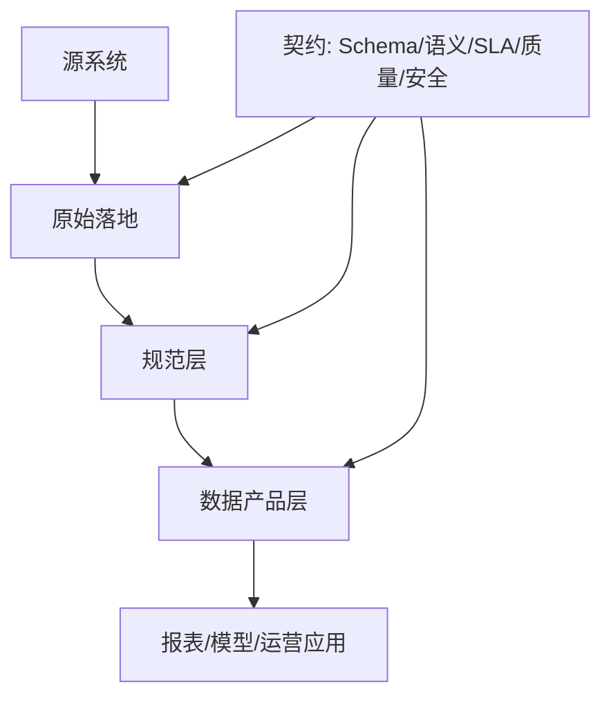
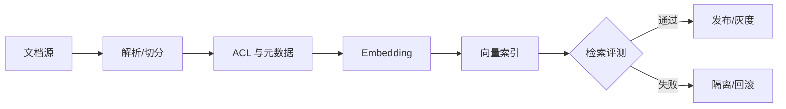
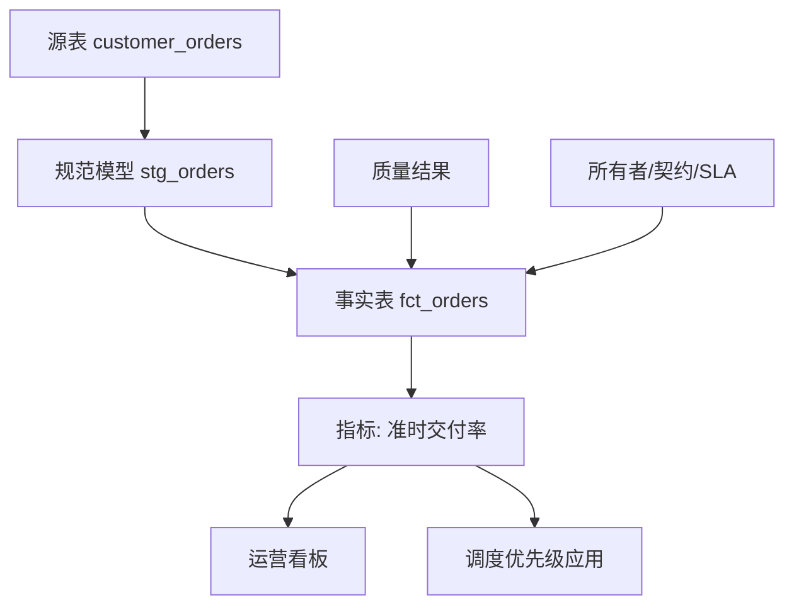
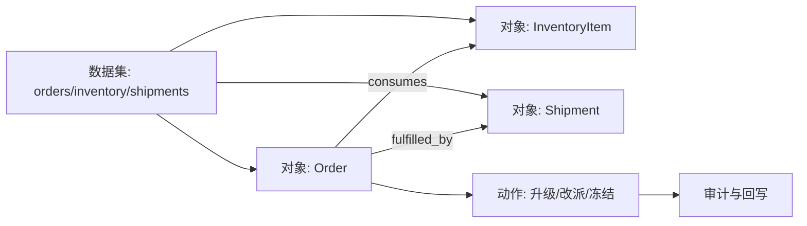
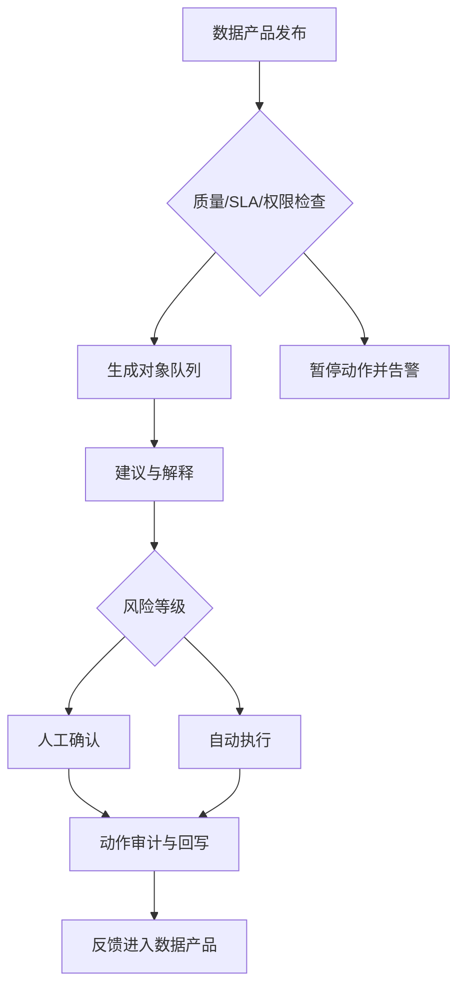

# 第七章 数据集成与数据产品

FDE 项目中的数据工作，不只是把源系统同步到仓库，也不是给业务做几张报表。以“高风险订单队列”为例，团队需要接入订单、库存、运输和客户等级数据，判断哪些订单可能逾期，再把处置动作回写到业务系统。这里的数据不只是分析材料，而是会影响客户承诺、库存调度和人工优先级的生产资产。

数据一旦进入现场交付，就会同时承担三类责任：支撑分析判断、驱动自动化流程、成为运营应用中的可执行对象。本章从五个层面展开：7.1 定义数据源接入与契约，7.2 设计批流管道、编排和索引管道，7.3 建立质量门、可观测性和血缘，7.4 统一语义层、本体和指标口径，7.5 把数据产品推进到对象队列、动作审计和反馈回写。

Lakehouse 和开放表格式的共同目标，是把“文件堆”变成可以演进、可审计、可回滚、可被多个计算引擎消费的数据产品底座。例如 ACID、批流统一、Schema enforcement（模式强制）和 Time travel（历史版本访问）可参考 [Delta Lake](https://docs.delta.io/) 的设计；Schema evolution（模式演进）、Partition evolution（分区演进）和隐藏分区能力可参考 [Apache Iceberg](https://iceberg.apache.org/docs/latest/evolution/)。对 FDE 而言，价值不在名词本身，而在这些能力能否支撑现场数据产品的契约、重跑、质量门和动作闭环。


本章的核心判断是：数据产品不是一张表，也不是一个仪表盘，而是一组有所有者、有契约、有质量门、有语义边界、能进入业务动作闭环的可运行资产。

本章承接第 6 章的发布与质量门禁，输出数据契约、管道设计卡、质量规则、血缘与资产目录、语义指标定义和运营动作闭环；第 8 章会继续展开身份、隐私、审计和合规控制，第 9/10 章会展开 RAG、Agent 与 LLMOps 的模型评测细节。

## 1. 数据源接入与契约

### 1.1 先定义边界，再搬运数据

数据接入的第一性原理是边界管理：源系统产生事实，数据平台保存和加工事实，消费系统基于事实做判断或动作。FDE 现场常见错误是先把数据库、接口、文件和日志全部接进来，再试图在下游解释字段含义。这样会把源系统的命名混乱、缺失值、权限例外和业务口径争议一并复制到平台。正确顺序应当是先识别数据产品的消费者、使用场景、更新频率和失败影响，再决定接入方式。对订单、库存、设备状态、客户触点这类高价值对象，源表不是简单的输入，而是跨团队协作的接口。

数据契约要把“谁生产、谁拥有、字段代表什么、何时算新鲜、变更如何通知、谁可以看”写成机器可检查的约束。它不是工具清单，而是生产方、数据平台和消费者之间的运行协议。

实现时可以分三层看：规范层可参考 Linux Foundation Bitol 项目的 [Open Data Contract Standard（ODCS）](https://bitol-io.github.io/open-data-contract-standard/v3.1.0/)；平台元数据层可参考 [OpenMetadata 的 Data Contract 标准](https://openmetadatastandards.org/data-contracts/data-contract/) 对 Schema、语义规则、质量期望、SLA 与安全定义的拆分；开发工具层可参考 [dbt Sources](https://docs.getdbt.com/docs/build/sources) 对源表声明、字段描述、测试、freshness 和 `source()` 血缘依赖的支持。ODCS v3.1.0 将标准拆分为 Fundamentals、Schema、Data Quality、Support、Pricing、Team、Roles、SLA、Servers 等章节。下面是便于阅读的简化示例；生产落地应按所选标准的当前 schema 校验，不应直接复制伪代码上线。

```yaml
apiVersion: v3.1.0
kind: DataContract
id: orders-v2
status: active
domain: commerce
owner: data-platform@example.com
team:
  - username: orders-platform@example.com
    role: producer
  - username: ops-data-owner@example.com
    role: data-owner
roles:
  - role: data-owner
    access: read
classification: confidential
purpose: operational_order_risk
allowedUse:
  - operational_decision_support
  - fraud_review
prohibitedUse:
  - external_model_training
  - cross_tenant_export
retention:
  raw: 30d
  product: 400d
schema:
  - name: orders
    physicalName: prod.orders_v2
    properties:
      - name: order_id
        logicalType: string
        required: true
        unique: true
      - name: account_id
        logicalType: string
        required: true
        pii: false
      - name: customer_contact
        logicalType: string
        required: false
        pii: true
        maskingPolicy: hash_for_non_privileged_users
slaProperties:
  - property: frequency
    value: 5
    unit: m
    element: orders.updated_at
  - property: maxDelay
    value: 15
    unit: m
    element: orders.updated_at
accessPolicy:
  rowLevel: tenant_id
  columnLevel: pii_masked_by_default
  delegatedSubjectRequired: true
  failClosedOnPolicyError: true
support:
  onCall: data-oncall@example.com
  escalation: operations-owner@example.com
```

| 契约项 | 要回答的问题 | 常见落地形式 |
| --- | --- | --- |
| Schema | 字段名、类型、主键、可空性是否稳定 | OpenAPI/JSON Schema、dbt model contract、表定义 |
| 语义 | 金额、状态、时间戳、删除标记的业务含义是什么 | 字段说明、枚举字典、领域术语表 |
| SLA | 数据多久更新一次，延迟多久算事故 | freshness 规则、告警阈值、运行日历 |
| 质量 | 哪些异常必须阻断下游 | not null、unique、accepted values、行数波动 |
| 安全 | 谁能读取，哪些字段需要脱敏，允许用途和禁止用途是什么，代理/服务账号代表谁执行 | 权限组、列级策略、allowed_use、delegated subject、审计日志 |
| 消费者 | 谁依赖这个数据产品，失败会影响什么 | 消费者登记、SLA 通知组、回归查询 |
| AI/LLM 数据边界 | 哪些内容可进入 prompt、检索上下文、eval 或反馈标签 | context policy、eval dataset 版本、禁止用途、标注责任 |

最小责任模型应同时声明 producer、data owner、data steward、consumer owner、on-call 和 escalation owner。producer 对源事实和变更通知负责，data owner 对业务口径和风险接受负责，steward 对质量规则和目录说明负责，consumer owner 对下游回归负责，on-call 对事故响应负责，escalation owner 对跨团队阻塞做最终裁决。安全项只定义数据产品访问边界；身份、脱敏、审计和合规控制应接到 [8.1 身份、权限与零信任](../08_security/8.1_identity.md)、[8.2 数据隐私与分级保护](../08_security/8.2_privacy.md) 和 [8.4 审计、留痕与合规证据](../08_security/8.4_audit.md)。凡是被 Agent、RAG 或自动化工具消费的数据契约，还应提供负向权限测试：无租户、过期授权、角色映射失败、delegated subject 缺失、用途不匹配和策略服务不可用时都必须 fail closed，并把拒绝原因写入审计事件。

### 1.2 契约要服务变更，而不是冻结系统

数据契约的目的不是让源系统永远不变，而是让变更可预期。业务系统会增加字段、废弃状态、拆分流程、迁移数据库；如果平台只靠“今天能跑”的 SQL 维持，下游报表、模型和应用会在某次小改动后集体失真。[dbt model contracts](https://docs.getdbt.com/docs/mesh/govern/model-contracts) 把模型契约（model contract）定位为对模型输出形状的前置保证（upfront guarantee），并在构建时验证输出是否匹配；其文档也建议优先给被下游依赖的公共模型（public model）定义契约。这个取舍对 FDE 很关键：不是所有中间表都需要重治理，但所有对外承诺的数据产品都需要契约。

现场可采用三层接入策略。第一层是原始落地区，保留源系统事实与加载元数据，尽量少改动；第二层是规范层，把主键、时间、状态、删除语义和隐私处理标准化；第三层是产品层，只暴露有所有者、有文档、有测试、有 SLA 的数据集。原始层不能成为永久数据垃圾场：应按数据分类定义保留期、删除请求传播、历史快照清理、legal hold 例外审批和 purge 验证记录。非生产环境只能使用合成数据或经过验证的脱敏样本，不能把生产 PII 直接复制到测试库。

新源接入时，先给出最小契约：主键、增量字段、时间语义、失败重跑方式、权限边界。CDC 场景还必须声明操作类型、删除/tombstone 语义、source offset 或 LSN/binlog position、事务顺序、snapshot 标记和 schema 变更兼容性；否则下游无法正确处理乱序、重放和删除。等使用场景稳定后，再补充字段级质量、版本兼容和语义层定义。这样既避免为了治理而治理，也避免把脆弱的探索性数据直接推给运营应用。

破坏性变更要当作一次小型产品发布管理。以订单数据产品为例，源系统准备把 `customer_id` 重命名为 `account_id`，并在 `order_status` 中新增 `RISK_HOLD` 枚举。错误做法是直接删掉旧字段，让旧报表关联失败，再让下游把未知状态默认归入 `OTHER`；如果运营应用把 `RISK_HOLD` 当成可发货状态，可能触发错误承诺。正确做法是按“变更前评估 -> 双字段兼容 -> 消费者迁移 -> 切换 -> 退役旧字段”的状态推进。

变更提案应说明字段重命名的业务原因、旧字段和新字段的映射关系、新枚举进入哪些指标和应用、哪些消费者会受影响。兼容窗口内同时输出 `customer_id` 和 `account_id`，并把 `customer_id` 标记为 deprecated；质量规则同时检查两个字段的一致性，语义层把旧指标继续映射到旧字段，把新应用迁到新字段。新增枚举不能被下游默认归入 `OTHER` 或忽略，必须在枚举字典、accepted values 测试、指标过滤条件和状态机流转中同时登记。

消费者通知要给出可执行信息，而不是只发“字段要改”的邮件。通知内容至少包括变更编号、目标发布时间、兼容窗口结束时间、受影响资产、迁移示例 SQL、联系人、脱敏样例数据、回滚标准、审批人和消费者回归确认。版本切换可以采用 `orders_v1` 与 `orders_v2` 并行，或同一数据产品的 contract version 切换；无论哪种方式，都要在切换前确认核心消费者已经通过回归查询。回滚标准应提前写清楚：如果新字段空值率超过阈值、旧新字段映射不一致、关键消费者未迁移、`RISK_HOLD` 导致自动动作误触发，立即停止发布，恢复旧版本指针，保留原始事件与审计日志，后续通过补偿任务重放。

| 变更类型 | 例子 | 处理规则 |
| --- | --- | --- |
| 兼容 | 增加可空字段、补充描述、增加非阻断质量规则 | 记录版本，通知消费者，不要求双跑 |
| 条件兼容 | 新增枚举、默认值变化、历史回填、单位或时区标准化 | 需要消费者影响分析、样例数据、回归查询和兼容窗口 |
| 破坏性 | 删除字段、主键变化、空值语义变化、权限收紧、指标分母变化 | 走 RFC 审批、dual-run、cutover、deprecated、retired 状态机 |

破坏性变更 RFC 的最小字段是：变更编号、owner、审批人、目标发布时间、兼容窗口、受影响资产和消费者、迁移 SQL 或 API 样例、测试样本、质量门、回滚触发条件、消费者 sign-off 和强制切换标准。



## 2. 批处理、流处理、编排与索引管道

### 2.1 批与流是延迟和一致性的选择

批处理和流处理不是新旧技术之争，而是对业务时效、一致性、成本和复杂度的不同取舍。批处理适合财务结算、日终库存、历史回填和复杂汇总，因为它可以在确定窗口内重跑、校验和对账；流处理适合告警、订单状态、设备遥测和用户行为触发，因为它把事件延迟压缩到秒级或分钟级。FDE 现场要避免把“实时”当成默认目标。真正的问题是：如果数据晚 15 分钟、1 小时或 1 天，业务损失是什么；如果数据重复、乱序或临时不一致，下游能否承受。

以 [Delta Lake](https://docs.delta.io/) 为代表的 Lakehouse 表格式支持同一张表服务批处理和流处理，体现批流统一的方向；Kafka 的 [exactly-once 设计](https://kafka.apache.org/43/design/design/)则依赖事务性、幂等写入以及 offset、状态和输出的原子提交，但这类保证主要覆盖 Kafka topic 内的读-处理-写链路；写外部系统仍需要外部系统事务、幂等键或补偿机制配合。因此，管道设计要把语义讲清楚：摄取层可以 at-least-once，当前快照层按源系统提交顺序或 offset 做条件更新，事件序列产品保留 append-only log、operation、source position 和 tombstone/delete 语义，产品层再给消费者稳定快照或事件流。

| 模式 | 适用场景 | 关键风险 | 工程控制 |
| --- | --- | --- | --- |
| 批处理 | 日终、回填、对账、复杂聚合 | 窗口口径不清、重跑覆盖错误 | 分区快照、幂等写入、审计表 |
| 微批 | 近实时指标、频繁增量同步 | 小文件、延迟抖动、重复消费 | 合并策略、watermark、去重键 |
| 流处理 | 告警、状态机、事件驱动应用 | 乱序、重复、外部副作用 | 事务、状态存储、补偿流程 |
| 混合 | 既要低延迟又要可回算 | 双路径口径漂移 | 同源逻辑、统一表格式、回放测试 |

选择模式时先问四个问题：业务能接受的延迟是多少，失败后是否需要精确重放，是否会触发外部副作用，团队能承担多少实时运维成本。日终对账和历史回填优先批处理；近实时队列、频繁刷新指标和低风险提醒优先微批；需要秒级状态变化且能处理乱序、重复和补偿时才选流处理；既要低延迟又要权威月结时，用同源事件构建流式当前态和批式权威账，避免两套口径。

### 2.2 编排要表达数据依赖，不只是定时任务

管道失败往往不是因为某个 SQL 写错，而是因为调度系统只知道“几点运行”，不知道“哪个数据产品已经更新”。传统 cron 式编排适合固定节奏任务，但在多源系统、迟到数据和跨团队依赖下，很容易出现上游未完成、下游提前运行的情况。Airflow 2.x 文档使用 Dataset 和 data-aware scheduling 表达这种能力；Airflow 3.x 稳定文档将这一能力称为 [Asset-aware scheduling](https://airflow.apache.org/docs/apache-airflow/stable/authoring-and-scheduling/asset-scheduling.html)，用 Asset 表达可被任务更新并触发 DAG 的数据资产。命名从 Dataset 到 Asset 的变化不改变核心原则：任务之间依赖的不是脚本名称，而是数据资产状态。

事件触发也不能替代幂等、补偿和重跑设计。Airflow 的资产事件可以减少“下游跑早了”的问题，但它不能保证源系统没有重复事件、外部 API 没有部分成功、消费者动作没有副作用，也不能自动决定多个资产事件应该按单次合并处理还是逐个处理；其文档也提醒，多租户环境里创建 Asset Event 的权限可能等价于触发依赖该资产的下游 DAG。每条关键管道仍要定义幂等键、写入覆盖策略、失败后的补偿步骤、可重跑的数据窗口和人工介入边界。事件负责告诉系统“可以开始”，工程设计负责保证“重复开始、晚开始、失败后再开始都不会破坏业务事实”。

FDE 项目可以把编排分为四类。第一类是摄取编排，关注凭证、连接、增量位点和失败重试；第二类是转换编排，关注依赖图、模型选择、分区和成本；第三类是质量编排，把阻断性检查放在发布门前，把非阻断性异常送入观察与工单；第四类是应用编排，把数据产品更新转换成缓存刷新、任务分配、告警通知或运营动作。编排系统不应吞掉业务语义。每个 DAG 或 job 都应暴露输入、输出、所有者、SLA、重跑方式和失败影响。否则团队只会知道“任务红了”，不知道“哪个业务能力不可用了”。

关键 DAG/job 至少要有一张设计卡：输入资产、输出资产、owner、freshness SLA、幂等键、写入语义、重跑窗口、异常记录位置、失败影响、补偿动作、人工介入入口和成本预算。坏记录不要悄悄丢弃，应进入隔离表或死信队列，保留原始 payload、错误规则、批次 ID、血缘信息和修复状态；修复后通过受控 replay 合并回产品层。回填或重算要先 dry-run，限定分区范围，估算成本，通知消费者，写入审计记录，并在完成后做源目标对账。

### 2.3 向量索引也是数据产品

生成式应用引入了一类新的数据产品：向量索引。维修手册问答、合同条款检索、售后工单助手和政策解释系统，都依赖把非结构化文档转成可检索、可审计、可删除、可重建的索引。第 9 章会展开 RAG 交互与答案质量，第 10 章会展开 LLMOps 评测；本节只讨论索引作为数据产品时必须具备的契约、版本、权限和回滚边界。

第一是 chunking 策略。固定窗口（如 512-1024 token，overlap 64-128）只是经验起点，不是通用最佳值，需要按文档结构、检索评测和上下文预算调参；结构化文档（合同、条款、API 文档）应优先按标题、章节和段落语义切分，表格与代码块应保持原子性。每个 chunk 必须保留 `chunk_id`、来源文档 ID、版本、位置、内容 hash、parser/chunker 版本、索引构建 ID、ACL 元数据、`content_type`、`sensitivity_class`、`retrieval_policy`、`allowed_use`、`prohibited_use`、`citation_required`、删除/过期标记和回滚策略。PII 扫描、脱敏、加密、删除传播和查询时 ACL enforcement 都必须进入管道，而不能只靠应用层承诺。

第二是 embedding 与索引版本管理。embedding 模型升级、维度变化、预处理、距离度量、索引参数或 reranker 调整都会让旧向量与新查询不可比。管道中应显式记录 `embedding_model`、`model_version`、`dimensions`、`preprocess_version`、`tokenizer`、`normalization`、`distance_metric`、`index_params`、`reranker_version` 和 `query_encoder_version`，并把它们作为索引名或 collection 名的一部分；切换时采用双写、双查、灰度切流和回滚索引，与 [7.1 的破坏性契约变更](7.1_contract.md) 同样对待。

第三是 eval dataset 生命周期。索引发布前至少要有固定的开发集、回归集和上线验收集，样本来源包括真实问题、专家标注、线上失败案例和合成边界样本；每条样本都应记录问题、可见权限、期望命中文档、禁止命中文档、引用要求和适用场景。Ragas 当前文档列出的 Context Precision、Context Recall、Faithfulness 等指标可以作为 RAG 评测口径之一，但第 7 章只要求“指标退化能阻断发布或触发回滚”，具体生成质量和评测方法放到 [9.3 RAG 与企业知识接入](../09_ai_native/9.3_rag.md) 与 [10.2 提示、检索与工具调用评测](../10_llmops/10.2_eval.md) 展开。

第四是接入语义层与工具调用。模型与外部数据/工具之间的连接可采用 [Model Context Protocol (MCP)](https://modelcontextprotocol.io/) 这样的标准协议，把语义层、数据产品 API 或检索服务封装为 MCP server。MCP 标准化的是上下文与工具连接方式；授权、血缘、权限、契约和审计仍需要 MCP server 与平台策略自己实现并强制执行。索引版本、chunk ID、ACL 命中记录和检索参数应进入后续 trace 字段，供 [10.3 追踪、成本与延迟治理](../10_llmops/10.3_trace.md) 使用。把向量库与 RAG 视作受治理的数据产品，是 FDE 现场区别于“先 demo 再说”的关键。



## 3. 数据质量与血缘

### 3.1 质量检查要靠近业务失败模式

数据质量不是抽象的“干净”，而是数据是否足以支撑特定决策。一个字段为空可能无关紧要，也可能让发货、授信或设备停机判断出错。FDE 团队应从失败模式倒推质量规则：重复订单会导致重复履约，库存负数会造成错误补货，状态枚举漂移会让看板漏数，时间戳时区错误会让 SLA 统计失真。质量门不应只追求覆盖率，而要区分阻断、告警和观察。阻断规则保护生产动作，告警规则保护分析可信度，观察规则用于发现趋势变化。

在质量规则落地上，可以把工具分成声明式验证和 SQL 断言两类：[GX Core](https://docs.greatexpectations.io/docs/core/introduction/gx_overview) 用 Expectations 描述并验证数据标准，并提供 Python 接口来构建和运行数据验证工作流；dbt 的 [data tests](https://docs.getdbt.com/docs/build/data-tests)则把测试表达为 SQL 断言，内置 `unique`、`not_null`、`accepted_values` 和 `relationships` 等通用检查，并建议对主键和源数据假设做测试。两类工具的共同原则是：质量规则必须可执行、可复用、可追溯，而不是停留在文档里。

数据质量也需要测试分层。PR/CI 阶段做契约测试、fixture-based transformation tests 和关键 SQL 断言；发布前做源目标对账、控制总额、历史窗口回放和消费者回归查询；生产运行时监控 freshness、volume、distribution、schema、lineage 和动作误触发。这样能把“代码能跑”与“业务事实可用”分开验证。

| 质量维度 | 典型规则 | 失败后的处理 |
| --- | --- | --- |
| 完整性 | 主键非空、关键字段非空、分区齐全、源目标行数和控制总额一致、CDC 位点连续 | 阻断发布，通知数据所有者 |
| 唯一性 | 业务主键唯一、事件幂等键唯一 | 隔离重复记录，触发去重或回放 |
| 有效性 | 枚举值、日期范围、金额范围合法 | 告警并生成异常样本 |
| 一致性 | 外键可关联、状态流转合法 | 阻断运营动作，允许分析降级 |
| 新鲜度 | 更新时间不超过 SLA | 标注 stale，暂停自动决策 |

质量规则需要分级，否则团队会在“全阻断”和“全忽略”之间摇摆。一个实用分级样例如下：

| 等级 | 规则样例 | 处理策略 |
| --- | --- | --- |
| P0 阻断 | `order_id` 为空、同一订单重复进入待执行队列、金额为负且会触发退款 | 停止发布或暂停动作，通知数据所有者和值班负责人 |
| P1 降级 | 新鲜度超过 SLA 但未影响资金动作、部分维度无法关联、异常枚举低于阈值 | 发布 stale 标记，禁止自动执行，允许人工复核或确认后处理 |
| P2 告警 | 行数波动超过历史区间、非关键字段空值率上升、描述字段格式漂移 | 生成样本和工单，不阻断发布 |
| P3 观察 | 分布轻微偏移、低价值字段新增未知值、探索性指标缺少历史基线 | 记录趋势，进入下一轮规则评审 |

每条 P0/P1 规则都应像生产告警一样管理：负责人、检测频率、阻断对象、降级行为、通知对象、修复 SLA、样本输出位置、恢复判据和升级时限必须写清楚。P0 应由值班负责人确认并升级到数据 owner；P1 可以允许人工确认路径，但界面必须显示 stale 标识、触发规则、受影响字段和最后更新时间。告警关闭必须依赖恢复查询或重放验证，而不是手工点掉通知。规则 owner 不能只写团队名：至少要有业务 owner、技术 owner、值班联系人、升级对象和替代联系人，避免关键数据产品在夜间或假期无人能决策。

### 3.2 数据可观测性的五维框架

工程化质量监控还需要一个常态视角，而不仅是发布前门禁。数据可观测性的 5 大支柱可参考 [Monte Carlo](https://montecarlo.ai/blog-what-is-data-observability) 与 [Bigeye](https://www.bigeye.com/blog/data-observability) 等资料的总结，并作为现场落地的最小集：

- 新鲜度（Freshness）：表/分区/topic 是否按预期时间更新，迟到比例如何；模板应区分 event time、ingestion time、processing time、业务日历、允许迟到窗口和 warn/error 阈值。
- 体量（Volume）：行数、字节数、文件数是否落在历史正常区间，是否出现断崖式上升或下降。
- 分布（Distribution）：关键列的空值率、唯一值数、均值/方差、枚举占比是否漂移；核心指标还应按区域、渠道、客户等级等维度做 segment-level drift，避免全局均值掩盖局部异常。
- Schema：列的增加、删除、类型变更、约束变更是否被检测并通知下游。
- 血缘（Lineage）：上下游依赖和影响范围可追踪，事故时可驱动通知与回滚。

这五维与“质量检查要靠近业务失败模式”的质量规则互补：质量规则面向已知失败模式，可观测性面向未知异常。两者都应接入告警系统，并按 P0–P3 同一分级处理。若高风险订单队列突然下降 40%，排查顺序应先看 freshness 是否延迟，再看 volume 是否少了分区或 topic，再看 distribution 是否某个订单状态激增，再看 schema 是否新增枚举，最后用 lineage 找到最近变更和受影响消费者。

AI 数据产品还要补充在线信号：检索空结果率、低相似度命中率、引用缺失率、拒答率、prompt injection 命中、PII 泄漏告警、索引构建失败率和删除传播失败率。这些信号也应进入 P0-P3，而不是只留在模型评测报告里。本节关注数据资产级异常；生产遥测、SLO、值班和事件响应在第 12 章展开。

### 3.3 血缘是影响分析，不是装饰图

血缘的价值在事故和变更时才真正显现。字段要改名、源表要迁移、质量规则失败、指标突然下降时，团队必须快速回答：谁生产了这份数据，经过哪些转换，影响哪些报表、模型和应用，应该通知谁。血缘建模可参考 [OpenLineage](https://openlineage.io/) 对 run、job、dataset 和 facets 的定义；schema 等较稳定信息适合放在 DatasetFacet，每次运行读取/写入的分区、版本和统计则应放在 InputFacet 或 OutputFacet。资产发现与治理则可参考 [OpenMetadata](https://docs.open-metadata.org/) 对数据发现、血缘、治理、质量和协作的统一平台设计。血缘不应是后补的静态图，而应从编排、转换、查询和发布过程自动采集。

FDE 现场应建立“技术血缘 + 业务血缘”的双层模型。技术血缘回答列从哪里来、SQL 如何变换、任务何时运行；业务血缘回答这个字段支撑哪个指标、指标进入哪个决策、决策影响哪个流程。只做技术血缘，业务用户看不懂影响；只做业务说明，工程团队无法定位根因。较好的做法是把数据契约、质量结果、运行记录、所有者、消费者和下游曝光点绑定在同一资产目录页上。每个数据产品发布前必须有 upstream/downstream、字段级映射、运行记录来源、缺失血缘告警和 owner 修复时限。

发生事故时，团队可以从失败质量规则跳到上游源表、最近变更、下游 dashboard 和运营应用，形成可行动的排障路径。复盘要记录时间线、影响范围、根因、哪些检测触发或未触发、恢复动作、预防项、owner 和截止日期；否则血缘只帮助找到一次问题，不能让系统变得更稳。



## 4. 语义层与知识图谱

### 4.1 语义层统一指标定义

当同一个指标在财务、销售、运营和客户成功团队中有不同 SQL，组织就会陷入“数字都对，但互相不一致”的状态。语义层的目标是把实体、维度、度量和指标定义集中管理，让 BI、Notebook、应用和 AI 助手共享同一套业务口径。以 dbt 的 [Semantic Models](https://docs.getdbt.com/docs/build/semantic-models) 为例，semantic model 是 MetricFlow 和 Semantic Layer 的基础，并用 entity 表达 join key，区分 primary、unique、foreign、natural 等实体类型；natural key 适合用真实业务属性识别 SCD Type II 等历史记录。

FDE 项目中，语义层尤其适合处理客户现场的口径争议。例如“活跃客户”到底按登录、交易、合同还是服务单计算；“准时交付”按承诺日期、发货日期还是签收日期计算；“库存可用”是否扣除质检冻结和已分配订单。这些问题不能靠每个报表作者自行解释。语义层应把指标拆成事实表、实体键、时间维度、过滤条件、聚合方式、owner、黄金查询和变更历史，并把它们写入版本控制。

| 语义元素 | 作用 | 例子 |
| --- | --- | --- |
| Entity | 连接业务对象的稳定键 | customer、order、asset、shipment |
| Dimension | 切分和过滤指标的属性 | region、product_line、order_status |
| Measure | 可聚合的事实 | revenue、quantity、duration_minutes |
| Metric | 面向业务的计算定义 | on_time_delivery_rate、active_accounts |
| Saved query | 可复用查询视角 | 本周高风险订单、逾期设备清单 |

一个指标定义至少要能回答：业务定义、公式、事实表、实体粒度、时间口径、过滤条件、空值处理、可用维度、质量规则、业务 owner、技术 owner、批准人、兼容窗口和弃用策略。以 `on_time_delivery_rate` 为例，分子是承诺时间内签收的订单数，分母是已签收且未取消的订单数，时间维度使用承诺交付日期，按客户等级、区域和产品线切分；如果承诺日期为空，这条订单不能悄悄进入分母，而应进入质量异常样本。

```yaml
metric: on_time_delivery_rate
business_owner: supply_chain_ops
technical_owner: data_platform
grain: order
entity: order_id
time_dimension: promised_delivery_date
numerator: delivered_at <= promised_delivery_date
denominator: delivered_at is not null and order_status != 'CANCELLED'
null_handling: exclude_and_report_missing_promised_date
allowed_dimensions: [region, customer_tier, product_line]
golden_queries:
  - name: 2026_q1_top_customer_regression
    expected_range: 0.91..0.94
deprecation_policy: 60d dual-run before formula changes
```

不同消费者应通过受控接口复用语义层。BI 使用 saved query 或 export，产品应用使用 API 或物化视图，Notebook 使用只读语义接口，AI 助手只能通过已注册 metric、saved query 或 MCP 工具查询关键指标；未定义实体或口径冲突时，应拒答或要求澄清。语义层还要继承行级、列级、用途、租户、区域和环境权限，把维度枚举、过滤条件和聚合结果也纳入泄露评估，避免“统一口径”变成横向越权入口或小样本反推入口。

### 4.2 知识图谱和本体把数据接到行动

语义层解决指标口径，知识图谱解决对象关系，本体（ontology）把对象、关系、动作和权限合成可操作的业务对象层。传统数据仓库擅长回答“过去发生了什么”，但运营应用需要回答“对象之间是什么关系，下一步能做什么”。普通语言说，本体就是把订单、库存、供应商、设备等对象，以及它们之间的关系、可执行动作和权限边界放在同一层管理。

Palantir 在 [Ontology](https://www.palantir.com/docs/foundry/ontology/overview) 中把本体定位为组织的 operational layer，将 datasets、virtual tables 和 models 映射为真实世界对象，并包含 objects、properties、links、actions、functions 和 dynamic security 等元素；其 [Object edits and materializations](https://www.palantir.com/docs/foundry/object-edits/overview) 说明也把 Action 定义为改变一个或多个对象属性的单一事务。

这给 FDE 一个重要启发：数据产品如果只停在报表，就只能影响认知；如果进入本体和运营动作，就能影响流程。以供应链场景为例，表里有订单、库存、供应商和运输事件；本体层把它们建模为对象和链接；应用层允许运营人员对“高风险订单”执行改派、催单、冻结或升级。知识图谱不必一开始覆盖全企业，应该从高价值工作流切入，先建少数稳定对象，再逐步扩展关系和动作。下一节讨论的是这些对象如何进入任务队列、审批、动作执行和审计回写的运行层。



## 5. 从报表到运营应用

### 5.1 报表回答问题，运营应用改变结果

报表的价值是让人看见问题，但 FDE 的目标通常不是“看见”就结束，而是让组织更快、更一致地采取行动。一个库存报表告诉团队哪些 SKU 缺货；运营应用则能把缺货对象分配给负责人、生成补货建议、触发供应商沟通、记录处置结果，并把结果回写到系统。两者的差别不在界面复杂度，而在闭环程度：报表以阅读为中心，运营应用以对象、状态、动作和责任人为中心。

从数据产品演进到运营应用，需要补齐四个能力。第一是对象化，把宽表中的行变成订单、客户、设备、病例、合同等可追踪对象；第二是状态机，定义对象从待处理到已解决、已升级、已关闭的合法流转；第三是动作层，把业务操作封装成可授权、可审计、可回滚或可补偿的命令；第四是反馈层，把用户处置、异常原因和结果质量回流到数据平台。这也是 [Palantir Ontology](https://www.palantir.com/docs/foundry/ontology/overview) 将语义元素和动作元素放在同一 operational layer 中的原因：真实业务系统需要同时理解对象含义和改变对象状态。

| 层级 | 主要产物 | 成功标准 |
| --- | --- | --- |
| 报表 | 指标、趋势、筛选器 | 用户能发现问题 |
| 分析工作台 | 明细、钻取、假设分析 | 用户能解释原因 |
| 任务队列 | 对象列表、优先级、负责人 | 用户知道先处理什么 |
| 运营应用 | 动作、审批、回写、审计 | 用户能完成闭环 |
| 自动化决策 | 规则/模型、人工兜底 | 系统能稳定改善结果 |

状态机要显式定义合法转移、禁止转移、超时转移和补偿动作。对象从“待处理”到“已升级”可能需要质量门通过、权限有效、负责人存在和幂等键可用；从“已升级”回到“待处理”则可能需要撤销外部工单或记录补偿失败。没有状态转移契约时，运营应用会退化成一组按钮，事故后无法解释谁在什么证据下改变了对象状态。

### 5.2 运营应用要把治理内嵌到动作里

把数据接入运营应用后，风险也随之上升。错误报表最多误导会议，错误动作可能影响客户、资金、库存、合规或安全。因此，运营应用不能绕开数据治理，而要把治理嵌入动作路径。每个关键动作都应知道它依赖哪些数据产品、最近一次质量检查是否通过、输入数据是否新鲜、操作者是否有权限、执行后如何审计。对自动化建议，也要区分“推荐给人确认”和“系统直接执行”两种风险等级。

工程上可以采用“可解释建议 + 人在回路 + 审计回写”的渐进路线。第一阶段只把高风险对象排队并解释原因；第二阶段允许用户在应用中执行标准动作；第三阶段对低风险、可补偿动作自动执行；第四阶段再把结果反馈给模型和规则。这个过程应持续连接质量、血缘和语义层：质量失败时暂停动作，血缘变更时评估影响，语义定义变更时重新验证指标和任务队列。在这里，运营应用可信任的基础不只是动作设计，还包括 [OpenMetadata](https://docs.open-metadata.org/) 所强调的数据发现、血缘、质量、治理和协作能力。

| 条件 | 允许模式 | 说明 |
| --- | --- | --- |
| P0 质量失败、权限不明、动作不可补偿 | 禁止动作 | fail closed，暂停队列或仅展示事故说明 |
| P1 降级、数据 stale、影响客户或资金 | 人工确认 | 展示受影响字段、最后更新时间、质量规则和限制说明 |
| 质量通过、低风险、可补偿 | 自动执行 | 需要幂等键、补偿流程、误触发率监控和回滚开关 |
| 高风险但证据充分 | 审批后执行 | 需要职责分离、二次确认和动作级审计 |

动作权限要和数据读取权限分开建模。最低要求是区分谁可读、谁可建议、谁可执行、谁可审批、谁可回滚；资金、客户、库存、安全相关动作需要分级审批和 break-glass 审计。降级期间，系统应进入只读或人工确认模式，禁用自动动作；恢复时要重新计算受影响对象队列，而不是简单恢复按钮。

### 5.3 高风险订单队列案例

某制造企业希望每天提前识别可能逾期或影响重点客户的订单，并把处理动作闭环到业务系统。数据契约先定义订单、库存、产能、运输和客户等级五类输入：每类输入都有主键、更新时间、枚举字典、SLA、隐私边界和破坏性变更通知规则。管道层按资产更新触发近实时刷新，但重跑窗口应按数据分类、合同、法规和业务恢复目标定义；如果库存事件晚到，系统可以重算受影响订单，而不是覆盖整张订单队列。

质量门把订单队列分成可发布、降级和阻断三种状态。P0 规则包括订单主键为空、客户等级缺失、承诺日期早于下单日期、同一订单重复进入执行队列；任何 P0 失败都阻断动作。P1 规则包括运输 ETA 超过 SLA、库存快照晚于 30 分钟、供应商状态未知；这些订单仍可展示，但只能进入人工确认。语义层集中定义“高风险订单”：承诺交付日期、客户优先级、库存缺口、产能冲突、运输延迟和合同罚金共同决定风险分。运营应用只读取这个语义指标，不允许每个团队在界面里重写一套风险 SQL。

| 字段 | 案例定义 |
| --- | --- |
| 风险分 | `customer_priority * 0.3 + inventory_gap * 0.3 + capacity_conflict * 0.2 + transport_delay * 0.2` |
| 阈值 | `>= 0.8` 高风险，`0.5-0.8` 人工复核，`< 0.5` 观察 |
| 时间口径 | 以承诺交付日期为主，运输 ETA 只作为解释字段 |
| 缺失处理 | 客户等级、承诺日期或库存快照缺失时进入 P0/P1，不得默认低风险 |
| 解释输出 | 主要风险因素、受影响字段、质量门结果、最近更新时间 |

动作层按风险和可补偿性分流。高风险且影响重点客户的订单进入人工确认队列，应用展示风险原因、血缘、最近质量结果和可选动作，例如升级、拆单、改派、冻结承诺或联系供应商。低风险且可补偿的动作，例如刷新客户通知草稿或创建内部跟进任务，可以自动执行。所有动作都写回审计表：记录输入数据版本、语义指标版本、质量门结果、操作者、审批意见、外部系统返回引用和补偿状态。审计字段应采用白名单：敏感值脱敏或哈希引用，禁止记录密钥、token 和完整外部响应；审计日志本身要只读、不可篡改、有保留期并记录访问审计。

回写结果再进入数据产品，用于评估建议准确率、动作完成率和误触发率，形成从契约到执行再到学习的闭环。用户点击、人工纠正和专家标注不能直接等同于训练标签，应分为 raw feedback、reviewed annotation、eval case、training/fine-tuning candidate 四层，并记录标注 schema、rubric、审核人、争议仲裁和版本。只有经过授权用途检查、隐私最小化和标注审核的数据，才能进入评测或训练候选；反馈闭环不能绕过原始数据契约。


