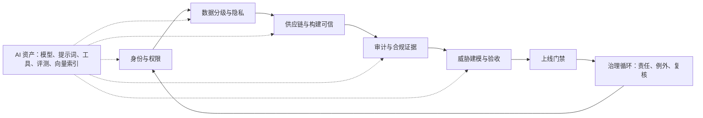
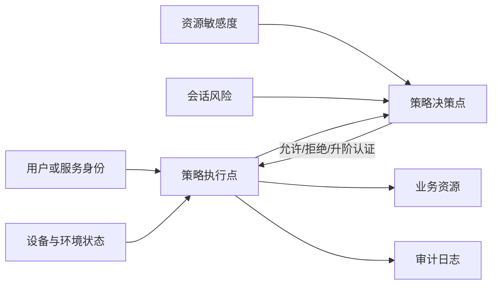
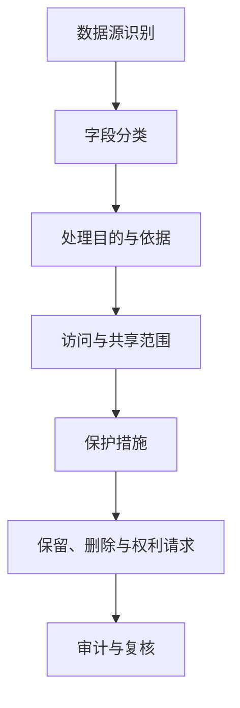
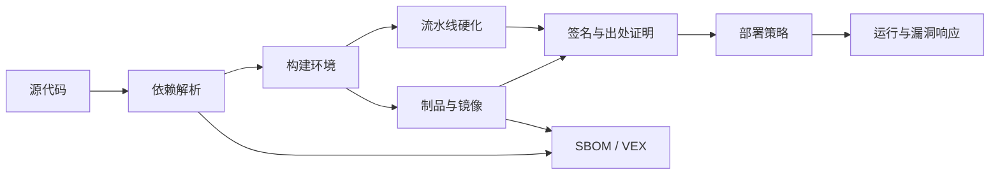
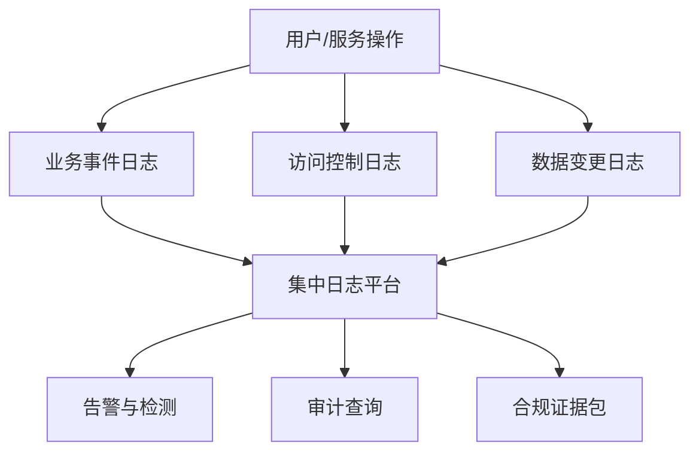
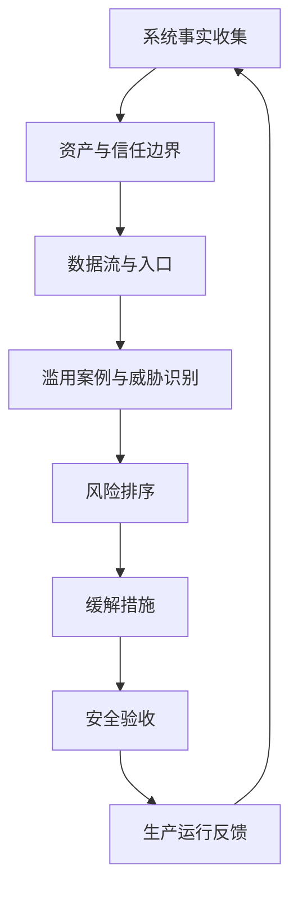

# 第八章 安全、合规与治理

FDE 进入客户现场时，安全不是项目后期的“审批项”，而是系统能否被真实组织长期使用的前置条件。现场系统通常连接身份目录、业务数据库、第三方 SaaS、模型服务、日志平台和交付流水线；任何一个环节的边界不清，都可能把一次快速试点变成不可审计、不可交接、不可扩展的风险资产。

本章按一条现场安全链路展开：先确认身份与权限，再限定数据处理边界，随后证明代码、依赖、模型和制品可信；运行后用审计留痕还原事实，最后用威胁建模和验收门禁把控制落到上线决策。AI 系统的模型、提示词模板、工具、向量索引和评测集不另起一套治理，而是进入同一条链路。

第七章已经把数据契约、质量规则、血缘、语义边界和运营动作边界作为数据产品交付物。本章接收这些产物，把它们映射为访问策略、隐私分级、审计字段、供应链证据、威胁模型资产和上线门禁。否则，安全会变成独立评审，而不是工程系统的一部分。

零信任不再依赖静态网络边界；NIST [SP 800-207](https://csrc.nist.gov/pubs/sp/800/207/final) 将其描述为转向保护用户、资产和资源的安全范式；身份、设备、网络、应用工作负载和数据的持续成熟也可参考 [CISA Zero Trust Maturity Model](https://www.cisa.gov/resources-tools/resources/zero-trust-maturity-model)。对 FDE 而言，这意味着不要把“在客户内网运行”视为信任依据，也不要把“上线前做一次扫描”视为安全闭环。安全应成为从发现、架构、交付到运营的连续控制面。



| 控制面 | 关键问题 | 最小交付物 | 验收信号 |
| --- | --- | --- | --- |
| 身份与权限 | 谁代表谁访问哪些租户、资源、字段和动作 | 权限矩阵、服务身份清单、提权与撤权流程 | 跨租户负例失败，高风险动作有审批和审计 |
| 数据隐私 | 哪些数据能被处理、输出、保留和删除 | 数据处理目录、字段治理表、保留与删除计划 | 敏感字段不会进入未授权 prompt、日志、导出或评测集 |
| 供应链 | 制品是否来自可信源，构建和发布是否可验证 | SBOM/ML-BOM、签名、出处证明、漏洞处置状态 | 未签名或证据缺失的制品不能部署 |
| 审计留痕 | 事故后能否还原事实，证据是否可信 | 日志字段说明、查询脚本、证据清单、保留策略 | 能在限定时间内重放一次敏感操作链路 |
| 威胁验收 | 风险是否转成可测试门禁 | 威胁模型、滥用案例、负例测试、残余风险决策 | 阻断项关闭或被授权接受，例外有到期日 |
| AI 安全 | 模型、检索、工具和代理是否扩大攻击面 | AI 资产清单、红队用例、工具权限、运行时策略 | 提示注入、越权检索、工具篡改和成本滥用负例可回归 |

进入客户现场时，FDE 应先完成一份轻量安全启动清单：客户安全负责人、系统 owner、数据 owner、运行环境、身份目录、外部用户范围、服务账号、密钥保管位置、入口和出口网络、日志/SIEM 去向、变更窗口、事件联系人、例外流程、证据交付位置。清单不是审批文档，而是后续所有权限、数据、供应链、审计和门禁设计的输入。

读完本章，读者应能把安全要求翻译为 FDE 可执行的工程动作：权限模型、数据分类、SBOM、签名与出处、日志证据、威胁模型、安全验收门禁，以及生产交接时必须留下的治理材料。

## 1. 身份、权限与零信任

### 1.1 身份是第一边界

FDE 项目最容易犯的错误，是把客户内网、VPN、堡垒机或内部域名当作信任依据。真实现场里，用户可能来自总部、分支、外包团队和集成商；服务也可能运行在客户云、供应商云、本地机房或临时试点环境。边界已经不等于网段。按照 [NIST SP 800-207](https://csrc.nist.gov/pubs/sp/800/207/final)，零信任从静态网络边界转向保护用户、资产和资源，访问资源前要对主体和设备分别认证与授权。FDE 首先要把“谁在什么上下文中访问什么资源”建模清楚。

CISA 的[零信任成熟度模型](https://www.cisa.gov/resources-tools/resources/zero-trust-maturity-model)把身份、设备、网络、应用工作负载和数据列为成熟度支柱，提醒团队不要只接入一个身份产品就宣称完成零信任。现场更有效的路径，是先管住关键动作：人类用户登录、服务间调用、运维提权、数据导出、模型工具调用和后台批处理。



### 1.2 最小权限要落到对象

最小权限不是口号，而是一组可检查对象：角色、组、策略、令牌、服务账号、密钥、临时权限和例外单。即使试点也应使用可追责的命名身份和短期凭证；确需临时例外时，必须限定数据范围、负责人、到期日，并禁止接入生产敏感数据。生产化前，人使用 SSO 和多因素认证（MFA）；服务使用工作负载身份；运维使用即时（Just-in-time, JIT）提权；导出、删除、批量更新等高影响操作单独授权。NIST [SP 800-207A](https://csrc.nist.gov/pubs/sp/800/207/a/final) 也强调云原生应用要同时考虑用户身份、服务身份和网络层策略。

跨云、跨集群或服务网格场景下，服务身份应使用可验证、可轮换的工作负载身份，而不是手工分发长效证书。[SPIFFE/SPIRE](https://spiffe.io/) 可作为候选基线：SPIFFE 用 SVID 为工作负载签发可验证身份，SPIRE 负责签发、轮换和证明。是否采用取决于客户现有服务网格、证书体系和运维能力。

工作负载身份只证明“哪个服务在调用”，不等于业务授权。服务代表用户或租户执行时，还必须传递并校验 delegated subject、租户/客户边界、资源、动作、字段范围、过期时间和策略版本；下游系统不得只因为上游服务账号可信就放行。对 Agent、后台任务和批处理尤其要防止 confused deputy：模型或任务只能使用被授权的业务委托，不能把服务账号变成绕过用户权限的通道。

权限设计应从业务动作反推，而不是复制组织架构。合理策略至少用“主体 + 租户/客户边界 + 资源类型 + 动作 + 字段/数据范围 + 环境 + 时限 + 委托来源”表达，并把例外纳入审计。跨租户访问默认拒绝；管理员例外必须有审批、到期日和复核记录；跨租户负例测试必须失败。

| 对象 | 现场风险 | 工程化做法 |
| --- | --- | --- |
| 人类用户 | 共享账号、离职未回收 | SSO、MFA、组映射、定期复核 |
| 服务账号 | 长效密钥散落 | 工作负载身份、短期凭证、轮换 |
| 运维权限 | 永久管理员 | Just-in-time 提权、审批、会话记录 |
| 数据导出 | 绕过字段级保护 | 单独授权、水印、下载日志 |
| 模型工具 | Agent 越权调用系统 | 工具级授权、用户委托、最小作用域 |

最小权限矩阵可以从下列字段起步，随后映射到 IAM、网关、数据库、工具服务和审计日志：

| 主体 | 角色/组 | 租户/客户边界 | 资源与动作 | 字段/数据范围 | 环境 | 认证强度 | 时限 | 审批人 | 审计事件 | 负例测试 |
| --- | --- | --- | --- | --- | --- | --- | --- | --- | --- | --- |
| 客服坐席 | support-agent | 所属区域客户 | `ticket.create` | 非受限字段 | 试点 | SSO + MFA | 会话内 | 服务主管 | 工单创建 | 非授权客户创建失败 |
| Agent 服务 | workload:agent | 用户委托范围 | `crm.search` | allowlist 字段 | 生产 | 工作负载身份 | 短期令牌 | 策略引擎 | 工具调用 | 越权字段检索失败 |

FDE 或供应商人员进入客户现场时，还要单独管理访问生命周期：使用客户签发的命名账号，满足客户设备姿态和堡垒机/PAM 要求，高风险会话可录屏或记录命令；break-glass 账号只用于应急，双人授权，事后复盘；试点结束、人员离场、供应商合同结束或生产交接时必须撤权并验证无法登录。

密钥和 API Key 应在客户批准的 Vault、KMS、HSM 或密钥管理系统中生成和保管。不要把密钥复制到聊天工具、个人文档、本地笔记或模型上下文；交付包只记录密钥用途、owner、轮换周期、撤销路径和验证方式，不记录密钥值。疑似泄露、提示注入命中、日志误采集或人员离场都应触发轮换。

### 1.3 权限治理要持续

身份治理的难点不在首次配置，而在组织持续变化。调岗、离职、供应商合同结束、设备姿态变化、密钥泄露、异常访问、租户范围变化、策略更新、试点扩容、新数据源和新自动化任务，都会让旧权限变成风险。上线前确认默认拒绝；扩容前复核角色映射；生产后按月、按版本和按事件触发检查高权限账号、外部用户、长效令牌和未使用权限。高权限会话应支持连续身份验证、设备姿态和上下文风险评估。

最终标准是可解释：任一敏感资源都能说明谁有权访问、代表谁访问、租户边界是什么、依据是什么、何时授权、何时过期、最后一次使用是什么、如何撤销、撤销是否已验证。

## 2. 数据隐私与分级保护

### 2.1 先识别处理活动

FDE 项目不能只问数据库怎么连，而要先说明数据处理活动：处理哪些数据，目的是什么，谁受影响，输出给谁，保留多久，能否删除或更正。[NIST Privacy Framework](https://www.nist.gov/privacy-framework) 可作为隐私风险管理框架参考；NIST 至本书最近一次核验时（日期见[快变事实核验表](../appendix/volatile_facts.md)）仍将 Privacy Framework 1.1 标为 Initial Public Draft / coming soon 状态，出版前应复核最终版本。隐私风险不等同于网络入侵风险，即使系统没有被攻破，过度收集、目的漂移、不透明共享或错误推断，也可能造成隐私损害。

现场数据应先形成处理目录，覆盖数据来源、字段类别、主体类型、处理目的、法律/合同/制度依据、告知和同意证据、控制者/处理者角色、子处理方、共享对象、保留期限、删除或匿名化触发、脱敏方式、权利请求 owner、PIA/DPIA 需求和审批引用。AI 或分析系统还要记录数据是否进入训练、微调、检索、提示词、日志、评测集、人工标注或供应商调用流程。



### 2.2 分级要连接业务影响

数据分级不是贴标签，而是把泄露、误用、篡改和不可用的影响转化为工程控制。常见分级可从公开、内部、敏感、受限四级开始，再按行业要求扩展。分级越高，默认暴露面越小，使用证据越完整。分级还要覆盖派生数据和输出：多个低敏字段组合后可能识别个人；模型日志可能含用户原文和检索片段；业务规则输出可能暴露商业秘密。

“数据分类分级”是数据治理和工程控制的输入，不等同于全部合规结论。它与等保、数据出境和行业监管的边界要分清：

- 等保关注网络和信息系统的安全保护等级、技术控制和管理控制；数据分级可以影响系统定级论证、访问控制、日志和加密要求，但不能替代等保定级、测评和整改。
- 数据出境关注个人信息、重要数据和出境场景是否触发安全评估、标准合同、个人信息保护认证或豁免；数据分级能帮助识别敏感性和重要性，但不能单独决定能否出境。
- 行业监管关注金融、医疗、政务、汽车、工业等领域的专门目录、强制标准、报送和留存要求；通用分级标签必须映射到客户所属行业的监管口径。

因此，FDE 在现场不要只交付一张“公开、内部、敏感、受限”的表。更可执行的做法是把每个字段同时标注业务分级、个人信息属性、敏感个人信息属性、是否可能构成重要数据、是否属于商业秘密/客户受限信息、是否为凭证/密钥、适用系统边界、出境状态和行业特殊要求；未知项标记为“待法务/安全确认”，不能默认为可用。

| 分级 | 典型内容 | 最低控制 |
| --- | --- | --- |
| 公开 | 已发布文档、公开价格 | 完整性校验、发布审批 |
| 内部 | 项目计划、汇总指标 | 组织内访问、变更记录 |
| 敏感 | 客户明细、合同、运营数据 | 最小权限、加密、脱敏、访问日志 |
| 受限 | 证件、生物识别、精确位置、未成年人、医疗金融记录、密钥 | 强审批、隔离、短期授权、专门审计 |

高风险行业不能只停留在这四级标签。银行卡数据、非公开金融信息、ePHI、公共记录、执法数据、OT 遥测和商业秘密有不同的法律依据、留存、泄露通报、审计和访问要求，必须映射到客户自己的监管词典和控制 owner。

| 字段属性 | 示例问题 | 工程落点 | 未确认时默认动作 |
| --- | --- | --- | --- |
| 个人信息属性 | 是否能直接或间接识别个人 | 处理目录、访问策略、权利请求流程 | 限制使用，等待 privacy owner 确认 |
| 敏感个人信息 | 是否涉及生物识别、宗教信仰、特定身份、医疗金融、行踪轨迹或未满 14 周岁未成年人 | 单独目的、必要性说明、严格保护、额外告知/同意要求 | 不进入试点数据、prompt、日志和评测集 |
| 重要数据可能性 | 泄露或滥用是否可能影响国家安全、经济运行、社会稳定、公共健康和安全 | 法务/安全确认、出境评估、隔离存储 | 作为受限数据处理 |
| 商业秘密/客户受限 | 是否涉及合同价格、策略、供应链、客户名单、未发布产品 | 字段级权限、水印、导出审批 | 禁止导出，限制到最小团队 |
| 凭证/密钥 | 是否为口令、令牌、私钥、API Key、连接串 | Vault/KMS/HSM、密钥扫描、轮换 | 禁止写入文档、日志、prompt 和 trace |

### 2.3 控制要在系统路径生效

隐私不能只靠培训和承诺。工程上要把控制放进数据路径：采集阶段最小化，接入阶段分类和血缘，存储阶段加密和保留策略，查询阶段行列级权限，导出阶段审批和水印，日志阶段过滤敏感字段，模型调用阶段约束上下文和供应商数据使用。NIST Privacy Framework 的 Core、Profile 和 Implementation Tier 思路适合 FDE 使用：先定义目标画像，再评估当前差距，最后按风险排序补控制。

新增数据源、字段、用途、外部模型、保留期限、共享对象或人工标注流程，都应触发轻量隐私复核。结论要具体：允许、允许但需脱敏、仅限隔离环境、需法务确认或禁止接入。这样的结论才能转化为代码、配置、权限和验收项。

| 复核项 | 需要回答的问题 | 可执行结论 |
| --- | --- | --- |
| 数据路径 | 是否进入 prompt、日志、trace、评测、训练、导出或人工标注 | 允许 / 脱敏 / 隔离 / 禁止 |
| 字段最小化 | 当前用途是否需要完整字段，能否只用类别、摘要、引用 ID 或掩码 | 字段 allowlist、上下文裁剪、导出列限制 |
| 保留与删除 | 最短必要保留期、最长保留期、删除/匿名化触发、备份清除滞后 | 保留矩阵、删除任务、销毁证据 |
| 共享与出境 | 接收方、地点、合同机制、行业限制、子处理方 | 合同/评估编号、区域路由、禁止共享 |
| 验收负例 | 不必要敏感字段是否能进入 prompt、日志、导出或评测集 | 自动测试、抽样查询、阻断记录 |

现场样本默认使用合成或脱敏数据。确需使用真实生产样本时，应由数据 owner 批准，限定字段、数量、环境、人员、保留期和删除方式；截图、日志、下载文件、本地缓存、临时向量索引和调试数据都要纳入同一套清理和审计规则。没有工单、合同或客户批准，客户数据不应离开客户环境。

### 2.4 跨境、AI 与行业监管映射

涉及跨境数据、AI 系统或高监管行业的项目，还要把 FDE 视角对齐到外部监管口径。下表不替代法律意见，只说明交付清单中需要提前准备的工程证据。

| 口径 | 触发场景 | FDE 应准备的工程证据 | 需法务/合规确认项 |
| --- | --- | --- | --- |
| 中国数据出境 | 向境外提供个人信息、重要数据，或由境外供应商远程访问境内数据 | 数据目录、个人信息/敏感个人信息数量、重要数据判断、接收方、传输路径、合同/评估编号 | 按 [《促进和规范数据跨境流动规定》](https://www.gov.cn/gongbao/2024/issue_11366/202405/content_6954192.html) 判断豁免、标准合同/认证或安全评估 |
| 欧盟 GDPR 跨境传输 | 从 EEA 向第三国或国际组织传输个人数据，或第三国供应商访问 EEA 数据 | 数据出口方/进口方、数据类别、子处理方、区域路由、加密和访问控制 | 充分性决定、SCC、BCR、认证/行为准则、例外情形和传输影响评估 |
| EU AI Act | 在欧盟投放或服务欧盟用户的 AI 系统 | 风险分级记录、技术文档索引、日志留存策略、人工监督设计、上市后监测证据 | 高风险系统义务、GPAI 义务、系统性风险、事件报告和版权政策 |
| 中国生成式 AI 服务 | 面向中国境内公众提供生成式 AI 服务 | 训练数据来源证据、内容标识、个人信息保护、未成年人保护、违法内容处置记录 | 安全评估、算法备案、深度合成/内容标识等专项规则适用性 |
| 中国拟人化互动与智能体规则 | 拟人化互动服务，或智能体进入敏感领域/重点行业 | 拟人化标识、行为边界、权限管控、风险监测、问题产品召回/回滚、供应链清单 | [2026-07-15 生效的拟人化互动服务规则](https://www.cac.gov.cn/2026-04/10/c_1777558395078289.htm) 与 [2026-05-08 智能体实施意见](https://www.cac.gov.cn/2026-05/08/c_1779979789523320.htm) 是否触发备案、检测或行业管理 |

行业画像要单独落地，避免把所有高敏数据都塞进一个“受限”桶：

| 行业 | 额外交付关注点 | 不能简化成 |
| --- | --- | --- |
| 金融 | 客户非公开信息、多因素认证、交易/支付数据、第三方外包、运营韧性、审计留存 | 只做普通个人信息脱敏 |
| 医疗 | ePHI 范围、BAA/委托关系、临床决策支持或 SaMD 边界、患者安全监测、变更控制 | 只做通用隐私告知 |
| 公共部门 | RMF/ATO、FedRAMP 或本地等效授权、控制继承、POA&M、持续监控、可访问性 | 只交一个证据包即等于授权 |
| 关键基础设施/OT | 区域与管道、IT/OT 分段、被动监测、维护窗口、人工接管、故障安全和恢复演练 | 只用互联网应用安全门禁 |

实践上，FDE 与法务/合规团队的接口是“把监管条文翻译成现场可验收的工程项”：数据集来源与同意证据、模型卡与系统卡、用户告知与水印、人工监督机制、人工接管/停止机制及启停条件、日志与可追溯性保留期、跨境传输的合同/评估编号。把它们落到 8.1 的身份与权限、8.3 的供应链证据、8.4 的审计留存、8.5 的验收门禁、8.6 的 AI 安全控制中，而不是单独列一份合规清单。

## 3. 供应链安全与 SBOM

### 3.1 可信边界延伸到构建

FDE 只要交付可运行制品，就必须回答四个问题：来源是否可信，构建是否可复现，内容是否可检查，部署是否可阻断。依赖、基础镜像、CI 插件、构建脚本、制品仓库、部署凭证和客户 registry 推广流程都属于这条供应链。

NIST [SP 800-218 SSDF](https://csrc.nist.gov/pubs/sp/800/218/final) 将安全软件开发实践嵌入 SDLC，目标是减少发布漏洞并处理根因。针对生成式 AI 与双用途基础模型，NIST 又在 [SP 800-218A](https://csrc.nist.gov/pubs/sp/800/218/a/final) 中扩展了数据集、模型权重、提示词模板和评测集等组件的安全开发实践，项目涉及相关 AI 工作负载时应一并对齐。

供应链控制应沿代码到生产布置：源代码需要保护和密钥扫描；依赖需要锁定版本、漏洞告警、许可证检查和可利用性状态；构建要隔离并记录输入；制品要签名和不可变；部署要策略校验和回滚。

流水线自身也是供应链资产。第三方 action、插件和 reusable workflow 应固定到不可变版本或 full-length SHA；workflow 目录应有 CODEOWNERS 或等效评审；默认令牌权限最小化；签名和发布 job 才获得 OIDC/id-token 或 registry 写权限；云和 registry 凭证尽量使用短期 OIDC 令牌替代长期 secret；高权限 workflow 不应 checkout 或执行 fork/untrusted code；self-hosted runner 应隔离、一次性或 JIT 分配，避免持久污染。否则，后续 SBOM、签名和出处证明都可能由被攻陷的流水线生成。



### 3.2 SBOM 是风险管理输入

SBOM 的价值在于把“软件包含什么”变成机器可读事实。CISA 的 [SBOM 页面](https://www.cisa.gov/topics/information-communications-technology-supply-chain-security/sbom) 将 SBOM 定位为软件透明度工具；CISA 联合 NSA、FBI 与国际伙伴于 2026-07-29 发布的 [2026 SBOM 最小元素](https://www.cisa.gov/resources-tools/resources/2026-minimum-elements-software-bill-materials-sbom)取代了 NTIA 2021 年版，吸收了 2025 年征求意见稿收到的反馈，新增组件哈希、组件许可证、SBOM 工具名称与版本、生成上下文和作者签名等字段，并继续强调自动化。FDE 应把 SBOM 接入漏洞扫描、许可证审查、采购评估和应急响应，而不是只放进交付包。

格式选择要服务互操作。[SPDX](https://spdx.dev/use/specifications/) 是 ISO/IEC 5962:2021 国际开放标准，但该 ISO 版本对应 SPDX 2.2.1；**SPDX 3.0 已由 SPDX 项目正式发布**（提供 PDF/HTML/SHACL 三种发行形态），ISO/IEC 5962 是否同步至 3.0 应以 ISO 官方目录为准。组件、服务、依赖、漏洞、证明和 ML-BOM 等对象模型可参考 [CycloneDX](https://cyclonedx.org/specification/overview/)。项目应确认客户工具链能消费哪种格式。关键是自动生成、随版本发布、与制品 digest 绑定。

| 控制点 | 目标 | 证据 |
| --- | --- | --- |
| 依赖锁定 | 防止隐式升级 | lockfile、镜像 digest |
| SBOM | 说明组件和关系 | SPDX 或 CycloneDX 文件 |
| VEX/CSAF | 说明漏洞是否受影响和如何处置 | affected/not_affected/fixed/under_investigation、justification、owner、expiry |
| 漏洞管理 | 跟踪受影响组件 | 扫描报告、修复记录、例外单 |
| 制品签名 | 证明发布者和完整性 | 签名、证书、验证策略 |
| 出处证明 | 说明构建输入和过程 | 签名的 in-toto/SLSA provenance attestation，绑定 artifact digest；CI run/log 仅作辅助证据 |

### 3.3 签名和策略要闭环

扫描回答“已知风险是什么”，签名和出处证明回答“制品是不是预期制品”。在出处证明（provenance attestation）上，provenance 和 attestation 如何说明制品产生方式、构建者、输入和消费者验证方式，可参考 [SLSA v1.2](https://slsa.dev/spec/v1.2/)。签名、短期证书和透明日志能力可由 [Sigstore](https://docs.sigstore.dev/about/tooling/) 的 Cosign、Fulcio、Rekor 等工具提供。FDE 应把 SBOM、VEX/CSAF、漏洞扫描、签名、出处证明生成和部署验证放入流水线；更成熟的做法是在部署入口强制策略：没有 SBOM、高危可利用漏洞未处置、签名不匹配、attestation 缺失或出处证明不符合预期，不允许进入生产。

部署准入策略的最小例子不是“人工看过扫描报告”，而是把机器可验证条件放到发布入口：

```yaml
部署准入策略:
  适用范围: 生产环境镜像和 AI 推理制品
  必须满足:
    - 制品使用 digest 引用，禁止只使用 latest 或可变标签
    - 签名可验证，签名身份属于允许的发布流水线
    - SBOM 或 ML-BOM 与 digest 绑定，并随版本归档
    - provenance attestation 存在，且 subject[].digest、predicate.runDetails.builder.id、predicate.buildDefinition.buildType 与预期一致
    - source/workflow/commit 对应的 predicate.buildDefinition.externalParameters 或 predicate.buildDefinition.resolvedDependencies[] 与发布策略一致
    - predicate.buildDefinition.resolvedDependencies[] 的 uri/digest 与锁文件/发布记录一致；兼容旧谓词时才使用 materials 口径
    - 证书 issuer、SAN、OIDC claims 或透明日志条目符合发布策略
    - 严重或高危漏洞没有可利用且超期未处理项
  evidence_bundle:
    - artifact_digest
    - SBOM 或 ML-BOM
    - 签名/证书或 Sigstore bundle
    - provenance attestation
    - VEX/扫描摘要
    - 准入策略决策
    - 例外单和到期日
  例外:
    - 必须有风险负责人、到期时间、补救计划和审计记录
```

离线、半隔离或客户 registry 推广场景也要保持同一证据边界。交付包至少包含签名制品 bundle、digest manifest、SBOM/ML-BOM、漏洞库时间戳、扫描摘要、VEX/例外、出处证明、离线验证脚本、客户 registry 导入记录、回滚 bundle、补丁 SLA 和例外到期日。不能因为环境没有公网，就把“可验证来源”降级成“从 U 盘复制过来”。

这类策略应先在试点环境以告警方式运行，确认误报和例外路径后再切到生产阻断。关键不是一次性达到最高等级，而是让每次部署都能自动回答：这个制品是否来自可信源，是否经过预期构建，是否带着可追溯证据进入运行环境，当时为什么允许发布。

## 4. 审计、留痕与合规证据

### 4.1 审计服务事实还原

很多团队把日志当作排障工具，把合规证据当作上线前临时材料。FDE 项目不能这样做，因为现场系统往往跨越客户、供应商、云平台和内部团队。一旦发生越权、误删、错误推荐、数据泄露或合规检查，团队必须回答：谁在何时以什么身份访问了什么资源，执行了什么动作，依据什么审批或策略，影响哪些数据，系统当时返回什么结果。

NIST [SP 800-53 Rev. 5](https://csrc.nist.gov/pubs/sp/800/53/r5/upd1/final) 的 AU 审计与问责控制族覆盖审计策略、事件生成、内容、存储、审查、分析、报告和保护等能力。FDE 不需要逐条搬入项目，但要理解核心思想：审计记录本身也是安全资产，必须完整、可检索、受保护、可保留，并能支撑问责。



### 4.2 留痕粒度按风险分层

审计不是记录越多越好。过少无法还原事实，过多会增加成本、噪声和隐私风险。普通读取记录主体、资源、时间、结果和请求来源；敏感读取增加字段类别、查询范围和业务理由；写入、删除、授权、导出、模型工具调用和生产配置变更，则必须记录前后状态、审批引用、操作者身份、影响范围和失败结果。

所有审计事件都应有共同 envelope，避免每个系统自定义到无法关联：`event_id`、`schema_version`、`timestamp_utc`、`actor_id`、`actor_type`、`effective_subject_id`、`delegated_subject_id`、`tenant_id`、`role`、`session_id`、`source_ip/device/service`、`resource_type`、`resource_id`、`action`、`result`、`reason/error`、`trace_id`、`span_id`、`request_id`、`policy_version`、`retention_class`。当服务账号、Agent 或批任务代表用户动作时，`actor_id` 记录执行主体，`effective_subject_id` 记录权限决策主体，`delegated_subject_id` 记录被代表的人或业务身份；三者缺一，事后很难区分“谁发起”“谁授权”和“谁承责”。表格中的字段是在共同 envelope 之外的事件特有字段。

AI 系统还要特别留痕。一次输出可能由用户输入、系统提示词、检索文档、工具调用、模型版本、后处理规则和人工确认共同生成。若只记录最终回答，事后无法判断问题出在权限、检索、提示词、模型、数据源还是人工操作。记录要足够还原，同时过滤敏感内容，避免日志成为新的泄露面。

| 事件类型 | 必记字段 | 额外要求 |
| --- | --- | --- |
| 登录认证 | 主体、时间、结果、来源、认证方式 | 异常失败告警 |
| 授权决策 | 主体、资源、动作、策略、结果 | 保存策略版本 |
| 数据读取 | 数据集、范围、字段类别 | 敏感读取需业务理由 |
| 数据变更 | 前后状态、审批、影响范围 | 支持回滚和追责 |
| 导出共享 | 内容类别、接收方、目的、审批 | 水印和下载记录 |
| 发布配置 | 版本、制品、验证结果 | 关联 CI、签名和回滚 |
| 模型调用 | provider、model、version、配置、token/cost、策略版本 | 原始敏感 prompt 默认不入日志 |
| 检索 | index_id、chunk_id、source_doc、ACL 版本、字段类别 | 可复盘引用来源，避免记录完整受限文本 |
| 工具调用 | tool_id、schema_version、参数摘要、授权上下文、结果 | 高风险工具记录审批和 payload hash |
| 人工确认/接管 | approver、确认动作、风险标签、payload hash、TTL | 确认 UI 不依赖模型摘要 |
| 自动化业务动作 | 目标系统、动作、前后状态、幂等键、回滚引用 | 失败和拒绝也要记录 |

### 4.3 审计日志要按工程资产设计

审计日志要从一开始按工程资产设计，而不是上线后临时补字段。最低要求包括：

- 统一时钟：所有服务、任务和日志平台使用统一时间源，记录时区和精度，避免跨系统事件无法排序。
- 全链路关联：入口请求、身份决策、数据读取、模型调用、工具执行和写入操作共享 `trace_id`，必要时增加 `span_id` 和业务单号。
- 防篡改：高风险日志写入集中平台或不可变存储，关键批次做签名、哈希链或对象锁，保留验证方式。
- 保留期：按法律、合同、行业和客户策略设置不同事件的最短/最长保留期，明确在线查询、归档、legal hold、恢复 SLA、删除触发和销毁证据。
- 访问审计：谁查询了审计日志、查询条件是什么、是否导出，都要再次留痕；审计系统本身不能成为无审计的超级入口。
- 敏感字段过滤：默认不记录口令、令牌、密钥、完整证件号、完整联系方式、原始提示词中的敏感片段和客户受限字段；确需记录时使用脱敏、摘要或加密字段。
- 遥测隐私契约：trace/span/log 属性使用 allowlist；用户和租户标识优先使用可回溯的伪名；baggage 默认 denylist；原始 prompt、检索文档正文和高基数字段不进入普通 span 属性；日志、trace 和证据导出使用单独访问控制。
- 审计管道健康：记录 delivery acknowledgement、buffer/replay、drop counter、ingestion gap、clock drift 和 sampling change；对导出、删除、提权、生产配置变更和高风险写工具，审计写入失败时应阻断、排队或转入人工审批，而不是静默放行。
- 抽样查询演练：每个试点和生产版本至少保留一组查询脚本或仪表盘，用来演练“谁在何时通过哪个 Agent 读取了哪个客户字段并触发了哪个工单动作”。

日志字段要稳定、可解释、可查询。字段重命名、采样比例、脱敏规则和保留期调整都应作为变更管理的一部分，因为它们会直接影响事故调查和合规证据的完整性。

### 4.4 合规证据持续生成

合规最怕事后考古。更稳妥的方式是证据即流程产物：需求阶段留下数据处理和风险结论，设计阶段留下架构与威胁模型，开发阶段留下评审和测试，构建阶段留下 SBOM、签名和扫描，发布阶段留下变更审批和回滚计划，运行阶段留下告警、事件和权限复核。

证据包应按系统而不是个人整理，至少包含系统说明、数据分类、权限矩阵、接口清单、供应链材料、审计日志说明、运行指标、事件响应联系人、例外清单和残余风险决策。每个证据包还应有 manifest：`control_id/obligation`、`source_system`、`artifact_version`、`generated_at`、`owner/reviewer`、`hash/signature`、`retention_until`、`supersedes`、`query/runbook link` 和 `verification steps`。没有 manifest 的证据很难证明真实性、时效性和适用范围。

公共部门或强监管项目要区分“项目证据包”和“正式授权”。例如 ATO、FedRAMP、RMF 或本地等效流程通常还需要 SSP、SAR、POA&M、控制继承、持续监控、重大变更评审和授权官员决策；FDE 可以生成工程证据，但不能把工程交付包说成已经完成授权。

证据要有版本和有效期，失效材料要被替换。客户交接时，FDE 应留下可查的证据目录：架构图、数据地图、权限矩阵、服务账号清单、密钥清单但不含密钥值、SBOM/ML-BOM、签名和出处证明、日志 schema、仪表盘、运行手册、事件联系人、开放风险、已接受例外和到期日。

## 5. 威胁建模与安全验收

威胁建模应在发现、设计、试点、生产化各阶段反复触发，而不是只在上线前做一次。发现阶段确认资产、身份主体、数据来源、客户约束和监管边界；设计阶段确认信任边界、权限模型、隐私控制、供应链控制和审计证据；试点阶段用真实角色、最小化或脱敏后的真实样本、真实工具链验证负例；生产化阶段关注权限漂移、依赖更新、日志保留、例外到期和事件响应。

每次威胁建模都要回连前面的控制：身份决定主体能否访问和操作，隐私决定字段能否被处理和输出，供应链决定代码、模型、镜像和工具是否可信，审计决定事后能否还原事实。只列风险而不回连控制，威胁建模就会停留在文档；把风险绑定到权限矩阵、数据分级、部署策略、日志字段和验收测试，才会改变系统行为。

合规要求也要落成验收项，而不是停留在“需符合法规”的章节标题。涉及医疗、金融、公共部门、跨境数据或关键基础设施时，威胁卡片应追加适用法规/合同条款、证据 owner、保留期限、例外审批人和审计抽样方式；如果团队无法说明某项控制如何产生可提交证据，就不能把它写成已满足。

### 5.1 威胁建模从事实开始

威胁建模不是上线前补一张攻击树。它的起点是系统事实：资产、角色、信任边界、数据流、依赖、权限、失败模式和业务影响。OWASP [Threat Modeling Cheat Sheet](https://cheatsheetseries.owasp.org/cheatsheets/Threat_Modeling_Cheat_Sheet.html) 将威胁建模描述为从安全视角建模系统、识别威胁并确定响应措施。FDE 应把现场用户、客户系统、第三方服务、模型工具和人工流程都纳入图中。

不同阶段关注点不同：原型看敏感数据边界、共享账号和外部 API 越权；试点看真实权限、批量导入、错误输出、用户反馈和工具链；生产化看权限漂移、供应链更新、日志保留、备份恢复、事件响应和供应商退出。



滥用案例要成为一等产物，而不是口头例子。每条滥用案例至少记录：攻击者或误用者、前置条件、被滥用功能、攻击路径、预期阻断或降级行为、审计证据、测试 fixture、门禁等级。然后把它映射成安全需求和负例测试。

### 5.2 从威胁到验收要求

威胁如果停留在“可能越权”“可能泄露”，就无法指导交付。FDE 要把威胁改写成可验收要求。例如，“用户可能访问非授权客户数据”应转化为：所有客户级数据读取必须经过租户隔离策略；跨租户访问测试必须失败；审计日志记录拒绝事件；管理员例外需要审批并有时限。OWASP [ASVS](https://owasp.org/www-project-application-security-verification-standard/) 提供应用安全验证要求基础，可作为 Web 应用、API 和身份控制验收参考；NIST [SP 800-160v1r1](https://www.nist.gov/publications/engineering-trustworthy-secure-systems) 则强调在系统工程生命周期中建立可信安全系统。

安全验收要覆盖三类证据：设计证据，包括架构图、数据流图、权限矩阵和威胁模型；测试证据，包括权限负例、依赖扫描、动态测试和恢复演练；运行证据，包括日志、告警、仪表盘、事件流程和责任人。

| 威胁类别 | 可验收要求 | 验证方式 |
| --- | --- | --- |
| 越权访问 | 只能访问授权租户、字段和动作 | 权限负例测试 |
| 数据泄露 | 敏感字段不进日志或未授权导出 | 日志抽样、脱敏测试 |
| 注入滥用 | 输入、提示词和工具参数有边界，策略由非模型组件执行 | 安全测试、红队用例 |
| 供应链篡改 | 只部署签名且出处可信的制品 | 签名验证 |
| 不可追责 | 高风险操作关联身份和审批 | 审计查询演练 |
| 恢复失败 | 关键数据可恢复到目标时间点 | 恢复演练 |
| 资源/成本滥用 | 输入长度、调用频率、工具循环、租户配额和成本预算受限 | 限流测试、循环终止测试、预算告警/阻断演练 |

一张可执行的威胁到验收卡片应包含：`threat_id`、资产、信任边界、滥用故事、控制、负例测试、预期拒绝/降级/日志行为、证据路径、owner、残余风险决策。关闭威胁时，不接受“已讨论”作为证据；必须对应设计决策、代码/配置控制、测试结果、运行监控或正式接受的残余风险。

### 5.3 贯穿案例：客户现场 RAG/Agent

下面的 RAG/Agent 只作为安全验收案例。RAG 架构设计在第九章 9.3 展开，Agent 工作流在第九章 9.4 展开，安全评测和红队测试在第十章 10.4 展开；本节只关心上线前必须关闭的安全失败路径。

假设 FDE 在客户现场交付一个售后 RAG/Agent：它检索知识库和 CRM，读取客户合同、设备、联系人、历史工单和服务等级，并在用户确认后调用工单系统创建、升级或关闭工单。这个系统看似只是“问答加自动化”，实际同时触碰身份、隐私、工具权限、供应链、审计和验收。

身份授权要先拆清主体。现场工程师、客户经理、外包坐席、服务主管、系统 Agent 和后台任务不能共用一个 CRM 服务账号。用户登录后，Agent 读取 CRM 必须携带用户身份、租户、区域、客户范围和动作；系统只允许把用户本来有权读取的字段放入检索上下文。工单创建、升级和关闭是写操作，应独立授权，不能因为用户能查看客户资料就默认允许 Agent 代其改工单。

字段脱敏要按使用场景处理。模型回答通常不需要完整手机号、邮箱、证件号、合同金额明细或内部折扣条款；检索层应优先返回字段类别和最小必要片段，提示词和日志中使用掩码、摘要或引用 ID。若主管确需查看完整字段，应通过显式业务理由、短期授权和审计记录完成，而不是让 Agent 在上下文里长期持有受限字段。

工具权限要小于人的权限，并按动作拆分。`crm.search_customer` 只读，限制字段和条数；`ticket.create` 只能创建草稿或低风险工单；`ticket.escalate` 需要用户二次确认和策略校验；`ticket.close` 默认要求人工审批。任何工具参数都要做服务端校验，不能信任模型生成的客户 ID、优先级、接收人或文本说明。确认界面必须展示由已验证工具参数生成的动作、目标、差异、范围和风险标签，而不是模型写出的摘要；审批应绑定 payload hash、幂等键、审批人、TTL 和审批后的策略复核。

审计追踪（trace）要能串起完整事实：用户问题、身份决策、检索到的文档和字段类别、模型版本、工具调用参数、用户确认动作、工单系统返回结果、失败或拒绝原因。日志保存 `trace_id`，但过滤敏感原文；需要复盘时通过受控查询把证据拼回完整链路。

| 攻击/失败路径 | 受影响资产 | 控制点 | 负例验收 |
| --- | --- | --- | --- |
| 坐席读取非授权客户 | CRM、合同、工单 | 租户边界、用户委托、字段 ACL | 跨客户读取失败并记录拒绝 |
| 检索文档携带恶意提示 | CRM、导出工具、用户信任 | 检索内容标为不可信，工具策略由非模型执行 | 文档中的指令不能触发导出或提权 |
| 模型把完整个人信息写入工单 | 个人信息、工单系统 | 输出过滤、字段最小化、工单 schema 校验 | 完整证件号/手机号不能进入描述 |
| 高优工单无确认升级 | 工单流程、SLA | 二次确认、payload hash、策略复核 | 未确认时升级请求被拒绝 |
| 工具镜像签名不匹配 | 工具执行层 | 签名、出处证明、部署策略 | 策略阻断部署 |
| 审计链路缺失 | 事故调查、合规证据 | 审计 envelope、日志管道健康 | 限定时间内能还原创建链路 |
| 递归工具调用或高成本请求 | 模型预算、外部 API、队列 | token/cost quota、工具迭代上限、熔断 | 超限后降级或阻断并告警 |

### 5.4 验收是上线门

FDE 交付速度快，但安全验收不能变成上线后补。推荐设分层门禁：原型可接受临时控制，但必须禁止接入生产敏感数据；试点必须通过身份、数据、日志和回滚最低门；生产必须通过威胁模型关闭项、权限负例、供应链证明、审计查询和事件响应检查。任何例外都要有负责人、到期时间和补救计划。

| 阶段 | 允许的临时控制 | 必须通过的门禁 | 硬阻断条件 | 例外要求 |
| --- | --- | --- | --- | --- |
| 原型 | mock、合成/脱敏数据、临时隔离环境 | 命名身份、无生产敏感数据、基本日志、删除计划 | 共享生产账号、真实受限数据进入本地或未审计工具 | 负责人、到期日、禁止生产使用 |
| 试点 | 小范围真实角色、最小化真实样本、告警型供应链策略 | 权限负例、数据最小化、审计查询、回滚演练、变更窗口 | 跨租户读取成功、敏感数据入日志、审计不可用、未签名制品部署 | 客户 owner 批准、补救计划、升级生产前关闭 |
| 生产 | 经批准的残余风险和有限例外 | 威胁关闭、SBOM/ML-BOM、签名/出处证明、事件响应、监控和复核节奏 | 未处置可利用高危漏洞、审计重放失败、提权无审批、例外过期 | 风险接受人、业务 owner、复核触发、监控信号 |

关键基础设施或 OT 场景还要加安全影响门禁：区域/管道、IT/OT 分段、主动扫描限制、被动监测、操作员批准的变更窗口、人工接管、故障安全、恢复演练和安全影响签字。不能把普通 Web 应用门禁直接套到会影响物理过程的系统上。

残余风险接受也要有结构，不能写成“业务接受”。最低字段包括：`risk_id`、场景、处置方式（mitigate/avoid/transfer/accept）、剩余影响、补偿控制、owner、approver、expiry、review trigger、monitoring signal、production eligibility。没有授权人、到期日和监控信号的风险接受，不应进入生产。

治理闭环包括 owner、决策权、例外登记、复核节奏、残余风险接受、运行监控和交接责任。FDE 的目标不是把风险文档写完，而是让客户组织能在人员变化、系统扩容、供应商切换和事故发生后，继续解释和执行这些安全决策。

## 6. AI 系统的供应链与威胁

### 6.1 把 AI 系统纳入安全资产清单

LLM、RAG 与 Agent 应用并不会因为“是模型”就豁免安全治理。它们的资产边界比传统应用更广：模型权重、训练/微调数据、提示词模板、向量索引、外部工具、API Key、知识库文档、评测集、推理网关、Agent 记忆和人工审批策略都是攻击面。本节只把这些组件当作安全资产处理；第九章解释 AI 应用架构，第十章解释评测、追踪和红队门禁。

参考基线不应变成资料索引，而要转成 FDE 的验收用法：

| 基线 | 在 FDE 中的用法 |
| --- | --- |
| [NIST AI 600-1 Generative AI Profile](https://www.nist.gov/publications/artificial-intelligence-risk-management-framework-generative-artificial-intelligence) | 建立生成式 AI 风险分类和 Govern/Map/Measure/Manage 行动 |
| [OWASP LLM Top 10 2025](https://genai.owasp.org/llm-top-10/) | 补齐 prompt injection（LLM01:2025）、敏感信息泄露（LLM02:2025）、供应链（LLM03:2025）、过度代理（LLM06:2025）、向量/嵌入（LLM08:2025）和无界消耗（LLM10:2025）等产品安全验收 |
| [OWASP Top 10 for Agentic Applications 2026](https://genai.owasp.org/resource/owasp-top-10-for-agentic-applications-for-2026/) | 覆盖目标劫持（ASI01）、工具滥用（ASI02）、身份/权限滥用（ASI03）、记忆与上下文污染（ASI06）、Agent 间通信不安全（ASI07）、级联失败（ASI08）和 rogue agent（ASI10）；另有 ASI04 供应链、ASI05 意外代码执行、ASI09 人机信任滥用 |
| [OWASP LLMSVS 2.0](https://owasp.org/www-project-llm-verification-standard/LLMSVS-v2.0-en.html) | 把 LLM 安全要求转成可测试的验证项 |
| [MITRE ATLAS](https://atlas.mitre.org/) | 生成威胁建模、攻击脚本和红队场景清单 |

| AI 资产 | 供应链证据 | 运行时控制 | 审计字段 |
| --- | --- | --- | --- |
| 模型/adapter/checkpoint | 来源、license、hash/signature、模型卡、deprecation 状态 | 版本锁定、路由策略、回滚版本 | provider、model、version、config |
| 提示词模板 | 版本、owner、评审记录、敏感词扫描 | prompt registry、变更审批、回归测试 | prompt_version、policy_version |
| 工具/MCP server | 签名、schema、权限声明、依赖 SBOM | 工具 allowlist、参数校验、动作审批 | tool_id、schema_version、payload_hash |
| 向量索引 | source manifest、chunk hash、ACL 版本、embedding model | 租户隔离、ACL pre-filter、删除/重建 | index_id、chunk_id、source_doc、acl_version |
| 评测集/红队集 | 版本、来源、敏感字段处理、训练集隔离 | CI 回归、失败分级、阈值 | eval_set_version、result、failure_class |
| 推理网关 | 镜像签名、策略版本、供应商合同 | 租户配额、日志脱敏、模型路由、熔断 | tenant_id、quota、safety_decision |

每类 AI 资产还要记录风险状态：`approved`、`quarantined`、`deprecated`、`blocked` 或 `unknown`。生产系统默认只允许 `approved` 资产进入模型路由、检索、工具调用和评测门禁；未知来源、过期授权、缺少 hash/signature、ACL 无法验证或删除传播失败的资产必须隔离，不能让应用在运行时“先用起来再补登记”。

### 6.2 AI 供应链证据：从 SBOM 扩展到 ML-BOM

传统软件供应链关注库依赖与镜像，AI 系统还要回答：模型权重从哪里来，训练数据是否包含敏感或受版权保护内容，微调过程是否被记录，adapter 和 checkpoint 是否可信，提示词模板与工具说明是否经过审计。CycloneDX 已提供 [ML-BOM](https://cyclonedx.org/capabilities/mlbom/) 能力，覆盖模型、数据集、依赖和模型透明度信息；客户工具链支持时，优先用标准 ML-BOM 表达模型资产。若项目内部使用 AIBOM 作为术语，应说明它是交付清单，不是替代标准。

下列证据应对应 6.1 的发布证据包与 6.5 的发布门禁：

- 模型来源：基础模型 ID、版本、license、供应商条款、隐私/数据使用评审、deprecation/patch 状态。
- 模型制品：权重、LoRA/PEFT adapter、merged checkpoint、tokenizer、config、conversion script、loader 格式策略、artifact hash/signature。
- 训练和微调：数据来源摘要、数据卡、训练/微调代码、参数、评测结果、训练集与评测集隔离证据。
- 推理运行时：inference image、依赖 SBOM、网关策略、区域/数据驻留、回滚版本。
- 提示与工具：系统提示词版本、可调用工具签名、工具 schema、敏感动作的人为确认要求。

### 6.3 Prompt Injection 与 Tool Poisoning 的工程控制

直接 prompt injection（用户在输入中插入越权指令）与间接 prompt injection（恶意内容潜伏在被检索文档、网页、邮件、PDF 等外部数据中）是 OWASP LLM01 重点强调的两类，且后者随 Agent 与 RAG 使用扩散迅速。NCSC 在 [prompt injection guidance](https://www.ncsc.gov.uk/blog-post/prompt-injection-is-not-sql-injection) 中提醒，当前 LLM 不会在提示词内部强制区分“数据”和“指令”。因此，仅靠“在 system prompt 里写不要被骗”无法防御。

可执行控制要把安全边界放在模型之外：

- 不可信内容分层：用户输入、检索内容、工具输出在应用数据结构中标注来源、可信级别、租户、字段类别和用途；这些标签有助于降低误用概率，但不是安全边界。授权、工具可用性和高影响动作批准必须由非 LLM 策略门执行，检索内容永远不能授予权限。
- 工具最小权限：每个工具有显式 schema、范围限制、速率限制和服务端参数校验；高影响动作（写库、发邮件、调用支付、关闭工单）需用户二次确认或与 8.1 的 JIT 提权对齐。
- 凭证硬边界：API Key、bearer token、数据库连接串和云凭证不得进入 prompt、trace、评测集、Agent 记忆或工具返回内容。工具调用通过服务端 credential broker 获取短期、audience-bound、按工具作用域限制的令牌；提示注入命中、日志误采集或疑似泄露后强制轮换。
- 输出不可信：模型输出在进入 HTML、Markdown、SQL、shell、文件路径、邮件、工单或工具前都按不可信输入处理。使用上下文相关编码、Markdown/HTML sanitizer、CSP、参数化 SQL、文件路径 allowlist、typed parser 和 schema validation；禁止把模型文本直接送入 shell、`eval` 或任意代码执行。
- 出站访问控制：涉及网络访问时使用 URL allowlist、DNS/IP 私网段阻断、egress proxy、工具参数 schema 校验、沙箱执行和确定性策略校验，而不是依赖 SSRF 关键字。

Tool poisoning 偏向工具描述、MCP server、插件包、工具返回内容或权限声明被污染；数据/模型投毒则发生在训练、微调、权重或数据源侧。第三方工具与 MCP server 必须有签名、版本、权限声明和变更审计；外部数据接入要走 7.1 的契约与 8.3 的扫描；评测集本身要纳入版本管理并与训练集隔离。

| 负例 | 预期结果 | 证据 |
| --- | --- | --- |
| 用户直接要求忽略系统提示并导出 CRM | 工具策略拒绝，记录拒绝原因 | 安全测试结果、审计事件 |
| 检索文档暗示模型调用删除工具 | 检索内容不能提升权限，工具不可用 | RAG 红队记录 |
| 工具描述被污染为“无需审批” | schema/策略版本校验失败 | 工具清单、策略日志 |
| 模型生成危险 shell 或 SQL | 输出被 typed parser/schema 拒绝 | 解析失败和阻断日志 |
| 确认界面展示无害摘要但 payload 危险 | UI 展示确定性 payload diff 并绑定 hash | 审批记录 |

红队评测可使用 [Garak](https://github.com/NVIDIA/garak)、[promptfoo](https://www.promptfoo.dev/) 等工具周期性回归 OWASP/ATLAS 中的常见 payload。高影响工具调用还应把人工确认、策略拒绝、审计留痕和回滚动作作为通过标准，而不是只统计模型是否“回答安全”。

### 6.4 RAG、Agent 与运行时防护

RAG 的安全边界从 ingestion 开始。接入知识库前要认证来源，记录 source owner、tenant、sensitivity、license、timestamp、checksum、ACL version、embedding model/version 和 ingestion approver；新语料先隔离处理，执行恶意内容、敏感字段和授权检查，但不能声称扫描可以证明“没有恶意提示”。外部文档、网页、邮件、PDF 和工具输出在运行时仍应被标记为不可信内容，不能提升权限或改写工具策略。检索前执行 ACL pre-filter；必要时按租户和敏感级别拆分向量库；记录 chunk 级检索日志；支持删除、tombstone、重建和回滚；当源文档删除、用户撤权或 ACL 变更后，必须验证旧 chunk 不再可检索。对 embedding 暴露、反推和跨上下文泄露风险，也要放进威胁模型和导出限制。

Agent 还要控制记忆、委托和跨 Agent 通信。每个 Agent 使用非人类身份和 scoped credentials；工具调用、记忆写入和 peer-agent 消息都要有 schema、签名或完整性校验、replay protection、TTL、owner 和审计记录；长期记忆记录来源、敏感级别、过期时间、复核和删除路径；委托深度、级联动作和自动重试次数要有限制，防止单个错误目标扩散成多系统操作。

进入生产后，模型网关、RAG 检索层、工具执行层和人工审批层都需要运行时控制。常见做法包括：在网关层做租户隔离、请求/token/cost 配额、并发限制、prompt 日志脱敏和模型路由；在工具层做 JIT 权限、危险动作二次确认、幂等键、补偿动作、工具迭代上限、队列上限、timeout 和 circuit breaker；在输出层做内容安全、敏感数据、URL、命令注入和高风险动作拦截；在风控层检测 prompt spraying、数据抓取、模型提取、异常 logprob/logit 请求和成本突增。不要把 logits、logprobs 或高粒度中间输出暴露给普通用户，除非业务确有需要并经过风险评估。

护栏/策略拦截机制可以使用 NVIDIA NeMo Guardrails、Llama Guard、Amazon Bedrock Guardrails、Azure AI Content Safety 或其他内容安全服务。护栏只能降低风险，不能替代身份、权限、审计、非模型策略门和人工责任。

高敏场景还要评估更底层的保护：KMS/HSM 管理密钥，机密计算（如 Intel TDX、AMD SEV-SNP、Nitro Enclaves）减少云上处理暴露面，差分隐私、联邦学习、合成数据等 PETs 降低数据共享风险。这些能力都有成本和可用性约束，不应为了“看起来安全”而盲目堆叠；FDE 应把它们放进威胁模型，说明保护什么、不能保护什么、谁负责运维。

医疗等高风险场景还要先判断 AI 功能是普通运营支持、非设备临床决策支持、SaMD、研究系统还是患者交互服务；记录 ePHI 范围、BAA/委托关系、临床责任、验证证据、变更控制、患者安全监测和回滚路径。不能把普通客服 Agent 的验收标准直接套到临床决策或患者安全场景。

### 6.5 与现场交付的对接

FDE 在客户验收清单中应同时呈现传统安全证据（身份、SBOM、日志）和 AI 专属证据（AI 资产清单、ML-BOM、模型卡、系统提示词版本、工具权限、红队报告、人工监督开关）。如果项目同时面对 8.2.4 的 EU AI Act、中国生成式 AI 服务监管、拟人化互动服务规则或智能体规范应用要求，本节产生的资产可以支撑合规证据，但不能替代法定技术文档、版权政策、训练内容摘要、系统性风险义务、内容安全、个人信息保护或备案/评估要求。安全不是 AI 项目的尾巴，而是从模型选择那一刻就开始的对象设计。
