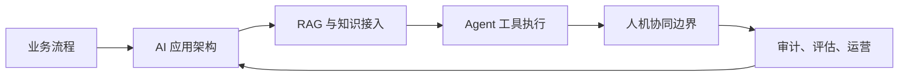
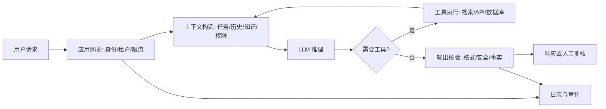
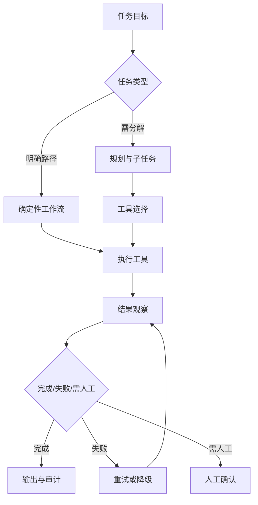
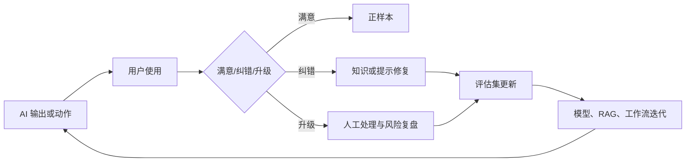

# 第九章 AI 原生 FDE

AI 原生不是把聊天框嵌入现有系统，也不是让模型替代所有业务判断。对 FDE 而言，AI 原生意味着把模型、知识、工具、权限、审计和人类决策重新组织成可交付、可运行、可治理的现场系统。企业客户通常不缺概念验证，真正稀缺的是能接入真实流程、经得住安全审查、在成本和延迟约束内稳定运行，并能在组织边界中被持续改进的 AI 应用。

本章讨论 FDE 在企业 AI 落地中的核心工作。首先识别真实瓶颈：数据可用性、流程嵌入、权限边界、评估体系和运营责任，往往比模型选择更决定成败。随后拆解 LLM 应用架构，说明提示词、模型网关、工具调用、上下文管理、评估和观测如何形成工程闭环。第三部分进入 RAG 与企业知识接入，强调检索质量、权限过滤、引用、更新和审计。第四部分讨论 Agent 工作流，区分确定性编排、半自主代理和多代理协作；多代理只在 peer agent 信任边界、每个代理的工具权限、handoff schema、仲裁规则和 trace 隔离都可审计时进入生产设计。最后回到人机协同：哪些动作必须保留人工确认，哪些判断可以自动化，哪些责任不能交给模型。

OpenAI 在 [agents 工具发布说明](https://openai.com/index/new-tools-for-building-agents/)中将 agents 描述为代表用户独立完成任务的系统，并在 Responses API、内置工具、Agents SDK 和 tracing 上强化了生产化能力；Anthropic 在 [building effective agents](https://www.anthropic.com/engineering/building-effective-agents) 中强调成功实现通常来自简单、可组合的模式，而不是过早采用复杂框架。安全边界方面，提示注入、敏感信息泄露、过度代理和供应链风险会改变传统应用安全边界，这类风险可参考 [OWASP LLM Top 10](https://owasp.org/www-project-top-10-for-large-language-model-applications/)。FDE 的价值，是把这些模型能力和风险控制翻译为现场可执行的工程设计。

读完本章，读者应能判断一个企业 AI 项目是否只是演示，还是已经具备生产条件：是否知道要解决哪类流程瓶颈，是否有可测试的架构，是否能把企业知识安全接入模型，是否能控制 Agent 的动作范围，是否能让人类在正确位置承担责任。

## 1. 企业 AI 落地的真实瓶颈

### 1.1 瓶颈通常不在模型本身

企业 AI 项目失败，常被归因于“模型不够聪明”，但 FDE 在现场看到的根因往往更朴素：业务问题没有被收敛，知识源不可用，权限边界没有建模，评估样本缺失，流程入口不稳定，责任人也不清楚。模型能力提升会降低原型门槛，却不会自动解决组织、数据和运营问题。Microsoft 在 [Responsible AI 的企业就绪性指南](https://learn.microsoft.com/en-us/startups/build/enterprise-readiness/responsible-ai)中，把企业就绪性放在可靠性、安全、成本、运营、性能和治理的组合中讨论，这一点对 FDE 很关键：AI 系统不是一次 API 调用，而是一套长期运行的业务能力。

AI 落地首先要问“它改变哪个决策或动作”。客服助手如果只回答政策，不连接工单、权限和升级流程，就只能降低检索成本；销售助手如果不能读取最新合同、产品限制和客户上下文，就会制造新的核对负担；运维 Agent 如果没有明确授权和回滚机制，就会把自动化风险放大。FDE 应从高频、低歧义、可验证的场景切入，把价值闭环压缩到可观察的指标中，例如平均处理时间、一次解决率、人工复核量、错误更正率和升级时延。

| 瓶颈 | 表面症状 | FDE 应做的工程动作 |
| --- | --- | --- |
| 问题不聚焦 | 演示很强，生产无入口 | 定义流程、角色、输入、输出和成功指标 |
| 知识不可用 | 回答泛化、引用缺失 | 建立知识目录、同步机制和来源可信度 |
| 权限未建模 | 模型看到不该看的数据 | 检索前鉴权、字段级过滤、审计记录 |
| 缺少评估 | 只能凭感觉说效果好 | 建黄金集、离线评测、线上反馈闭环 |
| 责任不清 | 出错后无人接管 | 明确人工确认点、回退路径和 SLA |

### 1.2 贯穿案例：用 Agent 处理企业售后工单

本章后续以“企业售后工单 Agent”作为贯穿案例。现状流程通常是：客户通过门户、邮件、电话或聊天窗口提交问题；一线客服先判断产品、客户等级、合同 SLA 和问题类别；再到 CRM、工单系统、知识库、产品文档、历史缺陷、订单和日志平台中查找线索；能解决的直接回复客户，不能解决的转给客户成功、技术支持、法务或研发。这个流程的瓶颈不是客服不会写回复，而是上下文分散、权限复杂、升级标准不稳定、复核成本高。

该 Agent 的数据源包括工单正文、客户主数据、合同和 SLA 条款、知识库文章、产品发布说明、已知问题列表、历史工单、客户沟通记录、订单状态和可脱敏的运行日志。用户角色至少包括客户、一线客服、客户成功经理、技术支持工程师、法务、产品经理和研发值班人员；同一条工单在不同角色眼中可见的信息不同，后续 RAG 和工具调用必须继承这个权限边界。

目标指标不应只看“回答是否像人”。更可靠的指标包括首次响应时间、平均解决时间、一次解决率、错误分流率、引用覆盖率、人工复核通过率、升级时延、SLA 违约率、客户满意度、每单处理成本和高风险动作拦截率。第一阶段可以让 Agent 做分类、摘要、相似案例检索、回复草稿、升级建议和证据整理；只有在评估稳定后，才逐步开放低风险写入。

不能自动化的动作要提前写清楚。Agent 不应自动承诺赔偿、修改合同条款、关闭高价值客户工单、发布安全公告、删除客户数据、变更生产配置、触发退款、绕过 SLA 或代表法务给出正式法律结论。它可以准备材料、提出建议和生成待审批草稿，但这些动作必须保留人工确认，必要时要求双人确认。

### 1.3 从用例组合判断可生产性

判断一个 AI 用例是否值得进入生产，不应只看回答质量，还要看三条曲线。第一是风险曲线：错误输出会造成建议偏差、数据泄露、误操作还是合规事故。第二是验证曲线：结果能否用事实、规则、测试或人工抽样确认。第三是集成曲线：它是否必须穿透多个系统、审批链和权限域。三条曲线同时很高时，先做辅助决策而不是自动执行；风险低、验证强、集成浅的场景，才适合快速自动化。

OWASP 在 [LLM Top 10](https://owasp.org/www-project-top-10-for-large-language-model-applications/)中把提示注入、敏感信息泄露、过度代理等列为 LLM 应用的重要风险，说明 AI 原生系统的失败模式已经超出传统 Web 表单。FDE 的交付物因此不只是模型配置，还应包括用例分级、数据处理说明、评估集、权限矩阵、运行看板、人工兜底流程和事故复盘模板。只有这些材料存在，客户团队才有能力在 FDE 离场后继续扩展，而不是停留在供应商维护的演示系统中。

### 1.4 用小闭环替代大愿景

AI 战略可以宏大，第一批生产场景必须很小。一个好的切入点通常满足四个条件：数据源明确、用户群体明确、结果可核验、错误可恢复。FDE 应把“端到端自动化”拆成检索、草拟、校验、建议、执行、审计几个阶段，先让模型承担草拟和归纳，再逐步把确定性强的动作交给工具。每一步都要留下对照组和指标，否则团队无法分辨是真正节省了时间，还是把工作转移到了复核环节。

## 2. LLM 应用架构

### 2.1 从单次调用到应用系统

LLM 应用架构的核心，不是“选择哪个模型”，而是把不确定的语言模型放进可控制的软件系统。一个生产应用至少包含入口层、上下文构造、模型调用、工具执行、输出校验、评估观测和审计留痕。入口层处理用户、租户、权限和速率限制；上下文层决定给模型看什么；模型层处理推理和生成；工具层把模型意图转成数据库查询、搜索、工单或业务动作；校验层检查格式、权限、事实和安全；观测层记录延迟、成本、错误、命中来源和用户反馈。

新建代理与工具调用应用可优先采用 [OpenAI 的 Responses API](https://developers.openai.com/api/docs/guides/migrate-to-responses)；Chat Completions 仍是受支持接口，适合已有简单对话链路继续运行。Responses API 工具能力可按四类管理：内置检索工具（如 web search、file search）、执行工具（如 code interpreter、computer use、image generation）、外部系统连接（如 remote MCP server）和自定义函数。具体可用性取决于模型、账号权限、区域和安全策略；生产系统不应把某个工具默认为永久可用。它还与 Agents SDK、Evals 和 tracing 集成。提示工程也应先定义成功标准，再设计角色、上下文和示例，这一点可参考 [Anthropic 的提示工程文档](https://platform.claude.com/docs/en/build-with-claude/prompt-engineering/overview)。FDE 在客户现场应避免把提示词当作唯一架构，把 prompt、检索、函数 schema、策略、评测和日志一并纳入版本控制。

### 2.2 上下文是新的运行时资源

传统应用主要管理 CPU、内存、连接池和数据库事务；LLM 应用还要管理上下文窗口、token 成本、检索片段、会话历史和提示注入风险。上下文不是越多越好。过长的上下文会增加成本和延迟，也会把无关信息、旧政策或恶意指令带入模型。FDE 应把上下文构造视为一个可测试模块：输入是什么、过滤规则是什么、片段如何排序、是否包含来源、是否符合当前用户权限、超出预算时如何降级。

生产架构中还需要模型网关。模型网关不只是转发请求，而是统一处理模型选择、降级、重试、超时、缓存、成本标签、敏感数据处理和供应商切换。对高风险场景，网关应支持不同模型或规则的交叉检查：一个模型生成，另一个模型或确定性规则做判定；结构化输出必须按 schema 校验，不能让业务系统直接执行自然语言。这样做会增加工程量，但可以把模型的不确定性隔离在受控边界内。

确定性策略控制面应在模型之外执行。身份、租户、字段权限、工具白名单、动作审批、成本预算、输出 schema 和合规拒绝原因，都应由普通软件组件或策略引擎计算并记录；模型可以提出建议和参数，但不能自己决定是否有权读取、写入、发送或删除。

生产架构控制面清单应至少覆盖以下内容：

| 控制面 | 售后工单 Agent 中的要求 |
| --- | --- |
| 模型网关 | 按任务类型选择模型，统一限流、超时、重试、缓存、供应商切换和敏感字段处理 |
| prompt 版本 | 分类、摘要、回复草稿、升级建议分别版本化，记录发布人、发布时间、适用场景和回滚版本 |
| 工具 schema | 工单查询、客户查询、知识检索、回复草稿、升级单创建都要定义参数、返回结构、错误码和权限条件 |
| 上下文预算 | 区分系统指令、用户问题、历史工单、RAG 片段和工具结果的 token 配额，超限时按可信度和时效性裁剪 |
| 审计字段 | 记录用户、租户、工单 ID、模型版本、prompt 版本、检索片段、工具参数、人工确认人和最终动作 |
| 数据留存 | 明确 Responses 是否使用有状态会话、是否设置 `store: false`、是否适用 ZDR、file/vector store 是否按供应商资源保留到显式删除以及删除后的清除窗口、reasoning item 是否回传或加密、审计日志保留到哪里；例如 OpenAI 的[数据控制说明](https://developers.openai.com/api/docs/guides/your-data)将 vector store 列为非 ZDR，并说明相关对象在 API 或控制台删除后仍需 30 天从服务器清除 |
| 成本/延迟预算 | 为一次分类、一次检索回答、一次升级建议设置费用和 P95 延迟上限，超过预算时降级到模板或人工队列 |
| 降级路径 | 模型不可用时保留规则分类、关键词检索、人工分派和只读知识库入口；工具失败时不得伪造执行结果 |

工具接入也要按风险分层。web search、file search 和只读数据库查询通常属于证据增强，但仍可能带来外部内容注入、数据外发、索引留存和引用误导；code interpreter、image generation 和批量文档处理会引入执行环境、文件和版权边界；remote MCP server、业务 API 和 computer use 则可能触达真实系统。以 OpenAI Responses API 为例，live `web_search` 与 `external_web_access: false` 的 offline/cache-only 模式有不同的 HIPAA/BAA、ZDR 和外部访问边界，preview 形态也可能忽略该参数，不能把“web search”笼统标成同一合规能力。FDE 应把每个工具按副作用、数据外发、留存边界、运行沙箱、审批模式和不可信内容处理方式标注为只读、草稿、需人工确认或可自动执行，并在发布门禁中记录工具版本、scope、审批人、禁止动作和回滚路径。Remote MCP 接入应限制 `allowed_tools`，用 `require_approval` 控制敏感工具；如使用 OAuth，再限制 token scope。敏感动作默认人工批准，MCP 返回内容按不可信数据处理。

### 2.3 模型选型矩阵

模型选型不是“选最强的那个”，而是按任务的推理深度、工具调用密度、上下文长度、区域合规和成本/延迟预算落点匹配。模型清单属于高漂移事实，不应在书稿中长期固定为“某一代模型族”。现场应把模型选型做成版本化记录：状态（GA/preview/弃用）、模型 ID、上下文窗口、工具支持、区域/数据驻留、价格口径、默认留存、ZDR 支持、供应商 SLA、回退模型和禁止使用场景。

| 选型维度 | 必填记录 | 现场判断 |
| --- | --- | --- |
| 模型状态 | 官方模型 ID、GA/preview、发布日期和弃用说明 | preview 模型不得默认承载高风险写动作 |
| 接入路径 | 直连 API、AWS Bedrock、Google Agent Platform、Microsoft Foundry、私有部署等 | 同一模型在不同通道下的工具、审计、留存、支持和区域能力可能不同 |
| 能力边界 | 推理、工具调用、多模态、上下文窗口、结构化输出 | 按任务切分，不用单一模型覆盖所有场景 |
| 合规边界 | 区域、数据驻留、默认存储、ZDR、日志保留 | 合规优先时先筛区域和留存，再比质量 |
| 成本延迟 | 输入/输出/推理/缓存 token、批处理、工具另计 | 用 trace 实测，不用公开价估全链路成本 |
| 回退路径 | 降级模型、只读模式、人工队列、缓存答案 | 强模型失败时系统仍能安全响应 |

现场选型建议：高风险写动作和复杂多步 Agent 优先用强推理模型，分类、抽取、路由用低延迟/低成本模型，长文档/长会话场景按上下文长度和引用质量而不是“总分”挑模型；数据合规要求严的场景优先评估区域部署或开权重本地部署，但要预留至少一个质量基线模型和可解释的回退路径。若客户通过云平台采购或调用同一模型，还要把云账号归属、IAM / Bedrock / Agent Platform / Foundry 控制、区域与数据驻留、GovCloud / 商用区差异、配额、支持路径、功能缺口和切换回退纳入接管证据。

### 2.4 评估与观测要先于规模化

没有评估的 LLM 应用无法稳定改进。OpenAI 在[评估最佳实践](https://developers.openai.com/api/docs/guides/evaluation-best-practices)中强调，eval 应围绕生产任务设计，用样本和指标测试模型在真实环境中的表现。FDE 应至少准备三类评估：离线黄金集，用于比较模型、提示词和检索策略；上线前红队集，用于覆盖提示注入、越权、敏感信息和误操作；线上反馈集，用于把用户修改、人工拒绝和事故样本回流到测试集中。观测指标也要超出“请求成功率”，包括 token 成本、工具调用失败率、检索无结果率、引用覆盖率、人工接管率和高风险拒答率。

在售后工单 Agent 中，eval 不能只评回复文本，还要评分类、检索证据、工具参数、升级判断和拒答行为。红队样本应覆盖客户伪造身份、邮件正文提示注入、跨客户数据索取、诱导承诺赔偿、要求绕过 SLA、引用过期政策和伪造日志等路径。线上回放要保留输入、上下文构造、检索命中、工具调用、模型输出、人工修改和最终结果，确保每次事故都能复现到同一控制面版本；进入回放库前，应沿用第 10 章和第 12 章的 trace 治理，把原文替换为证据 ID、内容 hash、脱敏片段或受控快照，并记录敏感级别、访问范围、保留期和删除责任。

平台化工具正在把构建、连接、评估和追踪收敛到同一控制面，这也体现了生产 Agent 需要工作流版本、数据连接治理、交互界面和 trace 级评估。这里先说明 LLM 应用的控制面；更详细的 eval 设计、红队方法、回放数据集和发布门禁，详见 [§10.2 提示、检索与工具调用评测](../10_llmops/10.2_eval.md)，该节将其作为独立质量体系展开。

> **API 选型注意**：OpenAI Assistants API 已于 2025-08-26 弃用、2026-08-26 完全下线，弃用公告给出的推荐替代是 Responses API **与 Conversations API** 两者，迁移路径见[官方迁移指南](https://developers.openai.com/api/docs/assistants/migration)。Responses API 于 2025-03-11 发布时公开的内置工具包括 web search、file search 和 computer use，Code Interpreter 当时仍属于 Assistants parity 路线；按当前 Responses 文档，code interpreter、remote MCP 等也已进入 Responses 工具体系。既有 Assistants 集成应规划迁移路径，并在每次上线前按官方文档复核工具可用性。

## 3. RAG 与企业知识接入

### 3.1 RAG 是知识接入模式，不是万能补丁

RAG 的基本思想，是在生成前先检索外部知识，再把相关事实提供给模型。Lewis 等人在 2020 年的 [Retrieval-Augmented Generation 论文](https://arxiv.org/abs/2005.11401)中把参数化模型与非参数化外部记忆结合，用于知识密集型任务。企业采用 RAG，主要是为了让模型连接最新政策、产品文档、合同条款、工单记录、数据字典和操作手册，而不是依赖训练时记住的知识。类似地，grounding 也可被理解为将模型输出连接到可验证信息源，以降低虚构内容并提供可审计来源；这一口径可参考 [Google Gemini Enterprise Agent Platform grounding 文档](https://docs.cloud.google.com/gemini-enterprise-agent-platform/models/grounding/overview)。

但 RAG 不能自动保证正确。检索不到、切分错误、权限过滤缺失、旧文档优先、相似度误判、引用不完整，都会让模型生成看似可信的错误答案。FDE 要把 RAG 当成数据产品来建设：知识源有所有者，文档有生命周期，索引有刷新策略，片段有来源和版本，答案有引用，用户有反馈入口，监控能发现命中率和质量退化。

| 环节 | 关键设计 | 常见失败 |
| --- | --- | --- |
| 采集 | 数据源、所有者、刷新频率 | 把临时文档当正式知识 |
| 清洗 | 去重、格式化、权限标签 | 页眉页脚和旧版本污染索引 |
| 切分 | 按语义、标题、表格边界切块 | 固定长度切断关键条件 |
| 检索 | 向量、关键词、混合检索、重排 | 相似但不相关内容排在前面 |
| 生成 | 引用、拒答、结构化输出 | 没依据也强行回答 |
| 反馈 | 用户纠错、低分样本回流 | 质量问题无法复现 |

RAG 数据产品还需要一份索引契约。契约至少写清 source owner、source of truth、ACL 映射字段、索引版本、刷新 SLA、阻断级过期阈值、紧急下架路径、冲突文档的裁决 owner 和回滚方式。没有这些字段，RAG 只是一次检索工程，无法解释“为什么这个用户在这个时间看到了这份证据”。

### 3.2 企业知识首先要过权限边界

企业 RAG 与公开网页问答最大的不同，是检索结果本身可能包含敏感信息。模型不能先拿到全量片段再“承诺不泄露”，而应在检索前或检索时就执行访问控制。用户是谁、属于哪个租户、拥有哪些项目、能看哪些字段、是否允许跨区域处理、是否允许下载原文，都应进入检索策略。

OpenAI 的 [file search 工具](https://developers.openai.com/api/docs/guides/tools-file-search)是 Responses API 的内置工具之一：vector store 由文件检索/向量库接口管理，Responses 请求中再挂载 `file_search` 与 `vector_store_ids`，并可用 metadata filters 或按场景拆分 vector store 控制召回范围。Google 的 [Grounding with Agent Search](https://docs.cloud.google.com/gemini-enterprise-agent-platform/models/grounding/grounding-with-vertex-ai-search)（原 Grounding with Vertex AI Search）也强调可以把模型连接到网站数据或文档集合。

这些能力不自动等于企业权限治理。企业用户组和角色过滤仍需应用侧通过元数据过滤、独立索引或检索前鉴权保证，不能假设工具自动理解客户 ACL。托管 file/vector store 通常也是应用资源，生产设计必须写清保留、删除、数据驻留和 ZDR 适用性；以 OpenAI 的[数据控制说明](https://developers.openai.com/api/docs/guides/your-data)为例，`/v1/vector_stores` 不属于 ZDR 端点，对象未删除时会持续保留，删除后仍需 30 天才从服务器清除。若客户要求严格留存、本地证据控制或即时删除证明，应优先评估客户自管检索链路。FDE 应在这些能力之上补齐企业侧的数据分级、租户隔离和审计要求。

RAG 权限设计至少包括三层。第一层是数据源接入权限，决定哪些系统可以被索引。第二层是索引权限，决定片段携带哪些 ACL、标签和保留策略。第三层是查询权限，决定当前用户能检索哪些片段，并把命中的文档 ID、版本、权限规则写入日志。不要把“向量库里没有用户信息”误认为安全，因为片段文本本身可能泄露客户、员工、合同或安全配置。ACL 映射缺失、授权过期、角色无法解析、策略服务超时或 source owner 不明时，检索层应 fail closed，并把 `deny_reason`、`policy_version`、`index_version`、`principal`、`tenant` 和 `requested_scope` 写入 trace 与审计日志；日志中只记录被拒绝 chunk 的 ID、版本和策略原因，不记录被拒绝的原文内容。系统不能退化为“先检索再让模型判断能不能说”。

在售后工单 Agent 中，同一个问题“客户 A 能否获得高级支持和赔偿？”对不同角色应返回不同证据。销售可以看到客户购买版本、续约阶段、公开服务包和可销售的支持权益，但不能看到法务谈判底稿。法务可以看到合同条款、责任限制、历史赔偿审批和争议邮件，但不应看到与本判断无关的销售预测。客户成功可以看到 SLA、健康度、历史工单、升级记录和可执行的安抚方案，但不应看到内部研发安全缺陷细节。答案相似不代表证据相同；权限化 RAG 的重点，是让每个角色只基于自己可见的片段作答。

权限过滤有四个取舍。pre-filter 在检索前按租户、角色、项目、地区和密级过滤，安全性最好，但可能因为过滤过窄导致召回不足。post-filter 在检索后剔除不可见片段，便于复用索引和重排，但只适用于应用自管检索链路：模型绝不能看到被剔除内容，也要记录剔除原因；如果使用托管 file search 并由供应商工具直接把检索内容提供给模型，权限必须在 `filters`、`vector_store_ids` 或独立 vector store 层提前收窄，不能等模型拿到片段后再过滤。ACL 标签要写到片段元数据中，例如 `tenant_id`、`customer_id`、`role_allowlist`、`data_class`、`region`、`expires_at` 和 `source_system`，否则后续审计无法解释为什么某个用户看到了某个证据。引用缺失时要拒答或降级：可以回答“当前可见材料不足以确认赔偿资格”，并提示需要法务或客户成功补充授权材料；不能为了流畅而用无引用内容补全结论。

### 3.3 检索质量度量

RAG 质量不能用一个总分概括，应分别度量检索层和生成层。下列指标在 FDE 现场是最小必备集，缺一项就难以定位“是检索没找到，还是模型没用上”。

| 指标 | 度量对象 | 简要定义 | 易失效场景 |
| --- | --- | --- | --- |
| Recall@k | 检索 | top-k 中是否包含至少一份正确证据 | 多份正确证据时只看是否命中一条，会掩盖覆盖度问题 |
| MRR（Mean Reciprocal Rank） | 检索/排序 | 第一份正确证据的倒数排名平均 | 只关心第一条；对需要多源交叉的问题失真 |
| nDCG@k | 检索/排序 | 按相关度加权的排序质量 | 需要分级相关度标注，二值标注下退化 |
| Faithfulness（忠实度） | 生成 | 答案陈述是否都能在给定证据中找到支撑 | 证据冲突或证据外常识时易误判 |
| Context Precision（Ragas） | 生成-检索接口 | 进入上下文的片段中真正相关的比例 | 噪声片段被模型忽略时仍记为低分 |
| Context Recall（Ragas） | 生成-检索接口 | 回答所需事实在上下文中的覆盖比例 | 需要参考答案分解为事实点，标注成本高 |

实践上，离线评测应同时跑“检索指标 + 生成指标”：Recall@k/MRR 退化先于答案错误暴露，Faithfulness 退化通常意味着 prompt 或模型问题而非检索问题。生产日常 triage 可先看无结果率、越权过滤数、引用覆盖率、旧索引命中和人工纠错率；Context Recall 这类需要事实点拆解的指标更适合离线诊断和发布候选门禁，不宜被误写成每次请求都要实时计算的指标。

### 3.4 质量来自检索、引用和评估闭环

RAG 质量评估不能只看最终回答。FDE 应拆成检索评估和生成评估：检索看 top-k 是否包含正确证据、是否有无关片段、是否命中最新版本；生成看答案是否忠于证据、是否标注来源、是否在证据不足时拒答。AWS 在 [Grounding and RAG](https://docs.aws.amazon.com/prescriptive-guidance/latest/agentic-ai-serverless/grounding-and-rag.html)中把 RAG 视为让生成式 AI 适合客户和员工场景的基础策略，强调事实化和合规。落地时，这意味着答案必须能追溯到材料，而不是只追溯到模型。好的 RAG 系统会承认“不知道”，会提示缺失材料，会把错误引用变成待修复知识任务。

## 4. Agent 工作流

### 4.1 Agent 的本质是受控行动

Agent 不是更长的提示词，而是能围绕目标规划步骤、调用工具、读取结果并继续推进的系统。它的价值在于把语言理解、推理和工具执行连接起来，例如查找资料、生成变更、创建工单、更新记录、发送通知或触发审批。OpenAI 在 [agents 工具发布说明](https://openai.com/index/new-tools-for-building-agents/)中把 agents 定义为代表用户独立完成任务的系统，并提供内置工具、SDK 和 tracing 来支持构建；Anthropic 在 [building effective agents](https://www.anthropic.com/engineering/building-effective-agents) 中区分 workflow 与 agent，建议优先使用简单、可组合的模式，例如 routing、parallelization、orchestrator-workers 和 evaluator-optimizer。

FDE 要把“自主”翻译成可治理的行动范围。一个 Agent 必须知道目标、可用工具、输入输出格式、失败重试策略、权限边界、停止条件和人工接管点。没有这些边界，Agent 会从助手变成不可预测的自动化脚本。现场最稳妥的路线，是先用确定性工作流包住模型：业务系统决定步骤，模型负责分类、摘要、草拟和参数生成；当评估证明稳定后，再允许模型在有限工具集合中选择下一步。

Agent 工作流可以看作第 7 章运营应用动作层在 AI 场景下的扩展：它不能绕开数据产品契约、质量门、语义口径、动作权限和回写审计。

### 4.2 售后工单 Agent 状态机

售后工单 Agent 不应被实现成“循环调用模型直到满意”，而应有显式状态机。下面是一条可生产的最小路径：

| 状态 | 输入 | 允许动作 | 转移条件 |
| --- | --- | --- | --- |
| 计划 | 工单正文、用户身份、客户 ID、当前 SLA | 生成任务计划，列出需要证据、可能工具和风险等级 | 计划完整后进入工具选择；缺少关键身份或客户信息则终止并要求补充 |
| 工具选择 | 计划、权限、预算、工具白名单 | 选择只读检索、客户查询、历史工单查询或草稿生成工具 | 工具在权限和预算内则执行；高风险写入进入人工确认 |
| 执行 | 工具 schema、参数、调用人权限 | 调用工具并记录参数、版本、超时和错误码 | 成功进入观察；失败进入重试或降级 |
| 观察 | 工具结果、引用、错误信息 | 判断证据是否足够、是否冲突、是否需要更多检索 | 证据足够进入草稿或确认；证据冲突进入人工确认；证据不足且可重试则返回工具选择 |
| 重试 | 失败原因、剩余预算、幂等键 | 调整查询、换检索策略、切换模型或降级模板 | 超过重试上限、费用上限或 SLA 上限则转人工队列 |
| 人工确认 | 草稿、证据、风险标记、建议动作 | 让授权人员批准、修改或拒绝 | 批准后执行写入；拒绝后回滚或终止；要求双人确认时等待第二人 |
| 回滚 | 已执行动作、补偿动作、审计记录 | 撤回草稿、取消升级单、恢复工单状态、通知责任人 | 回滚成功后终止；回滚失败则升级事故 |
| 终止条件 | 完成结果或失败原因 | 输出答案、创建任务或进入人工队列 | 必须记录最终状态、原因、证据引用和后续责任人 |

工具也要按权限等级标注，不能把所有函数都暴露成同一类“可调用能力”。

| 工具等级 | 示例工具 | 控制要求 |
| --- | --- | --- |
| 只读 | 搜索知识库、读取工单、查询客户 SLA、检索历史案例、读取可脱敏日志 | 只允许当前用户可见数据；结果必须带来源、版本和 ACL 命中记录 |
| 可写 | 创建内部备注、生成回复草稿、创建升级单、更新工单标签、追加待办 | 需要幂等键、schema 校验、字段级权限、失败补偿和人工可见审计 |
| 双人确认 | 发送正式赔偿承诺、关闭高价值客户工单、触发退款、修改 SLA 例外、发布安全或法律声明 | 第一审批人确认业务合理性，第二审批人确认权限和风险；未完成确认时 Agent 只能保留草稿 |

工具等级应与统一动作分类对齐：`read` 只读查询，`draft` 生成草稿但不触达外部系统，`stage` 创建待确认变更，`commit` 执行可补偿写入，`irreversible` 触发删除、资金、权限、法律承诺或外部发送。工具注册表至少记录工具 owner、环境、side effect、数据外发、允许主体、必需审批、幂等键、补偿动作和禁用条件；没有注册表的函数不应暴露给 Agent。

状态机的价值，是让“Agent 为什么这样做”可以被复盘。每一次状态转移都要记录触发条件、模型输出、工具参数、观察结果、人工决定和预算消耗；否则事故发生后只能猜测模型意图，无法定位是检索、prompt、工具 schema、权限还是人工流程出了问题。

每个状态还应有可执行契约：owner、进入阈值、退出阈值、契约测试、风险接受人、回滚或补偿动作，以及触发复审的条件。例如“人工确认”状态的 owner 是客户授权角色，退出阈值是审批记录完整且幂等键有效，契约测试覆盖未确认不得写入，复审触发包括写工具 schema 变更、审批规则变更和任一越权样本失败。

### 4.3 工作流模式比框架更重要

企业场景中，Agent 工作流可以按控制强度分层。路由型适合把请求分给不同专家链路，例如政策问答、技术支持和账务查询。编排-执行型适合复杂任务，由一个 orchestrator 拆分子任务，再交给专门工具或子代理。评估-优化型适合文档、代码、分析报告等可反复改进的产物。并行型适合多来源搜索和交叉核验。完全开放的自主 Agent 只适合低风险、隔离且可重置的沙盒；监控只是补偿控制，不能把高影响工具变成可随意自动执行的能力。

| 模式 | 适用场景 | 控制重点 |
| --- | --- | --- |
| Routing | 请求类别清晰、处理链路不同 | 分类准确率、错路由回退 |
| Parallelization | 多来源搜索、交叉核验、独立子任务可并发 | 结果一致性、部分失败处理、成本上限 |
| Sequential workflow | 审批、采集、生成、校验顺序固定 | 状态机、幂等、超时 |
| Orchestrator-workers | 多文件修改、多来源研究、复杂分析 | 子任务边界、结果合并 |
| Evaluator-optimizer | 写作、代码、策略建议 | 评估标准、迭代上限 |
| Autonomous agent | 探索性任务、低风险环境 | 工具白名单、预算、人工接管 |

### 4.4 多 Agent 进入生产的条件

多个 Agent 并行或互相委托时，生产门槛高于单 Agent。每个子 Agent 必须有独立身份、工具范围、预算、输出契约和停止条件；调度 Agent 只能分配任务和汇总结果，不能继承所有子 Agent 的工具权限。跨 Agent 消息按不可信输入处理，必须带来源、任务 ID、证据引用和完整性标记；任一子 Agent 触发权限拒绝、预算耗尽、循环或高风险动作时，整体工作流应降级到人工确认，而不是让另一个 Agent 继续尝试。

### 4.5 Agent 失败模式名录

生产 Agent 的故障模式可枚举，远比“模型说错话”具体。下表整理 FDE 现场最常遇到的 8 类失败，每类都应在 trace、评测和运行手册中各有对应检测项。

| 失败模式 | 现场表现 | 检测信号 | 缓解动作 |
| --- | --- | --- | --- |
| 循环 / loop | 同一工具或同一查询反复调用，无新增证据 | 步骤数超阈值；相邻 N 步参数高度重复；连续步骤无新增证据 | 步数/预算上限；重复参数熔断；强制反思后切换策略或转人工 |
| Tool flailing | 多个工具乱序尝试，参数不收敛 | 工具调用序列熵高；连续失败率高；选错工具占比上升 | 收窄工具白名单；引入 router 子模型；要求模型先输出计划再执行 |
| Indirect prompt injection | 工具/检索返回内容内嵌指令，劫持 Agent | 输出与原任务发散；检测到工具输出包含 system/role 字样或 URL；执行了未在计划中的写动作 | 所有 web、file、RAG 和工具返回都按 tainted data 处理；关键词只作启发式信号，仍需语义策略检查、分离指令通道、输出 schema 校验和对抗样本 |
| Context overflow | 上下文接近窗口上限，旧约束被挤出 | input_tokens 接近上限；系统约束遗忘；引用断裂 | 摘要/裁剪策略；分段会话；关键约束钉在 system 段；超限降级 |
| 过早终止 | 任务未完成即输出最终答案 | trace 中关键步骤缺失；引用为空；评测 completeness 低 | 终止条件显式化；要求自检 checklist；evaluator-optimizer 模式 |
| 伪造工具调用结果 | 模型在文本中“描述”调用了工具但未真正调用 | trace 中无对应 tool span；输出含 ID/时间戳但系统无记录 | 强制结构化工具调用；禁止纯文本声明执行；事后核对 tool span |
| 上下文中毒 | 历史错误结论或脏数据进入后续轮次 | 同一会话错误率随轮次累积；引用反复指向同一可疑文档 | 会话隔离；可信片段标记；定期重置；坏样本回流到回归集 |
| 工具混淆 | 同名/相似工具选错（如 read vs write、stage vs prod） | 工具调用与意图分类不一致；环境标签不匹配；权限拒绝率升高 | 工具命名加环境前缀；schema 描述强化；选错触发阻断或人工复核，确认后才允许继续执行 |

每个失败模式都应在第 10 章的评测集、红队和回归门禁中至少有一条负例，并在第 12 章的运行手册中至少有一条对应告警和处置步骤。

### 4.6 工具调用必须按最小权限设计

Agent 的风险集中在工具层。模型说错话通常是内容风险；模型调用错工具，可能变成业务风险、数据风险或资金风险。过度代理、提示注入和敏感信息泄露等 [OWASP LLM Top 10](https://owasp.org/www-project-top-10-for-large-language-model-applications/) 风险，都会在 Agent 场景中放大。FDE 应把每个工具定义为最小权限接口：只暴露必要参数，只允许当前用户可执行的动作，高影响动作必须二次确认，外部内容不能直接变成系统指令，工具结果要标记来源和可信度。

生产 Agent 还需要状态和预算控制。状态记录当前目标、已执行步骤、工具结果、失败原因和人工决策；预算限制 token、时间、工具次数、费用和重试次数。所有动作都要可重放：谁发起、模型看到什么上下文、为什么选择工具、调用了什么参数、返回什么结果、最终如何交付。没有 trace 的 Agent 无法调试，也无法通过企业审计。

## 5. 人机协同与操作边界

### 5.1 人类不应只做兜底按钮

人机协同的目标，不是把人放在流程末尾为模型错误背锅，而是让人类在最能创造价值的位置参与：定义目标、提供上下文、处理例外、确认高风险动作、反馈质量、承担组织责任。AI 擅长生成候选项、总结材料、发现相似模式、草拟文档和调用工具；人类擅长判断目标是否合理、风险是否可接受、例外是否需要破坏常规、责任是否可以承担。FDE 的设计任务，是把这些能力分工变成界面、权限、状态机和审计记录。

Microsoft 的 [Responsible AI](https://learn.microsoft.com/en-us/startups/build/enterprise-readiness/responsible-ai) 对透明、问责和监督的要求，Google [grounding 文档](https://docs.cloud.google.com/gemini-enterprise-agent-platform/models/grounding/overview)对可验证来源的要求，以及 [OWASP LLM Top 10](https://owasp.org/www-project-top-10-for-large-language-model-applications/)对错误信息、不可验证输出和过度代理的提醒，共同指向同一个结论：模型建议必须可解释，关键动作必须可确认，责任链必须可追溯。

| 决策类型 | 可自动化程度 | 人类角色 |
| --- | --- | --- |
| 低风险摘要 | 高 | 抽样校验、纠错反馈 |
| 标准流程分类 | 中高 | 处理低置信度和争议样本 |
| 对外发送内容 | 中 | 审阅语气、事实和合规要求 |
| 数据修改 | 中低 | 确认范围、回滚方案和影响 |
| 资金、权限、删除 | 低 | 明确批准、双人复核、事后审计 |

### 5.2 操作边界要写进系统，而不是写进培训

很多团队把 AI 风险控制写在用户培训里：不要输入敏感信息，不要完全相信答案，不要让模型执行危险动作。培训必要，但不足以构成控制。真正的边界应写进系统：输入端做数据分类和脱敏；检索端做权限过滤；模型端做工具白名单和结构化输出；执行端做审批、幂等和回滚；审计端记录上下文、证据和责任人。边界越靠近系统，越不依赖个人记忆。

FDE 应把操作划分为建议、草拟、待确认执行、自动执行四级。建议级只影响认知，例如“这些订单可能延期”；草拟级生成可编辑产物，例如邮件、SQL、变更单；待确认执行级允许模型填好参数，但必须由授权用户确认；自动执行级只允许低风险、可逆、规则明确的动作。每一级都要有默认拒绝策略：证据不足不回答，权限不足不检索，风险过高不执行，状态不一致不提交。

人工确认不是点一个“同意”按钮。确认界面必须展示确定性生成的 payload、目标对象、差异、权限主体、证据引用、风险标签、回滚或补偿方式、幂等键和过期时间；审批记录绑定 payload hash，而不是绑定模型摘要。这样才能证明人确认的是实际将执行的动作，而不是确认了一段可能遗漏关键信息的自然语言说明。

凡是用户反馈、工单、截图、日志和模型 trace 会进入改进闭环，都要先写数据契约：敏感级别、脱敏/最小化规则、访问范围、保留期、删除责任人、样本可否跨客户复用、以及退出训练或评测集的流程。否则“反馈闭环”会变成无人负责的影子数据资产。

### 5.3 反馈闭环决定长期质量

AI 系统上线后，质量会随业务变化而漂移。政策更新、产品变更、组织调整、数据源迁移、模型版本升级，都可能让原本正确的回答变错。人机协同必须包含反馈机制：用户能标记错误、补充正确答案、指出缺失来源、撤销或升级操作；运营团队能把反馈转化为知识修复、评估样本和流程改进。反馈不应只进入聊天记录，而应进入产品待办和模型评估。

最终边界应能够被一句话检验：当模型出错时，系统是否限制了损害、保留了证据、让合适的人接管，并把教训反馈到下一轮设计。如果答案是否定的，就还不是可生产的人机协同。
