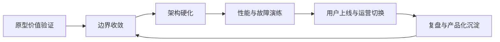
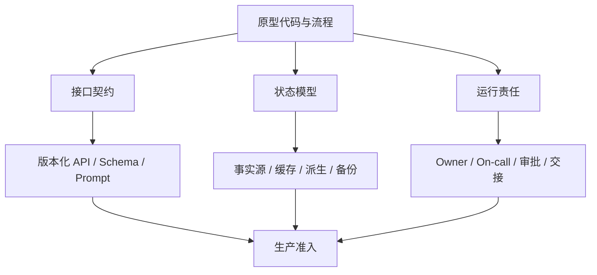
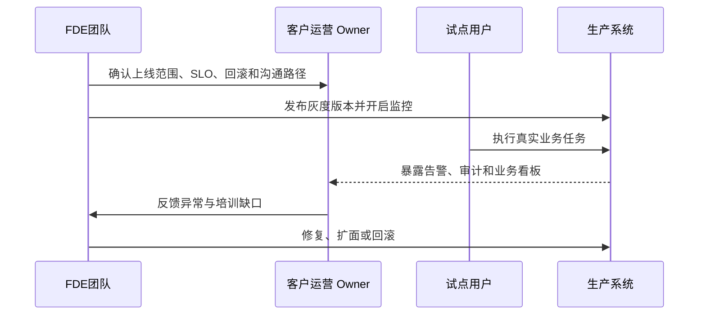

# 第十一章 从原型到生产系统

原型证明的是“这件事可能有价值”，生产系统证明的是“这件事可以被组织持续依赖”。FDE 在客户现场推进项目时，最危险的误判不是原型失败，而是原型成功后没有及时收紧边界：临时账号继续存在，手工脚本进入关键路径，模型提示词没有版本，数据回填没有审计，性能指标只在演示样本上成立，值班、回滚和客户运营切换无人负责。

本章讨论从原型到生产的工程化迁移。Google SRE 在 [Service Level Objectives](https://sre.google/sre-book/service-level-objectives/) 中强调，必须先理解用户真正关心的服务行为，再定义 SLI、SLO 和错误预算；DORA 的 [软件交付性能指标](https://dora.dev/guides/dora-metrics/) 则把变更吞吐与不稳定性放在同一张仪表盘上。对 FDE 而言，这两类思想必须合并：既要让系统能快，又要让系统在真实组织中可恢复、可解释、可交接。

本章不把“上线”视为终点，而把它视为责任转移的开始。读者应能识别原型的可丢弃部分与可产品化部分，建立生产准入清单，设计架构硬化路径，定义性能、伸缩和故障模式，完成用户上线与运营切换，并把项目经验沉淀为下一次交付可复用的平台资产。

## 1. 原型的目标与边界

### 1.1 原型只回答最小风险问题

原型不是生产系统的幼年形态，而是用最小成本回答最大不确定性。FDE 做原型前应先写清楚问题：是验证业务流程可被数字化，验证数据足以支撑决策，验证模型能处理现场语言，还是验证用户愿意改变工作方式。不同问题决定不同取舍。若目标是验证调度规则，界面可以粗糙；若目标是验证一线人员采用率，交互路径就不能省略；若目标是验证安全审批可行性，权限、审计和数据留存必须提前出现。

定义指标应从用户关心的行为出发，而不是先度量容易采集的信号，这一点可参考 [Google SRE](https://sre.google/sre-book/service-level-objectives/) 对 SLO 的论述。原型阶段同样适用：成功标准不应是“演示跑通”，而应是一个可判定的学习结果。例如“调度员能在十分钟内完成异常订单重排”“模型输出被业务专家接受的比例超过约定阈值”“关键数据缺口被定位到具体系统和责任人”。这些标准要能产生继续、暂停、缩小范围或重做架构的决策。

| 原型类型 | 主要问题 | 必须保留的证据 | 不应提前投入 |
| --- | --- | --- | --- |
| 业务流程原型 | 用户是否采用 | 任务完成率、访谈记录、例外路径 | 大规模重构后台 |
| 数据可行性原型 | 数据是否足够可信 | 字段血缘、缺失率、样本错误 | 完整数据平台 |
| AI 能力原型 | 模型是否能辅助决策 | 评测集、失败样例、人工判分 | 自动化闭环执行 |
| 集成原型 | 系统能否互通 | API 契约、延迟、权限阻塞 | 复杂缓存和伸缩 |

### 1.2 边界要比功能更早收紧

原型最常见的债务不是代码丑，而是边界模糊。临时 CSV 是否可以继续作为数据源，人工修补是否属于流程，模型建议是否允许直接写回生产系统，失败时由谁接手，这些问题若没有在原型验收时回答，后续硬化会变成不断补洞。Palantir Foundry 的 [Ontology system](https://www.palantir.com/docs/foundry/architecture-center/ontology-system) 将数据、逻辑、动作和安全放在同一模型中讨论，给 FDE 一个重要提示：生产边界必须同时覆盖“看到什么”“算出什么”“能做什么”和“谁负责”。

原型验收应输出三份清单。第一是保留清单：哪些能力已经被证据证明，值得进入生产路线。第二是丢弃清单：哪些脚本、提示词、样例数据、人工操作只服务演示，必须删除或隔离。第三是风险清单：哪些假设还没有被验证，但若进入生产会影响客户承诺。只有当这三份清单存在，团队才知道下一步是硬化、重写、还是继续探索。

### 1.3 贯穿案例：用 AI 重排异常订单

假设一个制造客户希望用 AI 辅助处理异常订单：供应延迟、产线故障、急单插入或运输窗口变化后，系统给调度员生成重排建议，并在审批后写回排产系统。原型阶段不应承诺“自动排产”，而应验证四个最小风险问题。第一，异常订单能否被现有数据及时识别。第二，模型能否把订单、产能、约束和客户优先级解释成调度员能审阅的建议。第三，建议是否减少调度员查找信息和比较方案的时间。第四，人工审批链路是否能接受“AI 建议、人员确认、系统写回”的责任边界。

原型可以使用一次性脚本快速学习，但这些脚本不能默认进入生产。应丢弃或隔离的内容包括：手工拼接 CSV 的 notebook、为单次演示写死客户名称和产线编号的规则、只覆盖三五个样例的提示词调试脚本、绕过权限系统的本地回放工具、需要 FDE 手动复制结果到排产系统的操作步骤。它们的价值是帮助团队定位业务语义，不是成为生产链路的一部分。

真正应保留的是数据契约和决策证据。异常订单重排至少需要稳定定义 `Order`、`CapacitySlot`、`ExceptionEvent`、`ReplanProposal` 和 `ApprovalDecision`：每个对象的主键、时间戳、事实源、允许为空字段、审计字段和下游写回语义都要写清楚。模型提示词可以重写，界面可以重做，但“哪些字段构成异常”“哪些约束不能被突破”“谁批准了哪条建议”必须从原型开始沉淀为契约。

进入上线前，团队要把原型学习结果拆成四类生产准入目标，而不是只说“模型效果不错”。服务 SLO 关注异常事件进入系统后是否在约定时间内生成可审阅建议、建议页在关键业务时段是否可用。AI 质量门禁关注评测回归、不可执行建议比例、权限与安全负例、高风险写回审批和人工接管路径。成本预算关注每笔异常处理的 token、工具调用和人工复核成本。业务 KPI 关注异常订单平均处理时长、人工改写比例、准时交付或客户承诺违约是否改善，以及调度员能否在没有 FDE 陪跑时完成处理。

## 2. 架构硬化与可维护性

### 2.1 硬化从接口、状态和责任开始

架构硬化不是把原型代码“加固一下”，而是把系统改造成可被多人维护、可被事故流程接管、可被客户审计的工程资产。第一步是拆清接口：外部系统调用什么 API，批处理读取哪些表，模型工具能访问哪些动作，人工操作在哪里进入链路。第二步是拆清状态：哪些数据是事实源，哪些是缓存，哪些是派生结果，哪些可以重算，哪些必须备份。第三步是拆清责任：谁拥有服务，谁拥有数据契约，谁拥有模型评测，谁批准高风险变更。

Microsoft Cloud Adoption Framework 在 [Ready your Azure cloud operations](https://learn.microsoft.com/en-us/azure/cloud-adoption-framework/manage/ready-cloud-operations) 中把运营准备拆为部署标准化、可靠性要求、监控、保护等能力，并要求按工作负载优先级定义 SLO、RPO、RTO。FDE 可以把这类框架转化为生产准入门禁：没有 SLO 不上线，没有恢复目标不接关键流程，没有审计字段不允许写回，没有回滚方案不开放全量用户。

### 2.2 可维护性要体现在变更成本

可维护性不是代码风格问题，而是每次变更需要多少人、多少上下文和多少风险。生产系统应把易变部分显式版本化：配置、提示词、特征定义、数据契约、权限策略、告警阈值和发布计划都应进入可追溯流程。Google SRE 的 [Service Level Objectives](https://sre.google/sre-book/service-level-objectives/) 强调用错误预算平衡可靠性和创新速度；同书的 [Production Services Best Practices](https://sre.google/sre-book/service-best-practices/) 则强调配置校验、退化设计和依赖控制等生产实践。对现场团队而言，这意味着维护性要通过机制体现：小批量变更、自动化检查、灰度发布、可观测性、清晰的回滚路径和事后复盘。

硬化时要避免两种极端。一种是把原型全盘重写，导致已验证的业务知识丢失；另一种是把临时实现原封不动搬进生产，导致隐性债务绑定客户流程。更稳妥的做法是保留经过验证的业务语义，重做不可运营的技术边界。判断标准很简单：新成员能否在不问原作者的情况下定位入口、理解数据流、运行测试、解释告警、回滚变更。如果不能，系统还没有真正硬化。

### 2.3 生产准入门禁

生产准入门禁的作用不是制造流程负担，而是在系统进入客户真实工作前阻止不可运营的风险。门禁应由 FDE、平台团队和客户 Owner 共同确认，并且每一项都能指向具体证据，而不是口头承诺。

每个门禁项都应有相同的证据格式：owner、通过阈值、验证证据、契约测试、回滚边界、风险接受人和复审触发。复审触发包括扩大用户范围、增加写动作、替换模型/数据源、权限策略变化、事故复盘行动项到期，以及任一关键回归样本失败。

原型到生产可以拆成五个连续门禁：Prototype Exit 确认可保留能力、丢弃物和未验证假设；Hardening Ready 确认接口、状态、Owner、测试和审计边界；Pilot Ready 确认 SLO、容量、回滚、人工兜底和观察窗口；Production Ready 确认真实用户、真实数据、真实写动作和客户 Owner 接管能力；Handover Ready 确认运行手册、告警处理、权限流程、复盘行动项和遗留债务都有明确 owner。任何阶段未通过时，只能停留在当前范围或降级到只读/内部使用。

允许带入生产的债务必须显式接受，而不是默认为“以后再修”。每一项债务至少记录：债务描述、用户影响、为什么不阻塞当前上线、补偿控制、风险接受人、到期日期、复审触发和清除条件。没有 owner、没有到期日、无法解释用户影响或缺少补偿控制的债务，不应进入生产范围。

| 门禁项 | 准入要求 | 未满足时的处理 |
| --- | --- | --- |
| Owner | 服务 Owner、数据 Owner、客户业务 Owner、升级路径明确 | 不允许进入无人值守生产 |
| SLO | 可用性、端到端延迟、数据新鲜度、关键动作成功率有目标和测量方式 | 只能继续试点或内部使用 |
| RPO/RTO | 明确可接受数据丢失窗口和恢复时间，备份与恢复步骤已验证 | 不接入关键业务写回 |
| 审计字段 | 写回、审批、模型建议、人工覆盖都记录操作者、时间、输入、输出和原因 | 禁止执行高风险动作 |
| 权限边界 | 用户、角色、模型工具、服务账号的读写范围最小化并可审计 | 不开放真实数据或写权限 |
| 回滚演练 | 发布回滚、配置回滚、模型版本回滚和数据修正路径至少演练一次 | 不扩大用户范围 |
| 数据契约 | 输入输出 schema、事实源、字段语义、兼容策略和质量检查已版本化 | 不允许下游依赖 |
| 模型评测集 | 覆盖常见、边界和失败样例；评测口径、人工判分和回归阈值明确 | 不允许模型建议影响生产写动作 |
| 告警手册 | 告警含义、用户影响、排查步骤、降级动作、沟通模板和恢复验证齐全 | 不进入非 FDE 值守时段 |

AI 系统在通用门禁之上还有额外准入项。任一项缺失都不应承担有副作用的自动化动作。

| AI 专属门禁项 | 准入要求 | 未满足时的处理 |
| --- | --- | --- |
| 评测集覆盖业务关键场景 | 黄金集、负例、安全样本对核心任务有显式覆盖，阈值经业务 Owner 认可 | 仅允许只读建议，不进入写动作 |
| Prompt/检索/工具版本化 | prompt、检索语料/索引、工具 schema 三者均有版本号并写入 trace | 不允许发布候选 |
| 模型供应商账户隔离 | 生产、预发、研发使用不同 API key/项目；密钥可独立轮换与撤销 | 不接入真实客户数据 |
| PII 脱敏策略 | 输入、上下文、日志、trace 的 PII 字段级脱敏规则与保留周期已写入设计 | 不允许跨租户或对外共享 trace |
| 模型服务 SLO / 供应商 SLA 与回退路径 | 内部模型服务有 SLO，供应商 SLA 与限流边界已确认，主模型故障时有备选模型或规则降级路径，并演练过一次 | 关键流程不上线 |
| Token 预算上限 | 单请求/单租户/单功能均有 token 与费用上限，超限熔断或降级 | 不开放对外流量 |
| 人工干预率上限 | 设定人工改写、退回、转人工队列等告警阈值，超过即触发评估和扩面暂停 | 不扩大用户范围 |
| 高风险工具/写动作审批 | 写库、发邮件、付款、改权限等动作有审批、幂等键、补偿动作和审计字段 | 写动作降级为草稿或只读建议 |
| 提示注入/越权负例 | 覆盖提示注入、跨租户、越权工具、政策冲突和敏感数据泄露样本 | 阻断发布或限制到内部租户 |
| 红队回归 | OWASP LLM Top 10、OWASP Agentic Applications 2026、MITRE ATLAS 等高风险样本进入回归集，模型、提示、工具变更后必跑；该组合是本书建议的生产门禁口径 | 不允许扩大流量 |

门禁不是一次性文档。每次扩大用户、增加写回动作、替换模型、改变数据源或调整权限，都应重新检查受影响项。若团队无法说明某次变更触碰了哪些门禁，说明系统的生产边界还没有被真正建模。

## 3. 性能、伸缩与故障模式

### 3.1 性能指标必须贴近用户体验

性能不是压测报告里的最大 QPS，而是用户在关键任务中感受到的等待、阻塞和失败。Google SRE 在 [SLI/SLO](https://sre.google/sre-book/service-level-objectives/) 章节中指出，延迟、错误率、吞吐和可用性是常见指标，但平均值会掩盖长尾；P95、P99 等分位数更能暴露真实体验。FDE 系统还要额外关注端到端业务延迟：数据进入系统到可决策的时间，模型建议生成到人工确认的时间，写回动作到下游系统可见的时间。

伸缩设计要从瓶颈假设开始，而不是从“加机器”开始。批处理瓶颈可能在数据抽取窗口，交互式应用瓶颈可能在权限过滤或前端聚合，AI 应用瓶颈可能在上下文构造、模型限流、工具调用串行化或人工审批。每个瓶颈都应有触发阈值、扩容动作和降级策略。基于 OpenAI [企业数据使用说明](https://openai.com/business-data/)这类供应商控制面，本书建议在企业 AI 场景中把数据边界、审计和权限约束视为性能优化的硬前提；绕过这些约束得到的“更快路径”只是把风险隐藏到生产链路里。

容量计划应作为上线门禁的一部分，而不是压测后的附录。最小字段包括：基线负载、峰值假设、关键业务时段、每层容量上限、供应商限流/配额、队列深度、并发上限、成本上限、扩容 lead time、降级顺序和停止接收新任务的阈值。AI 链路还要单独列出 token/请求预算、工具调用并发、人工审批吞吐和影子运行额外负载。

| 层面 | 关键指标 | 常见瓶颈 | 降级方式 |
| --- | --- | --- | --- |
| 前端体验 | 页面可用时间、交互延迟 | 大查询、同步渲染 | 分页、预聚合、只读模式 |
| API 服务 | P95/P99、错误率、吞吐 | 连接池、锁、下游超时 | 限流、缓存、熔断 |
| 数据链路 | 新鲜度、积压、重跑时间 | 抽取窗口、坏数据 | 跳过非关键源、延迟标记 |
| AI 链路 | 评测分、响应时长、成本 | 上下文过长、模型限流 | 小模型、模板化、人工接管 |

### 3.2 故障模式要先于事故被命名

没有被命名的故障，很难被监控、演练和复盘。FDE 应在上线前列出关键故障模式：数据源不可用、权限系统异常、模型输出低置信、下游写回失败、队列积压、缓存污染、区域网络中断、第三方 API 限流、发布后指标恶化。Google SRE 的 [Practical Alerting](https://sre.google/sre-book/practical-alerting/) 强调监控既要支持高层服务目标告警，也要保留足够粒度用于排查。告警因此不应只盯 CPU 和内存，而要绑定用户影响和业务动作。

故障演练的目标不是证明团队聪明，而是降低真实事故中的认知负荷。每个高风险模式都应有检测信号、用户影响、自动动作、人工步骤、沟通模板和恢复验证。若某个故障只能靠原作者手工修复，说明它还不是生产能力。规模化的本质，是系统在压力、失败和人员轮换下仍保持可解释的行为。

### 3.3 AI 链路的生产保护栏

AI 系统进入生产后，故障不只来自服务不可用，也来自输出质量、调用成本、限流、长尾延迟和人工信任变化。模型调用应被当作受限下游依赖来管理：每个场景设置请求速率、并发数、重试上限和排队策略；达到限流时优先保护关键工作流，低优先级任务进入延迟队列或模板化降级，而不是让所有用户一起等待。

成本预算也要进入运行指标。团队应按业务对象核算成本，例如每笔异常订单、每次客户对话、每个审批建议的模型和工具调用成本。预算不是简单压低 token，而是让系统知道何时使用强模型、何时使用小模型、何时复用已有结果、何时停止自动尝试并交给人工。没有预算边界的 AI 功能，很容易在试点用户增加后变成不可解释的运营支出。

缓存策略要区分可缓存内容和不可缓存责任。稳定的政策说明、产品目录、产线能力、历史说明可以缓存；用户权限过滤后的结果、临近实时库存、审批状态和带个人敏感信息的上下文不能随意跨用户复用。缓存命中率、缓存年龄和缓存污染恢复步骤都应被监控，否则缓存会把“快”变成“错得更稳定”。

长尾延迟需要单独设计。AI 链路通常包含检索、上下文组装、模型调用、工具执行、校验和人工审批，平均响应时间无法说明最差体验。系统应记录每一段耗时，设置 P95/P99 目标，并为慢请求提供可见状态：正在检索、正在生成、等待审批、下游写回中。用户可以接受合理等待，但不能接受不知道系统是否还活着。

评测回归是 AI 生产的版本门禁。每次改提示词、模型、检索源、工具 schema 或安全策略，都要跑固定评测集，比较正确性、可执行性、拒答率、幻觉样例、权限违规和成本变化。若评测下降超过阈值，发布应暂停；若业务必须上线，应记录例外批准和补偿措施。

人工接管阈值必须清楚。低置信输出、约束冲突、高金额订单、关键客户、重复失败、权限不确定、模型超时和下游写回失败，都应触发人工确认或转入人工队列。好的 AI 生产系统不是永远自动化，而是知道什么时候停止自动化，并把足够上下文交给负责的人。

## 4. 用户上线与运营切换

### 4.1 上线是行为迁移，不只是流量切换

用户上线的难点通常不在发布按钮，而在工作方式迁移。原型阶段，用户会容忍人工解释、临时入口和 FDE 现场陪跑；生产阶段，系统必须进入客户的日常节奏：谁每天打开它，谁处理异常，谁批准动作，谁接收告警，谁在系统不可用时执行替代流程。上线计划应按用户群、业务时段、数据范围和动作风险分批推进，而不是用“全量开放”证明信心。

上线计划还要写清切换与共存策略。若新旧流程需要并行，必须定义共存窗口、哪一边是事实源、哪些动作允许双写、如何对账、谁处理冲突、何时回滚、何时关闭旧入口。没有对账和停用标准的“并行运行”会把迁移风险延长成长期运营成本。

Google SRE 的[发布协调清单](https://sre.google/sre-book/launch-checklist/)强调发布前协调、依赖确认、监控和分阶段发布；回退优先、配置校验和依赖控制等生产实践还可参考 Google SRE 的 [Production Services Best Practices](https://sre.google/sre-book/service-best-practices/)。DORA 的[软件交付性能指标](https://dora.dev/guides/dora-metrics/)也提醒团队同时观察吞吐和不稳定性：部署频率、变更前置时间、失败部署恢复时间、变更失败率和部署返工率。FDE 上线时应把这些工程指标与业务指标并排看：用户是否真的完成任务，人工兜底是否减少，异常是否更早暴露，客户运营团队是否能独立处理常见问题。

### 4.2 运营切换要有接管标准

生产交接不能只交代码仓库和部署文档，还要交“如何运行”。Microsoft CAF 的运营准备要求覆盖监控、保护、部署和可靠性能力；Palantir AI FDE 关于[安全与治理](https://www.palantir.com/docs/foundry/ai-fde/security-and-governance)的文档也强调敏感操作需要用户批准，所有活动应受权限、治理和审计约束。对 FDE 项目而言，接管包至少包括运行手册、告警看板、升级联系人、权限申请流程、回滚权限、演练记录、开放风险和客户 Owner 签收。接管标准应确认：客户 Owner 已明确，值班或支持路径已确认，关键告警有处理手册，权限申请有流程，数据异常有归属，发布与回滚由客户或平台团队可执行。

上线后应设置观察窗口，至少覆盖一个完整业务周期；“低风险场景一到两周”是本书建议的案例假设，高风险场景应按结算、排产、审计或监管周期确定。窗口内不要急于扩功能，而要验证运营事实：哪些告警噪声过高，哪些用户绕回旧流程，哪些异常需要 FDE 解释，哪些指标无法被客户理解。只有当系统能被客户组织独立运行，FDE 才算完成运营切换；否则只是把一个成功演示搬到了生产环境。

运营切换还需要明确沟通节奏。本书建议上线当天关注是否可用，第一周关注异常和采用，第一月关注价值指标和维护负担；实际节奏应由客户业务周期和风险等级决定。每个阶段都应有固定复盘：保留什么、修正什么、停止什么、何时扩大范围。若没有这种节奏，客户容易把所有问题继续抛给 FDE，团队也难以判断系统是已经稳定，还是只是靠现场陪跑维持运行。

责任转移应在上线计划中写成 RACI。FDE 负责发布候选证据、灰度观察和知识转移；平台/SRE 负责部署、监控、回滚执行和运行权限；客户 Owner 负责业务验收、扩面批准、人工兜底和日常运营；业务或合规批准人负责风险接受。回滚矩阵还要写清触发条件、决策 owner、执行人、最长决策时间、补偿/重放动作、沟通口径和恢复验证。

### 4.3 灰度上线示例：让异常订单重排逐步上线

AI 异常订单重排系统的灰度不应从“所有订单、所有调度员、自动写回”开始。更稳妥的灰度范围是：一个区域、两到三条产线、少量高频异常类型、固定调度班组、只读建议加人工审批写回。灰度用户必须是真实承担业务结果的人，而不是只参加演示的管理者；否则上线验证的是观感，不是运营能力。

观察窗口至少覆盖一个完整业务节奏，例如一个排产周期或一个结算周期。窗口内应同时看四类指标：工程指标包括可用性、P95/P99 延迟、错误率、限流次数和写回成功率；AI 指标包括建议可执行率、人工改写率、低置信触发率和评测回归结果；业务指标包括异常处理时长、延期风险变化、人工协调次数和客户承诺影响；运营指标包括告警噪声、手册命中率、客户 Owner 独立处理比例和培训缺口。

扩面、暂停和回滚条件要在灰度前写清楚。若 SLO 连续达标、关键告警可被客户 Owner 处理、人工改写率下降、没有未解释的权限或审计缺口，可以扩大到更多产线或异常类型。若长尾延迟恶化、模型不可执行建议集中出现、成本超过预算、用户绕回旧流程、告警需要 FDE 才能解释，应暂停扩面并修复。若写回错误、权限越界、审计缺失、数据契约破坏或客户承诺受到实质影响，应立即回滚到只读建议或关闭写回。

### 4.4 影子运行与 champion-challenger

模型或提示词切换时，灰度之外还应叠加影子运行（shadow mode）或 champion-challenger 评估。影子运行让新模型/新 prompt 与真实流量并行执行，但输出仅写入 trace 和影子评测看板，不进入用户结果；champion-challenger 则在小流量上让 challenger 替代 champion 的部分响应，与 champion 的关键业务指标按相同口径对比。影子 trace 也必须带数据契约：敏感级别、脱敏/最小化、访问角色、保留期、删除责任人，以及是否允许进入回放/评测集。

最小流程：覆盖一个完整业务周期或预设观察窗口的影子运行 → 对齐影子评测指标（可审核通过率、证据忠实度（Faithfulness）、人工改写率、成本、延迟）→ 与 champion 基线对比并达到预先写入发布门禁的阈值 → 在受控灰度范围切换 challenger 为 champion，保留旧 champion 至少一个回滚周期。任何关键指标低于基线、出现新失败模式或客户 Owner 反馈异常，应停止切换并将样本回流到回归集。

champion-challenger 不能只比较模型分数。切换前还要固定流量分配、用户/租户隔离、写动作权限、停止条件、回滚 owner 和冷却期。若 challenger 影响生产写回，必须先通过只读影子评测和人工审批灰度；只有当质量、延迟、成本、人工干预率和业务影响都达到发布门禁，才允许提升为新的 champion。

### 4.5 客户 Owner 接管验收

客户 Owner 接管验收是灰度结束的必要条件。验收不只是签字，而是客户 Owner 能独立完成一次发布检查、解释关键看板、处理一条告警、执行一次回滚演练、批准或拒绝一条 AI 建议，并说明失败时的沟通路径。只有这组动作通过，系统才从 FDE 陪跑进入客户团队独立运营。

## 5. 复盘与产品化沉淀

### 5.1 复盘要寻找系统性改进

复盘不是项目总结会，也不是责任分配会，而是把一次交付中暴露的事实转化为下一次更快、更稳的能力。Google SRE 的 [Postmortem Culture](https://sre.google/sre-book/postmortem-culture/) 强调从失败中学习，关注事实、影响、根因和行动项。FDE 项目即使没有事故，也应该复盘：哪些原型假设被推翻，哪些数据问题反复出现，哪些审批路径拖慢上线，哪些模型失败样例具有代表性，哪些手工步骤应被平台化。

复盘材料要区分三类结论。第一类是项目特有结论，只留在客户交付档案中，例如某个系统接口不稳定。第二类是行业或领域结论，应进入领域知识库，例如制造排产常见的例外订单模型。第三类是平台结论，应进入产品路线，例如通用权限模板、数据质量检查器、评测集管理、灰度发布模块和运营看板。若所有经验都停留在个人记忆里，团队会在下一个客户现场重复支付同样成本。

| 复盘问题 | 证据来源 | 沉淀去向 |
| --- | --- | --- |
| 哪个假设最晚才被验证 | 原型验收、需求变更 | 发现阶段检查清单 |
| 哪类故障最影响上线 | 事故记录、告警历史 | 生产准入门禁 |
| 哪些操作依赖现场 FDE 团队 | 工单、聊天记录、值班记录 | 运营手册与自动化 |
| 哪些能力可跨客户复用 | 代码、模板、评测集 | 平台组件或产品 Backlog |

复盘证据若包含客户反馈、聊天记录、截图、日志或模型 trace，也必须沿用同一套数据契约：敏感级别、脱敏/最小化、访问范围、保留期、删除责任和跨客户复用限制。复盘不应成为绕过生产数据治理的例外通道。

复盘行动项必须进入可跟踪队列，而不是停留在会议纪要。每个行动项至少包含：问题证据、根因假设、修复动作、owner、截止日期、验证方式、状态、复审日期和未完成时的风险接受人。关闭行动项时要附上验证证据；若行动项逾期或验证失败，应回流到生产门禁或开放风险清单。

### 5.2 产品化要保留领域语义

产品化不是把客户代码抽象成一套空泛框架，而是保留被验证的领域语义，同时去掉客户特有噪声。Palantir 在 [AIP architecture](https://www.palantir.com/docs/foundry/architecture-center/aip-architecture) 中将安全治理、自动化、Ontology 和 agent 生命周期放在生产架构中统一描述，说明可复用能力往往来自“业务对象、动作、权限、评测和运营”的组合，而不是单个技术组件。OpenAI 企业资料也反复强调管理、隐私、合规和使用洞察，这些都是 AI 能力规模化时必须产品化的控制面。

产品化评估可以用三问判断。第一，是否有至少两个场景复用了同一语义结构，而不是只复用了代码片段。第二，是否能通过配置、模板或扩展点适配差异，而不需要复制粘贴。第三，是否有测试、文档、Owner 和版本策略支撑长期维护。达不到这三点的沉淀，应先进入内部参考库；达到这三点的能力，才值得进入平台或正式产品。FDE 的长期价值，不只是交付一个系统，而是让每一次现场交付都减少下一次从零开始的部分。

### 5.3 “不可产品化”的反例

不是所有成功交付都值得产品化。一个异常订单重排项目若只在某个客户的特殊组织结构下成立，依赖某位调度专家的隐性经验，规则写死在单一工厂、单一 ERP 字段和单一审批习惯里，即使业务效果很好，也不应急着包装成通用产品。此时产品化会把客户特例伪装成平台能力，让后续项目被错误抽象拖累。

不可产品化的典型信号包括：价值来自一次性数据清洗而不是可复用能力；核心判断无法写成清晰契约，只能由现场专家解释；配置项比代码逻辑还复杂，换一个客户就需要复制一套分支；没有稳定评测集，效果只能靠演示样例证明；安全、权限和审计边界依赖客户内部默契；维护责任无法从原 FDE 转移给平台或客户团队。

面对这类成果，正确做法不是强行产品化，而是分层沉淀。领域观察可以进入案例库，数据问题可以进入发现阶段清单，少量稳定 schema 可以进入模板，失败样例可以进入评测集，无法泛化的客户逻辑则留在交付档案。产品化的克制和产品化本身同样重要：只有当语义、契约、测试、运营和 Owner 都能跨场景成立，沉淀才应该进入正式产品路线。
