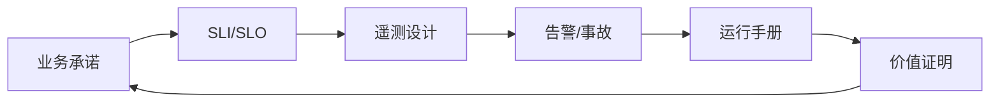
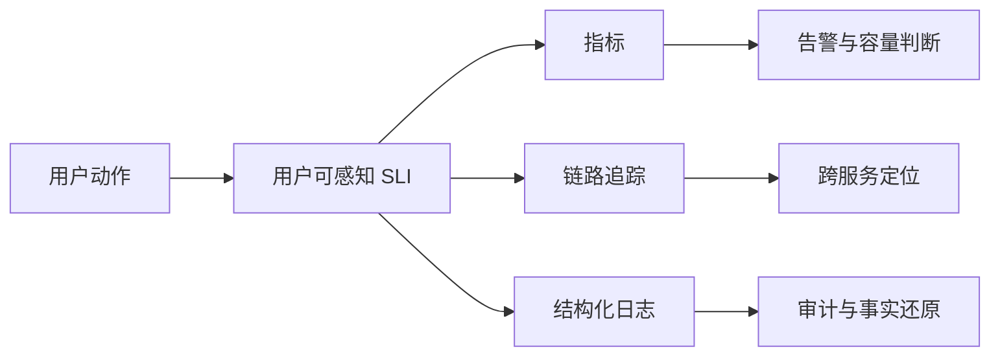
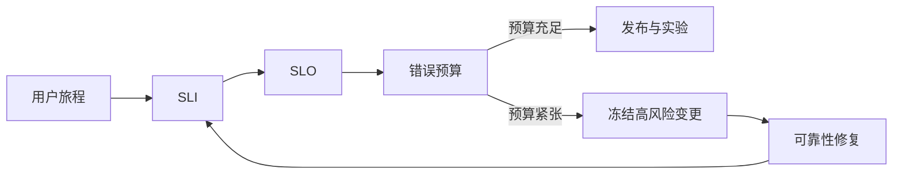
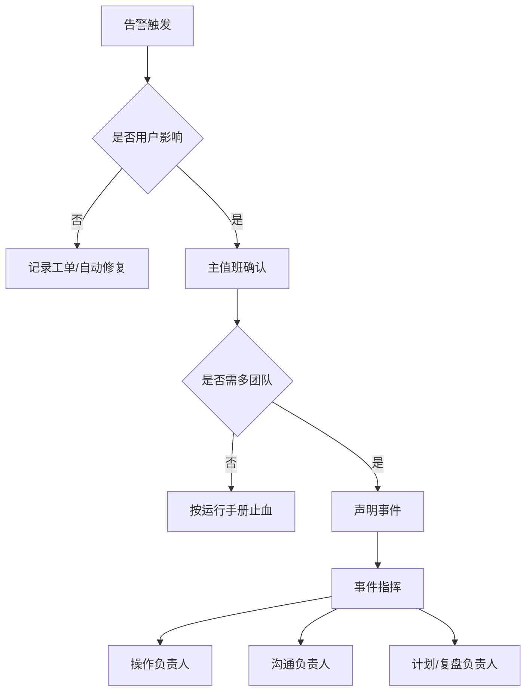
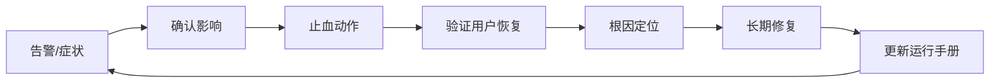
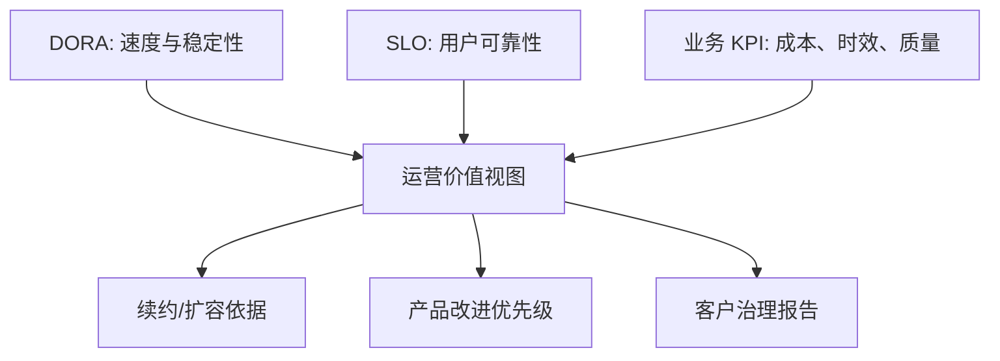

# 第十二章 可观测性与现场运维

FDE 项目进入生产现场后，真正的难点不再是“系统能否部署成功”，而是“系统能否被长期理解、控制和证明价值”。客户现场通常同时存在遗留系统、云服务、第三方接口、人工流程和组织边界。一次失败可能来自代码缺陷，也可能来自数据漂移、容量误判、权限变更、外部依赖、发布窗口或操作失误。没有可观测性，团队只能在事故中猜测；没有运行机制，团队只能靠少数专家记忆维持服务。

可观测性可以建立在指标、日志和链路追踪等遥测信号之上，这一点可参考 [OpenTelemetry](https://opentelemetry.io/docs/concepts/observability-primer/)；可靠性管理则可参考 [Google SRE](https://sre.google/sre-book/service-level-objectives/) 对 SLI、SLO 和错误预算的论述。对 FDE 而言，这些实践的价值不是引入更多工具，而是把“用户是否得到承诺结果”变成可测量、可告警、可复盘、可改进的工程闭环。现场运维的逻辑顺序应始终保持一致：先明确业务承诺，再定义 SLI/SLO，然后设计遥测，基于遥测组织告警和事故响应，把可执行动作固化为运行手册，最后用运营指标证明价值。本章文件顺序先说明遥测问题域，再正式定义 SLO，是为了让读者看到遥测要服务什么问题；工程实施时仍应从业务承诺和 SLO 反推遥测。

本章按这条链路展开：如何从业务承诺提炼 SLI/SLO，如何设计指标、日志、追踪和 Agent/GenAI 观测字段，如何组织告警、值班和事件响应，如何用运行手册降低操作风险，如何把 DORA、SLO 和业务 KPI 转化为客户能接受的价值证明，以及如何把 token 成本与多租户归因纳入同一套观测体系。

## 1. 指标、日志与链路追踪

本章的起点不是工具，而是业务承诺和 SLI/SLO。遥测设计承接这些承诺：每一个需要被证明、告警或复盘的目标，都必须提前设计可采集、可关联、可解释的证据。

### 1.1 先从问题设计遥测

可观测性不是把所有数据都收上来，而是让团队能够回答生产现场最关键的问题：用户是否成功完成业务动作，失败影响了谁，瓶颈在哪一层，最近一次变更是否相关，是否需要回滚或降级。遥测信号可参考 [OpenTelemetry Signals](https://opentelemetry.io/docs/concepts/signals/) 中对 traces、metrics、logs 和 baggage 的组合式定义；其[可观测性入门](https://opentelemetry.io/docs/concepts/observability-primer/)也强调，可靠性要回答“服务是否按用户期望工作”。因此 FDE 项目应从用户旅程和关键业务动作反推遥测，而不是从 CPU、内存、日志量开始堆仪表盘。

### 1.2 三类信号各司其职

指标适合聚合判断，用于可用性、延迟、吞吐、错误率、队列积压、饱和度和业务转化率；日志适合记录离散事实，用于审计、异常上下文、人工操作和不可聚合的诊断细节；链路追踪适合解释一次请求如何穿过网关、服务、数据库、消息队列和外部接口。Grafana 文档把 metrics、logs、traces 和 profiles 称为 observability pillars，并强调信号关联可以从指标点跳转到相关 trace 或日志；日志与追踪关联也可利用 [OpenTelemetry 日志规范](https://opentelemetry.io/docs/specs/otel/logs/)中 LogRecord 携带的 TraceId 和 SpanId。

| 信号 | 回答的问题 | FDE 现场用法 | 常见误用 |
| --- | --- | --- | --- |
| 指标 | 现在是否异常，趋势如何 | SLO、告警、容量、发布观察 | 只看主机指标，不看用户动作 |
| 日志 | 发生了什么，谁做了什么 | 审计、异常上下文、合规证据 | 打印敏感数据，缺少 request_id |
| 追踪 | 请求慢在哪里，跨服务如何传播 | API、数据流、Agent 工具链定位 | 全量采样导致成本失控 |

### 1.3 控制基数、语义和成本

遥测系统最常见的失败，是上线初期看似丰富，几周后因高基数字段、噪声日志和无边界采样而不可维护。指标标签应限制在服务、环境、租户级别、接口、状态码等稳定维度，避免把用户 ID、订单号、完整 URL query 放入标签。日志必须结构化，字段命名要与追踪语义一致，并在源头完成脱敏。追踪要按服务重要性、错误、慢请求和关键交易设置采样策略，保留能支撑排障的证据。现场交付时，应把遥测 schema、保留周期、访问权限和费用上限写入运维设计；否则可观测性会从工程能力变成新的生产风险。

遥测证据还要能回连发布和运营对象：`deployment_id`、`release_candidate`、`feature_flag`、`model_version`、`prompt_version`、`index_version`、`tenant`、`business_process` 和 `slo_id` 应在指标、日志和 trace 之间保持一致。否则团队只能看到“某个指标坏了”，不能回答它和哪次变更、哪个客户流程、哪个模型或哪条 SLO 有关。

### 1.4 Agent/GenAI 要观测行为证据

Agent 和 GenAI 系统的现场风险不只来自接口可用性，还来自输出质量、工具调用路径、上下文漂移和人工接管边界。OpenTelemetry [GenAI 语义约定](https://github.com/open-telemetry/semantic-conventions-genai/blob/main/docs/registry/attributes/gen-ai.md)已覆盖模型调用、token usage、工具执行 span 等信号，其中 `gen_ai.usage.input_tokens`、`gen_ai.usage.output_tokens`、`gen_ai.usage.reasoning.output_tokens`、`gen_ai.usage.cache_read.input_tokens`、`gen_ai.usage.cache_creation.input_tokens` 可用于记录输入、输出、推理和缓存相关 token；语义约定也明确输入输出内容应按配置选择性采集。因此 FDE 项目不要只记录“模型调用成功”，还要让一次自动化建议可以被审计、复现和解释。

| 观测字段 | 用途 | 采集边界 |
| --- | --- | --- |
| 模型版本、提示词版本 | 判断行为变化是否由模型或提示词切换引起 | 记录版本 ID 和哈希，不记录完整敏感提示词 |
| 工具调用链 | 还原 Agent 调用了哪些系统、顺序和结果 | 记录工具名、trace_id、状态码和耗时 |
| 输入 token、输出 token | 分析成本、延迟和上下文长度风险 | 使用供应商返回用量或离线计数 |
| 缓存命中 | 判断性能和成本优化是否生效 | 记录命中状态和缓存 token，不暴露原文 |
| 人工接管 | 衡量自动化边界和风险控制 | 记录接管原因、角色和时间，不记录个人敏感信息 |
| 可审核通过率 | 衡量输出是否能进入业务流程 | 区分“生成成功”和“审核可用” |
| 脱敏边界 | 证明日志、追踪和样本未泄露受保护数据 | 标注敏感级别、字段级脱敏/最小化策略、访问范围、保留周期和删除责任 |

这些字段应进入统一遥测 schema，并与业务 SLI、告警规则和运行手册保持同一套命名。否则事故发生时，团队只能看到模型 API 正常，却无法说明建议为什么变差、影响了哪些审批、该回滚模型还是回滚提示词。

## 2. 服务等级目标

业务承诺只有转化为 SLI/SLO，才能进入工程控制系统。SLO 定义完成后，下一步才是为这些目标设计遥测、告警和事故响应，而不是反过来从已有仪表盘拼指标。

### 2.1 SLO 是可靠性的产品语言

FDE 项目常被要求“稳定”“快”“不要出问题”，但这些描述无法指导工程取舍。Google SRE 在[服务等级目标](https://sre.google/sre-book/service-level-objectives/)一章中，将 SLI 定义为对服务水平某方面的定量测量，将 SLO 定义为 SLI 的目标值或目标范围。关键不是追求 100%，而是把用户真正关心的行为写成可计算承诺：请求成功率、端到端延迟、批处理准时完成率、数据新鲜度、自动化动作成功率、人工接管率等。一个好的 SLO 应明确测量窗口、统计口径、数据来源、排除条件和责任边界。人工接管率不是越低越好；高风险流程中，合理接管代表系统守住了自动化边界。

| 服务类型 | 推荐 SLI | 示例 SLO | 不宜作为核心 SLO 的指标 |
| --- | --- | --- | --- |
| 用户接口 | 成功率、P95/P99 延迟 | 30 天内 99.9% 请求成功且 P95 < 300ms | 平均 CPU |
| 数据管道 | 准时率、完整率、新鲜度 | 每日 08:00 前 99% 分区可用 | 单次任务耗时 |
| Agent 工作流 | 任务完成率、人工接管率 | 关键流程 99% 产出可审核通过或可接受结果 | Token 总量 |
| 集成接口 | 依赖可用性、重试成功率 | 第三方失败时 5 分钟内降级 | 单节点存活 |

SLO 定义卡应成为上线交付物，至少包含：用户旅程、SLI 公式、测量窗口、数据来源、排除条件、服务 owner、业务 owner、错误预算策略、burn-rate 告警、关联运行手册和复审节奏。没有这些字段，SLO 只是一个目标数字，无法驱动告警、发布冻结或客户沟通。

一张 SLO 卡还应记录 `slo_id`、关联功能、客户承诺边界、例外审批人、冻结规则、恢复判据和报告对象。对 AI/Agent 流程，必须把“生成成功”和“可审核通过/可接受结果”拆成不同 SLI；否则模型 API 正常会掩盖业务动作质量下降。

### 2.2 错误预算连接速度与风险

SLO 的工程价值来自错误预算。若目标是 30 天 99.9% 可用，则理论错误预算约为 43.2 分钟不可用时间；当预算充足，团队可以加快发布和实验；当预算快速消耗，应暂停高风险变更，优先修复可靠性问题。Google SRE Workbook 的[基于 SLO 告警](https://sre.google/workbook/alerting-on-slos/)进一步用 burn rate 描述错误预算消耗速度，使告警从“指标越线”转向“可靠性目标正在被消耗”。这比单纯盯 5xx 阈值更贴近用户影响，也更适合向客户解释为什么某些发布要延后。

### 2.3 现场 SLO 要避免伪精确

初次进入客户现场时，很多系统没有稳定历史数据，也没有端到端用户视角。此时不要编造精确目标，应先建立基线：过去 30 天成功率是多少，慢请求集中在哪些业务路径，哪些失败来自外部依赖，哪些失败可被降级吸收。SLO 可以先宽后严，但不能含糊。每个 SLO 都应附带仪表盘、告警规则、例外说明和复盘机制。对 FDE 团队尤其重要的是区分服务承诺与业务承诺：系统可用不等于业务结果达成，模型回复成功也不等于任务正确完成。最终 SLO 应服务取舍：是否值得为一个低频后台页面投入高可用架构，是否需要为关键审批链路增加同步降级路径，是否应该把客户依赖方纳入联合演练。

## 3. 告警、值班与事件响应

### 3.1 告警必须指向动作

告警不是监控系统的通知功能，而是把用户风险转交给值班人员的契约。Prometheus 官方说明中，Prometheus 服务器根据告警规则生成 alerts，并由 [Alertmanager](https://prometheus.io/docs/alerting/latest/overview/) 负责去重、分组、静默、抑制和路由。FDE 项目的告警应优先基于 SLO、错误预算消耗和关键业务动作，而不是为每个机器指标设置阈值。一个可唤醒人的告警必须说明影响范围、判断依据、推荐动作、升级路径和静默条件；如果值班人员收到告警后只能继续翻仪表盘猜测，它就是噪声。

| 告警类型 | 适合唤醒 | 推荐处理 | 反例 |
| --- | --- | --- | --- |
| SLO 快速燃烧 | 是 | 立即分级、止血、升级 | 只报 CPU 90% |
| 单实例失败且有冗余 | 否 | 工单或自动修复 | 夜间叫醒 |
| 安全或数据泄露信号 | 是 | 进入安全事件流程 | 普通日志告警 |
| 发布观察窗口退化 | 视影响 | 暂停、回滚、降级 | 发布后无人看 |

### 3.2 值班要有权限、边界和保护

值班不是让最懂系统的人长期背锅，而是组织承诺：有人在明确时间内接收风险，有权限采取止血动作，有机制获得支援。值班手册应写清主值班、备值班、业务联系人、客户联系人、供应商联系人，以及哪些操作可以直接执行、哪些必须审批。Google SRE 在处理 operational load 时强调值班与中断管理需要机制化；现场团队也应限制夜间非紧急噪声，保证轮值可持续。FDE 项目还要特别处理客户现场权限：如果值班人员没有生产访问权、没有降级开关、不能联系网络或数据库团队，所谓 7x24 只是形式。

### 3.3 事件响应先恢复，再复盘

Google 的 [Incident Management Guide](https://sre.google/resources/practices-and-processes/incident-management-guide/) 强调准备、可靠告警、明确 on-call 流程，以及基于 Incident Command System 的协调、沟通和控制。一次事件中，最危险的不是没人努力，而是多人同时无协调地改生产系统。事件流程应明确 Incident Commander、Operations Lead、Communications Lead；操作只从一个通道进入，沟通按节奏更新，状态文档记录时间线、影响、假设、动作和结果。恢复阶段优先止血：回滚、降级、限流、切换、关闭非关键功能。若事件涉及入侵、凭证泄露、数据泄露、合规报告或客户安全承诺，则进入安全事件响应分支：先保护证据和审计日志，限定影响范围，执行遏制、凭证轮换、隔离或下线，并让安全、隐私、法务或合规 owner 确认对外通知和恢复条件；不得为了快速恢复而覆盖取证材料或扩大泄露面。根因分析和长期修复必须在服务恢复后进行，并形成无责复盘、行动项、负责人和到期日。FDE 项目要把复盘交付给客户能理解的事实链，而不是只给内部技术结论。

事件台账是运行证据的一部分，最低字段包括 incident_id、SEV、开始/发现/声明/恢复/关闭时间、影响范围、客户沟通记录、关键动作、执行人、变更关联、数据或权限影响、残余风险、行动项 owner 和到期日。没有台账，事件响应会停留在聊天记录里，无法支撑客户复盘或后续审计。

### 3.4 SEV 分级表

事件分级决定唤醒范围、沟通节奏和复盘要求。FDE 现场应与客户 Owner 在上线前对齐下表，避免事件中临时争议。

| 级别 | 影响范围 | 人员唤醒 | 客户沟通节奏 | 复盘要求 |
| --- | --- | --- | --- | --- |
| SEV-0 | 全站不可用、数据丢失、安全/合规事件、客户承诺被违反 | 全员唤醒，含管理层和安全；安全事件由安全负责人主导 IR 分支 | 立即首报，每 15–30 分钟更新，恢复后正式书面通报 | 强制无责复盘 + 客户级行动项与到期日；安全/合规事件补证据保全、影响范围、通知和补救记录 |
| SEV-1 | 核心业务严重受损或大范围降级；存在升级风险 | 主备值班 + 业务/平台/客户 Owner | 30 分钟首报，每 30–60 分钟更新 | 强制复盘 + 行动项与回归测试 |
| SEV-2 | 核心业务效率受影响但有人工兜底；无数据/越权风险 | 主值班，必要时业务 Owner | 工作时间内通报，按需更新 | 简化复盘 + 至少一条改进项 |
| SEV-3 | 局部噪声、可观察异常、轻微体验影响 | 工单内处理，无需唤醒 | 周报或月报合并通报 | 记录到趋势看板，是否复盘按团队判断 |

### 3.5 事件案例：模型切换后审批建议变差

背景：2025 年 5 月 14 日（周三）10:00，团队将采购审批 Agent 的主模型从 `model-a` 切换到 `model-b`，提示词版本保持 `approval-v17`，目标是降低延迟和 token 成本。发布观察窗口内，技术调用成功率仍为 99.9%，但业务侧“审批建议可审核通过率”从 96% 降到 88%，人工复核退回率明显升高。

| 环节 | 处理内容 |
| --- | --- |
| 告警 | 10:18，`ApprovalRecommendationQualityDrop` 触发：15 分钟窗口内可审核通过率低于 92%，且人工退回率高于基线 2 倍；同一 trace 维度显示异常集中在 `model-b`。 |
| 影响范围 | 影响采购金额大于 5 万元的自动审批建议，约 18% 新建审批单进入人工复核队列；没有自动放行错误，客户最终审批权限未被绕过。 |
| SEV | 定为 SEV-2：核心业务效率受影响并可能扩大，但无数据丢失、无越权审批、无全站不可用。 |
| Incident Commander | 当班 FDE Tech Lead 担任 Incident Commander；Operations Lead 负责回滚和指标验证；Communications Lead 负责客户状态更新。 |
| 首要止血 | 10:24 暂停 `model-b` 全量流量，将高金额审批建议切回 `model-a + approval-v17`；低金额场景继续影子运行 `model-b`，但不进入业务建议结果。 |
| 客户沟通 | 10:30 向客户审批运营负责人发送首次更新：说明影响范围、已采取回退、无自动放行风险、下一次更新时间；后续每 30 分钟同步一次恢复指标。 |
| 恢复验证 | 10:45 外部合成用例通过；11:05 可审核通过率回到 95% 以上并保持 30 分钟；人工复核队列积压清零后，Incident Commander 宣布服务恢复。 |
| 复盘行动项 | 1. 为模型切换增加影子评估门槛：关键金额段通过率不得低于基线 1 个百分点；2. 将模型版本、提示词版本、工具调用链、输入输出 token、缓存命中写入审批建议 trace；3. 在运行手册中补充“模型回退”和“事后评估提示词回退/修订”的分支，事故中不得临时改生产提示词；4. 为客户报告增加“生成成功”和“可审核通过”的分离指标；5. 一周内复核 `model-b` 失败样本，决定是否调整提示词或保留仅影子模式。 |
| 复盘记录 | 事件时间线、指标截图、客户沟通记录和行动项保存到客户约定的 incident 目录，并关联到对应变更单。 |

## 4. 变更风险与运行手册

### 4.1 大多数事故来自变更

现场系统的风险高峰通常出现在发布、配置调整、数据迁移、证书轮换、权限变更、模型切换、依赖升级和容量扩缩时。Google SRE 的[发布工程](https://sre.google/sre-book/release-engineering/)强调自助化、高速度、封闭构建和强工具化，核心原因是规模化发布不能依赖人工记忆。FDE 项目应把每次变更视为受控实验：明确变更目的、影响面、回滚路径、观察指标、审批条件和暂停条件。越靠近客户核心流程，越不能用“只是改个配置”降低标准。

| 变更类型 | 主要风险 | 必要控制 |
| --- | --- | --- |
| 应用发布 | 缺陷放大到真实用户 | 金丝雀、自动回滚、发布观察 |
| 配置变更 | 即时全局生效 | 分环境、审计、版本化 |
| 数据迁移 | 不可逆写入、语义漂移 | 备份、校验、双写对账 |
| 数据产品变更/质量失败 | 契约破坏、质量门阻断、消费者误用 | 契约版本、质量门、血缘影响分析、消费者通知、回滚/重放窗口 |
| 权限调整 | 越权或阻断业务 | 最小权限、到期、复核 |
| 模型/规则切换 | 输出行为变化 | 影子评估、人工抽检、回退 |

### 4.2 运行手册写给压力下的人

运行手册不是知识库文章，而是事故压力下可以执行的操作脚本。它应从症状入口组织：告警名称、用户现象、影响判断、首要止血动作、诊断命令、回滚步骤、升级联系人、验证方式和复盘记录位置。每一步都应可复制、可审计、可撤销；危险动作要标注前置条件和预期结果。Grafana Synthetic Monitoring 在 [checks 文档](https://grafana.com/docs/grafana-cloud/observe-and-act/testing/synthetic-monitoring/create-checks/checks/)中提到检查结果可保存为 Prometheus metrics 和 Loki logs，并用于 Grafana alerting 与 incident management；这类合成检查可以直接成为运行手册中的“外部用户视角验证”。

### 4.3 运行手册模板

每个会唤醒值班人员的告警，都应有一份对应运行手册。模板可以保持统一，但内容必须具体到当前系统、环境和权限边界。

| 字段 | 写法要求 |
| --- | --- |
| 告警名 | 使用监控系统中的精确名称，例如 `ApprovalRecommendationQualityDrop`。 |
| Owner 与复核周期 | 写清手册 owner、备份 owner、最近验证时间、下次复核日期和触发强制复核的变更类型。 |
| 触发条件 | 写清窗口、阈值、维度和排除条件，例如“15 分钟可审核通过率低于 92% 且样本数大于 50”。 |
| 确认命令 | 给出可复制命令、仪表盘链接或查询语句，并说明正常结果长什么样。 |
| 前置条件 | 写清所需权限、环境、特性开关、只读/写入边界、break-glass 是否允许，以及缺少权限时的升级路径。 |
| 首要止血动作 | 优先选择可逆动作，例如暂停流量、关闭开关、降级、限流、切回上一版本。 |
| 回滚步骤 | 写清回滚对象、执行人权限、命令或控制台路径、预期耗时和失败处理。 |
| 验证方式 | 包含内部指标、外部合成检查、业务抽样和客户侧确认口径。 |
| 升级联系人 | 列出主值班、备值班、业务负责人、客户联系人和供应商联系人。 |
| 数据治理 | 写清本手册会查看或保存的截图、日志、trace、工单和客户反馈的敏感级别、脱敏/最小化、访问角色、保留期和删除责任人。 |
| 禁止操作 | 明确事故中不得执行的动作，例如不得直接修改生产数据、不得清空队列、不得关闭审计日志。 |
| 复盘记录位置 | 写清事件时间线、截图、沟通记录、样本和行动项保存位置。 |

如果运行手册包含 break-glass 操作，必须写清授权人、最长有效期、可执行动作、禁止动作、审计字段、事后回收步骤和补普通变更单的时限。break-glass 不是“临时绕过流程”，而是带 TTL、带证据、带复核的受控例外。

运行手册还应包含“何时声明事件”和“何时解除事件”的判定条件。只要需要跨团队协调、存在客户影响或需要客户沟通，就不应停留在个人排障状态。

手册本身也要被治理，不能只在事故后靠记忆更新。每份关键运行手册至少应有以下可验证控制：

1. **静态检查**：CI 或文档检查确认必填字段齐全，链接、仪表盘、查询语句和联系人路径未失效。
2. **演练检查**：按复核周期执行 dry run，记录执行人、环境、失败步骤、修订 commit 和下一次演练日期。
3. **变更联动**：发布、模型切换、权限策略、告警阈值、数据契约或供应商入口变化时，变更单必须声明是否影响运行手册。
4. **权限回放**：用值班角色而非管理员角色验证确认命令、止血动作和回滚步骤，避免事故时才发现权限不足。
5. **证据留存**：演练和真实事件都要回写 trace、告警截图、命令输出摘要、审批记录和客户确认，形成可审计证据包。

### 4.4 手册必须演练和版本化

没有演练的运行手册，通常会在事故中暴露三个问题：命令过期、权限不足、联系人失效。FDE 团队应把运行手册作为交付物版本化，与架构、部署和权限变更同步更新；每次真实事件后，必须把缺失步骤补回手册。关键手册要定期演练，尤其是回滚、灾备切换、密钥轮换、数据恢复和客户通知。演练不是表演成功，而是发现不可执行之处。运行手册还应避免绑定个人经验：如果只有某位专家能理解步骤，说明手册仍未完成。最终目标是让一名合格值班人员在有限上下文下也能安全止血，并把系统交还给后续修复流程。

### 4.5 运行手册示例：审批建议变差时怎么处理

以下示例把 12.3.5 案例（采购审批 Agent 从 `model-a` 切到 `model-b` 后，可审核通过率从 96% 降到 88%）按模板字段端到端填写。

| 字段 | 内容 |
| --- | --- |
| 告警名 | `ApprovalRecommendationQualityDrop` |
| Owner 与复核周期 | Owner：FDE Tech Lead；备份 Owner：平台 SRE；最近验证：`2025-09-15` 演练通过；下次复核：`2025-10-15`；模型路由、提示词、审批策略、告警阈值或客户联系人变化时必须提前复核。 |
| 触发条件 | 滚动 15 分钟窗口内，金额≥5 万元的审批建议样本量≥50，且可审核通过率 < 92% 或人工退回率 > 基线 2 倍；按 trace 维度 `model_version` 区分。 |
| 确认命令 | 打开仪表盘 `dash/approval-agent-quality`，按 `model_version` 分组看可审核通过率；查询 `sum by (model_version) (rate(approval_recommendation_passed_total[15m])) / sum by (model_version) (rate(approval_recommendation_total[15m]))`；正常值≥0.95。 |
| 前置条件 | 执行人需 `gateway-admin` 角色或 break-glass 审批；只能改模型路由和影子模式开关，不得修改生产审批数据；缺少权限时升级平台 SRE on-call。 |
| 首要止血动作 | 1) 在模型网关把 `purchase_amount>=50000` 的流量从 `model-b` 切回 `model-a + approval-v17`；2) 对 `model-b` 启用影子模式（不影响业务结果）。两步均为可逆开关，无需发布。 |
| 回滚步骤 | 在 `gateway-config` 仓库先生成 revert 分支，执行 `argocd app diff gateway-prod` 或等价预览，确认只变更模型路由与影子模式字段，并把 diff、审批或 break-glass 工单号写入事件台账；再由 `gateway-admin` 执行受控 sync。若必须手动在控制台改回 `routing.purchase_approval.model=model-a`，应先暂停对应 GitOps 自动同步，记录操作者、原因和预期漂移，恢复后补 PR/commit 让 Git 状态重新成为事实源。 |
| 验证方式 | 合成用例 `approval-quality-canary` 全绿；可审核通过率连续 30 分钟≥95%；人工复核队列积压清零；客户运营 Owner 抽检 5 条建议确认无异常。 |
| 升级联系人 | 主值班：FDE Tech Lead（PagerDuty 队列 `fde-primary`）；备值班：平台 SRE on-call；业务负责人：客户采购运营经理；客户联系人：客户 IT Ops 值班；供应商：模型供应商 enterprise support 工单入口。 |
| 数据治理 | 涉及审批建议的 trace 和 failed 样本标为 `confidential`；只保存脱敏输入、证据 ID、模型/提示版本、工具轨迹和人工处理结果；访问限 FDE on-call、客户采购运营 Owner 和平台 SRE；保留 90 天或客户合同约定周期；删除责任人为客户数据 Owner。 |
| 禁止操作 | 不得在事件中调整 `approval-v17` 提示词；不得清空人工复核队列；不得直接修改已落库的审批结论；不得关闭 trace 采样。 |
| 复盘记录位置 | `incidents/2025/<事件号>/` 目录下保存时间线、指标截图、客户沟通记录、failed 样本与行动项清单，并在变更单 `CHG-<id>` 中反向链接。 |
| 何时声明事件 | 触发条件持续 10 分钟未自愈，或客户 Owner 主动反馈影响业务 → 声明 SEV-2 事件。 |
| 何时解除事件 | 业务指标恢复并稳定 30 分钟，且无新增退回 → 由 Incident Commander 宣布恢复，进入复盘阶段。 |

## 5. 运营指标与价值证明

### 5.1 运营指标要连接业务结果

FDE 现场交付最终要证明价值，而不是证明团队很忙。运营指标应从客户关心的结果反推：处理时长是否下降，人工接管是否减少，失败重试是否降低，关键流程是否更稳定，审计证据是否更完整，变更是否更安全。OpenTelemetry 的可观测性入门把 SLO 视为把可靠性传达给组织的方式，并强调将 SLI 与业务价值连接；这正是 FDE 汇报运营价值的基础。仪表盘不应只展示技术健康，还要展示服务对业务动作的影响。

| 指标层次 | 代表指标 | 证明的问题 |
| --- | --- | --- |
| 技术健康 | 可用性、延迟、错误率、饱和度 | 系统是否可靠运行 |
| 交付效率 | 发布频率、变更前置时间、自动化比例 | 团队是否更快交付 |
| 稳定性 | 变更失败率、失败部署恢复时间、错误预算消耗 | 速度是否带来风险 |
| 业务结果 | 周转时间、一次通过率、人工接管率 | 客户是否得到价值 |
| 治理证据 | 审计完整率、手册覆盖率、复盘关闭率 | 能否被交接和审查 |

### 5.2 DORA 指标不能孤立使用

Google Cloud 在[介绍 Four Keys 的文章](https://cloud.google.com/blog/products/devops-sre/using-the-four-keys-to-measure-your-devops-performance)中将 DORA 早期核心四项指标概括为部署频率、变更前置时间、变更失败率和恢复服务时间。DORA 的[指标指南](https://dora.dev/guides/dora-metrics/)已将当前五指标模型调整为：change lead time、deployment frequency 和 failed deployment recovery time 归入 throughput；change fail rate 和 deployment rework rate 归入 instability。现场报告应说明采用的是历史 Four Keys 还是当前五指标，避免把旧 MTTR / time to restore service 与 failed deployment recovery time 混用。

| DORA 指标 | 维度 | 现场解释 |
| --- | --- | --- |
| 部署频率（deployment frequency） | 吞吐量 | 单位时间内生产部署次数或部署间隔。 |
| 变更前置时间（change lead time） | 吞吐量 | 从代码提交到生产部署需要多久。 |
| 变更失败率（change fail rate） | 不稳定性 | 部署后需要立即干预、回滚或热修的比例。 |
| 失败部署恢复时间（failed deployment recovery time） | 吞吐量 | 在 DORA 软件交付指标口径中，失败部署从触发到恢复生产需要多久，收窄并替代旧 MTTR / time to restore service 口径；事故响应团队仍可在自己的 SRE/ITSM 口径中继续使用 MTTR 或恢复时间。 |
| 部署返工率（deployment rework rate） | 不稳定性 | 因生产事件触发的非计划部署占比。 |

这套口径适合观察工程系统是否变得更高效，但不能替代业务结果。一个 FDE 团队可能部署更频繁，却没有减少客户运营成本；也可能让失败部署恢复更快，却没有解决根本流程缺陷。因此应把 DORA 指标、SLO 指标和客户业务 KPI 放在同一张经营视图中，避免工程局部最优。

### 5.3 价值证明要有基线和反事实

价值证明最忌只报上线后的绝对数字。上线前应建立基线：人工处理平均多久，异常率是多少，每月事故多少次，审计取证需要多久，发布失败造成多大影响。上线后再用同口径窗口比较，并说明季节性、业务量变化、流程变更和外部依赖。对自动化和 AI 场景，还要区分“系统完成”和“结果可接受”：自动生成了建议不等于业务采纳，减少人工步骤不等于降低风险。FDE 团队应把运营报告做成决策材料：哪些指标证明价值，哪些指标暴露风险，谁负责决策，触发什么动作，何时复核，下一阶段应该投资可靠性、效率、覆盖范围还是治理能力。这样，运维不再是成本中心，而是现场价值持续兑现的证据系统。

价值卡的最低字段包括：业务目标、基线窗口、对比窗口、样本量、排除条件、反事实或对照组、成本变化、风险变化、数据来源、owner、复核日期和下一步决策。缺少基线或对照时，应明确写成“趋势观察”，不能包装成已证明的业务收益。

## 6. 成本可观测性与多租户归因

### 6.1 Token 成本是一等运营指标

AI 系统的成本可观测性不应等同于“月底看账单”。成本本身不是可靠性 SLI，但成本超限会影响限流、降级和服务承诺。FDE 应把成本写进遥测 schema，按请求记录输入/输出/推理/缓存读取/缓存写入 token 数、单价、估算 USD、模型 ID、prompt 版本、租户、功能和环境。OpenTelemetry GenAI 语义约定的 `gen_ai.usage.input_tokens`、`gen_ai.usage.output_tokens`、`gen_ai.usage.reasoning.output_tokens`、`gen_ai.usage.cache_read.input_tokens`、`gen_ai.usage.cache_creation.input_tokens` 可按当前 OTel GenAI 语义约定采集，并在升级时关注 Development/Recommended 字段的稳定性变更。

### 6.2 成本消耗速率与预算告警

把月度预算映射成 burn rate 告警，与 SLO 错误预算同构。先定义预算口径：月预算按自然月或 30 天折算，日预算 = 月预算 / 预算天数，滚动窗口按统一时区计算，预留额度和试用额度是否计入要写清。本书建议先用两档案例阈值（均以月预算为基准）：快速燃烧（例如 1 小时内消耗超过月预算的 2%，约为匀速消耗的 14 倍）触发立即响应；慢速燃烧（例如 6 小时内消耗超过月预算的 5%，约为匀速消耗的 6 倍）触发工单。这是借用 SLO burn-rate 的多窗口工程口径（对应 SRE Workbook 的 2%/1h、5%/6h 模式），不是 FinOps 行业基准；真实阈值应按业务价值、预算弹性和异常历史校准。告警应携带 top-N 维度归因，避免值班只看到“总额超了”却找不到来源。任何新功能上线前，必须设置租户级和功能级的硬上限（hard cap），超限熔断或降级到低成本模型/模板，而不是等账单。

### 6.3 租户维度成本归因

多租户场景下，成本归因决定了能否做差异化定价、能否识别滥用、能否给客户出可解释账单。最小归因维度：租户 ID、功能、模型、prompt 版本、是否缓存命中、是否触发工具/人工。归因数据应进入数据仓库供分析，并暴露为客户可见的用量看板。对内则用于发现长尾高成本租户、提示词膨胀和检索失控（例如 top-k 过大导致 input token 爆炸）。

| 归因维度 | 用途 | 常见反模式 |
| --- | --- | --- |
| 租户 | 差异化定价、滥用识别、客户对账 | 只看总成本，无法回答“谁在花钱” |
| 功能 | 判断 ROI，淘汰高成本低价值功能 | 把所有 LLM 调用归到一个“AI”账户 |
| 模型/版本 | 评估模型切换的成本影响 | 模型 ID 未写入 trace |
| 缓存命中 | 验证 prompt caching 是否生效 | 未采集 cache read / cache creation tokens，无法量化收益 |

### 6.4 与供应商账单对账

内部估算与供应商账单之间可能存在偏差，来源包括汇率、计费粒度、试用额度、缓存折扣和后置 SKU 调整。月度对账流程应固定：拉取供应商账单明细或 FOCUS 口径成本数据 → 与内部 trace 聚合数据按 API key/项目/租户/功能维度对齐 → 偏差超过团队自定阈值（例如 3%，本书建议的案例假设）触发排查 → 偏差原因写入对账记录。供应商账单或 FOCUS 数据是财务对账基线；trace 是请求级估算和租户/功能归因基线，两者要通过 SKU、consumed units、项目、API key、tenant 和 feature 映射。长期偏差应反馈给数据团队修正单价表，并把异常账期作为成本治理改进的输入。

### 6.5 成本看板最小集

FDE 交付应至少提供以下四类看板：实时总额与 burn rate；按租户/功能 top-N 的当日支出；模型/版本切换前后的单位请求成本对比；缓存命中率与节省金额。每张成本卡还应同时展示质量、延迟和业务量，避免团队只为降成本切到低质量模型或缩小检索范围。看板要与告警、运行手册和价值证明同口径，避免运营、财务和工程各算各的账。
