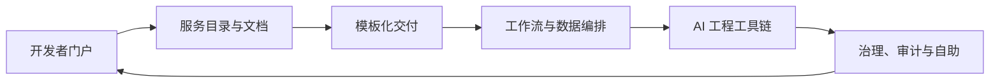
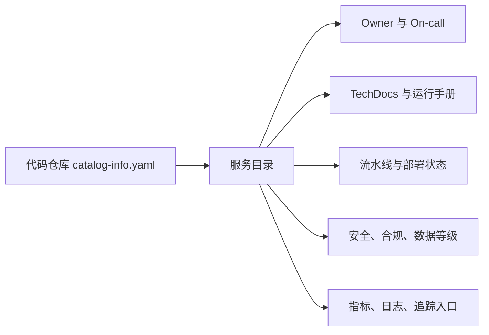
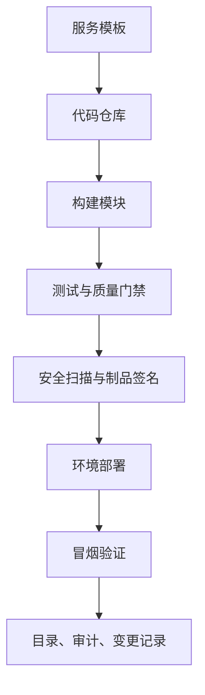
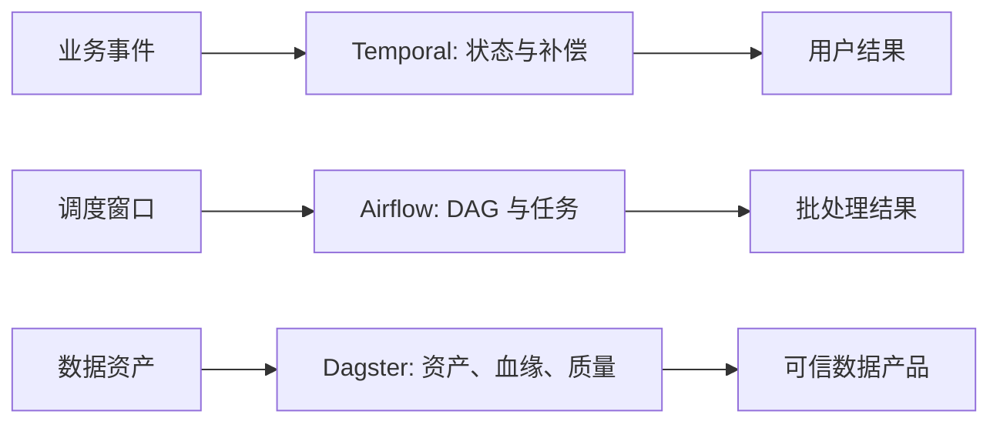
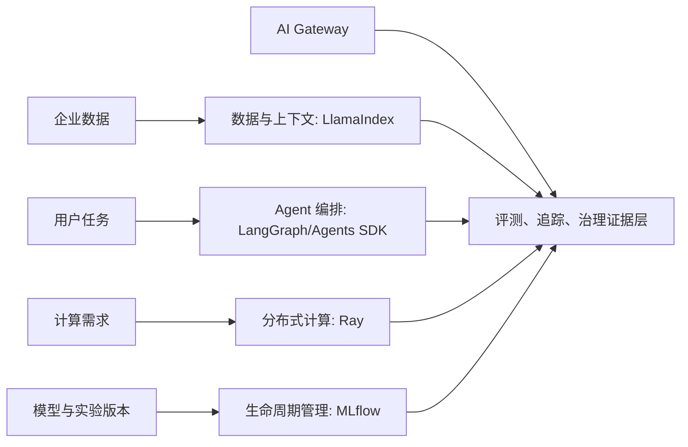
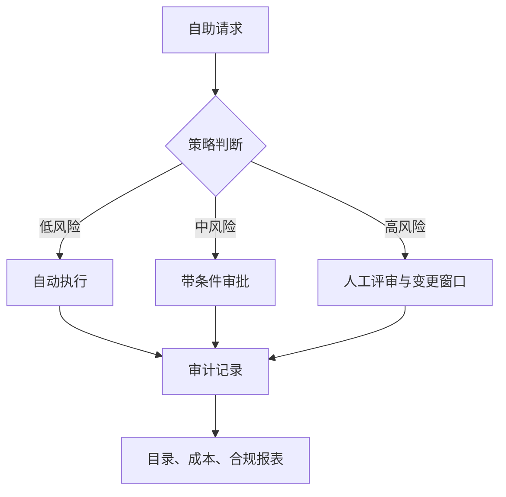

# 第十三章 工具生态与平台化

FDE 项目的交付速度，最终取决于团队能否把重复工作沉淀为平台能力。工具不是越多越好；工具生态的目标，是让开发者、数据工程师、运维、安全和业务团队在同一套事实、流程和边界上协作。开发者门户负责回答“系统在哪里、谁负责、如何接入”；交付平台负责把最佳实践固化为模板和流水线；工作流与数据编排负责让长周期任务可恢复、可观察；AI 工程工具链负责把模型、检索、评测和部署连接成闭环；平台治理负责在自助能力和风险控制之间建立秩序。

工具生态可以按能力边界组织：用 [Backstage Software Catalog](https://backstage.io/docs/features/software-catalog/) 汇聚服务元数据、所有权和插件能力；用 [Dagger](https://docs.dagger.io/) 把交付流程抽象为可复用的代码化函数和模块；用 [Temporal](https://docs.temporal.io/) 处理故障后可从中断处恢复的 durable execution；用 [Airflow](https://airflow.apache.org/docs/apache-airflow/stable/core-concepts/overview.html) 和 [Dagster](https://docs.dagster.io/) 分别覆盖任务 DAG 与数据资产视角；用 [LangGraph](https://docs.langchain.com/oss/python/langgraph/persistence)、[LlamaIndex](https://developers.llamaindex.ai/python/framework/)、[Ray](https://docs.ray.io/en/latest/ray-overview/index.html) 与 [MLflow](https://mlflow.org/docs/latest/ml/tracking/) 覆盖 agent 编排、上下文增强、分布式计算和模型生命周期管理。



本章讨论平台化的五个层次：开发者门户与服务目录、交付平台与模板化、工作流与数据编排、AI 工程工具链，以及平台治理与自助能力。核心观点是：平台不是替团队做决定，而是把正确决策变成低摩擦路径，把高风险动作变成可审计流程。

本章与前面几个工程章节的边界要清楚。第 6 章讨论 CI/CD 的流水线设计、质量门禁、发布策略和回滚实践；本章不重复展开具体流水线，而是讨论如何把这些实践封装成可复用的平台模板、模块和自助入口。第 7 章讨论数据工程、数据质量、血缘和数据产品；本章只讨论数据平台能力如何接入统一门户、目录、权限和编排。第 10 章讨论 LLMOps 的模型、评测、提示、检索、监控和成本闭环；本章关注这些能力如何被组织复制：谁维护模板，谁审批高风险动作，哪些证据进入目录、审计和治理流程。

因此，工具生态章的重点不是列工具清单，而是回答“如何把工具变成平台”：把服务目录、交付模板、工作流编排、数据资产、AI 工具链和策略治理整合成统一操作路径，让 FDE 经验可以跨客户、跨团队、跨项目复用。

## 1. 开发者门户与服务目录

### 1.1 门户是工程事实入口

FDE 团队进入客户现场后，最先遇到的混乱通常不是代码，而是事实分散：服务名在仓库、告警、仪表盘、运行手册、云资源和工单系统中各不相同；一个接口出了问题，没人能立刻判断负责人、依赖方、数据等级和发布历史。开发者门户的价值，是把这些事实组织到一个可搜索、可扩展、可审计的入口。它不是“内部导航页”，而是平台的索引层。

开发者门户的服务目录可参考 [Backstage Software Catalog](https://backstage.io/docs/features/software-catalog/) 的做法：用源代码中的 metadata YAML 作为组件元数据来源，并让团队通过正常 Git 流程维护服务元数据。官方文档还说明，任何软件都可以注册为组件，包括服务、网站、库、数据管道和外部 SaaS；通过 Backstage Software Templates 创建的软件会自动进入目录。这个模型适合 FDE：服务目录不依赖某个中央管理员手工录入，而是让所有权、生命周期、依赖、文档和交付入口跟随代码演进；运行状态、SLO、成本和安全证据则应从运行系统、流水线和治理工具同步，不应手工写死在目录里。



### 1.2 服务目录要回答生产问题

一个可用的服务目录至少要回答六类问题。第一，谁负责：owner、业务联系人、值班组、升级路径。第二，它是什么：类型、生命周期、业务能力、接口、数据域。第三，它依赖谁：上游、下游、数据库、队列、外部 API。第四，它现在怎样：SLO、告警、最近部署、运行环境。第五，如何变更：模板、流水线、审批、回滚入口。第六，风险在哪：权限边界、数据分类、暴露面、合规证据。

| 目录字段 | 平台用途 | 现场风险 |
| --- | --- | --- |
| owner、system、domain | 责任归属与组织边界 | 事故时找不到负责人 |
| lifecycle、tier | 发布策略与 SLO 分层 | 关键系统按实验系统治理 |
| dependsOn / dependencyOf | 影响分析与变更评审 | 下游中断才发现依赖 |
| runbook、dashboard | 值班入口 | 告警后只能问专家 |
| data_classification | 权限与审计 | 敏感数据被错误暴露 |

门户建设要避免两个极端：一是把目录当资产盘点，字段很多但没人维护；二是把门户当万能控制台，把所有工具 UI 嵌进去却没有统一模型。正确做法是从关键工作流反推目录字段：新服务创建、事故响应、发布审批、依赖变更、安全审查和交接培训。凡是不能驱动动作的字段，都应谨慎加入；凡是能降低等待和误判的入口，都应优先接入。

商业 Internal Developer Platform / Portal（IDP，内部开发者平台/门户）市场近两年快速成熟；这里的 IDP 不是 Identity Provider。FDE 选型时应明确：客户是否有自建运维能力、是否已有 SaaS 采购通道、是否需要深度自定义，并按“门户/目录”“平台编排”“治理/scorecard”分组评估。下表是公开定位摘要（快照日期见[快变事实核验表](../appendix/volatile_facts.md)）；产品功能、定价和托管边界变化快，采购前必须复核官方文档和合同条款。

| 平台 | 定位 | 托管模型 | 典型成本口径 |
| --- | --- | --- | --- |
| [Backstage](https://backstage.io/) | 开源 IDP 框架，需自建插件与运维 | 自托管 | 有平台工程团队，希望深度定制 |
| [Humanitec](https://humanitec.com/) | 以 Platform Orchestrator、资源图和 Terraform/OpenTofu 模块编排为主；Score 可作为工作负载规格入口 | SaaS / 自托管 | 多云、多环境差异大，需自动生成应用配置 |
| [Port](https://www.port.io/) | 高度可配的开发者门户，目录 + 自助操作 | SaaS | 想快速落地门户、不愿运维 Backstage |
| [Cortex](https://www.cortex.io/) | 服务目录 + Scorecard 工程健康度评估 | SaaS | 需要可量化的工程成熟度治理 |

Backstage、Port、Cortex 主要覆盖门户、目录和治理体验；Humanitec 更偏平台编排、动态配置和环境生成，可接入这些门户。它们在自托管能力、定价（按服务数 / 用户数）、AI 辅助和 Scorecard 上各有侧重；FDE 评估时应让客户先列出强制需求（合规、私网部署、与 ServiceNow / GitHub / GitLab 集成），再判断 SaaS 是否合规可用。

一个典型事故场景可以这样落地。第一，告警系统把 `service`, `environment`, `slo`, `trace_id` 和告警规则链接带入门户，值班人员不用再猜服务名。第二，在服务目录中打开该组件，确认 owner、on-call 组、业务联系人和升级路径，若一级值班未响应，按目录里的升级链路通知负责人。第三，进入同一组件的 runbook 和 dashboard，查看已知故障模式、关键指标、日志和追踪入口。第四，查看最近部署、配置变更、依赖版本和变更单，判断告警是否与刚发布的版本、特性开关或基础设施调整相关。第五，打开依赖图，识别下游服务、数据管道、队列和外部 API，先通知受影响 owner，再决定是否降级、限流或暂停下游任务。第六，若需要升级处理，在门户中发起事故升级：关联告警、runbook 步骤、最近部署、依赖影响、回滚候选版本和当前证据，让指挥、开发、数据和客户团队看到同一事实。

## 2. 交付平台与模板化

### 2.1 模板化把经验变成默认路径

交付平台的目标不是替代 CI/CD 工具，而是把组织认可的工程路径变成默认选项。FDE 团队常在不同客户、云环境、合规约束和遗留系统之间切换，如果每个项目都重新设计仓库结构、构建脚本、镜像策略、权限申请、观测接入和发布流程，交付质量会依赖少数资深工程师记忆。模板化的价值，是让新服务从第一天就带有目录元数据、测试框架、容器构建、基础告警、部署配置、运行手册和安全检查。

模板化入口可参考 [Backstage Software Templates](https://backstage.io/docs/features/software-templates)：模板可以加载代码骨架、收集参数并发布到 GitHub 或 GitLab 等位置。对 FDE 而言，模板不应只生成代码骨架，还应生成平台契约：`catalog-info.yaml`、SLO 初稿、最小权限、环境变量规范、OpenTelemetry 接入、发布策略和回滚说明。模板越接近生产真实路径，后续治理越少依赖补救。

模板输出要明确“谁维护、何时校验”，否则生成物很快失真。

模板族不应只覆盖 Web/API 服务。FDE 平台至少要区分四类 golden path：API 服务模板输出接口契约、SLO、观测和回滚；数据管道模板输出数据契约、freshness/quality 检查、血缘和重跑策略；批处理/业务工作流模板输出幂等、补偿、超时和人工介入；AI agent/RAG 模板输出权限矩阵、索引契约、eval suite、trace schema、工具注册表和人审策略。不同模板共享生产契约，但测试、评测和运行手册必须按风险面分开。

| 模板输出 | 生成内容样例 | 维护责任 | 校验时机 |
| --- | --- | --- | --- |
| `catalog-info.yaml` | 组件名、owner、system、domain、lifecycle、依赖、文档链接 | 服务 owner 维护，平台团队维护 schema | 模板 dry run、合并前检查、生产发布前 |
| SLO 初稿 | 可用性目标、延迟目标、错误预算、告警路由 | 服务 owner 与 SRE 共同维护 | 首次上线评审、季度运行复盘、SLO 变更时 |
| 最小权限 | 服务账号、云资源角色、数据库权限、密钥访问范围 | 服务 owner 申请，安全或平台策略校验 | 环境创建、权限变更、生产发布前 |
| OpenTelemetry | trace、metrics、logs SDK 配置，资源属性和采样默认值 | 平台团队维护默认接入，服务 owner 调整业务标签 | 构建检查、集成环境冒烟、生产告警接入 |
| SBOM | 依赖清单、镜像摘要、许可证和漏洞扫描入口 | 构建平台生成，服务 owner 处理例外 | 每次构建、制品签名、发布门禁 |
| 回滚说明 | 回滚命令、数据兼容性、特性开关、不可逆迁移说明 | 服务 owner 维护，发布经理或 SRE 复核 | 每次生产变更、演练、事故复盘 |

### 2.2 流水线要可编程、可复用、可验证

传统流水线容易在 YAML 中堆积条件分支，最后变成难以测试的隐式程序。可编程流水线可参考 [Dagger](https://docs.dagger.io/) 的设计：其官方文档把 Dagger Functions 描述为由类型安全 SDK 编写、打包在模块中的计算单元，并强调可以“write pipelines in code, not YAML”。这类思路适合把交付动作拆成可复用模块：构建镜像、生成 SBOM、运行契约测试、扫描漏洞、发布到临时环境、执行冒烟测试、注册服务目录。平台团队维护模块，业务团队调用模块；差异通过参数表达，而不是复制粘贴流水线。

把流水线写成代码不自动带来治理收益。FDE 采用 Dagger 或类似能力前，应先确认模块 owner、版本发布策略、缓存/密钥边界、CI runner 权限、制品存储、失败日志脱敏和本地/CI 一致性；否则只是把难维护的 YAML 迁移成难维护的程序。



| 平台能力 | 模板输出 | 门禁检查 |
| --- | --- | --- |
| 服务创建 | 仓库、目录元数据、运行手册 | owner、生命周期、数据等级 |
| 构建发布 | 镜像、制品、版本号 | 可重复构建、依赖锁定 |
| 质量控制 | 单测、契约测试、冒烟测试 | 覆盖关键路径 |
| 安全治理 | SBOM、扫描、签名 | 高危漏洞和权限漂移 |

模板化不是冻结技术选择。优秀的平台应允许团队在受控边界内选择语言、框架和部署形态，但必须统一不可协商的生产契约：可观测性、可回滚性、可审计性、依赖声明、权限最小化和数据保护。这样，平台提供速度，治理提供边界，团队仍保留解决业务问题的自由。

## 3. 工作流与数据编排

### 3.1 先区分业务工作流和数据编排

FDE 项目里，“工作流”常被混用。业务工作流关注长周期状态：客户开户、订单履约、审批、补偿、人工确认和跨系统事务；数据编排关注数据资产：抽取、转换、质量校验、训练集生成、报表刷新和特征发布。两者都需要依赖、重试和可观测性，但失败语义不同。业务工作流要保证状态不丢、动作不重复、人工介入可恢复；数据编排要保证数据血缘清楚、调度窗口明确、资产质量可验证。

业务工作流可参考 [Temporal](https://docs.temporal.io/) 官方文档强调的 crash-proof execution：应用在崩溃、网络故障或基础设施中断后，可以从中断处继续执行，适合订单、支付、审批、客户 onboarding 等关键流程。数据编排可参考 [Airflow](https://airflow.apache.org/docs/apache-airflow/stable/core-concepts/overview.html) 的 DAG 模型，任务按显式依赖、调度区间和运行状态执行；Airflow 3 已把 Dataset 语义演进为 Asset，并支持 asset-aware scheduling，但它仍更偏 DAG/工作负载优先。以资产思考数据、把数据表、模型特征、报告和下游消费关系纳入统一资产图的做法，可参考 [Dagster](https://docs.dagster.io/)；当资产图、血缘、质量和 owner 是主要抽象时，Dagster 更适合做数据产品控制面。

Airflow 的 Asset Event 能表达“某个资产已更新并可触发下游”，但它不是事务边界，也不能替代数据质量、幂等和消费者通知。资产事件的权限同样敏感：谁能发布事件，谁就可能触发依赖该资产的下游 DAG，因此多租户现场要把事件发布权限纳入治理。Airflow 的 Asset URI 和 `extra` 会以明文形式存入元数据库，不应放入凭证、客户标识或敏感参数；`can_create` Assets 权限也近似于触发所有依赖这些 Asset 的下游 DAG，不能按普通元数据写权限对待。



### 3.2 编排工具要按失败模式选择

工具选择的第一性问题不是“哪个更流行”，而是失败后要恢复什么。若一个流程跨多个外部系统、需要等待人工审批、可能运行数小时或数天，并且不能因为 worker 重启而丢状态，Temporal 这类 durable execution 更合适。若任务以定时批处理为主，依赖关系清晰，失败后可以重跑某个任务、某个 DAG run 或由资产更新触发下游任务，Airflow 的 DAG、scheduler 和 worker 模型更直观。若团队的核心痛点是“哪些数据资产过期、谁依赖它、质量检查在哪失败”，Dagster 的资产视角更能减少数据平台混乱。

| 场景 | 推荐抽象 | 关键设计点 |
| --- | --- | --- |
| 长事务、审批、补偿 | Durable workflow | 幂等 activity、确定性 workflow、状态可恢复 |
| 定时批处理、任务依赖 | DAG | 调度窗口、重试策略、任务粒度 |
| 数据产品、特征、报表 | 数据资产 | 血缘、质量检查、元数据、所有权 |
| AI 评测与索引刷新 | 混合编排 | 数据版本、模型版本、失败回放 |

编排平台上线前，要先定义运行契约：任务是否幂等，外部副作用是否可补偿，重试会不会重复扣费或重复写入，人工审批是否有超时和升级路径，数据资产是否有 freshness 和质量阈值。编排工具能让复杂流程可见，但不能替团队补上业务语义。没有幂等性、所有权和质量口径，任何漂亮的 DAG 图都会在生产中变成事故地图。

以“客户开户 + 数据校验 + 人工审批 + 报表刷新”为例，不应强行用同一个工具吃掉全部问题。客户开户主流程适合 Temporal：创建客户档案、调用 KYC 服务、等待人工审批、补偿失败的外部调用、处理超时升级，这些步骤有长周期状态、外部副作用和恢复要求。数据校验和报表刷新适合 Airflow 或 Dagster：每日同步客户主数据、执行质量规则、刷新开户漏斗报表、发布给 BI 或风控模型，这些任务有明确调度窗口、数据血缘和可重跑语义。人工审批可以由 Temporal 等待审批结果，但审批页面、权限和审计应接入门户与治理系统，而不是把人机交互硬塞进数据 DAG。

混用的边界是事件和数据资产。Temporal 在“客户开户完成”“审批拒绝”“开户超时”时发布业务事件；Airflow 或 Dagster 订阅事件或按窗口读取已落库状态，生成数据资产和报表。这样，业务流程失败时恢复业务状态，数据任务失败时重跑数据资产；两边通过清晰契约连接，而不是让 Temporal 承担批量数据血缘，或让 Airflow/Dagster 承担不可丢状态的客户交易。

## 4. AI 工程工具链

### 4.1 AI 工具链要覆盖上下文、编排、计算和生命周期

AI 原生 FDE 项目不能只接一个模型 API。生产系统通常包含文档解析、索引、检索、提示、agent 状态、工具调用、评测、模型选择、推理、成本和回滚。工具链要让模型行为可复现、可评估、可追踪、可治理。

AI 工具链可按上下文、编排、计算和生命周期分层选择。上下文增强、RAG、数据连接器和工作流能力可参考 [LlamaIndex](https://developers.llamaindex.ai/python/framework/)；LangGraph 的 [持久化文档](https://docs.langchain.com/oss/python/langgraph/persistence)说明，checkpointer 按线程保存图状态，支持对话延续、中断恢复、故障恢复与 human-in-the-loop；[Functional API 文档](https://docs.langchain.com/oss/python/langgraph/functional-api)则提醒要让流程可确定性重放——把随机值等非确定性操作和文件写入、API 调用等副作用放进 task，并让它们幂等。分布式处理、训练、调参和服务可参考 [Ray](https://docs.ray.io/en/latest/ray-overview/index.html) 的 Ray Core、Ray Clusters 以及 Data、Train、Tune、Serve 等库；模型生命周期记录可由 [MLflow Tracking](https://mlflow.org/docs/latest/ml/tracking/) 记录 runs、datasets、artifacts、models，并通过 Tracking Server、Artifact Store 和 Model Registry 支撑协作。



### 4.2 LangGraph、LlamaIndex、Agents SDK 与 MCP 的分层

LLM 工程栈里几个常被并列的名词其实分属不同层，FDE 选型时要分开评估：

- **LlamaIndex** 在本书 FDE 栈中主要放在 **数据 / 上下文层**：负责文档解析、切分、索引、检索与引用证据，输出标准化的 chunks 与 retrievers，供上层 agent 调用；它也有 agent/workflow 原语，选型时要和 LangGraph、Agents SDK 的编排边界一起评估，避免同一层重复抽象。
- **LangGraph** 处于 **流程编排层**：用有状态图描述 agent 的步骤、分支、循环、人审与重试，提供持久化、checkpoint、time travel，可与任何模型供应商组合。
- **OpenAI Agents SDK** 处于 **agent 运行时层**：提供代码优先的 agent 运行时和编排 SDK，开发者声明 tools/handoffs，运行时负责模型调用、工具调用、多轮控制与追踪。
- **AI Gateway** 处于 **模型与策略控制层**：统一模型/provider API、路由、重试、fallback、预算/限流、guardrail、MCP/tool inspection、token 和成本归因，并把 model route、policy version、fallback path、guardrail result 和 trace_id 写入证据链。
- **MCP（由 Anthropic 发起，现由 AAIF / Linux Foundation 承接治理的开放协议）** 处于 **工具与上下文协议层**：MCP server 暴露工具、资源和提示；host 或 agent 框架中的 MCP client 负责消费这些能力，使外部系统不必绑定到某个模型 SDK。MCP 标准化访问方式，但不替代最小权限、用户 consent、工具 allowlist、scoped token、写动作人审、gateway 检查和审计。

简化的依赖关系：MCP 提供工具与数据接口 → LangGraph 在流程编排层消费 MCP 工具，Agents SDK 在 agent runtime 中消费 MCP 工具 → LlamaIndex 等通过 MCP 或框架原生接口提供数据上下文 → AI Gateway 在模型和工具边界执行路由、预算、策略和观测。FDE 常见误区是把它们当成竞品做单选，正确做法是按层组合，并保留替换某一层的能力。

Linux Foundation 公开信息显示 MCP 已作为 Agentic AI Foundation 的 founding project 接收，官方 MCP 社区也维护治理说明；这说明协议治理正在走向中立化，但不代表任意 MCP server 可直接进入生产。FDE 应把 MCP server 当作供应链资产：记录来源、版本、签名、工具 schema、权限范围、网络访问、数据外发、依赖 SBOM、运行身份和禁用开关。

### 4.3 生产 AI 平台要以证据闭环为中心

AI 工程平台的关键不是工具覆盖率，而是证据闭环。一次回答或自动动作必须能追溯到：模型、提示、索引、文档片段、工具、中间状态、评测结果、审批记录、成本和延迟归因。没有这些证据，评测无法解释，事故无法复盘，合规也无法成立。

| 层次 | 典型工具 | 平台交付物 |
| --- | --- | --- |
| 数据与上下文 | LlamaIndex | 连接器、解析、索引版本、引用证据 |
| Agent 编排 | LangGraph | 状态图、checkpoint、人审、恢复策略 |
| AI Gateway | LiteLLM / Envoy AI Gateway / Portkey / Kong AI Gateway 等 | provider/model 路由、预算/限流、fallback、guardrail、成本和 trace 证据 |
| 计算与服务 | Ray | 批处理、训练、调参、服务 |
| 生命周期 | MLflow | run、artifact、registry、评测记录 |
| 治理 | 门户与策略引擎 | 成本、权限、审计、回滚 |

平台团队应把 AI 工具链做成可组合能力，而不是强迫所有项目使用同一套模板。低风险问答可用轻量 RAG 与离线评测；高风险写入动作必须使用持久化状态、人审、审计和回放；大规模模型服务需要弹性层；模型迭代需要注册中心记录版本和指标。每次自动化提升，都必须同步提升可解释、可恢复和可治理能力。

## 5. 平台治理与自助能力

### 5.1 自助不是无审批，而是策略前置

平台化最容易失败的地方，是把自助能力误解为“谁都可以点按钮”。真正的自助，是把政策、模板、权限、配额、审计和回滚能力前置，让低风险动作即时完成，高风险动作进入清晰审批。FDE 现场通常要同时面对客户安全团队、内部平台团队、业务负责人和交付工程师；如果每个环境、账号、数据库、模型、密钥和外部接口都靠人工工单协调，速度会消失。如果完全放开，又会制造权限漂移、成本失控和合规风险。

治理应围绕平台契约设计，而不是围绕工具权限设计。目录和模板事实源负责 owner、数据等级、生命周期、SLO、模板版本和自助入口。运行时事实源负责变更窗口、回滚方式、观测信号、可恢复流程和审批记录。AI/模型事实源负责模型记录、提示版本、工具权限、风险等级和审计日志。Backstage 目录与模板、Dagger 模块、Temporal 或 LangGraph 的可恢复流程、MLflow 的模型记录，都可以成为治理事实来源，而不是孤立工具。

策略决策可以从应用代码中拆出来，用结构化输入做统一判断；这类通用策略引擎可参考 [Open Policy Agent](https://www.openpolicyagent.org/docs)。在 Kubernetes 场景，轻量准入可使用原生 ValidatingAdmissionPolicy/CEL；更复杂的策略生命周期、审计报告、mutation/generation、镜像校验或 Rego 复用，可用 [OPA Gatekeeper](https://www.openpolicyagent.org/docs/kubernetes) 或 [Kyverno](https://kyverno.io/docs/policy-types/cluster-policy/validate/)。关键不是选哪一个工具，而是把平台动作转换成一致的策略输入、审批记录和证据链。

```rego
package platform.governance

default allow := false

allow if {
  input.action == "create_resource"
  input.resource.owner
  input.resource.data_classification
  input.resource.cost_center
}

allow if {
  input.action == "deploy_production"
  input.change.tests_passed
  input.change.sbom_signed
  input.change.rollback_plan
  input.approval.change_id
}

allow if {
  input.action == "request_data_access"
  input.request.purpose
  input.request.expires_at
  input.approval.data_owner
}

allow if {
  input.action == "ai_agent_write"
  input.agent.tool in {"create_ticket", "update_runbook"}
  input.agent.risk_level == "low"
  input.audit.trace_id
}
```

该示例为治理意图伪代码，未经过 Rego v1 语法校验。生产部署可根据落点改写为 OPA 策略、OPA Gatekeeper Constraint、Kyverno ClusterPolicy、Kubernetes ValidatingAdmissionPolicy/CEL 或平台自助系统的策略单元。这段策略只表达平台治理意图，实际生产还要补充组织身份、租户边界、例外流程和测试用例。它的价值在于让“创建资源、发布生产、申请数据访问、AI agent 写操作”都经过同一种判断模型。



### 5.2 平台指标要衡量摩擦和风险

平台治理不能只报“接入了多少服务”。好的平台指标同时衡量效率、质量和风险：新服务从申请到可部署需要多久，模板生成后有多少手工修改，发布失败率是否下降，事故定位时间是否缩短，高危漏洞是否被阻断，权限例外是否按期回收，模型成本是否可归因，人工审批是否集中在真正高风险动作上。平台团队要像产品团队一样运营内部能力，把开发者体验和控制效果同时纳入复盘。

| 治理对象 | 自助能力 | 控制点 | 指标 |
| --- | --- | --- | --- |
| 服务创建 | 模板和目录注册 | owner、数据等级、SLO | 首次部署时长 |
| 环境与资源 | 配额化申请 | 成本中心、生命周期 | 闲置资源率 |
| 生产发布 | 标准流水线 | 测试、扫描、回滚 | 变更失败率 |
| 数据访问 | 用途化授权 | 最小权限、到期回收 | 权限例外数量 |
| AI 动作 | 工具权限与人审 | 风险分级、审计 | 未经批准写操作数 |

| 平台动作 | 策略检查 | 审批 | 审计证据 | 回滚证据 |
| --- | --- | --- | --- | --- |
| 创建资源 | owner、数据等级、成本中心、生命周期、配额 | 超配额或敏感资源需平台 owner 审批 | 资源规格、申请人、策略版本、决策结果 | Terraform plan、删除计划、资源 TTL |
| 发布生产 | 测试通过、SBOM 签名、漏洞阈值、回滚计划、变更窗口 | 高风险服务或冻结窗口需变更审批 | 制品摘要、流水线记录、变更单、策略决策 | 上一版本、回滚命令、数据库兼容性说明 |
| 申请数据访问 | 用途、数据分类、最小权限、到期时间、租户边界 | 敏感数据需 data owner 与安全审批 | 申请单、授权范围、到期时间、访问日志 | 权限回收记录、下游缓存清理证明 |
| AI agent 写操作 | 工具 allowlist、风险等级、上下文来源、写入范围 | 中高风险写操作需人审或双人确认 | agent trace、提示版本、工具调用、审批人 | 反向操作、变更 diff、工单或 runbook 历史 |

AI 证据资产也要治理：eval 样本、trace、prompt、检索片段、失败截图、人工反馈和红队 payload 都应标注敏感级别、脱敏/最小化、访问范围、保留期、删除责任、跨客户复用限制和审计日志。平台指标表中的每个指标还应有 owner、阈值、复审频率、触发动作和风险接受人；否则指标只会描述状态，不能驱动治理。

治理的成熟标志，是开发者愿意走平台路径，因为它更快、更清晰、更少返工；安全和运维团队也愿意信任平台路径，因为它保留了证据和控制。若平台只增加表单和审批，它会被绕过；若平台只追求速度而没有策略，它会成为风险放大器。FDE 的平台化应坚持一个边界：把重复、标准、可证明安全的动作自动化；把不确定、高影响、不可逆的动作显性化，并让决策留下证据。
