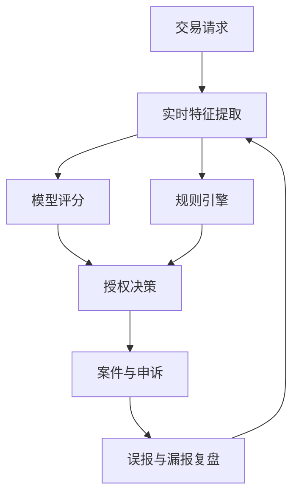

# 第十四章 行业实践案例

前线部署工程不是把通用软件交付给客户后离场，而是在真实业务环境中把问题、数据、流程、系统和组织约束连接起来。本章选取政府公共服务、金融风控、制造供应链、医疗生命科学，以及能源通信关键基础设施五类场景，重点观察三件事：一是团队如何进入现场并识别真实约束；二是工程系统如何嵌入既有业务流；三是案例中的收益、限制和风险如何被公开材料支撑，而不是被营销语言放大。

这些案例并不代表某个行业存在唯一正确路线。政府服务强调用户研究、合规和可审计治理；支付风控要求毫秒级响应和误杀控制；制造现场关注物料、设备和工艺数据的连续性；医疗生命科学必须把模型验证、临床流程和隐私保护放在交付之前；关键基础设施则把韧性、安全和人工监督置于效率之上。前线部署工程师的共同职责，是在这些差异化约束下，把抽象能力转化为可运行、可解释、可维护的现场系统。

本章只选择五类约束差异明显的行业作样本，不覆盖物流、国防、零售、SaaS、教育等全部场景。读者复用时应按约束原型迁移，而不是按行业名称迁移：监管责任、实时性、物理安全、资金风险、数据敏感度和人工授权边界，比“属于哪个行业”更决定部署方式。

| 小节 | 行业场景 | 主要工程问题 | 公开案例来源 |
| --- | --- | --- | --- |
| 14.1 | 政府与公共部门 | 政策、服务、用户反馈和敏捷治理协同 | [GOV.UK Service Manual](https://www.gov.uk/service-manual/agile-delivery/agile-government-services-introduction)、[GDS](https://gds.blog.gov.uk/2018/04/26/gov-uk-a-journey-in-scaling-agile/) |
| 14.2 | 金融与风控 | 实时评分、误报控制、规则与模型协作 | [Visa](https://usa.visa.com/about-visa/newsroom/press-releases.releaseId.20661.html)、[Mastercard](https://www.mastercard.com/us/en/news-and-trends/press/2024/february/mastercard-supercharges-consumer-protection-with-gen-ai.html) |
| 14.3 | 制造与供应链 | 数字孪生、物料流、工艺变更和可追溯 | [Siemens 客户案例](https://resources.sw.siemens.com/en-US/case-study-roj/) |
| 14.4 | 医疗与生命科学 | 临床数据、AI 验证、药物研发和安全报告 | [Mayo Clinic](https://www.mayo.edu/research/centers-programs/robert-d-patricia-e-kern-center-science-health-care-delivery/research-activities/clinical-data-science)、[Pfizer](https://www.pfizer.com/news/press-release/press-release-detail/cytoreason-announces-expanded-collaboration-deal-pfizer) |
| 14.5 | 能源、通信与关键基础设施 | 自治网络、智能电网、韧性和人机协同 | [Ericsson DNB case](https://www.ericsson.com/en/cases/2024/digital-nasional-berhad-intent-based-operations)、[美国能源部](https://www.energy.gov/nepa/articles/cx-032183-cognitive-digital-twin-development-secure-and-resilient-smart-grid) |
| 14.6 | 公开失败案例 | 演示与生产脱节、模型直驱高影响动作、部署一致性缺失 | [JNCI Watson/MD Anderson 文章](https://academic.oup.com/jnci/article/109/5/djx113/3847623)、[Zillow investor release](https://investors.zillowgroup.com/investors/news-and-events/news/news-details/2021/Zillow-Group-Reports-Third-Quarter-2021-Financial-Results--Shares-Plan-to-Wind-Down-Zillow-Offers-Operations/default.aspx?stream=business)、[Air Canada 裁决](https://decisions.civilresolutionbc.ca/crt/crtd/en/item/525448/index.do)、[SEC Knight Capital](https://www.sec.gov/files/litigation/admin/2013/34-70694.pdf) |

本章阅读时应特别区分“案例已经公开证明的事实”和“可迁移的工程模式”。前者必须通过链接核验，后者需要结合自身行业的监管、数据质量、组织能力和风险承受度重新设计。

本章采用三档证据强度：`已证实事实` 只写公开材料直接支持的内容；`供应商/机构口径` 标明来源方与验证范围；`本书推断` 只用于提炼工程模式，不当作案例收益或失败原因的确定结论。

## 1. 政府与公共部门

### 1.1 从行业约束转向现场案例

<!-- claim-id: FDE-14.1-001 -->

政府数字化的典型约束不是单纯技术复杂，而是政策变化、公众可用性、采购治理、信息安全和问责机制同时存在。英国 GOV.UK Service Manual 的[敏捷政府服务指南](https://www.gov.uk/service-manual/agile-delivery/agile-government-services-introduction)明确要求政府数字服务采用敏捷方式建设和运行，并强调快速构建、测试、根据反馈和数据迭代；该页还把公共监护人办公室的 Lasting Power of Attorney 服务和法院费用帮助服务列为案例。对前线部署工程而言，这意味着团队不能只接收一份固定需求，而要把政策人员、服务负责人、内容设计、开发、运维和用户研究放进同一反馈回路。

### 1.2 案例卡：GOV.UK 如何改造 Lasting Power of Attorney（LPA）服务

<!-- claim-id: FDE-14.1-002 -->

| 字段 | 内容 |
| --- | --- |
| 背景 | 英格兰和威尔士的 Office of the Public Guardian 需要把制作 Lasting Power of Attorney（LPA，持久授权委托书）的流程从长纸质表格，转为用户可在线填写、系统生成表格、再签署寄回的服务。该案例来自 GDS 的 [Public Guardian agile development 案例](https://gds.blog.gov.uk/2014/09/26/the-public-guardian-on-agile-development/)等公开材料，非普遍收益承诺。 |
| 现场问题 | 用户要处理法律概念、身份关系、签署顺序和纸面材料；内部团队还要保留治理、审计和政策责任。若只把纸表搬到网页，会把行政复杂度转嫁给公众。 |
| 部署动作 | 先交付可用的核心服务，再用两周迭代、用户反馈和服务手册语言持续改进；让业务负责人定期看到真实产品，而不是只看项目文档。 |
| 关键取舍 | 不是一次性追求全流程无纸化，而是在法律文件仍需签署寄回的条件下，先降低填写和理解成本；不是取消治理，而是让治理者更频繁地看见可运行服务。 |
| 公开结果或预期指标 | GDS 公开材料称该服务让制作 LPA 更简单，并强调从衡量“纸张移动速度”转向衡量客户影响；可复用时应跟踪完成率、退件率、求助量、办理时长和弱势用户可达性。 |
| 不可外推边界 | 该案例不能证明所有政府服务都适合相同节奏，也不能绕过法律签署、申诉、身份核验和可访问性要求；只能复用“以用户结果和治理证据驱动迭代”的工作方式。 |

### 1.3 现场团队的治理边界

<!-- claim-id: FDE-14.1-003 -->

GOV.UK 的[敏捷治理原则](https://www.gov.uk/service-manual/agile-delivery/governance-principles-for-agile-service-delivery)提出“go see for yourself”和“trust and verify”：治理者要看见真实产品，团队也要以轻量、频繁的证据接受检验。GDS 在博客 [GOV.UK: a journey in scaling agile](https://gds.blog.gov.uk/2018/04/26/gov-uk-a-journey-in-scaling-agile/) 中回顾了 GOV.UK 扩展敏捷实践的经验，指出 GOV.UK 已上线多年并持续根据反馈改进，且被视为国家基础设施的一部分。这些公开材料没有把成功归因于单个工具，而是强调跨职能团队、短周期交付、服务指标和现场反馈。

### 1.4 可迁移做法

| 现场动作 | 工程产物 | 风险控制 |
| --- | --- | --- |
| 访谈办事人员和公众用户 | 用户旅程、服务蓝图 | 防止只优化内部流程 |
| 以小批量功能上线 | 可回滚发布、运行日志 | 降低政策和需求变化风险 |
| 建立服务指标 | 仪表盘、反馈队列 | 避免用交付进度替代服务结果 |
| 引入轻量治理 | 决策记录、风险清单 | 保留问责和审计证据 |

政府场景的经验是：前线部署工程师应把“能上线”降级为中间目标，把“持续满足公众需求且可被审计”作为最终目标。任何自动化、AI 或数据平台都必须服务于服务责任，而不是替代责任主体。

这类项目还要求 FDE 对语言保持克制。公共部门的用户可能并不关心底层是否采用微服务、AI 代理或数据湖，他们关心的是能否完成申请、是否公平、是否可申诉、是否保护个人信息。工程团队如果把内部效率放在公众服务之前，就会把技术优化变成新的行政摩擦。因此公共部门案例应重点学习服务设计、证据治理和问责链，而不是简单复制某个系统架构。

## 2. 金融与风控

### 2.1 实时风控的工程本质

<!-- claim-id: FDE-14.2-001 -->

金融风控的现场压力来自交易速度、欺诈变化和客户体验之间的冲突。Visa 在 2024 年发布 [Visa Account Attack Intelligence Score](https://usa.visa.com/about-visa/newsroom/press-releases.releaseId.20661.html)，称其用于识别无卡交易中的枚举攻击，并为发卡机构提供实时风险评分；新闻稿披露该评分面向美国发卡机构先行推出，并可在授权决策中与规则引擎结合使用。这里的关键不是“有一个模型”，而是模型、规则、授权链路、异常解释、运营处置和客户申诉必须在毫秒级业务流中协同。

### 2.2 案例卡：Visa 如何识别枚举攻击

| 字段 | 内容 |
| --- | --- |
| 背景 | 枚举攻击会在无卡交易链路中批量试探卡号、有效期或安全码，攻击者一旦确认账户信息就可能快速转向欺诈交易。该案例来自 Visa 公开材料，非普遍收益承诺。 |
| 现场问题 | 风控系统既要在授权链路中足够快，又要避免把正常持卡人交易误判为攻击；发卡机构还需要把风险分数嵌入既有规则、客服、补卡和申诉流程。 |
| 部署动作 | 在 VisaNet 交易流中对无卡交易进行实时风险评分，把枚举风险作为授权决策输入，并可与发卡机构规则引擎共同使用。 |
| 关键取舍 | 不能只追求更高拦截率；误报会影响客户体验、客服负载和商户转化。部署重点是把模型分数、规则阈值、人工复核和客户补救动作连成闭环。 |
| 公开结果或预期指标 | Visa 公开材料称 VAAI Score 可在 20 毫秒内提供实时风险评分，并称相较其他风险模型误报率降低 85%。这些数字只适用于其材料所述产品和数据条件；本地复用应重新验证欺诈损失、误报率、授权延迟和客服工单变化。 |
| 不可外推边界 | 该案例不能证明所有欺诈类型都可用同一模型处理，也不能替代本地监管、数据授权、模型解释和申诉机制；地区、发卡策略、商户组合和攻击手法变化都会改变收益。 |

### 2.3 旁栏短例：Mastercard 如何用生成式 AI 辅助风控

<!-- claim-id: FDE-14.2-002 -->

Mastercard 的 [Decision Intelligence Pro](https://www.mastercard.com/us/en/news-and-trends/press/2024/february/mastercard-supercharges-consumer-protection-with-gen-ai.html) 公开介绍了用交易周边实体关系评估风险，并称相关技术在低于 50 毫秒内改进 DI 分数，初始建模显示欺诈检测率平均提升 20%、部分场景最高提升 300%。这同样来自公开材料，非普遍收益；FDE 复用时只能借鉴“图关系、实时评分、规则协同”的部署形态，不能把供应商建模结果当作自身上线指标。

### 2.4 风控部署回路

金融场景的可迁移原则是“先定义损失函数，再定义模型”。误杀会损害正常客户体验，放行会造成欺诈损失，二者都需要被度量。公开案例中提到的性能和收益应限定在其产品、区域和客户条件内使用；在自身环境复用时，必须重新校准数据分布、监管要求、延迟预算和人工复核流程。

FDE 在金融现场还要处理模型解释和责任分配。风控模型给出高风险评分，并不等于系统可以自动拒绝所有交易；业务策略、合规要求、客户分层和申诉渠道都可能影响最终动作。一个可交付系统应能说明：哪些特征参与判断，哪些规则覆盖模型，哪些交易进入人工复核，哪些操作写入审计日志，哪些指标用于监控误报和漏报。若这些链路缺失，模型越强，组织风险越大。

| 风控环节 | FDE 关注点 | 不可忽视的边界 |
| --- | --- | --- |
| 数据接入 | 实时性、质量、授权来源 | 不能混用未经授权数据 |
| 模型评分 | 可解释性、漂移、延迟 | 不能只看离线 AUC（离线样本上的区分能力指标） |
| 规则决策 | 策略 Owner、版本、例外 | 不能让规则长期无人维护 |
| 案件处理 | 复核效率、证据完整性 | 不能让用户无申诉路径 |

## 3. 制造与供应链

### 3.1 现场数据比算法更先到场

<!-- claim-id: FDE-14.3-001 -->

制造与供应链场景中，前线部署工程师首先面对的是设备、工艺、物料和人员流程的不连续。Siemens 在 ROJ 的[数字孪生客户案例](https://resources.sw.siemens.com/en-US/case-study-roj/)中描述了电子制造企业在高混合、小批量订单下，通过 Opcenter 和 Valor 建立端到端数字化流程；公开案例列出的结果包括缩短新产品导入时间、提升生产效率、减少库存浪费和过期物料。应注意，这些数字来自特定客户案例，不能直接外推到其他工厂。

### 3.2 案例卡：Siemens ROJ 如何用数字孪生改进电子制造

| 字段 | 内容 |
| --- | --- |
| 背景 | ROJ 是意大利电子设计与制造企业，面对汽车、通信和工业客户的高混合、小批量订单，月订单多、批量小、新产品导入频繁。该案例来自 Siemens 公开客户材料，非普遍收益承诺。 |
| 现场问题 | 手工 NPI 流程耗时且容易出错；设备、仓储、智能货架和 AGV 产生的数据格式不一致；为了避免缺料停线，现场会超量采购电子元件，导致库存、过期物料和空间浪费。 |
| 部署动作 | 用 Valor Process Preparation 做可制造性分析和工艺准备，用 Opcenter Execution Electronics IoT 归一化 SMT 线数据，用 Valor Material Management 连接仓库、工站、智能货架和 AGV，形成从设计、机器程序、物料配送到追溯的闭环。 |
| 关键取舍 | 数字孪生不是先做三维展示，而是先让 BOM、工艺路线、设备状态、物料批次和质量记录说同一种数据语言；自动配送也不是直接替代现场判断，而是先消除缺料、过期和换线中的可见浪费。 |
| 公开结果或预期指标 | Siemens 公开材料称 ROJ 节省 40% NPI 时间、生产效率提高 20%、每年减少超额库存支出超过 15 万欧元、过期物料减少 20%。本地复用应重新验证换线时间、停线等待、库存周转、报废率和追溯完整率。 |
| 不可外推边界 | 这些结果依赖 ROJ 的电子制造场景、既有设备、数据接入条件和 Siemens/Cadlog 实施路径；不能直接外推到流程工业、离散装配或缺少设备数据的工厂。 |

（数据由 ROJ 与 Siemens 共同发布，非独立审计。）

### 3.3 数字孪生不是三维展示

<!-- claim-id: FDE-14.3-002 -->

在该案例中，数字孪生的价值不在于可视化本身，而在于把设计、可制造性分析、机器程序、物料流和追溯数据连接起来。Siemens 的[综合数字孪生说明](https://www.siemens.com/en-us/company/digital-twin/comprehensive-digital-twin-for-industry/)也强调，数字孪生可覆盖产品、机器、生产和工厂生命周期，用仿真和运行数据支持测试、优化和预测维护。前线部署团队进入工厂时，应优先梳理 BOM、工艺路线、换线规则、设备接口和质量记录，而不是先开发漂亮的大屏。

### 3.4 制造部署检查表

| 层级 | 需要现场确认的问题 | 可交付物 |
| --- | --- | --- |
| 产品 | 版本、BOM、工程变更如何流转 | 产品数据模型 |
| 工艺 | 工站、节拍、返工和质检点在哪里 | 工艺路线图 |
| 设备 | PLC、MES、仓储系统接口是否可用 | 接口适配器 |
| 物料 | 批次、库位、有效期如何追踪 | 物料追溯链 |
| 运营 | 异常由谁确认、谁放行 | 安灯（Andon，现场异常呼叫机制）和处置流程 |

制造案例的核心启示是：可部署系统必须尊重现场节拍。任何优化建议都要能解释其对换线、停机、质量和库存的影响；否则，再先进的模型也只是脱离车间的预测。

FDE 还要区分“建议系统”和“控制系统”。前者可以在计划、排程、质检和异常处理上提供洞察；后者直接影响设备动作、人员安全和产线稳定，必须满足更严格的实时性、权限、验证和回退要求。制造现场通常存在大量历史系统和专有协议，短期内不可能全部替换。更现实的路径是先围绕一个价值闭环建立可信数据链，再逐步把经验沉淀为接口、规则和模板，避免一次性平台化压垮现场。

## 4. 医疗与生命科学

### 4.1 主案例选择：先深挖一个临床工作流

<!-- claim-id: FDE-14.4-001 -->

医疗与生命科学的前线部署不能把“模型准确率”单独视为成功。本节以 Mayo Clinic Clinical Data Science Program 公开介绍的 Control Tower 项目作为主案例，因为它同时覆盖统一数据平台、实时仪表盘、风险评分、提醒、临床专家介入和结果评估；其他药物研发、药物警戒和 AI-ECG 场景只作为旁栏短例，避免把临床、研发和安全报告三类不同责任体系混在一起。

### 4.2 案例卡：Mayo Clinic 如何用 Control Tower 支持患者照护

| 字段 | 内容 |
| --- | --- |
| 背景 | Mayo Clinic Kern Center 的[临床数据科学项目](https://www.mayo.edu/research/centers-programs/robert-d-patricia-e-kern-center-science-health-care-delivery/research-activities/clinical-data-science)介绍，Control Tower 是建立在统一数据平台上的住院场景支持框架，结合工程、设计、知识管理和分析能力，首个概念验证用于识别可能需要姑息治疗支持的患者。该案例来自 Mayo 公开材料，非普遍收益承诺。 |
| 现场问题 | 住院患者是否需要姑息治疗支持，不能只靠模型分数判断；临床团队需要在不打断现有护理流程的情况下，更早发现需要专科建议的患者，并保留医生判断、沟通和责任边界。 |
| 部署动作 | 用机器学习形成风险评分，配合实时仪表盘和提醒，把预测结果送到姑息治疗专家可行动的工作流中；系统不是自动下医嘱，而是帮助专科团队主动提供建议。 |
| 关键取舍 | 优先把 AI 放在“发现和分流”位置，而不是替代临床决策；优先验证患者流程和专家响应，而不是单独宣传模型准确率；先做概念验证和临床评估，再谈规模化。 |
| 公开结果或预期指标 | Mayo 当前公开材料称该工具让专科人员提供姑息治疗会诊的时间缩短超过 40%，60 天再入院减少超过 25%。这些数字只适用于其公开项目语境；本地复用应重新验证提醒阳性率、专家响应时间、咨询完成率、再入院率、患者体验和误分流风险。 |
| 不可外推边界 | 不能把该案例外推为所有医院 AI 都能降低再入院，也不能把姑息治疗分流经验直接套到急诊、ICU、影像诊断或药物研发；复用前必须确认数据许可、伦理审查委员会（IRB）、隐私合规、临床治理审批路径、临床负责人和退出机制。 |

### 4.3 深入拆解：医疗场景如何划清部署责任

这个主案例的可迁移价值不在“某个模型可以预测姑息治疗需求”，而在部署责任链：问题由临床负责人定义，数据平台提供可追溯输入，模型输出被转化为专家可处理的队列，结果用真实流程指标评估。FDE 在医疗现场要先证明系统不会破坏现有安全机制，再证明效率；模型输出应以建议、分层、提醒或研究辅助的形式进入流程，并保留人工判断、审计日志、偏差监控和退出机制。

### 4.4 旁栏短例：AI-ECG 与药物安全如何支持专业判断

<!-- claim-id: FDE-14.4-002 -->

Yao 等 2021 年发表于 *Nature Medicine* 的 [Mayo Clinic AI-ECG 低射血分数识别随机临床试验](https://www.nature.com/articles/s41591-021-01335-4)把 120 个初级护理团队、45 个诊所或医院纳入集群随机试验，并以 90 天内新诊断低射血分数为主要终点；该论文也收录在 Mayo 的[出版记录](https://mayoclinic.elsevierpure.com/en/publications/artificial-intelligenceenabled-electrocardiograms-for-identificat/)中。该短例说明：临床 AI 上线前后应设计真实世界评估，而不是只看回顾性准确率。

<!-- claim-id: FDE-14.4-003 -->

Pfizer 在 [AI in Drug Safety](https://www.pfizer.com/news/articles/ai-drug-safety-building-elusive-%E2%80%98loch-ness-monster%E2%80%99-reporting-tools) 一文中介绍了用 AI 处理不良事件报告摄取和处理中的重复性任务，并明确工具用于支持药物警戒专家而不是替代人。

<!-- claim-id: FDE-14.4-004 -->

Pfizer 与 CytoReason 的[合作扩展公告](https://www.pfizer.com/news/press-release/press-release-detail/cytoreason-announces-expanded-collaboration-deal-pfizer)说明疾病模型可支持药物研发决策。两者都来自公开材料，不能外推为研发成功率、上市速度或安全报告效率的普遍收益。

### 4.5 医疗部署检查表

| 风险问题 | 工程回应 | 组织回应 |
| --- | --- | --- |
| 数据用途不清 | 用途标签、访问策略 | 伦理与合规审批 |
| 模型偏差 | 分层评测、持续监控 | 临床负责人复核 |
| 工作流打断 | 嵌入现有系统入口 | 培训和反馈渠道 |
| 责任不明 | 审计日志、版本记录 | 明确最终决策人 |

医疗和生命科学场景还需要把数据生命周期说清楚。训练、验证、部署、监控和研究复用可能涉及不同的同意、脱敏、访问控制和保留期限。FDE 不能因为技术上可以连接电子病历、实验数据、影像、文献和真实世界证据，就默认这些数据可以被同一模型或同一团队使用。可交付系统应把数据用途、责任主体、访问路径和审计证据固化到流程中，并让临床或科研负责人能理解这些边界。

## 5. 能源、通信与关键基础设施

### 5.1 关键基础设施的部署目标

<!-- claim-id: FDE-14.5-001 -->

能源、通信和关键基础设施的共同特点是：系统失效会外溢到公共安全、经济运行和社会秩序。美国能源部 NEPA 的[智能电网认知数字孪生项目页](https://www.energy.gov/nepa/articles/cx-032183-cognitive-digital-twin-development-secure-and-resilient-smart-grid)描述了面向智能电网的认知数字孪生项目，目标是表示物理电力系统及其通信、控制和运行。该类项目提醒我们，关键基础设施中的“数字孪生”不仅是资产模型，还涉及控制链路、通信依赖和攻击面。

### 5.2 案例卡：Ericsson 与 DNB 如何推进意图驱动网络运营

<!-- claim-id: FDE-14.5-002 -->

| 字段 | 内容 |
| --- | --- |
| 背景 | Ericsson 的 DNB 案例 [From data-driven to intent-based network operations](https://www.ericsson.com/en/cases/2024/digital-nasional-berhad-intent-based-operations) 描述，马来西亚 Digital Nasional Berhad 使用 Ericsson Operations Engine 建设多运营商核心网，并在 2024 年试验意图驱动运营。Ericsson 随后在 2025 年公开称 DNB/Ericsson 获得 TM Forum Level 4 autonomy for 5G service assurance validation；这属于 Ericsson/TM Forum 公开验证口径，不等于所有网络都具备同等自治能力。该案例来自 Ericsson 公开材料，非普遍收益承诺。 |
| 现场问题 | DNB 的批发网络要服务多个通信服务提供商，核心网、客户体验、告警、配置和 SLA 要在同一运营体系中被管理；如果只靠人工排障，复杂度、告警量和变更风险都会快速上升。 |
| 部署动作 | 先建立数据驱动运营和自动化流程，再用实时网络可视化、自治分析仪表盘和意图驱动运营试验，把业务意图映射为网络配置、监控和服务保障动作；若引用 2025 验证材料，应同时保留验证范围、供应商口径和本地复验边界。 |
| 关键取舍 | 自动化用于管理复杂性，不等于取消人工责任；高风险动作必须有审批、回退和审计。意图描述也不能停留在口号，必须落到可验证的服务级别协议（SLA）、网络切片、配置变更和告警闭环。 |
| 公开结果或预期指标 | Ericsson 公开材料给出若干供应商口径数字，例如客户投诉解决时间、自动创建工单、告警数量和 uptime 相关改善；这些数字不能直接作为本地上线指标。复用时应重新验证 SLA 达成率、告警压缩率、变更失败率、回滚时间和人工接管频率。 |
| 不可外推边界 | 该案例不能证明所有通信网络都能直接进入自治运营；设备供应商、网络架构、监管模式、客户合同和运维成熟度不同，都会改变自动化边界。 |

### 5.3 旁栏短例：认知数字孪生如何用于智能电网

美国能源部公开页面对智能电网认知数字孪生的表述仍处于项目目标层面：构建动态数字孪生来表示物理电力系统及其通信、控制和运行。它适合作为关键基础设施部署的边界提醒，而不是收益案例：FDE 可以借鉴“物理资产、通信链路、控制策略、运行状态一起建模”的范围定义，但不能把项目目标写成已经验证的可靠性收益。

### 5.4 部署控制矩阵

| 维度 | 能源系统 | 通信网络 | 前线部署重点 |
| --- | --- | --- | --- |
| 资产 | 发电、输配电、控制设备 | RAN、核心网、传输、云平台 | 统一资产和拓扑模型 |
| 数据 | 遥测、保护、负荷、天气 | 告警、KPI、用户体验、配置 | 质量校验和实时性分层 |
| 决策 | 调度、隔离、恢复 | 扩容、优化、故障定位 | 人工审批和自动动作边界 |
| 风险 | 级联故障、网络攻击 | 大面积退服、错误配置 | 演练、回滚和审计 |

关键基础设施的经验是：前线部署工程师必须把可靠性、安全和可解释性放在自动化之前。可行路径通常是从只读观测、辅助诊断、建议动作开始，逐步进入受控自动化；每一步都需要清晰的责任人、故障模式分析和应急回退方案。

## 6. 公开失败案例

> 14.6.1 至 14.6.4 为来自公开材料的真实失败案例；14.6.5 为基于多次交付经验的**合成反模式案例**，不对应任何特定客户、项目或时间，仅用于补充 FDE 自反性视角。

行业案例不仅来自成功侧。公开失败为 FDE 提供另一种参考：当数据、流程、责任或对模型的预期被错放时，部署如何瓦解。下列前四个案例均来自公开报道与监管文件，目的不在评判当事方，而在抽取可迁移的教训。

### 6.1 IBM Watson Health 与 MD Anderson 取消

<!-- claim-id: FDE-14.6-001 -->

| 字段 | 内容 |
| --- | --- |
| 公开证据 | 原 UT System Audit Office PDF 链接已不可稳定访问；本书改用 2017 年 *JNCI* 的 [M. D. Anderson Breaks With IBM Watson](https://academic.oup.com/jnci/article/109/5/djx113/3847623)作为可访问公开来源。该文基于当时 university audit，披露 Oncology Expert Advisor 项目的支出、合同到期和临床未使用情况。 |
| 场景 | MD Anderson 癌症中心与 IBM 自 2012 年起合作，目标是用 Watson 辅助肿瘤治疗建议。 |
| 已证实结果 | 项目花费超 6,200 万美元后被取消，未达临床部署条件。 |
| 本书推断：失败模式 | 系统未能与当时的 EHR 和真实临床部署流程形成端到端闭环，采购和治理流程存在问题。 |
| 监管/治理后果 | 审计报告暴露采购与治理缺陷，项目未形成可交接的临床生产能力。 |
| 不可外推边界 | 不能据此推断“医疗 AI 不可行”；问题在于生产集成、临床责任、验证路径和治理证据未闭合。 |
| 本书建议：FDE 防御动作 | 先打通最小真实数据闭环、EHR 数据契约、临床责任人、分阶段验证和停用条件，再扩大投入。 |

### 6.2 Zillow Offers 2021 关闭

<!-- claim-id: FDE-14.6-002 -->

| 字段 | 内容 |
| --- | --- |
| 公开证据 | Zillow 2021 年 11 月提交的 [SEC Form 8-K](https://www.sec.gov/Archives/edgar/data/1617640/000161764021000085/z-20211102.htm)。 |
| 场景 | Zillow Offers 用算法定价直接收购房屋（iBuying），再进行翻新和转售。 |
| 已证实结果 | Zillow 宣布关闭 Offers 业务，减员约 25%，并对持有房产计提存货减值。 |
| 本书推断：失败模式 | 房价预测不确定性、收益和资产负债波动、运营翻新与转售能力约束共同放大风险。 |
| 监管/治理后果 | 资本市场公告、业务退出、人员和库存处置成为治理事件，而不只是模型准确率问题。 |
| 不可外推边界 | 不能简单归因于“算法定价失败”；公开证据同时指向市场预测、资产负债和运营履约约束。 |
| 本书建议：FDE 防御动作 | 资金类模型必须设置风险上限、人工复核、市场漂移监控、库存暴露阈值和可执行退出条件。 |

### 6.3 Air Canada chatbot 2024 BC tribunal

<!-- claim-id: FDE-14.6-003 -->

| 字段 | 内容 |
| --- | --- |
| 公开证据 | 2024 年 2 月加拿大 BC Civil Resolution Tribunal [Moffatt v. Air Canada, 2024 BCCRT 149](https://decisions.civilresolutionbc.ca/crt/crtd/en/item/525448/index.do)。 |
| 场景 | Air Canada 网站客服 chatbot 向乘客说明丧亲折扣政策。 |
| 已证实结果 | 裁决认定 chatbot 提供错误政策信息，公司需向乘客赔偿。 |
| 本书推断：失败模式 | chatbot 输出与 Air Canada 自己的 bereavement policy 页面冲突；缺乏同源政策页对账、政策来源绑定、版本冲突检测、误答兜底和受控回退机制。 |
| 监管/治理后果 | 企业不能把面向客户部署的 chatbot 视为脱离自身责任的独立实体。 |
| 不可外推边界 | 不能推断所有客服 bot 都不可用；可外推的是高影响政策回答必须可追溯、可拒答、可人工升级。 |
| 本书建议：FDE 防御动作 | 对客户可见回答使用受控知识库、政策引用、版本对账、置信不足拒答、人工升级和误答补偿流程；RAG 只能作为实现方式之一，不能替代治理。 |

### 6.4 Knight Capital 2012 算法故障

<!-- claim-id: FDE-14.6-004 -->

| 字段 | 内容 |
| --- | --- |
| 公开证据 | [SEC 立案文件](https://www.sec.gov/files/litigation/admin/2013/34-70694.pdf)。 |
| 场景 | Knight Capital 部署新订单路由代码，涉及高频资金交易路径。 |
| 已证实结果 | 8 台服务器中 1 台未更新，旧 SMARS 代码被重新激活，45 分钟内产生逾 4.6 亿美元亏损。 |
| 本书推断：失败模式 | 部署依赖人工逐台操作，缺少自动一致性校验；旧功能开关复用导致代码路径冲突；缺少足以阻止大量错误订单进入市场的自动控制和快速停用机制。 |
| 监管/治理后果 | SEC 执法文件将部署控制、风险管理和监管义务连接在一起，说明发布缺陷可直接变成治理事件。 |
| 不可外推边界 | 这不是“自动交易必然失败”，而是高影响系统缺少声明式部署、一致性校验和快速止损。 |
| 本书建议：FDE 防御动作 | 使用声明式部署、全节点版本对账、不可复用功能开关、自动熔断和“部署完成但行为异常”的演练。 |

### 6.5 合成反模式：Demo-Driven Delivery 反噬（匿名合成案例）

<!-- claim-id: FDE-14.6-005 -->

| 字段 | 内容 |
| --- | --- |
| 案例来源 | 本书基于多个公开复盘讨论与作者团队观察合成，已匿名化，不指向特定企业。 |
| 场景 | 某 FDE 团队在 Discovery 阶段为赢单做了高光 demo，客户高层签字时把 demo 当作可交付基线写入 SOW。 |
| 已观察现象（去数字、保量级） | 进入生产后，模型在真实分布数据上的准确率从演示口径明显下降（约下降一个量级的可接受度）；客户拒绝按 SOW 验收；FDE 被迫在交付期内倒推“评测集对齐”工作；项目延期一到两个季度；定制代码堆积无法回流平台。 |
| 本书归纳：失败模式 | demo 使用清洗后窄分布数据，但评测集、权限边界、失败模式、回滚条件未写入 SOW；售前与交付之间无“demo-to-prod 转换检查表”；FDE 在售前阶段缺一票否决权。 |
| 与 §1.1 价值主张的对应 | “FDE 连接交付指标与业务指标”反向变成了“FDE 被高光 demo 反向绑架交付指标”；“现场学习”演化为“现场定制”，回流通道关闭。 |
| 不可外推边界 | 这不是“AI 演示一定会失败”，而是“演示数据未声明边界 + SOW 未约束验收基线”两者叠加。 |
| 本书建议：FDE 防御动作 | Discovery 出口物增加“评测集 + 失败案例 + 数据契约”三件套；SOW 中明确“demo 非验收基线”条款；售前阶段 FDE 一票否决权写入岗位职责；建立 demo 资产库并强制标注“已知不适用场景”清单。 |
| 退出条件（已陷入后） | 暂停定制开发，重新协商“渐进式验收”分阶段里程碑；用 honeypot 评测集替换 demo 评测集作为新基线。 |
| 与 §16 的对应 | AI FDE / Agent 化后，“demo 一键好看”会被放大；同步建议把“demo 数据契约”作为 Agent 工具调用前置策略。 |

### 6.6 跨案例的共同模式

| 共同失败模式 | FDE 防御动作 |
| --- | --- |
| 演示数据与生产数据脱节 | 先做最小真实数据闭环，再扩规模 |
| 模型直接驱动高影响动作 | 加上限/下限/人工确认/熔断 |
| 部署流程依赖人工一致性 | 声明式部署 + 版本对账 |
| 责任与解释链路缺失 | 输出可追溯到来源、政策、版本 |
| 售前 demo 被当作验收基线 | demo 资产标注边界 + SOW 明确非验收条款 |

这些案例说明：失败很少由单点缺陷造成，而是由“证据缺失 + 责任不清 + 缺乏退出条件”共同作用。FDE 的工作不是承诺成功，而是提前让失败可见、可控、可恢复。
