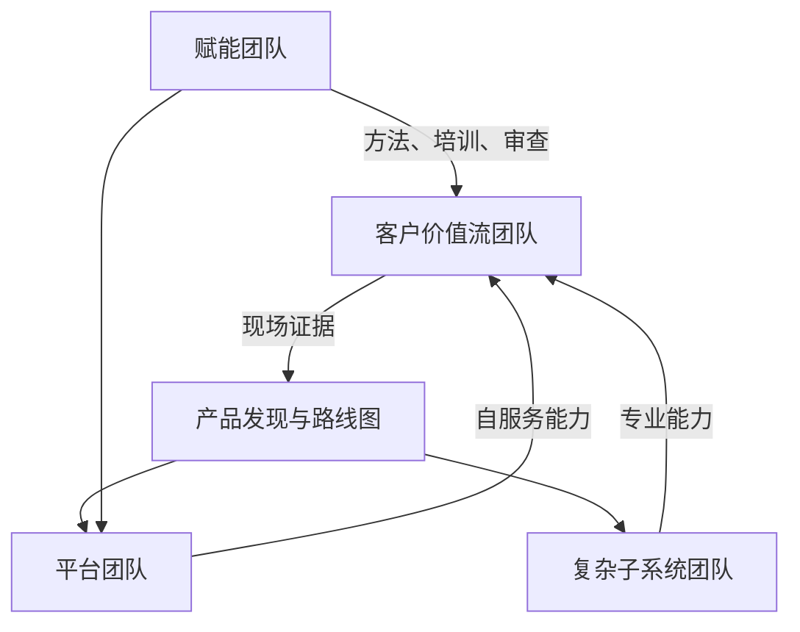

# 第十五章 组织能力与职业发展

FDE 不是单个“万能工程师”的神话，而是一种组织能力：把真实业务现场、产品平台、工程交付、可靠运行和专业伦理连接成可复制的工作系统。随着 AI 采用扩大、数据平台进入更多企业流程，但试点进入核心流程的成熟度仍不均衡，FDE 的价值不再只是快速完成一个客户项目，而是帮助组织识别可规模化的部署模式、把现场经验反馈到产品，并让客户团队最终能够独立运行。

公开岗位说明给出了组织能力的共同信号（快照日期见[快变事实核验表](../appendix/volatile_facts.md)）：从研究突破到生产系统的转化可参考 [OpenAI 的 FDE 岗位说明](https://openai.com/careers/forward-deployed-engineer-nyc/)，嵌入战略客户并把可复用部署模式反馈给产品工程可参考 [Anthropic 的 FDE 岗位说明](https://job-boards.greenhouse.io/anthropic)，招聘标准、培养框架、生产卓越和平台能力则可参考 [Scale AI 的 FDE 管理岗位说明](https://scale.com/careers/4690504005)。这些岗位说明共同显示 FDE 能力模型必须同时覆盖工程深度、业务理解、现场判断、产品抽象和组织学习；本书据此提出后续组织建议。

本章讨论五个主题：FDE 能力模型，招聘、培养与梯队，现场伦理与专业边界，从项目制到产品组织，以及个人职业路径与成长方法。目标是回答一个现实问题：当一个组织同时追求速度、质量、复用和责任时，FDE 应如何被选择、培养、管理和评价。

## 1. FDE 能力模型

### 1.1 能力不是岗位描述的堆叠

FDE 的能力模型要从工作对象出发，而不是从传统职能边界出发。公开岗位说明提供了清晰信号（快照日期见[快变事实核验表](../appendix/volatile_facts.md)）：把前沿模型部署成生产系统的角色定义可参考 [OpenAI FDE](https://openai.com/careers/forward-deployed-engineer-nyc/)；嵌入关键客户、推动 AI 采用，并把可复用部署模式反馈给产品和工程的要求可参考 [Anthropic FDE](https://job-boards.greenhouse.io/anthropic)；招聘标准、培养框架、生产卓越和可复用构件要求可参考 [Scale AI 的 FDE 负责人岗位](https://scale.com/careers/4690504005)。本书据此判断，FDE 不是“会写代码的顾问”，也不是“懂客户的后端工程师”，而是在不完整信息、复杂约束和真实运营压力下，把问题转化为可运行系统的人。岗位页属于高漂移来源，读者用于招聘或能力盘点前应重新核验当前页面。

| 能力域 | 关键行为 | 低成熟度信号 | 高成熟度信号 |
| --- | --- | --- | --- |
| 现场发现 | 识别真实决策、数据、流程和阻力 | 只记录需求清单 | 找到影响业务结果的约束 |
| 工程实现 | 设计接口、数据、权限、评测和部署路径 | 只做演示原型 | 可交接、可监控、可回滚 |
| 产品抽象 | 从单点项目提炼复用模式 | 每个客户重做一遍 | 形成平台能力和模板 |
| 组织协作 | 连接客户、销售、产品、工程、法务与安全 | 靠个人推动 | 建立清晰责任边界 |
| 专业判断 | 在速度、风险和伦理之间取舍 | 为成交牺牲边界 | 能拒绝不可接受方案 |

### 1.2 五层能力从任务到组织影响

评价 FDE 不能只看“交付了多少功能”。现场工作容易制造虚假的忙碌感：会议多、需求急、客户反馈强烈，但这些都不等于工程影响。更可靠的分层方式是看责任半径。第一层是任务执行，能在明确方案下完成配置、集成和修复。第二层是端到端交付，能把模糊问题拆成可验证的版本。第三层是现场架构，能在客户约束下定义数据契约、权限模型、SLO 和上线策略。第四层是产品反馈，能把多个部署中的共性问题转成平台需求。第五层是组织塑造，能建立方法、培养他人并影响商业与工程决策。

| 责任半径 | 证据样例 |
| --- | --- |
| 任务执行 | 明确任务的代码、配置、测试和交付记录 |
| 端到端交付 | 问题切片、验收阈值、上线计划和客户自治/接管证据 |
| 现场架构 | ADR、数据契约、权限模型、SLO、回滚和故障模式清单 |
| 产品反馈 | 多客户共性问题、平台需求、模板或复用组件 |
| 组织塑造 | 方法标准、评审机制、人才培养和跨团队决策记录 |

### 1.3 能力证据必须可审计

成熟组织不应只靠面试印象或客户好评评价 FDE。能力证据应来自可复核产物：发现记录、架构决策、评测集、上线计划、事故复盘、客户培训材料、产品反馈单、复用组件和长期运营指标。软件交付组织的能力、实践和度量可参考 [DORA 研究入口](https://dora.dev/research/) 的长期研究，但团队不应把工程表现简化为个人产出数量。对 FDE 而言，真正的能力证据是“客户现场问题是否被正确建模，系统是否能可靠运行，经验是否能让下一个部署更快、更安全”。如果一个人每次都能救火，但组织没有因此减少同类事故，这不是高级能力，而是组织依赖风险。

## 2. 招聘、培养与梯队

### 2.1 招聘要验证真实场景，而不是背诵框架

FDE 招聘的核心难点是候选人必须同时具备工程深度、客户沟通和不确定性处理能力。简历中的“全栈”“AI”“咨询”“交付”都不足以说明能力。更有效的面试应模拟真实现场：给出一段含噪声的业务背景、一组不完整数据、一条安全限制、一个上线期限，让候选人说明如何澄清目标、识别风险、切分版本、验证成功和处理反对意见。公开岗位说明也支持这种组合能力判断（快照日期见[快变事实核验表](../appendix/volatile_facts.md)）：复杂生产部署和客户合作可参考 [OpenAI](https://openai.com/careers/forward-deployed-engineer-nyc/)，战略客户嵌入与产品反馈可参考 [Anthropic](https://job-boards.greenhouse.io/anthropic)，招聘标准、培养框架、平台能力和生产卓越可参考 [Scale AI 的 FDE 负责人岗位](https://scale.com/careers/4690504005)。招聘不是寻找“什么都做过的人”，而是验证候选人是否能在边界清楚、事实不足、压力真实的环境中做出可解释决策。

| 环节 | 推荐考察 | 证据 | 淘汰信号 |
| --- | --- | --- | --- |
| 工程面 | 架构、数据、接口、可靠性 | 设计取舍和失败模式 | 只追求炫技 |
| 现场面 | 澄清问题、管理客户预期 | 追问顺序和边界意识 | 直接承诺不可控结果 |
| 产品面 | 复用抽象和路线反馈 | 从个案提炼共性 | 每个需求都定制 |
| 伦理面 | 隐私、安全、利益冲突 | 拒绝条件和升级路径 | 把合规视为阻碍 |
| 复盘面 | 从失败中学习 | 具体改进动作 | 只归因于客户或资源 |

一个完整的场景面试可以按三段结构展开：

1. **问题陈述**：客户是一家全国连锁医疗服务集团，正在试点用 AI 辅助分诊客服。业务方希望六周内把预约改期、保险资格初筛和术前注意事项问答接入客服工作台，并声称“只要模型准确率超过 90% 就可以自动回复”。候选人拿到的数据并不完整：三个月客服工单样本只有 2,000 条，其中 18% 缺少最终处理结果；保险字段有多种编码；只有聚合级转化率，没有逐通话耗时；历史投诉只给了摘要，没有原始录音。安全限制也很明确：不得把受保护健康信息发送到未批准的外部服务，不得保存完整身份证件号，不得让模型直接做医疗建议或保险承诺，生产访问必须经过客户安全团队审批。

2. **候选人输出**：期望输出不是宏大方案，而是 45 分钟内完成一页可执行判断。它应包含业务目标、数据缺口、首版范围、安全设计、上线评测、灰度策略、回滚条件和客户自治/接管计划。候选人还应说明哪些能力可沉淀为平台组件，例如受限行业数据接入模板、人工复核工作流和高风险回答评测集。

3. **评分要点**：按证据而不是表达流畅度给分。评分表使用 1-5 分行为锚点，面试官先独立打分再校准；医疗建议自动化、导出未授权原始数据、绕过合规、无人工责任人等红线项直接淘汰。优秀候选人会主动区分业务价值、工程可行性和风险边界，会在数据不足时提出可验证的下一步，会拒绝把模型准确率当作唯一上线门槛，并能把一次部署转成可复用能力。合格候选人能完成基本架构和项目切分，但需要面试官提醒才会补充审计、权限或人工复核。需要谨慎的候选人会给出漂亮架构，却没有说明失败模式、客户责任人、数据授权和上线退出条件。应淘汰的回答包括：承诺六周内全自动上线；建议先导出全部原始数据到个人环境分析；把医疗建议、保险资格和客服话术混在同一个无边界模型中；用“后续再补合规”替代上线前控制；遇到数据缺失时只要求更多数据，而没有提出最小可验证实验。

> 注：该题为构造案例，不影射任何真实客户。

### 2.2 培养应以影子机制和可交付物为中心

FDE 新人不能只靠文档入门。最有效的培养路径是“观察、共担、主导、复盘”：先跟随资深 FDE 参加发现、架构评审和上线会议；再负责低风险模块；随后独立主导一个清晰边界的部署；最后把经验沉淀成模板、检查表或平台需求。每个阶段都要有可交付物，而不是只记录学习时长。新人完成一次客户访谈后，应产出问题地图和假设清单；完成一次原型后，应产出评测标准和弃用清单；完成一次上线后，应产出运行手册、SLO、培训材料和复盘。培养的关键是把隐性判断显性化，让新人理解为什么某些需求不能接、某些捷径不能走、某些指标不能作为成功标准。

### 2.3 梯队设计要避免英雄依赖

本书建议规模化 FDE 组织至少检查四类责任：能稳定交付的执行者，能设计现场架构的主导者，能把部署经验产品化的技术负责人，以及能建立方法和团队能力的组织负责人。梯队建设本身就是 FDE 组织能力的一部分，这一点可从 [Scale AI 的 Director, Forward Deployed Engineering 岗位](https://scale.com/careers/4690504005)对招聘、培养、保留、标准、平台化构件和生产卓越的职责描述中看到。管理者要警惕“最强的人总在最急项目里”的惯性：短期看速度快，长期会造成知识孤岛、质量不稳定和新人无法成长。更好的方式是让高级 FDE 同时承担项目、复盘、模板化和培养责任，并用交付质量、复用率、客户自治/接管成功率和同伴成长来评价影响。

## 3. 现场伦理与专业边界

### 3.1 现场越近，边界越要清楚

FDE 常进入客户的核心流程、敏感数据和组织政治现场，因此伦理不是附加要求，而是工程设计条件。专业伦理可参考 [ACM/IEEE 软件工程伦理准则](https://www.acm.org/code-of-ethics/software-engineering-code)中对公共利益、客户和雇主利益、产品质量、专业判断、管理责任、职业诚信等原则的要求；避免伤害、尊重隐私、保护机密信息和诚实可信等要求也可参考 [ACM 职业伦理守则](https://www.acm.org/code-of-ethics)。对 FDE 而言，这些原则会落到非常具体的问题：客户要求导出超出授权范围的数据怎么办，销售承诺了尚未验证的能力怎么办，模型结果被用于高影响决策却没有人工复核怎么办，现场人员要求绕过审计流程怎么办。越是客户信任你，越不能把信任变成越权。

| 风险场景 | 专业边界 | 必要动作 |
| --- | --- | --- |
| 访问生产数据 | 最小权限、目的限定、留痕 | 走授权流程并记录用途 |
| 演示 AI 能力 | 不夸大准确性和自动化边界 | 标明评测范围和失败模式 |
| 客户要求绕过流程 | 不以效率替代控制 | 升级给安全、法务或责任人 |
| 发现潜在伤害 | 公共利益优先于短期交付 | 暂停、记录、复核、升级 |
| 产品反馈含敏感信息 | 脱敏和最小披露 | 只传递必要模式和证据 |

### 3.2 AI 现场要把风险管理嵌入交付

AI 项目特别容易出现“演示可信、生产脆弱”的错觉。组织可参考 [NIST AI 风险管理框架](https://www.nist.gov/itl/ai-risk-management-framework)，把可信性考虑纳入 AI 产品、服务和系统的设计、开发、使用与评估；NIST 对生成式 AI 安全特征的讨论可参考 [AI RMF 相关资源](https://airc.nist.gov/airmf-resources/airmf/3-sec-characteristics/)。这些特征应按场景权衡，不是机械清单。FDE 不需要把每个项目都变成合规论文，但必须把风险管理转成工程动作：定义不可用场景，设置人工复核点，保存输入输出证据，建立红队测试，限制工具权限，监控漂移与滥用，并在界面上清楚说明系统建议的性质。伦理不是“上线前补一页说明”，而是从发现阶段就影响范围、数据、权限、评测和运营。

高风险场景要先把模型定位为“建议源”，而不是“决策者”。例如客户希望模型根据采购合同、供应商历史表现和制裁名单提示是否批准付款。这个功能可以进入审批流，但不能绕过审批流：模型只生成风险摘要、证据引用和建议等级；付款批准仍由客户授权人完成；界面必须显示“建议不构成最终审批”，并要求审批人选择接受、驳回或要求补充证据。人工复核规则要按风险分层：低金额、低风险建议可以抽样复核；高金额、命中制裁关键词、涉及新供应商或模型置信度低的建议必须双人复核；任何缺少来源证据的建议不得进入自动通过路径。

日志留痕要能回答四个问题：模型看到了什么、建议了什么、谁看过并做了什么决定、后续结果是否证明判断有误。记录内容应包括请求时间、数据版本、提示词和工具版本、检索到的证据标识、模型输出、审批人、审批动作、覆盖理由、异常标记和最终业务结果。日志不应无限制复制敏感原文；能用引用标识、哈希、脱敏字段和受控证据库定位的，就不要把完整敏感内容写入普通应用日志。FDE 要和客户共同确认敏感级别、脱敏/最小化、访问范围、日志保留期限、删除责任人和审计导出方式，避免上线后才发现无法复盘。

红队测试应覆盖正常评测集之外的滥用路径：供应商名称相似导致误匹配，合同条款包含提示注入，导致模型行为被操纵，制裁名单数据过期，审批人复制模型建议而不看证据，模型在证据不足时编造理由，以及用户要求系统绕过复核。红队结论必须转成上线门槛，而不是只写在报告里。可上线的最低条件包括：高风险样本必须进入人工复核；提示注入不能改变工具权限和审批规则；无证据输出必须被拦截；关键日志可追溯；客户责任人已确认误判处理流程。

回滚条件也要提前写清楚。出现以下情况应暂停或降级：高风险建议漏进自动通过路径；关键日志缺失或无法关联审批动作；红队发现可稳定绕过复核；线上误判超过约定阈值；上游名单、合同或权限数据源失效；客户审批人无法区分模型建议和最终决策。回滚不一定等于关闭全部功能，可以先降级为只读提示、只显示证据不显示建议、扩大人工复核比例，或只保留低风险场景。核心原则是：当系统无法证明“谁基于什么证据做了什么决定”时，就不能继续承担高风险决策链路的一部分。

### 3.3 专业边界保护客户，也保护团队

现场关系容易让 FDE 承担不属于自己的责任：替客户做业务审批，替销售解释合同，替法务判断监管义务，替运维长期值守，或替产品承诺路线图。边界不清会制造三类风险。第一，责任错位，真正的业务责任人没有做决策。第二，证据缺失，系统失败后无法说明谁批准了什么。第三，团队不可持续，FDE 变成无限服务接口。正确做法是把边界写进工作机制：每个高风险动作有客户责任人，每个生产权限有审批与到期时间，每个模型能力有适用条件，每个上线承诺有 SLO 和回滚方案。专业不是“什么都帮客户做”，而是在客户压力最大时仍能守住事实、权限和责任。

| 升级条件 | 最终负责方 | 必要证据 |
| --- | --- | --- |
| 生产数据越权或用途不明 | 客户安全 / 数据责任人 | 数据范围、授权记录、访问日志 |
| 销售承诺超出已验证能力 | 产品 / 商业负责人 | 当前评测结果、失败模式、不可承诺边界 |
| 高风险 AI 建议进入自动通过路径 | 客户业务责任人 / 法务 | 审批规则、红队结果、人工复核记录 |
| 需要长期运维代管 | 客户运维责任人 | 自治/接管计划、运行手册、SLO 和升级路径 |

## 4. 从项目制到产品组织

### 4.1 项目成功不等于产品成功

FDE 组织最常见的陷阱是把每次客户部署都当成独立项目。项目制关注范围、期限和验收，适合启动和证明价值；但如果所有知识都停留在项目里，组织会不断重复发现、集成、配置、培训和运维。产品组织关注可复用能力、长期运营、路线选择和用户结果。这个转变不是取消客户定制，而是区分“必须为现场适配的部分”和“应该沉淀成平台的部分”。产品发现可参考 [Atlassian 产品发现指南](https://www.atlassian.com/agile/product-management/discovery)中对理解客户需求和业务背景、并在构建前验证想法的定义；这正是 FDE 从个案进入产品的入口。现场反馈只有被整理成问题模式、使用证据、优先级和边界条件，才会变成产品资产。

| 维度 | 项目制 | 产品组织 |
| --- | --- | --- |
| 成功标准 | 按时交付和验收 | 持续使用、复用和业务结果 |
| 团队边界 | 围绕客户项目临时组队 | 围绕价值流和平台能力长期负责 |
| 知识形态 | 会议纪要和个人经验 | 路线图、组件、模板、评测集 |
| 预算逻辑 | 一次性交付成本 | 生命周期投入与回报 |
| 风险管理 | 上线前集中处理 | 从发现到运营持续控制 |

把项目需求转成平台能力，需要一个固定入口，而不是靠项目结束后的个人记忆。

| 步骤 | 要回答的问题 | 关键证据 |
| --- | --- | --- |
| 现场反馈采集 | 这是真问题还是一次性反馈 | 客户原话、失败截图、配置差异、集成阻塞、人工绕行、业务指标影响 |
| 归类 | 属于客户适配、行业共性、平台缺口、体验缺陷，还是运营/文档问题 | 重复出现的客户/团队、反例、监管和数据所有权差异 |
| 优先级排序 | 是否值得进入平台路线 | 影响客户数、减少工时、降低风险、实现复杂度、是否阻塞当前路线 |
| 路线图翻译 | 能否写成可复用能力 | 负责人、适用边界、不做什么、迁移计划、验收指标、复用场景 |
| 发布后验证 | 下一个部署是否更快、更稳、更少定制 | 采用项目数、首次接入时间、定制代码减少、重复缺陷下降、客户自治/接管时间 |

若一个能力发布后仍需要大量手工解释和项目分叉，说明抽象边界或自服务体验仍然不足。项目到产品的闭环，只有在下一个部署确实更快、更稳、更少定制时才算完成。

### 4.2 组织结构应服务价值流

组织结构可以借用 [Team Topologies](https://www.atlassian.com/devops/frameworks/team-topologies) 的思想：把团队分为面向价值流的团队、平台团队、复杂子系统团队和赋能团队，并让平台团队帮助价值流团队以更高自治度交付。FDE 组织可以据此设计：现场团队贴近客户价值流，负责发现、部署和反馈；平台团队提供身份、数据、评测、可观测性、工作流和部署基础能力；复杂子系统团队处理模型、优化、仿真、数据治理等高专业度问题；赋能团队把安全、产品发现、运行成熟度和 AI 评测方法带给更多团队。小团队早期可以一人兼多种角色，但责任仍要分清；随着规模和风险上升，再把角色拆成长期团队。这样设计的目标不是画漂亮组织图，而是减少等待、重复和认知负荷，让现场问题能更快进入可复用能力。

### 4.3 度量要连接交付流与产品结果

从项目制转向产品组织后，度量也要改变。只看项目毛利、工时利用率或验收数量，会鼓励团队把所有差异都留在客户项目里。更好的度量应同时覆盖交付流、产品复用和运营结果。高绩效技术组织的度量可参考 [DORA](https://dora.dev/research/) 的持续研究，它强调以用户为中心和保持优先级稳定对组织成功的重要性；其[软件交付指标](https://dora.dev/guides/dora-metrics/)已从早期 Four Keys 扩展为五项，包括 deployment rework rate。FDE 可以在此基础上增加现场特有指标：部署模式复用率、客户自治/接管时间、上线后人工介入率、平台缺口关闭周期、从现场反馈到产品发布的时间。每个产品化指标都应有定义公式、owner 和误用防护，例如“复用率”不能鼓励把不合适的客户强行塞进通用模板，“自治/接管时间”不能鼓励提前撤出 FDE 支持。产品化不是把所有东西做成通用功能，而是让下一个客户少付一次相同的学习成本。

## 5. 职业路径与成长方法

### 5.1 FDE 的成长不是离开工程

FDE 职业路径常被误解为“从工程转向客户关系”。真正有长期价值的 FDE 不是工程能力变浅，而是责任对象变宽：从写对一个模块，到让一个客户工作流在生产中可靠运行，再到让多个客户的共性需求进入产品平台。公开岗位说明也显示了这种复合路径（快照日期见[快变事实核验表](../appendix/volatile_facts.md)）：生产系统部署可参考 [OpenAI FDE](https://openai.com/careers/forward-deployed-engineer-nyc/)，部署模式沉淀和产品反馈可参考 [Anthropic FDE](https://job-boards.greenhouse.io/anthropic)，招聘、平台能力、生产卓越和培养框架可参考 [Scale AI 的 FDE 负责人岗位](https://scale.com/careers/4690504005)。职业成长的核心问题不是“我更像工程师还是顾问”，而是“我的判断是否能影响更大的系统、更长的生命周期和更多团队”。

| 阶段 | 主要责任 | 成长焦点 | 典型证据 |
| --- | --- | --- | --- |
| 初级 FDE | 完成明确任务 | 工程基本功和现场纪律 | 可维护代码、清晰记录 |
| 独立 FDE | 端到端交付 | 发现、切分、上线和接管 | 生产上线与复盘 |
| 高级 FDE | 复杂现场架构 | 风险、可靠性和组织协同 | SLO、权限、评测、培训 |
| Staff FDE | 多项目模式沉淀 | 产品抽象和平台反馈 | 复用组件、路线建议 |
| Principal/Lead | 组织能力建设 | 标准、梯队和战略取舍 | 方法体系、人才培养 |

### 5.2 成长方法要围绕证据循环

FDE 的学习速度取决于证据循环，而不是忙碌程度。一个可执行的方法是每个项目都维护四类记录：问题假设、工程决策、运行证据和复用机会。问题假设记录客户真正要改变的业务行为；工程决策记录为什么选择某个架构、模型、权限或集成方式；运行证据记录上线后的稳定性、使用率、人工介入和失败案例；复用机会记录哪些能力应进入模板、平台或产品路线。这个循环让个人成长从“我参与过很多项目”变成“我能解释哪些模式反复出现，哪些取舍被证明有效，哪些失败应被系统性避免”。个人成长也可以借鉴 [Google SRE](https://sre.google/sre-book/service-level-objectives/) 关于 SLO 的思想：目标要可观察，反馈要及时，偏差要进入改进，而不是留在主观感受里。

个人成长档案可以按项目维护，但必须短而具体，避免变成周报归档。一个实用模板如下：

| 字段 | 要记录的问题 | 合格示例 |
| --- | --- | --- |
| 项目假设 | 我认为客户行为会发生什么变化，为什么值得做 | “把合同检索接入审批页后，审批人不再离开系统查共享盘，平均审批时长下降 20%” |
| 关键取舍 | 我放弃了什么，换来了什么 | “首版只支持三类合同模板，换取两周内上线和可控评测范围” |
| 失败证据 | 哪些事实证明原判断不完整或错误 | “上线后一半驳回来自附件缺失，不是检索错误；原方案没有覆盖资料完整性检查” |
| 复用资产 | 哪些产物能让下一个项目少走弯路 | “合同字段映射表、审批日志结构、红队样本、客户培训脚本” |
| 下一次行为改变 | 下个类似项目我会提前做什么不同动作 | “发现阶段先画资料流和责任人，不先讨论模型准确率” |

这份档案的价值不在于记录自己做了多少事，而在于暴露判断质量。项目假设迫使 FDE 说明目标行为，而不是只列功能；关键取舍记录当时为什么不做某些事，避免事后用结果倒推合理性；失败证据让成长建立在反例上，而不是只挑成功故事；复用资产把个人经验转成团队资产；下一次行为改变则把复盘落到可观察动作。管理者评审成长档案时，应看候选人是否能从证据中改变工作方式，而不是看文档写得是否完整。

### 5.3 职业选择要管理广度与深度

FDE 的优势是跨边界，风险也是跨边界。长期成长必须主动管理三种债务。第一是技术债：长期只做现场拼装，会失去架构和编码深度。第二是产品债：长期只满足单个客户，会失去抽象和优先级判断。第三是边界债：长期靠个人关系推进，会失去制度化影响。可持续的职业路径应在每年选择一个深度主题，例如数据治理、LLMOps、可靠性、行业流程、权限模型或产品发现，并在项目中产出可复用资产。晋升叙事也要从“我救了多少火”转向“我减少了多少火”：更短的部署周期，更低的上线失败率，更快的客户自治/接管，更清晰的产品路线，更强的新人培养。FDE 的高级阶段不是成为不可替代的人，而是让正确的方法、工具和判断能被更多人复用。
