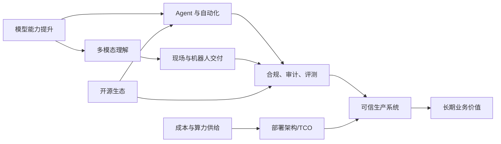
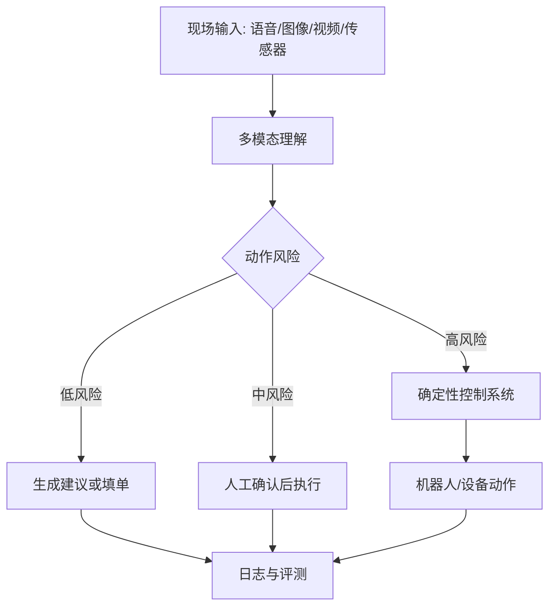
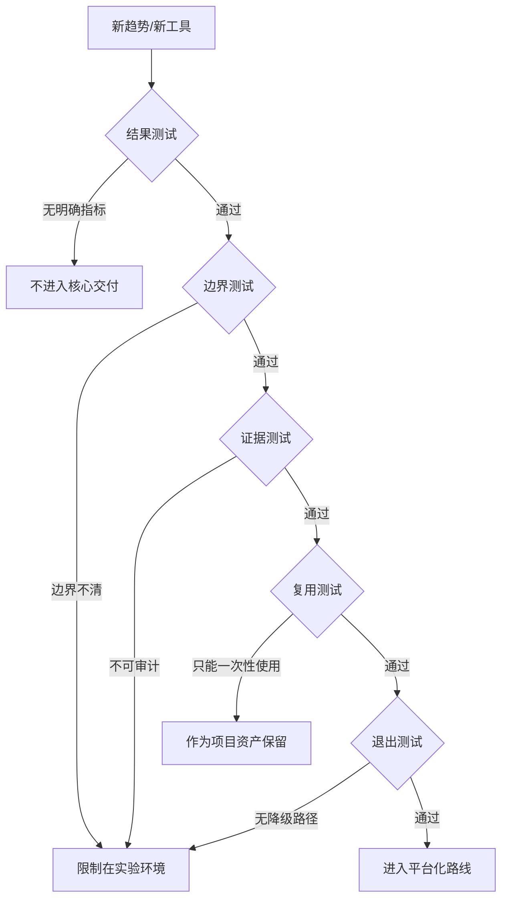

# 第十六章 趋势与未来

FDE 的未来不应被理解为“更多工具替代人”，而应被理解为现场交付边界的重新分配：模型和代理承担更多检索、生成、变更草拟、验证和运维辅助工作；FDE 则把精力转向问题定义、系统边界、治理证据、价值判断和组织采用。这个方向已经有现实基础：例如工具调用、文件搜索、网页搜索和计算机使用等 agent 基础能力可参考 [OpenAI Responses API](https://openai.com/index/new-tools-for-building-agents/)；把自然语言请求转成 Foundry 内的数据管道、Ontology、代码仓库和治理操作的路径可参考 [Palantir AI FDE](https://www.palantir.com/docs/foundry/ai-fde/overview)。

但趋势不是命运。多模态模型、机器人、开源 agent 框架、AI 治理标准和合规自动化都在快速演进，许多能力仍受成本、可靠性、权限、责任和组织接受度约束。本章讨论六类变化：AI FDE 与自动化代理如何改变工程分工，多模态与机器人如何把现场交付推进到物理世界，合规自动化和可信 AI 如何成为生产准入条件，开源生态会带来哪些机会与风险，FDE 如何判断一项新能力是否具备长期价值，以及推理成本与算力供给如何重塑部署架构。后续趋势都用五个测试审查：结果、边界、证据、复用和退出；第 16.5 节会把这套判断正式展开。

本章所有未来判断都按两层表达：已经公开发布、可由官方资料核查的能力写成事实；对行业走向、角色变化和组织影响的判断写成推断，并保留适用条件。

## 1. AI FDE 与自动化代理

### 1.1 从助手到受控执行者

AI FDE 的核心变化，不是把 FDE 变成聊天窗口，而是把现场工程动作拆成可由模型参与的闭环：理解意图、选择上下文、调用工具、观察结果、生成解释、等待确认或继续执行。这一路径可参考 [Palantir AI FDE](https://www.palantir.com/docs/foundry/ai-fde/overview) 的公开描述：用户用自然语言提出请求，系统分析意图、决定 Foundry 操作、执行原生工具，并返回解释和文档；其工具可覆盖数据转换、代码仓库、Ontology 编辑、权限审计和应用构建。构建代理应用时，也可以把 OpenAI 的 [agents 工具](https://openai.com/index/new-tools-for-building-agents/) 作为基础设施，覆盖 Responses API、Web Search、File Search、Computer Use、Agents SDK 和 tracing。

对 FDE 来说，这意味着“会写代码”会逐渐让位于“会定义可执行边界”。代理可以草拟 pipeline、生成接口适配、搜索文档、补测试、分析日志，但它不能替 FDE 决定哪个客户动作可自动执行、哪个数据源可进入上下文、哪个失败需要人工接管。现场系统一旦连接真实权限和生产工具，风险不再是回答错误，而是动作错误。因此 AI FDE 应从低风险、可回滚、可审计任务开始：只读探索、文档解释、变更草案、测试生成、配置检查、运行手册更新。

### 1.2 FDE 的新分工

可以推断，未来高质量 FDE 团队会形成“人定义目标和边界，代理执行可验证子任务”的工作方式。但这个推断成立有前提：组织必须有稳定权限模型、版本化环境、自动测试、可观测性和审计链路。缺少这些基础时，代理只会把不可控脚本执行得更快。成熟团队应把代理接入点设计成工程接口，而不是开放式聊天框。

| 工作层次 | 代理适合承担 | FDE 必须保留 |
| --- | --- | --- |
| 发现 | 汇总材料、提取矛盾、生成访谈问题 | 判断真实业务问题和成功指标 |
| 构建 | 草拟代码、管道、测试、文档 | 定义架构边界和生产约束 |
| 验证 | 运行检查、比较结果、生成回归报告 | 决定是否满足上线证据 |
| 运维 | 解释告警、建议修复、更新手册 | 承担责任、沟通影响、控制变更 |

AI FDE 的价值上限不取决于模型是否“自主”，而取决于组织能否把自主性约束在正确边界内。FDE 要把每个代理动作绑定到身份、权限、预算、环境、回滚和证据。只有这样，自动化代理才会成为生产能力，而不是现场风险的新来源。

短案例：一家企业的数据团队要把“客户退款后 24 小时内仍被计入活跃收入”的口径修正到日级收入管道。业务负责人用自然语言描述变更目标、受影响报表和上线时限，Agent 读取现有数据契约、草拟 SQL transform、补充边界测试，并生成 PR。FDE 不直接让 Agent 合并，而是检查字段血缘、回填范围、权限影响和验收样本后批准进入 CI。第一次 CI 发现历史分区的空值处理会破坏下游毛利率测试，流水线自动阻断发布并回滚临时环境；Agent 根据失败日志提出修正，FDE 复核后再次运行。上线后，PR、测试结果、审批记录、回滚记录、样本对账和监控截图被沉淀到变更证据包中。这个案例的重点不是 Agent 写了多少代码，而是自然语言需求被转成了可审查、可失败、可回滚、可交接的工程闭环。

## 2. 多模态与机器人现场交付

### 2.1 多模态改变现场输入

传统 FDE 多处理文本、表格、日志、接口和会议纪要；多模态模型把现场输入扩展到语音、图像、视频、屏幕、传感器和空间状态。实时语音交互、转写和工具调用可参考 OpenAI 的 [Realtime API 文档](https://developers.openai.com/api/docs/guides/realtime)，实时、音频、图像等能力也在其[模型文档](https://developers.openai.com/api/docs/models)中的多模态/实时模型家族里持续演进。对 FDE 来说，意义不只是“能听能看”，而是现场事实可以更接近原始发生方式：设备面板、操作视频、仓库货位、客服语音、施工照片、巡检记录都可能成为工程输入。

但多模态不是自动可靠。图像识别会受光照、角度、遮挡、分辨率和标注口径影响；语音会受噪声、口音、术语和多人打断影响；视频和传感器会引入成本、隐私、存储和延迟问题。FDE 应避免把多模态作为炫技入口，而要先定义业务动作：识别异常、辅助验收、远程指导、自动填单、质量复核、机器人调度，哪一个动作需要哪种输入，错误会造成什么后果。

### 2.2 机器人把交付带入物理世界

机器人现场交付会让 FDE 面对更硬的边界：物理安全、实时控制、设备维护、网络覆盖、环境变化和人工协作。开源机器人基础设施已形成可复用生态，例如 [ROS 文档](https://docs.ros.org/) 提供 ROS 2、包索引、Docker 镜像、Gazebo 和 Open-RMF 等开发资源。可以推断，多模态模型会更多进入机器人工作流，承担场景理解、任务分解、自然语言交互和异常解释；但底层运动控制、避障、安全停机和设备状态机仍应由确定性系统承担。

FDE 的长期机会，是把物理现场数字化为可治理工作流：输入可追溯、判断可评测、动作可回滚或可停止、责任可分配。其边界也必须清楚：在安全关键场景中，模型只能作为感知和建议层，不能绕过安全控制链路直接驱动设备。

因此，多模态和机器人不会削弱现场工程，反而会提高现场工程门槛。团队需要同时理解模型能力、传感器误差、网络条件、设备协议、作业安全和人类操作习惯。未来更有价值的 FDE，不是能把聊天界面接到摄像头的人，而是能判断哪些物理动作可以自动化、哪些必须人工确认、哪些场景必须保持机械和软件双重保护的人。

短案例：制造/仓储现场希望减少夜班巡检漏检。团队在货架通道部署固定摄像头和手持终端，巡检员可以拍摄托盘照片、口述“第三排疑似破损、温控灯闪烁”，系统把图像、语音转写、货位编码和历史工单合并成巡检候选事件。模型负责识别破损包装、堵塞通道、异常指示灯和语音中的设备编号，但 FDE 明确把误识别风险写进流程：低置信度、遮挡严重、涉及停线或安全隔离的结果必须人工确认；只有“补拍照片、创建工单、提醒复核”这类低风险动作可自动执行。机器人可以移动到指定货位、调整摄像头角度、上传更多证据，但不能直接拉闸、搬运危险品或解除安全锁。结果是漏检率下降、工单证据更完整，代价是高风险动作仍保留人工确认阈值和机械安全链路。这种取舍看似降低自动化程度，实际提高了客户愿意长期运行系统的可信度。

## 3. 合规自动化与可信 AI

### 3.1 可信不是声明，而是证据链

AI 进入现场生产后，合规不会停留在隐私政策和上线审批。它会进入需求、数据、模型、评测、部署、运行、告警、事故和退役的完整生命周期。AI 风险管理可按 NIST [AI RMF Core](https://airc.nist.gov/airmf-resources/airmf/5-sec-core/) 拆成 Govern、Map、Measure、Manage 四类功能，并贯穿 AI 系统生命周期；AI 管理系统的建立、实施、维护和持续改进要求可参考 [ISO/IEC 42001](https://www.iso.org/standard/81230.html)。欧盟 [AI Act](https://eur-lex.europa.eu/legal-content/en/TXT/?uri=CELEX%3A32024R1689) 已经把高风险 AI、透明度、通用 AI 模型和监管责任推向制度化方向。FDE 不必把自己变成法律专家，但必须把合规要求翻译成工程证据。

可信 AI 的现场证据至少包括：数据来源和授权、训练或配置记录、模型版本、提示词版本、评测样本、失败样例、人工复核规则、权限矩阵、日志保留、用户告知、异常升级、回滚与停用条件。若系统会执行动作，还要记录工具调用、参数、审批人、执行结果和业务影响。合规自动化的目标不是生成更多表格，而是让这些证据自然来自交付流水线和运行系统。

EU AI Act 已于 2024 年 8 月 1 日生效，并按阶段适用：2025 年 2 月 2 日起适用禁用 AI 实践和 AI 素养等一般要求；2025 年 8 月 2 日起适用通用目的 AI 模型规则和治理安排；透明度规则按官方时间线于 2026 年 8 月生效（以最终 Digital Omnibus 文本为准；2026-05 政治协议调整了部分 Annex III 时点，需对照最新 EU AI Act timeline 服务页核验）。欧盟在 [AI Act 实施页面](https://digital-strategy.ec.europa.eu/en/policies/regulatory-framework-ai)中还说明，后续 AI omnibus 政治协议/简化方案将部分高风险系统时间线拆开：Annex III 某些高风险领域（如生物识别、关键基础设施、教育、就业、移民与边境控制）规则适用时间为 2027 年 12 月 2 日；嵌入受监管产品（如升降机或玩具）的高风险 AI 系统规则适用时间为 2028 年 8 月 2 日。现场交付应以最终法规文本和客户法域为准，把法规版本、适用日期和客户法域作为证据包的一部分。

高风险系统要分清两条路径：一类来自 Annex III 高风险使用场景，例如边境管理、执法、就业筛选、教育评价和关键基础设施；另一类来自 Article 6(1) 与 Annex I 的受监管产品路径，例如安全相关产品组件、自动驾驶或医疗器械中的 AI 能力。FDE 的工程任务，是先判断系统是否可能影响健康、安全或基本权利，再把合规证据映射到可运行清单：数据清单记录来源、授权、代表性、脱敏和保留；模型清单记录模型版本、用途、评测、漂移和已知限制；Agent 工具清单记录工具白名单、权限、审批规则、输入输出 schema 和禁止动作；运行事件清单记录每次调用、人工介入、告警、事故、回滚、停用和用户解释请求。没有这些清单，合规讨论会停留在抽象承诺；有了这些清单，合规才可能被测试、审计和交接。

### 3.2 自动化合规的边界

OWASP [LLM Top 10](https://owasp.org/www-project-top-10-for-large-language-model-applications/) 把提示注入、过度代理、过度依赖等列为 LLM 应用风险；Palantir 在 [AI FDE 安全与治理文档](https://www.palantir.com/docs/foundry/ai-fde/security-and-governance)中强调代理使用用户现有身份和权限，并对变更操作要求显式确认。这些实践指向同一原则：可信 AI 不是在模型外包一层“安全提示词”，而是把身份、权限、审批、日志和评测放进系统结构。

| 合规对象 | 自动化证据 | 不能自动化替代的判断 |
| --- | --- | --- |
| 数据 | 来源、授权、代表性、脱敏、保留策略 | 数据使用目的是否正当 |
| 模型 | 版本、用途、评测、漂移、已知限制 | 风险是否可被业务接受 |
| Agent 工具 | 工具白名单、权限、审批、调用日志、禁止动作 | 高影响动作是否应开放 |
| 运行事件 | 调用、人工介入、告警、事故、回滚、停用记录 | 是否暂停或下线系统 |

可以推断，未来 FDE 的竞争力会越来越取决于“合规即代码”和“治理即运行数据”的能力。但边界必须明确：自动化可以降低证据收集成本，不能消除责任主体；可以提示风险，不能替组织承担伦理、法律和业务后果。

## 4. 开源生态的机会与治理

### 4.1 开源降低现场试错成本

FDE 工作天然依赖异构系统：数据管道、容器平台、可观测性、模型网关、向量检索、Agent 编排、权限集成、文档系统和 CI/CD。开源生态的价值，不只是免费，而是让团队在客户现场保留可检查、可替换、可迁移的技术边界。容器平台可参考 CNCF 托管的 [Kubernetes](https://kubernetes.io/docs/)；遥测框架可参考供应商中立的 [OpenTelemetry](https://opentelemetry.io/docs/)，它用于生成、采集和导出 traces、metrics、logs 等遥测数据；LLM 应用与外部数据源和工具的集成则可参考开放协议 [Model Context Protocol 2026-07-28 specification](https://modelcontextprotocol.io/specification/2026-07-28)（MCP 自 2024-11 首发后多次迭代，本文固定引用当前修订版 2026-07-28 spec）。这些项目共同降低了“每个客户从零对接”的成本。

开源对 AI FDE 尤其重要。模型和平台变化快，单一供应商接口可能让现场系统难以迁移。开源协议、SDK、评测框架、观测标准和部署基座能把可变部分限制在适配层。FDE 应优先把通用能力沉淀到开放边界：数据契约、工具描述、评测样本、trace schema、权限映射、模型路由、运行手册，而不是把客户逻辑锁进某个闭源控制台。

### 4.2 开源不是无治理

开源 AI 的边界比传统软件更复杂。Open Source Initiative 在 2024 年发布 [Open Source AI Definition 1.0](https://opensource.org/blog/the-open-source-initiative-announces-the-release-of-the-industrys-first-open-source-ai-definition)，强调需要足够信息让有能力者能用相同或类似数据重建实质等价系统。这提醒 FDE：开放权重、开放代码、开放数据、开放许可证和可商业使用不是同一件事。把“可下载模型”直接称为开源，可能在合规和客户承诺上造成误导。

| 许可证 | 商用允许 | 再分发条件 | 主要限制条款 |
| --- | --- | --- | --- |
| Apache 2.0 | 是 | 保留版权声明与 NOTICE，注明修改 | 含专利授权与终止条款 |
| MIT | 是 | 保留版权与许可声明 | 无附加使用限制 |
| OpenRAIL（如 BigScience RAIL） | 是 | 下游需附带相同使用限制 | 列举禁用场景（武器、监控、歧视等） |
| Llama 4 Community License | 是（受条件约束） | 必须包含 Meta 协议与商标说明；若用 Llama 4 材料或输出创建、训练、微调或改进并分发 AI 模型，模型名需以 `Llama` 开头 | MAU > 7 亿需另行授权，并需保留 attribution/notice、遵守可接受使用政策；Llama 4 多模态模型的 Section 1(a) 权利不授予欧盟居民个人或主营业地在欧盟的公司，但该限制不适用于集成这些模型的产品或服务的终端用户（该条款载于可接受使用政策而非许可协议正文） |
| Gemma Terms of Use（Gemma 1-3/3n 等） | 是 | 转发 Google 的使用条款与禁用清单 | 受 Google Prohibited Use Policy 约束，包含模型衍生与禁用用途要求 |
| Gemma 4 Apache 2.0 | 是 | 保留 Apache 2.0 要求的版权、许可与 NOTICE | Google 2026 年发布的 Gemma 4 改用 Apache 2.0；选型时仍需核对具体模型卡与分发包 |

该表按各许可证的公开版本整理（快照日期见[快变事实核验表](../appendix/volatile_facts.md)），具体条款以官方文本、模型卡和实际下载包为准；FDE 在为客户选型时应让法务复核而非按表照搬。触发刷新条件包括模型新版本、许可证变更、分发渠道变化、客户使用范围变化和再分发计划变化。

短案例：一家客户希望把客服摘要模型从闭源 API 迁到“开源模型”，理由是成本更低且可私有化部署。FDE 没有只看排行榜，而是把候选项拆成四个问题：许可证是否允许客户的商业使用和再分发；训练数据或数据说明是否足够支撑合规承诺；开放的是权重、推理代码、训练代码还是完整可复现材料；如果质量、成本或政策变化，是否有退出到其他模型或供应商的路径。评估后，团队选择了一个开放权重模型作为第一阶段替代，但在合同和架构中明确写成“开放权重部署”，没有承诺其等同于开源；同时保留模型路由、评测集、提示词版本和输出审计，使客户将来可以迁移。这个案例说明，开放权重可以是好的工程选择，但不自动满足开源治理、数据来源和商业使用要求。

| 开源机会 | FDE 应利用 | 主要风险 |
| --- | --- | --- |
| 基础设施 | Kubernetes、OpenTelemetry、CI/CD、IaC | 版本漂移、运维责任不清 |
| Agent 协议 | MCP、工具 schema、上下文接口 | 权限扩大、工具冒名、注入 |
| 模型生态 | 本地模型、开放权重、评测集 | 许可证、数据来源、质量波动 |
| 应用框架 | RAG、工作流、可视化组件 | 过度封装、生产能力不足 |

可以推断，未来 FDE 团队会更像“开源组合工程师”：从生态中选择可验证组件，把它们纳入企业权限、测试、审计和运营体系。长期优势不来自追逐最多框架，而来自知道哪些边界必须开放，哪些责任必须由团队自己承担。

## 5. 判断长期价值

### 5.1 不用新奇性衡量未来

趋势判断最容易犯的错误，是把技术热度当成长期价值。FDE 面对 AI FDE、多模态、机器人、开源协议和合规自动化时，不能只问“是否先进”，而要问“是否让现场结果更可持续”。一个能力只有同时改善业务结果、工程可维护性、组织采用和治理证据，才值得进入核心交付体系。否则它可能只是一次成功演示：短期让客户兴奋，长期增加依赖、成本和责任不清。

长期价值应从反事实开始评估：如果不引入这项能力，问题会如何继续发生；如果引入，哪个瓶颈被消除；如果模型、供应商或政策变化，系统是否还能运行；如果 FDE 离开，客户团队是否能维护。这个判断比 ROI 表更硬，因为它直接面对可持续性。OpenAI 和 Palantir 的代理能力说明工具执行正在增强，但官方资料同时强调工具、上下文、权限、trace、审批和治理；这意味着可控性本身就是价值的一部分，而不是上线后的补丁。

### 5.2 长期价值的五个测试

FDE 可以用五个测试筛选未来能力。第一，结果测试：它是否改善一个明确业务指标，而不是只提升体验感。第二，边界测试：它是否有清楚的输入、输出、权限、失败模式和回滚方式。第三，证据测试：它是否能自动留下评测、日志、审批和运行记录。第四，复用测试：它是否能沉淀为模板、组件、协议或方法，而不是一次性定制。第五，退出测试：当模型不可用、成本上升或供应商变化时，系统是否有降级路径。

任何进入平台路线的新能力，都应先写一页决策备忘录：事实来源与核验日期、要验证的假设、目标业务指标、输入/输出/权限边界、证据字段、owner、TCO 基线、复审日期和退出路径。没有这份备忘录，趋势判断容易从工程决策滑向采购偏好或演示偏好。

反例：某团队把一个会议纪要 Agent 快速接入客户项目管理系统，演示时能自动总结讨论、创建任务、提醒负责人，看起来节省了 FDE 的会后整理时间。但按五个测试复盘，它没有通过任何一项：结果测试上，只统计了“生成任务数”，没有证明延期率或返工率下降；边界测试上，Agent 可以读取所有项目空间并创建任务，却没有区分建议、草稿和正式任务；证据测试上，没有保存原始会议片段、任务生成依据和人工修改记录；复用测试上，提示词写死了该客户的组织称谓和项目字段；退出测试上，一旦模型费用上升或接口停用，团队没有人工回填流程和历史映射。正确处理方式不是扩大试点，而是退回到草稿模式，先补指标、权限、日志、模板和降级路径。

对未来的合理态度，是积极但不迷信。可以推断，FDE 的角色会被 AI 显著增强，部分低层交付动作会被代理承担；但客户现场最稀缺的仍是判断力：知道该解决什么、何时停止、谁承担责任、哪些证据足以交付、哪些局部成功不应产品化。长期价值不是工具替代人，而是让人把工程判断放在更高杠杆的位置。

最后，还要警惕“平台化幻觉”。不是每个现场需求都值得沉淀为平台能力，也不是每个自动化都值得长期维护。判断长期价值时，应把维护成本、责任成本、培训成本和退出成本一并计算。只有当某项能力能被多个团队复用，并且复用不会掩盖关键差异时，它才适合进入平台路线；否则，把它保留为项目经验、模板或案例，反而更符合 FDE 的工程理性。

## 6. 推理成本与算力

### 6.1 推理成本曲线正在改写部署经济

公开价格页显示，AI 推理计费口径已经明显分化；历史降价趋势需要按具体模型、日期和 SKU 逐项核验，不能用一句“单位 token 下降”替代版本化测算。以 [OpenAI 价格页](https://openai.com/api/pricing/)、[Anthropic 价格页](https://claude.com/pricing) 与 [Google Gemini Enterprise Agent Platform 价格页](https://cloud.google.com/gemini-enterprise-agent-platform/generative-ai/pricing) 为例，输入、缓存输入、输出、批处理、长上下文和工具调用可能采用不同计价口径。部分平台还会把 web search/grounding、file 或 vector store 存储、code/container session、上下文缓存存储、guardrail/eval、媒体生成、人工评审或数据自动化按独立 SKU 计费。企业部署中 token 用量也会因 RAG、长上下文与 agent 链式调用上升。FDE 在估算成本时不能只看“每百万 token 多少美元”，需要把单次任务平均 token 数、输出长度、重试率、缓存命中率、批处理折扣、工具调用次数、存储/会话时长和人工复核成本一同建模。

### 6.2 专用芯片改变本地推理选项

算力选型不能只看峰值 FLOPS。FDE 更关心模型是否能跑、延迟是否达标、供应是否稳定、客户是否能运维、框架和驱动是否被团队掌握。下表用于现场初筛，具体采购仍要以客户云区、供应合同、出口管制、框架兼容和压测结果为准。

| 算力路线 | 代表产品 | 更适合的场景 | 现场核验点 |
| --- | --- | --- | --- |
| NVIDIA Hopper 存量集群 | [H100](https://www.nvidia.com/en-us/data-center/h100/)、[H200](https://www.nvidia.com/en-gb/data-center/h200/) | 现有云区或客户机房已经大规模部署，需要成熟 CUDA/NCCL/vLLM/TensorRT-LLM 生态 | GPU 配额、互连拓扑、显存容量、驱动/CUDA 版本、现有调度器和成本基线 |
| NVIDIA Blackwell / rack-scale | [GB200 NVL72](https://www.nvidia.com/en-sg/data-center/gb200-nvl72/)、[GB300 NVL72](https://www.nvidia.com/en-gb/data-center/gb300-nvl72/)、B200/GB200 系列；Rubin/Vera Rubin 影响 2026+ 容量规划 | 大上下文、高并发、训练/推理混部或 hyperscaler 托管的前沿模型服务 | 液冷/供电、NVLink 域、交付周期、云厂商可用区、现有镜像和推理栈兼容；区分已可采购、区域可用和已发布路线图 |
| AMD Instinct | [MI300X / MI325X](https://www.amd.com/en/products/accelerators/instinct/mi300.html)、[MI350 Series / MI350X / MI355X](https://www.amd.com/en/products/accelerators/instinct/mi350.html) | 希望降低 NVIDIA 依赖、已有 ROCm 经验、需要大显存推理或多云议价能力 | ROCm/框架兼容、算子覆盖、CDNA 4/MI350 系列软件成熟度、供应商支持、推理服务镜像、团队调优经验 |
| AWS 自研芯片 | [Trainium2 / Trn2](https://aws.amazon.com/ec2/instance-types/trn2)、[Trainium3 / Trn3](https://aws.amazon.com/ec2/instance-types/trn3/)、[Inferentia2 / Inf2](https://aws.amazon.com/ec2/instance-types/inf2/) | 已在 AWS，长期稳定高并发，愿意适配 Neuron SDK 以降低单位推理/训练成本 | Neuron 编译路径、支持模型列表、区域供给、EKS/SageMaker 集成、迁移和回退成本 |
| Google TPU | [TPU v5e/v5p/v6e Trillium](https://docs.cloud.google.com/tpu/docs/v6e)、[TPU7x / Ironwood](https://docs.cloud.google.com/tpu/docs/tpu7x) | 已在 GCP/Agent Platform/GKE，JAX、TensorFlow 或 Gemini 生态适配较好 | 模型框架、切分方式、TPU 拓扑、GKE/Agent Platform 路径、数据驻留和排障能力；区分当前代际、公告状态和客户所在区域可用性 |
| 低延迟推理 ASIC | [Groq LPU](https://groq.com/blog/the-groq-lpu-explained)、[Cerebras WSE-3](https://www.cerebras.ai/press-release/cerebras-announces-third-generation-wafer-scale-engine/)、[Tenstorrent Blackhole/Wormhole](https://tenstorrent.com/hardware/cards) | 对 token 生成延迟、吞吐或特定供应链有强要求，愿意接受平台生态差异 | 支持模型、API/自托管路径、批处理能力、成本模型、长期供应和退出方案 |
| 国产/主权算力 | [华为昇腾 Atlas/Ascend](https://e.huawei.com/cn/products/computing/ascend)、昇腾 910B/910C 生态 | 中国法域、国产化、数据出域受限或特定采购目录要求 | CANN/MindSpore/框架适配、模型迁移、供应与服务、性能压测、监管和采购限制 |

这些路线的实际经济性取决于：模型是否有官方/社区编译路径、批大小与延迟约束、是否需要长上下文 KV 缓存、跨区域出口成本、可观测性与调度工具成熟度，以及自有运维人力。对 FDE 来说，最稳的交付物不是“选某块卡”，而是保留模型路由、压测脚本、容量模型和回退路径。

### 6.3 本地小模型 vs API 的决策框架

| 决策维度 | 倾向 API（Claude / GPT / Gemini） | 倾向本地或专用部署 |
| --- | --- | --- |
| 数据敏感度 | 已有 DPA 与 BAA 覆盖 | 数据不可出客户网络 |
| QPS 与峰值 | 突发、低均值 | 长期稳定高并发 |
| 任务难度 | 需要前沿推理或多模态 | 任务窄、可用 7B-70B 蒸馏 |
| 迭代速度 | 模型更新频繁、想跟随 | 锁定版本、强可复现性 |
| 总成本规模 | API 支出低且波动大 | 稳定高吞吐，经 TCO 测算超过自建折旧 + 托管 + 运维线 |
| 运维成熟度 | 团队无 GPU/推理栈经验 | 已有 MLOps 或平台团队 |

FDE 应在客户现场做一次简单的 TCO 测算：API 月度成本 vs（GPU 硬件折旧 + 托管 + 运维 FTE + 模型授权），并设置一个 6-12 个月复评点。决策不需要永久，但需要显式。

### 6.4 对 FDE 部署架构的影响

1. **模型路由层成为默认评估项**：在多模型、多租户、成本敏感或合规要求场景中，网关层应评估按任务复杂度、租户、成本预算路由到不同模型（前沿 API、区域 API、本地小模型），并暴露统一观测与计费维度。
2. **缓存与短路至关重要**：提示缓存通常不会减少请求中携带的 token 数，而是让重复前缀按缓存输入价计费并降低延迟；答案缓存、向量结果缓存和工具调用结果缓存才可能直接减少后续请求、检索或工具执行。架构上应分别记录 `input_tokens`、`cached_input_tokens`、`output_tokens`、工具调用次数和缓存命中率，而不是只看总 token。
3. **预算守门进流水线**：把“单次任务成本上限”“租户日预算”“模型升级回归预算”作为评测项，避免新模型上线后悄悄翻倍。
4. **算力供给作为风险维度**：GPU 供应、区域配额、合同 commitment 都可能成为上线瓶颈，FDE 应与客户采购、云厂商架构师同步排期，而不是在切流前才发现配额不够。

推理成本与算力不再是“后端工程师独立处理的事”。FDE 的现场设计必须把成本曲线、芯片选项与运维能力一起放进可交付架构里，让客户在 12 个月后仍能解释每一笔 AI 支出。
