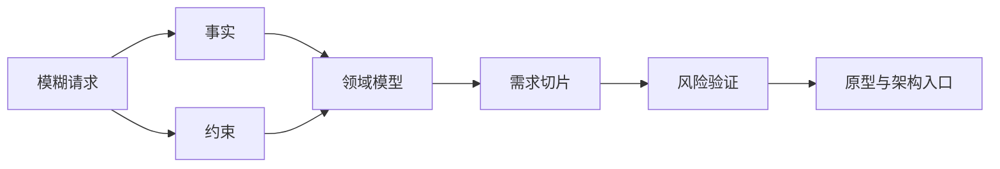
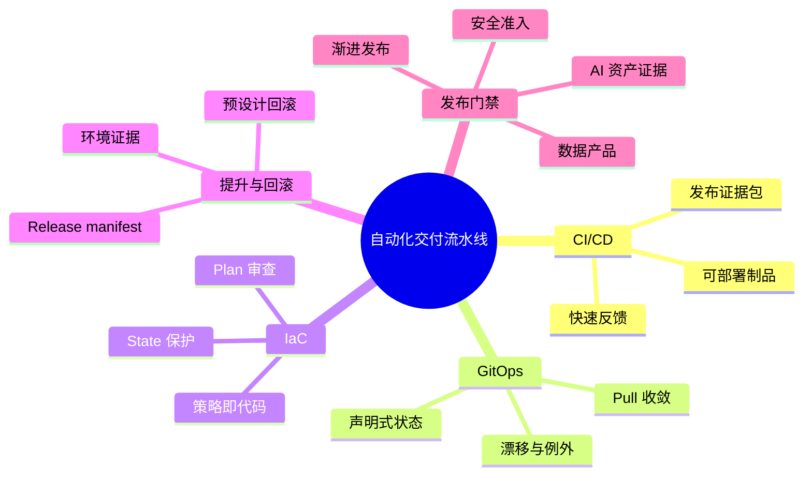
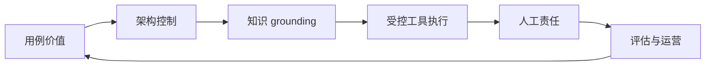
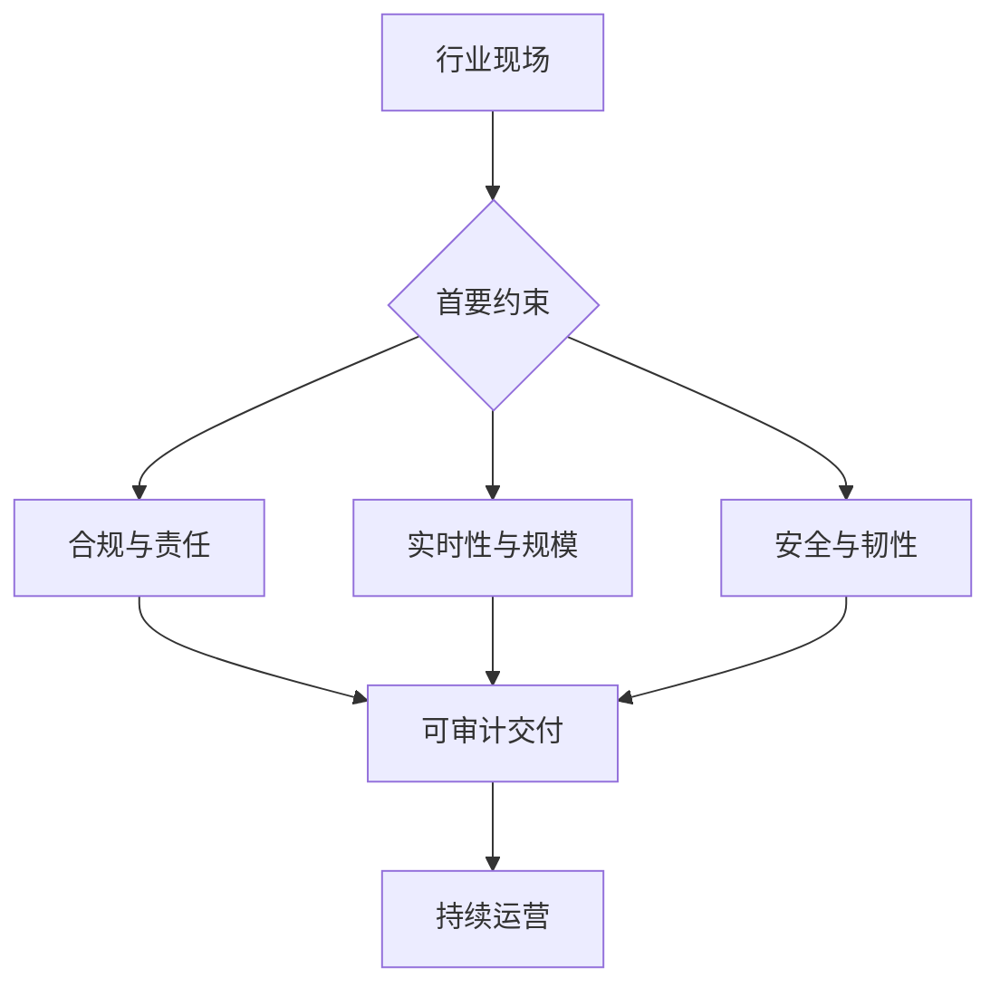

# 第十八章 全书总结

## 第一章 FDE 的角色边界

### 1.6.1 角色边界决定交付质量

本章讨论了 FDE 的出现背景、现场嵌入方式、相邻角色分工和价值闭环。FDE 的核心不是“到客户现场写代码”这么简单，而是在复杂组织环境中把问题发现、工程交付、生产运行、指标验证和产品反哺连成闭环。Palantir 将 FDE [视为一种产品开发范式](https://www.palantir.com/docs/foundry/architecture-center/platforms/)；OpenAI 与 Anthropic 的公开材料也显示，AI 公司正在通过 FDE/类似职位[推动前沿模型进入生产场景](https://openai.com/business/the-openai-deployment-company)。这些公开资料共同说明，FDE 的价值来自现场学习速度、工程闭环能力和可复用沉淀能力。

FDE 不是售前工程师、解决方案架构师、专业服务、SRE、平台工程师或客户成功的替代品。它更像一个高密度接口，把相邻角色的输入整合成可运行系统，并把现场信号转回产品和平台。若没有清晰边界，FDE 很容易退化成无边界救火、临时脚本堆积或高成本定制；若边界清晰，它可以成为企业 AI 和复杂软件落地中最关键的反馈通道。

| 本章问题 | 关键结论 |
| --- | --- |
| FDE 为何出现 | 企业软件价值从功能交付转向生产化结果，传统角色之间存在现场闭环缺口 |
| 如何现场嵌入 | 进入真实工作流，处理数据、权限、流程、运行和采用约束 |
| 如何与相邻角色分工 | 不替代相邻角色，而是在高不确定性交付阶段承担整合责任 |
| 如何判断成功 | 同时衡量交付速度、运行质量、用户采用和复用沉淀 |
| 如何识别反模式 | 警惕驻场化、定制陷阱、影子 SRE、PPT 顾问化和演示模型化等退化形态 |

### 1.6.2 进入下一章

下一章将进入 FDE 的第一项基本功：现场问题发现。角色边界回答“谁负责什么”，问题发现回答“什么问题值得做”。在真实项目中，错误的问题定义会让后续架构、数据、AI、交付和运维全部失焦。因此，FDE 必须先学会在客户现场建立事实、识别约束、形成领域语言，并把模糊诉求切成可验证的工程问题。

## 第二章 现场问题发现

现场问题发现的核心，是把模糊请求转化为可验证的工程入口。本章从五个动作展开：业务场景进入、事实收集与约束识别、领域语言与流程建模、需求切片与优先级、风险假设与验证计划。它们共同解决一个问题：在投入真实工程资源前，团队是否知道自己正在改变什么、为什么改变、受哪些边界约束、如何判断第一步做对了。

FDE 不是被动记录需求的人，也不是带着预设方案进入现场的人。它要在现场建立证据链：从业务触发事件到成功指标，从系统与数据事实到组织约束，从领域术语到流程状态，从候选切片到验收条件，再从风险假设到验证实验。这个证据链越清晰，后续原型、试点和生产化越不会陷入范围膨胀或责任漂移。

本章引用的外部依据可以转成几类动作：用 DORA 的 [DevOps capabilities](https://dora.dev/capabilities/) 观察系统级交付与运营能力；用 Martin Fowler 的 [Bounded Context](https://martinfowler.com/bliki/BoundedContext.html) 处理领域语言边界；用 [Atlassian User Stories](https://www.atlassian.com/agile/project-management/user-stories) 和 [Scrum Guide 2020](https://scrumguides.org/scrum-guide.html) 组织目标、价值和可检验增量；用 NIST [SP 800-30 Rev.1](https://csrc.nist.gov/pubs/sp/800/30/r1/final)、OWASP 的 [Threat Modeling](https://owasp.org/www-community/Threat_Modeling) 和 [LLM Top 10 2025](https://genai.owasp.org/llm-top-10/) 把风险转化为可讨论、可验证、可缓解的模型。

| 本章产物 | 判断标准 |
| --- | --- |
| 现场地图 | 能说明角色、流程、系统、数据和异常路径 |
| 事实与约束清单 | 每条结论有来源，每个未知项有验证动作 |
| 领域语言包 | 关键术语、状态、事件、上下文 owner 和边界无明显歧义 |
| 需求切片 | 小而完整，包含用户、价值、验收、不做事项和决策 owner，并明确采用形态（规则/自动化/智能体） |
| 验证计划 | 每个实验都有阈值，结果能改变后续决策 |
| 数据与运行边界 | 样本授权、脱敏方式、审计字段、人工接管和告警 owner 明确 |

进入下一章之前，团队应避免急于承诺完整架构。更稳妥的做法，是带着本章产物讨论系统边界、集成方式、数据契约和架构取舍：哪些能力需要现在建设，哪些只需验证，哪些必须明确不做。

## 第三章 系统思维与架构取舍

第三章讨论的是 FDE 从“把功能做出来”走向“把系统交付出来”的关键能力。系统思维并不要求一开始就画出宏大的目标架构，而是要求每个现场判断都能落到边界、决策、集成、契约和债务这五类问题上，并能从第二章的现场证据进入第四章的交付门禁。

本章的核心结论有五点。第一，系统边界应由责任、数据所有权、变化频率、运行约束、权限合规和沉淀路径共同决定，而不是由页面、工单或组织偏好决定。第二，关键架构决策必须记录背景、备选方案、后果、风险接受、回滚边界和复审条件，否则未来团队只能从代码倒推意图。第三，FDE 应优先验证真实集成路径，尽早暴露身份、数据、失败、审计、所有权、重放和接管问题。第四，接口是组织之间的长期承诺，应通过契约、版本、兼容策略、mock、测试和监控共同维护，尤其要防止事件、数据和工具契约漂移。第五，技术债不是坏代码的别名，而是有意识借用未来成本的工程取舍；它必须可见、可复审、有人接受风险，并在安全、数据正确性、运行恢复和规模化受阻前被偿还。

后续章节会在这些原则上展开交付节奏、团队协作和工程底座。没有清晰边界，协作会变成反复协调；没有决策记录，架构会变成口头传统；没有集成优先，原型会停留在演示；没有契约治理，系统会被隐式依赖拖住；没有债务管理，短期速度会转化为长期停滞。完成本章后，团队至少应能拿出五类交付输入：一张边界图、一条关键 ADR、一条生产等价集成路径、一组契约与测试样例、一份有 owner 和到期日的债务清单。

## 第四章 交付节奏与团队协作

第四章讨论的是 FDE 交付中最容易被低估的部分：团队如何协作，交付节奏如何服务决策，系统如何从原型进入生产，现场反馈如何转成可管理的变更，客户如何从依赖外部团队走向自治。小队模型的关键不是头衔齐全，而是责任闭环清楚；RACI、验收样例、项目决策日志、ADR 和生产责任人，都是为了减少跨组织交付中的等待和误解。

原型、试点和生产化必须分开看。原型验证假设，试点验证真实流程，生产化验证长期运行能力。真实数据试点前就要完成轻量治理准入，进入生产前还要检查工程、运行、治理和业务四类证据，避免把一次成功演示误认为稳定系统。反馈循环也要进入工程系统，区分事实、价值、可用性和风险，并处理脱敏、访问、保留期和下游流转，避免把所有声音都变成范围膨胀或影子数据资产。

变更管理的目标不是拖慢团队，而是让不同风险等级的变更走不同路径。低风险变更应快，高风险变更应清楚，紧急变更应有爆炸半径、时限、恢复验证和事后闭环。知识转移则贯穿整个项目：客户不仅要会使用系统，还要能理解边界、处理常见异常、维护运行资产并持续改进。撤场验收要验证这些能力已经落到客户侧责任人、复核周期和可复核证据上。FDE 的最终成果不是一套交付物，而是客户组织获得一套可运行、可治理、可演进的工程能力。

| 本章主题 | 核心方法 | 交付判断 |
| --- | --- | --- |
| 小队协同 | 跨职能小队、RACI、明确唯一负责者 | 决策路径清楚，问题能快速升级 |
| 交付节奏 | 每日检查、每周评审、扩面评审、发布准备、自治复盘 | 关键事实能按时进入决策 |
| 生命周期 | 原型、试点、生产化分阶段推进 | 每阶段有独立退出标准 |
| 反馈与变更 | 证据化反馈、风险分级变更 | 快速学习且影响可控 |
| 客户自治 | ADKAR、陪跑、运行资产产品化、撤场验收 | 客户能独立完成真实操作并接手责任 |

回到 AI 工单分流助手：好的交付不是把模型接进客服系统，而是让客户知道谁能授权数据、谁能决定扩面、何时该降级成人工建议、反馈如何进入评测和变更、撤场后谁能解释告警和处理误分流。只有这条责任链闭合，系统才算真正进入客户组织。

## 第五章 云原生运行底座

第五章讨论的是 FDE 系统进入生产后最基础的一层能力：如何把应用、平台和客户环境组织成可重复、可治理、可恢复的运行底座。容器把应用及其依赖封装为可复现的交付单元，但容器本身不能替代版本治理、配置分层和状态外置。运行时则是节点与工作负载之间的契约，决定隔离、资源、日志和安全边界。

Kubernetes 的价值在于声明式对象与控制循环。团队声明期望状态，控制器持续修正当前状态；Pod、Deployment、StatefulSet、Service、PVC、StorageClass、ConfigMap、Secret、ServiceAccount、NetworkPolicy 等对象共同表达运行、访问、存储、配置、身份和通信边界。多环境与混合云进一步要求团队把差异显式化：通用基线保持应用契约一致，环境覆盖承载域名、证书、存储、节点池和容量差异。混合云设计的核心不是跨云口号，而是控制面、数据面和信任边界是否清楚。

入口治理和服务网格把网络从“连得上”推进到“可治理”。Gateway API 更适合表达平台与应用团队之间的入口职责分离；Istio 等服务网格适合复杂东西向通信中的安全、观测和流量控制，但只有在团队具备运维能力时才应引入。资源、容量与可靠性则把系统从“能启动”推进到“能承受真实业务”。requests、limits、探针、HPA、PDB、拓扑约束、观测和发布策略必须协同设计。

| 本章主题 | 核心方法 | 交付判断 |
| --- | --- | --- |
| 容器与运行时 | 不可变镜像、外置状态、RuntimeClass、最小权限 | 任意版本可从镜像和清单重建 |
| Kubernetes 对象 | spec/status、控制器、Service、StatefulSet、PVC、StorageClass、标签、配置与身份对象 | 运行和存储边界能被声明、审查和自动化 |
| 多环境与混合云 | 基线与覆盖分离，控制面、数据面、信任边界分层 | 差异可解释，漂移可发现 |
| 入口与网格 | Gateway API 分层入口，网格治理东西向流量 | 流量、安全和观测策略有明确归属 |
| 容量与可靠性 | requests/limits、探针、HPA、PDB、拓扑分布 | 峰值和故障场景下仍可预测运行 |
| GPU 与 AI 工作负载 | DRA/Device Plugin、GPU Operator、推理服务、权重分发 | GPU 资源、模型服务与成本可审计 |

读完本章，FDE 应能把客户现场的运行问题转成一组可审查对象：镜像是否可复现，工作负载和身份边界是否清楚，环境差异是否被覆盖而不是手工修改，入口和东西向通信是否有 owner 与证据，容量假设是否经过压测和故障演练，AI/GPU 资源是否能按模型版本、SLO 和成本审计。这些对象不是交付终点；第六章会继续讨论如何把它们纳入 CI/CD、GitOps、IaC、发布门禁和回滚证据链。

## 第六章 自动化交付流水线

自动化交付流水线是一条把工程判断固化为证据链的系统。持续集成提供快速反馈，持续交付把已验证代码变成随时可部署的制品；GitOps 将环境期望状态放进 Git，并通过控制器持续收敛；基础设施即代码让网络、计算、数据和权限从手工配置变成可版本化、可审查、可复现的资产；环境提升坚持提升同一个不可变制品和同一份 release manifest，而不是在每个环境重新构建；发布策略则通过滚动、蓝绿、金丝雀和特性开关控制风险暴露。

本章最重要的原则有三条。第一，制品和证据要分开但绑定：可部署制品用 digest 固化，SBOM、签名、SLSA provenance、ML-BOM、内部 AI 资产清单、测试报告、eval set、RAG 索引和模型/系统卡作为证据包绑定到同一发布。第二，环境变更必须声明式、版本化，并能处理漂移、暂停同步、断网现场和客户审批；否则自动化只会扩大手工错误的影响面。第三，回滚和质量门禁必须预先设计并定期演练；没有验证过的回滚路径，在真实事故中不能视为生产能力。

面向生产的流水线不是为了消灭人工，而是让人类只在真正需要判断的地方介入。越是关键的系统，越应把重复动作交给自动化，把不可逆动作交给审查，把发布信心建立在机器可验证证据之上。

## 第七章 数据集成与数据产品

第七章讨论的是 FDE 项目中数据能力的完整链路：从源系统接入开始，用契约明确 Schema、语义、SLA、质量和安全边界；再用批处理、流处理、数据感知编排和索引管道把事实稳定送到下游；随后用质量门和血缘把数据资产变成可排障、可审计、可变更的生产系统；最后通过语义层、本体和运营应用，把数据从“可查询”推进到“可行动”。

Lakehouse、Delta Lake、Apache Iceberg、dbt、OpenLineage、OpenMetadata、Great Expectations 和 Palantir Ontology 代表的不是一组孤立工具，而是同一个方向：数据平台必须同时支持演进、治理和业务闭环。FDE 团队不应把数据工作降级为 ETL，也不应把治理做成远离现场的审批表。

最小可行的数据产品，至少要有所有者、契约、质量规则、运行记录、血缘、语义说明、明确消费者、权限边界和变更通知方式。交付前应按下面的清单验收：

| 检查项 | 最低通过标准 | 证据产物 | 未通过处理 |
| --- | --- | --- | --- |
| Owner 与消费者 | producer、data owner、on-call、核心消费者明确 | 契约、资产目录页、通知组 | 不允许进入产品层 |
| 契约与变更 | Schema、语义、SLA、质量、安全、兼容窗口版本化 | contract YAML、RFC、回归查询 | 进入 draft/review，不允许 cutover |
| 管道与重跑 | DAG/job 有幂等键、重跑窗口、隔离表、补偿步骤 | 管道设计卡、runbook、审计记录 | 禁止自动触发下游动作 |
| 质量与血缘 | P0 阻断、P1 降级，upstream/downstream 和字段级映射可查 | 质量报告、血缘图、资产页 | 标注 stale 或暂停发布 |
| 语义与指标 | 指标 owner、公式、时间口径、golden query 和版本历史明确 | Metric RFC、saved query、回归结果 | 不允许应用自写口径 |
| RAG/索引数据产品 | 索引可重建，embedding/index/reranker/chunk policy 版本化，ACL、用途限制与删除传播可验证 | 索引构建记录、eval dataset、trace 字段、ACL 负例 | 回滚到上一索引、限制可见范围或 fail closed |
| 运营动作 | 状态机、动作权限、审批、审计白名单、反馈分层和用途检查明确 | 动作矩阵、状态转移契约、审计表、反馈 schema | 只展示或人工确认，不自动执行 |

| 本章主题 | 核心方法 | 交付判断 |
| --- | --- | --- |
| 数据源接入 | 数据契约、源声明、分层接入 | 变更可预期，消费者知道边界 |
| 批流、编排与索引管道 | 按延迟和一致性选择模式，按数据资产触发任务，按索引版本治理 RAG 数据 | 管道可重跑，失败影响可定位 |
| 质量与血缘 | 可执行断言、质量门、运行时血缘 | 异常能阻断、定位和追责 |
| 语义与本体 | 指标集中定义，对象和动作建模 | 业务口径一致，数据能进入流程 |
| 运营应用 | 对象队列、状态机、动作审计、反馈回写 | 系统不只展示问题，还能改善结果 |

## 第八章 安全、合规与治理

FDE 项目的安全、合规与治理，不能等到上线前集中补齐。身份、数据、供应链、审计和威胁建模共同决定系统是否能被客户组织长期运行、审查和扩展。安全做得好，不是让交付变慢，而是让试点能够进入生产，让生产能够交接，让事故能够定位，让合规能够被证据支撑。

本章有六个结论：

- 身份是现场系统的第一边界，租户/客户边界、用户委托和服务身份要同时建模。
- 隐私控制从数据处理活动开始，必须覆盖输入、派生数据、输出、日志、评测集和删除路径。
- SBOM、ML-BOM、签名和出处证明要进入发布链路，CI 记录只能作为辅助证据。
- 审计留痕服务事实还原，日志字段、证据 manifest、保留期和审计管道健康都要设计。
- 威胁建模必须转成滥用案例、负例测试、上线门禁和残余风险决策。
- AI 资产要纳入供应链和威胁治理，提示词分层不是安全边界，工具和权限必须由非模型策略门控制。

| 领域 | FDE 必须留下的交付物 | 常见失败信号 | 上线门禁/复核节奏 |
| --- | --- | --- | --- |
| 身份与权限 | 权限矩阵、角色映射、服务身份、提权流程、复核记录 | 共享账号、永久管理员、跨租户例外无到期 | 跨租户负例失败；调岗、离职、租户变化和版本发布触发复核 |
| 数据隐私 | 数据处理目录、字段治理表、脱敏和保留策略、删除证据 | 不知道数据流向，日志含敏感原文 | 敏感字段不得进入未授权 prompt/log/eval/export；新增用途触发复核 |
| 供应链 | SBOM/ML-BOM、VEX、扫描报告、签名、出处证明、发布策略 | 制品不可复现，镜像标签可被覆盖，CI 日志被当成 provenance | 未签名、证据缺失或可利用高危未处置时阻断部署 |
| 审计合规 | 审计字段说明、查询方式、证据 manifest、责任人 | 事故后无法说明谁做了什么 | 能重放敏感操作链路；日志管道故障触发告警或阻断高风险动作 |
| 威胁验收 | 威胁模型、滥用案例、风险处置、负例测试、上线门禁 | 只有扫描报告，没有安全要求闭环 | 阻断项关闭；残余风险有 owner、approver、expiry 和监控信号 |
| AI 安全 | AI 资产清单、ML-BOM、模型卡、系统提示词版本、工具权限、红队报告 | 只测回答质量，不测越权、注入、供应链和成本滥用 | Prompt injection、RAG 越权、工具篡改、递归调用和高成本请求可回归 |

本章实操可以用一个“现场 RAG/Agent 安全验收包”收束：权限矩阵、数据处理目录、SBOM/ML-BOM、审计查询、威胁模型、负例测试、例外清单、上线门禁。每一项都要有 owner、证据路径、复核日期和状态（通过、失败、例外且有到期日）。

下一章进入 AI 原生 FDE：当模型、知识、工具和人类决策进入真实流程时，如何把这些安全与治理能力落实到可交付的 AI 系统。

## 第九章 AI 原生 FDE

AI 原生 FDE 的关键，不是追逐最新模型接口，而是把模型能力放入企业能够运行、审计和改进的工程体系。企业 AI 落地的真实瓶颈通常来自问题定义、知识接入、权限边界、评估闭环和责任划分。模型越强，越需要清楚地说明它在流程中承担什么角色、能看到什么数据、能调用什么工具、何时必须停下来交给人。

本章的核心结论有五点。第一，AI 用例要从业务动作反推，像售后工单 Agent 一样先界定流程、角色、数据源、指标和不可自动化动作。第二，LLM 应用架构必须包含上下文构造、工具调用、输出校验、评估观测和审计，而不是把提示词当作全部系统。第三，RAG 是企业知识接入模式，不是正确性的保证；检索、权限、引用、刷新和反馈共同决定质量。第四，Agent 工作流要先受控再自主，优先使用 routing、parallelization、orchestrator-workers 和 evaluator-optimizer 等可解释模式。第五，人机协同要把操作边界写进系统，用人工确认、回滚、审计和反馈闭环控制风险。

| 主题 | FDE 交付重点 | 可生产判断 |
| --- | --- | --- |
| AI 落地瓶颈 | 用例分级、指标、责任人、运营入口 | 是否有真实流程和可验证价值 |
| LLM 架构 | 网关、上下文、工具、校验、观测 | 是否能测试、降级和追踪 |
| RAG | 知识目录、索引、权限、引用、反馈 | 是否能说明答案来源和可见范围 |
| Agent | 工作流、工具白名单、状态、预算、trace | 是否能限制动作并复盘原因 |
| 人机协同 | 确认点、回滚、审批、反馈样本 | 是否能在人接管时保留证据 |

进入第 10-12 章前，本章应交付一组可传递产物：AI 用例 brief、权限矩阵、RAG 索引契约、工具注册表、基础 eval suite、trace schema、人机协同策略和回滚路径。第 10 章用这些产物形成评测与回归门禁，第 11 章把它们接入生产准入和上线切换，第 12 章再用同一套字段组织告警、运行手册和运营复盘。

进入后续 LLMOps、生产化和现场运维章节时，AI 原生能力不应作为某个项目的临时技巧存在。FDE 应把可复用的提示、评估、RAG 管线、工具接口、安全策略、审计字段和人机协同模式沉淀为平台能力，让不同团队能够在共同边界内快速交付，而不是每个场景重新承担一次模型风险。

## 第十章 模型评测与 LLMOps

模型评测与 LLMOps 的核心，是把“模型看起来不错”转化为“系统在明确任务、明确边界和明确风险下持续可用”。FDE 面向真实客户现场，不能只依赖通用榜单、一次演示或主观体验；评测集、trace、红队、成本、延迟和回归门禁必须成为交付资产的一部分。

本章的关键结论有六点。第一，评测集要来自真实任务、失败样本和业务验收标准，并把输入、上下文、期望行为、禁止行为、grader、阈值、阻断级别和人工复核规则写成可执行样例，阈值必须有统计口径和人工校准。第二，提示、检索和工具调用要拆开评测，RAG 和工具负例必须覆盖无答案、冲突文档、无权限、旧索引、相似但无关和写工具需审批。第三，追踪要覆盖模型调用、检索、工具、token、成本、延迟、内容引用/哈希和关键版本字段，才能支撑生产治理。第四，安全评测和红队测试必须进入系统层，并按 OWASP LLM Top 10 2025 与 OWASP Agentic Applications 2026 补齐系统提示泄露、向量/Embedding 弱点、无界资源消耗、过度代理权限、工具滥用、agent 身份/权限和级联失败门禁。第五，版本、回放和回归让每次事故都能进入测试集，让模型升级和提示修改变成可审查的工程变更。第六，CI/CD 门禁要分层，把本地检查、PR 快速门禁、发布候选门禁、生产灰度和定期漂移检查连接成持续发布契约。

| LLMOps 能力 | 交付物 | 失败信号 |
| --- | --- | --- |
| 评测集 | 样本、标签、评分准则、阈值、人工复核规则 | 只看演示，不跑回归 |
| 分层评测 | 提示、RAG、工具、编排评测和负例矩阵 | 答案错了但不知道改哪里 |
| 追踪治理 | trace、成本、延迟、错误、归因和版本字段 | 线上失败不可复现 |
| 安全红队 | OWASP 风险样本、严重度、修复和门禁 | 注入、泄露或越权只靠提示防守 |
| 回放回归 | 版本矩阵、回放集、发布门禁 | 模型或提示升级靠人工感觉 |
| CI/CD 门禁 | 本地、PR、发布候选、灰度和漂移检查 | 所有风险都堆到上线前人工判断 |

下一章将进入从原型到生产系统：如何把评测、追踪和门禁接入真实上线、硬化和运营切换。

## 第十一章 从原型到生产系统

从原型到生产，是 FDE 项目中责任形态变化最大的一段旅程。原型阶段，团队追求快速学习；生产阶段，客户组织开始依赖系统完成真实工作。两者之间不能只靠“补测试、加监控、部署到正式环境”连接，而要重新确认目标、边界、架构、性能、故障模式、上线节奏、运营责任和产品化沉淀。

本章的核心结论有五点。第一，原型必须回答最小风险问题，并明确哪些能力保留、哪些临时实现丢弃、哪些假设仍未验证。第二，架构硬化要从接口、状态和责任开始，把配置、提示词、数据契约、权限和发布策略纳入版本化治理。第三，性能和伸缩要围绕用户体验、业务延迟和故障模式定义，而不是只看平均值或单次压测峰值。第四，上线是行为迁移，运营切换必须有客户 Owner、告警手册、权限流程、回滚路径、观察窗口，并对 AI 变更使用 shadow mode、champion-challenger 和客户 Owner 接管验收。第五，复盘的目的不是记录项目历史，而是把现场事实沉淀为可复用的领域知识、平台组件和产品能力。

| 阶段 | 关键问题 | 必要交付物 | 常见失败信号 |
| --- | --- | --- | --- |
| 原型 | 验证什么风险 | 成功标准、证据、保留/丢弃清单 | 演示成功但无法决策 |
| 硬化 | 如何被维护 | 接口契约、状态模型、Owner、SLO | 只有原作者能运行 |
| 伸缩 | 压力下如何退化 | 性能基线、容量计划、故障手册 | 平均值好看，长尾失控 |
| 上线 | 谁接管日常运营 | 上线计划、培训、告警、回滚 | FDE 长期陪跑才可用 |
| 沉淀 | 下次如何更快 | 复盘、模板、评测集、平台 Backlog | 经验停留在个人记忆 |

本章交给第 12 章的运营输入包括：SLO/错误预算草案、回滚矩阵、告警候选、运行手册草案、eval/trace 字段、访问与留存策略、成本预算和客户 Owner 接管证据。第 12 章应按同一套字段建立告警、值班、事件响应、成本归因和价值证明，而不是另起一套运维口径。

生产化的判断标准很朴素：系统是否能被目标用户持续使用，是否能被客户团队独立运行，是否能在失败时被快速恢复，是否能在人员变化后继续演进。达到这些标准后，原型才真正完成了向生产系统的迁移。

## 第十二章 可观测性与现场运维

可观测性与现场运维，是 FDE 项目从“能上线”走向“可持续运行”的分水岭。业务承诺先被翻译成 SLI/SLO，再进入指标、日志、链路追踪和 Agent/GenAI 观测字段；告警、值班和事件响应让异常有组织地被处理；变更风险管理和运行手册让关键操作可重复、可审计、可交接；运营指标与价值证明则把工程工作连接到客户结果。

本章的核心结论有六点。第一，现场运维的顺序是业务承诺、SLI/SLO、遥测设计、告警/事故、运行手册、价值证明。第二，遥测必须从用户动作和业务问题反推，三类信号要能互相关联。第三，Agent/GenAI 不能只观测调用成功，还要记录模型/提示词版本、工具调用链、输入/输出/推理/缓存 token、人工接管、可审核通过率和脱敏边界。第四，SLO 不是宣传口径，而是可靠性控制系统，必须带有测量窗口、数据来源和错误预算。第五，告警必须指向动作，事件响应要先恢复服务，再做无责复盘和长期修复。第六，运营价值需要基线、同口径比较、DORA 当前五指标和业务解释，不能只展示工具仪表盘。

| 能力 | 关键交付物 | 失败信号 |
| --- | --- | --- |
| 可观测性 | 遥测 schema、仪表盘、关联 ID、Agent/GenAI 观测字段、保留策略 | 指标很多但无法定位用户影响 |
| SLO | SLI/SLO 定义、错误预算、SLO 告警 | 只承诺“高可用”，没有计算口径 |
| 事件响应 | 值班表、事件角色、状态文档、复盘行动项 | 多人无协调直接改生产 |
| 运行手册 | 症状入口、止血步骤、验证方式、升级路径 | 手册过期，只有专家能执行 |
| 价值证明 | 基线、DORA 五指标、SLO/业务 KPI 视图、治理报告 | 只报上线数量，不报客户结果 |
| 成本治理 | token/工具成本 schema、租户和功能归因、预算告警、账单对账 | 月底才发现成本异常，无法解释谁在消耗预算 |

本章向第 13 章交付的是平台需求：统一遥测 schema、SLO 定义卡、告警和 runbook 模板、成本归因字段、trace 数据治理契约、事故复盘产物和客户 Owner 接管证据。平台化章节应把这些要求变成门户、模板、工作流和策略能力。

到这里，FDE 的技术主线已经进入长期运营阶段。后续章节将进一步讨论规模化、组织协作和能力沉淀：如何把一次现场成功变成可复制的方法、平台和团队机制。

## 第十三章 工具生态与平台化

工具生态与平台化的核心，不是引入更多工具，而是把交付组织需要反复做对的事情，变成统一入口、标准模板、可恢复流程、证据链和策略边界。开发者门户让服务、所有权、文档、运行状态和治理信息可被发现；交付平台把最佳实践固化为模板与可复用模块；工作流与数据编排让长周期任务、批处理和数据资产可观察、可恢复；AI 工程工具链把上下文、agent、计算、实验和模型生命周期纳入闭环；平台治理则让自助能力在风险可控的前提下扩展。

本章的核心结论有五点。第一，服务目录必须服务生产动作，而不是停留在资产盘点。第二，模板化要输出生产契约，包括目录、观测、测试、安全和回滚。第三，工作流工具要按失败模式选择：长事务看恢复语义，批处理看调度语义，数据平台看资产语义。第四，AI 工程平台必须保留模型、提示、索引、工具、状态、评测和成本证据。第五，自助能力要通过策略前置实现，低风险自动化，高风险可审批、可审计、可回滚。

| 层次 | 代表能力 | 关键问题 |
| --- | --- | --- |
| 开发者门户 | 服务目录、TechDocs、工具入口 | 谁负责，系统在哪里，如何运维 |
| 交付平台 | 模板、流水线模块、质量门禁 | 如何快速创建可生产化服务 |
| 编排平台 | Durable workflow、DAG、数据资产 | 失败后恢复什么，如何证明数据可信 |
| AI 工具链 | RAG、agent、分布式计算、ML lifecycle；其中 AI Gateway 负责模型路由、预算/限流、fallback、guardrail | 模型行为能否复现、评测和治理；谁调用了哪个模型，为什么降级或阻断，成本归到哪里 |
| 平台治理 | 策略、权限、配额、审计 | 如何同时降低摩擦和风险 |

平台化不是把所有团队变成同一种工程形态，而是把共同底座标准化，把差异留给业务场景。一个成熟的 FDE 平台，应让新团队更快进入正确路径，让事故更快定位，让风险更早暴露，让经验可以跨项目复制。

第 13 章承接第 12 章的运营字段，产出的是平台契约矩阵：服务目录字段、模板族、工作流恢复语义、AI Gateway 证据、策略检查、成本/配额、数据治理和回滚证据。后续组织章节应围绕这些契约设计团队责任，而不是把平台能力当成单纯工具采购。

## 第十四章 行业实践案例

第十四章不再把行业差异停留在约束速览，而是把五类行业拆成可复用但不可照搬的现场案例。共同点是：团队必须进入真实现场，理解数据从哪里来、决策由谁负责、系统失败会影响谁，并把软件能力嵌入现有流程。差异点是：公共部门可从 [GOV.UK](https://www.gov.uk/service-manual/agile-delivery/agile-government-services-introduction) 看到服务责任和可审计治理的重要性；金融风控可从 [Visa](https://usa.visa.com/about-visa/newsroom/press-releases.releaseId.20661.html) 与 [Mastercard](https://www.mastercard.com/us/en/news-and-trends/press/2024/february/mastercard-supercharges-consumer-protection-with-gen-ai.html) 案例看到毫秒级决策和误报控制的压力；制造场景可从 [Siemens ROJ](https://resources.sw.siemens.com/en-US/case-study-roj/) 案例看到设备和物料连续追踪的价值；医疗场景可从 [Mayo Clinic](https://www.mayo.edu/research/centers-programs/robert-d-patricia-e-kern-center-science-health-care-delivery/research-activities/clinical-data-science) 看到安全验证和临床责任的边界；关键基础设施则可从 [Ericsson DNB](https://www.ericsson.com/en/cases/2024/digital-nasional-berhad-intent-based-operations) 与[美国能源部](https://www.energy.gov/nepa/articles/cx-032183-cognitive-digital-twin-development-secure-and-resilient-smart-grid)材料看到韧性、安全和人工监督的要求。

### 14.7.1 案例复用条件表

| 案例 | 可复用前提 | 不能复用部分 | 上线前验证项 |
| --- | --- | --- | --- |
| GOV.UK Lasting Power of Attorney 服务 | 有明确服务负责人、真实用户研究、政策和法律边界可被转译为服务流程 | 英国法律流程、GDS 组织模式、具体表格和签署要求 | 完成率、退件率、求助量、办理时长、可访问性、申诉路径 |
| Visa VAAI Score 枚举攻击识别 | 有实时交易流、授权规则引擎、可标注欺诈和误报样本、客服补救流程 | VisaNet 数据、美国发卡机构先行条件、供应商公布的 20 毫秒和 85% 误报改善 | 授权延迟、误报率、漏报损失、规则覆盖、人工复核、客户通知和补卡流程 |
| Mastercard Decision Intelligence Pro 短例 | 有账户、商户、设备、地域和历史行为等关系数据，并能在授权链路中低延迟评分 | Mastercard 私有网络数据、供应商初始建模收益、具体生成式 AI 实现 | 图关系质量、评分延迟、欺诈检测提升、误杀影响、监管解释和漂移监控 |
| Siemens ROJ 数字孪生 | 设备、MES、仓储和物料数据可接入，且有一个明确的 NPI 或物料闭环 | ROJ 的电子制造工艺、Siemens/Cadlog 实施组合、公开客户案例收益数字 | 换线时间、停线等待、库存周转、过期物料、追溯完整率、设备接口稳定性 |
| 主案例：Mayo Clinic Control Tower 患者照护支持 | 有临床负责人、统一数据平台、可行动的专科队列和伦理/IRB/隐私合规/临床治理审批路径 | Mayo 的临床组织、姑息治疗流程、公开材料中的及时转诊和再入院改善数字 | 提醒阳性率、专家响应时间、咨询完成率、患者体验、误分流风险、退出机制 |
| 旁栏：Mayo Clinic AI-ECG 短例 | 有前瞻性或真实世界评估设计，能把模型输出嵌入临床决策支持而非自动诊断 | 试验人群、诊所网络、低射血分数场景和论文结果 | 外部验证、主要终点、医生采纳率、下游检查量、假阳性和假阴性处理 |
| 旁栏：Pfizer 药物安全短例 | 有清晰的不良事件摄取流程、药物警戒专家复核和监管报告责任链 | Pfizer 全球安全组织规模、具体平台、处理量和研发合作收益 | 有效报告判定、严重性分类、人工复核、审计日志、监管提交质量 |
| Ericsson DNB 意图驱动网络运营 | 网络拓扑、告警、配置、SLA 和客户体验数据可观测，且运维流程已有自动化基础 | DNB 多运营商核心网架构、Ericsson Operations Engine 实施路径、供应商发布的收益数字不可直接复用 | SLA 达成率、告警压缩率、变更失败率、回滚时间、人工接管频率 |
| 边界参考：DOE 智能电网认知数字孪生短例 | 能同时建模物理电力系统、通信、控制和运行状态，并有演练环境 | DOE 项目目标本身、任何未公开验证的可靠性收益 | 仿真保真度、控制边界、网络安全、故障模式、演练和人工授权 |

这些案例最重要的结论是：前线部署工程不是“把平台卖进客户现场”，而是把可运行系统与业务责任共同交付。工程师需要能够写代码、看数据、读流程、问风险，也要知道何时不自动化、何时保留人工确认、何时拒绝用缺乏证据的收益承诺推动上线。行业案例可以提供模式，但不能替代本地验证；每一次部署都应重新定义指标、风险、回退和维护责任。

任何案例复用前，都要把公开证据和本书推断分开，并写出 owner、上线阈值、回滚条件、复审触发和风险接受人。高影响自动化不得只因相似案例存在就跳过本地人工授权边界。

## 第十五章 组织能力与职业发展

FDE 的组织能力来自五个支柱：选择合适的人，培养可审计的能力，守住现场伦理边界，把项目经验沉淀为产品能力，并为个人建立长期成长路径。公开招聘与企业 AI 部署资料显示，多家公司正在显式建设 FDE 或类似能力。它要求工程师进入客户现场，但不等于放弃工程；要求团队快速交付，但不等于牺牲安全、隐私和可靠性；要求理解客户，但不等于把所有客户要求都变成产品承诺。

本章的核心结论有五点。第一，FDE 能力模型应覆盖现场发现、工程实现、产品抽象、组织协作和专业判断，并以可复核产物评价。第二，招聘和培养要基于真实场景，梯队建设要避免英雄依赖。第三，伦理与边界是现场工程的一部分，涉及数据访问、AI 风险、客户承诺和责任归属。第四，从项目制到产品组织的关键，是把现场反馈转成可复用平台能力、产品路线和长期运营指标。第五，FDE 个人成长应围绕证据循环，持续管理技术深度、产品抽象和组织影响。

| 主题 | 关键问题 | 可交付物 | 落地机制 | 成熟信号 |
| --- | --- | --- | --- | --- |
| 能力模型 | 什么算高级 FDE | 能力矩阵、证据清单 | 用真实产物和现场反馈校准等级 | 影响从任务扩展到组织 |
| 招聘培养 | 如何稳定复制人才 | 场景面试、影子机制、梯队标准 | 用含噪声案例、阶段交付物和复盘评审验证能力 | 新人能独立交付并复盘 |
| 伦理边界 | 什么不能为了速度牺牲 | 权限、审计、风险升级路径 | 在审批流、人工复核、日志留痕和回滚条件中固化边界 | 能拒绝不可接受方案 |
| 产品组织 | 如何避免重复定制 | 模板、平台能力、路线反馈 | 将现场反馈归类、排序、进入路线图，并用复用指标验收 | 下一个部署更快更稳 |
| 职业成长 | 如何长期保持价值 | 决策记录、运行证据、复用资产 | 维护个人成长档案，跟踪假设、取舍、失败证据和行为改变 | 个人经验转成团队能力 |

组织层面的判断标准很朴素：客户现场是否更快获得可信结果，团队是否更少依赖个人英雄，产品是否不断吸收真实部署经验，工程师是否在更大责任半径内保持专业深度。达到这些标准，FDE 才不是一种岗位标签，而是一种可持续的组织能力。

## 第十六章 趋势与未来

第十六章讨论的是 FDE 的未来边界。AI FDE 与自动化代理会把更多工程动作变成可对话、可调用、可观察的闭环，但它们只有在权限、上下文、工具、审批、测试和审计清楚时才适合进入生产。多模态和机器人会把现场输入从文本和系统日志扩展到语音、图像、视频、传感器和物理动作，但安全关键链路仍必须由确定性控制、人工确认和可停止机制保护。

可信 AI 和合规自动化会成为 FDE 的基本生产能力。NIST AI RMF、ISO/IEC 42001、OWASP LLM Top 10、EU AI Act 等框架的共同含义是：AI 系统必须能解释其数据、模型、动作、风险和责任。开源生态则为 FDE 提供开放边界和组合能力，但开源不等于无治理；许可证、数据来源、权限扩大和生产维护责任都需要显式管理。

推理成本和算力会继续改变部署经济。本书判断，在多模型、多租户、成本敏感或合规要求场景中，模型路由、缓存、预算守门和专用算力选项会成为默认评估项。FDE 需要把模型价格、缓存计费、工具调用、专用芯片、本地部署和云端 API 放进同一张 TCO 表，而不是只比较单个 token 单价。

判断未来能力的标准不是新奇性，而是长期价值。FDE 应用结果、边界、证据、复用和退出五个测试筛选新工具。真正值得沉淀的趋势，必须让客户现场更可运行、更可审计、更可交接、更可复用，而不是只让一次演示更漂亮。
