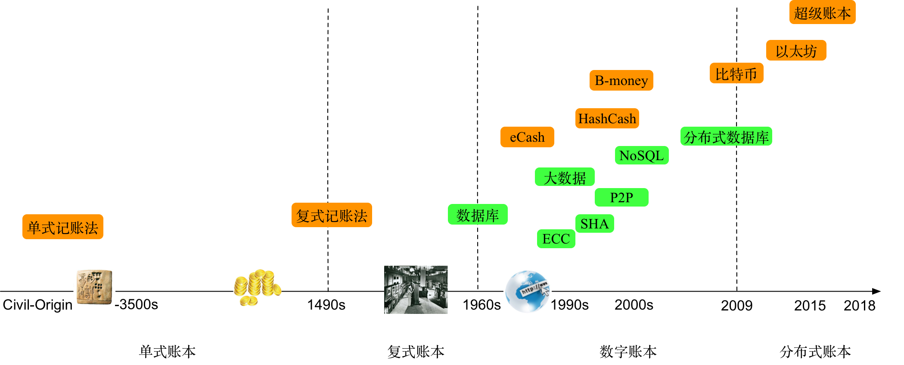
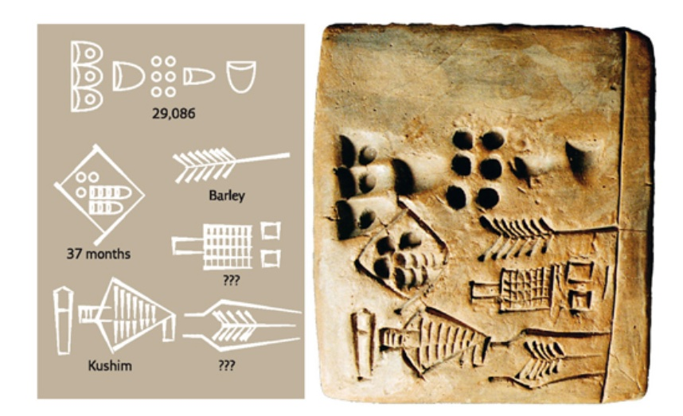
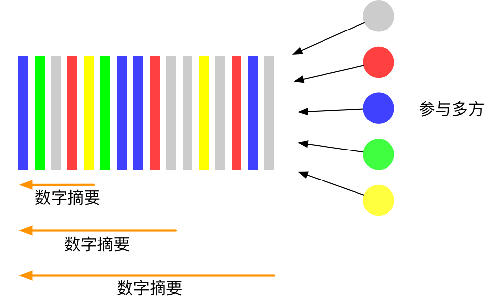
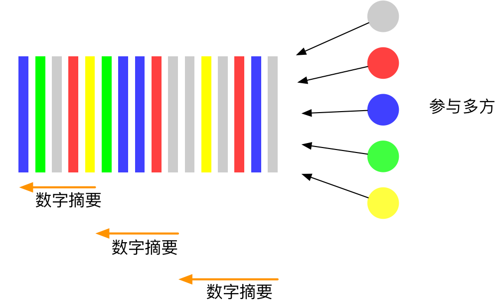
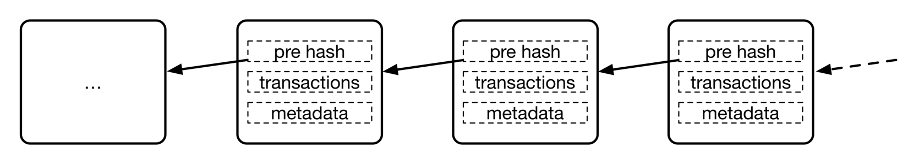
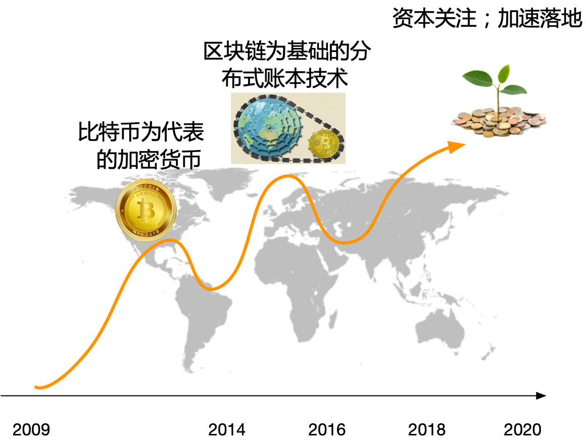
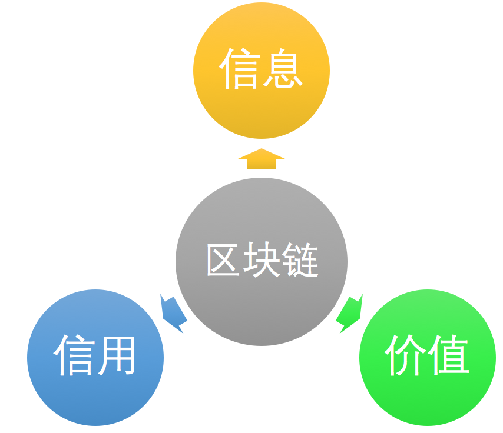

# 第一章 区块链的诞生

**大道无形，链生其中。**

认识新事物，首先要弄清楚它的来龙去脉。知其出身，方能知其所以然。

区块链（Blockchain）结构首次为人关注，源于 2009 年初上线的比特币（Bitcoin）开源项目。从记账科技数千年的演化角度来看，区块链实际上是记账问题发展到分布式场景下的天然结果。

本章将从记账问题的历史讲起，剖析区块链和分布式账本技术的来龙去脉。通过介绍比特币项目探讨区块链的诞生过程，并初步剖析区块链技术潜在的商业价值。

通过阅读本章内容，读者可以了解到区块链思想和技术的起源和背景，以及在商业应用中的巨大潜力。

## 记账科技的千年演化

如果说金融科技（Financial Technology，Fintech）是保障社会文明的重要支柱，那么记账科技（Ledger Technology，或账本科技）则是这一支柱最核心的基石。

大到国际贸易，小到个人消费，都离不开记账这一看似普通却不简单的操作。无论是资金的流转，还是资产的交易，都依赖于银行、交易机构正确维护其记账系统。

毫不夸张地说，人类文明的整个发展历程，都伴随着记账科技的持续演化。

目前，很少见到对记账科技演化规律的研究，这导致了人们对其认知的局限。近年来，以区块链为基础的分布式账本技术飞速崛起并得到快速应用。尽管如此，却很少有人能说清楚区块链与记账问题的关系。区块链到底解决了哪些问题？为何能在金融领域产生如此巨大的影响？

按照科技发展的一般规律，可将记账科技从古至今的演化过程大致分为四个阶段：单式账本、复式账本、数字化账本、分布式账本。各个阶段的时期和特点如下表所示。

| 阶段 | 时期 | 主要特点 |
| --- | --- | --- |
| 阶段一：单式账本 | 约公元前 3500 年 ~ 15 世纪 | 使用原始的单式记账法（Single Entry Bookkeeping） |
| 阶段二：复式账本 | 15 世纪 ~ 20 世纪中期 | 现代复式记账法（Double Entry Bookkeeping）出现和应用 |
| 阶段三：数字化账本 | 20 世纪中期 ~ 21 世纪初 | 物理媒介账本演化到数字化账本 |
| 阶段四：分布式账本 | 2009 年至今 | 以区块链为代表的分布式账本相关思想和技术出现 |

科技创新往往不是孤立的。记账科技的发展也与众多科技和商业成果的出现息息相关，特别是商业贸易、计算技术、数据处理等，如下图所示。

下面笔者将具体讲述不同阶段中记账科技的发展状况。

### 阶段一：单式账本

人类文明早期，就已经产生了记账需求和相关活动。

已知最早的账本是“库辛（Kushim）泥板”，于 1929 年发掘于幼发拉底河下游右岸的伊拉克境内。据鉴定，库辛泥板属于公元前 3500 ~ 前 3000 年的乌鲁克城（Uruk，美索不达米亚西南部苏美尔人的古城），其内容据破译为“37 个月收到了 29086 单位的大麦，并由库辛签核”。如下图所示。

库辛泥板同时也是目前已知的最古老的人类文字记录。除了昙花一现的苏美尔文明，在古中国、古埃及、古希腊、古罗马等人类早期文明中，都不乏与记账相关的考古发现。

类似于这样的通过单条记录进行账目记录的方法称为“单式记账法”或“简单记账法”，对应的账本叫“单式账本”。

此后相当长的一段时间里（甚至到今天），人们都在使用单式记账法进行记账，无论是记录在泥板、绳索上，还是记录在后来的纸质账本中，虽然物理媒介不同，但核心方法都是一致的。

简单记账法自然易用，适合小规模的简易账务，但当面对大规模账务，特别是涉及多个实体的复杂记账需求时，就暴露出不少问题。

首先是容易出错。以库辛账本为例，如果大麦入库和出库交易记录很多，很难确认账本记录跟实际情况是否匹配；即便发现不匹配，也很难定位到哪次记录出了问题。

其次是容易篡改。账本只有一个，只能保管在记账者个人手里。假设记账者不那么诚实，那么，他可以轻易地通过修改已有的记录来窃取大麦。并且其他人很难发现账本被篡改过。

随着商业活动的普及、交易规模增大和参与方的增多（特别是所有者和经营者的分离），单式记账法已经难以满足人们日益提高的记账需求。代表现代记账思想的“复式记账法”应运而生。

### 阶段二：复式账本

14 世纪的意大利，是世界贸易的门户，来自各国的商人、学者、艺术家、工匠等齐聚于此，揭开了文艺复兴大时代的序幕。此后长达三个世纪里，整个欧洲在商业、文化、艺术、科技等方面都涌现出大量创新成果，对全世界产生了深远的影响。其中有三项尤为引人注目：

* 宗教改革：马丁·路德批判了当时基督教的诸多弊端，提出宗教不应有等级制度，即宗教面前人人平等，无需任何代理人或中间介绍人；
* 朴素宇宙观：从地心说，到日心说，再到宇宙观形成，人类终于意识到地球并非所处宇宙的“中心”，甚至任何位置都可以被认为是宇宙的“中心”，是否是中心也并不特别或重要；
* 复式记账法：前所未有的繁荣的商业活动催生了更先进的记账方式。复式记账法将单一中心记录分拆为多个科目，极大提高了账目的可靠性，一旦发现问题，方便追查根源，对应的账本叫“复式账本”。

这些成果虽然分属文化、天文和金融等不同领域，但在核心思想上却如此一致和谐，不得不令人惊讶。

关于复式记账法的文字记载最早出现于 1494 年，意大利著名数学家卢卡·帕西奥利（Luca Pacioli）在其著作《Summa de arithmetica, geometria, Proportioni et proportionalita（算术、几何、比及比例概要）》中介绍了算术的原理和应用、意大利各地的度量衡制度、商业记账方法和几何学基础。当然，复式记账法的出现是数百年商业活动和数学发展的结果。早在 1202 年，比萨（意大利北部城市）的数学家斐波那契在《珠算原理》中介绍了东方数学思想，包括十进制阿拉伯数字、分数等，还指出了如何使用这些数学手段来进行记账和计算利息。这些都极大地促进了金融行业的发展。

复式记账法演化到现在包括增减记账法、收付记账法、借贷记账法三种。目前最常用的是借贷记账法，它基于会计恒等式（资产=负债+权益），确保每笔交易都按照该恒等式进行记录。复式记账法很快就得到了广泛应用，并成为现代会计学的重要基础。卢卡·帕西奥利也因此被誉为“会计学之父”。

复式记账法原理并不复杂。由于交易的本质是将某种价值从来源方转移到目标方，因此可将每笔交易分别在贷方（来源方）和借方（目标方）两个科目进行记录，且借贷双方的总额应该时刻保持相等（即守恒）。

如果库辛当年也懂得复式记账法，当大麦入库时，就会分别在“库存大麦科目”和“应收大麦科目”上都进行记录，并且记录数额应该一致。如果要做审核，可以分别对不同科目进行统计，查看其结果是否相同。可见，使用复式记账法能很容易对交易的来龙去脉进行追踪，而且验证账目是否记录正确。实际上，比特币的交易模型中也借鉴了复式记账法的思想。

复式记账法虽然解决了单个记账人所持本地账本的可信度问题，但是仍然无法解决多方之间账本的可信互通问题。例如，投资者如何确保所投资企业的账目没有作假？贸易双方产生交易纠纷时该以谁的账本为准？这些问题的解决要等到数百年以后了。

*注：借（Debit）意味着债务，表示从其他方转移到本科目内；贷（Credit）意味着债权，代表从该科目转移出去。*

### 阶段三：数字化账本

如果要评价 20 世纪最伟大的十大发明，数字计算机一定会入围。它在物理世界之外开创了全新的赛博空间，为人类社会的方方面面都带来了巨大变化。

早期计算机很重要的用途之一便是进行账目相关的统计处理。1951 年，全世界首台商用计算机 UNIVAC 即为美国人口普查局所用。

使用计算机，不但可以提高大规模记账的效率，还可以避免人工操作的错误。为了更好地管理统计数据，人们发明了专门的数据库技术。从最早的网状数据库（Network Databases）和层次数据库（Hierarchical Databases），到具有开创意义的关系型数据库（Relational Database），再到互联网出现后大量新需求催生的大数据、NoSQL 等技术，根源上都与记账问题息息相关。

在这一阶段，记账方法本身并没有太多创新，但由于数字媒介的出现，使得账本的规模、处理的速度、账本的复杂度，都有了天翻地覆的提升。而这些为后来包括电子商务、互联网金融在内的多种数字化服务奠定了技术基础。

### 阶段四：分布式账本

复式记账法虽然记录了交易的来龙去脉，不易出错，但本质上仍然是中心化模式。

中心化模式的记账系统方便使用，但在很多情况下仍然存在不少问题：账本掌握在个体手中，一旦出现数据丢失则无法找回；在同时涉及到多个交易方的情况下，需要分别维护各自的账本，如果出现不一致，对账较为困难。

因此，人们很自然地想到借助分布式系统的思想来实现分布式账本（Distributed Ledger）：由交易多方共同维护同一个共享的分布式账本；打通交易在不同阶段的来龙去脉；凭借分布式技术，进一步提高记账的规模、效率、可靠性以及合规性。

但在分布式场景下，如何避免某个参与方恶意篡改或破坏记录？该由谁来决定将交易记录写到账本中？这些问题一直没有得到很好的解决。

2009 年 1 月，基于区块链结构的比特币网络悄然问世，它融合了现代密码学和分布式网络技术等重要成果。此后数年里，在纯分布式场景下，比特币网络稳定支持了海量转账交易。这让人们开始认识到，**区块链这一看似极为简洁的数据结构，居然恰好解决了分布式记账的基本需求**，于是基于区块链结构的分布式记账技术开始大量出现。由于这些技术多以区块链结构作为其核心的账本结构，也往往被统称为区块链技术。

2014 年开始，金融、科技领域的专家们开始关注区块链技术，并积极推动分布式账本相关应用落地。在此过程中，对开放、先进分布式账本平台的需求越来越迫切。

2015 年的年底，三十家金融和科技领域的领军企业（包括 IBM、Accenture、Intel、J.P.Morgan、DTCC、SWIFT、Cisco 等）联合发起了超级账本（Hyperledger）开源项目，并由中立的 Linux 基金会进行管理。该项目遵循 Apache v2 许可（商业友好），致力于打造一个开源、满足企业场景的分布式记账科技生态。2024 年 9 月，Hyperledger Foundation 相关项目和社区并入 Linux Foundation Decentralized Trust，Hyperledger 品牌继续用于 Fabric 等项目；项目和会员数量仍在随社区治理持续变化。

目前，基于分布式账本技术的各种创新方案已经在金融、供应链、医疗等领域得到了不少落地应用。但笔者认为，类比互联网的发展过程，目前分布式账本技术整体还处于发展的初期，还存在不少尚待解决的问题，包括权限管理、隐私保护、性能优化和互操作性等。未来在这些方面的科技突破，将极大拓展分布式账本技术的应用场景和形态，最终实现传递“价值”的商业协同网络。

*注：1371 年，中国明朝开展了首次面向全国的户籍勘查。勘查采用户帖制度，十年清查一次，每次记录各户现有人数，以及距上次的新增、减少情况。将历届信息进行前后对照，有效规避了统计错误。*

### 记账科技的未来

记账科技历千年而弥新，由简单到复杂，由粗糙到精细，由中心化到分布式，这与业务需求的不断变化密不可分。大规模、高安全、易审计等特性将越来越受到关注。

笔者相信，随着社会文明的进步，特别是商业活动的进一步成熟，分布式记账的需求将更加普遍，分布式记账科技也将更加繁荣。

## 分布式记账与区块链

金融行业是对前沿信息科技成果最敏感的行业之一。特别是对记账科技，其每次突破都会引发金融领域的重要革新，进而对社会生活的各个方面产生阶段性的影响。那么，从技术层面看，区块链到底解决了什么记账难题呢？

### 分布式记账的难题

分布式记账由来已久。为了正常进行商业活动，参与者需要找到一个多方均能信任的第三方来负责记账，确保交易记录的准确。然而，随着商业活动的规模越来越大，商业过程愈加动态和复杂，很多场景下难以找到符合要求的第三方记账方（例如，供应链领域动辄涉及来自数十个行业的数百家参与企业）。这就需要交易各方探讨在分布式场景下进行协同记账的可能性。

实际上，可以很容易设计出一个简单粗暴的分布式记账结构，如下图所示方案（一）。多方均允许对账本进行任意读写，一旦发生新的交易即追加到账本上。这种情况下，如果参与多方均诚实可靠，则该方案可以正常工作；但是一旦有参与方恶意篡改已发生过的记录，则无法确保账本记录的正确性。

为了防止有参与者对交易记录进行篡改，需要引入一定的验证机制。很自然，可以借鉴信息安全领域的数字摘要（Digital Digest）技术，从而改进为方案（二）。每次当有新的交易记录被追加到账本上时，参与各方可以使用 Hash 算法对完整的交易历史计算数字摘要，获取当前交易历史的“指纹”。此后任意时刻，每个参与方都可以对交易历史重新计算数字摘要，一旦发现指纹不匹配，则说明交易记录被篡改过。同时，通过追踪指纹改变位置，可以定位到被篡改的交易记录。

方案（二）可以解决账本记录防篡改的问题，然而在实际生产应用时，仍存在较大缺陷。由于每次追加新的交易记录时需要从头对所有的历史数据计算数字摘要，当已存在大量交易历史时，数字摘要计算成本将变得很高。而且，随着新交易的发生，计算耗费将越来越大，系统扩展性很差。

为了解决可扩展性的问题，需要进一步改进为方案（三）。注意到每次摘要已经确保了从头开始到摘要位置的完整历史，当新的交易发生后，实际上需要进行额外验证的只是新的交易，即增量部分。因此，计算摘要的过程可以改进为对旧的摘要值再加上新的交易内容进行验证。这样就既解决了防篡改问题，又解决了可扩展性问题。

实际上，读者可能已经注意到，方案（三）中的账本结构正是一个区块链结构（如下图所示）。可见，从分布式记账的基本问题出发，可以自然推导出区块链结构，这也说明了**对于分布式记账问题，区块链结构是一个简洁有效的天然答案**。

*注：当然，区块链结构也并非解决分布式记账问题的唯一答案，实际上，除了简单的线性队列结构，也有人提出采用树或图结构。*

### 区块链的三次热潮

区块链结构的首次大规模应用是在比特币项目。从比特币项目诞生之日算起，区块链已在全球掀起了三次热潮。

第一波热潮出现在 2013 年左右。比特币项目上线后，很长一段时间里并未获得太多关注。直到比特币价格发生增长，各种加密货币项目纷纷出现，隐藏在其后的区块链结构才首次引发大家的兴趣。2014 年起，区块链这个术语开始频繁出现，但更多集中在加密货币和相关技术领域。

第二波热潮出现在 2016 年前后。以区块链为基础的分布式账本技术被证实在众多商业领域存在应用价值。2015 年 10 月《经济学人》封面文章《信任机器》中，正式指出区块链在构建分布式账本平台中的重要作用，促使更多实验性应用出现。下半年更是出现了“初始代币发行（Initial Coin Offering，ICO）”等新型融资募集形式。这一时期，区块链技术自身也有了发展和突破。2015 年 7 月底，以太坊（Ethereum）开源项目正式上线。该项目面向公有场景针对比特币项目的缺陷进行了改善，重点在于对通用智能合约的支持，同时优化了性能和安全性。

2015 年底，Linux 基金会牵头发起了超级账本（Hyperledger）开源项目，希望联合各行业的力量构造开放、企业级的分布式账本技术生态。与此前的开源项目相比，超级账本项目主要面向联盟链场景，关注企业在权限管理、隐私保护和安全性能等方面的核心诉求，并积极推动技术成果在各行业的落地实践。首批会员企业包括来自科技界和金融界的领军企业，如 IBM、Intel、Cisco、Digital Asset 等。2024 年 9 月，Hyperledger Foundation 项目和社区进入 Linux Foundation Decentralized Trust 生态，Fabric、Besu、Indy、Iroha、Cacti 等项目继续演进，项目和会员规模以社区官方公布为准。尤为值得称道的是，超级账本项目采取了商业友好的 Apache 2.0 开源许可，吸引了众多企业的选用。

随着更多商业项目开始落地，从 2017 年开始至今，众多互联网领域的资本开始关注区块链领域，人才缺口持续加大，商业和政策环境开始加强。区块链已经俨然成为继人工智能后的又一资本热点。

分析这三次热潮可以看出，每一次热潮的出现都与金融行业对区块链技术的深化应用密切相关。这也表明金融行业对信息科技始终保持了较高的敏感度。

### 分布式记账的重要性

分布式记账问题为何重要？可以类比互联网出现后给社会带来的重大影响。

互联网是人类历史上最大的分布式互联系统，它已成为信息社会的基础设施，很好地解决了传递**信息**的问题。然而，由于早期设计上的缺陷，互联网无法确保所传递信息的可靠性，这大大制约了人们利用互联网进行大规模协作的能力。而以区块链为基础的分布式记账科技则可能解决传递**可信信息**的问题，这意味着基于分布式记账科技的未来商业网络将成为新一代的文明基础设施——大规模协同网络。

分布式记账科技的核心价值在于为未来多方协同网络提供可信基础。区块链引发的记账科技的演进，将促使商业协作和组织形态发生变革。甚至世界经济论坛执行主席 Klaus Schwab 认为 “区块链是（继蒸汽机、电气化、计算机之后的）第四次工业革命的核心成果（Blockchains are at the heart of the Fourth Industrial Revolution）”。

### 分布式记账的现状与未来

类比互联网，从科技发展的一般规律来看，笔者认为，分布式记账科技现在仍处于发展早期，而商业应用已经在加速落地中，如下表所示。

阶段 | 互联网 | 区块链 | 阶段
-- | -- | -- | --
1974~1983 | ARPANet 内部试验网络 | 比特币试验网络 | 2009~2013
1984~1993 | TCP/IP 基础协议确立，基础架构完成 | 基础协议和框架探索，出现超级账本、以太坊等开源项目 | 2014~2018
1990s~2000s | HTTP 应用协议出现；互联网正式进入商用领域 | 商业应用的加速落地，仍未出现杀手级应用 | 2019~2023
2000s~？ | 桌面互联网、移动互联网、物联网 | 分布式协同商业网络 | 2024~

互联网在发展过程中，先后经历了试验网络、基础架构和协议、商业应用、大规模普及等四个阶段，每个阶段都长达 10 年左右。其中第二个阶段尤为关键，TCP/IP 取代了已有的网络控制协议成为核心协议，这奠定了后来全球规模互联网的技术基础。

作为一套前所未有的大规模协同网络，分布式记账网络的发展很大可能也要经历这四个阶段的演化。当然，站在前人肩膀上，无论是演化速度还是决策效率，都会有不小的优势。

客观来看，虽然超级账本、以太坊等开源项目在基础协议和框架方面进行了诸多探索，并取得了重要成果，但在多账本互联、与已有系统的互操作性等方面还存在不足，商业应用的广度和深度仍需实践的考验。

但毫无疑问，分布式记账科技已经成为金融科技领域的重要创新，必将为金融行业创造新的发展机遇。而未来的商业协同网络，也将成为人类文明进步的重要基础。

## 集大成者的比特币

要了解区块链的诞生过程，先要弄清楚比特币的来龙去脉。这要从加密货币数十年的历史说起。

### 加密货币的历史

上世纪 40 年代计算机（ENIAC，1946 年）出现后，人们就尝试利用信息技术提高支付系统的效率。除了作为电子支付手段的各种银行卡，自 80 年代起，利用密码学手段构建的加密数字货币（Cryptocurrency）也开始成为研究的热门。

加密货币前后经历了 30 多年的探索，比较典型的成果包括 [e-Cash](https://doi.org/10.1007/978-1-4757-0602-4_18)、[Hashcash](http://www.hashcash.org/)、[B-money](http://www.weidai.com/bmoney.txt) 和 Bit Gold 等。

1983 年，时任加州大学圣塔芭芭拉分校教授的 [David Chaum](https://en.wikipedia.org/wiki/David_Chaum) 最早在论文《Blind Signatures for Untraceable Payments》中提出了 [e-Cash](https://doi.org/10.1007/978-1-4757-0602-4_18)，并于 1989 年创建了 [DigiCash](https://en.wikipedia.org/wiki/Digicash) 公司。ecash 系统是首个尝试实现不可追踪（untraceable）的匿名数字货币，基于 David Chaum 自己发明的盲签名技术，曾被应用于部分银行的小额支付系统中。ecash 虽然不可追踪，但仍依赖中心化机构（银行）的协助，同期也由于信用卡体系的快速崛起，DigiCash 公司最终于 1998 年宣告破产。鉴于 David Chaum 在数字货币研究领域发展早期的贡献，有人认为他是“数字货币之父”。值得一提的是，David Chaum 目前仍活跃在数字货币领域，期待他能做出更重要的贡献。

1997 年，Adam Back 提出了 [Hashcash](http://www.hashcash.org/)，来解决邮件系统中“拒绝服务攻击（Denial of Service，DoS）”与垃圾邮件问题（该思路后来也被用于博客评论垃圾信息等场景）。Hashcash 应用工作量证明（Proof of Work，PoW）机制来获取额度，该机制后来被比特币所采用。类似思想最早曾在 1993 年的论文《Pricing via processing or combating junk mail》中提出。

1998 年，刚大学毕业的华人[Wei Dai](http://www.weidai.com/) （戴维）提出了 [B-money](http://www.weidai.com/bmoney.txt) 的设计，这是首个不依赖中心化机构的匿名数字货币方案。B-money 引入工作量证明的思想来解决数字货币产生的问题，指出任何人都可以发行一定量的货币，只要他可以给出某个复杂计算问题（未说明是用 Hash 计算）的答案，货币的发行量将跟问题的计算代价成正比。并且，任何人（或部分参与者）都可以维护一套账本，构成一套初级的 P2P 网络，使用者在网络内通过对带签名的交易消息的广播来实现转账的确认。B-money 是去中心化数字货币领域里程碑式的成果，为后面比特币的出现奠定了基础。从设计上看，B-money 已经很好地解决了货币发行的问题，但是未能解决“双花”问题，也未能指出如何有效、安全地维护账本，最终未能实现。

同年，[Nick Szabo](https://unenumerated.blogspot.com/) 也提出了名为 [Bit Gold](https://unenumerated.blogspot.com/2005/12/bit-gold.html) 的去中心化数字货币设计。系统中将解决密码学难题（challenge string）作为发行货币的前提，并且上一个难题的结果作为下一个难题生成的参数。对方案的确认需要系统中大多数参与者确认。该方案最终也并未实现。

这些方案要么依赖于一个中心化的管理机构，要么更多偏重理论层面的设计而未能实现。直到比特币的出现，采用创新的区块链结构来维护账本，使用 1999 年后出现的 P2P 网络技术实现账本同步，并引入经济博弈机制，充分利用现代密码学成果，**首次从实践意义上实现了一套去中心化（decentralized）的开源数字货币系统**。也正因为比特币的影响力巨大，很多时候谈到数字货币其实是指类似以加密技术为基础的数字货币（crypto currency）。

比特币依托的分布式网络无需任何管理机构，基于密码学原理来确保交易的正确进行；另一方面，比特币的价值和发行并未有中央机构进行调控，而是通过计算力进行背书，通过经济博弈进行自动调整。这也促使人们开始思考，在数字化的世界中，应该如何发行货币，以及如何衡量价值。

比特币也启发了众多数字货币的出现。截至 2026 年初，全球已有超过 10000 种数字货币，既包括以官方为发行主体的法定数字货币（Digital Fiat Currency，DFC）或央行数字货币（Central Bank Digital Currency，CBDC），也包括各种民间数字货币。其中，中国的数字人民币（e-CNY）已在多个城市试点运行，成为全球 CBDC 发展的重要实践。

目前，除了像以比特币这样的分布式技术之外，仍然存在不少中心化代理模式的数字货币机制，包括 paypal、支付宝甚至 Q 币等。通过跟已有的支付系统合作，也可以高效地进行代理交易。

现在还很难讲哪种模式将会成为日后的主流，未来甚至还可能出现更先进的技术。但毫无疑问，这些成果都为后来的数字货币设计提供了极具价值的参考；而站在前人肩膀上的比特币，必将在人类货币史上留下难以磨灭的印记。

*注：严格来说，加密货币并非依赖加密机制，而是使用了密码学中的签名机制。*

### 比特币的诞生

2008 年 10 月 31 日（东部时间），星期五下午 2 点 10 分，化名 Satoshi Nakamoto（中本聪）的人在 [metzdowd 密码学邮件列表](https://www.metzdowd.com/pipermail/cryptography/2008-October/014810.html) 中提出了比特币（Bitcoin）的设计白皮书《Bitcoin: A Peer-to-Peer Electronic Cash System》，并在 2009 年公开了最初的实现代码。首个比特币是 UTC 时间 2009 年 1 月 3 日 18:15:05 生成。但比特币真正流行开来，被人们所关注则是至少两年以后了。

作为开源项目，比特币很快吸引了大量开发者的加入，目前的官方网站 [bitcoin.org](https://bitcoin.org)，提供了比特币相关的代码实现和各种工具软件。

除了精妙的设计理念外，比特币最为人津津乐道的一点，是发明人“中本聪”尚无法确认真实身份。也有人推测，“中本聪”背后可能不止一个人，而是一个团队。这些猜测都为比特币项目带来了不少传奇色彩。

### 比特币的意义和价值

直到今天，关于比特币的话题仍充满了不少争议。但大部分人应该都会认可，比特币是数字货币历史上，甚至整个金融历史上一次了不起的社会学实验。

比特币网络上线以来，在没有中心运营方的情况下，已经在全球范围内运行了超过 17 年时间，成功处理了数亿笔交易。但这并不意味着它从未经历严重技术事件：2010 年 8 月曾发生 CVE-2010-5139 价值溢出漏洞，攻击者可构造异常交易创造超额比特币；2013 年 3 月也曾因 0.8 与旧版本节点兼容性问题出现链分叉。这些事件最终通过紧急修复、算力切换和社区协调得到处理。

比特币网络目前由数千个可独立验证规则的节点和全球矿工参与构成，不需要中心化的支持机构参与。其安全性主要来自有效区块链上累积的工作量证明和诚实算力占优的经济假设，而不是简单取决于节点数量。

比特币**首次真正从实践意义上实现了安全可靠的去中心化数字货币机制**，这也是它受到无数金融科技从业者热捧的根本原因。

作为一种概念货币，比特币主要希望解决已有货币系统面临的几个核心问题：

* 被掌控在单一机构手中，容易被攻击；
* 自身的价值无法保证，容易出现波动；
* 无法匿名化交易，不够隐私。

要实现一套数字货币机制，最关键的还是要建立一套完善的交易记录系统，以及形成一套合理的货币发行机制。

这个交易记录系统要能准确、公正地记录发生过的每一笔交易，并且无法被恶意篡改。对比已有的银行系统，可以看出，现有的银行机制作为金融交易的第三方中介机构，有代价地提供了交易记录服务。如果参与交易的多方都完全相信银行的记录（数据库），就不存在信任问题。可是如果是更大范围（甚至跨多家银行）进行流通的货币呢？哪家银行的系统能提供完全可靠不中断的服务呢？唯一可能的方案是一套分布式账本。这个账本可以被所有用户自由访问，而且任何个体都无法对所记录的数据进行恶意篡改和控制。为了实现这样一个前所未有的账本系统，比特币网络巧妙地设计了区块链结构，提供了可靠、无法被篡改的数字货币账本功能。

比特币网络中，货币的发行是通过比特币协议来规定的。货币总量受到控制，发行速度按协议规则阶梯式递减——每 21 万个区块（约四年）区块奖励减半一次，而非根据经济状况自动调节；自动调整的是挖矿难度（每 2016 个区块一次），用于稳定约十分钟的出块间隔。总量恒定意味着长期发行率趋近于零，但购买力和价格仍由市场供需决定，不能仅凭发行规则推出通胀或通缩（参见 [6.1 比特币简介](../06_bitcoin/intro.md)）。

此外，也要看到，作为社会学实验，比特币已经获得了某种成功，特别是基于区块链技术，已经出现了许多颇有价值的商业场景和创新技术。但这绝不意味着比特币自身必然能够进入未来的商业体系中。比特币自身价值的波动十分剧烈；同时由于账目公开可查，通过分析仍有较大概率追踪到实际使用者；比特币系统在管理环节上仍然依赖中心化的机制。

### 更有价值的区块链技术

如果说比特币是影响力巨大的社会学实验，那么从比特币核心设计中提炼出来的区块链技术，则让大家看到了塑造更高效、更安全的未来商业网络的可能性。

2014 年开始，比特币背后的区块链技术开始逐渐受到大家关注，并进一步引发了分布式记账（Distributed Ledger）技术的革新浪潮。区块链思想和结构恰好应对了分布式场景下记账的技术挑战。

区块链技术早已从比特币项目脱颖而出，在金融、贸易、征信、物联网、共享经济等诸多领域崭露头角。现在，除非特别指出是“比特币区块链”，否则当人们提到“区块链”时，往往已与比特币没有什么必然联系了。

## 区块链的商业价值

商业行为的典型过程为：交易多方通过协商确定商业合约，通过执行合约完成交易。区块链擅长的正是如何在多方之间达成合约，并确保合约的顺利执行。

根据类别和应用场景不同，区块链所体现的特点和价值也不同。

从技术角度，一般认为，区块链具有如下特点：

* 分布式容错性：分布式账本网络极其鲁棒，能够容忍部分节点的异常状态；
* 不可篡改性：共识提交后的数据会一直存在，不可被销毁或修改；
* 隐私保护性：密码学保证了数据隐私，即便数据泄露，也无法解析。

随之带来的业务特性将可能包括：

* 可信任性：区块链技术可以提供天然可信的分布式账本平台，不需要额外第三方中介机构参与；
* 降低成本：与传统技术相比，区块链技术可能通过自动化合约执行带来更快的交易，同时降低维护成本；
* 增强安全：区块链技术将有利于安全、可靠的审计管理和账目清算，减少犯罪风险。

区块链并不是凭空诞生的新技术，而是多种技术演化到一定程度后的产物，因此，其商业应用场景也跟促生其出现的环境息息相关。对于基于数字方式的交易行为，区块链技术能潜在地降低交易成本、加快交易速度，同时能提高安全性。笔者认为，**能否最终提高生产力，将是一项技术能否被实践接受的关键**。

根据多家机构的统计，全球区块链市场规模已从 2020 年的不足百亿美元增长到 2025 年的数百亿美元。Fortune Business Insights 在 2024 年的报告中预测，全球区块链市场规模将从 2024 年的约 279 亿美元增长到 2032 年的超过 8250 亿美元。不同研究机构对 CAGR、细分口径与预测区间的测算存在差异，但总体趋势是一致的：区块链技术的投资重心正从底层基础设施向应用层（如 DeFi、供应链金融、数字身份等）转移，企业级区块链解决方案的落地案例也在持续增加。

目前，区块链技术已经得到了众多金融机构和商业公司的关注，包括大量金融界和信息技术界的领军性企业和团体。典型企业和组织如下所列（排名不分先后）。

* 维萨国际公司（VISA International）
* 美国纳斯达克证券交易所（Nasdaq Stock Exchange）
* 高盛投资银行（Goldman Sachs）
* 花旗银行（Citi Bank）
* 美国富国银行（Wells Fargo）
* 中国人民银行（The People's Bank Of China，PBOC）
* 瑞士联合银行（Union Bank of Switzerland）
* 德意志银行（Deutsche Bank AG）
* 美国证券集中保管结算公司（Depository Trust Clearing Corporation，DTCC）
* 环球同业银行金融电讯协会（Society for Worldwide Interbank Financial Telecommunication，SWIFT）
* 三菱日联金融集团（Mitsubishi UFJ Financial Group, Inc.，MUFG）
* 国际商业机器公司（International Business Machines Corporation，IBM）
* 甲骨文公司（Oracle Corporation）
* 微软公司（Microsoft Corporation）
* 英特尔公司（Intel Corporation）
* 亚马逊公司（Amazon Corporation）
* 思科公司（Cisco Corporation）
* 埃森哲公司（Accenture Corporation）
* Meta 平台公司（Meta Platforms，former Facebook）

实际上，区块链可以有效地实现大规模信息和个体的自主化连接。因此，所有与信息、价值（包括货币、证券、专利、版权、数字商品、实际物品等）、信用等相关的交换过程，都将可能从区块链技术中得到启发或直接受益。但这个过程绝不是一蹴而就的，需要长时间的探索和论证。

本书将在后续章节中通过具体的案例来讲解区块链的多个典型商业应用场景。
