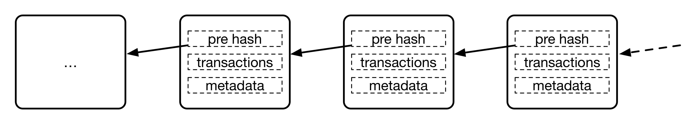
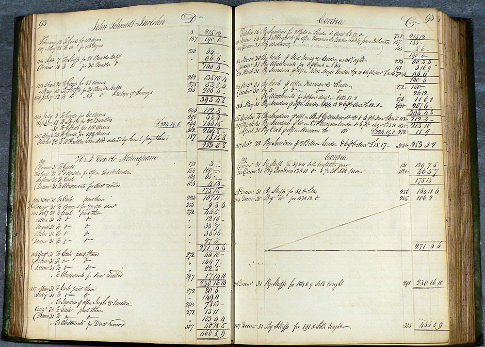
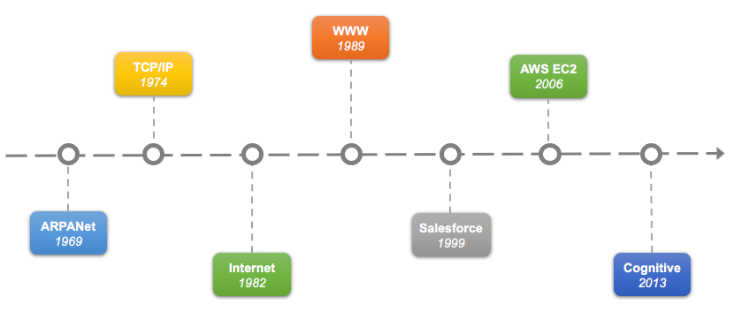

# 第二章 核心技术概览

**设计之妙夺造化，存乎一心胜天工。**

跨境商贸中签订的合同，怎么确保对方能严格遵守和及时执行？

酒店宣称刚打捞上来的三文鱼，怎么追踪捕捞和运输过程中的时间和卫生情况？

数字世界里，怎么证明你是谁？怎么证明某个资产属于你？

囚徒困境中的两个人，怎样才能达成利益的最大化？

宇宙不同文明之间的“黑暗森林”猜疑链，有没有可能被彻底打破？

这些看似很难解决的问题，在区块链的世界里已经有了初步的答案。

本章将带领大家探索区块链的核心技术，包括其定义与原理、关键的问题等，还将探讨区块链技术的演化，并对未来发展的趋势进行展望。最后，对一些常见的认识误区进行了澄清。

## 定义与原理

### 定义

区块链技术自身仍然在飞速发展中，相关规范和标准还待进一步成熟。

公认的最早关于区块链的描述性文献是中本聪所撰写的 [《比特币：一种点对点的电子现金系统》](https://bitcoin.org/bitcoin.pdf)，但该文献重点在于讨论比特币系统，并没有明确提出区块链的术语。在其中，区块和链被描述为用于记录比特币交易账目历史的数据结构。

另外，也常见将区块链类比为一种共享账本或分布式数据库技术：通过维护数据块的链式结构，维持持续增长、可验证、难以篡改的数据记录。

笔者认为，讨论区块链可以从狭义和广义两个层面来看待。

狭义上，区块链是一种以区块为基本单位的链式数据结构，区块中利用数字摘要对之前的交易历史进行校验，适合分布式记账场景下防篡改和可扩展性的需求。

广义上，区块链还指代基于区块链结构实现的分布式记账技术，包括分布式共识、隐私与安全保护、点对点通信技术、网络协议、智能合约等。

### 早期应用

1990 年 8 月，Bellcore（1984 年由 AT&T 拆分而来的研究机构）的 Stuart Haber 和 W. Scott Stornetta 在论文《How to Time-Stamp a Digital Document》中就提出利用链式结构来解决防篡改问题，其中新生成的时间证明需要包括之前证明的 Hash 值。这可以被认为是区块链结构的最早雏形。

后来，2005 年 7 月，在 Git 等开源软件中，也使用了类似区块链结构的机制来记录提交历史。

区块链结构最早的大规模应用出现在 2009 年初上线的比特币项目中。在无集中式管理的情况下，比特币网络长期维持主链运行，支持了海量的交易记录；同时，早期也经历过 2010 年价值溢出漏洞、2013 年链分叉等严重技术事件。这些经验共同推动了区块链结构校验、共识规则兼容和节点升级治理的演进。

### 基本原理

区块链的基本原理理解起来并不复杂。首先来看三个基本概念：

* 交易（Transaction）：一次对账本的操作，导致账本状态的一次改变，如添加一条转账记录；
* 区块（Block）：记录一段时间内发生的所有交易和状态结果等，是对当前账本状态的一次共识；
* 链（Chain）：由区块按照发生顺序串联而成，是整个账本状态变化的日志记录。

如果把区块链系统作为一个状态机，则每次交易意味着一次状态改变；生成的区块，就是参与者对其中交易导致状态改变结果的共识。

区块链的目标是实现一个分布的数据记录账本，这个账本只允许添加、不允许删除。账本底层的基本结构是一个线性的链表。链表由一个个“区块”串联组成（如下图所示），后继区块中记录前导区块的哈希（Hash）值。某个区块（以及块里的交易）是否合法，可通过计算 Hash 值的方式进行快速检验。网络中节点可以提议添加一个新的区块，但必须经过共识机制来对区块达成确认。

### 以比特币为例理解区块链工作过程

具体以比特币网络为例，来看其中如何使用了区块链技术。

首先，用户通过比特币客户端发起一项交易，消息广播到比特币网络中等待确认。网络中的节点会将收到的等待确认的交易请求打包在一起，添加上前一个区块头部的 Hash 值等信息，组成一个区块结构。然后，试图找到一个 nonce 串（随机串）放到区块里，使得区块结构的哈希结果满足一定条件（比如小于某个值）。这个计算 nonce 串的过程，即俗称的“挖矿”。nonce 串的查找需要花费一定的计算力。

一旦矿工找到了满足条件的 nonce 串，这个区块在格式上就“合法”了，成为候选区块。矿工将其在网络中广播出去。其他节点收到候选区块后进行验证，发现确实满足共识规则，就可以添加到自己维护的本地区块链结构上。交易确认并不是简单按“多少个节点接受”计算，而是随着后续区块不断叠加，所在分支累积的工作量证明不断增加。

这里比较关键的步骤有两个，一个是完成对一批交易的共识（创建合法区块结构）；一个是新的区块添加到链结构上，被网络认可，确保未来无法被篡改。当然，在实现上还会有很多额外的细节。

比特币的这种基于算力（寻找 nonce 串）的共识机制被称为工作量证明（Proof of Work，PoW）。这是因为要让哈希结果满足一定条件，并无已知的快速启发式算法，只能对 nonce 值进行逐个尝试的蛮力计算。尝试的次数越多（工作量越大），算出来的概率越大。

通过调节对哈希结果的限制条件，比特币网络控制平均约 10 分钟产生一个合法区块。算出区块的节点将得到区块中所有交易的管理费和协议固定发放的奖励费（2024 年 4 月第四次减半后为 3.125 比特币，每四年减半）。

读者可能会关心，比特币网络是任何人都可以加入的，如果网络中存在恶意节点，能否进行恶意操作来对区块链中记录进行篡改，从而破坏整个比特币网络系统。比如最简单的，故意不承认别人产生的合法候选区块，或者干脆拒绝来自其他节点的交易请求等。

实际上，比特币节点会验证每个区块是否满足共识规则，并在有效分支之间选择最难被重新创造、也就是累计工作量最大的链。攻击者若想改写已确认交易，需要重新完成该区块及其之后区块的工作量证明，并追上诚实矿工继续增长的链。安全分析因此取决于攻击者掌握的哈希算力占比、确认深度、网络传播和经济激励等因素，而不是节点数量，也不能用简单等比公式概括。一般而言，确认深度越大，重组成本越高；若攻击者长期掌握多数算力，则可以更可靠地重写近期交易历史。

当然，即便攻击者没有多数算力，也仍可能通过网络隔离、审查交易、矿池集中等方式造成局部风险。要长期破坏主链共识，通常需要持续投入大量算力并承担币价、区块奖励和基础设施层面的经济损失。

## 技术的演化与分类

区块链技术自比特币网络中首次被大规模应用，到今天应用在越来越多的分布式记账场景中。

### 区块链的演化

比特币区块链面向转账场景，支持简单的脚本计算。比特币脚本被有意设计为非图灵完备，不支持循环语句，以避免无限循环等安全风险。很自然想到如果引入更多复杂的计算逻辑，将能支持更多应用场景，这就是智能合约（Smart Contract）。智能合约可以提供除了货币交易功能外更灵活的功能，执行更为复杂的操作。

引入智能合约后的区块链，已经超越了单纯的数据记录功能，实际上带有点“智能计算”的意味了；更进一步地，还可以为区块链加入权限管理、高级编程语言支持等，实现更强大的、支持更多商用场景的分布式账本系统。

从计算特点上，可以看到现有区块链技术的三种典型演化场景：

| 场景 | 功能 | 智能合约 | 一致性 | 权限 | 类型 | 性能 | 编程语言 | 代表 |
| :--- | :--- | :--- | :--- | :--- | :--- | :--- | :--- | :--- |
| 数字货币 | 记账功能 | 不带有或较弱 | PoW | 无 | 公有链 | 较低 | 简单脚本 | 比特币网络 |
| 分布式应用引擎 | 智能合约 | 图灵完备 | PoS（以太坊 2022 年合并后） | 无 | 公有链 | 受限 | 特定语言 | 以太坊网络 |
| 带权限的分布式账本 | 商业处理 | 多种语言，图灵完备 | 包括 CFT、BFT 在内的多种机制，可插拔 | 支持 | 联盟链 | 可扩展 | 高级编程语言 | 超级账本 |

### 区块链与分布式记账

[现代复式记账系统](https://zh.wikipedia.org/wiki/%E5%A4%8D%E5%BC%8F%E7%B0%BF%E8%AE%B0)最早出现在文艺复兴时期的意大利，直到今天仍是会计学科的核心方法。复式记账法对每一笔账目同时记录来源和去向，首次将对账验证功能嵌入记账过程，提升了记账过程的可靠性和可追查性。区块链则实现了完整交易历史的记录和保护。

从这个角度来看，**区块链是首个自带对账功能的数字账本结构**。

更广泛地，区块链实现了去中心化的记录。参与到系统中的节点，并不属于同一组织，彼此可以信任或不信任；链上数据由所有节点共同维护，每个节点都存储一份完整或部分的记录拷贝。

跟传统的记账技术相比，基于区块链的分布式账本包括如下特点：

* 维护一条不断增长的链，只可能添加记录，而且记录一旦确认则不可篡改；
* 去中心化，或者说多中心化的共识，无需集中的控制，实现上尽量分布式；
* 通过密码学的机制来确保交易无法被抵赖和破坏，并尽量保护用户信息和记录的隐私性。

### 技术分类

根据参与者的不同，可以分为公有（Public 或 Permissionless）链、联盟（Consortium 或 Permissioned）链和私有（Private）链。

公有链，顾名思义，任何人都可以参与使用和维护，参与者多为匿名。典型的如比特币和以太坊区块链，信息是完全公开的。

如果进一步引入许可机制，可以实现私有链和联盟链两种类型。此外，还有一种混合模式被称为“许可公链”（Permissioned Public Chain），如部分采用治理委员会或许可验证者集合的公链，通过特定的节点准入机制来兼顾性能与安全性。需要注意的是，Algorand 官方定位为开放、无许可网络，并采用 Pure Proof-of-Stake 共识，不宜归入许可公链。

私有链，由集中管理者进行管理限制，只有内部少数人可以使用，信息不公开。一般认为跟传统中心化记账系统的差异不明显。

联盟链则介于两者之间，由若干组织一起合作（如供应链机构或银行联盟等）维护一条区块链，该区块链的使用必须是带有权限的限制访问，相关信息会得到保护，典型如超级账本项目。在架构上，现有大部分区块链在实现都至少包括了网络层、共识层、智能合约和应用层等分层结构，联盟链实现往往还会引入额外的权限管理机制。

公有链信任度最高，也容易引发探讨，但短期内更多的应用会首先在联盟链上落地。公有链因为要面向匿名公开的场景，面临着更多的安全挑战和风险；同时为了支持互联网尺度的交易规模，需要更高的可扩展性。这些技术问题在短期内很难得到解决。

对于信任度和中心化程度的关系，对于大部分场景都可以绘制如下所示的曲线。一般地，去中心化程度越高，信任度会越好。但两者的关系并非线性那么简单。随着独立控制方和关键资源分布更广，前期的信任度往往会增长较快；到了一定程度后，如果算力、权益、开发权或基础设施仍集中在少数主体手中，单纯增加节点数量并不会明显改善信任度。

另外，根据使用目的和场景的不同，又可以分为以数字货币为目的的货币链，以记录产权为目的的产权链，以众筹为目的的众筹链等，也有不局限特定应用场景的所谓通用链。通用链因为要兼顾不同场景下的应用特点，在设计上需要考虑更加全面。

#### 模块化区块链（Modular Blockchains）

随着区块链技术的演进，近年来出现了**模块化区块链**这一新的设计范式（截至 2025 年）。与传统整体式（Monolithic）区块链将执行、结算、数据可用性等功能集成在一条链上不同，模块化区块链将这些功能解耦为独立的模块。例如，Celestia、Polkadot、Cosmos 等项目通过模块化设计，允许一些链专注于执行、一些链专注于数据可用性，从而大幅提升整个生态的可扩展性和灵活性。这一范式的演进反映了区块链社区对更灵活、更高效架构的持续探索。

## 关键问题和挑战

从技术角度讲，区块链所涉及的领域比较繁杂，包括分布式系统、密码学、心理学、经济学、博弈论、控制论、网络协议等，这也意味着我们在工程实践中会面临大量的挑战。

下面列出了目前业界关注较多的一些技术话题。

### 隐私保护

隐私保护一直是分布式系统领域十分关键的问题。在分布式场景下，因为缺乏独立的管理机制，参与网络的各方无法保证严格遵守协议，甚至会故意试图获取网络中他人的数据，对这些行为都很难进行约束。

要在共享协同信息和隐私保护之间达到合适的平衡是个不小的挑战，目前，公有账本系统屡屡出现安全漏洞，动辄造成数千万美金损失的风险。随着欧盟《通用数据保护条例》（General Data Protection Regulation，GDPR）的落地，隐私保护的合规要求愈加严格；传统的信息安全技术、形式化验证技术在应对新的需求时暴露出实践性不强的缺陷，都亟待解决。

尤其是医疗健康领域，对数据的隐私性需求最为强烈，要求严格控制数据的来源、所有权和使用范围。传统的基于加密的手段很难满足这些要求，需要结合零知识证明、同态加密、隐私查询等新的密码学手段。而这些新技术在实际应用中还存在不少问题。

### 分布式共识

共识是分布式系统领域经典的技术难题，学术界和业界都已有大量的研究成果（包括 Paxos、拜占庭系列算法等）。

问题的核心在于确保某个变更在分布式网络中得到一致的执行结果，是被参与多方都承认的，同时这个信息是不可推翻的。

该问题在公开匿名场景下和带权限管理的场景下需求差异较大，从而导致了基于概率的算法和确定性算法两类思想。

最初，比特币区块链考虑的是公开匿名场景下的最坏保证。通过引入了“工作量证明”（Proof of Work）策略来限制少数算力的恶意行为，并通过概率模型使有效网络最终收敛到累计工作量最大的链。算法的核心思想是基于经济利益的博弈，让恶意破坏的参与者承担算力、电力和机会成本，从而激励大部分算力合作。同时，确认必须经过多个区块的生成之后达成，从概率上进行保证。这类算法的主要问题在于效率低下和能源浪费。类似地，还有以权益为抵押的 PoS 和 DPoS 算法等。

后来更多的区块链技术（如超级账本）在带权限许可的场景下，开始考虑支持更多的确定性的共识机制，包括改进的拜占庭算法等，可以解决快速确认的问题。但已有算法往往在大规模和动态场景下表现不佳。

共识问题在很长一段时间内都将是极具学术价值的研究热点，核心的指标将包括支持规模、容错的资源比例、决策收敛速度、出错后的恢复、动态特性等。PoW 等基于概率的系列算法通常按算力或权益等资源占比分析安全边界，而不能简单按节点数量计算；PBFT 等确定性算法理论上则允许不超过 1/3 的不合作节点。

### 交易性能

一般情况下，区块链并不适用于高频交易的场景，但由于金融系统的迫切需求，业界目前积极探讨如何提高其交易性能，包括吞吐量（Throughput）和确认延迟（Latency）两个方面。

目前，公开的比特币公有区块链只能支持平均每秒约 7 笔的吞吐量，常见高价值交易会等待约一小时的多个区块确认。以太坊在 2022 年合并后已转为 PoS，但其一层吞吐量仍受区块 gas、区块时间和去中心化约束，难以直接满足高频交易类应用。2017 年底，游戏应用 CryptoKitties 就造成了以太坊网络的严重堵塞。

*注：这些限制主要针对一层（Layer 1）链上交易。截至 2026 年 4 月，比特币闪电网络、以太坊 Rollup（Arbitrum、Optimism 等）和 StarkNet 等二层（Layer 2）方案已经在生产环境中使用，主要通过链下执行、批量提交或状态通道等方式降低成本并提升容量。但不同方案的安全假设、数据可用性、退出机制和实际吞吐量差异很大，不宜笼统宣称都能达到数千或数万 tps。*

这种场景下，为了提高处理性能，一方面可以提升单个节点的性能（如采用高配置的硬件），同时设计优化的策略和并行算法而提高性能；另外一方面可将交易处理卸载（off-load）到链下，只用区块链记录最终交易信息，如比特币社区提出的 [闪电网络](https://lightning.network/lightning-network-paper.pdf) 等设计。类似地，侧链（side chain）、影子链（shadow chain）等思路在当前阶段也有一定的借鉴意义。实际性能提升取决于应用模式、资产桥接、数据可用性和最终结算方式。

联盟链场景下，参与方在共同的信任前提和利益约束下，可以采取更激进的设计，换取性能的提升。以超级账本 Fabric 项目为例，普通虚拟机配置即可达到每秒数千次的交易吞吐量；在进一步优化或硬件加速情况下可以达到每秒数万次的处理性能。

整体来看，开源区块链系统已经可以满足一部分支付、资产登记、供应链协作和审计追踪等应用场景的性能需求。对于高频交易、实时零售支付或大规模撮合等场景，仍需要结合 Layer 2、联盟链、链下系统或传统数据库进行架构取舍。

*注：传统支付网络、证券交易所和互联网支付系统的吞吐量口径并不一致，区块链 Layer 2 的“理论峰值”“批处理能力”和“实际用户交易吞吐量”也不是同一指标。做工程选型时，应比较端到端确认延迟、可用性、结算终局性、合规和灾备能力，而不是只比较 tps。*

### 扩展性

常见的分布式系统，可以通过横向增加节点来扩展整个系统的处理能力。

对于区块链网络系统来说，跟传统分布式系统不同，这个问题往往并非那么简单。实际上，大部分区块链系统的性能，很大程度上取决于单个节点的处理能力。对这些系统来说，节点需要满足 **高性能、安全、稳定、硬件辅助加解密能力**。

例如，对于比特币和以太坊区块链而言，网络中每个参与维护的核心节点都要保持一份完整的存储，并且进行智能合约的处理。此时，整个网络的总存储和计算能力，取决于单个节点的能力。甚至当网络中节点数过多时，可能会因为共识延迟而降低整个网络的性能。尤其在公有网络中，由于大量低性能处理节点的存在，问题将更加明显。

要解决这个问题，根本上是放松对每个节点都必须参与完整处理的限制（当然，网络中节点要能合作完成完整的处理），这个思路已经在超级账本等项目中得到应用；同时尽量减少核心层的处理工作，甚至采用多层处理结构来分散交易。

在联盟链模式下，还可以专门采用高性能的节点作为核心节点，用相对较弱的节点作为代理访问节点。

另外，未来必然会涉及到不同账本之间互通的需求（跨链）。目前无论是基于公证人（Notary）、侧链/中继链锚定（Sidechains / Relays）还是哈希锁定（Hash-locking）机制，在实践中仍存在一些不足。公证人机制往往需要依赖第三方的公证人，存在中心化的弱点；侧链/中继链锚定机制目前应用在资产类转移场景，依赖不同链之间的合约配合；哈希锁定在闪电网络中最早提出，并应用在 W3C 的 Interledger 协议中，目前只支持支付类交换操作，而且要求双方账本理解彼此合约。

超级账本的 Quilt 项目和 W3C 的 Interledger Payments 工作组已对此问题开展研究，但离通用的跨链需求还有距离。要想解决跨链的扩展性问题，需要有办法打通不同框架，类似路由器来沟通不同的子网。

### 安全防护

区块链目前最热门的应用场景是金融相关的服务，安全自然是最敏感也是挑战最大的问题。

区块链在设计上大量采用了现代成熟的密码学算法和网络通信协议。但这是否就能确保其绝对安全呢？

**世界上并没有绝对安全的系统。**

系统越复杂，攻击面越多，安全风险越高；另外系统是由人设计的和运营的，难免出现漏洞。

作为分布式系统，区块链首先要考虑传统的网络安全（认证、过滤、攻防）、信息安全（密码配置、密钥管理）、管理安全（审计、风险分析控制）等问题。其次，尤其要注意新场景下凸显的安全挑战。

首先是监管和责任边界。对区块链系统如何进行监管？攻击区块链系统是否属于犯罪？不同司法辖区的答案并不完全相同。以美国为例，涉及黑客入侵、诈骗、勒索、洗钱或制裁规避的数字资产案件已经可以被既有刑事和民事执法工具追究；但公有链协议本身、去中心化治理、跨境资产追索和智能合约责任归属等问题仍在演化中，不能作绝对化表述。

其次是代码实现的漏洞管理。考虑到使用了几十年的 openssl 还带着那么低级的漏洞（[heart bleeding](https://heartbleed.com/)），而且是源代码完全开放的情况下，让人不禁对运行中的大量线上系统持谨慎态度。而对于金融系统来说，无论客户端还是平台侧，即便是很小的漏洞都可能造成难以估计的损失。

另外，公有区块链所有交易记录都是公开可见的，这意味着所有的交易，即便被匿名化和加密处理，但总会在未来某天被破解。安全界一般认为，只要物理上可接触就不是彻底的安全。实际上，已有文献证明，比特币区块链的交易记录大部分都能追踪到真实用户。

公有链普遍缺乏有效的治理和调整机制，一旦运行中出现问题难以及时修正。即使是有人提交了修正补丁，只要有部分既得利益者联合起来反对，就无法得到实施。比特币社区已经出现过多次类似的争论。

最后，运行在区块链上的智能合约应用五花八门，可能存在潜在的漏洞，必须要有办法进行安全管控，在注册和运行前进行形式化验证和安全探测，以规避恶意代码的破坏。运行智能合约的环境也会成为攻击的目标。近些年区块链领域的安全事件大都跟智能合约漏洞有关。

2014 年 3 月，Mt.Gox 交易所宣称其保存的 85 万枚比特币被盗，直接导致破产。

2016 年 6 月 17 日，发生 [DAO 系统漏洞被利用](https://blog.ethereum.org/2016/06/17/critical-update-re-dao-vulnerability) 事件，直接导致价值 5000 万美元的数字货币被利用者获取。这一事件催生了智能合约安全审计行业的发展。尽管对于这件事情的反思还在进行中，但事实再次证明，目前基于区块链技术进行生产应用时，务必要细心谨慎地进行设计和验证。必要时，甚至要引入“形式化验证”和人工审核机制。（详见第三章“失败案例分析”中的深入讨论。）

2018 年 3 月，币安交易所被黑客攻击，造成用户持有比特币被大量卖出。虽然事后进行了追回，但仍在短期内对市场价格造成了巨大冲击。

*注：著名黑客凯文•米特尼克（Kevin D. Mitnick）所著的《反欺骗的艺术——世界传奇黑客的经历分享》一书中分享了大量的真实社交工程欺骗案例。*

### 数据库和存储系统

区块链网络中的大量信息需要写到文件和数据库中进行存储。

观察区块链的应用，大量的读写操作、Hash 计算和验证操作，跟传统数据库的行为十分不同。

当年，人们观察到互联网场景中大量非事务性的查询操作，而设计了非关系型（NoSQL）数据库。那么，针对区块链应用的这些特点，是否可以设计出一些特殊的针对性的数据库呢？

LevelDB、RocksDB 等键值数据库，具备很高的随机写和顺序读、写性能，以及相对较差的随机读的性能，被广泛应用到了区块链信息存储中。但面向区块链的数据库技术仍然是需要突破的技术难点之一，特别是如何支持更丰富语义的操作。

正如此前预测，目前已经出现了引入区块链特性的“账本数据库”，包括甲骨文等产品。它们通过签名来防抵赖，并追溯数据修改历史，提供审计功能。亚马逊曾推出 Quantum Ledger Database（QLDB），但 AWS 已公告其支持截至 2025 年 7 月 31 日结束，新项目不应再将其作为可持续选型。

此外，在高吞吐量的场景下，本地账本结构会快速累积大量数据。这些数据的保存、索引、清理，发生故障后的恢复，新加入节点的数据获取等，都是值得探索的开放问题。

### 互操作和运营治理

大部分企业内和企业之间都已经存在了一些信息化产品和工具，例如，处于核心位置的数据库、企业信息管理系统、通讯系统等。企业在采用新的产品时，往往会重点考察与已有商业流程和信息系统进行集成时的平滑度。

两种系统如何共存，如何分工，彼此的业务交易如何进行合理传递？出现故障如何排查和隔离？已有数据如何在不同系统之间进行迁移和灾备？这些都是很迫切要解决的实际问题。解决不好，将是区块链技术落地的不小阻碍。

另外，虽然大部分区块链系统在平台层面都支持了去中心化机制，在运营和治理层面却往往做不到那么去中心化。以比特币网络为例，历史上多次发生过大部分算力集中在少数矿池的情况，同时软件的演化路线集中在少数开发者手中。运营和治理机制是现有区块链系统中普遍缺失的，但在实际应用中又十分重要。

如何进行合理的共识、高效的治理仍属于尚未解决的问题。公有账本试图通过将计算机系统中的令牌与经济利益挂钩，维护系统持续运行；联盟账本通过商业合作和投票等方式，推举联盟治理机构，进行联盟网络的维护管理。这些机制仍需在实践过程中不断完善和改进。以供应链场景为例，动辄涉及数百家企业，上下游几十个环节，而且动态性较强。这些都需要分布式账本平台能提供很强的治理投票和权限管控机制。

## 趋势与展望

关于区块链技术发展趋势的探讨和争论，自其诞生之日起就从未停息。或许，读者可以从现代计算技术的演变史中得到一些启发。

以云计算为代表的现代计算技术，其发展历史上有若干重要的时间点和事件：

* 1969 - ARPANet（Advanced Research Projects Agency Network）：现代互联网的前身，由美国高级研究计划署（Advanced Research Projects Agency）提出，使用的协议是 NCP，核心缺陷之一是难以连接不同类型的计算机网络；
* 1974 - TCP：Vint Cerf（温顿•瑟夫）与 Robert E. Kahn（鲍勃•卡恩）发表《A Protocol for Packet Network Intercommunication》，奠定后来 TCP/IP 协议族的基础；
* 1983 - Internet：ARPANET 在 1983 年 1 月 1 日切换到 TCP/IP，现代互联网由此进入统一协议阶段；
* 1989 - WWW：早期互联网的应用主要包括 telnet、ftp、email 等，蒂姆·伯纳斯-李（Tim Berners-Lee）设计的 WWW 协议成为互联网的杀手级应用，引爆了现代互联网，从那开始，互联网业务快速扩张；
* 1999 - salesforce：互联网出现后，一度只能进行通信应用，但 salesforce 开始以云的理念提供基于互联网的企业级服务；
* 2006 - aws ec2：AWS EC2 奠定了云计算的业界标杆，直到今天，竞争者们仍然在试图追赶 AWS 的脚步；
* 2013 - cognitive：以 IBM Watson 为代表的认知计算开始进入商业领域，计算开始变得智能，进入“后云计算时代”。
* 2023 - GenAI：以 ChatGPT 为代表的生成式 AI 爆发，通用型 AI 应用进入大众视野；通用人工智能（AGI）仍是研究和产业界持续争论的远期目标。

从这个历史中能看出哪些端倪呢？

一个是 **技术领域也存在着周期律。** 这个周期目前看是 7 年左右。或许正如人有“七年之痒”，技术也存在着七年这道坎，到了这道坎，要么自身发生突破迈过去，要么就被新的技术所取代。事实上，从比特币网络上线（2009 年 1 月）算起，区块链技术在经历了 2017 年的 ICO 狂潮、2020 年的 DeFi Summer、2024 年的 Layer 2 爆发后，正迈向新的成熟期。

*注：为何恰好是 7 年？7 年按照产品周期来看基本是 2~3 个产品周期，市场或许只能提供不超过三次机会。*

另外，**最早出现的未必是先驱，也可能是先烈。** 创新科技固然先进，但过早播撒种子，缺乏合适环境也难发芽长大。例如早期的算法稳定币项目，在缺乏成熟市场机制时大多失败，而后续的 DeFi 协议则建立在更稳固的基础之上。技术创新必须立足于需求，过早过晚都会错失良机。

最后，**事物的发展往往是延续的、长期的。** 新生事物大多数不是凭空而生，往往是解决了先贤未能解决的问题，或是出现了之前未曾出现过的场景。区块链技术正在与 **AI（智能体经济）**、**DePIN（去中心化物理基础设施）** 和 **RWA（现实世界资产）** 深度融合，这正是技术延续和扩展的体现。

目前，区块链在金融相关领域的应用相对成熟，其他方向尚处于初步实践阶段。2018 年 3 月，国际银行间金融电信协会（The Society for Worldwide Interbank Financial Telecommunication，SWIFT）公布了基于 Hyperledger Fabric 1.0 的 Nostro 账户对账 DLT 概念验证结果。该 PoC 有 34 家银行参与，证明相关方案可以满足自动化实时流动性监控和对账所需的部分业务功能与数据丰富度；但报告同时指出，要支撑大规模、任务关键型全球金融基础设施，还需要解决实时流动性报告、标准接口、通道规模和技术成熟度等前提条件。因此，它更适合作为企业级 DLT 的重要验证案例，而不是已经生产化落地的结论。

此外，相关标准化组织也在积极从标准和规范角度探讨如何使用分布式账本。包括：

* 国际电信联盟电信标准化组织（International Telecommunication Union Telecommunication Standardization Sector，ITU-T）自 2016 年起发起 3 个工作小组（SG16，17，20）来分别进行分布式账本整体需求、分布式账本安全需求和分布式账本在物联网领域应用等方面的研究；
* 国际标准化组织（International Organization for Standardization，ISO）成立 5 个课题组，探讨制定关于分布式账本架构、应用、安全保护、身份管理和智能合约方面的相关规范；
* 电气电子工程师协会（IEEE）成立 P2418.2 项目，探讨区块链系统数据格式标准；
* 国际互联网工程任务组（Internet Engineering Task Force，IETF）成立了 Decentralized Internet Infrastructure Proposed RG (dinrg)。该研究组将集中在去中心化架构服务中的信任管理、身份管理、命名和资源发现等问题；
* 万维网联盟（World Wide Web Consortium，W3C）成立了三个相关的研究小组，分别探讨区块链技术和应用；数字资产管理规范以及跨账本互联协议等。

当然，企业界的进展也不甘落后。不少科技企业已推出了分布式账本相关的产品或方案，并得到了初步的验证。由于分布式账本技术自身的复杂性且尚不成熟，正确使用还需要较高的门槛。目前，这些企业方案多数依托流行的云计算技术，将节约开发成本、方便用户使用账本服务作为主要目标。

随着区块链和分布式账本相关技术的日益成熟，面向企业应用的场景已大规模落地。跨链技术（如 Polkadot, Cosmos）的突破，也正在连接起孤立的价值网络，逐步实现“万链互联”的愿景，为构建下一代价值互联网打下坚实基础。

## 认识上的误区

目前，区块链作为一种相对年轻的技术，自身仍在飞速发展中，在相关概念上仍有一些值得探讨之处。

下面总结一些常见的认知误区。

**区块链是完全创新的新技术** 作为融合多项已有技术而出现的事物，区块链跟现有记账科技和信息体系是一脉相承的。区块链在解决多方合作和可信计算问题上向前多走了一步，但并不意味着它就是万能的（从来不会存在一项万能的科技），更不会快速颠覆已有的众多商业模式。很长一段时间里，区块链的应用场景仍需不断摸索，区块链在自身发展的同时也会与已有系统共存互通。

**区块链必然是去中心化的，去中心化一定优于中心化设计** 比较两种技术的优劣，必须要先确定场景，区块链也是如此。不可能存在某种技术在任意场景下都是最优的。目前区块链的两大形态——公有链和联盟链之所以在技术选型上存在较大差异，正是因为它们面向的场景不同。中心化设计往往具有设计简单、管理完善、性能高、安全可控的特点，但容错性能比较差；去中心化（多中心化）的设计可以提高容错性能，可以利用多方共识来降低篡改风险，但意味着设计较复杂，性能较差。

从实际需求出发，现有大部分区块链技术都介于绝对的中心化和绝对的去中心化之间，以取得不同指标上的平衡。例如某些公有链为了提高性能，选择部分代表节点来参与共识。

**区块链离不开加密数字货币** 虽说区块链的早期应用之一是比特币等加密数字货币，但发展到今日，区块链技术早已脱颖而出，两者也各自朝着不同的目标向前发展。比特币侧重从金融角度发掘加密数字货币的实验和实践意义；区块链则从技术层面探讨和研究分布式账本科技的商业价值，并试图拓展到更多分布式互信的场景。

**区块链是一种数据库技术** 虽然区块链中往往使用了已有的数据库技术，也可以用来存储或管理数据（Data Management），但它要面向的主要问题是多方数据互信协作（Data Collaboration）问题，这是传统数据技术无法解决的。单纯从数据存储或管理角度，区块链效率可能不如传统数据库效率高，因此一般不推荐把大量原始数据直接放到区块链系统中。当然，区块链系统可以与现有数据库和大数据系统等进行集成。甲骨文等团队尝试将区块链的一些特性引入到数据库中，提出了 Blockchain Table 等账本数据库能力；亚马逊的 Quantum Ledger Database（QLDB）曾是类似产品，但 AWS 已在 2025 年 7 月 31 日结束其支持，当前不宜作为新系统选型。

另一方面，区块链复杂大规模的场景需求也对数据库技术提出了新的需求。例如开源社区普遍使用的 levelDB 在扩展性方面表现并不特别优秀，需要进行增强；部分业务场景下需要支持 SQL 语义。可以借鉴其他数据库（如 RocksDB 和 BerkeleyDB）的一些优势进行改造。

**Token 等于加密数字货币** 早在区块链概念出现之前，Token（令牌或凭证）就大量应用在计算机系统中。作为权限证明，它可以协助计算机系统进行认证等操作。作为分布式系统，区块链中很自然也可以在某些场景（如游戏积分）下借用 Token 机制，带来应用生态的管理便利。而加密数字货币试图借用数字化技术来实现货币功能，更强调经济价值，跟计算机系统中的原生功能无必然联系。总之，两者是不同层面的概念，即使不依赖 Token，仍然可以实现加密数字货币；数字凭证只有具备可靠、大范围接受的购买力，才可能成为货币，否则只能作为收藏品在小圈子内流通。
