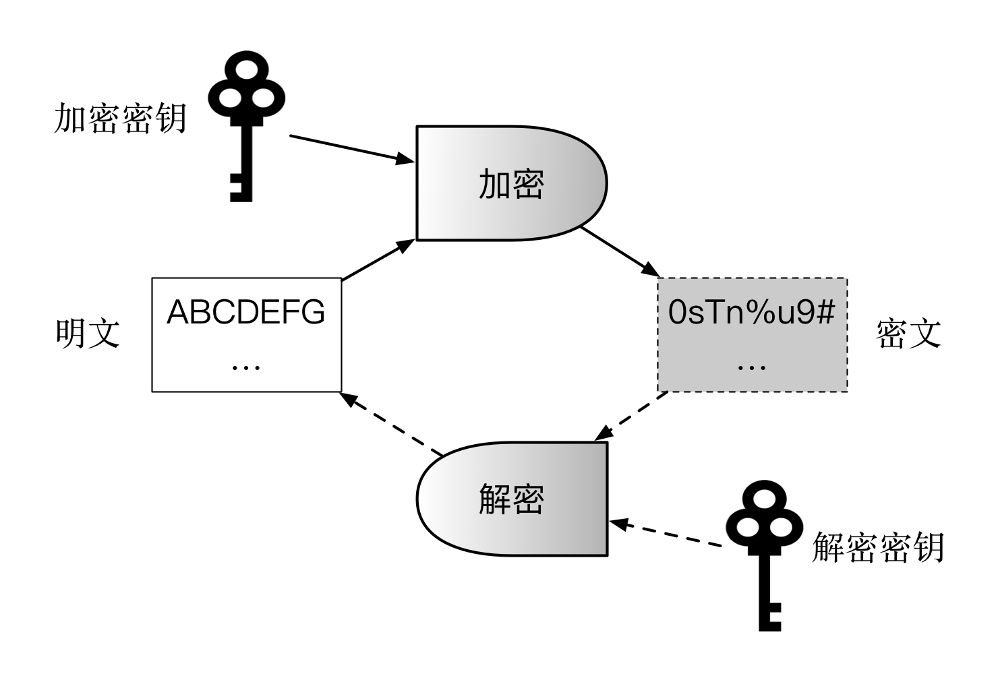
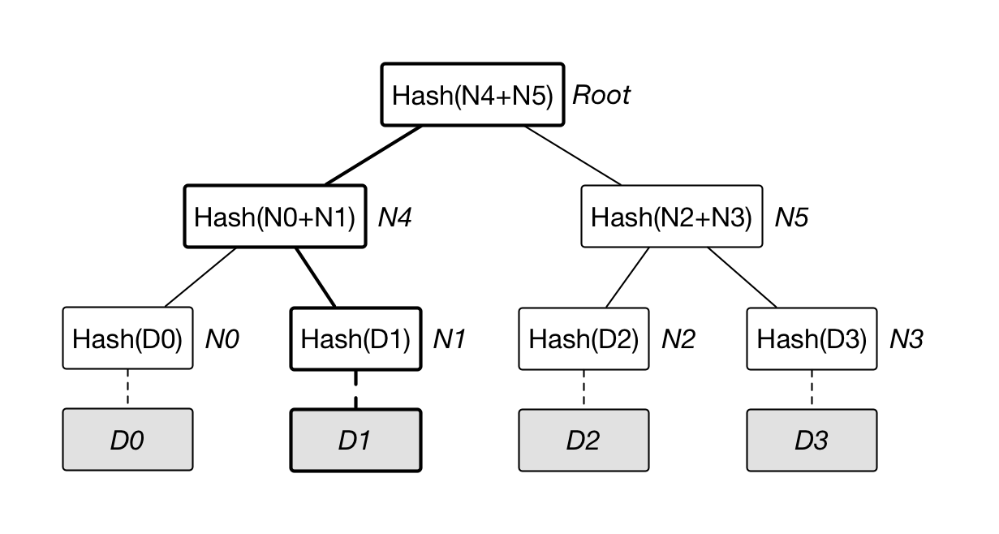
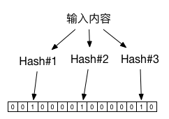

# 第五章 密码学与区块链安全

**工程领域从来没有黑科技；密码学不仅是工程。**

密码学作为核心的安全技术在信息科技领域的重要性无需多言。离开现代密码学和信息安全技术，人类社会将无法全面步入信息时代。区块链和分布式账本中大量使用了密码学和安全技术的最新成果，特别是身份认证和隐私保护相关技术。

从数学定理到工程实践，密码学和信息安全所涉及的知识体系十分繁杂。本章将介绍与区块链密切相关的安全知识，分为两部分：一是密码学基础，包括 Hash 算法与摘要、加密算法、数字签名和证书、PKI 体系、Merkle 树、布隆过滤器、同态加密、零知识证明等；二是区块链自身的安全实践，包括安全概览、智能合约漏洞与安全开发最佳实践、常见攻击向量、安全审计流程与审计工具。通过本章，读者可以了解常见安全技术体系，以及如何实现信息安全的核心要素：机密性、完整性、可认证性和不可抵赖性，为后续理解区块链的设计奠定基础。

## 密码学简史

从历史角度看，密码学可以大致分为古典密码学和近现代密码学两个阶段。两者以现代信息技术的诞生为分界点，现在所讨论的密码学多是指后者，建立在信息论和数学成果基础之上。

古典密码学源自数千年前。最早在公元前 1900 年左右的古埃及，就出现过使用特殊字符和简单替换式密码来保护信息。美索不达米亚平原上曾出土一个公元前 1500 年左右的泥板，其上记录了加密描述的陶器上釉工艺配方。古希腊时期（公元前 800 ~ 前 146 年）还发明了通过物理手段来隐藏信息的“隐写术”，例如使用牛奶书写、用蜡覆盖文字等。后来在古罗马时期还出现了基于替换加密的凯撒密码，据称凯撒曾用此方法与其部下通信而得以命名。

这些手段多数是采用简单的机械工具来保护秘密，在今天看来毫无疑问是十分简陋，很容易破解的。严格来看，可能都很难称为密码科学。

近现代密码的研究源自第一、二次世界大战中对军事通信进行保护和破解的需求。

1901 年 12 月，意大利工程师 Guglielmo Marconi（奎里亚摩·马可尼）成功完成了跨越大西洋的无线电通信实验，在全球范围内引发轰动，推动了无线电通信时代的到来。无线电极大提高了远程通信的能力，但存在着天然缺陷——它很难限制接收方，这意味着要想保护所传递信息的安全，必须采用可靠的加密技术。

对无线电信息进行加密以及破解的过程直接促进了近现代密码学和计算机技术的出现。反过来，这些科技进步也影响了时代的发展。一战时期德国外交部长 Arthur Zimmermann（阿瑟·齐默尔曼）拉拢墨西哥构成抗美军事同盟的电报（1917 年 1 月 16 日）被英国情报机构 —— 40 号办公室破译，直接导致了美国的参战；二战时期德国使用的恩尼格玛（Enigma）密码机（当时最先进的加密设备）被盟军成功破译（1939 年到 1941 年），导致大西洋战役德国失败。据称，二战时期光英国从事密码学研究的人员就达到 7000 人，而他们的成果使二战结束的时间至少提前了一到两年时间。

1945 年 9 月 1 日，Claude Elwood Shannon（克劳德·艾尔伍德·香农）完成了划时代的内部报告《A Mathematical Theory of Cryptography（密码术的一个数学理论）》，1949 年 10 月，该报告以《Communication Theory of Secrecy Systems（保密系统的通信理论）》为题在 Bell System Technical Journal（贝尔系统技术期刊）上正式发表。这篇论文首次将密码学和信息论联系到一起，为对称密码技术提供了数学基础。这也标志着近现代密码学的正式建立。

1976 年 11 月，Whitfield Diffie 和 Martin E.Hellman 在 IEEE Transactions on Information Theory 上发表了论文《New Directions in Cryptography（密码学的新方向）》，探讨了无需传输密钥的保密通信和签名认证体系问题，正式开创了现代公钥密码学体系的研究。

现代密码学的发展与电气技术特别是计算机信息理论和技术关系密切，已经发展为包括随机数、Hash 函数、加解密、身份认证等多个课题的庞大领域，相关成果为现代信息系统特别是互联网奠定了坚实的安全基础。

*注：当年破译 Enigma 依靠的是波兰与英国密码学家的数学分析、缴获的密码本以及 Bombe 等专用机电设备；在掌握当日密钥设置前，单条消息的破译代价极高。以今天的计算能力，穷举 Enigma 的密钥空间已是轻而易举。*

## Hash 算法与数字摘要

### 定义

Hash（哈希或散列）算法，又常被称为指纹（fingerprint）或摘要（digest）算法，是非常基础也非常重要的一类算法。可以将任意长度的二进制明文串映射为较短的（通常是固定长度的）二进制串（Hash 值），并且不同的明文很难映射为相同的 Hash 值。

例如计算 “hello blockchain world, this is yeasy@github” 的 SHA-256 Hash 值。

```bash
$ echo "hello blockchain world, this is yeasy@github"|shasum -a 256
db8305d71a9f2f90a3e118a9b49a4c381d2b80cf7bcef81930f30ab1832a3c90
```

对于某个文件，无需查看其内容，只要其 SHA-256 Hash 计算后结果同样为 `db8305d71a9f2f90a3e118a9b49a4c381d2b80cf7bcef81930f30ab1832a3c90`，则说明文件内容（极大的概率）就是 “hello blockchain world, this is yeasy@github”。

除了快速对比内容外，Hash 思想也经常被应用到基于内容的编址或命名算法中。

一个优秀的 Hash 算法，将能满足：

* 正向快速：给定原文和 Hash 算法，在有限时间和有限资源内能计算得到 Hash 值；
* 逆向困难：给定（若干）Hash 值，在有限时间内无法（基本不可能）逆推出原文；
* 输入敏感：原始输入信息发生任何改变，新产生的 Hash 值都应该发生很大变化；
* 碰撞避免：很难找到两段内容不同的明文，使得它们的 Hash 值一致（即发生碰撞）。

碰撞避免有时候又被称为“抗碰撞性”，可分为“弱抗碰撞性”和“强抗碰撞性”。给定原文前提下，无法找到与之碰撞的其他原文，则算法具有“弱抗碰撞性”；更一般地，如果无法找到任意两个可碰撞的原文，则称算法具有“强抗碰撞性”。

很多场景下，也往往要求算法对于任意长的输入内容，输出为定长的 Hash 结果。

### 常见算法

目前常见的 Hash 算法包括国际上的 Message Digest（MD）系列和 Secure Hash Algorithm（SHA）系列算法，以及国内的 SM3 算法。

MD 算法主要包括 MD4 和 MD5 两个算法。MD4（RFC 1320）是 MIT 的 Ronald L. Rivest 在 1990 年设计的，其输出为 128 位。MD4 已证明不够安全。MD5（RFC 1321）是 Rivest 于 1991 年对 MD4 的改进版本。它对输入仍以 512 位进行分组，其输出是 128 位。MD5 比 MD4 更加安全，但过程更加复杂，计算速度要慢一点。MD5 已于 2004 年被成功碰撞，其安全性已不足应用于商业场景。

SHA 算法由美国国家标准与技术院（National Institute of Standards and Technology，NIST）征集制定。首个实现 SHA-0 算法于 1993 年问世，1998 年即遭破解。随后的修订版本 SHA-1 算法在 1995 年面世，它的输出为长度 160 位的 Hash 值，安全性更好。SHA-1 设计采用了 MD4 算法类似原理。2005 年王小云团队提出理论攻击方法（将攻击复杂度从 2^80 降低到约 2^69，但尚未实现实际碰撞），2017 年 Google 与 CWI 联合实现了首次实际碰撞攻击（SHAttered 项目，复杂度约 2^63.1），意味着无法满足商用需求。

为了提高安全性，NIST 后来制定出更安全的 SHA-224、SHA-256、SHA-384 和 SHA-512 算法（统称为 SHA-2 算法）。2015 年，NIST 正式发布了新一代的 SHA-3 标准（基于 Keccak 算法）。虽然 SHA-3 已经标准化，但在实际应用中仍不如 SHA-2 广泛，目前主要用于数字签名、随机数生成等特定场景。

此外，中国密码管理局于 2010 年 12 月 17 日公布了 SM3 密码杂凑算法，2012 年将其发布为密码行业标准 GM/T 0004-2012 《SM3 密码杂凑算法》，建立了国内商用密码体系中的公开 Hash 算法标准，已经被广泛应用在数字签名和认证等场景中。

*注：MD5 的实际碰撞和 SHA-1 的首个理论攻击，都由清华大学教授、中国科学院院士王小云主导完成；SHA-1 的首次实际碰撞则由 Google 与 CWI 在 2017 年实现。*

### 性能

大多数 Hash 算法都是计算敏感型算法，在强大的计算芯片上完成得更快。因此要提升 Hash 计算的性能可以考虑硬件加速。例如采用普通 FPGA 来计算 SHA-256 值，可以轻易达到数 Gbps 的吞吐量，使用专用芯片吞吐量甚至会更高。

也有一些 Hash 算法不是计算敏感型的。例如 scrypt 算法，计算过程需要大量的内存资源，因此很难通过选用高性能芯片来加速 Hash 计算。这样的算法可以有效防范采用专用芯片进行算力攻击。

### 数字摘要

数字摘要是 Hash 算法重要用途之一。顾名思义，数字摘要是对原始的数字内容进行 Hash 运算，获取唯一的摘要值。

利用 Hash 函数抗碰撞性特点，数字摘要可以检测内容是否被篡改过。

细心的读者可能会注意到，有些网站在提供文件下载时，会同时提供相应的数字摘要值。用户下载原始文件后可以在本地自行计算摘要值，并与所提供摘要值进行比对，以确保文件内容没有被篡改过。

### Hash 攻击与防护

Hash 算法并不是一种加密算法，不能用于对信息的保护。

但 Hash 思想可被应用到对登录口令的保存上。例如网站登录时需要验证用户名和密码，如果网站后台直接保存用户的口令原文，一旦发生数据库泄露后果不堪设想（事实上，网站数据库泄露事件在国内外都不少见）。

口令保存不能直接使用普通快速 Hash（如 SHA-256(password)）。后台应使用专门的口令 Hash 或基于口令的密钥派生函数（KDF），如 Argon2id、scrypt、bcrypt 或 PBKDF2，对每个口令配置独立随机盐和合适的成本参数。数据库中通常保存算法标识、成本参数、盐和 Hash 结果；验证时用同一参数重新计算并比较结果。这样即便数据库泄露，也能显著提高离线猜解成本。

然而，有时用户设置口令的安全强度不够，采用了一些常见的字符串，如 password、123456 等。有人专门搜集了这些常见口令，计算对应的 Hash 值，制作成字典。这样通过 Hash 值可以快速反查到原始口令。这一类型以空间换时间的攻击方法包括字典攻击和彩虹表攻击（只保存一条 Hash 链的首尾值，相对字典攻击可以节省存储空间）等。

为了防范这一类攻击，必须采用加盐（Salt）的方法。盐不是保密信息，重点是每个账户唯一、随机，并随 Hash 结果一起保存；它能防止预计算彩虹表和相同口令产生相同 Hash。还应设置可随硬件能力提升而调整的成本参数：例如 OWASP 建议优先使用 Argon2id，并在无法使用时选择 scrypt、bcrypt 或 PBKDF2 等方案；FIPS 场景可采用 PBKDF2-HMAC-SHA-256 并配置足够高的迭代次数。

在更高风险场景下，可以增加 Pepper：在口令 Hash 之外，再使用服务端单独保存的秘密值参与 HMAC 或加密处理。Pepper 不能替代盐和成本参数，且不应存放在同一个口令数据库中，最好放在 HSM、TEE 或独立密钥管理系统中。

## 加解密算法

加解密算法是现代密码学核心技术，从设计理念和应用场景上可以分为两大基本类型：对称加密、非对称加密，如下表所示。

算法类型 | 特点 | 优势 | 缺陷 | 代表算法
------  | --- | --- | --- | -------
对称加密 | 加解密的密钥相同 | 计算效率高，加密强度高 | 需提前共享密钥，易泄露 | DES、3DES、AES、IDEA
非对称加密 | 加解密的密钥不相同 | 无需提前共享密钥 | 计算效率低，存在中间人攻击可能 | RSA、ElGamal、椭圆曲线算法

### 加解密系统基本组成

现代加解密系统的典型组件包括算法和密钥，密钥包括加密密钥、解密密钥。

其中，加解密算法自身是固定不变的，并且一般是公开可见的；密钥则是最关键的信息，需要安全地保存起来，甚至通过特殊硬件进行保护。一般来说，密钥需要在加密前按照特定算法随机生成，长度越长，则加密强度越大。

加解密的典型过程如下图所示。加密过程中，通过加密算法和加密密钥，对明文进行加密，获得密文；解密过程中，通过解密算法和解密密钥，对密文进行解密，获得明文。



根据加解密过程中所使用的密钥是否相同，算法可以分为对称加密（Symmetric Cryptography，又称共有密钥加密，Common-key cryptography）和非对称加密（Asymmetric Cryptography，又称公钥加密，Public-key Cryptography）。两种模式适用于不同的需求，形成互补。某些场景下可以组合使用，形成混合加密机制。

### 对称加密算法

对称加密算法，顾名思义，加密和解密过程的密钥是相同的。

该类算法优点是加解密效率（速度快，空间占用小）和加密强度都很高。

缺点是参与方需要提前持有密钥，一旦有人泄露则系统安全性被破坏；另外如何在不安全通道中提前分发密钥也是个问题，需要借助额外的 Diffie–Hellman 协商协议或非对称加密算法来实现。

对称密码从实现原理上可以分为两种：分组加密和序列加密。前者将明文切分为定长数据块作为基本加密单位，应用最为广泛。后者则每次只对一个字节或字符进行加密处理，且密码不断变化，只用在一些特定领域（如数字媒介的加密）。

**分组加密**的代表算法包括 DES、3DES、AES、IDEA 等。

* DES（Data Encryption Standard）：经典的分组加密算法，最早于 1977 年被美国联邦信息处理标准采纳为 FIPS PUB 46，此后经 46-1、46-2 多次重申，最后一版为 1999 年的 FIPS 46-3，将 64 位明文加密为 64 位的密文，其密钥长度为 64 位（包括 8 位校验码），现在已经很容易被暴力破解；
* 3DES：三重 DES 操作：加密 --> 解密 --> 加密，处理过程和加密强度优于 DES，但现在也被认为不够安全；
* AES（Advanced Encryption Standard）：由美国国家标准研究所（NIST）采用，取代 DES 成为对称加密实现的标准，1997~2000 年 NIST 从 15 个候选算法中评选 Rijndael 算法（由比利时密码学家 Joan Daemen 和 Vincent Rijmen 发明）作为 AES，标准为 FIPS-197。AES 是分组算法，分组长度固定为 128 位，支持 128、192、256 位三种密钥长度，分别称为 AES-128、AES-192、AES-256。AES 的优势在于处理速度快，整个过程可以数学化描述，目前尚未有有效的破解手段；
* IDEA（International Data Encryption Algorithm）：1991 年由密码学家 James Massey 与来学嘉共同提出，设计类似于 3DES，密钥长度增加到 128 位，具有更好的加密强度。

**序列加密**又称流加密。1949 年，Claude Elwood Shannon（信息论创始人）首次证明，要实现绝对安全的完善保密性（Perfect Secrecy），可以通过“一次性密码本”的对称加密处理。即通信双方每次使用跟明文等长的随机密钥串对明文进行加密处理。序列密码采用了类似的思想，每次通过伪随机数生成器来生成伪随机密钥串。代表算法包括 RC4 等。

总结一下，对称加密算法适用于大量数据的加解密过程，不能用于签名场景，并且需要提前安全地分发密钥。

*注：分组加密每次只能处理固定长度的明文，因此对于过长的内容需要采用一定模式进行分割。CBC（Cipher Block Chaining）和 CTR（Counter）等模式只提供机密性，不提供消息认证；单独使用时无法防止密文被篡改。实践中应优先使用 AEAD 模式（如 AES-GCM、ChaCha20-Poly1305），或在确有必要时采用正确的 Encrypt-then-MAC 组合。*

### 非对称加密算法

非对称加密是现代密码学的伟大发明，它有效解决了对称加密需要安全分发密钥的问题。

顾名思义，非对称加密中，加密密钥和解密密钥是不同的，分别称为公钥（Public Key）和私钥（Private Key）。私钥一般通过随机数算法生成，公钥可以根据私钥生成。

其中，公钥一般是公开的，他人可获取的；私钥则是个人持有并且要严密保护，不能被他人获取。

非对称加密算法优点是公私钥分开，无需安全通道来分发密钥。缺点是处理速度（特别是生成密钥和解密过程）往往比较慢，一般比对称加解密算法慢 2~3 个数量级；同时加密强度也往往不如对称加密。

非对称加密算法的安全性往往基于数学问题，包括大数质因子分解、离散对数、椭圆曲线等经典数学难题。

代表算法包括：RSA、ElGamal、椭圆曲线、SM2 等系列算法。

* RSA：经典的公钥算法，1978 年由 Ron Rivest、Adi Shamir、Leonard Adleman 共同提出，三人于 2002 年因此获得图灵奖。算法利用了对大数进行质因子分解困难的特性，但目前还没有数学证明两者难度等价，或许存在未知算法可以绕过大数分解而进行解密。
* ElGamal：由 Taher ElGamal 设计，利用了模运算下求离散对数困难的特性，比 RSA 产生密钥更快。被应用在 PGP 等安全工具中。
* 椭圆曲线算法（Elliptic Curve Cryptography，ECC）：应用最广也是强度最高的系列算法，基于对椭圆曲线上特定点进行特殊乘法逆运算（求离散对数）难以计算的特性。最早在 1985 年由 Neal Koblitz 和 Victor Miller 分别独立提出。ECC 系列算法具有多种国际标准（包括 ANSI X9.63、NIST FIPS 186-2、IEEE 1363-2000、ISO/IEC 14888-3 等），一般被认为具备较高的安全性，但加解密过程比较费时。其中，密码学家 Daniel J.Bernstein 于 2006 年提出的 Curve25519 曲线，以及构建在其上的 X25519 密钥交换算法和 2011 年提出的 Ed25519 签名算法，由于其设计完全公开、性能突出等特点，近些年引起了广泛关注和应用。
* SM2（ShangMi 2）：中国国家商用密码系列算法标准，由中国密码管理局于 2010 年 12 月 17 日发布，同样基于椭圆曲线算法，一般认为其安全强度优于 RSA 系列算法。

非对称加密算法适用于签名场景或密钥协商过程，但不适于大量数据的加解密。签名与验签的相对开销随算法而异：RSA 的验签要比签名快 1~2 个数量级（公钥指数很小）；而 ECDSA、Ed25519、SM2 等椭圆曲线算法则相反，签名快于验签。

RSA 类算法被认为已经很难抵御现代计算设备的破解，一般推荐商用场景下密钥至少为 2048 位。如果采用安全强度更高的椭圆曲线算法，256 位密钥即可满足绝大部分安全需求。

#### 选择明文攻击

细心的读者可能会想到，非对称加密中公钥是公开的，因此任何人都可以利用它加密给定明文，获取对应的密文，这就带来选择明文攻击的风险。

为了规避这种风险，现代的非对称加密算法（如 RSA、ECC）都引入了一定的保护机制：对同样的明文使用同样密钥进行多次加密，得到的结果完全不同，这就避免了选择明文攻击的破坏。

在实现上可以有多种思路。一种是对明文先进行变形，添加随机的字符串或标记，再对添加后结果进行处理。另外一种是先用随机生成的临时密钥对明文进行对称加密，然后再将对称密钥进行加密，即利用多层加密机制。

### 混合加密机制

混合加密机制同时结合了对称加密和非对称加密的优点。

该机制的主要过程为：先用非对称加密（计算复杂度较高）协商出一个临时的对称加密密钥（或称会话密钥），然后双方再通过对称加密算法（计算复杂度较低）对所传递的大量数据进行快速的加密处理。

典型的应用案例是网站中使用越来越普遍的通信协议 -- 安全超文本传输协议（Hyper Text Transfer Protocol Secure，HTTPS）。

与以明文方式传输数据的 HTTP 协议不同，HTTPS 在传统的 HTTP 层和 TCP 层之间引入 Transport Layer Security/Secure Socket Layer（TLS/SSL）加密层来实现安全传输。

SSL 协议是 HTTPS 初期采用的标准协议，最早由 Netscape 于 1994 年设计实现，其两个主要版本（包括 v2.0 和 v3.0）曾得到大量应用。SSL 存在安全缺陷易受攻击（如 POODLE 和 DROWN 攻击），无法满足现代安全需求，已于 2011 和 2015 年被 IETF 宣布废弃。基于 SSL 协议（v3.1），IETF 提出了改善的安全标准协议 TLS，成为目前广泛采用的方案。2008 年 8 月，TLS 1.2 版本（RFC 5246）发布，修正了之前版本的不少漏洞，极大增强了安全性；2018 年 8 月，TLS 1.3 版本（RFC 8446）发布，提高了握手性能同时增强了安全性。现代商用场景应优先使用 TLS 1.3；如需兼容 TLS 1.2，应只启用具备前向安全性的 ECDHE/DHE 与 AEAD 套件。除了 Web 服务外，TLS 协议也被广泛应用到 FTP、Email、实时消息、音视频通话等场景中。

早期 TLS 版本中采用 RSA 密钥传输（TLS_RSA）的 HTTPS 握手可简化理解为如下步骤：


1）客户端浏览器发送握手信息到服务器，包括随机数 R1、支持的加密算法套件（Cipher Suite）类型、协议版本、压缩算法等。注意该过程传输为明文。
2）服务端返回信息，包括随机数 R2、选定加密算法套件、协议版本，以及服务器证书。注意该过程为明文。
3）浏览器检查带有该网站公钥的证书。该证书需要由第三方 CA 来签发，浏览器和操作系统会预置权威 CA 的根证书。如果证书被篡改作假（中间人攻击），很容易通过 CA 的证书验证出来。
4）如果证书没问题，则客户端用服务端证书中公钥加密随机数 R3（又叫 Pre-MasterSecret），发送给服务器。此时，只有客户端和服务器都拥有 R1、R2 和 R3 信息，基于随机数 R1、R2 和 R3，双方通过伪随机数函数来生成共同的对称会话密钥 MasterSecret。
5）后续客户端和服务端的通信都通过协商后的对称加密（如 AES）进行保护。

可以看出，该过程是实现防止中间人窃听和篡改的前提下完成会话密钥的交换。但 TLS_RSA 这类静态 RSA 密钥传输不具备前向安全性：一旦服务器私钥泄露，历史会话也可能被解密。TLS 1.3 已移除静态 RSA 和静态 Diffie-Hellman 密码套件，所有基于公钥的密钥交换都提供前向安全性。需要注意，选用合适的加密算法套件对于 TLS 的安全性十分重要。要合理选择安全强度高的算法组合，如 ECDHE-RSA 和 ECDHE-ECDSA 等，而不要使用安全性较差的 DES/3DES、TLS_RSA 或静态 ECDH 套件。

现代 TLS 的密钥协商通常通过临时 Diffie-Hellman（DHE）或临时椭圆曲线 Diffie-Hellman（ECDHE）完成，证书中的 RSA、ECDSA 或 EdDSA 公钥主要用于服务器身份认证和握手签名。

加密算法套件包括一组算法，包括交换、认证、加密、校验等：

* 密钥交换算法：负责协商对称密钥，常见类型包括 DHE、ECDHE 等；RSA 密钥传输、静态 DH 和静态 ECDH 属于旧式机制，不推荐用于新系统；
* 证书签名算法：负责验证身份，常见类型包括 RSA、DSA、ECDSA 等；
* 加密数据算法：对建立连接的通信内容进行对称加密，常见类型包括 AES 等；
* 消息认证算法：验证消息的完整性和真实性，TLS 1.2 中可能是 HMAC-SHA256/HMAC-SHA384，AEAD 套件则由 GCM 或 ChaCha20-Poly1305 等算法产生认证标签；SHA 本身只是摘要算法，不等同于 MAC。

一个典型的 TLS 1.2 AEAD 密码算法套件可能为 “TLS_ECDHE_ECDSA_WITH_AES_256_GCM_SHA384”，意味着：

* 协商过程算法是 ECDHE（Elliptic Curve Diffie–Hellman Ephemeral），基于椭圆曲线的短期 DH 交换，每次交换都用新的临时密钥，保障前向安全性；
* 证书签名算法是 ECDSA（Elliptic Curve Digital Signature Algorithm），基于椭圆曲线的签名；
* 加密数据算法是 AES-256-GCM，AES 密钥长度为 256 位，AES 分组长度仍然固定为 128 位；GCM 同时提供机密性和认证标签；
* SHA384 是该套件使用的 Hash 算法，参与 TLS 伪随机函数或密钥派生和握手完整性校验，并不是把 SHA 单独当作加密算法使用。

目前，推荐选用如下的加密算法套件：

* TLS_AES_256_GCM_SHA384
* TLS_CHACHA20_POLY1305_SHA256
* TLS_AES_128_GCM_SHA256
* TLS_ECDHE_ECDSA_WITH_AES_256_GCM_SHA384
* TLS_ECDHE_RSA_WITH_AES_256_GCM_SHA384
* TLS_ECDHE_ECDSA_WITH_CHACHA20_POLY1305_SHA256

*注：TLS 1.0 和 TLS 1.1 已被 IETF 废弃；新系统不应启用 SSL、TLS 1.0 或 TLS 1.1。*

### 离散对数与 Diffie–Hellman 密钥交换协议

Diffie–Hellman（DH）密钥交换协议是一个应用十分广泛的协议，最早由惠特菲尔德·迪菲（Bailey Whitfield Diffie）和马丁·赫尔曼（Martin Edward Hellman）于 1976 年提出。该协议可以实现在不安全信道中协商对称密钥。

DH 协议的设计基于著名的离散对数问题（Discrete Logarithm Problem，DLP）。离散对数问题是指对于一个很大的素数 p，已知 g 为 p 的模循环群的原根，给定任意 x，求解 X=g^x mod p 是可以很快获取的。但在已知 p，g 和 X 的前提下，逆向求解 x 很难（目前没有找到多项式时间实现的算法）。该问题同时也是 ECC 类加密算法的基础。

DH 协议的基本交换过程如下，以 Alice 和 Bob 两人协商为例：

* Alice 和 Bob 两个人协商密钥，先公开商定 p，g；
* Alice 自行选取私密的整数 x，计算 X=g^x mod p，发送 X 给 Bob；
* Bob 自行选取私密的整数 y，计算 Y=g^y mod p，发送 Y 给 Alice；
* Alice 根据 x 和 Y，求解共同密钥 Z_A=Y^x mod p；
* Bob 根据 X 和 y，求解共同密钥 Z_B=X^y mod p。

实际上，Alice 和 Bob 计算出来的结果将完全相同，因为在 mod p 的前提下，Y^x =(g^y)^x =g^(xy) = (g^x)^y=X^y。而信道监听者在已知 p，g，X，Y 的前提下，无法求得 Z。

### 安全性

虽然很多加密算法的安全性建立在数学难题基础之上，但并非所有算法的安全性都可以从数学上得到证明。

公认高安全性的加密算法和实现往往是经过长时间充分实践论证后，才被大家所认可，但不代表其绝对不存在漏洞。使用方式和参数不当，也会造成安全强度下降。

另一方面，自行设计和发明的未经过大规模验证的加密算法是一种不太明智的行为。即便不公开算法加密过程，也很容易被分析和攻击，无法在安全性上得到足够保障。

实际上，现代密码学算法的安全性是通过数学难题来提供的，并非通过对算法自身的实现过程进行保密。

### 抗量子密码算法（Post-Quantum Cryptography）

随着量子计算技术的快速发展，传统的非对称加密算法（如 RSA、ECC）面临着严峻的安全威胁。Shor 算法证明，足够强大的量子计算机可以在多项式时间内破解基于大数分解和离散对数问题的加密体系。这意味着，构建在现有公钥基础设施之上的区块链系统必须未雨绸缪，向抗量子密码算法（PQC）迁移。

2024 年，美国国家标准与技术研究院（NIST）正式发布了首批抗量子密码学标准（FIPS 203, 204, 205），标志着 PQC 进入了标准化应用阶段。

目前主要的抗量子算法路线包括：

*   **基于格的密码（Lattice-based Cryptography）**：这是目前最被看好的路线，NIST 选定的 **Kyber**（ML-KEM, 用于密钥封装）和 **Dilithium**（ML-DSA, 用于数字签名）均属于此类。其优势是计算速度快，公钥和密文尺寸适中，但也面临着参数选择复杂的挑战。
*   **基于哈希的签名（Hash-based Signature）**：如 **SPHINCS+** (SLH-DSA)。其安全性完全依赖于哈希函数的安全性（十分稳健），不依赖其他数学假设，但签名体积较大。
*   **基于编码的密码（Code-based Cryptography）**：如 McEliece 算法，历史悠久且从未被攻破，但公钥尺寸极大（KB 级别），限制了其应用。
*   **多变量密码（Multivariate Cryptography）**：签名速度快且非常短，但公钥较大。

对于区块链而言，升级到抗量子签名方案（如 Dilithium 或 SPHINCS+）是当务之急。以太坊等主流公链已经开始研究账户抽象（Account Abstraction）来支持签名算法的平滑切换，以应对未来的量子威胁。

## 消息认证码与数字签名

消息认证码和数字签名技术通过带密钥的认证算法来保护消息完整性并认证身份；它们通常会用到消息摘要，但不是简单地“加密摘要”。

### 消息认证码

消息认证码（Message Authentication Code，MAC），利用共享密钥构造认证值，对消息完整性（Integrity）和来源真实性进行保护。其中最常用的是基于密码学 Hash 函数的构造 HMAC（RFC 2104）；此外还有基于分组密码的 CMAC/GMAC、基于 Poly1305 的构造等，并非都是「基于 Hash」的。MAC 不是对称加密算法，不提供机密性。

基本过程为对某个消息，利用提前共享的对称密钥和 Hash 算法进行处理，得到 HMAC 值。该 HMAC 值持有方可以向对方证明自己拥有某个对称密钥，并且确保所传输消息内容未被篡改。

典型的 HMAC 生成算法包括 K，H，M 三个参数。K 为提前共享的对称密钥，H 为提前商定的 Hash 算法（如 SHA-256），M 为要传输的消息内容。三个参数缺失了任何一个，都无法得到正确的 HMAC 值。

消息认证码可以用于简单证明身份的场景。如 Alice、Bob 提前共享了 K 和 H。Alice 需要知晓对方是否为 Bob，可发送一段消息 M 给 Bob。Bob 收到 M 后计算其 HMAC 值并返回给 Alice，Alice 检验收到 HMAC 值的正确性可以验证对方是否真是 Bob。

*注：例子中并没有考虑中间人攻击的情况，并假定信道是安全的。*

消息认证码的主要问题是需要提前共享密钥，并且当密钥可能被多方同时拥有（甚至泄露）的场景下，无法追踪消息的真实来源。如果采用非对称数字签名机制，则能有效地解决这个问题。

### 数字签名

类似在纸质合同上进行签名以确认合同内容和证明身份，数字签名既可以证实某数字内容的完整性，又可以确认其来源（即不可抵赖，Non-Repudiation）。

一个典型的场景是，Alice 通过信道发给 Bob 一个文件（一份信息），Bob 如何获知所收到的文件即为 Alice 发出的原始版本？Alice 可以先对文件内容进行摘要，然后用自己的私钥和签名算法生成签名，之后同时将文件和签名都发给 Bob。Bob 收到文件和签名后，用 Alice 的公钥和同一签名算法执行验签，并把验签过程绑定到收到的文件内容。如果验签通过，说明该文件确实由持有 Alice 私钥的一方签发，并且文件内容没有被修改过。这里的“签名/验签”不是通用的“私钥加密、公钥解密”；ECDSA、EdDSA 等签名算法本身就不存在解密步骤。

并非所有非对称加密算法都可以直接用来实现数字签名，实践中应使用标准化的数字签名算法和安全参数。当前常用算法包括 RSA-PSS、ECDSA（Elliptic Curve Digital Signature Algorithm）和 EdDSA 等。NIST FIPS 186-5 已将传统 DSA 保留为仅用于验证既有签名，不再推荐用于生成新签名。

除普通的数字签名应用场景外，针对一些特定的安全需求，产生了一些特殊数字签名技术，包括盲签名、多重签名、群签名、环签名等。

#### 盲签名

盲签名（Blind Signature），由 David Chaum 在 1982 年的 CRYPTO '82 上提出、论文集 1983 年出版，论文《Blind Signatures for Untraceable Payments》中[提出](http://www.hit.bme.hu/~buttyan/courses/BMEVIHIM219/2009/Chaum.BlindSigForPayment.1982.PDF)。签名者需要在无法看到原始内容的前提下对信息进行签名。

盲签名可以实现对所签名内容的保护，防止签名者看到原始内容；另一方面，盲签名还可以实现防止追踪（Unlinkability），签名者无法将签名内容和签名结果进行对应。典型的实现包括 RSA 盲签名算法等。

#### 多重签名

多重签名（Multiple Signature），即 n 个签名者中，收集到至少 m 个（n >= m >= 1）的签名，即认为合法。

其中，n 是提供的公钥个数，m 是需要匹配公钥的最少的签名个数。

多重签名可以有效地应用在多人投票共同决策的场景中。例如双方进行协商，第三方作为审核方。三方中任何两方达成一致即可完成协商。

比特币交易中就支持多重签名，可以实现多个人共同管理某个账户的比特币交易。

#### 群签名

群签名（Group Signature），即某个群组内一个成员可以代表群组进行匿名签名。签名可以验证来自于该群组，却无法准确追踪到签名的是哪个成员。

群签名需要一个群管理员来添加新的群成员，因此存在群管理员可能追踪到签名成员身份的风险。

群签名最早在 1991 年由 David Chaum 和 Eugene van Heyst 提出。

#### 环签名

环签名（Ring Signature），由 Rivest，Shamir 和 Tauman 三位密码学家在 2001 年首次提出。环签名属于一种简化的群签名。

签名者首先选定一个临时的签名者集合，集合中包括签名者自身。然后签名者利用自己的私钥和签名集合中其他人的公钥就可以独立地产生签名，而无需他人的帮助。签名者集合中的其他成员可能并不知道自己被包含在最终的签名中。

环签名在保护匿名性方面也具有很多用途。

### 安全性

数字签名算法自身的安全性由数学问题进行保护。但在实践中，各个环节的安全性都十分重要，一定要严格遵循标准流程。

例如，目前常见的数字签名算法需要选取合适的随机数作为配置参数，配置参数使用不当或泄露都会造成安全漏洞和风险。

2010 年 12 月，安全团队 fail0verflow 在第 27 届混沌通信大会（27C3）上披露，SONY 公司的 PS3 产品在采用十分安全的 ECDSA 进行签名时，对每个签名都使用了同一个固定的随机参数 k，导致任意两个签名即可解出私钥，最终造成重大经济损失。

## 数字证书

对于非对称加密算法和数字签名来说，很重要的步骤就是公钥的分发。理论上任何人都可以获取到公开的公钥。然而这个公钥文件有没有可能是伪造的呢？传输过程中有没有可能被篡改呢？一旦公钥自身出了问题，则整个建立在其上的安全性将不复成立。

数字证书机制正是为了解决这个问题，它就像日常生活中的证书一样，可以确保所记录信息的合法性。比如证明某个公钥是某个实体（个人或组织）拥有，并且确保任何篡改都能被检测出来，从而实现对用户公钥的安全分发。

根据所保护公钥的用途，数字证书可以分为加密数字证书（Encryption Certificate）和签名验证数字证书（Signature Certificate）。前者往往用于保护用于加密用途的公钥；后者则保护用于签名用途的公钥。两种类型的公钥也可以同时放在同一证书中。

一般情况下，证书需要由证书认证机构（Certification Authority，CA）来进行签发和背书。公开信任 TLS 证书的 CA 例子包括 DigiCert、GlobalSign、Sectigo、Let's Encrypt 等。VeriSign 是历史品牌，其公开 TLS 证书业务已不宜作为当前商业 CA 示例。用户也可以自行搭建本地 CA 系统，在私有网络中进行使用。

### X.509 证书规范

一般的，一个数字证书内容可能包括证书域（证书的版本、序列号、签名算法类型、签发者信息、有效期、被签发主体、**签发的公开密钥**）、CA 对证书的签名算法和签名值等。

目前使用最广泛的标准为 ITU 和 ISO 联合制定的 X.509 的 v3 版本规范（RFC 5280），其中定义了如下证书信息域：

* 版本号（Version Number）：规范的版本号，目前为版本 3，值为 0x2；
* 序列号（Serial Number）：由 CA 维护的为它所颁发的每个证书分配的唯一的序列号，用来追踪和撤销证书。只要拥有签发者信息和序列号，就可以唯一标识一个证书。最大不能超过 20 个字节；
* 签名算法（Signature Algorithm）：数字签名所采用的算法，如 sha256WithRSAEncryption 或 ecdsa-with-SHA256；
* 颁发者（Issuer）：颁发证书单位的信息，如 “C=CN, ST=Beijing, L=Beijing, O=org.example.com, CN=ca.org.example.com”；
* 有效期（Validity）：证书的有效期限，包括起止时间（如 Not Before 2026-04-25-00-00UTC，Not After 2026-10-22-00-00UTC）。公开信任 TLS 服务器证书的有效期受到 CA/B Forum Baseline Requirements 限制：2026-03-15 起最长 200 天，2027-03-15 起最长 100 天，2029-03-15 起最长 47 天；私有 PKI 可按自身策略设置，但不应把公开 TLS 的限制忽略掉；
* 被签发主体（Subject）：证书拥有者的标识信息（Distinguished Name），如 “C=CN, ST=Beijing, L=Beijing, CN=personA.org.example.com”；
* 主体的公钥信息（Subject Public Key Info）：所保护的公钥相关的信息；
    * 公钥算法（Public Key Algorithm）：公钥采用的算法；
    * 主体公钥（Subject Public Key）：公钥的内容；
* 颁发者唯一号（Issuer Unique Identifier，可选）：代表颁发者的唯一信息，仅 2、3 版本支持，可选；
* 主体唯一号（Subject Unique Identifier，可选）：代表拥有证书实体的唯一信息，仅 2、3 版本支持，可选；
* 扩展（Extensions，可选）：可选的一些扩展。可能包括：
    * Subject Key Identifier：实体的密钥标识符，区分实体的多对密钥；
    * Basic Constraints：一般指明该证书是否属于某个 CA；
    * Authority Key Identifier：颁发这个证书的颁发者的公钥标识符；
    * Authority Information Access：颁发相关的服务地址，如颁发者证书获取地址和吊销证书列表信息查询地址；
    * CRL Distribution Points：证书注销列表的发布地址；
    * Key Usage: 表明证书的用途或功能信息，如 Digital Signature、keyCertSign。`keyCertSign` 只能用于 CA 证书，TLS 服务器叶子证书不能声明该用途；
    * Subject Alternative Name：证书身份实体的别名，如该证书可以同样代表 *.org.example.com，org.example.com，*.example.com，example.com 身份等。

此外，证书的颁发者还需要对证书内容利用自己的私钥进行签名，以防止他人篡改证书内容。

### 证书格式

X.509 规范中一般推荐使用 PEM（Privacy Enhanced Mail）格式来存储证书相关的文件。证书文件的文件名后缀一般为 `.crt` 或 `.cer`，对应私钥文件的文件名后缀一般为 `.key`，证书请求文件的文件名后缀为 `.csr`。有时候也统一用 `.pem` 作为文件名后缀。

PEM 格式采用文本方式进行存储，一般包括首尾标记和内容块，内容块采用 base64 编码。

例如，一个简化的示例证书文件的 PEM 格式如下所示：

```text
-----BEGIN CERTIFICATE-----
...base64-encoded certificate...
-----END CERTIFICATE-----
```

可以通过 openssl 工具来查看其内容。

```bash

## openssl x509 -in example.com-cert.pem -noout -text
Certificate:
    Data:
        Version: 3 (0x2)
        Serial Number:
            22:13:22:47:3a:a4:0a:58:ea:dd:95:e7:b2:5e:84:8a
    Signature Algorithm: ecdsa-with-SHA256
        Issuer: C=US, ST=California, L=San Francisco, O=example.com, CN=example.com
        Validity
            Not Before: Apr 25 03:30:37 2026 GMT
            Not After : Oct 22 03:30:37 2026 GMT
        Subject: C=US, ST=California, L=San Francisco, O=example.com, CN=example.com
        Subject Public Key Info:
            Public Key Algorithm: id-ecPublicKey
                Public-Key: (256 bit)
                pub:
                    04:29:08:1d:9d:e6:24:21:0f:6c:86:d4:76:1f:ca:
                    cf:7c:d6:5b:50:bd:c3:19:d9:3b:07:f2:ca:b8:6b:
                    e9:a1:f0:59:11:16:dd:9a:4c:58:a5:1c:6e:c6:2e:
                    a7:99:1b:a2:e0:5c:d9:db:cc:15:48:28:3c:1a:1a:
                    15:82:7d:0f:44
                ASN1 OID: prime256v1
        X509v3 extensions:
            X509v3 Key Usage: critical
                Digital Signature
            X509v3 Extended Key Usage:
                TLS Web Server Authentication
            X509v3 Basic Constraints: critical
                CA:FALSE
            X509v3 Subject Alternative Name:
                DNS:example.com
            X509v3 Subject Key Identifier:
                48:03:F0:E6:7A:6C:13:1A:26:DB:19:EF:2E:5A:3B:79:86:79:44:EB:74:94:B1:7B:8D:28:EF:62:18:48:55:A8
    Signature Algorithm: ecdsa-with-SHA256
         30:45:02:21:00:ca:83:0e:d8:10:10:dd:cf:60:04:93:a4:d6:
         84:b2:5c:fe:f4:5d:19:38:75:3c:17:30:5e:ea:47:bd:a2:8c:
         b1:02:20:52:8b:00:da:60:58:5a:0c:a2:8d:d6:f7:5b:b3:25:
         e5:26:9d:b2:49:b7:c2:65:af:4d:01:ca:3b:ab:7c:0b:ef
```

此外，还有 DER（Distinguished Encoding Rules）格式，是采用二进制对证书进行保存，可以与 PEM 格式互相转换。

### 证书信任链

证书中记录了大量信息，其中最重要的包括 `签发的公开密钥` 和 `CA 数字签名` 两个信息。因此，只要使用 CA 的公钥验证证书上的 CA 签名，就能证明所记录的公钥是否合法。

读者可能会想到，怎么证明用来验证对实体证书进行签名的 CA 公钥自身是否合法呢？毕竟在获取 CA 公钥的过程中，它也可能被篡改掉。

实际上，CA 的公钥是否合法，一方面可以通过更上层的 CA 颁发的证书来进行认证；另一方面某些根 CA（Root CA）可以通过预先分发证书来实现信任基础。例如，主流操作系统和浏览器里面，往往会提前预置一些权威 CA 的证书（通过自身的私钥签名，系统承认这些是合法的证书）。之后所有基于这些 CA 认证过的中间层 CA（Intermediate CA）和后继 CA 都会被验证合法。这样就从预先信任的根证书，经过中间层证书，到最底下的实体证书，构成一条完整的证书信任链。

某些时候用户在使用浏览器访问某些网站时，可能会被提示是否信任对方的证书。这说明该网站证书无法被当前系统中的证书信任链进行验证，需要进行额外检查。另外，当信任链上任一证书不可靠时，则依赖它的所有后继证书都将失去保障。

可见，证书作为公钥信任的基础，对其生命周期进行安全管理十分关键。后面章节将介绍的 PKI 体系提供了一套完整的证书管理的框架，包括生成、颁发、撤销过程等。

## PKI 体系

按照 X.509 规范，公钥可以通过证书机制来进行保护，但证书的生成、分发、撤销等步骤并未涉及。

实际上，要实现安全地管理、分发证书需要遵循 PKI（Public Key Infrastructure）体系。该体系解决了证书生命周期相关的认证和管理问题。

需要注意，PKI 是建立在公私钥基础上实现安全可靠传递消息和身份确认的一个通用框架，并不代表某个特定的密码学技术和流程。实现了 PKI 规范的平台可以安全可靠地管理网络中用户的密钥和证书。目前包括多个具体实现和规范，知名的有 RSA 公司的 PKCS（Public Key Cryptography Standards）标准和 OpenSSL 等开源工具。

### PKI 基本组件

一般情况下，PKI 至少包括如下核心组件：

* CA（Certification Authority）：负责证书的颁发和吊销（Revoke），接收来自 RA 的请求，是最核心的部分；
* RA（Registration Authority）：对用户身份进行验证，校验数据合法性，负责登记，审核过了就发给 CA；
* 证书数据库：存放证书，多采用 X.500 系列标准格式。可以配合 LDAP 目录服务管理用户信息。

其中，CA 是最核心的组件，主要完成对证书信息的维护。

常见的操作流程为，用户通过 RA 登记申请证书，提供身份和认证信息等；CA 审核后完成证书的制造，颁发给用户。用户如果需要撤销证书则需要再次向 CA 发出申请。

### 证书的签发

CA 对用户签发证书实际上是对某个用户公钥，使用 CA 的私钥对其进行签名。这样任何人都可以用 CA 的公钥对该证书进行合法性验证。验证成功则认可该证书中所提供的用户公钥内容，实现用户公钥的安全分发。

用户证书的签发通常应由用户自己生成公钥和私钥，然后 CA 对公钥内容进行签名（只有用户持有私钥）。对于公开信任的 TLS 服务器证书，CA/B Forum Baseline Requirements 明确禁止 CA 代表订阅者生成包含 `serverAuth` 或 `anyExtendedKeyUsage` 的证书密钥对，也禁止接受由该 CA 先前生成的密钥对。私有 PKI 中如确需密钥托管或代生成，必须有明确授权、用途边界和保护措施，且不适用于需要不可抵赖性的签名私钥。

前者情况下，用户一般会首先自行生成一个私钥和证书申请文件（Certificate Signing Request，即 csr 文件），该文件中包括了用户对应的公钥和一些基本信息，如通用名（common name，即 cn）、组织信息、地理位置等。CA 只需要对证书请求文件进行签名，生成证书文件，颁发给用户即可。整个过程中，用户可以保持私钥信息的私密性，不会被其他方获知（包括 CA 方）。

生成证书申请文件的过程并不复杂，用户可以很容易地使用开源软件 openssl 来生成 csr 文件和对应的私钥文件。

例如，安装 openssl 后可以执行如下命令来生成私钥和对应的证书请求文件：

```bash
$ openssl req -new -newkey rsa:2048 -sha256 -keyout private.key -out for_request.csr
Generating a 2048 bit RSA private key
................................................+++++
................................................+++++
writing new private key to 'private.key'
Enter PEM pass phrase:
Verifying - Enter PEM pass phrase:
-----
You are about to be asked to enter information that will be incorporated
into your certificate request.
What you are about to enter is what is called a Distinguished Name or a DN.
There are quite a few fields but you can leave some blank
For some fields there will be a default value,
If you enter '.', the field will be left blank.
-----
Country Name (2 letter code) [AU]:CN
State or Province Name (full name) [Some-State]:Beijing
Locality Name (eg, city) []:Beijing
Organization Name (eg, company) [Internet Widgets Pty Ltd]:Blockchain
Organizational Unit Name (eg, section) []:Dev
Common Name (e.g. server FQDN or YOUR name) []:example.com
Email Address []:

Please enter the following 'extra' attributes
to be sent with your certificate request
A challenge password []:
An optional company name []:
```

生成过程中需要输入地理位置、组织、通用名等信息。生成的私钥和 csr 文件默认以 PEM 格式存储，内容为 base64 编码。

如生成的 csr 文件内容可能为：

```bash
$ cat for_request.csr
-----BEGIN CERTIFICATE REQUEST-----
...base64-encoded CSR...
-----END CERTIFICATE REQUEST-----
```

openssl 工具提供了查看 PEM 格式文件明文的功能，如使用如下命令可以查看生成的 csr 文件的明文：

```bash
$ openssl req -in for_request.csr -noout -text
Certificate Request:
    Data:
        Version: 0 (0x0)
        Subject: C=CN, ST=Beijing, L=Beijing, O=Blockchain, OU=Dev, CN=example.com
        Subject Public Key Info:
            Public Key Algorithm: rsaEncryption
            Public-Key: (2048 bit)
                Modulus:
                    ...2048-bit modulus omitted...
                Exponent: 65537 (0x10001)
        Attributes:
            a0:00
    Signature Algorithm: sha256WithRSAEncryption
        ...signature omitted...
```

示例中使用 2048 位 RSA 和 SHA-256。1024 位 RSA 和 SHA-1 签名已不适合新的证书申请或签发：NIST SP 800-131A 将低于 2048 位的 RSA 签名生成列为不允许，SHA-1 也不应用于新的数字签名生成。

需要注意，用户自行生成私钥情况下，私钥文件一旦丢失，CA 方由于不持有私钥信息，无法进行恢复，意味着通过该证书中公钥加密的内容将无法被解密。

### 证书的吊销

证书超出有效期后会作废，用户也可以主动向 CA 申请吊销某证书文件。

由于 CA 无法强制收回已经颁发出去的数字证书，因此为了实现证书的作废，往往还需要维护一个吊销证书列表（Certificate Revocation List，CRL），用于记录已经吊销的证书序号。

因此，通常情况下，当对某个证书进行验证时，需要首先检查该证书是否已经记录在列表中。如果存在，则该证书无法通过验证。如果不在，则继续进行后续的证书验证过程。

为了方便同步吊销列表信息，IETF 提出了在线证书状态协议（Online Certificate Status Protocol，或 OCSP），支持该协议的服务可以实时在线查询吊销的证书列表信息。

## Merkle 树结构

[Merkle 树](https://en.wikipedia.org/wiki/Merkle_tree)（又叫哈希树）是一种典型的二叉树结构，由一个根节点、一组中间节点和一组叶节点组成。Merkle 树最早由 Ralph Merkle 在 1980 年提出，曾广泛用于文件系统和 P2P 系统中。

其主要特点为：

* 最下面的叶节点包含存储数据或其 Hash 值；
* 非叶子节点（包括中间节点和根节点）都是它的两个孩子节点内容的 Hash 值。

进一步地，Merkle 树可以推广到多叉树的情形，此时非叶子节点的内容为它所有的孩子节点的内容的 Hash 值。

Merkle 树逐层记录 Hash 值的特点，让它具有了一些独特的性质。例如，底层数据的任何变动，都会传递到其父节点，一层层沿着路径一直到树根。这意味树根的值实际上代表了对底层所有数据的“数字摘要”。

目前，Merkle 树的典型应用场景包括如下几种。

### 证明某个集合中存在或不存在某个元素

通过构建集合的 Merkle 树，并提供该元素各级兄弟节点中的 Hash 值，可以不暴露集合完整内容而证明某元素存在。

另外，对于可以进行排序的集合，可以将不存在元素的位置用空值代替，以此构建稀疏 Merkle 树（Sparse Merkle Tree）。该结构可以证明某个集合中不包括指定元素。

### 快速比较大量数据

对每组数据排序后构建 Merkle 树结构。当两个 Merkle 树根相同时，则意味着所代表的两组数据（极大的概率）相同。否则，必然不同。

由于 Hash 计算的过程可以十分快速，预处理可以在短时间内完成。利用 Merkle 树结构能带来巨大的比较性能优势。

### 快速定位修改

以下图为例，基于数据 D0……D3 构造 Merkle 树，如果 D1 中数据被修改，会影响到 N1，N4 和 Root。



因此，一旦发现某个节点如 Root 的数值发生变化，沿着 Root --> N4 --> N1，最多通过 O(lgN) 时间即可快速定位到实际发生改变的数据块 D1。

### 成员证明（不是零知识证明）

仍以上图为例，如果要向他人证明某个数据 D0 已被承诺到 Merkle 根中，证明人可以公开 D0 及其路径上的兄弟节点 Hash（如 N1、N5）和 Root。验证者按路径重新计算 Root，若结果一致，即可确认 D0 属于该 Merkle 根代表的数据集合。

这种 Merkle inclusion proof 可以避免暴露完整集合，但它会暴露被证明的叶子、路径长度、相邻节点 Hash，很多实现还会暴露叶子位置；它证明的是“给定叶子在给定根承诺的集合中”，不是零知识证明。零知识证明要求验证者除了命题真假之外不获得额外信息，Merkle 成员证明通常不满足这个性质。

## 布隆过滤器

布隆过滤器（Bloom Filter）是在 1970 年由 Burton Howard Bloom 在论文《Space/Time Trade-offs in Hash Coding with Allowable Errors》提出的。布隆过滤器是一种基于 Hash 的高效查找结构，能够快速（常数时间内）回答“某个元素是否在一个集合内”的问题。

该结构因为具有高效性而广泛应用到网络和安全领域，例如信息检索（BigTable 和 HBase）、垃圾邮件规则、注册管理等。

### 基于 Hash 的快速查找

在介绍布隆过滤器之前，先来看看基于 Hash 的快速查找算法。在前面的讲解中，我们提到，Hash 可以将任意内容映射到一个固定长度的字符串，而且不同内容映射到相同串的概率很低。因此，这就构成了一个很好的“内容 -> 索引”的生成关系。

试想，如果给定一个内容和存储数组，通过构造 Hash 函数，让映射后的 Hash 值总不超过数组的大小，则可以实现快速的基于内容的查找。例如，内容 “hello world” 的 Hash 值如果是 “100”，则存放到数组的第 100 个单元上去。如果需要快速查找任意内容，如 “hello world” 字符串是否在存储系统中，只需要将其在常数时间内计算 Hash 值，并用 Hash 值查看系统中对应元素即可。该系统“完美地”实现了常数时间内的查找。

然而，令人遗憾的是，当映射后的值限制在一定范围（如总数组的大小）内时，会发现 Hash 冲突的概率会变高，而且范围越小，冲突概率越大。很多时候，存储系统的大小又不能无限扩展，这就造成算法效率的下降。为了提高空间利用率，后来人们基于 Hash 算法的思想设计出了布隆过滤器结构。

### 更高效的布隆过滤器



布隆过滤器采用了多个 Hash 函数来提高空间利用率。

对同一个给定输入来说，多个 Hash 函数计算出多个地址，分别在位串的这些地址上标记为 1。在查找时，进行同样的计算过程，并查看对应元素，如果都为 1，则说明较大概率是存在该输入。

布隆过滤器与单个 Hash 算法查找相比，大大提高了空间利用率，可以使用较少的空间来表示较大集合的存在关系。

实际上，无论是 Hash 还是布隆过滤器，基本思想是一致的，都是基于内容的编址。Hash 函数存在冲突，布隆过滤器也存在冲突，即这两种方法都存在着误报（False Positive）的情况，但绝对不会漏报（False Negative）。

布隆过滤器在应用中误报率往往很低，例如，在使用 7 个不同 Hash 函数的情况下，记录 100 万个数据，采用 2 MB 大小的位串，整体的误判率将低于 1%。而传统的 Hash 查找算法的误报率将接近 10%。

## 同态加密

### 定义

同态加密（Homomorphic Encryption）是一种特殊的加密方法，允许对密文进行处理得到仍然是加密的结果。即对密文直接进行处理，跟对明文进行处理后再对处理结果加密，得到的结果相同。从抽象代数的角度讲，保持了同态性。

同态加密可以保证实现处理者无法访问到数据自身的信息。

如果定义一个运算符 $$\triangle{}$$，对加密算法 `E` 和 解密算法 `D`，满足：

$$E(X\triangle{}Y) = E(X)\triangle{} E(Y)$$

则意味着对于该运算满足同态性。

同态性来自代数领域，按所支持的运算可分为加法同态、乘法同态等类型（减法、除法等运算往往可由加法、乘法推得）。一旦同时满足加法同态和乘法同态，由于加法与乘法即可构造任意算术/布尔电路，便足以支持任意可计算函数，这样的方案即被称为全同态（Fully Homomorphic）。

对于计算机操作来讲，实现了全同态意味着对于所有处理都可以实现同态性。只支持单一类型运算（如仅加法或仅乘法）的方案被称为部分同态（Partially Homomorphic）；同时支持两类运算但电路深度受限的方案被称为类同态（Somewhat Homomorphic）。

### 问题与挑战

同态加密的问题最早在 1978 年由 Ron Rivest、Leonard Adleman 和 Michael L. Dertouzos 提出（同年 Ron Rivest、Adi Shamir 和 Leonard Adleman 还共同发明了 RSA 算法）。但第一个“全同态”的算法直到 2009 年才被克雷格·金特里（Craig Gentry）在论文《Fully Homomorphic Encryption Using Ideal Lattices》中提出并进行数学证明。

仅满足加法同态的算法包括 Paillier 和 Benaloh 算法；仅满足乘法同态的算法包括 RSA 和 ElGamal 算法。

同态加密在云计算和大数据的时代意义十分重大。目前，虽然云计算带来了包括低成本、高性能和便捷性等优势，但从安全角度讲，用户还不敢将敏感信息直接放到第三方云上进行处理。如果有了比较实用的同态加密技术，则大家就可以放心地使用各种云服务了，同时各种数据分析过程也不会泄露用户隐私。加密后的数据在第三方服务处理后得到加密后的结果，这个结果只有用户自身可以进行解密，整个过程第三方平台无法获知任何有效的数据信息。

另一方面，对于区块链技术，同态加密也是很好的互补。使用同态加密技术，运行在区块链上的智能合约可以处理密文，而无法获知真实数据，极大的提高了隐私安全性。

目前全同态的加密方案主要包括如下三种类型：

* 基于理想格（ideal lattice）的方案：Gentry 和 Halevi 在 2011 年提出的基于理想格的方案可以实现 72 bit 的安全强度，对应的公钥大小约为 2.3 GB，同时刷新密文的处理时间需要几十分钟。
* 基于整数上近似 GCD 问题的方案：Dijk 等人在 2010 年提出的方案（及后续方案）采用了更简化的概念模型，可以降低公钥大小至几十 MB 量级。
* 基于带扰动学习（Learning With Errors，LWE）问题的方案：Brakerski 和 Vaikuntanathan 等在 2011 年左右提出了相关方案；Lopez-Alt A 等在 2012 年设计出多密钥全同态加密方案，接近实时多方安全计算的需求。

目前，已知的同态加密技术往往需要较高的计算时间或存储成本，相比传统加密算法的性能和强度还有差距，但该领域关注度一直很高，笔者相信，在不远的将来会出现接近实用的方案。

### 函数加密

与同态加密相关的一个问题是函数加密。

同态加密保护的是数据本身，而函数加密顾名思义保护的是处理函数本身，即让第三方看不到处理过程的前提下，对数据进行处理。

该问题已被证明不存在对多个通用函数的任意多密钥的方案，目前仅能做到对某个特定函数的一个密钥的方案。

## 零知识证明

零知识证明（Zero-Knowledge Proof，ZKP）是现代密码学中最重要的概念之一，也是当前区块链技术发展最活跃的前沿领域。它允许一方（证明者）向另一方（验证者）证明某个陈述是正确的，而**无需透露除该陈述本身之外的任何信息**。

### 基本概念

1985 年，Goldwasser、Micali 和 Rackoff 在论文《The Knowledge Complexity of Interactive Proof-Systems》中首次提出了零知识证明的概念。

一个零知识证明系统需要满足三个核心性质：

*   **完备性（Completeness）**：如果陈述为真，诚实的证明者总能让诚实的验证者信服。
*   **可靠性（Soundness）**：如果陈述为假，不诚实的证明者无法使验证者相信（除非概率极低）。
*   **零知识性（Zero-Knowledge）**：验证者在验证过程中除了知道陈述为真之外，不会获得任何其他信息。

### 经典比喻：阿里巴巴洞穴

想象一个环形洞穴，中间有一道只能用密码打开的门。Alice 想向 Bob 证明她知道密码，但又不想把密码告诉 Bob。

1.  Bob 在洞穴入口等待。
2.  Alice 随机选择从左边或右边进入洞穴。
3.  Bob 走到入口处，随机喊 Alice 从左边或右边出来。
4.  如果 Alice 从 Bob 指定的方向出来，意味着她可能知道密码（能打开门），也可能是猜对了（50% 的概率）。

重复这个过程多次（如 20 次），如果 Alice 每次都能从指定方向出来，则 Bob 可以非常确信 Alice 知道密码，但 Bob 始终没有获得密码本身。

### 主要类型

#### zk-SNARKs

**Zero-Knowledge Succinct Non-Interactive Argument of Knowledge**

*   **Succinct（简洁）**：生成的证明非常小，验证速度非常快。
*   **Non-Interactive（非交互）**：证明者只需发送一次证明，验证者即可验证，无需来回通信。
*   **需要可信设置（Trusted Setup）**：需要一个初始化阶段生成公共参数，如果该阶段的“有毒废料”泄露，系统安全性将受损。

代表项目：**Zcash**（首个将 zk-SNARKs 用于加密货币的项目）、**zkSync**。

#### zk-STARKs

**Zero-Knowledge Scalable Transparent Argument of Knowledge**

*   **Scalable（可扩展）**：证明生成和验证时间随问题规模增长更优。
*   **Transparent（透明）**：不需要可信设置，避免了安全隐患。
*   **证明体积较大**：相比 SNARKs，生成的证明更大。

代表项目：**Starknet**、**StarkEx**。

#### 其他主流证明系统（2026 更新）

随着技术迭代，通用的证明系统（Universal SNARKs）成为主流，只需一次可信设置（或者像 STARKs 一样完全不需要）即可支持任意电路。

*   **Plonk**：目前应用最广泛的通用 SNARK 方案之一，支持可更新的可信设置（Updatable Trusted Setup）。
*   **Halo2**：由 Zcash 团队开发，利用递归证明（Recursive Proofs）实现极高的扩展性，无需可信设置。

### 在区块链中的应用

#### 1. ZK Rollups（Layer 2 扩容）

ZK Rollups 利用零知识证明在链下批量处理交易，然后将一个简洁的有效性证明提交到 Layer 1。Layer 1 只需验证这个证明，无需重新执行所有交易，从而大幅提升吞吐量并降低成本。

代表项目会随主网状态、治理和生态迁移变化，应以各项目官方文档和公告为准。审计或选型文档不要把 TPS、TVL、证明延迟等动态指标写成长期静态表格。

##### zkEVM 与 ZK Rollup 项目状态核查

当前市场上有多个 ZK Rollup / zkEVM 实现，各有权衡。建议用以下维度做实时核查，而不是固化一张很快过期的排名表：

| 核查维度 | 应确认的问题 |
|---------|-------------|
| 主网状态 | 是否仍在积极维护，是否有迁移、降级支持或停止排序器的官方公告 |
| EVM 兼容性 | 是字节码等价、Solidity 源码兼容，还是需要特定编译器/账户抽象约束 |
| 数据可用性 | 交易数据是否发布到 L1，是否依赖外部 DA 层或委员会 |
| 排序器/证明者 | 排序器、证明者和升级权限是否中心化，是否有强制退出路径 |
| 指标来源 | TPS、TVL、费用和证明延迟是否来自官方仪表盘或链上浏览器的最新数据 |

**Polygon zkEVM 状态**：Polygon zkEVM Mainnet Beta 的 sequencer 已于 2026 年 7 月 1 日停止出块，此后不再处理交易。官方为钱包中持有的资产提供认领入口，锁定在 DeFi 协议中的资金无法自动迁移；未认领的资产在 2027 年 12 月 31 日之后被视为无主。新项目选型不应再把它写成与其他活跃通用 zkEVM 同等的长期建设目标。

**性能与安全权衡**：

zkEVM 的设计涉及多个权衡：

| 权衡维度 | 求快求省 | 求稳求安全 |
|--------|---------|----------|
| 证明系统 | 使用较新或高度定制的证明栈，优化证明生成成本 | 使用更成熟、审计更充分的证明组件 |
| 证明延迟 | 更频繁提交证明，依赖更强的 prover 性能和运营能力 | 更保守的批次与证明节奏，确认体验较慢 |
| EVM 兼容 | 源码级兼容或存在特定编译器/操作码约束 | 更接近字节码级兼容，迁移成本更低 |
| 风险偏好 | 中高 | 低 |
| 适用场景 | 高频交易、游戏 | 资产托管、DeFi 借贷 |

#### 2. 隐私保护

*   **隐私交易**：如 Zcash，用户可以进行“屏蔽”交易，隐藏发送方、接收方和金额。
*   **隐私身份**：用户证明自己满足某些条件（如年龄大于 18 岁）而不透露具体信息。

#### 3. 跨链桥安全

传统跨链桥依赖多签或委员会，存在单点故障风险。基于 ZKP 的跨链桥可以通过数学证明来验证源链上的事件确实发生，无需信任第三方。

### 挑战与展望

*   **计算开销**：生成零知识证明需要大量计算资源，虽然验证很快，但证明生成仍是瓶颈。硬件加速（如 FPGA、GPU、ASIC）是重要的研究方向。
*   **开发复杂度**：编写 ZK 电路需要专业知识。诸如 **Circom**、**Noir**、**Cairo** 等 ZK 专用语言正在降低开发门槛。
*   **标准化**：不同 ZK 方案之间缺乏互操作性，行业标准尚在形成中。

零知识证明被认为是继智能合约之后，区块链领域最重要的技术突破。随着技术的成熟，它将在隐私保护、可扩展性和可验证计算等方面发挥越来越重要的作用。

## 区块链安全概览

区块链作为一个去中心化的分布式账本系统，其安全性建立在密码学、共识机制和网络协议等多个层面的基础之上。然而，随着区块链应用的不断扩展，特别是智能合约的引入，安全挑战也日益复杂。

### 安全层级

区块链系统的安全可以从以下几个层级来理解：

1.  **数据层安全**：主要依赖于 Hash 算法、数字签名、非对称加密等密码学技术，确保数据的机密性、完整性和不可篡改性。
2.  **网络层安全**：涉及 P2P 网络的通信安全，防止拒绝服务攻击（DoS/DDoS）、日蚀攻击（Eclipse Attack）等。
3.  **共识层安全**：确保分布式节点能够就账本状态达成一致，抵御 51%攻击、双花攻击等。
4.  **合约层安全**：随着以太坊等图灵完备公链的出现，智能合约代码的漏洞（如重入攻击、整数溢出）成为主要的安全隐患。
5.  **应用层安全**：包括钱包安全、交易所安全、DApp 前端安全等，涉及私钥管理、钓鱼攻击防护等。

### 安全挑战

*   **技术复杂性**：区块链融合了多学科技术，任何一个环节的疏漏都可能导致系统安全崩溃。
*   **不可篡改性的双刃剑**：区块链的不可篡改特性意味着一旦发生错误或被攻击，往往难以回滚，资金损失难以追回。
*   **开源生态**：虽然开源有助于发现漏洞，但也使得黑客更容易分析代码寻找攻击点。
*   **经济激励**：区块链系统直接承载价值，黑客攻击成功可获得巨大的经济利益，因此攻击动力极强。

本章后续小节将重点介绍智能合约漏洞、常见攻击向量以及安全审计等关键内容。

## 智能合约漏洞

智能合约一旦部署在区块链上，通常是不可变的（除非设计了升级机制）且代码是公开可见的。这种特性要求编写合约时必须极度谨慎。以下是一些常见的智能合约漏洞。

### 1. 重入攻击 （Reentrancy Attack）

这是最著名也是破坏性最大的漏洞之一（如 The DAO 事件）。

**原理**：
攻击者创建一个恶意合约，该合约调用受害合约的提款函数。如果受害合约在更新用户余额之前就发送资金，恶意合约可以在其 `fallback` 函数中再次调用受害合约的提款函数，形成递归调用，直到受害合约余额被耗尽。

**防范**：
*   **Checks-Effects-Interactions 模式**：先检查条件，再更新状态（扣除余额），最后进行交互（发送以太币）。
*   使用重入锁（Reentrancy Guard）。

```solidity
// 易受攻击的代码
function withdraw() public {
    uint balance = userBalances[msg.sender];
    require(balance > 0);
    (bool success, ) = msg.sender.call{value: balance}(""); // Interaction
    require(success);
    userBalances[msg.sender] = 0; // Effect (Too late!)
}

// 安全代码
function withdraw() public {
    uint balance = userBalances[msg.sender];
    require(balance > 0);
    userBalances[msg.sender] = 0; // Effect
    (bool success, ) = msg.sender.call{value: balance}(""); // Interaction
    require(success);
}
```

### 2. 整数溢出与下溢（Integer Overflow/Underflow）

**原理**：
在 Solidity 0.8.0 之前，如果一个 `uint8` 变量值为 255，加 1 后会变为 0（溢出）；如果值为 0，减 1 后会变为 255（下溢）。攻击者利用这一点可以修改余额或绕过限制。

**防范**：
*   使用 Solidity 0.8.0 及以上版本（内置了溢出检查）。
*   Solidity 0.8.0 之前的遗留代码可使用 OpenZeppelin Contracts v4 的 `SafeMath`；当前 v5 已移除被 0.8.0 原生检查取代的 `SafeMath` 方法。

### 3. 短地址攻击 （Short Address Attack）

**原理**：
早期以太坊节点在处理交易数据时，如果参数长度不足，会自动补零。如果攻击者构造一个恶意的短地址，可能导致合约解析参数时发生位移，从而错误计算转账金额。

**防范**：
*   在合约层面检查输入参数的长度。
*   现代钱包和节点通常已修复此问题。

### 4. 依赖时间戳 （Timestamp Dependence）

**原理**：
`block.timestamp` 可以被矿工小幅度操纵（通常在十几秒内）。如果合约逻辑（如随机数生成、彩票开奖）完全依赖时间戳，矿工可以尝试操控出块时间来获利。

**防范**：
*   避免在关键逻辑中仅依赖 `block.timestamp`。
*   对于需要随机数的场景，使用像 Chainlink VRF 这样的预言机服务。

### 5. 权限控制不当 （Access Control Issues）

**原理**：
关键函数（如修改拥有者、铸造代币、提取资金）没有添加适当的权限修饰符（如 `onlyOwner`），导致任何人都可以调用。

**防范**：
*   严格检查每个 public/external 函数的权限需求。
*   使用 OpenZeppelin 的 `Ownable` 或 `AccessControl` 库；按当前 v5 示例编写时，`Ownable` 构造函数需要显式传入 `initialOwner`。

### 6. 其他常见漏洞

*   **TX.Origin 攻击**：使用 `tx.origin` 进行鉴权而不是 `msg.sender`，可能导致钓鱼攻击。
*   **未处理的返回值**：低级调用（如 `call`）失败时会返回 false 但不会抛出异常，如果未检查返回值，后续逻辑会继续执行。
*   **前端抢跑（Front-Running）**：攻击者通过观察内存池中的未确认交易，提高 Gas 费抢先执行自己的交易（如抢购 NFT、夹子攻击）。

### 7. DeFi 时代的新型攻击

随着 DeFi 生态的成熟，出现了若干新型攻击向量：

*   **闪电贷相关攻击（Flash-Loan-Enabled Attack）**：闪电贷常被用来在单笔交易中放大资金量，进而操纵薄流动性市场、预言机价格、治理投票或清算路径。防护重点不是“检测是否使用闪电贷”这种脆弱信号，而是让业务逻辑在任何临时大额资金下仍然安全：使用抗操纵的多源价格预言机或足够窗口的 TWAP，限制单笔价格影响和滑点，设置熔断/延迟机制，并用属性测试覆盖极端流动性场景。

*   **MEV（最大可提取价值）攻击**：矿工/验证者通过重排、插入或审查交易来提取额外价值。常见形式包括三明治攻击（在用户交易前后插入交易来套利）、即时清算（抢先执行清算交易获取奖励）等。以太坊社区通过 PBS（提议者-构建者分离）和 Flashbots 等方案来缓解 MEV 问题。

*   **跨链桥攻击**：跨链桥由于管理大量锁定资产且涉及多链交互，成为高价值攻击目标。典型案例包括 Ronin Bridge（2022，6.2 亿美元）、Wormhole（2022，3.2 亿美元）。防范需要多重签名、零知识证明验证、延迟提款等机制。

*   **治理攻击**：攻击者通过闪电贷临时获取大量治理代币，在 DAO 投票中通过恶意提案。防范措施包括投票锁定期、时间锁（Timelock）和快照机制。

## 智能合约安全开发最佳实践

智能合约一旦部署就几乎无法修改，且往往控制着大量资金，因此需要比传统软件更高的安全标准。本节总结了业界公认的最佳实践，帮助开发者在整个生命周期中防止安全事故。

### 1. 设计阶段最佳实践

#### 1.1 最小化复杂度原则

**核心理念**：代码越简单，越容易被审计和验证，漏洞越少。

**实践建议**：
- 单一职责：每个合约应该只负责一个核心功能，避免臃肿合约
- 模块化设计：将复杂逻辑分解为多个独立的小合约
- 避免过度优化：可读性和安全性比 Gas 优化更重要

**示例 - 不好的做法**：

```solidity
pragma solidity ^0.8.24;

// 一个合约承载了太多职责：转账、质押、治理、预言机等
contract Monolith {
    // 数百行代码，混杂各种逻辑
    function complexFunction() public {
        // 代码越长，越容易出现漏洞
    }
}
```

**示例 - 好的做法**：

```solidity
// 分离职责，使用接口定义清晰的边界
pragma solidity ^0.8.24;

import {IERC20} from "@openzeppelin/contracts/token/ERC20/IERC20.sol";
import {SafeERC20} from "@openzeppelin/contracts/token/ERC20/utils/SafeERC20.sol";
import {ReentrancyGuard} from "@openzeppelin/contracts/utils/ReentrancyGuard.sol";

interface IOracle {
    function getPrice(address token) external view returns (uint256);
}

contract TransferModule {
    using SafeERC20 for IERC20;

    IERC20 public immutable token;

    constructor(IERC20 token_) {
        token = token_;
    }

    function safeTransfer(address to, uint256 amount) external {
        token.safeTransfer(to, amount);
    }
}

contract StakingModule is ReentrancyGuard {
    using SafeERC20 for IERC20;

    IERC20 public immutable token;
    mapping(address => uint256) public stakes;

    constructor(IERC20 token_) {
        token = token_;
    }

    function stake(uint256 amount) external nonReentrant {
        require(amount > 0, "Zero amount");       // Checks
        stakes[msg.sender] += amount;             // Effects
        token.safeTransferFrom(                   // Interactions
            msg.sender,
            address(this),
            amount
        );
    }
}
```

实际合约中，`unstake`、`claim` 等共享 `stakes` 状态的外部入口也应使用同一套 CEI 和重入保护策略；若代币存在转账税或 rebasing 行为，应改用余额差额记账。

#### 1.2 状态机设计

**核心理念**：为合约定义明确的状态转换规则，防止非法状态。

```solidity
pragma solidity ^0.8.0;

contract SafeAuction {
    enum State { Created, Active, Ended, Settled }
    State public state = State.Created;
    uint public endTime;
    mapping(address => uint) public bids;

    // 状态修饰符
    modifier atState(State _state) {
        require(state == _state, "Invalid state");
        _;
    }

    function startAuction() public atState(State.Created) {
        state = State.Active;
        endTime = block.timestamp + 7 days;
    }

    function placeBid() public payable atState(State.Active) {
        require(block.timestamp < endTime, "Auction has ended");
        require(msg.value > 0, "Bid must be positive");
        bids[msg.sender] += msg.value;
    }

    function endAuction() public atState(State.Active) {
        require(block.timestamp >= endTime, "Auction not ended");
        state = State.Ended;
    }

    function settle() public atState(State.Ended) {
        state = State.Settled;
        // 清算逻辑
    }
}
```

#### 1.3 明确定义业务规则和约束

在代码中清晰地记录所有约束条件，这些将成为后续审计的依据。

```solidity
/**
 * @title SafeTokenVault
 * @notice 代币保管合约
 * @dev 业务约束：
 *  1. 每次提取最多 50% 余额，防止突然大额提取
 *  2. 每个账户每天最多提取一次
 *  3. 紧急情况下（>50% 用户冻结账户），启动冷却期
 */
contract SafeTokenVault {
    uint public constant MAX_WITHDRAWAL_PERCENT = 50; // 最多提取 50%
    uint public constant WITHDRAWAL_COOLDOWN = 1 days;

    mapping(address => uint) public balances;
    mapping(address => uint) public lastWithdrawal;
    mapping(address => bool) public frozenAccounts;

    function balanceOf(address account) public view returns (uint) {
        return balances[account];
    }

    function withdraw(uint amount) external {
        require(block.timestamp >= lastWithdrawal[msg.sender] + WITHDRAWAL_COOLDOWN,
                "Too frequent withdrawals");
        require(amount <= balanceOf(msg.sender) * MAX_WITHDRAWAL_PERCENT / 100,
                "Exceeds max withdrawal limit");
        require(!frozenAccounts[msg.sender], "Account frozen");

        // 实现
    }
}
```

### 2. 编码阶段最佳实践

#### 2.1 Checks-Effects-Interactions 模式

这是防止重入攻击的标准模式。

```solidity
pragma solidity ^0.8.0;

contract GoodWithdrawal {
    mapping(address => uint) public balances;

    // 不良模式：交互在前，更新在后
    function badWithdraw(uint amount) external {
        (bool success, ) = msg.sender.call{value: amount}("");
        require(success);
        balances[msg.sender] -= amount;  // 重入时此处未执行
    }

    // 正确模式：检查 -> 更新 -> 交互
    function goodWithdraw(uint amount) external {
        // 1. Checks：验证前置条件
        require(balances[msg.sender] >= amount, "Insufficient balance");

        // 2. Effects：修改状态
        balances[msg.sender] -= amount;

        // 3. Interactions：执行外部调用
        (bool success, ) = msg.sender.call{value: amount}("");
        require(success, "Transfer failed");
    }
}
```

#### 2.2 使用重入锁

对于无法完全避免重入的复杂场景，使用重入锁提供保护。

```solidity
pragma solidity ^0.8.24;

contract WithReentrancyGuard {
    uint private locked = 1;
    address public externalContract;

    modifier nonReentrant() {
        require(locked == 1, "No reentrancy");
        locked = 2;
        _;
        locked = 1;
    }

    function complexOperation() external nonReentrant {
        // 即使这里调用不信任的外部合约，也不会重入
        (bool success, ) = externalContract.call("");
        require(success, "External call failed");
    }
}

// 或使用 OpenZeppelin 的实现
import {ReentrancyGuard} from "@openzeppelin/contracts/utils/ReentrancyGuard.sol";

contract SafeContract is ReentrancyGuard {
    function withdraw() public nonReentrant {
        // 代码
    }
}
```

#### 2.3 显式处理低级调用的返回值

```solidity
pragma solidity ^0.8.24;

import {IERC20} from "@openzeppelin/contracts/token/ERC20/IERC20.sol";
import {SafeERC20} from "@openzeppelin/contracts/token/ERC20/utils/SafeERC20.sol";

contract ProperErrorHandling {
    using SafeERC20 for IERC20;

    address public token;

    // 不良做法：忽略返回值
    function bad_transfer() public {
        address(0x123).call{value: 1 ether}("");  // 失败时无提示
        // 继续执行下一行，可能导致状态不一致
    }

    // 正确做法 1：检查返回值
    function good_transfer_v1() public {
        (bool success, ) = address(0x123).call{value: 1 ether}("");
        require(success, "Transfer failed");
    }

    // 正确做法 2：使用高级接口
    function good_transfer_v2() public {
        require(
            IERC20(token).transfer(address(0x123), 1 ether),
            "Transfer failed"
        );
    }

    // 正确做法 3：使用 SafeERC20 兼容不返回 bool 的 ERC-20
    function good_transfer_v3() public {
        IERC20(token).safeTransfer(address(0x123), 1 ether);
    }
}
```

#### 2.4 使用自定义错误表达失败原因

Solidity 0.8.x 中可以用 custom errors 替代长字符串错误。它们更适合 ABI 解码、测试断言和 gas 成本控制。

```solidity
pragma solidity ^0.8.24;

contract CheckedAuction {
    enum State { Created, Active, Ended }

    error InvalidState(State expected, State actual);
    error BidMustBePositive();

    State public state = State.Created;

    modifier atState(State expected) {
        if (state != expected) {
            revert InvalidState(expected, state);
        }
        _;
    }

    function placeBid() external payable atState(State.Active) {
        if (msg.value == 0) {
            revert BidMustBePositive();
        }
        // 记录出价
    }
}
```

测试中应断言具体错误，而不是只匹配字符串：

```typescript
await expect(auction.placeBid({ value: 0 }))
    .to.be.revertedWithCustomError(auction, "BidMustBePositive");
```

#### 2.5 避免依赖 block.timestamp 进行关键判断

```solidity
pragma solidity ^0.8.0;

contract TimeDependenceIssues {
    uint lastRewardTime;

    function grantReward() private {
        // 发放奖励的具体实现
    }

    // 不良做法：仅依赖 block.timestamp
    function vulnerable_reward() public {
        if (block.timestamp >= lastRewardTime + 1 days) {
            grantReward();
            lastRewardTime = block.timestamp;
        }
    }

    // 改进做法：添加额外保护
    function safe_reward() public {
        require(block.timestamp >= lastRewardTime + 1 days, "Too early");
        require(block.timestamp - lastRewardTime < 2 days, "Too late");
        grantReward();
        lastRewardTime = block.timestamp;
    }
}
```

#### 2.6 严格的权限控制

```solidity
pragma solidity ^0.8.24;

import {Ownable} from "@openzeppelin/contracts/access/Ownable.sol";
import {AccessControl} from "@openzeppelin/contracts/access/AccessControl.sol";

// 简单场景：使用 Ownable
contract SimpleAccess is Ownable {
    constructor(address initialOwner) Ownable(initialOwner) {}

    function criticalFunction() public onlyOwner {
        // 仅拥有者可调用
    }
}

// 复杂场景：使用 AccessControl 支持多角色
contract ComplexAccess is AccessControl {
    bytes32 public constant ADMIN_ROLE = keccak256("ADMIN_ROLE");
    bytes32 public constant MODERATOR_ROLE = keccak256("MODERATOR_ROLE");

    constructor(address admin) {
        _grantRole(DEFAULT_ADMIN_ROLE, admin);
        _grantRole(ADMIN_ROLE, admin);
    }

    function withdraw() public onlyRole(ADMIN_ROLE) {
        // 仅管理员可调用
    }

    function moderate() public onlyRole(MODERATOR_ROLE) {
        // 仅审核员可调用
    }
}
```

### 3. 测试阶段最佳实践

#### 3.1 全面的单元测试

```typescript
// test/SafeAuction.test.ts
import { expect } from "chai";
import { network } from "hardhat";

const { ethers } = await network.create();

describe("SafeAuction", function () {
    let auction;
    let owner, bidder1, bidder2;

    beforeEach(async function () {
        [owner, bidder1, bidder2] = await ethers.getSigners();
        const Auction = await ethers.getContractFactory("SafeAuction");
        auction = await Auction.deploy();
        await auction.waitForDeployment();
    });

    describe("State transitions", function () {
        it("Should not allow bidding before auction starts", async function () {
            await expect(
                auction.connect(bidder1).placeBid({ value: ethers.parseEther("1") })
            ).to.be.revertedWith("Invalid state");
        });

        it("Should transition to Active state", async function () {
            await auction.startAuction();
            expect(await auction.state()).to.equal(1); // Active
        });
    });

    describe("Bid placement", function () {
        beforeEach(async function () {
            await auction.startAuction();
        });

        it("Should accept valid bids", async function () {
            const bidAmount = ethers.parseEther("1");
            await auction.connect(bidder1).placeBid({ value: bidAmount });
            expect(await auction.bids(bidder1.address)).to.equal(bidAmount);
        });

        it("Should reject bids after auction ends", async function () {
            // 快进时间超过拍卖期限
            await ethers.provider.send("evm_increaseTime", [7 * 24 * 60 * 60 + 1]);
            await ethers.provider.send("evm_mine");

            await expect(
                auction.connect(bidder1).placeBid({ value: ethers.parseEther("1") })
            ).to.be.revertedWith("Auction has ended");
        });
    });

    describe("Attack vectors", function () {
        it("Should prevent reentrancy in settlement", async function () {
            // 部署攻击合约并测试
            const AttackFactory = await ethers.getContractFactory("ReentrancyAttack");
            const attack = await AttackFactory.deploy(await auction.getAddress());
            await attack.waitForDeployment();
            // 测试代码
        });
    });

    describe("Edge cases", function () {
        it("Should handle zero amount bids", async function () {
            await auction.startAuction();
            await expect(
                auction.connect(bidder1).placeBid({ value: 0 })
            ).to.be.revertedWith("Bid must be positive");
        });

        it("Should handle uint256 overflow", async function () {
            // 测试边界值
            await auction.startAuction();
            const maxUint = ethers.MaxUint256;
            // 测试逻辑
        });
    });
});
```

#### 3.2 覆盖率目标

```bash

## 运行覆盖率检查
npx hardhat coverage

# 输出示例：
# ¦ contracts/SafeAuction.sol ¦ 96.5 % ¦
# 目标：>95% 的语句覆盖率，>90% 的分支覆盖率
```

### 4. 审计阶段最佳实践

#### 4.1 内部审计清单

```markdown

## 智能合约审计清单

### 安全性检查
- [ ] 没有重入漏洞（使用 CEI 模式或重入锁）
- [ ] 整数溢出/下溢已处理（Solidity 0.8.0+ 内置检查；遗留 v4 代码才考虑 SafeMath）
- [ ] 访问控制正确（所有 public 函数都检查权限）
- [ ] 外部调用都检查返回值
- [ ] 没有依赖 tx.origin 进行认证
- [ ] 没有不安全的随机数生成
- [ ] 预言机数据已验证（多源、TWAP 等）

### 代码质量
- [ ] 没有未使用的变量或函数
- [ ] 事件已正确触发（用于链上索引）
- [ ] 常数已标记为 constant/immutable
- [ ] 使用了最新的安全库版本
- [ ] 代码注释清晰，特别是复杂逻辑

### 功能验证
- [ ] 所有业务规则已在代码中实现
- [ ] 状态转换符合预期
- [ ] 边界条件处理正确
- [ ] Gas 优化不影响安全性
```

#### 4.2 自动化审计

```bash

# 运行 Slither
slither contracts/SafeAuction.sol

# 运行 Mythril
myth analyze contracts/SafeAuction.sol

# 运行 Echidna（需要定义属性）
echidna contracts/SafeAuction.sol --solc-args "--optimize"
```

### 5. 部署后最佳实践

#### 5.1 合约验证

```bash

# 在区块链浏览器上验证源码
npx hardhat verify --network mainnet 0xContractAddress --constructor-args args.js
```

#### 5.2 监控和告警

```solidity
pragma solidity ^0.8.0;

contract MonitorableAuction {
    address public owner = msg.sender;

    modifier onlyOwner() {
        require(msg.sender == owner, "Not owner");
        _;
    }

    event AuctionStarted(uint startTime, uint endTime);
    event BidPlaced(address indexed bidder, uint amount);
    event AuctionEnded(uint finalBid);
    event UnusualActivity(string reason);

    function startAuction() public onlyOwner {
        uint endTime = block.timestamp + 7 days;
        emit AuctionStarted(block.timestamp, endTime);
    }

    function placeBid() external payable {
        if (msg.value > 1000 ether) {
            emit UnusualActivity("Unusually large bid");
        }
        emit BidPlaced(msg.sender, msg.value);
    }
}
```

链下监控示例：

```python
import requests
from web3 import Web3

w3 = Web3(Web3.HTTPProvider('http://localhost:8545'))
contract = w3.eth.contract(address=CONTRACT_ADDRESS, abi=CONTRACT_ABI)

# 监听异常活动事件
def monitor_events():
    while True:
        logs = w3.eth.get_logs({
            'address': CONTRACT_ADDRESS,
            'topics': [w3.keccak(text='UnusualActivity(string)')]
        })
        for log in logs:
            print(f"Alert: Unusual activity detected!")
            # 发送告警
```

#### 5.3 升级机制

```solidity
pragma solidity ^0.8.24;

import {Initializable} from "@openzeppelin/contracts-upgradeable/proxy/utils/Initializable.sol";
import {OwnableUpgradeable} from "@openzeppelin/contracts-upgradeable/access/OwnableUpgradeable.sol";
import {UUPSUpgradeable} from "@openzeppelin/contracts-upgradeable/proxy/utils/UUPSUpgradeable.sol";

contract UpgradeableAuction is Initializable, OwnableUpgradeable, UUPSUpgradeable {
    uint256 public version;

    function initialize(address initialOwner) public initializer {
        __Ownable_init(initialOwner);
        __UUPSUpgradeable_init();
        version = 1;
    }

    function _authorizeUpgrade(address newImplementation) internal onlyOwner override {
        // 升级授权逻辑
    }
}
```

### 6. 常见漏洞快速参考表

| 漏洞 | 表现 | 防护措施 | 工具检测 |
|------|------|--------|---------|
| 重入 | 余额被重复扣除 | CEI 模式、重入锁 | Slither, Mythril |
| 整数溢出 | 余额变为负数 | Solidity 0.8.0+ | Slither |
| 权限缺失 | 任何人可调用关键函数 | onlyOwner, AccessControl | Slither |
| 外部调用失败忽略 | 状态不一致 | 检查返回值、SafeERC20 | Slither |
| 时间戳依赖 | 矿工操纵 | 添加时间范围、预言机 | Mythril |
| 闪电贷相关操纵 | 预言机或流动性被瞬时扭曲 | 多源预言机、TWAP、价格影响限制、熔断 | 属性测试、链上监控 |
| MEV 抢跑 | 交易被插队 | 批处理、承诺-reveal | 链上分析 |

### 7. 资源与工具链

**必读资源**：
- OpenZeppelin Contracts：经审计的合约库（示例默认按 v5 路径和构造函数书写）
- Solidity 官方文档：语言规范和安全警告
- OWASP SCSVS / SCSTG / SCWE：智能合约安全需求、测试指南和弱点枚举
- EEA EthTrust Security Levels：审计和验收时可使用的安全等级基线
- SWC Registry：历史漏洞编号参考；不应作为当前唯一基线

**工具集**：
- Hardhat：开发和测试框架
- Truffle：成熟的开发套件（ConsenSys 已于 2023-09 宣布 sunset，存量项目可参考迁移说明，新项目推荐选 Hardhat 或 Foundry）
- Foundry：高性能的 Rust 实现
- etherscan API：链上数据获取

这些最佳实践的系统应用，能够从设计、编码、测试、审计到部署，全面保护智能合约的安全性。

## 常见攻击向量

除了智能合约代码层面的漏洞，区块链网络本身也面临多种攻击威胁。本节介绍几种最典型的攻击向量。

### 1. 51% 攻击（51% Attack）

**定义**：
攻击者控制了网络中超过 50% 的算力（PoW）或权益（PoS），从而获得对账本的某些控制权。

**后果**：
*   **双花（Double Spending）**：攻击者可以构造一条包含“未花费交易”的私有链，在主链确认交易并获得商品/服务后，广播更长的私有链覆盖主链，导致之前的交易无效，实现同一笔资产花费两次。
*   **拒绝服务**：攻击者可以拒绝打包特定地址的交易，或者阻止网络确认新块。
*   **重写历史**：攻击者可以回滚最近的区块。对掌握半数以上算力的攻击者来说，重写深度为 N 的历史其代价大致随 N 线性增长，但要追平并超过已累积很久的工作量，绝对成本依然高到不现实；而对算力不足半数的攻击者，成功概率才是随深度指数级衰减的。

**局限性**：
*   攻击者**无法**凭空创造资产。
*   攻击者**无法**盗取他人的私钥或转移他人资产。
*   对于大型公链（如比特币），发动 51% 攻击的成本极其高昂，但在小型山寨币网络中较常见。

### 2. 双花攻击 （Double Spending）

**定义**：
即“双重支付”，指同一笔数字货币被花掉了两次。

**实现方式**：
*   **51% 攻击**：最彻底的双花方式。
*   **Race Attack（竞态攻击）**：攻击者几乎同时向网络广播两笔冲突的交易（一笔发给商家，一笔发给自己）。如果商家在未等待足够确认数的情况下发货，可能最后网络确认的是发给攻击者自己的那笔。
*   **Finney Attack（芬尼攻击）**：攻击者自己是矿工，预先挖掘了一个包含私自转账给自己的区块但不广播，然后向商家发起交易。一旦商家发货，攻击者广播预挖的区块，使商家的交易失效。

**防范**：
*   **等待多重确认**：商家应等待足够多的区块确认（如比特币建议等待 6 个确认）再进行交付。

### 3. 重放攻击 （Replay Attack）

**定义**：
攻击者截获一条在一条链上有效的经过签名的交易，并在另一条链上（通常是硬分叉后的链）“通过重放”该交易，使其在另一条链上也被执行。

**场景**：
常见于硬分叉时期。例如，ETH 分叉出 ETC 时，如果没有重放保护，用户在 ETH 链上转账，可能导致 ETC 链上的同等资产也被转走。

**防范**：
*   **链 ID (Chain ID)**：在交易签名数据中包含唯一的链标识符（如 EIP-155），使得交易只能在特定的链上有效。

### 4. 日蚀攻击 （Eclipse Attack）

**定义**：
攻击者控制了受害者节点的所有对外连接（对等节点），将受害者隔离在真实网络之外。

**后果**：
*   受害者只看到攻击者制造的虚假区块链视图。
*   攻击者可以诱骗受害者确认无效交易或双花交易。

**防范**：
*   节点维护多元化的对等节点列表。
*   在建立连接时引入随机性。

### 5. 女巫攻击 （Sybil Attack）

**定义**：
攻击者创建大量的伪造身份（节点），以控制网络影响或破坏信誉系统。

**防范**：
*   **共识机制**：PoW（算力门槛）和 PoS（资金门槛）大大增加了创建有效节点的成本。

## 安全审计

由于区块链系统的不可更改性和高价值属性，上线前的安全审计是必不可少的环节。

### 审计流程

一个标准的安全审计流程通常包含以下阶段：

1.  **需求分析**：理解项目业务逻辑、架构设计和预期目标。
2.  **自动化扫描**：使用自动化工具进行初步筛查，发现常见的通用漏洞。
3.  **手动审计**：由资深安全专家深入阅读代码，检查复杂的业务逻辑漏洞、经济模型缺陷以及工具无法识别的问题。
4.  **形式化验证**：对于核心关键模块，通过数学方法证明代码逻辑符合规范（Mathematical Proof）。
5.  **报告与修复**：生成包含漏洞详情、风险等级和修复建议的报告。开发者修复后，审计团队需进行复核（Re-audit）。

### 常用工具

以下是一些业界常用的智能合约分析与审计工具：

*   **Slither**：Python 编写的 Solidity 静态分析框架，能快速检测出多种常见漏洞，且误报率较低。
*   **Mythril**：基于符号执行（Symbolic Execution）的以太坊智能合约安全分析工具。
*   **Manticore**：符号执行工具，支持 EVM、二进制文件和 WASM；官方仓库已处于维护模式，适合研究、复现或已有定制流程，不宜作为新项目唯一深度分析工具。
*   **Echidna**：基于属性的模糊测试（Fuzzing）工具，用于测试合约是否违反了设定的安全属性。
*   **Securify**：Securify v1 仓库已废弃并指向 Securify v2；新项目应先评估维护状态和编译器兼容性。

审计报告中的漏洞分类和验收基线建议使用仍在维护的标准：OWASP SCSVS/SCSTG/SCWE 适合作为开发与测试清单；EEA EthTrust Security Levels v2 或最新 Editor's Draft 适合作为审计等级和交付验收基线。SWC Registry 可用于兼容历史编号，但官方已说明其内容不再主动维护，不应单独作为当前基线。

### 审计要点

除了代码层面的漏洞（如重入、溢出），审计还应重点关注：

*   **业务逻辑完整性**：代码是否真实反映了白皮书中的设计？是否存在逻辑死胡同？
*   **权限管理**：是否存在超级管理员权限过大（Rug Pull 风险）？私钥管理是否安全（如必须使用多重签名）？
*   **经济模型安全**：通胀机制、奖励分配是否存在被套利或耗尽的风险？
*   **可升级性安全**：采用代理模式升级时，是否会破坏存储布局？

### 知名审计机构

*   CertiK
*   OpenZeppelin
*   SlowMist（慢雾）
*   Trail of Bits
*   ConsenSys Diligence

> **注意**：通过审计并不代表代码 100% 安全。审计只能证明在当前认知范围内未发现已知漏洞，项目方仍需保持警惕并设立漏洞赏金计划（Bug Bounty）。

## 智能合约安全审计工具

随着区块链应用的复杂度不断提高，智能合约安全已经成为整个生态的关键问题。安全审计工具通过静态分析、动态测试、符号执行等多种技术手段，帮助开发者在合约部署前发现潜在漏洞。本节介绍业界主流的智能合约审计工具及其应用场景。

### 1. Slither

**简介**：Slither 是由 Trail of Bits 开发的静态分析框架，用 Python 编写，支持 Solidity 和 Vyper。它能够快速扫描合约代码，识别常见的安全漏洞和代码坏味道，并可接入 CI、Hardhat 和 Foundry 项目。

**核心特性**：
- **快速静态分析**：基于数据流和控制流分析，无需执行代码即可识别潜在问题
- **丰富的检测器库**：内置多类检测器，覆盖重入、整数溢出、权限控制等常见漏洞
- **易于集成**：可作为命令行工具、Python 库使用，支持 CI/CD 集成
- **详细的报告**：按严重级别（高、中、低、信息）分类输出，并提供修复建议

**使用示例**：

```bash

## 安装 Slither
pip install slither-analyzer

# 分析合约
slither contract.sol

# 在 Hardhat/Foundry/Dapp/Brownie 项目根目录分析
slither .

# 输出详细报告
slither contract.sol --json results.json
```

**典型检测场景**：
```solidity
pragma solidity ^0.8.0;

contract VulnerableContract {
    uint public balance;

    // Slither 会警告：未使用的状态变量
    uint unused_var;

    // 重入漏洞检测
    function withdraw(uint amount) public {
        require(balance >= amount);
        (bool success, ) = msg.sender.call{value: amount}("");
        require(success);
        balance -= amount;  // Slither: 状态更新顺序错误
    }

    // 权限控制检测
    function setBalance(uint newBalance) public {
        balance = newBalance;  // Slither: 没有权限检查
    }
}
```

运行 Slither 会输出类似如下的警告：

```text
INFO:Slither:Analyzing contract...
Reentrancy in withdraw (VulnerableContract.withdraw):
	External call: (bool success, ) = msg.sender.call{value: amount}("")
	State change after call: balance -= amount
```

### 2. Mythril

**简介**：Mythril 是 ConsenSys Diligence 维护的 EVM 字节码符号执行工具，可分析 Solidity 源码编译产物或链上合约地址，发现特定路径下才触发的漏洞。

**核心特性**：
- **符号执行**：模拟合约执行的所有可能路径，发现在特定条件下才会触发的漏洞
- **字节码分析**：直接分析以太坊虚拟机（EVM）字节码，不仅限于 Solidity 源码
- **安全属性验证**：支持自定义检验属性和约束条件
- **可视化输出**：生成控制流图，直观展示漏洞位置

**使用示例**：

```bash

# 安装 Mythril
pip install mythril

# 分析合约源码
myth analyze contract.sol

# 分析部署在主网上的合约
myth analyze 0x06012c8cf97bead5deae237070f9587f8e7a266d

# 生成适合集成处理的 JSON 报告
myth analyze contract.sol -o jsonv2
```

**适用场景**：
- 检测高级逻辑漏洞（如状态机不一致）
- 分析复杂的资金流向
- 验证访问控制策略

**局限性**：
- 符号执行需要较长的分析时间，不适合超大型合约
- 对于涉及外部调用的复杂场景可能产生误报

### 3. Echidna

**简介**：Echidna 是 Trail of Bits 基于属性的模糊测试（Property-Based Fuzzing）工具，通过随机生成交易序列来探索合约的状态空间。

**核心特性**：
- **属性测试**：开发者定义安全属性（如余额不应为负），Echidna 尝试构造交易序列来违反这些属性
- **高效的随机测试**：相比符号执行，能更快地覆盖复杂的执行路径
- **多合约测试**：支持测试多个相互交互的合约
- **可配置性强**：支持自定义初始化、约束、回调函数等

**使用示例**：

```bash

# 安装 Echidna（需要 Docker）
docker pull trailofbits/echidna

# 创建包含测试属性的合约
cat > contract_with_properties.sol << 'EOF'
pragma solidity ^0.8.0;

contract TestTarget {
    uint public balance = 1000;

    function deposit(uint amount) public {
        balance += amount;
    }

    function withdraw(uint amount) public {
        require(balance >= amount);
        balance -= amount;
    }

    // Echidna 会尝试使此属性返回 false
    function echidna_balance_never_negative() public view returns (bool) {
        return balance >= 0;
    }

    function echidna_balance_not_too_large() public view returns (bool) {
        return balance <= 10**18;  // 防止整数溢出
    }
}
EOF

# 运行 Echidna
docker run --rm -v /path/to/contracts:/contracts trailofbits/echidna echidna /contracts/contract_with_properties.sol
```

**优势与劣势**：
- 优势：能发现符号执行可能遗漏的状态组合问题；快速反馈
- 劣势：不能保证发现所有漏洞；依赖于属性定义的质量

### 4. Hardhat 与 OpenZeppelin Upgrades

**简介**：Hardhat 是开发、测试和部署框架。OpenZeppelin 的 `@openzeppelin/hardhat-upgrades` 插件用于在 Hardhat 脚本中部署和升级代理合约，并做升级安全校验；它不是 Slither/Mythril 的集成审计套件。Slither 和 Mythril 应作为独立 CLI、pre-commit 或 CI 步骤运行。

**核心用途**：
- **开发测试**：使用 Hardhat 编译、运行单元测试和本地主网分叉测试
- **安全升级**：使用 OpenZeppelin Upgrades 部署代理并校验升级兼容性
- **独立扫描**：Slither 支持直接扫描 Hardhat/Foundry 项目；Mythril 通过 `myth analyze` 单独运行
- **安全库**：使用 OpenZeppelin Contracts v5 时按当前路径导入，并处理 v5 构造函数变化

**使用示例**：

```bash

# 安装 Hardhat（Hardhat 3 要求 Node.js 22 或以上）、工具箱和 OpenZeppelin Upgrades
npm install --save-dev hardhat @nomicfoundation/hardhat-toolbox-mocha-ethers @openzeppelin/hardhat-upgrades

# 创建项目
npx hardhat --init
```

```typescript
// hardhat.config.ts
import { defineConfig } from "hardhat/config";
import hardhatToolboxMochaEthers from "@nomicfoundation/hardhat-toolbox-mocha-ethers";
import hardhatUpgrades from "@openzeppelin/hardhat-upgrades";

export default defineConfig({
  plugins: [hardhatToolboxMochaEthers, hardhatUpgrades],
  solidity: "0.8.24",
  paths: {
    sources: "./contracts",
    tests: "./test"
  },
  networks: {
    localhost: {
      type: "http",
      url: "http://127.0.0.1:8545"
    }
  }
});
```

```bash
# 运行测试
npx hardhat test

# 如已安装 solidity-coverage，可运行覆盖率分析
npx hardhat coverage

# 安全扫描作为独立步骤运行
slither .
myth analyze contracts/VulnerableContract.sol -o jsonv2
```

**测试示例**：

```javascript
const { expect } = require("chai");
const { ethers } = require("hardhat");

describe("VulnerableContract", function () {
    let contract;

    beforeEach(async function () {
        const VulnerableContract = await ethers.getContractFactory("VulnerableContract");
        contract = await VulnerableContract.deploy();
    });

    it("重入攻击可以打穿 VulnerableContract，印证工具告警属实", async function () {
        const [owner, attacker] = await ethers.getSigners();

        // 部署攻击合约
        const AttackContract = await ethers.getContractFactory("ReentrancyAttack");
        const attack = await AttackContract.deploy(await contract.getAddress());

        // VulnerableContract 先外部转账、后扣减余额，且未加重入保护，
        // 因此攻击应当成功。修好之后这条断言要反过来写。
        await expect(
            attack.attack({ value: ethers.parseEther("1") })
        ).to.not.be.reverted;
    });
});
```

### 5. Manticore

**简介**：Trail of Bits 的 Manticore 是一个符号执行工具，支持智能合约、二进制文件和 WASM。其官方仓库已标明处于维护模式：不再内部持续开发，仅接受小型修复和轻量改进。因此它更适合复现实验、研究或已有流程中的定制分析，新项目通常应优先使用 Slither、Echidna、Foundry fuzz/invariant tests 等仍活跃的工具链。

**核心特性**：
- **多语言支持**：支持 EVM 字节码、二进制、WASM
- **高级分析能力**：可发现复杂的多步漏洞
- **插件扩展**：支持自定义分析器和检测规则

**基本使用**：

```python
from manticore.ethereum import ManticoreEVM

m = ManticoreEVM()

# 从 Solidity 源码加载合约
source_code = open('contract.sol').read()
user_account = m.create_account(balance=1*10**18)
contract_account = m.solidity_create_contract(source_code, owner=user_account, balance=0)

# 执行符号分析
m.run()
```

### 6. 综合安全审计实践

在实际项目中，通常需要多工具组合使用以获得全面的安全覆盖。推荐的审计流程：

```text
1. 自动扫描阶段
   ├─ Slither：快速识别常见漏洞（5分钟）
   └─ Mythril：深度符号执行（30-60分钟）

2. 属性测试阶段
   └─ Echidna：基于属性的模糊测试（持续运行，寻找边界情况）

3. 手动审查阶段
   ├─ 代码复审（逻辑验证、权限检查）
   └─ 设计审查（架构安全性、升级机制）

4. 集成测试阶段
   ├─ Hardhat：单元和集成测试
   ├─ 模拟主网环境测试
   └─ 覆盖率目标：>90%

5. 上线前
   ├─ 多签审计（由独立安全公司）
   ├─ Testnet 长期运行
   └─ Bug Bounty 计划
```

### 7. 工具对比表

| 工具 | 类型 | 学习曲线 | 速度 | 准确性 | 最佳用途 |
|------|------|--------|------|------|---------|
| Slither | 静态分析 | 低 | 快 | 中 | 快速初步审查 |
| Mythril | 符号执行 | 高 | 慢 | 高 | 深度逻辑漏洞 |
| Echidna | 模糊测试 | 中 | 中 | 中 | 状态空间探索 |
| Hardhat | 开发测试框架 | 低 | 中 | 中 | 编译、测试、本地主网分叉 |
| Manticore | 符号执行（维护模式） | 高 | 慢 | 高 | 研究、复现、已有定制流程 |

### 8. 安全分类和验收基线

- **SWC Registry**：适合作为历史漏洞编号和旧报告映射参考；官方页面已说明内容不再主动维护，不应作为当前唯一验收基线。
- **OWASP SCSVS / SCSTG / SCWE**：适合开发、测试和安全验收中的需求清单、测试指南和弱点枚举。
- **EEA EthTrust Security Levels v2 / Editor's Draft**：适合审计团队和项目方约定安全等级、形成合约验收基线。
- **Securify**：原 Securify v1 仓库已废弃并指向 Securify v2；除非为了复现历史结果，不建议作为新项目默认扫描器。

### 9. 最佳实践建议

1. **尽早整合自动化审计**：在开发阶段而非部署前，将安全检查纳入 CI/CD 流程
2. **多工具交叉验证**：不要完全依赖单一工具，不同工具各有盲点
3. **定义清晰的属性**：使用 Echidna 时，属性定义直接影响测试有效性
4. **关注误报和漏报**：调整工具配置以平衡误报率和覆盖度
5. **持续监控**：合约部署后仍需要链上监控和告警机制
6. **安全库的使用**：优先使用经过审计的库（如 OpenZeppelin）而非自行实现
7. **文档和注释**：为复杂逻辑添加详细注释，便于审计者理解意图

这些工具的合理组合使用，能够显著提高智能合约的安全性，降低被攻击的风险。

## 其他技术

密码学领域涉及到的技术还有许多，这里总结一些还在发展和探讨中的话题。

### 零知识证明

零知识证明（Zero Knowledge Proof），是这样的一个过程，证明者在不向验证者提供任何额外信息的前提下，使验证者相信某个论断（Statement）是正确的。

证明过程包括交互式（Interactive）和非交互式（Non-interactive）两种。

零知识证明的研究始于 Shafi Goldwasser，Silvio Micali 和 Charles Rackoff 在 1985 年提交的开创性论文《The Knowledge Complexity of Interactive Proof-Systems》，三位作者也因此在 1993 年获得首届哥德尔奖。

论文中提出了零知识证明要满足三个条件：

* 完整性（Completeness）：真实的证明可以让验证者成功验证；
* 可靠性（Soundness）：虚假的证明无法保证通过验证。但理论上可以存在小概率例外；
* 零知识（Zero-Knowledge）：如果得到证明，无法（或很难）从证明过程中获知除了所证明命题之外的任何信息，分为完美零知识、概率零知识两种。

交互式零知识证明相对容易构造，需要通过证明人和验证人之间一系列交互完成。一般为验证人提出一系列问题，证明人如果能都回答正确，则有较大概率确实知道论断。

例如，证明人 Alice 向验证人 Bob 证明两个看起来一样的图片有差异，并且自己能识别这个差异。Bob 将两个图片在 Alice 无法看到的情况下更换或保持顺序，再次让 Alice 识别是否顺序调整。如果 Alice 每次都能正确识别顺序是否变化，则 Bob 会以较大概率认可 Alice 的证明。此过程中，Bob 除了知道 Alice 确实能识别差异这个论断外，自己无法获知或推理出任何额外信息（包括该差异本身），也无法用 Alice 的证明（例如证明过程的录像）去向别人证明。注意这个过程中 Alice 如果提前猜测出 Bob 的更换顺序，则存在作假的可能性。

非交互式零知识证明（NIZK）则复杂得多。实际上，通用的非交互式完美或概率零知识证明（Proof）系统并不存在，但可以设计出计算安全的非交互式零知识论证（Argument）系统，具有广泛的应用价值。

Manuel Blum、Alfredo De Santis、Silvio Micali 和 Giuseppe Persiano 在 1991 年发表的论文《Noninteractive Zero-Knowledge》中提出了首个面向“二次非连续问题”的非交互的完美零知识证明（NIPZK）系统。

2012 年，Nir Bitansky、Ran Canetti 等在论文《From extractable collision resistance to succinct non-interactive arguments of knowledge, and back again》中提出了实用的非交互零知识论证方案 zk-SNARKs，后来在 Z-cash 等项目中得到广泛应用。目前，进行非交互式零知识论证的主要思路为利用所证明论断创造一个难题（一般为 NP 完全问题如 SAT，某些情况下需要提前或第三方提供随机数作为参数）。如果证明人确实知道论断，即可在一定时间内解决该难题，否则很难解答难题。验证人可以通过验证答案来验证证明人是否知晓论断。

零知识证明如果要能普及，还需要接受实践检验，另外需要考虑减少甚至无需预备阶段计算、提高可扩展性，同时考虑抵御量子计算攻击。

### 密码学承诺方案

承诺方（发送者）就某个值作出承诺，并以加密形式发送给接收方（验证者）；在稍后的阶段，承诺方再公开该值，供接收方验证其真实性。密码学承诺方案的两个关键性质：**隐藏性（Hiding）**：​在承诺阶段，接收方无法从承诺中获取关于实际值的信息，即承诺内容在公开前对接收方保持隐藏。**绑定性（Binding）**：​一旦承诺方作出承诺，就无法更改其内容，即承诺方被绑定于最初的承诺，无法在公开阶段提供不同的值。常见的密码学承诺方案包括 Hash 函数，以及 Pedersen 承诺。

Pedersen 承诺利用离散对数问题，在一个大阶质数阶循环群中（如椭圆曲线群），选取两个公开的生成元 $G$ 和 $H$，并确保没有人知道 $H$ 相对于 $G$ 的离散对数关系（即不存在已知的标量 $h$ 使得 $H = hG$）​。给定要承诺的实际数值 $v$（例如交易金额）和一个随机**盲值**（blinding factor）$r$，Pedersen 承诺的计算公式为：$C=r⋅G+v⋅H$。**承诺阶段**：发送方随机选择 $r$，计算 $C$ 并发送给接收方；**验证阶段**：发送方公开 $v$ 和 $r$，接收方验证 $C$ 是否等于 $r⋅G+v⋅H$。若验证通过，则承诺成立。

除了隐藏性和绑定性之外，Pedersen 承诺还具有加法同态性。这使得它被应用到 Monero、Zcash、Grin 等区块链中检查和审计交易的输入输出是否一致。需要注意，Pedersen Commitment 本身无法限制明文范围（如是否是负数），需结合其他技术（如 Bulletproofs）证明交易金额在合理区间内。

### 可验证随机函数

可验证随机函数（Verifiable Random Function，VRF）最早由 Silvio Micali（麻省理工学院）、Michael Rabin（哈佛大学）、Salil Vadhan（麻省理工学院）于 1999 年在论文《Verifiable Random Functions》中提出。

它讨论的是一类特殊的伪随机函数，其结果可以在某些场景下进行验证。一般可以通过签名和哈希操作来构建。

例如，Alice 拥有公钥 Pk 和对应私钥 Sk。Alice 宣称某可验证随机函数 F 和一个输入 x，并计算 y = F(Sk, x)。Bob 可以使用 Alice 公钥 Pk，对同样的 x 和 F 进行验证，证明其结果确实为 y。注意该过程中，因为 F 的随机性，任何人都无法预测 y 的值。

可见，VRF 提供了一种让大家都认可并且可以验证的随机序列，可以用于分布式系统中进行投票的场景。

### 安全多方计算

安全多方计算（Secure Multi-Party Computation，SMPC 或 SMC）由 Andrew Chi-Chih Yao（姚期智）于 1986 年在论文《How to generate and exchange secrets》中提出。其假设的场景为多个参与方都拥有部分数据，在不泄露自己数据的前提下，实现利用多方的数据进行计算。这一问题在多方彼此互不信任而又需要进行某些合作时（如保护隐私的前提下进行数据协同），十分有用，有时候也被称为隐私保护计算（Privacy-preserving Computation）。

根据参与方的个数，可以分为双方计算或多方计算；根据实现方法，可以分为基于噪音（如 differential privacy，差分隐私）、基于秘密共享（Secret Sharing）、基于混淆电路（Garbled Circuit）和基于同态加密（Homomorphic Encryption）。

一般来说，基于噪音的方案容易实现，但使用场景局限，基于密码学技术的方案更通用，但往往需要较大计算成本。

### 不经意传输

不经意传输（Oblivious Transfer，OT）的概念由 M. O. Rabin 于 1981 年提出；S. Even，O. Goldreich，A. Lempel 等人在论文《A Randomized Protocol for Signing Contracts》（CRYPTO'82，1983 年出版）中给出了应用更为广泛的 2 选 1 不经意传输。后来应用在安全多方计算等场景下。

该协议所解决的问题是发送方将信息发送给接收方，但要保护双方的隐私：发送方无法获知接收方最终接收了哪些信息；接收方除了能获知自己所需的信息外，无法获得额外的信息。

例如，银行向征信公司查询某个客户的征信情况以决定是否进行贷款，银行不希望征信公司知道该客户来到该银行申请贷款（属于客户隐私），同时，征信公司不希望银行拿到其他客户的征信数据。

一种简单的实现是发送方发送 N 个公钥给接收方，接收方随机选择一个公钥加密一个对称密钥并将结果返回发送方。发送方分别用 N 个私钥进行解密，其中 1 个结果为对称密钥，N-1 个为随机串，但发送方无法区别。发送方用 N 个解密结果分别加密 1 条消息（共计 N 条）并返回给接收方。接收方只能解密其中 1 条消息。如果双方提前约定好 N 对结果进行盲化的随机串，接收方还可以挑选只接收某个特定信息。

另外一种简单实现是接收方提供 N 个随机串作为公钥，并证明自己只知道其中 K 个串对应的私钥。发送方采用这些随机串加密 N 个信息，然后发给接收方。这样，接收方只能解开其中的 K 条信息。

### 差分隐私

差分隐私（Differential Privacy）是一种相对实用的隐私保护机制。

最初问题是研究如何分享一个数据集而保护数据集中个体的隐私，在 2006 年由 Cynthia Dwork、Frank McSherry、 Kobbi Nissim 和 Adam Smith 在论文《Calibrating Noise to Sensitivity in Private Data Analysis》中提出。由于在隐私保护问题上的应用前景，近些年成为研究热点。

主要思想是在数据集中巧妙的添加一些噪音扰动，使得对修改后数据集进行计算不太影响统计结果，但无法将其中任意个体追溯回原始个体信息。例如，将数据集中删掉任意一条记录，查询结果不受影响。

目前可行的方案主要包括添加拉普拉斯噪音（适合于数值型）和指数噪音（适合于非数值型）等。

### 量子密码学

量子密码学（Quantum Cryptography）随着量子计算和量子通信的研究而被受到越来越多的关注，被认为会在未来对已有的密码学安全机制产生较大的影响。

量子计算的概念最早是物理学家费曼于 1981 年提出，基本原理是利用量子比特可以同时处于多个相干叠加态，理论上可以同时用少量量子比特来表达大量的信息，并同时进行处理，大大提高计算速度。量子计算目前在某些特定领域已经展现出超越经典计算的潜力。如基于量子计算的 Shor 算法（1994 年提出），理论上可以实现远超经典计算速度的大数因子分解。2016 年 3 月，人类第一次以可扩展的方式，用 Shor 算法完成对数字 15 的质因数分解。

这意味着目前广泛应用的非对称加密算法，包括基于大整数分解的 RSA、基于椭圆曲线离散对数问题的 ECC 等将来都将很容易被破解。当然，现代密码学体系并不会因为量子计算的出现而崩溃。一方面，量子计算设备离实际可用的通用计算机还有较大距离，密码学家可以探索更安全的密码算法。另一方面，很多安全机制尚未发现能被量子算法攻破，包括基于 Hash 的数字签名、格（Lattice）密码、基于编码的密码，以及随机数生成和密钥派生等。

量子通信则可以提供对密钥进行安全协商的机制，有望实现无条件安全的“一次性密码”。量子密钥分发的安全性来自量子态的基本性质：未知量子态无法被复制，攻击者窃听信道时必然扰动量子状态，通信双方可以发现并选择丢弃此次传输的信息。该性质十分适合进行大量的密钥分发，如 1984 年提出的 BB84 协议采用单光子偏振态和两组共轭基进行制备与测量（并不依赖量子纠缠），结合量子通道和公开信道，可以实现安全的密钥分发；此外也有基于量子纠缠的方案，如 1991 年提出的 E91 协议。但要注意，量子通信无法避免协议层面的攻击，如经典的中间人攻击，可以对通信双方发送不同的量子对，实现在不被发现的情况下窃听信息。此外，量子信道易受干扰，对传输环境要求很高。

*注：一次性密码：最早由香农提出，实现理论上绝对安全的对称加密。其特点为密钥真随机且只使用一次；密钥长度跟明文一致，加密过程为两者进行二进制异或操作。*

### 社交工程学

密码学与安全问题，一直是学术界和工业界都十分关心的重要话题，相关的技术也一直在不断发展和完善。然而，**即便存在理论上完美的技术，也不存在完美的系统**。无数例子证实，看起来设计十分完善的系统最后被攻破，并非是因为设计上出现了深层次的漏洞。而问题往往出在事后看来十分浅显的一些方面。

例如，系统管理员将登录密码贴到电脑前；财务人员在电话里泄露用户的个人敏感信息；公司职员随意运行来自不明邮件的附件；不明人员借推销或调查问卷的名义进入办公场所窃取信息……

著名计算机黑客和安全顾问 Kevin David Mitnick 早年即以社交工程手段闯入多家企业和运营商的系统（流传甚广的“15 岁入侵北美空防司令部”说法源自媒体报道，Mitnick 本人多次否认，并无一手证据）。他在其著作《The Art of Deception》中揭示了大量通过社交工程学的手段轻易获取各种安全信息的案例。
