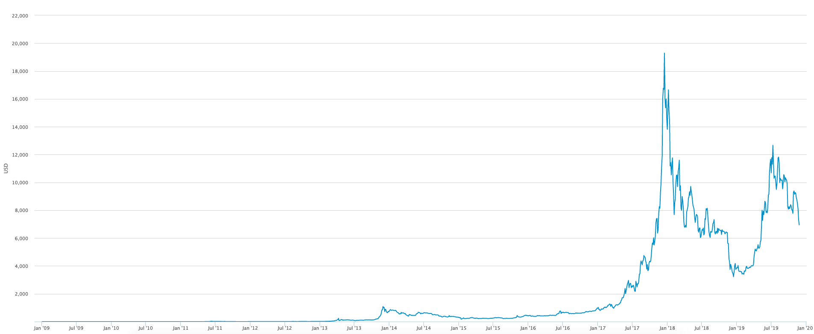
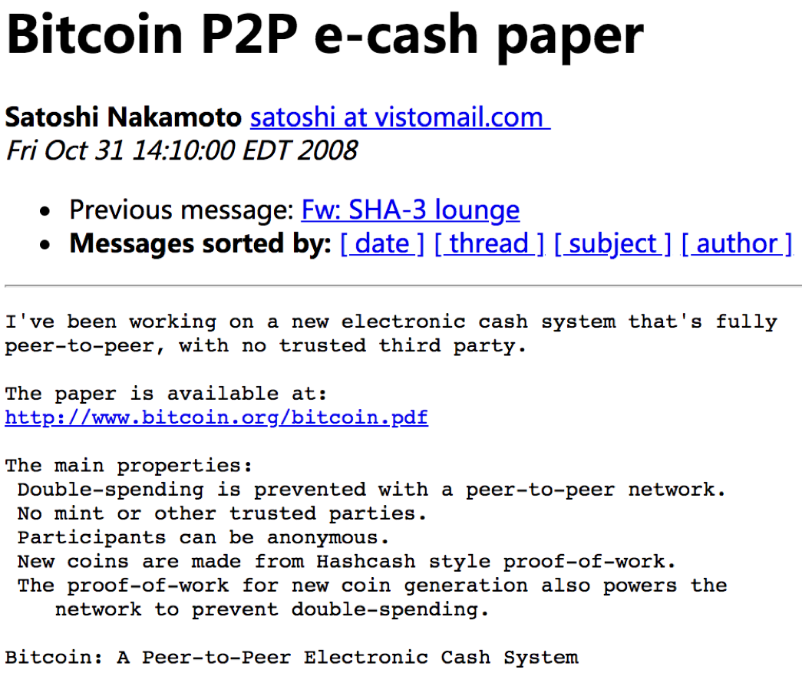
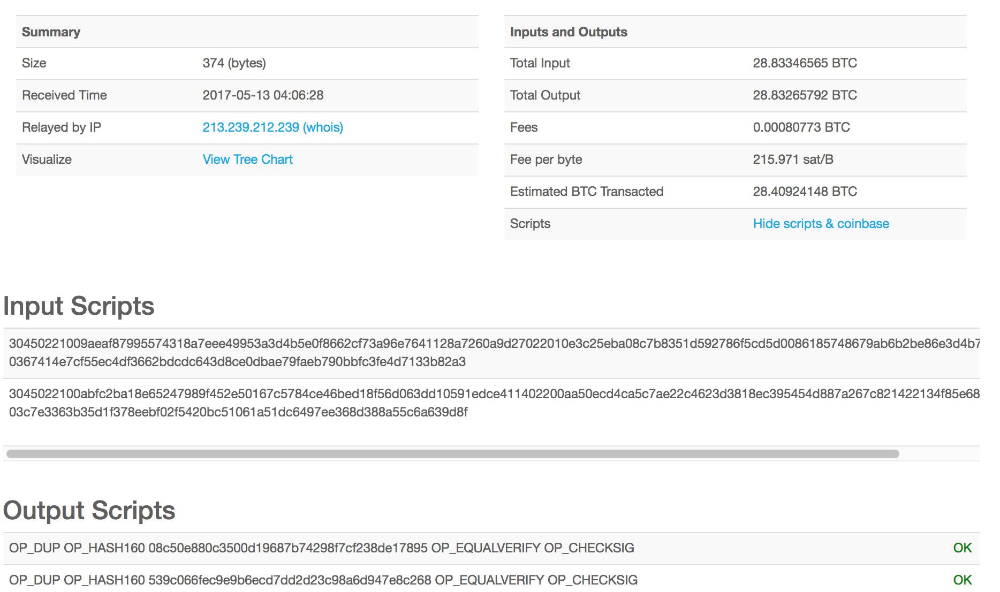
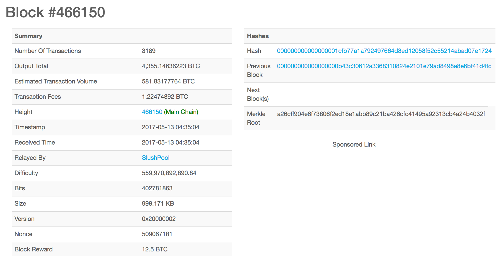
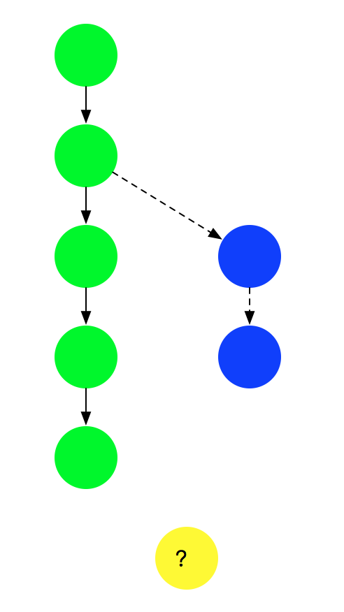
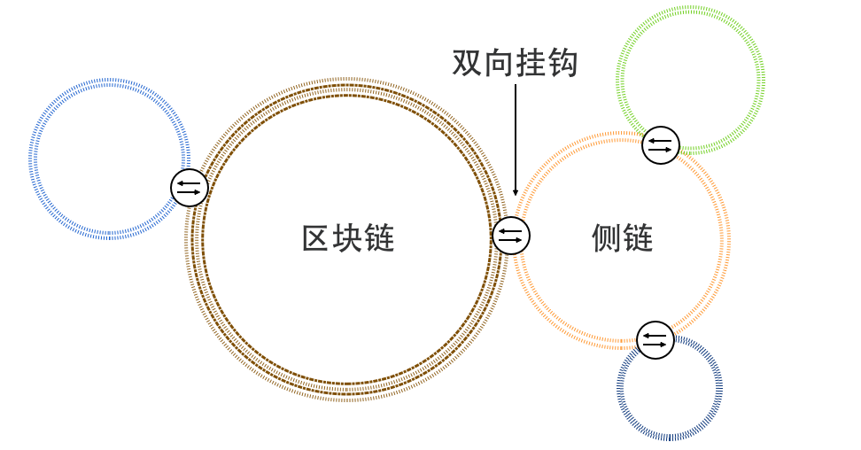
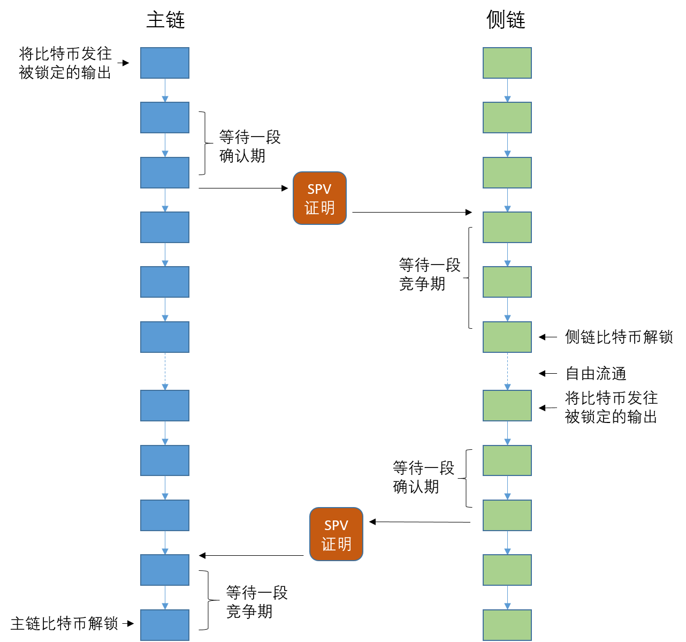

# 第六章 比特币 —— 初露锋芒的区块链

**之所以看得更远，是因为站在了巨人的肩膀上。**

作为区块链思想的源头，比特币项目值得区块链技术爱好者们仔细学习和研究。

比特币网络是首个得到大规模部署的区块链平台，也是首个得到长时间实践检验的加密货币实现，无论在科技史还是金融史上都将具有十分重要的意义。比特币项目在诞生和发展过程中，借鉴了加密货币、密码学、博弈论、分布式系统、控制论等多个领域的技术成果，可谓博采众家之长于一身，是集大成者。

后来的区块链技术应用已经超越了加密货币的范畴，但探索比特币项目的发展历程和设计思路，对于深刻理解区块链技术的来龙去脉有着重要的价值。

本章将介绍比特币项目的来源、核心原理设计、相关的工具，以及关键的技术话题。

## 比特币项目简介


比特币（BitCoin，BTC）是基于区块链技术的一种加密货币；比特币网络是首个经过大规模、长时间检验的公有区块链系统。

自 2009 年 1 月 3 日正式上线以来，比特币价格经历了多次剧烈震荡。2024-2026 年间，受现货 ETF、减半事件与宏观市场波动等因素影响，比特币价格一度快速上行，随后又出现显著回调，体现出加密资产市场的高波动特征。

比特币网络在功能上具有如下特点：

* 去中心化：意味着没有任何独立个体可以对网络造成有效破坏，交易请求需要大多数参与者进行共识才能被接受；
* 隐私性：网络中账户地址是化名的，很难从交易信息直接关联到具体的个体，但交易记录是公开可查的；
* 发行规则透明：比特币的新增发行通过挖矿实现，区块补贴每 210,000 个区块减半一次，总量上限约为 2100 万枚；这意味着货币发行率按规则下降，但市场价格和购买力仍会波动。

下图来自 [blockchain.com](https://www.blockchain.com/charts/market-price?timespan=all) 网站，可以看到比特币自诞生以来的汇率（以美元为单位）变化历史。



### 比特币大事记

#### 2008 ~ 2013



2008 年 10 月 31 日，中本聪在 metzdowd 的加密技术邮件列表发布比特币白皮书：“比特币：一种点对点的电子现金系统（Bitcoin: A Peer-to-Peer Electronic Cash System）”。

2009 年 1 月 3 日 18:15:05，中本聪挖出了首批 50 个比特币（流传的“赫尔辛基服务器”一说缺乏可靠证据，实际挖矿地点不可考），并在首个区块中记录了当天泰晤士报的头版标题：“The Times 03/Jan/2009 Chancellor on brink of second bailout for banks（财政大臣考虑再次紧急援助银行危机）”。首个区块也被称为创世区块或初始区块（Genesis Block），可以通过 [https://blockchain.info/block-index/14849](https://blockchain.info/block-index/14849) 查看其详细内容。

2009 年 1 月 12 日，中本聪将 10 枚比特币转账给开发者 Hal Finney，这也是首笔比特币转账（位于区块 170）。

2010 年 5 月 22 日，首次使用比特币购买实物商品（即首笔商业交易）：佛罗里达程序员 Laszlo Hanyecz 用 1 万 BTC 购买了价值 25 美元的披萨优惠券。这是比特币的首个兑换汇率：1 BTC = 0.0025 美金。以当前价格计算，这些比特币价值已超过 10 亿美金。

2010 年 7 月 17 日，第一个比特币交易平台 Mt.Gox 成立。

2011 年 4 月，首个有官方正式记载的版本 0.3.21 发布，支持普通用户参与到 P2P 网络中，并开始支持最小单位 “聪”。

2011 年 4 月 26 日，比特币宏大网络缺失的最后一块砖被砌好。中本聪发出一封简短的邮件之后，从此不再现身。

2011 年初，开始出现基于显卡的挖矿设备。2011 年年底，比特币价格约为 2 美元。

2011 年 6 月 19 日，由于安全事故，Mt.Gox 数据库发生泄漏，其宣称所保管的部分比特币被盗走。

2012 年 6 月，Coinbase 成立，支持比特币相关交易。公司目前已经发展为全球数字资产交易平台，同时支持包括比特币、以太币等数字货币。

2012 年 9 月 27 日，比特币基金创立，此时比特币价格为 12.46 美元。

2012 年 11 月 28 日，比特币产量第一次减半，单个区块产生的比特币从 50 个减半到 25 个。

2013 年 3 月，三分之一的专业矿工已经开始采用专用 ASIC 矿机进行挖矿。

2013 年 3 月 11 日，比特币发布 0.8.0 版本，大量完善了节点内部管理和网络通信，使得比特币有能力支持后来大规模的 P2P 网络。该版本包含一个严重的 bug，虽然后来被紧急修复，仍造成比特币价格大幅下跌。

2013 年 4 月 10 日，BTC 创下历史新高，266 美元。

2013 年 6 月 27 日，德国会议作出决定：持有比特币一年以上将予以免税，被业内认为此举变相认可了比特币的法律地位，此时比特币价格为 102.24 美元。

2013 年 10 月 29 日，世界第一台可以兑换比特币的 ATM 在加拿大上线。

2013 年 11 月 29 日，比特币的交易价格创下 1242 美元的历史新高，而同时黄金价格为一盎司 1241.98 美元，比特币价格首度超过黄金。

#### 2014 ~ 2019

2014 年 2 月 24 日，全球最大比特币交易平台 Mt.Gox 因 85 万个比特币被盗而宣告破产并关闭，造成大量投资者的损失，比特币价格一度暴跌。

2014 年 3 月，中国第一台可以兑换比特币的 ATM 在香港上线。

2014 年 6 月，美国加州通过 AB-129 法案，允许比特币等数字货币在加州进行流通。

2015 年 6 月 3 日，纽约成为美国第一个正式进行数字货币监管的州。

2015 年 10 月 22 日，欧盟法院在 Hedqvist 案（C-264/14）中认定比特币属于支付手段而非商品，比特币与法币之间的兑换服务免征增值税。

2015 年 10 月 31 日，《经济学人》杂志发表封面文章《信任机器》，开始关注比特币网络背后的区块链技术。

2016 年 1 月，中国人民银行在京召开了数字货币研讨会，会后发布公告宣称或推出数字货币。

2016 年 7 月 9 日，比特币产量第二次减半，每个区块产出从 25 枚比特币减少为 12.5 枚。

2016 年 8 月 2 日，知名比特币交易所 Bitfinex 遭遇安全攻击，按照当时市值计算，损失超过 6000 万美金。

2017 年 1 月 24 日，中国部分交易所（Okcoin、火币、BTCC）开始收取比特币交易手续费（为成交金额的 0.2%）。

2017 年 3 月，美国证券交易监督委员会（U.S. Securities and Exchange Commission，SEC）连续否决了比特币 ETF 申请。

2017 年 4 月 1 日，日本通过法案，正式将数字货币交易所纳入监管体系，承认比特币是合法的预付款工具。

2017 年 7 月，比特币网络全网算力首次突破 6 exahash/s（即每秒 10 的 18 次方哈希），创下历史新高。

2017 年 9 月 4 日，北京市互联网金融风险专项整治工作领导小组办公室下发通知，停止各类 ICO 和代币发行活动。之后，国内各大交易所和矿池陆续终止境内业务。

2017 年 10 月 13 日，比特币的价格首次突破 5000 美元。

2017 年 12 月 11 日，全球首个比特币期货合约在芝加哥期权交易所（Chicago Board Options Exchange，CBOE）上市。

2017 年 12 月 17 日，比特币期货在芝加哥商品交易所（Chicago Mercantile Exchange，CME）上市，当天单个比特币价格一度逼近 20000 美元（最高约 19800 美元，总市值超过 2000 亿美金），创下当时的历史新高。

2018 年 3 月 6 日，韩国政府发布禁令，禁止公职人员持有和交易加密货币。彼时比特币价格已经长期在 5000 美金左右波动。

2018 年 3 月 7 日，美国证券交易监督委员会发布了《关于可能违法的数字资产交易平台的声明》，规定数字货币交易所必须通过注册。

2018 年 12 月，受到行业周期和社区内部冲突的影响，比特币价格一路下跌，迫近 3000 美金关口。

2019 年 6 月，由于交易量不足以及来自芝加哥商品交易所的竞争，芝加哥期权交易所决定暂停比特币期货合约交易。

2019 年 6 月 18 日，Facebook 发布了加密货币项目 Libra 的白皮书，宣布要打造简单的、无国界的为数十亿普通人服务的金融基础设施。Libra Association 于 2020 年 12 月 1 日更名为 Diem Association；2022 年 1 月 31 日，Diem 宣布将与 Diem Payment Network 相关的知识产权和其他资产出售给 Silvergate，原项目实质停止推进。

2019 年 6 月下旬，受美联储降息预期和 Facebook 发币消息等因素影响，比特币价格重新攀升超过 10000 美金，并一度接近 13000 美金。

2019 年 9 月 23 日，比特币期货交易平台 Bakkt 上线，支持以比特币实物进行结算。

#### 2020 ~ 2025

2020 年 3 月 12 日，受新冠疫情引发的全球金融市场恐慌影响，比特币价格单日暴跌近 50%，从约 8000 美元跌至 3800 美元左右，被称为“黑色星期四”。

2020 年 5 月 11 日，比特币产量第三次减半，每个区块产出从 12.5 枚比特币减少为 6.25 枚。

2020 年 10 月，PayPal 宣布允许美国用户在其平台上购买、持有和出售比特币等加密货币，标志着主流支付巨头正式进入加密货币领域。

2020 年 12 月 16 日，比特币价格首次突破 20000 美元的历史高点。

2021 年 2 月 8 日，特斯拉（Tesla）宣布购买了价值 15 亿美元的比特币，并计划接受比特币作为支付方式，推动比特币价格快速攀升。

2021 年 4 月 14 日，比特币价格达到约 64000 美元的阶段性高点。同日，加密货币交易所 Coinbase 在纳斯达克成功上市。

2021 年 5 月，中国多地开始加强对加密货币挖矿的监管，大量矿场关闭或外迁。比特币价格随之大幅下跌。

2021 年 6 月 9 日，萨尔瓦多成为全球第一个将比特币作为法定货币的国家。

2021 年 9 月 24 日，中国人民银行等十部门发布通知，明确虚拟货币相关业务活动属于非法金融活动，全面禁止加密货币交易。

2021 年 11 月 10 日，比特币价格创下历史新高，达到约 69000 美元。

2022 年，受全球宏观经济环境恶化和多起加密货币行业爆雷事件（如 Terra/Luna 崩盘、FTX 交易所破产）影响，比特币进入熊市，年底价格跌至约 16000 美元。

2023 年，比特币价格逐步回暖，年底涨至约 42000 美元。市场对现货 ETF 获批的预期成为主要推动力。

2024 年 1 月 10 日，美国证券交易委员会（SEC）批准若干现货比特币交易所交易产品（ETP）份额上市交易，包括贝莱德（BlackRock）、富达（Fidelity）等机构相关产品。SEC 同时强调，该决定并不代表批准或背书比特币，投资者仍应关注比特币及相关产品风险。

2024 年 3 月，受 ETF 资金持续流入推动，比特币价格突破 73000 美元，创下新的历史高点。

2024 年 4 月 20 日，比特币产量第四次减半，每个区块产出从 6.25 枚比特币减少为 3.125 枚。下一次减半预计将在 2028 年发生。

2024 年 5 月，美国 SEC 批准了以太坊现货 ETF，进一步推动了加密货币的主流化进程。

2024 年底，比特币价格处于历史高位区间，全年现货 ETF 净流入达到数百亿美元量级（不同数据源统计口径略有差异）。

2025-2026 年间，比特币价格继续大幅波动，在创出新高后又出现明显回调。投资者应注意市场风险。

区块高度、完整节点磁盘占用和价格波动率都会持续变化，不宜用未注明时间点的固定数字描述。需要实时网络状态时，应以查询当时的 Bitcoin Core `getblockchaininfo`、全节点数据或可信市场数据源为准。

### 其他数字货币

比特币的“成功”，刺激了相关的生态和社区发展，大量类似数字货币纷纷出现。截至 2025 年，全球已有超过 10000 种加密货币，比较出名的包括以太币（Ethereum，ETH）、瑞波币（XRP）、索拉纳（Solana，SOL）、卡尔达诺（Cardano，ADA）等。

这些数字货币大部分建立在自己独立的区块链网络上，也有相当一部分作为代币运行在以太坊等智能合约平台之上。全球加密货币用户数量已从早期的数百万增长到数亿规模。

*注：通过 [blockchain.com](https://www.blockchain.com) 网站可以实时查询到比特币网络的信息，包括区块、交易、价格等在内的详细数据。*

## 实体货币到加密数字货币

区块链最初的思想，诞生于无数先哲对于用加密数字货币替代实体货币的探讨和设计中。

### 货币的历史演化

众所周知，货币是人类文明发展过程中的一大发明。其最重要的职能包括价值尺度、流通手段、贮藏手段等。很难想象离开了货币，现代社会庞大而复杂的经济和金融体系如何保持运转。也正是因为它如此重要，货币的设计和发行机制是关系到国计民生的大事。

历史上，在自然和人为因素的干预下，货币的形态经历了多个阶段的演化，包括实物货币、金属货币、代用货币、信用货币、电子货币、数字货币等。近代之前相当长的一段时间里，货币的形态一直是以实体的形式存在，可统称为“实体货币”。计算机诞生后，为货币的虚拟化提供了可能性。

同时，货币自身的价值依托也不断发生演化，从最早的实物价值依托、功能价值依托、发行方信用价值依托，直到今天的对信息科技（包括软件、系统、算法等）的信任价值依托。

*注：中国最早关于货币的文献记载“夏后以玄币”，出现在西汉桓宽《盐铁论·错币》。这里的“玄币”指的是一种黑色的布帛货币，说明早在夏朝就已开始使用贝壳和布帛作为交换媒介。*

### 从纸币到数字货币

理论上任何事物都可以作为货币，只要使用者愿意接受。例如在随便一张纸上注明代表若干金额，只要交易各方都认可，这张纸就可以起到货币职能。实际上如今世界最常见的货币流通形式就是纸币，既方便携带、不易仿制，又相对容易辨伪。

或许有人会认为信用卡等电子方式，相对于纸币等货币形式使用起来更为方便。确实，信用卡在某些场景会更为便捷，但它依赖背后的集中式支付体系，一旦碰到支付系统故障、断网、缺乏支付终端等情况，信用卡就无法使用；另外，信用卡形式往往还需要额外的终端设备支持。

目前，无论是货币形式，还是信用卡形式，都需要额外的支持机构（例如银行）来完成生产、分发、管理等操作。“中心化”的结构带来了管理和监管上的便利，但系统安全性方面存在很大挑战。诸如伪造、信用卡诈骗、盗刷、转账等安全事件屡见不鲜。

很显然，如果能实现一种数字货币，保持既有货币方便易用的特性，同时消除纸质货币的缺陷，无疑将极大提高社会整体经济活动的运作效率。

让我们来对比现有的数字货币（以比特币为例）和现实生活中的纸币，两者的优劣如下表所示。

| 属性 | 分析 | 优势方 |
| --- | --- | --- |
| 便携 | 大部分场景（特别大额支付）下数字货币将具备更好的便携性。 | 数字货币 |
| 防伪 | 两者各有千秋，但数字货币整体上会略胜一筹。纸币依靠的是各种设计（纸张、油墨、暗纹、夹层等）上的精巧，数字货币依靠的则是密码学上的保障。事实上，纸币的伪造时有发生，但数字货币的伪造目前还无法实现。 | 数字货币 |
| 辨伪 | 纸币即使依托验钞机等专用设备仍会有误判情况，数字货币依靠密码学易于校验。数字货币胜出。 | 数字货币 |
| 匿名 | 比特币利用化名（Pseudonymity）来隐藏身份，但账目公开可见。两者都无法阻止有意的追踪。 | 持平 |
| 交易 | 对纸币来说，谁物理持有纸币谁就是合法拥有者，交易通过纸币自身的转移即可完成，无法复制。对数字货币来说则复杂得多，因为任何数字物品都是可以被复制的，但数字形式也意味着转移成本会更低。总体看，两者适用不同的情景。 | 持平 |
| 资源 | 通常情况下，纸币的生产成本要远低于面额。数字货币消耗资源的计算则复杂得多。以比特币为例，PoW 的能耗来自全网矿工竞争区块补贴和交易费，矿工投入通常由预期收入、难度、电价和硬件效率共同决定，不能简单说“每枚币消耗接近其面值的电能”。 | 纸币 |
| 发行 | 纸币的发行需要第三方机构的参与；数字货币则通过分布式算法来完成发行。历史上，通胀和通缩往往是不合理地发行货币造成的；数字货币尚缺乏大规模验证，还有待观察。 | 持平 |
| 管理 | 纸币发行和回收往往通过统一机构，易于监管和审计；而目前数字货币在这方面还缺乏足够支持和验证。 | 纸币 |

可见，数字货币并非在所有领域都优于已有的货币形式。要比较两者的优劣应该针对具体情况具体分析。不带前提地鼓吹数字货币并不是一种科学和严谨的态度。实际上，仔细观察数字货币的应用情况就会发现，虽然以比特币为代表的数字货币已在众多领域得到应用，但还没有任何一种数字货币能完全替代已有货币。目前，世界各国央行都在密切关注和探索数字货币应用。

虽然当前的数字货币“实验”已经取得了不小影响，但可见的局限也很明显：其依赖的区块链和分布式账本技术还缺乏大规模场景的考验；系统的性能和安全性还有待提升；资源的消耗过高；对监管和审计支持不足等。这些问题的解决，都有待金融科技的进一步发展。

*注：严格来讲，货币（money）不仅局限于现金或通货（cash/currency），货币的含义范围更广。*

### “去中心化”的技术难关

虽然数字货币带来的预期优势可能很美好，但要设计和实现一套能经得住实用考验的数字货币并非易事。任何货币系统，首先要解决如何发行、如何流通和如何确定价值三个基本问题。

现实生活中常用的纸币具备良好的可转移性，可以相对容易地完成价值的交割。但是对于数字货币来说，因为数字化内容容易被复制，数字货币持有人可以试图将同一份货币发给多个接收者，这种攻击被称为“双重支付攻击（Double-spend Attack）”。

也许有人会想到，银行中的货币实际上也是数字化的，因为通过电子账号里面的数字记录了客户的资产。说的没错，这种电子货币模式有人称为“数字货币 1.0”，它实际上依赖了一个前提：假定存在一个安全可靠的第三方记账机构负责记账，这个机构负责所有的担保所有的环节，最终完成交易。

中心化控制下，数字货币的实现相对容易。但是，有些时候很难找到一个安全可靠的第三方机构，来充当这个记账者角色。

例如，发生贸易的两国可能缺乏足够的外汇储备用以支付；汇率的变化等导致双方对合同有不同意见；网络上的匿名双方进行直接买卖而不通过电子商务平台；交易的两个机构彼此互不信任，找不到双方都认可的第三方担保；使用第三方担保系统，但某些时候可能无法连接；第三方的系统可能会出现故障或被篡改攻击……

这个时候，就只有实现去中心化（De-centralized）或多中心化（Multi-centralized）的数字货币系统。在“去中心化”的场景下，实现数字货币存在如下几个难题：

* 货币的发行：如何合理发行货币，避免导致通货膨胀或其他经济问题；
* 货币的防伪：如何确保和检验货币的真实性，防止被伪造或篡改；
* 货币的交易：如何确保随时随地可以从支付方安全转移到接收方；
* 避免双重支付：电子数据很容易被复制，如何避免同一个数字货币被多次支付。

可见，在不存在第三方记账机构的情况下，实现一个数字货币系统的挑战着实不小。

能否通过技术创新来解决这个难题呢？比特币融合了数十年在金融、密码学和分布式系统领域的科技成果，终于实现了在全球范围内运行的大规模加密货币系统。

## 基本原理和设计

从分布式系统角度看，比特币网络是一个典型的分布式点对点网络，网络中的矿工通过“挖矿”来完成对交易记录的记账过程，维护网络的正常运行。

区块链网络提供一个公共可见的记账本，该记账本记录网络中所有的交易历史，而并非记录各个账户的余额。该设计可以避免重放攻击，即某个交易被多次重复提交。

### 基本交易过程

比特币中没有账户的概念。因此，每次发生交易，用户需要将交易记录写到比特币网络账本中，等网络确认后即可认为交易完成。

除了挖矿获得奖励的 coinbase 交易只有输出，正常情况下每个交易需要包括若干输入和输出，未经使用（引用）的交易的输出（Unspent Transaction Outputs，UTXO）可以被新的交易引用作为其合法的输入。被使用过的交易的输出（Spent Transaction Outputs，STXO），则无法被引用作为合法输入。

因此，比特币网络中一笔合法的交易，必须是引用某些已存在交易的 UTXO（必须是属于付款方才能合法引用）作为新交易的输入，并生成新的 UTXO（将属于收款方）。

那么，在交易过程中，付款方如何证明自己所引用的 UTXO 合法？比特币中通过“签名脚本”来实现，并且指定“输出脚本”来限制将来能使用新 UTXO 者只能为指定收款方。对每笔交易，付款方需要进行签名确认。并且，对每一笔交易来说，总输入不能小于总输出。总输入相比总输出多余的部分称为交易费用（Transaction Fee），为生成包含该交易区块的矿工所获得。交易费不是协议固定的 0.0001 BTC；节点会按本地中继策略、mempool 状态和费率（通常按 sat/vB 或 BTC/kvB）筛选交易，钱包也会根据期望确认时间估算费率。交易费用在奖励矿工的同时，也避免了网络受到大量低成本交易攻击。

交易中金额的最小单位是“聪”，即一亿分之一（10^-8）比特币。

下图展示了一些简单的示例交易。更一般情况下，交易的输入、输出可以为多方。

| 交易 | 目的 | 输入 | 输出 | 签名 | 差额 |
| --- | --- | --- | --- | --- | --- |
| T0 | A 转给 B | 他人向 A 交易的输出 | B 账户可以使用该交易 | A 签名确认 | 输入减输出，为交易服务费 |
| T1 | B 转给 C | T0 的输出 | C 账户可以使用该交易 | B 签名确认 | 输入减输出，为交易服务费 |
| ... | X 转给 Y | 他人向 X 交易的输出 | Y 账户可以使用该交易 | X 签名确认 | 输入减输出，为交易服务费 |

需要注意，刚放进网络中的交易（深度为 0）并非是实时得到确认的。进入网络中的交易存在被推翻的可能性，一般要再生成几个新的区块后（深度大于 0）才认为该交易被确认。

比特币采用了 UTXO 模型，相对账户模型，UTXO 模型可以更容易实现并行处理和隐私保护，并追踪完整交易路径；但由于需要存储和检索所有交易记录，对节点存储压力较大。

下面分别介绍比特币网络中的重要概念和主要设计思路。

### 重要概念

#### 账户/地址

比特币采用了非对称的加密算法，用户自己保留私钥，对自己发出的交易进行签名确认，并公开公钥。

比特币地址不是账户，也不总是公钥 Hash。地址是钱包给用户展示的、可编码某类输出脚本或见证程序的字符串：传统 P2PKH 地址对应公钥 HASH160，P2SH 地址对应脚本 Hash，原生 SegWit 地址使用 Bech32 编码见证程序，Taproot/P2TR 地址使用 Bech32m 编码 SegWit v1 见证程序。

早期 P2PKH/P2SH 地址使用 Base58Check 编码，并添加前导字节（表明支持哪种脚本）和 4 字节校验字节；现代原生 SegWit/Taproot 地址使用 Bech32/Bech32m，通常以 `bc1q` 或 `bc1p` 开头。

*注：传统 P2PKH 地址并非直接暴露公钥内容，而是公钥 Hash 后的值，避免公钥过早公开后增加被攻击的风险。*

#### 交易

交易是完成比特币功能的核心概念。原始交易的核心字段不是“付款人地址”和“收款人地址”，地址通常是钱包或区块浏览器从脚本中解析出来的展示形式。一条普通原始交易主要包括如下字段：

* 版本号（version）：指定交易版本，版本 2 可启用相对锁定时间相关语义；
* 输入（vin）：引用前序交易输出的 outpoint（txid 和 vout）、解锁脚本 scriptSig、序列号 sequence；SegWit 交易还包含对应输入的 witness 数据；
* 输出（vout）：金额 value 和锁定脚本 scriptPubKey，地址只是某些标准 scriptPubKey 的可读编码；
* 锁定时间（locktime）：交易最早可被纳入区块的区块高度或 Unix 时间。

网络中节点收到交易信息后，将进行如下检查：

* 交易是否已经处理过；
* 交易是否合法。包括输入引用的前序输出是否存在且未花费、解锁数据是否满足对应的锁定脚本、脚本执行是否通过；
* 交易的输入之和是否不小于输出之和。

检查都通过，则将交易标记为合法的未确认交易，并在网络内进行广播。

用户可以从 blockchain.info 网站查看实时的交易信息，一个示例交易的内容如下图所示。



#### 交易脚本

[脚本（Script）](https://en.bitcoin.it/wiki/Script) 是保障交易完成（主要用于检验交易是否合法）的核心机制，当所依附的交易发生时被触发。通过脚本机制而非写死交易过程，比特币网络实现了一定的可扩展性。比特币脚本语言是一种非图灵完备的语言，类似 [Forth](https://en.wikipedia.org/wiki/Forth_programming_language) 语言。

传统交易输入通常包含负责解锁的 scriptSig，交易输出包含负责锁定的 scriptPubKey。SegWit 交易把签名等解锁数据放入 witness 字段，scriptSig 可为空或只包含嵌套见证程序。

输出脚本一般由付款方对交易设置锁定，用来对能动用这笔交易的输出（例如，要花费该交易的输出）的对象（收款方）进行权限控制，例如限制必须是某个公钥的拥有者才能花费这笔交易。

认领脚本则用来证明自己可以满足交易输出脚本的锁定条件，即对某个交易的输出（比特币）的拥有权。

常见标准输出脚本包括：

* P2PKH：Pay-To-Public-Key-Hash，允许用户将比特币发送到公钥 Hash 对应的传统地址上（证明拥有该公钥），主网地址通常以 `1` 开头；
* P2SH：Pay-To-Script-Hash，支付者创建一个输出脚本，里边包含另一个脚本（认领脚本）的哈希，常见于多签或嵌套 SegWit，主网地址通常以 `3` 开头；
* P2WPKH/P2WSH：SegWit v0 的原生见证输出，分别对应公钥 Hash 和脚本 Hash，地址使用 Bech32，主网通常以 `bc1q` 开头；
* P2TR：Taproot 的 SegWit v1 输出，地址使用 Bech32m，主网通常以 `bc1p` 开头。

以 P2PKH 为例，输出脚本的格式为

```text
scriptPubKey: OP_DUP OP_HASH160 <pubKeyHash> OP_EQUALVERIFY OP_CHECKSIG
```

其中，OP_DUP 是复制栈顶元素；OP_HASH160 是计算 hash 值；OP_EQUALVERIFY 判断栈顶两元素是否相等；OP_CHECKSIG 判断签名是否合法。这条指令实际上保证了只有 pubKey 的拥有者才能合法引用这个输出。

另外一个交易如果要花费这个输出，在引用这个输出的时候，需要提供认领脚本格式为

```text
scriptSig: <sig> <pubKey>
```

其中，<sig> 是拿 pubKey 对应的私钥对交易（全部交易的输出、输入和脚本）Hash 值进行签名，pubKey 的 Hash 值需要等于 pubKeyHash。

进行交易验证时，会按照先 scriptSig 后 scriptPubKey 的顺序进行依次入栈处理，即完整指令为：

```text
<sig> <pubKey> OP_DUP OP_HASH160 <pubKeyHash> OP_EQUALVERIFY OP_CHECKSIG
```

读者可以按照栈的过程来进行推算，理解整个脚本的验证过程。

引入脚本机制带来了灵活性，但也引入了更多的安全风险。比特币脚本支持的指令集十分简单，基于栈的处理方式，并且非图灵完备，此外还添加了额外的一些限制（大小限制等）。

#### 区块

SegWit 激活后，比特币区块不再只用“1 MB”描述容量上限。共识规则使用区块重量（block weight）限制：区块重量 = 基础大小（不含 witness）× 3 + 总大小（含 witness），上限为 4,000,000 weight units；同时基础大小仍受旧节点可见的约 1 MB 约束。一个区块主要包括如下内容：

* 区块头：80 字节：
* 交易个数计数器：CompactSize 可变长度整数；
* 所有交易的具体内容，可变长，匹配 Merkle 树叶子节点顺序。

其中，区块头信息十分重要，包括：

* 版本号：4 字节；
* 上一个区块头的 Hash 值：链接到上一个合法的块上，对其区块头进行两次 SHA256 操作，32 字节；
* 本区块所包含的所有交易的 Merkle 树根的 Hash 值：两次 SHA256 操作，32 字节；
* 时间戳：4 字节；
* 难度指标：4 字节；
* Nonce：4 字节，PoW 问题的答案。

可见，要对区块链的完整性进行检查，只需要检验各个区块头部信息即可，无需获取到具体的交易内容，这也是简单交易验证（Simple Payment Verification，SPV）的基本原理。另外，通过头部的链接，提供时序关系的同时加大了对区块中数据进行篡改的难度。

一个示例区块如下图所示。



### 创新设计

比特币在设计上提出了很多创新点，主要考虑了避免作恶、采用负反馈调节和基于概率的共识机制等三个方面。

#### 如何避免作恶

基于经济博弈原理。在一个开放的网络中，无法通过技术手段保证每个人都是合作的。但可以通过经济博弈来让合作者得到利益，让非合作者遭受损失和风险。

实际上，博弈论早已被广泛应用到众多领域。

一个经典的例子是两个人来分一个蛋糕，如果都想拿到较大的一块，在没有第三方的前提下，该怎么制定规则才公平？

最简单的一个方案是任意一个人负责分配蛋糕，并且这个人后挑选。

*注：如果推广到 N 个人呢？*

比特币网络中所有试图参与者（矿工）都首先要付出挖矿的代价，进行算力消耗，越想拿到新区块的决定权，意味着抵押的算力越多。一旦失败，这些算力都会被没收掉，成为沉没成本。当网络中存在众多参与者时，个体试图拿到新区块决定权要付出的算力成本是巨大的，意味着进行一次作恶付出的代价已经超过可能带来的好处。

#### 负反馈调节

比特币网络在设计上，很好的体现了负反馈的控制论基本原理。

比特币网络中矿工越多，系统就越稳定，比特币价值就越高，但挖到矿的概率会降低。

反之，网络中矿工减少，会让系统更容易导致被攻击，比特币价值越低，但挖到矿的概率会提高。

因此，比特币的价格理论上应该稳定在一个合适的值（网络稳定性也会稳定在相应的值），这个价格乘以挖到矿的概率，恰好达到矿工的收益预期。

从长远角度看，硬件成本是下降的，但区块补贴每 210,000 个区块减半一次（约 4 年）。由于最小单位为聪，新增发行会在 2140 年前后趋近并最终停止，总发行量上限约为 2100 万枚；之后矿工收入将主要依靠交易费。

*注：比特币最小单位是“聪”，即 10^(-8) 比特币，总“聪”数为 2.1E15。这一上限之所以重要，是因为它低于 IEEE-754 双精度浮点数（以及部分语言如 JavaScript 的 Number 类型）可精确表示的整数上限 2^53 约等于 9E15，因此聪的总数能被精确表示；该限制来自浮点数格式而非处理器位宽（比特币金额在协议层用 64 位整数表示）。*

#### 共识机制

传统共识问题往往是考虑在一个相对封闭的分布式系统中，允许同时存在正常节点、故障节点，如何快速达成一致。

对于比特币网络来说，它是完全开放的，可能面向各种攻击情况，同时基于 Internet 的网络质量只能保证“尽力而为”，导致问题更加复杂，传统的一致性算法在这种场景下难以实用。

因此，比特币网络不得不对共识的目标和过程都进行了一系列限制，提出了基于 Proof of Work（PoW）的共识机制。

首先是不实现面向最终确认的共识，而是基于概率、随时间逐步增强确认的共识。现有达成的结果在理论上都可能被推翻，只是攻击者要付出的代价随时间而指数级上升，被推翻的可能性随之指数级的下降。

此外，考虑到 Internet 的尺度，达成共识的时间相对比较长。按照区块（一组交易）来进行阶段性的确认（快照），提高网络整体的可用性。

最后，限制网络中共识的噪音。通过进行大量的 Hash 计算和少数的合法结果来限制合法提案的个数，进一步提高网络中共识的稳定性。

## 挖矿过程

### 基本原理

比特币中最独特的一个概念就是“挖矿”。挖矿是指网络中的维护节点，通过协助生成和确认新区块来获取一定量新增比特币的过程。

当用户向比特币网络中发布交易后，需要有人将交易进行记录和确认，形成新的区块，并串联到区块链中。在一个互相不信任的分布式系统中，该由谁来完成这件事情呢？比特币网络采用了“挖矿”的方式来解决这个问题。

目前，每 10 分钟左右生成一个区块（记录了这段时间内发生的验证过的交易内容）。SegWit 之后，区块容量以区块重量衡量，上限为 4,000,000 weight units，而不是简单的 1 MB；节点会把新区块连接到已验证的最大累计工作量链上。每个区块的成功提交者可以得到系统 3.125 个比特币的区块补贴（该补贴作为区块内的第一个交易，一定区块数后才能使用），以及用户附加到交易上的支付服务费用。即便没有任何用户交易，矿工也可以自行产生合法的区块并获得补贴。

*注：区块奖励每 21 万个区块（约 4 年）减半一次。2024 年 4 月完成第四次减半后，奖励从 6.25 BTC 降至 3.125 BTC。历次减半：50（2009）→ 25（2012）→ 12.5（2016）→ 6.25（2020）→ 3.125（2024）。*

每个区块的补贴最初是 50 个比特币，每隔 21 万个区块自动减半（约 4 年），最终新增发行趋近并停止在约 2100 万枚上限。因此，更准确地说，比特币的供给增速按规则递减，长期货币发行率趋近于零；“通缩”若指购买力或价格水平变化，则还取决于市场需求，不能仅由发行规则推出。

### 挖矿过程

挖矿的具体过程为：参与者综合上一个区块的 Hash 值，上一个区块生成之后的新的验证过的交易内容，再加上自己猜测的一个随机数 X，一起打包到一个候选新区块，让新区块的 Hash 值小于比特币网络中给定的一个数。这是一道面向全体矿工的“计算题”，这个数越小，计算出来就越难。

系统每隔两周（即经过 2016 个区块）会根据上一周期的挖矿时间来调整挖矿难度（通过调整限制数的大小），来调节生成区块的时间稳定在 10 分钟左右。为了避免震荡，每次调整的最大幅度为 4 倍。历史上最快的出块时间小于 10s，最慢的出块时间超过 1 个小时。

为了挖到矿，参与处理区块的用户端往往需要付出大量的时间和计算力。算力一般以每秒进行多少次 Hash 计算为单位，记为 h/s。截至 2026 年 9 月，比特币网络算力的近一年峰值已超过 1300 EH/s（即每秒约 1.3×10^21 次 Hash 计算，出现在 2025 年 10 月），日常水平在 900~1000 EH/s 量级。

汇丰银行分析师 Anton Tonev 和 Davy Jose 在 2016 年一份客户报告中曾表示，比特币区块链（通过挖矿）提供了一个局部的、迄今为止最优的解决方案：如何在分散的系统中验证信任。这就意味着，区块链本质上解决了传统依赖于第三方的问题，因为这个协议不只满足了中心化机构追踪交易的需求，还使得陌生人之间产生信任。区块链的技术和安全的过程使得陌生人之间在没有被信任的第三方时产生信任。

### 如何看待挖矿

2010 年以前，挖矿还是一个非常热门的盈利行业。

但是随着相关技术和设备的发展，现在个人进行挖矿的收益已经降得很低。从概率上说，由于当前参与挖矿的计算力实在过于庞大（已经超出了大部分的超算中心），一般的算力已经不可能挖到比特币。特别是利用虚拟机来挖矿的想法，已经基本不可能了。

从普通的 CPU（2009 年）、到后来的 GPU（2010 年） 和 FPGA（2011 年末）、到后来的 ASIC 矿机（2013 年年初，目前单台算力已达每秒数百万亿次 Hash 计算，即数百 TH/s）、再到现在众多矿机联合组成矿池（知名矿池包括 Foundry USA、AntPool、F2Pool 等）。短短数年间，比特币矿机的技术走完了过去几十年的集成电路的进化历程，甚至还颇有创新之处。高回报刺激了科技的飞速发展。目前，矿机主要集中在少数矿池手中，全网的算力已达每秒 9×10^20 次 Hash 计算以上（900+ EH/s，截至 2026 年 9 月）。需要注意的是，ASIC 矿机执行的 SHA-256 运算与超级计算机的通用浮点运算并不等价，因此不宜简单类比。

很自然地，读者可能会想到，如果有人掌握了强大的计算力，计算出所有的新区块，并且拒不承认他人的交易内容，那是不是就能破坏掉比特币网络？确实如此，基本上个体达到 1/3 的计算力，比特币网络就存在被破坏的风险了；达到 1/2 的算力，从概率上就掌控整个网络了。但是要实现这么大的算力，将需要付出巨大的经济成本。

那么有没有办法防护呢？除了尽量避免计算力放到同一个组织手里，没太好的办法，这是目前 PoW 机制自身造成的。

也有人认为为了共识区块的生成，大部分计算力（特别是最终未能算出区块的算力）其实都浪费了。有人提出用 PoS（Proof of Stake）和 DPoS 等协议，利用权益证明（例如持有货币的币龄）作为衡量指标进行投票，相对 PoW 可以节约大量的能耗。PoS 可能会带来囤积货币的问题。除此之外，还有活跃度证明（Proof of Activity，PoA）、消耗证明（Proof of Burn，PoB）、能力证明（Proof of Capacity, PoC）、消逝时间证明（Proof of Elapsed Time）、股权速率证明（Proof of Stake Velocity，PoSV）等，采用了不同的衡量指标。

当然，无论哪种机制，都无法解决所有问题。一种可能的优化思路是引入随机代理人制度，通过算法在某段时间内确保只让部分节点参加共识的提案，并且要发放一部分“奖励”给所有在线贡献的节点。

## 共识机制

比特币网络是完全公开的，任何人都可以匿名接入，因此共识协议的稳定性和防攻击性十分关键。

比特币区块链采用了 Proof of Work（PoW）机制来实现共识。PoW 的核心思想最早由 Cynthia Dwork 和 Moni Naor 在 1993 年论文《Pricing via Processing or Combatting Junk Mail》中提出，1997 年由 Adam Back 在 [Hashcash](http://www.hashcash.org/) 中给出基于 SHA-1 的具体实例，1998 年被 [B-money](http://www.weidai.com/bmoney.txt) 采纳用于去中心化货币设计。

目前，Proof of X 系列中比较出名的一致性协议包括 PoW、PoS 和 DPoS 等，都是通过经济惩罚来限制恶意参与。

### 工作量证明

工作量证明是通过计算来猜测一个数值（nonce），使得拼凑上交易数据后内容的 Hash 值满足规定的上限（来源于 hashcash）。由于 Hash 难题在目前计算模型下需要大量的计算，这就保证在一段时间内，系统中只能出现少数合法提案。反过来，如果谁能够提出合法提案，也证明提案者确实已经付出了一定的工作量。

同时，这些少量的合法提案会在网络中进行广播，收到的用户进行验证后，会基于自己已验证的最大累计工作量链继续难题的计算。因此，系统中可能出现链的分叉（Fork），但最终会有一条链拥有更多累计工作量并成为节点的主动链。

Hash 问题具有不可逆的特点，因此，目前除了暴力计算外，还没有有效的算法进行解决。反之，如果获得符合要求的 nonce，则说明在概率上是付出了对应的算力。谁的算力多，谁最先解决问题的概率就越大。当掌握超过全网一半算力时，从概率上就能控制网络中链的走向。这也是所谓 `51%` 攻击的由来。

参与 PoW 计算比赛的人，将付出不小的经济成本（硬件、电力、维护等）。当没有最终成为首个算出合法 nonce 值的“幸运儿”时，这些成本都将被沉没掉。这也保障了，如果有人尝试恶意破坏，需要付出大量的经济成本。也有人考虑将后算出结果者的算力按照一定比例折合进下一轮比赛。

有一个很直观的超市付款的例子，可以说明为何这种经济博弈模式会促使节点收敛到最大累计工作量链。



假定超市只有一个出口，付款时需要排成一队，可能有人不守规矩要插队。超市管理员会检查队伍，认为累计排队成本最高的一条队伍是合法的，并让不合法的分叉队伍重新排队。新到来的人只要足够理智，就会自觉选择累计成本更高的队伍进行排队。这是因为，多条链的参与者看到累计工作量越高的链越有可能胜出，从而更倾向于选择这条链。

可以看到，最大累计工作量规则可以提高抗攻击性，同时其代价是浪费掉了未进入主动链的计算资源。部分改进工作是考虑以工作量链为基础，引入树形结构以提高整体的交易性能，如 GHOST 协议（《Secure high-rate transaction processing in bitcoin》）和 Conflux 算法（《Scaling Nakamoto Consensus to Thousands of Transactions per Second》）。

### 权益证明

权益证明（Proof of Stake，PoS）最早在 2012 年 8 月由 Sunny King 和 Scott Nadal 在 Peercoin 白皮书中提出，随后在 [Peercoin](https://www.peercoin.net/)（原名 PPCoin）系统中被实现，类似于现实生活中的股东机制，拥有股份越多的人越容易获取记账权（同时越倾向于维护网络的正常工作）。

典型的过程是通过保证金（代币、资产、名声等具备价值属性的物品即可）来对赌一个合法的块成为新的区块，收益为抵押资本的利息和交易服务费。提供证明的保证金（例如通过转账货币记录）越多，则获得记账权的概率就越大。合法记账者可以获得收益。

PoS 试图解决在 PoW 中大量资源被浪费的问题，因而受到了广泛关注。恶意参与者将存在保证金被罚没的风险，即损失经济利益。

一般情况下，对于 BFT 类 PoS（如 Tendermint）来说，需要掌握超过全网 1/3 的资源，才有可能破坏安全性（safety）；以太坊 Gasper 等 chain-based PoS 的破坏安全阈值同为 1/3：要让两个冲突的检查点同时被最终确定，至少 1/3 的质押会因违反罚没条件而被罚没。破坏活性（liveness）的门槛同样是 1/3——最终确定需要 2/3 的多数投票，因此只要超过 1/3 的质押离线或拒绝投票，链就无法继续最终确定。此时协议会启动「非活跃惩罚」（inactivity leak），逐步削减未参与者的质押，直到活跃方重新占到 2/3，从而让活性故障只是暂时的。

PoS 也有一些改进的算法，包括授权股权证明机制（DPoS），即股东们投票选出一个董事会，董事会中成员才有权进行代理记账。这些算法在实践中得到了不错的验证，但是并没有理论上的证明。

2017 年 8 月，来自爱丁堡大学和康涅狄格大学的 Aggelos Kiayias 等学者在论文《Ouroboros: A Provably Secure Proof-of-Stake Blockchain Protocol》中提出了 Ouroboros 区块链共识协议，该协议可以达到诚实行为的近似纳什均衡，被认为是首个可证实安全的 PoS 协议。

## 闪电网络

比特币的交易网络最为人诟病的一点便是交易性能：全网每秒 7 笔左右的交易速度，远低于传统的金融交易系统；同时，等待 6 个块的可信确认将导致约 1 个小时的最终确认时间。

为了提升性能，社区提出了闪电网络等创新的设计。

闪电网络的主要思路十分简单——将大量交易放到比特币区块链之外进行，只把关键环节放到链上进行确认。该设计最早于 2015 年 2 月在论文《The Bitcoin Lightning Network: Scalable Off-Chain Instant Payments》中提出。

比特币的区块链机制自身已经提供了很好的可信保障，但是相对较慢；另一方面考虑，对于大量的小额交易来说，是否真需要这么高的可信性？

闪电网络主要通过引入智能合约的思想来完善链下的交易渠道。核心的概念主要有两个：RSMC（Recoverable Sequence Maturity Contract）和 HTLC（Hashed Timelock Contract）。前者保障两方之间的直接交易可以在链下完成，后者让支付可以沿着多跳通道路由。

### RSMC

Recoverable Sequence Maturity Contract，即“可撤销的顺序成熟度合同”。这个词很绕，其实主要原理很简单，类似资金池机制。

首先假定交易双方之间存在一个“微支付通道”（资金池）。交易双方先预存一部分资金到“微支付通道”里，初始情况下双方的分配方案等于预存的金额。每次发生交易，需要对交易后产生资金分配结果共同进行确认，同时签字把旧版本的分配方案作废掉。任何一方需要提现时，可以将他手里双方签署过的交易结果写到区块链网络中，从而被确认。从这个过程中可以看到，只有在提现时候才需要通过区块链。

任何一个版本的方案都需要经过双方的签名认证才合法。任何一方在任何时候都可以提出提现，提现时需要提供一个双方都签名过的资金分配方案（意味着肯定是某次交易后的结果，被双方确认过，但未必是最新的结果）。在一定时间内，如果另外一方拿出证明表明这个方案其实之前被作废了（非最新的交易结果），则资金罚没给质疑方；否则按照提出方的结果进行分配。罚没机制确保了没人会故意拿一个旧的交易结果来提现。

另外，即使双方都确认了某次提现，首先提出提现一方的资金到账时间要晚于对方，这就鼓励大家尽量都在链外完成交易。通过 RSMC，可以实现大量中间交易发生在链外。

### HTLC

跨越多个通道的转账是通过 Hashed Timelock Contract 来实现的，中文意思是“哈希的带时钟的合约”。这个其实就是限时转账。理解起来也很简单，通过智能合约，双方约定转账方先冻结一笔钱，并提供一个 Hash 值，如果在一定时间内有人能提出一个字符串，使得它哈希后的值跟已知值匹配（实际上意味着转账方授权了接收方来提现），则这笔钱转给接收方。

不太恰当的例子，约定一定时间内，有人知道了某个暗语（可以生成匹配的 Hash 值），就可以拿到这个指定的资金。

假设 Alice 和 Bob 想进行跨链或链上资产交换：

* Alice 是交易的发起者，生成 secret。Bob 是交易的参与者，需要使用 Alice 的 secret 解锁资产。
* Alice 生成一个随机密钥（secret），并计算其 Hash 值 H。
* Alice 部署 HTLC 合约，将资金锁定到合约中，解锁条件是：任何人提供满足 Hash(secret) = H 的 secret，即可解锁资产。同时设置时间锁，超时后资金退还给 Alice。
* Bob 观察到 Alice 提供的 Hash 值 H，并在链上（或跨链）部署一个自己的 HTLC 合约，将他的资金锁定，并使用同一个 Hash 值 H 作为解锁条件。
* Alice 提供 secret 原像（例如 `abc123`）到 Bob 的 HTLC 合约上，满足了 Hash 值要求，获得资产。
* Bob 通过链上记录看到 Alice 提供的 secret，在 Alice 部署的 HTLC 合约上，使用 secret 解锁资金，获得资产。

如果任意一人不提供正确的信息，则智能合约在超时后，会将资产退回。从上面过程可以看出，Bob 的合约超时时间，要短于 Alice 的合约超时时间。

HTLC 机制还可以扩展到多个人的场景。例如三个人的场景，甲想转账给丙，丙先发给甲一个 Hash 值。甲可以先跟乙签订一个合同，如果你在一定时间内能告诉我一个暗语，我就给你多少钱。乙于是跑去跟丙签订一个合同，如果你告诉我那个暗语，我就给你多少钱。丙于是告诉乙暗语，拿到乙的钱，乙又从甲拿到钱。最终达到结果是甲转账给丙。这样甲和丙之间似乎构成了一条完整的虚拟的“支付通道”。

### 闪电网络

RSMC 保障了两个人之间的直接交易可以在链下完成，HTLC 让支付可以沿着多跳通道路由。闪电网络整合这两种机制，使得许多交易可以在链下完成，但并不保证任意两点之间总能成功支付。

实际使用中，发送方需要找到从自己节点到接收方的可用路由；公开网络图只能说明哪些通道存在，不能保证中间节点在线、方向性流动性充足或费率可接受。收款需要入站流动性，付款需要出站流动性，路由节点也需要在相邻通道之间具备合适方向的流动性。通道参与者还需要保持节点在线并监控链上关闭交易，或使用 watchtower 在离线时协助监控旧状态欺诈。

在整个交易中，智能合约起到了中介的重要角色，而区块链网络则确保最终的交易结果被确认。

## 侧链

侧链（Sidechain）协议允许资产在比特币区块链和其他区块链之间互转。这一项目也来自比特币社区，最早是在 2013 年 12 月提出，2014 年 4 月立项，由 Blockstream 公司（由比特币核心开发者 Adam Back、Matt Corallo 等共同发起成立）主导研发。侧链协议于 2014 年 10 月在白皮书《Enabling Blockchain Innovations with Pegged Sidechains》中公开。

侧链诞生前，众多“山寨币”的出现正在碎片化整个数字货币市场，再加上以太坊等项目的竞争，一些比特币开发者希望能借助侧链的形式扩展比特币的底层协议。

简单来讲，以比特币区块链作为主链（Parent chain），其他区块链作为侧链，二者通过双向挂钩（Two-way peg），可实现比特币从主链转移到侧链进行流通。不同侧链的安全假设不同：有的设计尝试用 SPV 证明表达跨链锁定状态，有的实际系统采用联盟或托管式挂钩，用户需要理解其信任模型。



侧链可以是一个独立的区块链，有自己按需定制的账本、共识机制、交易类型、脚本和合约的支持等。侧链不能在比特币主链上发行新的 BTC，但可以通过挂钩机制在侧链上流通代表性资产。当比特币在侧链流通时，主链上对应的比特币会被锁定，直到比特币从侧链回到主链。可以看到，侧链机制可将一些定制化或高频的交易放到比特币主链之外进行，实现了比特币区块链的扩展。侧链的核心原理在于能够冻结一条链上的资产，然后在另一条链上产生，可以通过多种方式来实现。这里先讲解 Blockstream 早期白皮书中基于简单支付验证（Simplified Payment Verification，SPV）证明的通用思路；商业化系统 Liquid 使用的是联盟挂钩和 functionary 模型，并非无需信任的主链原生 SPV 双向挂钩。

### SPV 证明

如前面章节所述，在比特币系统中验证交易时，涉及到交易合法性检查、双花检查、脚本检查等。由于验证过程需要完整的 UTXO 记录，通常要由运行着完整功能节点的矿工来完成。

而很多时候，用户只关心与自己相关的那些交易，比如当用户收到其他人号称发来的比特币时，只希望能够知道交易是否合法、是否已在区块链中存在了足够的时间（即获得足够的确认），而不需要自己成为完整节点做出完整验证。

中本聪设计的简单支付验证（Simplified Payment Verification，SPV）可以实现这一点。SPV 能够以较小的代价判断某个支付交易是否已经被验证过（存在于区块链中），以及得到了多少算力保护（定位包含该交易的区块在区块链中的位置）。SPV 客户端只需要下载所有区块的区块头（Block Header），并进行简单的定位和计算工作就可以给出验证结论。

侧链协议中，用 SPV 来证明一个交易确实已经在区块链中发生过，称为 SPV 证明（SPV Proof）。一个 SPV 证明包括两部分内容：一组区块头的列表，表示工作量证明；一个特定输出（output）确实存在于某个区块中的密码学证明。

### 双向挂钩

侧链协议的设计难点在于如何让资产在主链和侧链之间安全流转。简而言之，接受资产的链必须确保发送资产的链上的币被可靠锁定。



具体，协议采用双向挂钩机制实现比特币向侧链转移和返回。主链和侧链需要对对方的特定交易做 SPV 验证。完整过程如下：

* 当用户要向侧链转移比特币时，首先在主链创建交易，待转移的比特币被发往一个特殊的输出。这些比特币在主链上被锁定。
* 等待一段确认期，使得上述交易获得足够的工作量确认。
* 用户在侧链创建交易提取比特币，需要在这笔交易的输入指明上述主链被锁定的输出，并提供足够的 SPV 证明。
* 等待一段竞争期，防止双花攻击。
* 比特币在侧链上自由流通。
* 当用户想让比特币返回主链时，采取类似的反向操作。首先在侧链创建交易，待返回的比特币被发往一个特殊的输出。先等待一段确认期后，在主链用足够的对侧链输出的 SPV 证明来解锁最早被锁定的输出。竞争期过后，主链比特币恢复流通。

### 最新进展

侧链技术最早由 Blockstream 公司进行探索，2015 年发布 Liquid 原型和测试网络相关工作；生产版 Liquid Network 的首个区块生成于 2018 年 9 月 27 日 1:29 UTC，并于 2018 年 10 月对外宣布上线。

Liquid 的信任模型不同于比特币主链 PoW。Liquid 由 Liquid Federation 的一部分成员运行 functionaries；这些 functionaries 负责轮流提议并签名新区块，并管理 BTC/L-BTC 双向挂钩和联盟多签钱包。因而，Liquid 提供更快确认和资产发行等能力，但用户需要信任联盟门限、硬件安全模块和成员治理能够按规则运行。

基于一年多的探索，Blockstream 于 2017 年 1 月发表文章《Strong Federations: An Interoperable Blockchain Solution to Centralized Third Party Risks》，被称为对侧链早期白皮书的补充和改良。白皮书中着重描述了联合挂钩（Federated Pegs）的相关概念和应用。

此外，还有一些其他公司或组织也在探索如何合理地应用侧链技术，包括 ConsenSys、Rootstock 等。Lisk 曾以 Lisk SDK 走侧链路线，但已于 2024 年转为基于 OP Stack 的以太坊 Layer 2，加入 Optimism Superchain，不再作为侧链方案的代表。

## 热点问题

### 设计中的权衡

比特币的设计目标在于支持一套安全、开放、分布式的数字货币系统。围绕这一目标，比特币协议的设计中很多地方都体现了权衡（trade-off）的思想。

* 区块容量：更大的区块容量可以带来更高的交易吞吐率，但会增加节点带宽、验证和存储成本，带来中心化风险。SegWit 之后，比特币共识规则使用区块重量上限 4,000,000 weight units，而不是简单的 1 MB 上限。
* 出块间隔时间：更短的出块间隔可以缩短交易确认的时间，但也可能导致分叉增多，降低网络可用性。
* 脚本支持程度：更强大的脚本指令集可以带来更多灵活性，但也会引入更多安全风险。

### 分叉

比特币协议不会一成不变。当需要修复漏洞、扩展功能或调整结构时，比特币需要在全网的配合下进行升级。升级通常涉及更改交易的数据结构或区块的数据结构。

由于分布在全球的节点不可能同时完成升级来遵循新的协议，因此比特币区块链在升级时可能发生分叉（Fork）。对于一次升级，如果把网络中升级了的节点称为新节点，未升级的节点称为旧节点，根据新旧节点相互兼容性上的区别，可分为软分叉（Soft Fork）和硬分叉（Hard Fork）。

* 如果旧节点仍然能够验证接受新节点产生的交易和区块，则称为软分叉。旧节点可能不理解新节点产生的一部分数据，但不会拒绝。网络既向后和向前兼容，因此这类升级可以平稳进行。
* 如果旧节点不接受新节点产生的交易和区块，则称为硬分叉。网络只向后兼容，不向前兼容。这类升级往往引起一段时间内新旧节点所认可的区块不同，分出两条链，直到旧节点升级完成。

尽管通过硬分叉升级区块链协议的难度大于软分叉，但软分叉能做的事情毕竟有限，一些大胆的改动只能通过硬分叉完成。

### 交易延展性

交易延展性（Transaction Malleability）是比特币的一个设计缺陷。简单来讲，是指当交易发起者对交易签名（sign）之后，交易 ID 仍然可能被改变。

下面是一个比特币交易的例子。

```json
{
  "txid": "f200c37aa171e9687452a2c78f2537f134c307087001745edacb58304053db20",
  "version": 1,
  "locktime": 0,
  "vin": [
    {
      "txid": "21f10dbfb0ff49e2853629517fa176dc00d943f203aae3511288a7dd89280ac2",
      "vout": 0,
      "scriptSig": {
        "asm": "304402204f7fb0b1e0d154db27dbdeeeb8db7b7d3b887a33e712870503438d8be2d66a0102204782a2714215dc0d581e1d435b41bc6eced2c213c9ba0f993e7fcf468bb5d311[ALL] 025840d511c4bc6690916270a54a6e9290fab687f512c18eb2df0428fa69a26299",
        "hex": "47304402204f7fb0b1e0d154db27dbdeeeb8db7b7d3b887a33e712870503438d8be2d66a0102204782a2714215dc0d581e1d435b41bc6eced2c213c9ba0f993e7fcf468bb5d3110121025840d511c4bc6690916270a54a6e9290fab687f512c18eb2df0428fa69a26299"
      },
      "sequence": 4294967295
    }
  ],
  "vout": [
    {
      "value": 0.00167995,
      "n": 0,
      "scriptPubKey": {
        "asm": "OP_DUP OP_HASH160 7c4338dea7964947b3f0954f61ef40502fe8f791 OP_EQUALVERIFY OP_CHECKSIG",
        "hex": "76a9147c4338dea7964947b3f0954f61ef40502fe8f79188ac",
        "type": "pubkeyhash",
        "address": "1CL3KTtkN8KgHAeWMMWfG9CPL3o5FSMU4P"
      }
    }
  ]
}
```

在传统非 SegWit 交易中，发起者对交易的签名（scriptSig）位于交易的输入（vin）当中，属于 txid 承诺的交易序列化内容。交易 ID（txid）由交易序列化数据 Hash 得到，这就造成了一个问题：攻击者（尤其是签名方）可以通过改变 scriptSig 来改变 txid，而交易仍旧保持合法。例如，反转 ECDSA 签名过程中的 S 值，签名仍然合法，交易仍然能够被传播。SegWit 将签名等 witness 数据移出 txid 承诺范围，修复了主要的第三方交易延展性问题。

这种延展性攻击能改变交易 ID，但交易的输入和输出不会被改变，所以攻击者不会直接盗取比特币。这也是为什么这一问题能在比特币网络中存在如此之久，而仍未被根治。

然而，延展性攻击仍然会带来一些问题。比如，在原始交易未被确认之前广播 ID 改变了的交易可能误导相关方对交易状态的判断，甚至发动拒绝服务攻击；多重签名场景下，一个签名者有能力改变交易 ID，给其他签名者的资产带来潜在风险。同时，延展性问题也会阻碍闪电网络等比特币扩展方案的实施。

### 扩容与升级

比特币社区关于扩容的争论由来已久。最终，社区选择了技术升级而非简单扩大区块容量的路线。

#### 隔离见证（SegWit）

2017 年 8 月，隔离见证（Segregated Witness，SegWit）作为软分叉正式激活。它将交易中的见证数据与旧式交易序列化分离，修复了主要的第三方交易延展性问题，并通过区块重量机制提高了可承载数据量；实际容量取决于区块中传统数据和 witness 数据的比例，也为闪电网络等链下方案铺平了道路。

#### Taproot 升级

2021 年 11 月，比特币网络迎来了自 SegWit 以来最大的升级 —— Taproot。它引入了 **Schnorr 签名** 和 **Merkelized Abstract Syntax Trees (MAST)**。
*   **Schnorr 签名**：支持多重签名聚合成一个签名，提高了隐私性和效率。
*   **MAST**：允许复杂的智能合约逻辑在链上仅展示执行分支，大幅减少了数据占用并提升隐私。

### 生态创新：铭文与符文

长期以来，比特币被视为“数字黄金”，缺乏像以太坊那样的应用生态。然而，基于 **Taproot** 升级的技术特性，新的协议让比特币网络焕发了生机。

*   **Ordinals（铭文）**：2023 年初，Casey Rodarmor 提出了 Ordinals 理论，通过给每一个聪（Satoshi，比特币最小单位）编号并写入数据（Inscribing），实现了在比特币链上发行 NFT。这引发了巨大的关注和争议。
*   **Runes（符文）**：2024 年，为了解决早期的 BRC-20 协议带来的大量 UTXO 集膨胀问题，更加高效的原生同质化代币协议 Runes 被推出，进一步丰富了比特币的资产发行能力。

这些创新让比特币不仅仅是储值工具，也开始承载数据和应用价值，同时也显著增加了矿工的手续费收入，增强了网络在减半周期后的安全性。

### 拥抱合规：ETF 时代

随着区块链技术的成熟，主流金融市场开始接纳比特币。

*   **现货 ETP/ETF**：2024 年 1 月，美国 SEC 批准若干现货比特币交易所交易产品（ETP）份额上市交易。该批准是对交易所规则变更和产品披露框架的监管决定，不等于 SEC 认可或背书比特币本身，投资者仍需关注比特币及相关产品风险。
*   **监管追踪**：虽然比特币地址是匿名的，但通过 **链上分析（On-chain Analysis）** 技术，结合合规交易所的 KYC 信息，监管机构可以有效地追踪非法资金流向。“完全匿名”在比特币上已不复存在。

## 相关工具

比特币相关工具包括客户端、钱包和矿机等。

### 客户端

比特币客户端用于和比特币网络进行交互，同时可以参与到网络的维护。

客户端分为三种：完整客户端、轻量级客户端和在线客户端。

* 完整客户端：存储所有的交易历史记录，功能完备；
* 轻量级客户端：不保存交易副本，交易需要向别人查询；
* 在线客户端：通过网页模式来浏览第三方服务器提供的服务。

比特币客户端可以从 https://bitcoin.org/en/download 下载到。

基于比特币客户端，可以很容易实现用户钱包功能。

### 钱包

比特币钱包存储和保护用户的私钥，并提供查询比特币余额、收发比特币等功能。根据私钥存储方式不同，钱包主要分为以下几种：

* 离线钱包：离线存储私钥，也称为“冷钱包”。安全性相对最强，但无法直接发送交易，便利性差。
* 本地钱包：用本地设备存储私钥。可直接向比特币网络发送交易，易用性强，但本地设备存在被攻击风险。
* 在线钱包：用钱包服务器存储经用户口令加密过的私钥。易用性强，但钱包服务器同样可能被攻击。
* 多重签名钱包：由多方共同管理一个钱包地址，比如 2 of 3 模式下，集合三位管理者中的两位的私钥便可以发送交易。

比特币钱包可以从 https://bitcoin.org/en/choose-your-wallet 获取到。

### 矿机

比特币矿机是专门为“挖矿”设计的硬件设备，目前主要包括基于 GPU 和 ASIC 芯片的专用矿机。这些矿机往往采用特殊的设计来加速挖矿过程中的计算处理。

矿机最重要的属性是可提供的算力（通常以每秒可进行 Hash 计算的次数来表示）和所需要的功耗。当算力足够大，可以在概率意义上挖到足够多的新的区块，来弥补电力费用时，该矿机是可以盈利的；当单位电力产生的算力不足以支付电力费用时，该矿机无法盈利，意味着只能被淘汰。

目前，比特币网络中的全网算力仍然在快速增长中，矿工需要综合考虑算力变化、比特币价格、功耗带来的电费等许多问题，需要算好“经济账”。
