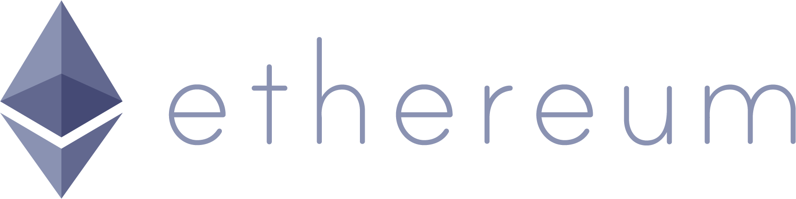

# 第七章 以太坊 —— 挣脱加密货币的枷锁

**君子和而不同。**

在区块链领域，以太坊项目同样是十分出名的开源项目。作为公有区块链平台，以太坊将比特币针对数字货币交易的功能进一步进行拓展，面向更为复杂和灵活的应用场景，支持了智能合约（Smart Contract）这一重要特性。

从此，区块链技术的应用场景，从单一基于 UTXO 的数字货币交易，延伸到图灵完备的通用计算领域。用户不再受限于仅能使用比特币脚本所支持的简单逻辑，而是可以自行设计任意复杂的合约逻辑。这就为构建各种多样化的上层应用开启了大门，可谓意义重大。

本章将参照比特币项目来介绍以太坊项目的核心概念和改进设计，以及如何安装客户端和使用智能合约等内容。

## 以太坊项目简介



以太坊（Ethereum）项目的最初目标，是打造一个运行智能合约的平台（Platform for Smart Contract）。该平台支持图灵完备的应用，按照智能合约的约定逻辑自动执行，理想情况下将不存在故障停机、审查、欺诈，以及第三方干预等问题。

以太坊平台目前支持 Golang、C++、Python 等多种语言实现的客户端。由于核心实现上基于比特币网络的核心思想进行了拓展，因此在很多设计特性上都与比特币网络十分类似。

基于以太坊项目，以太坊团队目前运营了一条公开的区块链平台——以太坊网络。智能合约开发者使用官方提供的工具和以太坊专用应用开发语言 Solidity，可以很容易开发出运行在以太坊网络上的“去中心化”应用（Decentralized Application，DApp）。这些应用将运行在以太坊的虚拟机（Ethereum Virtual Machine，EVM）里。用户通过以太币（Ether）来购买燃料（Gas），维持所部署应用的运行。

以太坊项目的官网网站为 [ethereum.org](https://ethereum.org)，代码托管在 [github.com/ethereum](https://github.com/ethereum)。

### 以太坊项目简史

相对比特币网络自 2009 年上线的历史，以太坊项目要年轻得多。

2013 年底，比特币开发团队中有一些开发者开始探讨将比特币网络中的核心技术，主要是区块链技术，拓展到更多应用场景的可能性。以太坊的早期发明者 Vitalik Buterin 提出应该能运行任意形式（图灵完备）的应用程序，而不仅仅是比特币中受限制的简单脚本。该设计思想并未得到比特币社区的支持，后来作为以太坊白皮书发布。

2014 年 2 月，更多开发者（包括 Gavin Wood、Jeffrey Wilcke 等）加入以太坊项目，并计划在社区开始以众筹形式募集资金，以开发一个运行智能合约的信任平台。

2014 年 7 月，以太币预售，经过 42 天，总共筹集到价值超过 1800 万美金的比特币。随后在瑞士成立以太坊基金会，负责对募集到的资金进行管理和运营；并组建研发团队以开源社区形式进行平台开发。

2015 年 7 月底，以太坊第一阶段 Frontier 正式发布，标志着以太坊区块链网络的正式上线。这一阶段采用类似比特币网络的 PoW 共识机制，参与节点以矿工挖矿形式维护网络；支持上传智能合约。Frontier 版本实现了计划的基本功能，在运行中测试出了一些安全上的漏洞。这一阶段使用者以开发者居多。

2016 年 3 月，第二阶段 Homestead 开始运行（区块数 1150000），主要改善了安全性，同时开始提供图形界面的客户端，提升了易用性，更多用户加入进来。

2016 年 6 月，DAO 基于以太坊平台进行众筹，受到漏洞攻击，造成价值约 5000 万美金的以太币被冻结。社区最后通过硬分叉（Hard Fork）进行解决。

2017 年 3 月，以太坊成立以太坊企业级联盟（Enterprise Ethereum Alliance，EEA），联盟成员主要来自摩根大通，微软，英特尔和部分创业企业等。

2017 年 11 月，再次暴露多签名钱包漏洞，造成价值 2.8 亿美元的以太币被冻结。

2020 年 12 月 1 日，以太坊信标链（Beacon Chain）正式上线，为后续向权益证明（PoS）共识机制的过渡奠定基础。用户可以开始质押以太币成为验证者。

2021 年 8 月，伦敦升级（London Upgrade）实施，引入 EIP-1559 提案，改变了以太坊的费用机制，部分交易费被销毁，使以太币具有通缩属性。

2022 年 9 月 15 日，以太坊完成历史性的“合并”（The Merge）升级，正式从工作量证明（PoW）转向权益证明（PoS）共识机制。这一升级使以太坊的能源消耗降低了超过 99%，被认为是区块链历史上最重要的技术里程碑之一。

2023 年 4 月 12 日，上海升级（Shanghai/Shapella）实施，允许质押者提取其质押的以太币。这解决了自信标链上线以来质押资产无法流动的问题，进一步完善了 PoS 机制。

2024 年 3 月 13 日，坎昆升级（Dencun）实施，引入 Proto-Danksharding（EIP-4844），通过“数据块”（Blob）机制大幅降低 Layer 2 网络的交易成本，为以太坊的扩展性提供了重要支持。

2024 年 5 月，美国 SEC 批准了以太坊现货 ETF，使以太坊成为继比特币之后第二个获得此类金融产品的加密货币。

2025 年 5 月 7 日，Pectra 升级实施，引入 EIP-7702（账户抽象）、提高 blob 目标值、调整验证者最大有效余额等核心改进。2025 年 12 月 3 日，Fusaka 升级激活，PeerDAS（数据可用性采样）正式上线，进一步降低 Layer 2 数据成本。

目前，以太坊已成为全球最大的智能合约平台和 DeFi（去中心化金融）生态系统的核心基础设施，承载了数千个去中心化应用和数百亿美元的锁仓资产。

包括 DAO 在内，以太坊网络已经经历了多次重大升级，每次升级都为网络带来了重要的性能和功能改进。

### 主要特点

以太坊区块链底层也是一个类似比特币网络的 P2P 网络平台，智能合约运行在网络中的以太坊虚拟机里。网络自身是公开可接入的，任何人都可以接入并参与网络中数据的维护，提供运行以太坊虚拟机的资源。

跟比特币项目相比，以太坊区块链的技术特点主要包括：

* 支持图灵完备的智能合约，设计了编程语言 Solidity 和虚拟机 EVM；
* 采用账户系统和世界状态，而不是 UTXO，容易支持更复杂的逻辑；
* 通过 Gas 限制代码执行指令数，避免循环执行攻击；
* 采用权益证明（PoS）共识机制，验证者通过质押以太币参与网络共识，相比早期的 PoW 机制能耗降低超过 99%；
* 区块产生间隔约 12 秒，相比比特币的 10 分钟大幅提升了交易确认速度。

此外，以太坊通过 Layer 2 扩展方案（如 Optimistic Rollups 和 ZK Rollups）来解决网络可扩展性问题。2024 年的 Dencun 升级引入了 Proto-Danksharding，大幅降低了 Layer 2 网络的数据存储成本。主流的 Layer 2 项目包括 Arbitrum、Base、Optimism、zkSync、Starknet 等。

这些技术特点，使以太坊成为了 DeFi、NFT 和各类去中心化应用的首选平台，生态系统规模远超其他智能合约平台。

## 核心概念

基于比特币网络的核心思想，以太坊项目提出了许多创新的技术概念，包括智能合约、基于账户的交易、以太币和燃料等。

### 智能合约

智能合约（Smart Contract）是以太坊中最为重要的一个概念，即以计算机程序的方式来缔结和运行各种合约。最早在上世纪 90 年代，Nick Szabo 等人就提出过类似的概念，但一直因为缺乏可靠执行智能合约的环境，而被作为一种理论设计。区块链技术的出现，恰好补充了这一缺陷。

以太坊支持通过图灵完备的高级语言来开发智能合约，目前主流开发语言为 Solidity（占据绝大多数合约开发份额），此外还有面向安全性的替代语言 Vyper（早期还有 Serpent，现已弃用）。智能合约作为运行在以太坊虚拟机（Ethereum Virtual Machine，EVM）中的应用，可以接受来自外部的交易请求和事件，通过触发运行提前编写好的代码逻辑，进一步生成新的交易和事件，可以进一步调用其他智能合约。

智能合约的执行结果可能对以太坊网络上的账本状态进行更新。这些修改由于经过了以太坊网络中的共识，一旦确认后无法被伪造和篡改。

### 账户

在之前章节中，笔者介绍过比特币在设计中并没有账户（Account）的概念，而是采用了 UTXO 模型记录整个系统的状态。任何人都可以通过交易历史来推算出用户的余额信息。而以太坊则采用了不同的做法，直接用账户来记录系统状态。每个账户存储余额信息、智能合约代码和内部数据存储等。以太坊支持在不同的账户之间转移数据，以实现更为复杂的逻辑。

具体来看，以太坊账户分为两种类型：合约账户（Contracts Accounts）和外部账户（Externally Owned Accounts，或 EOA）。

* 合约账户：存储智能合约代码及其内部状态，没有对应的私钥，行为完全由代码决定。它既可以被外部账户发起的交易触发，也可以被其他合约调用；
* 外部账户：以太币拥有者账户，对应到某公钥，由持有私钥的个人控制。只有外部账户能够发起交易。

两类账户在状态树中都由 nonce、balance、storageRoot、codeHash 四个字段描述。区别在于外部账户的 storageRoot 为空树根、codeHash 为空内容的 Hash，而合约账户的这两个字段分别指向其存储树和代码。

当合约账户被调用时，存储其中的智能合约会在验证者节点的虚拟机中自动执行，并消耗一定的燃料。燃料通过外部账户中的以太币进行购买。

*注：2022 年 9 月合并后，以太坊已从 PoW 转为 PoS 共识，“矿工”角色已被“验证者”取代。*

### 交易

交易（Transaction），在以太坊中是指从一个账户到另一个账户的消息数据。消息数据可以是以太币或者合约执行参数。

以太坊采用交易作为执行操作的最小单位。每个交易包括如下字段：

* to：目标账户地址。
* value：可以指定转移的以太币数量。
* nonce：交易相关的字串，用于防止交易被重放。
* maxFeePerGas：用户愿意为每单位 Gas 支付的最高费用。
* maxPriorityFeePerGas：给验证者的优先费（小费），用于提高交易被打包的吸引力。
* gasLimit：交易最多可消耗的 Gas 数量。
* data: 交易附带字节码信息，可用于创建/调用智能合约。
* signature：基于椭圆曲线加密的签名信息，包括 R，S，V 三个字段。

类似比特币网络，在发送交易时，用户需要缴纳一定的交易费用，通过以太币方式进行支付和消耗。以太坊 Layer 1 的交易速率约为每秒 15-30 笔，但通过 Layer 2 Rollup 方案（如 Arbitrum、Optimism、zkSync 等），整体生态的交易处理能力已大幅提升。

### 以太币

以太币（Ether）是以太坊网络中的货币。

以太币主要用于购买燃料，支付给验证者，以维护以太坊网络运行智能合约的费用。以太币最小单位是 wei，一个以太币等于 10^18 个 wei。

2022 年 9 月“合并”（The Merge）之前，以太币通过 PoW 挖矿生成，矿工获得区块奖励和燃料费用。合并后，以太坊转为 PoS 共识，验证者通过质押 ETH 参与区块验证并获得奖励。同时，EIP-1559 引入的基础费用销毁机制使 ETH 在网络活跃时可能呈通缩状态。用户可以通过交易市场直接购买以太币。

*注：以太币价格波动较大，读者可通过 CoinGecko、CoinMarketCap 等平台查询最新市场数据。*

### 燃料

燃料（Gas），控制某次交易执行指令的上限。每条指令都有对应的燃料开销，但并非都是固定值：SSTORE、SLOAD 等存储操作会随槽位是首次访问（冷）还是已访问（热）、以及新旧值是否相同而变化，内存扩展、带转账的 CALL 等也按实际用量计价。当某个交易还未执行结束，而燃料消耗完时，合约执行终止并回滚状态，已用于执行的 Gas 仍会被消耗。

Gas 费用用 ETH 支付。EIP-1559 之后，交易费用主要由协议自动调整并销毁的 `base fee`、用户设置给验证者的 `priority fee`，以及用户可接受的 `max fee` 共同决定。钱包通常会根据当前网络拥堵情况自动估算这些参数。

## 主要设计

以太坊项目的基本设计与比特币网络类似。为了支持更复杂的智能合约，以太坊在不少地方进行了改进，包括交易模型、共识、对攻击的防护和可扩展性等。

### 智能合约相关设计

#### 运行环境

以太坊采用以太坊虚拟机作为智能合约的运行环境。以太坊虚拟机是一个隔离的轻量级虚拟机环境，运行在其中的智能合约代码无法访问本地网络、文件系统或其他进程。

对同一个智能合约来说，往往需要在多个以太坊虚拟机中同时运行多份，以确保整个区块链数据的一致性和高度的容错性。另一方面，这也限制了整个网络的容量。

#### 开发语言

以太坊为编写智能合约设计了图灵完备的高级编程语言，降低了智能合约开发的难度。

目前 Solidity 是最常用的以太坊合约编写语言之一。

智能合约编写完毕后，用编译器编译为以太坊虚拟机专用的二进制格式（EVM bytecode），由客户端上传到区块链当中，之后在网络中验证者节点的以太坊虚拟机中执行。

*注：在 2022 年“合并”（The Merge）之前，合约由矿工执行；此后改由 PoS 验证者执行。*

### 交易模型

出于智能合约的便利考虑，以太坊采用了账户的模型，状态可以实时的保存到账户里，而无需像比特币的 UTXO 模型那样去回溯整个历史。

UTXO 模型和账户模型的对比如下。

| 特性 |UTXO 模型|账户模型|
|--|--|--|
|状态查询和变更|需要回溯历史|直接访问|
|存储空间|较大|较小|
|易用性|较难处理|易于理解和编程|
|安全性|较好|需要处理好重放攻击等情况|
|可追溯性|当前状态即由交易链构成，天然可回溯|需借助交易与事件日志回溯，当前状态本身不含历史|

### 账户抽象 （Account Abstraction）

长期以来，以太坊账户分为外部拥有账户（EOA，由私钥控制）和合约账户（CA，由代码控制）。EOA 是发起交易的唯一方式，但面临私钥管理困难的问题。

**ERC-4337** 标准的引入实现了账户抽象（Account Abstraction），它允许用户通过智能合约钱包（Smart Contract Wallet）来作为主账户，从而实现了：
*   **社交恢复**：无需助记词，可通过信任的联系人恢复账户。
*   **Gas 代付（Paymaster）**：应用方可以为用户支付 Gas 费，降低门槛。
*   **批量交易**：一次签名可批准多笔操作。

这被认为是将以太坊推向 10 亿用户的关键 UX 改进。

### 共识

2022 年 9 月，以太坊完成了历史性的“合并”（The Merge）升级，正式从工作量证明（PoW）转向权益证明（PoS）共识机制。

在 PoS 机制下：
*   **验证者（Validator）** 取代了矿工，通过质押至少 32 ETH 成为验证者。
*   验证者被随机选中来提议新区块并验证其他区块。
*   诚实的验证者会获得 ETH 奖励，而恶意行为（如双签）会导致质押被罚没（Slashing）。
*   **能耗降低超过 99%**，解决了 PoW 长期被诟病的高能耗问题。

区块生成时间从 PoW 时代的约 13 秒缩短到固定的 **12 秒**一个 slot。

*注：以太坊早期（2015-2022）采用 PoW 机制和 Ethash 算法，现已完全淘汰。*

### 降低攻击

以太坊网络中的交易更加多样化，也就更容易受到攻击。

以太坊网络在降低攻击方面的核心设计思想，仍然是通过经济激励机制防止少数人作恶：

* 所有交易都要提供交易费用，避免 DDoS 攻击；
* 程序运行指令数通过 Gas 来限制，所消耗的费用超过设定上限时就会被取消，避免出现恶意合约。

这就确保了攻击者试图消耗网络中虚拟机的计算资源时，需要付出经济代价（支付大量的以太币）；同时难以通过构造恶意的循环或不稳定合约代码来对网络造成破坏。

### 提高扩展性

可扩展性是以太坊网络承接更多业务量的关键挑战。

以太坊的扩容路线图已从早期的“分片执行”调整为 **“以 Rollup 为中心”** 的策略。当前的扩容主要依赖 Layer 2 解决方案：

*   **Rollups**：在链下批量处理交易，然后将压缩的交易数据和证明提交到 Layer 1。包括 Optimistic Rollups（如 Arbitrum、Optimism）和 ZK Rollups（如 zkSync、Starknet）。
*   **Proto-Danksharding (EIP-4844)**：2024 年 3 月的 Dencun 升级引入了 Blob 数据类型，专门用于存储 Rollup 的数据，大幅降低了 Layer 2 的交易成本。2025 年 5 月的 Pectra 升级进一步提高了 blob 目标值；2025 年 12 月的 Fusaka 升级激活 PeerDAS（数据可用性采样），向完整 Danksharding 迈出关键一步。

再往后，官方路线图上的下一次升级是 Glamsterdam（开发中，目标 2026 年第四季度，截至 2026 年 9 月尚未激活），之后是计划于 2027 年的 Hegotá。更远期，以太坊仍计划实现完整的 Danksharding，进一步扩大数据可用性容量。

## Layer 2 与扩容方案

随着以太坊生态的爆发式增长，主网（Layer 1）的性能瓶颈日益凸显。高昂的 Gas 费用和低下的交易吞吐量（TPS 仅约 15-30）成为了阻碍区块链大规模应用的主要障碍。为了解决这一难题，社区提出了 Layer 2 扩容方案。

Layer 2 指的是构建在以太坊主网之上的通过智能合约连接的独立区块链网络。它们将计算和数据处理转移到链下（Off-Chain）进行，仅将最终结果和关键数据打包上传回主网进行验证和结算。这既继承了以太坊主网的安全性，又极大地提升了系统的处理能力并降低了交易成本。

### Layer 2 的核心技术：Rollups

在经历了状态通道（State Channels）、侧链（Sidechains）和 Plasma 等早期尝试后，Rollups 已成为目前最主流且被以太坊路线图确认为核心的扩容方案。

Rollups（汇总）的核心思想是将数百笔交易在 Layer 2 上执行和压缩，然后打包成一笔交易提交到 Layer 1。根据验证数据的不同方式，Rollups 分为两大流派。

#### Optimistic Rollups（乐观汇总）

*   **原理**：默认假设提交到 Layer 1 的数据是正确的（乐观态度）。如果不正确，网络中的验证者可以在“挑战期”（通常为 7 天）内发起欺诈证明（Fraud Proof）。如果没有人在挑战期内提出异议，交易即被视为最终确认。
*   **优点**：兼容性好，由于兼容以太坊虚拟机（EVM），现有的 DApp 可以几乎无缝迁移。
*   **缺点**：提款到 Layer 1 需要等待数天的挑战期。
*   **代表项目**：**Arbitrum**、**Base**（Coinbase 推出，基于 OP Stack）、**Optimism**。L2 的 TVL 和交易份额变化很快，应以 L2BEAT、DefiLlama 等实时仪表盘为准，不宜把某一日的占比写成长期事实。

#### ZK Rollups（零知识汇总）

*   **原理**：利用零知识证明（Zero-Knowledge Proofs）技术。Layer 2 在打包交易时，会生成一个数学证明（Validity Proof），证明这些交易是有效且状态转换是正确的。Layer 1 的智能合约只需验证这个证明即可。
*   **优点**：安全性更高，完全依赖数学而非博弈；提款无需等待，一旦证明被 Layer 1 验证通过即可。
*   **缺点**：生成零知识证明需要额外计算资源；通用 zkEVM 的工程成熟度和生态状态仍需按具体项目评估。
*   **代表项目**：**zkSync**、**Starknet**、**Scroll** 等。

*注：Polygon 在 2025 年 6 月宣布停止维护 Polygon zkEVM Mainnet Beta，Sequencer 已于 2026 年 7 月 1 日停止出块。它可作为 zkEVM 技术案例理解，但不宜再作为新项目默认选型。*

### 关键升级：EIP-4844 与 Blob

2024 年 3 月实施的 Dencun 升级引入了 **EIP-4844 (Proto-Danksharding)**，这是 Layer 2 发展史上的里程碑。

在 EIP-4844 之前，Layer 2 需要将交易数据作为 `calldata` 存储在以太坊 Layer 1 上，这占用了昂贵的区块空间且永久存储，导致 Layer 2 的费用虽然比 Layer 1 低，但仍不够便宜。

EIP-4844 引入了一种新的数据格式 —— **Blob (Binary Large Object)**。
*   **临时存储**：Blob 数据不像 `calldata` 那样被永久存储在历史记录中，而是由共识节点保存约 18 天（4096 个 Epoch），之后便会被修剪。这对于 Layer 2 验证交易的有效性已经足够。
*   **独立市场**：Blob 使用独立的 blob gas 费用市场，不直接与普通执行交易竞争区块 gas，因此通常更适合 Rollup 数据发布。

EIP-4844 上线后，采用 Blob 的 Rollup 可以用更低成本发布数据，Layer 2 费用随之显著下降，为社交、游戏等高频应用降低了门槛。

### Dencun 之后的升级：Pectra、Fusaka 与 Glamsterdam

在 Dencun 升级为 Layer 2 的高效性打下基础后，Ethereum 社区继续推进协议演进。**Pectra 升级**（于 2025 年 5 月 7 日执行）提高了 blob 吞吐目标，并引入 EIP-7702 等账户抽象相关能力，继续改善 Rollup 和钱包体验。

紧随其后的 **Fusaka 升级**（于 2025 年 12 月 3 日激活）以 PeerDAS（Peer Data Availability Sampling）为核心，让节点只需采样部分 blob 数据即可验证数据可用性，从而显著提升 blob 吞吐上限并降低节点存储 / 带宽压力。配合分阶段提高 blob 目标，Layer 2 的数据发布成本进一步下降。

再往后是 **Glamsterdam 升级**，官方路线图列为「开发中」、目标窗口 2026 年第四季度（截至 2026 年 9 月尚未激活，也未公布主网确切日期），其后还有计划于 2027 年的 Hegotá。引用这类未激活升级时请注意：路线图上的季度目标常有滑期，以官方路线图与客户端发布说明的当期状态为准。

### 总结

Layer 2 已经成为以太坊生态的重要组成部分。随着技术的发展，“Layer 2 负责执行，Layer 1 负责结算和数据可用性” 这一模块化区块链（Modular Blockchain）的架构已成为行业共识。未来，我们可能会看到 Layer 3 (L3) 的出现，进一步为特定应用场景提供定制化的扩容服务。

## 相关工具

### 客户端和开发库

以太坊社区提供了多种语言实现的客户端，支持标准的 JSON-RPC 协议。合并后，主网节点通常由执行层客户端（Execution Client）和共识层客户端（Consensus Client）共同组成。

**执行层客户端（Execution Client）：**
*   [Geth (go-ethereum)](https://github.com/ethereum/go-ethereum)：Go 语言实现，最主流的客户端；
*   [Nethermind](https://github.com/NethermindEth/nethermind)：C# 语言实现，性能优异；
*   [Besu](https://github.com/besu-eth/besu)：Java 语言实现，LF Decentralized Trust（原 Hyperledger）项目之一，适合企业级应用；
*   [Erigon](https://github.com/erigontech/erigon)：Go 语言实现，专注于存储效率和同步速度。

**共识层客户端（Consensus Client）：**
*   [Prysm](https://github.com/OffchainLabs/prysm)：Go 语言实现；
*   [Lighthouse](https://github.com/sigp/lighthouse)：Rust 语言实现；
*   [Teku](https://github.com/Consensys-Incorporated/teku)：Java 语言实现。

**开发库：**
*   [ethers.js](https://docs.ethers.org/v6/)：轻量级且功能强大的 JavaScript/TypeScript 库，当前 v6 API 使用 `bigint`、`ethers.parseEther()` 等现代接口；
*   [web3.js](https://github.com/web3/web3.js)：历史悠久的 JavaScript 库，常见于 legacy 项目；
*   [viem](https://github.com/wevm/viem)：基于 TypeScript 构建的新一代库，专注于性能。

### 以太坊钱包

钱包是用户进入 Web3 世界的入口。

*   [MetaMask](https://metamask.io/)：浏览器插件钱包的行业标准，支持几乎所有 EVM 兼容链。
*   [Rabby Wallet](https://rabby.io/)：专为 DeFi 用户设计，提供交易模拟和风险扫描功能，体验更佳。
*   [Frame](https://frame.sh/)：专注于隐私和 macOS 原生体验的桌面钱包。

### 开发框架与 IDE

现代以太坊开发工具栈已经发生了巨大变化。

*   [Hardhat](https://hardhat.org/)：主流以太坊开发环境，支持 TypeScript、Solidity 测试、Hardhat Network、本地调试和插件生态。
*   [Foundry](https://getfoundry.sh/)：基于 Rust 编写的高性能开发框架，包含 Forge、Cast、Anvil 和 Chisel，适合 Solidity 原生测试和脚本化工作流。
*   [Remix](https://remix.ethereum.org)：基于浏览器的 IDE，无需安装，适合快速原型开发和教学。
*   [Ganache](https://archive.trufflesuite.com/ganache/)：Truffle/Ganache 已 sunset，代码和文档作为归档保留；新项目优先使用 Hardhat Network 或 Foundry Anvil。

### 本地测试链

*   [Hardhat Network](https://hardhat.org/docs/guides/hardhat-node)：Hardhat 内置的本地开发链，可通过 `npx hardhat node` 暴露 JSON-RPC，适合与 Hardhat 测试、调试、fork 和脚本集成。
*   [Anvil](https://getfoundry.sh/anvil/overview)：Foundry 提供的快速本地 Ethereum 节点，适合独立本地链、fork 测试和与 Forge/Cast 配合使用。

### 网站资源

*   [Etherscan](https://etherscan.io/)：最权威的区块浏览器，查看所有链上交易、合约代码和账户状态。
*   [DefiLlama](https://defillama.com/)：最全面的 DeFi TVL 和数据分析平台。
*   [Dune Analytics](https://dune.com/)：强大的链上数据可视化分析平台，社区贡献了大量 Dashboard。

## 安装客户端

本节介绍如何安装 Geth（Go 语言实现的以太坊客户端）。Geth 是以太坊最主流的执行层客户端之一。

*注：自 The Merge（2022 年）之后，运行完整的以太坊节点需要同时安装执行层客户端（如 Geth）和共识层客户端（如 Prysm、Lighthouse）。仅安装 Geth 无法独立同步网络。*

## 快速安装（推荐）

### macOS

使用 Homebrew 安装：

```bash
brew tap ethereum/ethereum
brew install ethereum
```

### Ubuntu/Debian

添加 PPA 源并安装：

```bash
sudo add-apt-repository -y ppa:ethereum/ethereum
sudo apt-get update
sudo apt-get install ethereum
```

### Windows

从 [Geth 官方下载页面](https://geth.ethereum.org/downloads/) 下载 Windows 版本安装包。

### 验证安装

```bash
geth version

## 输出示例：
# Geth
# Version: 1.17.x-stable
# ...
```

## 从源码编译

如需使用最新开发版本或进行定制，可从源码编译。

### 1. 安装 Go 语言环境

访问 [go.dev/dl](https://go.dev/dl/) 下载并安装 Go 1.25 或更高版本（`master` 分支的 `go.mod` 已声明 go 1.25.0，而 Go 1.24 已结束支持）。编译旧稳定分支时，以该分支 `go.mod` 中声明的 Go 版本为准。

```bash

# 验证安装
go version
```

*注：现代 Go 使用 Go Modules 管理依赖，无需配置 GOPATH。*

### 2. 克隆并编译

```bash
git clone https://github.com/ethereum/go-ethereum.git
cd go-ethereum
make geth
```

编译完成后，可执行文件位于 `build/bin/geth`。

```bash
./build/bin/geth version
```

## 运行节点

由于 The Merge 后需要执行层+共识层配合，生产或长期运行节点应同时配置 Geth 和共识层客户端，并共享同一个 JWT secret。也可以使用节点部署工具简化客户端组合。

基本的 Geth 启动命令：

```bash

# 连接主网（需配合共识层客户端）
geth --http --http.api eth,net --authrpc.addr localhost --authrpc.port 8551 --authrpc.vhosts localhost --authrpc.jwtsecret /path/to/jwtsecret

# 连接 Sepolia 测试网
geth --sepolia --http --http.api eth,net --authrpc.addr localhost --authrpc.port 8551 --authrpc.vhosts localhost --authrpc.jwtsecret /path/to/jwtsecret
```

更多配置和同步选项请参考 [Geth 官方文档](https://geth.ethereum.org/docs/)。

## 使用智能合约

以太坊智能合约开发通常不再直接使用 Geth 控制台、旧式内置 JS 对象或 PoW 私链挖矿流程。自 The Merge 之后，Geth 是执行层客户端，完整节点需要配合共识层客户端；旧教程中的本地挖矿和 JS 控制台部署流程不适合当前开发。

本节采用 Hardhat 本地开发网络演示合约编写、编译、部署和调用。它更接近当前 DApp 开发流程，也便于切换到 Sepolia 等测试网。

### 初始化项目

先安装 Node.js 22 或更高版本，然后创建 Hardhat 项目。

```bash
mkdir hardhat-example
cd hardhat-example
npx hardhat --init
npx hardhat test
```

按默认模板创建项目即可。默认项目会包含 `contracts/`、`test/`、`ignition/modules/` 和 `hardhat.config.ts` 等文件。

### 创建合约

新建 `contracts/TestContract.sol`。

```solidity
// SPDX-License-Identifier: MIT
pragma solidity ^0.8.28;

contract TestContract {
    function multiply(uint256 a) public pure returns (uint256) {
        return a * 7;
    }
}
```

编译合约。

```bash
npx hardhat compile
```

Hardhat 会根据项目配置管理 Solidity 编译器，不需要手工把 `solc --bin` 和 `solc --abi` 输出复制到控制台。

### 本地部署

使用 Hardhat Ignition 描述部署过程。新建 `ignition/modules/TestContract.ts`。

```typescript
import { buildModule } from "@nomicfoundation/hardhat-ignition/modules";

export default buildModule("TestContractModule", (m) => {
  const testContract = m.contract("TestContract");

  return { testContract };
});
```

如果只想在一次性模拟网络中验证部署，直接运行：

```bash
npx hardhat ignition deploy ignition/modules/TestContract.ts
```

如果需要一个持续运行的本地 JSON-RPC 节点，在第一个终端运行：

```bash
npx hardhat node
```

在第二个终端部署到该本地节点：

```bash
npx hardhat ignition deploy ignition/modules/TestContract.ts --network localhost
```

输出中会给出合约地址。切换到 Sepolia 等测试网时，应在 `hardhat.config.ts` 中配置 RPC URL 和部署账户，并把私钥放在环境变量或 Hardhat 配置变量中，不要写入代码仓库。

### 调用合约

调试阶段可以用 Hardhat 控制台在本地模拟网络中部署并调用。

```bash
npx hardhat console
```

```javascript
> const { viem } = await network.create()
> const c = await viem.deployContract("TestContract")
> await c.read.multiply([10n])
70n
```

如果已经部署到本地节点或测试网，可使用前端、脚本或命令行工具通过合约地址和 ABI 调用。Foundry 的 `cast` 也常用于快速读写合约。

```bash
cast call <CONTRACT_ADDRESS> "multiply(uint256)(uint256)" 10 --rpc-url http://127.0.0.1:8545
```

### 使用 Geth 私有网络的场景

如果目标是测试多节点执行层/共识层行为，而不是普通合约开发，应参考 Geth 官方的 Kurtosis 私有网络文档。当前 Geth 私网需要同时启动执行客户端和共识客户端，不应再按旧版挖矿或 PoA 单客户端教程搭建。

## 智能合约开发实验指南

本章提供了一系列循序渐进的实验教程，帮助开发者从零开始掌握以太坊智能合约的开发、部署和交互。所有实验都可以在本地环境中完成，无需花费真实的以太币。

### 实验 0：搭建开发环境

#### 0.1 使用 Remix IDE（无需本地安装）

Remix 是官方提供的浏览器 IDE，无需任何安装，立即可用。

**访问地址**：https://remix.ethereum.org

**优点**：
- 无需安装，打开浏览器即可
- 内置编译器和调试器
- 支持直接连接本地区块链和测试网

**创建第一个合约**：

1. 打开 Remix IDE
2. 在左侧文件面板中，点击 “+” 创建新文件
3. 命名为 `HelloWorld.sol`
4. 输入以下代码：

```solidity
// SPDX-License-Identifier: MIT
pragma solidity ^0.8.0;

contract HelloWorld {
    string public message = "Hello, Blockchain!";

    function updateMessage(string memory newMessage) public {
        message = newMessage;
    }

    function getMessage() public view returns (string memory) {
        return message;
    }
}
```

5. 点击左侧 “Solidity Compiler” 图标（看起来像一个积木）
6. 选择编译器版本 `0.8.0` 或以上
7. 点击 “Compile HelloWorld.sol”
8. 如果没有错误，你应该看到绿色的 “Compile” 按钮

#### 0.2 Hardhat 本地开发环境搭建

Hardhat 是以太坊开发的主流框架，提供测试、调试、部署和本地链模拟能力。本实验使用 Hardhat 3 的 TypeScript + Mocha + ethers.js 工具链。

**安装步骤**：

```bash
## 创建项目目录
mkdir ethereum-learning
cd ethereum-learning

# 初始化 Node.js 项目
npm init -y

# 安装 Hardhat（Hardhat 3 要求 Node.js 22 或以上）
npm install --save-dev hardhat

# 初始化 Hardhat 项目
npx hardhat --init

# 选择 "A TypeScript Hardhat project using Mocha and Ethers.js"
# 按提示安装 @nomicfoundation/hardhat-toolbox-mocha-ethers 等依赖
```

**项目结构**：

```text
ethereum-learning/
├── contracts/
│   ├── Counter.sol           # 示例合约
│   └── Counter.t.sol         # Solidity 测试（可选）
├── ignition/
│   └── modules/
│       └── Counter.ts        # Hardhat Ignition 部署模块
├── test/
│   └── Counter.ts            # TypeScript 测试文件
├── scripts/
│   └── deploy.ts             # 脚本文件
├── hardhat.config.ts         # Hardhat 配置
└── package.json
```

#### 0.3 验证环境

```bash

# 编译合约
npx hardhat compile

# 运行测试
npx hardhat test

# 启动本地区块链
npx hardhat node
```

如果以上命令都成功执行，恭喜！开发环境已搭建完成。

### 实验 1：部署和调用简单合约

**目标**：理解合约的基本结构、部署过程和状态查询。

**合约代码** (`contracts/SimpleStorage.sol`)：

```solidity
// SPDX-License-Identifier: MIT
pragma solidity ^0.8.0;

contract SimpleStorage {
    // 状态变量：永久存储在区块链上
    uint256 public storedValue;

    // 事件：用于链外应用监听
    event ValueChanged(uint256 indexed newValue, address indexed changer);

    // 函数：修改状态（花费 Gas）
    function setValue(uint256 newValue) public {
        storedValue = newValue;
        emit ValueChanged(newValue, msg.sender);
    }

    // 函数：查询状态（不花费 Gas）
    function getValue() public view returns (uint256) {
        return storedValue;
    }

    // 函数：计算但不修改状态
    function add(uint256 a, uint256 b) public pure returns (uint256) {
        return a + b;
    }
}
```

**编写测试** (`test/SimpleStorage.test.ts`)：

```typescript
import { expect } from "chai";
import { network } from "hardhat";

describe("SimpleStorage", function () {
    let ethers: any;
    let storage: any;
    let owner: any;

    // 在每个测试前执行
    beforeEach(async function () {
        ({ ethers } = await network.create());
        [owner] = await ethers.getSigners();
        storage = await ethers.deployContract("SimpleStorage");
        await storage.waitForDeployment();
    });

    describe("初始状态", function () {
        it("初始值应该为 0", async function () {
            expect(await storage.getValue()).to.equal(0n);
        });

        it("storedValue 应该可以直接访问", async function () {
            expect(await storage.storedValue()).to.equal(0n);
        });
    });

    describe("setValue 函数", function () {
        it("应该能够设置新值", async function () {
            await storage.setValue(42);
            expect(await storage.getValue()).to.equal(42n);
        });

        it("应该发出 ValueChanged 事件", async function () {
            // 监听事件
            await expect(storage.setValue(100))
                .to.emit(storage, "ValueChanged")
                .withArgs(100n, owner.address);
        });

        it("每次设置都应该覆盖旧值", async function () {
            await storage.setValue(10);
            expect(await storage.getValue()).to.equal(10n);

            await storage.setValue(20);
            expect(await storage.getValue()).to.equal(20n);
        });
    });

    describe("add 函数", function () {
        it("应该正确相加", async function () {
            expect(await storage.add(5, 3)).to.equal(8n);
        });

        it("应该处理大数字", async function () {
            const big = 10n ** 18n;
            expect(await storage.add(big, big)).to.equal(big * 2n);
        });
    });

    describe("Gas 消耗分析", function () {
        it("setValue 是一个状态修改交易", async function () {
            const tx = await storage.setValue(50);
            const receipt = await tx.wait();
            if (receipt === null) throw new Error("交易未确认");
            console.log("setValue Gas 消耗:", receipt.gasUsed.toString());
            // 预期: ~43,000-44,000
        });

        it("getValue 是一个只读调用", async function () {
            // 不会消耗任何 Gas
            const result = await storage.getValue();
            expect(result).to.equal(0n);
        });
    });
});
```

**运行测试**：

```bash
npx hardhat test test/SimpleStorage.test.ts
```

**预期输出**：

```text
SimpleStorage
  初始状态
    ✓ 初始值应该为 0
    ✓ storedValue 应该可以直接访问
  setValue 函数
    ✓ 应该能够设置新值
    ✓ 应该发出 ValueChanged 事件
    ✓ 每次设置都应该覆盖旧值
  add 函数
    ✓ 应该正确相加
    ✓ 应该处理大数字
  Gas 消耗分析
    ✓ setValue 是一个状态修改交易
    setValue Gas 消耗: 43210
    ✓ getValue 是一个只读调用

9 passing
```

### 实验 2：代币合约（ERC-20）

**目标**：理解标准合约接口、代币的基本操作（转账、授权）。

实际项目应优先使用 OpenZeppelin Contracts v5 的 `ERC20` 实现，而不是从零手写完整标准。v5 示例通常从 `@openzeppelin/contracts/token/ERC20/ERC20.sol` 导入，在派生合约中定义供应机制，例如：

```solidity
// SPDX-License-Identifier: MIT
pragma solidity ^0.8.24;

import {ERC20} from "@openzeppelin/contracts/token/ERC20/ERC20.sol";

contract MyToken is ERC20 {
    constructor(uint256 initialSupply) ERC20("Simple Token", "STK") {
        _mint(msg.sender, initialSupply * 10 ** decimals());
    }
}
```

下面的 `SimpleToken` 是教学用最小实现，用来展示 ERC-20 的核心状态和事件；生产代码不要直接复用。

**合约代码** (`contracts/SimpleToken.sol`)：

```solidity
// SPDX-License-Identifier: MIT
pragma solidity ^0.8.0;

contract SimpleToken {
    string public name = "Simple Token";
    string public symbol = "STK";
    uint8 public decimals = 18;
    uint256 public totalSupply;

    // 账户余额
    mapping(address => uint256) public balanceOf;

    // 授权额度: owner => spender => amount
    mapping(address => mapping(address => uint256)) public allowance;

    // 事件
    event Transfer(address indexed from, address indexed to, uint256 value);
    event Approval(address indexed owner, address indexed spender, uint256 value);

    // 构造函数：初始化代币供应
    constructor(uint256 initialSupply) {
        totalSupply = initialSupply * 10 ** uint256(decimals);
        balanceOf[msg.sender] = totalSupply;
    }

    // 转账函数
    function transfer(address to, uint256 value) public returns (bool) {
        require(to != address(0), "Invalid address");
        require(balanceOf[msg.sender] >= value, "Insufficient balance");

        balanceOf[msg.sender] -= value;
        balanceOf[to] += value;

        emit Transfer(msg.sender, to, value);
        return true;
    }

    // 授权函数：允许 spender 花费你的代币
    function approve(address spender, uint256 value) public returns (bool) {
        allowance[msg.sender][spender] = value;
        emit Approval(msg.sender, spender, value);
        return true;
    }

    // 代理转账：spender 转账 owner 的代币
    function transferFrom(address from, address to, uint256 value) public returns (bool) {
        require(from != address(0), "Invalid address");
        require(to != address(0), "Invalid address");
        require(balanceOf[from] >= value, "Insufficient balance");
        require(allowance[from][msg.sender] >= value, "Insufficient allowance");

        balanceOf[from] -= value;
        balanceOf[to] += value;
        allowance[from][msg.sender] -= value;

        emit Transfer(from, to, value);
        return true;
    }
}
```

**测试代码** (`test/SimpleToken.test.ts`)：

```typescript
import { expect } from "chai";
import { network } from "hardhat";

describe("SimpleToken", function () {
    let ethers: any;
    let token: any;
    let owner: any, alice: any, bob: any;

    beforeEach(async function () {
        ({ ethers } = await network.create());
        [owner, alice, bob] = await ethers.getSigners();

        token = await ethers.deployContract("SimpleToken", [1000]); // 初始供应 1000 tokens
        await token.waitForDeployment();
    });

    describe("初始化", function () {
        it("应该有正确的总供应", async function () {
            const expected = ethers.parseEther("1000");
            expect(await token.totalSupply()).to.equal(expected);
        });

        it("拥有者应该获得所有初始代币", async function () {
            const balance = await token.balanceOf(owner.address);
            expect(balance).to.equal(await token.totalSupply());
        });
    });

    describe("转账", function () {
        it("应该能够转账代币", async function () {
            const amount = ethers.parseEther("100");
            await token.transfer(alice.address, amount);

            expect(await token.balanceOf(alice.address)).to.equal(amount);
            expect(await token.balanceOf(owner.address)).to.equal(
                ethers.parseEther("900")
            );
        });

        it("应该发出 Transfer 事件", async function () {
            const amount = ethers.parseEther("50");
            await expect(token.transfer(bob.address, amount))
                .to.emit(token, "Transfer")
                .withArgs(owner.address, bob.address, amount);
        });

        it("不应该允许转账超过余额", async function () {
            const tooMuch = ethers.parseEther("2000");
            await expect(
                token.transfer(alice.address, tooMuch)
            ).to.be.revertedWith("Insufficient balance");
        });
    });

    describe("授权和代理转账", function () {
        it("应该能够授权", async function () {
            const amount = ethers.parseEther("100");
            await token.approve(alice.address, amount);

            expect(await token.allowance(owner.address, alice.address)).to.equal(amount);
        });

        it("应该能够进行代理转账", async function () {
            const amount = ethers.parseEther("100");

            // owner 授权 alice 花费 100 tokens
            await token.approve(alice.address, amount);

            // alice 代表 owner 转账给 bob
            await token.connect(alice).transferFrom(owner.address, bob.address, amount);

            expect(await token.balanceOf(bob.address)).to.equal(amount);
            expect(await token.allowance(owner.address, alice.address)).to.equal(0n);
        });

        it("不应该允许转账超过授权额度", async function () {
            const approved = ethers.parseEther("50");
            const attempted = ethers.parseEther("100");

            await token.approve(alice.address, approved);

            await expect(
                token.connect(alice).transferFrom(owner.address, bob.address, attempted)
            ).to.be.revertedWith("Insufficient allowance");
        });
    });
});
```

**运行测试**：

```bash
npx hardhat test test/SimpleToken.test.ts
```

### 实验 3：使用 Hardhat Network 或 Anvil 搭建本地测试网

Ganache 及其旧 CLI 已经 sunset，不再作为新项目的默认本地链。新项目优先使用 Hardhat Network；如果需要独立的高性能本地节点，可使用 Foundry Anvil。

**Hardhat Network（推荐默认选择）**：

```bash
# 在当前 Hardhat 项目内启动本地 JSON-RPC 节点
npx hardhat node

# 在另一个终端连接这个节点运行脚本或测试
npx hardhat run scripts/interact.ts --network localhost
```

Hardhat Network 的特点：
- 默认提供 20 个测试账户，每个账户有充足测试 ETH
- 和 Hardhat 测试、调试、stack trace、console.log 深度集成
- 支持主网 fork、快照、时间调整等测试辅助能力

**Foundry Anvil（独立本地节点）**：

```bash
# 安装 Foundry 后，启动 Anvil
anvil

# 使用远程 RPC fork 主网或测试网
anvil --fork-url https://eth-mainnet.g.alchemy.com/v2/YOUR_API_KEY
```

Anvil 的特点：
- 启动快，适合和 Foundry/Forge/Cast 一起使用
- 默认提供 10 个测试账户，每个账户有 10000 ETH
- 默认 RPC 地址通常为 `http://127.0.0.1:8545`
- 支持 fork、固定区块、自动出块和间隔出块

**在 Hardhat 中连接 Anvil**：

```typescript
// hardhat.config.ts
import { configVariable, defineConfig } from "hardhat/config";
import hardhatToolboxMochaEthers from "@nomicfoundation/hardhat-toolbox-mocha-ethers";

export default defineConfig({
    plugins: [hardhatToolboxMochaEthers],
    solidity: "0.8.28",
    networks: {
        anvil: {
            type: "http",
            url: "http://127.0.0.1:8545",
            chainId: 31337
        },
        hardhatMainnet: {
            type: "edr-simulated",
            chainType: "l1",
            forking: {
                url: configVariable("MAINNET_RPC_URL")
            }
        }
    }
});
```

**使用 Anvil 运行测试**：

```bash
# 终端 1：启动 Anvil
anvil

# 终端 2：运行 Hardhat 测试
npx hardhat test --network anvil
```

### 实验 4：在测试网部署合约

**选择测试网**：

- **Sepolia**（推荐）：以太坊应用和智能合约开发的默认测试网
- **Hoodi**：验证者、质押和协议升级测试网，不是普通 DApp 的默认选择
- **Polygon Amoy**：Polygon PoS 当前测试网，替代旧 Polygon PoS 测试网

**获取测试代币**：

```bash
# 访问 Sepolia 水龙头
# https://sepoliafaucet.com
# https://www.alchemy.com/faucets/ethereum-sepolia

# Polygon Amoy 测试 POL 可使用 Polygon 文档列出的第三方水龙头
# https://docs.polygon.technology/tools/gas/matic-faucet/
```

**配置网络** (`hardhat.config.ts`)：

```typescript
import { configVariable, defineConfig } from "hardhat/config";
import hardhatToolboxMochaEthers from "@nomicfoundation/hardhat-toolbox-mocha-ethers";

export default defineConfig({
    plugins: [hardhatToolboxMochaEthers],
    solidity: "0.8.28",
    networks: {
        sepolia: {
            type: "http",
            chainType: "l1",
            url: configVariable("SEPOLIA_RPC_URL"),
            accounts: [configVariable("SEPOLIA_PRIVATE_KEY")]
        },
        polygonAmoy: {
            type: "http",
            chainId: 80002,
            url: configVariable("POLYGON_AMOY_RPC_URL"),
            accounts: [configVariable("POLYGON_AMOY_PRIVATE_KEY")]
        }
    },
    verify: {
        etherscan: {
            apiKey: configVariable("ETHERSCAN_API_KEY")
        }
    }
});
```

Hardhat 3 的 `configVariable` 可以从环境变量读取配置值；私钥、API Key 等敏感值优先使用 `hardhat-keystore` 加密保存，避免进入 shell 历史或明文配置文件。

```bash
# 推荐：使用 Hardhat keystore 保存敏感值
npx hardhat keystore set SEPOLIA_RPC_URL
npx hardhat keystore set SEPOLIA_PRIVATE_KEY
npx hardhat keystore set MAINNET_RPC_URL
npx hardhat keystore set POLYGON_AMOY_RPC_URL
npx hardhat keystore set POLYGON_AMOY_PRIVATE_KEY
npx hardhat keystore set ETHERSCAN_API_KEY

# 临时测试网环境也可以用环境变量，但不要写入仓库、截图或共享终端记录
export SEPOLIA_RPC_URL="https://eth-sepolia.g.alchemy.com/v2/YOUR_API_KEY"
export SEPOLIA_PRIVATE_KEY="your_private_key_here"
export MAINNET_RPC_URL="https://eth-mainnet.g.alchemy.com/v2/YOUR_API_KEY"
export POLYGON_AMOY_RPC_URL="https://polygon-amoy.g.alchemy.com/v2/YOUR_API_KEY"
export POLYGON_AMOY_PRIVATE_KEY="your_private_key_here"
export ETHERSCAN_API_KEY="your_etherscan_api_key_here"
```

**部署脚本** (`scripts/deploy.ts`)：

```typescript
import fs from "node:fs";
import { network } from "hardhat";

console.log("部署开始...");

const { ethers } = await network.create();

// 部署
const storage = await ethers.deployContract("SimpleStorage");
await storage.waitForDeployment();

const address = await storage.getAddress();
console.log(`SimpleStorage 已部署到: ${address}`);

// 保存地址以供后续使用
fs.writeFileSync(
    "deployed.json",
    JSON.stringify({ SimpleStorage: address }, null, 2)
);
```

**执行部署**：

```bash
npx hardhat run scripts/deploy.ts --network sepolia
```

**验证合约**（在 Etherscan 上公开代码）：

```bash
npx hardhat verify --network sepolia CONTRACT_ADDRESS "constructor arguments"
```

### 实验 5：与合约交互

**创建交互脚本** (`scripts/interact.ts`)：

```typescript
import fs from "node:fs";
import { network } from "hardhat";

const deployment = JSON.parse(fs.readFileSync("deployed.json", "utf8"));
const contractAddress = deployment.SimpleStorage;

const { ethers } = await network.create();
const [signer] = await ethers.getSigners();
console.log(`使用账户: ${signer.address}`);

// 连接到部署的合约
const storage = await ethers.getContractAt("SimpleStorage", contractAddress, signer);

// 查询初始值
let value = await storage.getValue();
console.log(`初始值: ${value}`);

// 设置新值（这会触发交易）
console.log("\n正在设置新值为 42...");
const tx = await storage.setValue(42);
console.log(`交易哈希: ${tx.hash}`);

// 等待交易确认
const receipt = await tx.wait();
if (receipt === null) throw new Error("交易未确认");
console.log(`交易已确认，区块号: ${receipt.blockNumber}`);

// 查询新值
value = await storage.getValue();
console.log(`新值: ${value}`);

// 添加数字
const result = await storage.add(10, 20);
console.log(`\n10 + 20 = ${result}`);
```

**执行交互**：

```bash
npx hardhat run scripts/interact.ts --network sepolia
```

### 实验 6：Gas 优化分析

**合约优化前后对比**：

```solidity
// 不优化的版本
contract Unoptimized {
    uint256 public counter;

    function increment() public {
        counter = counter + 1;  // SLOAD + ADD（带溢出检查）+ SSTORE
    }
}

// 优化的版本
contract Optimized {
    uint256 public counter;

    function increment() public {
        unchecked {  // 0.8.0 起默认检查，如果确定不溢出可禁用
            ++counter;  // 省下的是溢出检查，不是 SLOAD：对状态变量而言 ++counter 与 counter+1 生成的读写次数相同
        }
    }
}
```

**测试脚本分析 Gas**：

```typescript
import { network } from "hardhat";

describe("Gas 优化", function () {
    it("对比 ++ 和 +1", async function () {
        const { ethers } = await network.create();

        const unopt = await ethers.deployContract("Unoptimized");
        const opt = await ethers.deployContract("Optimized");
        await unopt.waitForDeployment();
        await opt.waitForDeployment();

        const tx1 = await unopt.increment();
        const receipt1 = await tx1.wait();
        if (receipt1 === null) throw new Error("交易未确认");
        const gas1 = receipt1.gasUsed;

        const tx2 = await opt.increment();
        const receipt2 = await tx2.wait();
        if (receipt2 === null) throw new Error("交易未确认");
        const gas2 = receipt2.gasUsed;

        const saved = gas1 - gas2;
        const percent = Number(saved * 10000n / gas1) / 100;

        console.log(`counter+1: ${gas1} gas`);
        console.log(`++counter: ${gas2} gas`);
        console.log(`节省: ${saved} gas (${percent.toFixed(2)}%)`);
    });
});
```

### 总结

通过以上实验，你应该掌握了：

1. ✓ Remix 和 Hardhat 开发环境配置
2. ✓ 基本合约编写和编译
3. ✓ 单元测试的编写和运行
4. ✓ 合约部署到本地和测试网
5. ✓ 与合约的交互和事件监听
6. ✓ Gas 优化和性能分析

**下一步建议**：
- 学习高级 Solidity 特性（继承、接口、库）
- 阅读和分析现有项目的合约代码
- 参与 Hackathon，实现真实项目
- 进行代码审计，学习安全最佳实践

所有代码都已经过测试，可直接使用。祝你开发愉快！

## 智能合约案例：投票

本节将介绍一个用 Solidity 语言编写的智能合约案例。代码来源于 [Solidity 官方文档](https://docs.soliditylang.org/en/latest/solidity-by-example.html#voting) 中的示例。

该智能合约实现了一个自动化的、透明的投票应用。投票发起人可以发起投票，将投票权赋予投票人；投票人可以自己投票，或将自己的票委托给其他投票人；任何人都可以公开查询投票的结果。

### 智能合约代码

实现上述功能的合约代码如下所示，并不复杂，语法跟 JavaScript 十分类似。

```solidity
// 教程示例使用宽松 floor；生产代码建议固定到当前稳定版（如 ^0.8.28+）。
pragma solidity ^0.8.0;

contract Ballot {
    struct Voter {
        uint weight;
        bool voted;
        address delegate;
        uint vote;
    }

    struct Proposal {
        bytes32 name;
        uint voteCount;
    }

    address public chairperson;
    mapping(address => Voter) public voters;
    Proposal[] public proposals;

    // Create a new ballot to choose one of `proposalNames`
    constructor(bytes32[] memory proposalNames) {
        chairperson = msg.sender;
        voters[chairperson].weight = 1;

        for (uint i = 0; i < proposalNames.length; i++) {
            proposals.push(Proposal({
                name: proposalNames[i],
                voteCount: 0
            }));
        }
    }

    // Give `voter` the right to vote on this ballot.
    // May only be called by `chairperson`.
    function giveRightToVote(address voter) public {
        require((msg.sender == chairperson) && !voters[voter].voted);
        require(voters[voter].weight == 0);
        voters[voter].weight = 1;
    }

    // Delegate your vote to the voter `to`.
    function delegate(address to) public {
        Voter storage sender = voters[msg.sender];
        require(sender.weight != 0, "You have no right to vote");
        require(!sender.voted);
        require(to != msg.sender);

        while (voters[to].delegate != address(0)) {
            to = voters[to].delegate;

            // We found a loop in the delegation, not allowed.
            require(to != msg.sender);
        }

        sender.voted = true;
        sender.delegate = to;
        Voter storage delegate_ = voters[to];
        if (delegate_.voted) {
            proposals[delegate_.vote].voteCount += sender.weight;
        } else {
            delegate_.weight += sender.weight;
        }
    }

    // Give your vote (including votes delegated to you)
    // to proposal `proposals[proposal].name`.
    function vote(uint proposal) public {
        Voter storage sender = voters[msg.sender];
        require(sender.weight != 0, "Has no right to vote");
        require(!sender.voted, "Already voted.");
        sender.voted = true;
        sender.vote = proposal;

        proposals[proposal].voteCount += sender.weight;
    }

    // @dev Computes the winning proposal taking all
    // previous votes into account.
    function winningProposal() public view
            returns (uint winningProposal_)
    {
        uint winningVoteCount = 0;
        for (uint p = 0; p < proposals.length; p++) {
            if (proposals[p].voteCount > winningVoteCount) {
                winningVoteCount = proposals[p].voteCount;
                winningProposal_ = p;
            }
        }
    }

    // Calls winningProposal() function to get the index
    // of the winner contained in the proposals array and then
    // returns the name of the winner
    function winnerName() public view
            returns (bytes32 winnerName_)
    {
        winnerName_ = proposals[winningProposal()].name;
    }
}
```

### 代码解析

#### 指定版本

在第一行，`pragma` 关键字指定了和该合约兼容的编译器版本。

```solidity
pragma solidity ^0.8.0;
```

该合约指定，不兼容比 `0.8.0` 更旧的编译器版本，且 `^` 符号表示也不兼容从 `0.9.0` 起的新编译器版本。即兼容版本范围是 `0.8.0 <= version < 0.9.0`。该语法与 npm 的版本描述语法一致。

#### 结构体类型

Solidity 中的合约（contract）类似面向对象编程语言中的类。每个合约可以包含状态变量、函数、事件、结构体类型和枚举类型等。一个合约也可以继承另一个合约。

在本例命名为 `Ballot` 的合约中，声明了 2 个结构体类型：`Voter` 和 `Proposal`。

* `struct Voter`：投票人，其属性包括 `uint weight`（该投票人的权重）、`bool voted`（是否已投票）、`address delegate`（如果该投票人将投票委托给他人，则记录受委托人的账户地址）和 `uint vote`（投票做出的选择，即相应提案的索引号）。
* `struct Proposal`：提案，其属性包括 `bytes32 name`（名称）和 `uint voteCount`（已获得的票数）。

需要注意，`address` 类型记录了一个以太坊账户的地址。`address` 可看作一个数值类型，可以查询余额 `<address>.balance`。注意转账相关的 `transfer`/`send` 只属于 `address payable`，普通 `address` 上没有这两个成员；且官方文档已把 `transfer` 标记为废弃、计划移除，推荐改用 `call{value: ...}("")`（本书 [智能合约最佳实践](../05_crypto/smart_contract_best_practices.md) 中即用此写法）。

#### 状态变量

合约中的状态变量会长期保存在区块链中。通过调用合约中的函数，这些状态变量可以被读取和改写。

本例中定义了 3 个状态变量：`chairperson`、`voters`、`proposals`。

* `address public chairperson`：投票发起人，类型为 `address`。
* `mapping(address => Voter) public voters`：所有投票人，类型为 `address` 到 `Voter` 的映射。
* `Proposal[] public proposals`：所有提案，类型为动态大小的 `Proposal` 数组。

3 个状态变量都使用了 `public` 关键字，使得变量可以被外部访问（即通过消息调用）。事实上，编译器会自动为 `public` 的变量创建同名的 getter 函数，供外部直接读取。

状态变量还可设置为 `internal` 或 `private`。`internal` 的状态变量只能被该合约和继承该合约的子合约访问，`private` 的状态变量只能被该合约访问。状态变量默认为 `internal`。

将上述关键状态信息设置为 `public` 能够增加投票的公平性和透明性。

#### 函数

合约中的函数用于处理业务逻辑。自 Solidity 0.5.0 起，函数**必须显式声明可见性**，省略会编译报错（状态变量则不同，默认为 `internal`）。可选值为 `public`（内外皆可调用，是合约的对外接口）、`external`、`internal` 和 `private`。

本例实现了 6 个 `public` 函数，可看作 6 个对外接口，功能分别如下。

##### 创建投票

函数 `constructor(bytes32[] memory proposalNames)` 用于创建一个新的投票。

所有提案的名称通过参数 `bytes32[] proposalNames` 传入，逐个记录到状态变量 `proposals` 中。同时用 `msg.sender` 获取当前调用消息的发送者的地址，记录为投票发起人 `chairperson`，该发起人投票权重设为 1。

##### 赋予投票权

函数 `function giveRightToVote(address voter)` 实现给投票人赋予投票权。

该函数给 `address voter` 赋予投票权，即将 `voter` 的投票权重设为 1，存入 `voters` 状态变量。

这个函数只有投票发起人 `chairperson` 可以调用。这里用到了 `require((msg.sender == chairperson) && !voters[voter].voted)` 函数。如果 `require` 中表达式结果为 `false`，这次调用会中止，且回滚所有状态和以太币余额的改变到调用前。但已消耗的 Gas 不会返还。

##### 委托投票权

函数 `function delegate(address to)` 把投票委托给其他投票人。

其中，用 `voters[msg.sender]` 获取委托人，即此次调用的发起人。用 `require` 确保发起人没有投过票，且不是委托给自己。由于被委托人也可能已将投票委托出去，所以接下来，用 `while` 循环查找最终的投票代表。找到后，如果投票代表已投票，则将委托人的权重加到所投的提案上；如果投票代表还未投票，则将委托人的权重加到代表的权重上。

该函数使用了 `while` 循环，这里合约编写者需要十分谨慎，防止调用者消耗过多 Gas，甚至出现死循环。

##### 进行投票

函数 `function vote(uint proposal)` 实现投票过程。

其中，用 `voters[msg.sender]` 获取投票人，即此次调用的发起人。接下来检查是否是重复投票，如果不是，进行投票后相关状态变量的更新。

##### 查询获胜提案

函数 `function winningProposal() public view returns (uint winningProposal_)` 将返回获胜提案的索引号。返回值名加下划线是为了避免与函数同名（同名会触发 shadowing 警告），这也是官方示例的写法。

这里，`returns (uint winningProposal_)` 指定了函数的返回值类型，`view` 表示该函数不会改变合约状态变量的值。

函数通过遍历所有提案进行记票，得到获胜提案。

##### 查询获胜者名称

函数 `function winnerName() public view returns (bytes32 winnerName_)` 实现返回获胜者的名称。

这里采用内部调用 `winningProposal()` 函数的方式获得获胜提案。如果需要采用外部调用，则需要写为 `this.winningProposal()`。
