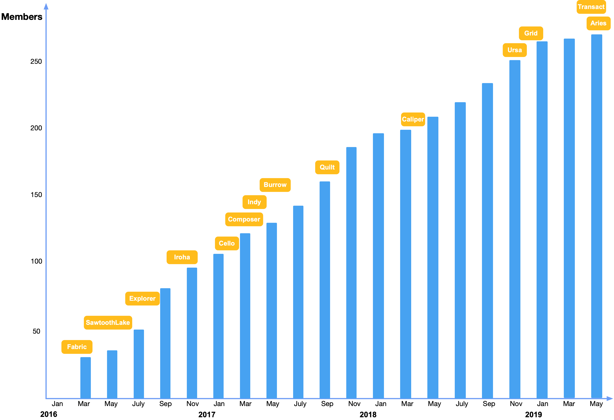
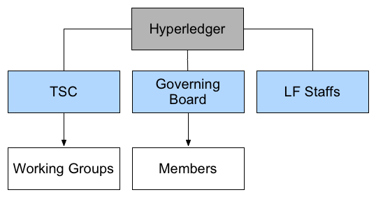
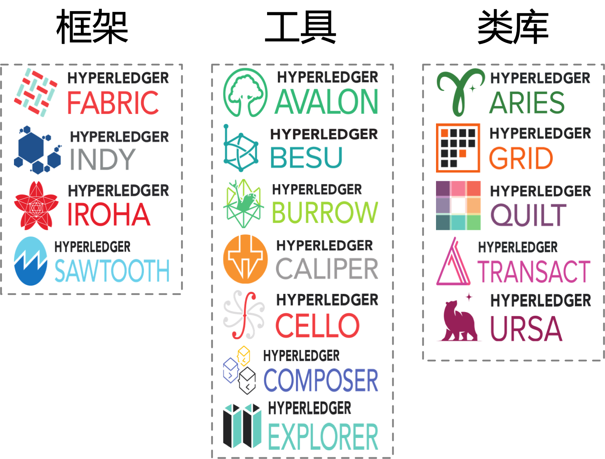
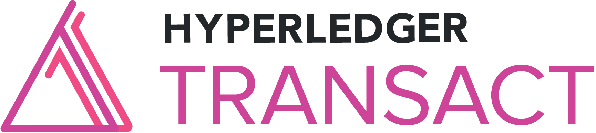
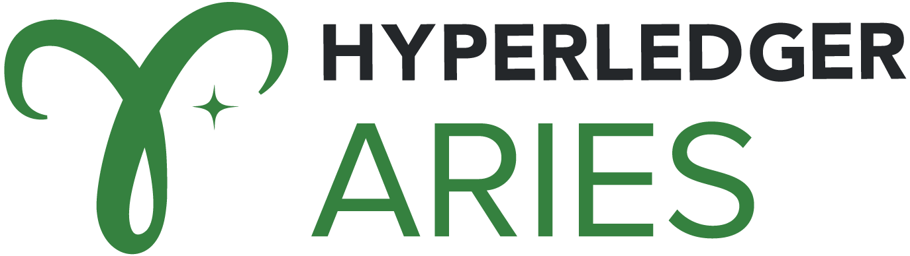
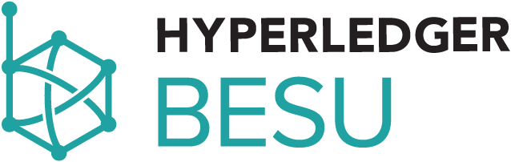
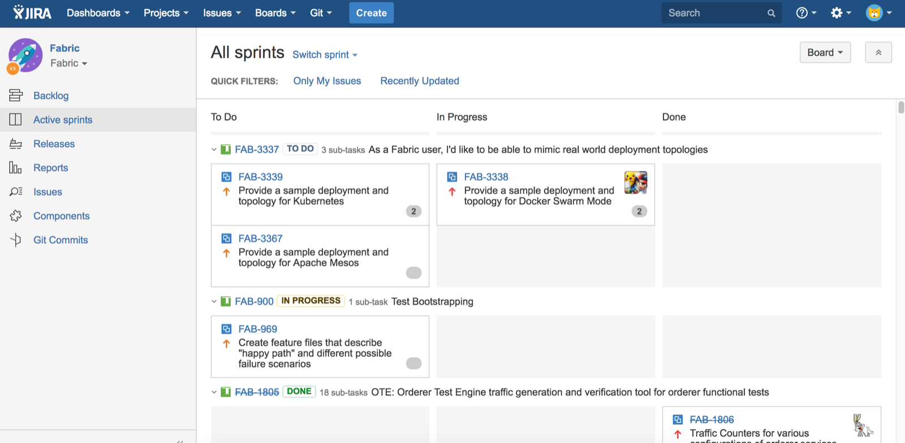
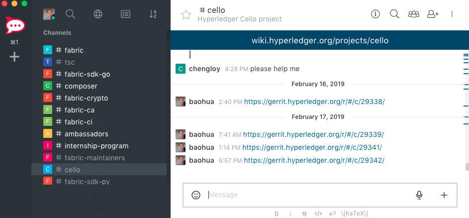
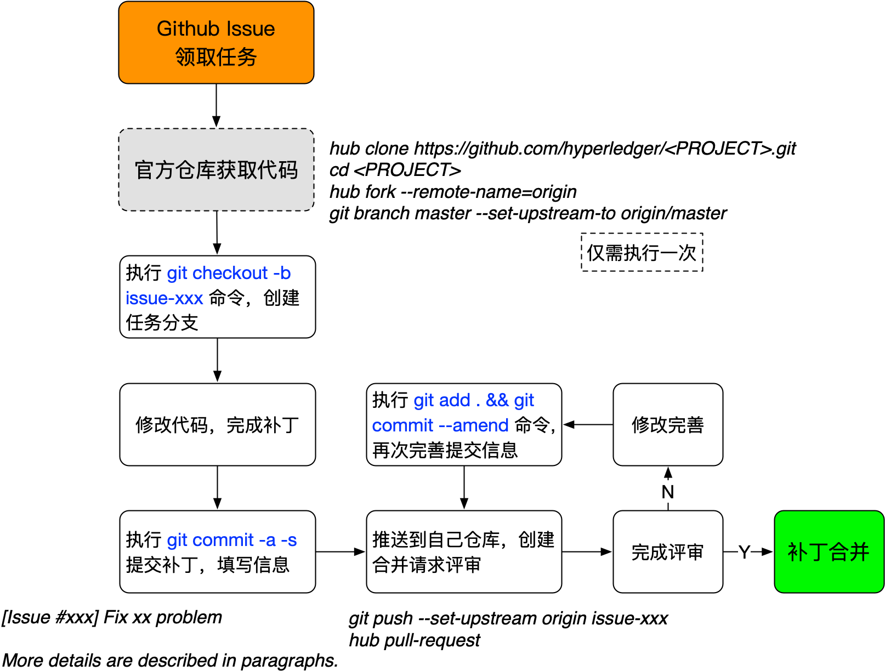

# 第八章 超级账本 —— 面向企业的分布式账本

**欲戴王冠，必承其重（Uneasy lies the head that wears a crown）。**

超级账本（Hyperledger）项目是全球最大的开源企业级分布式账本平台。

超级账本起源于 Linux 基金会 2015 年启动的开源协作项目；2024 年 9 月，Linux Foundation Decentralized Trust（LF Decentralized Trust，LFDT）正式启动，Hyperledger Foundation 下的区块链、分布式账本和相关技术转为 LFDT 项目。Hyperledger 品牌仍用于 Fabric 等多个项目，但项目治理、生命周期和项目目录应以 LFDT 官方页面为准。

本章将介绍超级账本项目的发展历史和社区组织，以及旗下的多个顶级开源项目的情况，还将展示开源社区提供的多个高效开发工具。最后介绍如何参与到超级账本项目中，进行代码贡献。

## 超级账本项目简介


2015 年 12 月，开源世界的旗舰组织 —— [Linux 基金会](https://www.linuxfoundation.org) 宣布启动超级账本（Hyperledger）联合项目；2016 年 2 月 9 日，[公布](https://www.linuxfoundation.org/press/press-release/linux-foundations-hyperledger-project-announces-30-founding-members-and-code-proposals-to-advance-blockchain-technology) 了 30 家创始企业成员（包括 IBM、Accenture、Intel、J.P.Morgan、R3、DAH、DTCC、FUJITSU、HITACHI、SWIFT、Cisco 等）。2024 年 9 月 16 日，Linux 基金会正式启动 [LF Decentralized Trust](https://www.lfdecentralizedtrust.org/announcements/linux-foundation-decentralized-trust-launches-with-17-projects-100-founding-members)，将 Hyperledger Foundation、Trust Over IP 等社区纳入更大的去中心化信任技术伞形组织；Hyperledger 相关技术成为 LFDT 项目，项目官方网站和目录以 [lfdecentralizedtrust.org](https://www.lfdecentralizedtrust.org/projects) 为准。

成立之初，项目就收到了众多开源技术贡献。IBM 贡献了 4 万多行已有的 [Open Blockchain](https://github.com/openblockchain) 代码，Digital Asset 贡献了企业和开发者相关资源，R3 贡献了新的金融交易架构，Intel 贡献了分布式账本相关的代码。

作为 LFDT 旗下的项目集合，超级账本由面向不同目的和场景的子项目构成。官方项目目录按孵化、毕业、休眠、归档等生命周期维护清单；代表性项目包括 Fabric、Besu、Cacti、FireFly、Indy、Iroha、AnonCreds、Identus、Web3j 等。Sawtooth 和 Aries 不应再作为活跃项目介绍：Sawtooth 已归档，并于 2024 年 2 月应维护者请求停止在 Hyperledger 社区内继续活跃维护，Aries 官方页面已标记为归档。所有项目都遵守 Apache v2 许可，并约定共同遵守如下的 [基本原则](https://github.com/hyperledger/hyperledger)：

* 重视模块化设计：包括交易、合同、一致性、身份、存储等技术场景；
* 重视代码可读性：保障新功能和模块都可以很容易添加和扩展；
* 可持续的演化路线：随着需求的深入和更多的应用场景，不断增加和演化新的项目。

*注：部分早期项目如 Composer、Quilt、Ursa、Avalon 等已归档或停止维护。当前状态请以 LFDT 项目目录、项目页面和治理站点为准，本章不再沿用早期“活跃/退出/终结”标签描述项目生命周期。*

超级账本项目的企业会员和技术项目发展都十分迅速。下图为历史增长示意，具体项目状态以 LFDT 官方目录和治理页面为准。



社区拥有数百家全球知名企业和机构会员，其中包括大量来自中国本土的企业，如华为、百度、腾讯等行业领军企业。此外，还有大量机构和高校成为超级账本联合会员，如英格兰银行、MIT 连接科学研究院、UCLA 区块链实验室、北京大学、浙江大学等。

如果说比特币为代表的加密货币提供了区块链技术应用的原型，以太坊为代表的智能合约平台延伸了区块链技术的适用场景，那么面向企业场景的超级账本项目则开拓了区块链技术的全新阶段。超级账本首次将区块链技术引入到了联盟账本的应用场景，引入权限控制和安全保障，这就为基于区块链技术的未来全球商业网络打下了坚实的基础。

超级账本项目的出现，实际上证实了区块链技术已经不局限在单一应用场景中，也不限于完全开放匿名的公有链模式下，而是有更多的可能性，也说明区块链技术已经被主流企业市场正式认可和实践。同时，超级账本项目中提出和实现了许多创新的设计和理念，包括权限和审查管理、多通道、细粒度隐私保护、背书-共识-提交模型，以及可拔插、可扩展的实现框架，对于区块链相关技术和产业的发展都将产生十分深远的影响。

*注：Apache v2 许可协议是商业友好的知名开源协议，鼓励代码共享，尊重原作者的著作权，允许对代码进行修改和再发布（作为开源或商业软件）。因其便于商业公司使用而得到业界的拥护。*

## 社区组织结构

每个成功的开源项目都离不开一个健康开发、不断繁荣的社区生态。

超级账本社区自成立之日起就借鉴了众多开源社区组织的经验，形成了技术开发为主体、积极结合应用的体系结构。2024 年 LF Decentralized Trust（LFDT）启动后，Hyperledger 相关项目纳入 LFDT 的治理框架。

LFDT 的组织治理由 Governing Board、Technical Advisory Council（TAC）、各项目自己的技术监督/维护者机制以及 Linux Foundation 支持团队共同构成。TAC 负责跨项目技术协作、总体技术愿景和项目生命周期评估；各项目的技术委员会或维护者团队负责本项目的日常技术方向和发布；Governing Board 负责 directed fund 的预算、规则和整体社区事务。

社区十分重视大中华地区的应用落地和开发情况，2016 年 12 月，[中国技术工作组](https://lf-hyperledger.atlassian.net/wiki/spaces/TWGC) 正式成立，负责推动社区组织建设和开源技术的发展和应用。

### 基本结构



社区目前主要是如下结构：

* Technical Advisory Council（TAC）：负责促进各技术项目之间的沟通协作，形成整体技术愿景，向预算相关委员会建议技术项目资源优先级，并评估项目生命周期状态。TAC 投票成员由项目维护者选举的代表和 Governing Board 选择的代表组成；
* 各项目技术委员会/维护者团队：负责单个项目的日常技术方向、开发流程、发布计划和维护者梯队；
* Governing Board（管理董事会）：负责 directed fund 的整体管理，包括预算、规则程序、社区事务、对外协作和必要的咨询机构设置；
* Linux Foundation（Linux 基金会）和 LFDT 支持团队：负责基金会运营、法律、基础设施、活动和社区支持，协助社区在开放治理框架下发展。

### 大中华区技术工作组

随着开源精神和开源文化在中国的普及，越来越多的企业和组织开始意识到共建一个健康生态系统的重要性，也愿意为开源事业做出一定贡献。

历史上，Hyperledger 社区于 2016 年 12 月成立大中华区技术工作组（TWG-China），负责推动区域社区组织建设、开源技术发展和应用落地。LFDT 启动后，区域参与方式随社区入口逐步迁移，当前参与方式应以 LFDT 的 Regional Chapters、Wiki、邮件列表和 Discord 等官方渠道为准。

技术工作组的 [主要职责](https://docs.google.com/document/d/1sXVltDZxnlB5Srd1A-EW0jtTz7P2cDLG8JmgaAYvMzU) 包括：

* 带领和引导大中华区的技术开发相关活动，包括贡献代码、文档、项目提案等；
* 推动技术相关的交流，促进会员企业之间的合作和实践案例的落地；
* 通过邮件列表、Discord、论坛和 Wiki 等方式促进社区开发者们的技术交流；
* 协助举办社区活动，包括 Meetup、黑客松、Hackfest、技术分享、培训等。

在运行期间，工作组由来自各个成员企业的技术专家组成，并得到了社区志愿者的支持。相关会议和活动内容通常保持开放；当前区域社区和技术交流入口请以 LFDT 官方网站、Wiki、邮件列表和 Discord 为准。

## 顶级项目介绍

Hyperledger/LFDT 项目代码主要托管在 [GitHub](https://github.com/hyperledger/) 和相关 LFDT 组织下。当前项目清单请以 [LFDT Projects](https://www.lfdecentralizedtrust.org/projects) 和项目矩阵为准；下面按贡献时间列出本章涉及的代表项目和历史项目。

* [Fabric](https://github.com/hyperledger/fabric)：LFDT/Hyperledger 已毕业项目，包括 [Fabric](https://github.com/hyperledger/fabric)、[Fabric CA](https://github.com/hyperledger/fabric-ca)、Fabric Gateway、多语言客户端库等，目标是区块链的基础核心平台，支持权限管理和可插拔架构，最早由 IBM 和 DAH 于 2015 年底发起；当前长期支持版本线为 2.5.x，3.x 版本线已发布并引入 BFT 排序服务等能力；
* [Sawtooth](https://github.com/hyperledger-archives/sawtooth-core) [Archived]：包括 arcade、[core](https://github.com/hyperledger-archives/sawtooth-core)、dev-tools、[validator](https://github.com/hyperledger-archives/sawtooth-validator)、mktplace 等。是 Intel 主要发起和贡献的区块链平台，支持基于硬件芯片的共识机制 Proof of Elapsed Time（PoET），2016 年 4 月贡献到社区；该项目已归档，并于 2024 年 2 月应维护者请求停止在 Hyperledger 社区内继续活跃维护，后续维护说明指向 Splinter 社区；
* [Blockchain Explorer](https://github.com/hyperledger-labs/blockchain-explorer) [Labs/Archived]：曾提供 Web 操作界面，通过界面快速查看查询绑定区块链的状态（区块个数、交易历史）信息等，由 DTCC、IBM、Intel 等开发支持，2016 年 8 月贡献到社区；当前仓库已迁移到 hyperledger-labs 并处于归档只读状态；
* [Iroha](https://github.com/hyperledger-iroha/iroha)：账本平台项目，基于 C++ 实现，带有不少面向 Web 和 Mobile 的特性，主要由 Soramitsu 于 2016 年 10 月发起和贡献；
* [Cello](https://github.com/hyperledger-cello/cello)：提供区块链平台的部署和运行时管理功能。使用 Cello，管理员可以轻松部署和管理多条区块链；应用开发者可以无需关心如何搭建和维护区块链，由 IBM 团队于 2017 年 1 月贡献到社区；当前仓库已从 `hyperledger/cello` 重定向到 `hyperledger-cello/cello`；
* [Indy](https://github.com/hyperledger-indy/indy)：提供基于分布式账本技术的数字身份管理机制，由 Sovrin 基金会发起，2017 年 3 月底正式贡献到社区；
* [Composer](https://github.com/hyperledger/composer)：[Archived] 曾提供面向链码开发的高级语言支持，自动生成链码代码等，由 IBM 团队发起并维护，2017 年 3 月底贡献到社区。目前已经停止维护；
* [Burrow](https://github.com/hyperledger-archives/burrow) [Archived]：提供以太坊虚拟机的支持，实现支持高效交易的带权限的区块链平台，由 Monax 公司发起支持，2017 年 4 月贡献到社区。该项目已被归档，代码已移至归档库；
* [Quilt](https://github.com/hyperledger-archives/quilt) [Archived]：对 W3C 支持的跨账本协议 Interledger 的 Java 实现。2017 年 10 月正式贡献到社区，现已归档（仓库迁至 hyperledger-archives）；
* [Caliper](https://github.com/hyperledger-caliper/caliper)：提供对区块链平台性能的测试工具，由华为公司发起支持，2018 年 3 月正式贡献到社区。
* [Ursa](https://github.com/hyperledger-archives/ursa)：[Archived] 曾提供一套密码学相关组件，初始贡献者包括来自 Fujitsu、Sovrin、Intel、DFINITY、State Street、IBM、Bitwise IO 等企业的开发者，2018 年 11 月正式被接收到社区，2023 年 4 月停止维护；
* [Grid](https://github.com/hyperledger-archives/grid) [Archived]：提供帮助快速构建供应链应用的框架，由 Cargill、Intel 和 Bitwise IO 公司发起支持，2018 年 12 月正式贡献到社区，现已归档；
* [Transact](https://github.com/hyperledger-archives/transact) [Archived]：提供运行交易的引擎和框架，由 Bitwise IO、Cargill、Intel、IBM、HACERA 等公司发起支持，2019 年 5 月正式贡献到社区，现已归档；
* [Aries](https://www.lfdecentralizedtrust.org/projects/aries) [Archived]：曾为客户端提供共享的密码学钱包、可复用代理框架和链下交互消息支持，由 Sovrin、C3I 和 Evernym 等公司发起支持，2019 年 5 月正式贡献到社区；该项目官方页面已标记为归档，核心组件迁移到 ACA-Py、OpenWallet Foundation、DIF Aries RFCs 和 LFDT Labs 等位置；
* [Besu](https://github.com/besu-eth/besu)：作为企业级的以太坊客户端支持，由 Consensys、Hacera、JPM 和 Redhat 等公司发起支持，2019 年 8 月正式贡献到社区；
* [Avalon](https://github.com/hyperledger-archives/avalon) [Archived]：提供链下计算支持，增强安全性和可扩展性，由 Intel、IEX、IBM 和 Consensys 等公司发起支持，2019 年 9 月正式贡献到社区，现已归档。

这些项目在不同历史阶段分别从平台、工具和类库三个层次支撑 Hyperledger / LFDT 生态；其中活跃项目、孵化项目、休眠项目和归档项目的当前状态应以 LFDT Projects 与年度 TAC 评审为准。



LFDT 当前治理文件中，项目正式生命周期包括孵化（Incubation）、毕业（Graduated）、休眠（Dormant）和归档（Archived）四种状态。提案（Proposal）是进入生命周期前的入口流程；被接受的项目从孵化状态开始。早期资料中的“活跃/退出/终结”称谓不再作为当前分类使用。

任何希望加入到 LFDT/Hyperledger 社区中的项目，都需要由发起人公开说明项目目的、范围、参与者、维护者和开发计划等信息，并提交给 LFDT Technical Advisory Council（TAC）评审。评审通过后，项目进入孵化状态；满足孵化退出条件后可以申请毕业。TAC 会在年度评审和必要的季度更新中评估项目是否维持、升级或降级生命周期状态；休眠或归档项目如需恢复开发，需要重新提交提案并从孵化状态进入生命周期。

### Fabric 项目


作为最早加入到超级账本项目中的顶级项目，Fabric 由 IBM、DAH 等企业于 2015 年底联合贡献到社区。项目在 GitHub 上地址为 https://github.com/hyperledger/fabric。

该项目的定位是面向企业的分布式账本平台，其创新地引入了权限管理支持，设计上支持可插拔、可扩展，是首个面向联盟链场景的开源项目。

Fabric 项目基于 Go 语言实现，贡献者超过 200 人，总提交次数已经超过 15000 次，核心代码数超过 15 万行。

Fabric 是 LFDT/Hyperledger 已毕业项目。官方文档将 Fabric 2.5.x 标记为当前长期支持版本线；Fabric 3.x 是当前主要功能版本线，3.0 引入了拜占庭容错（BFT）排序服务并移除了系统通道等 2.x 中已弃用的机制。两条线都在持续发布维护版本；生产网络应以官方发布说明和升级文档为准选择版本。项目同时包括 Fabric CA、Fabric Gateway、多语言客户端库等子项目。

项目的邮件列表地址为 fabric@lists.hyperledger.org。

### Sawtooth 项目


Sawtooth 项目由 Intel 等企业于 2016 年 4 月提交到社区，包括 sawtooth-core、sawtooth-supply-chain、sawtooth-marketplace、sawtooth-seth、sawtooth-next-directory、sawtooth-explorer 等数十个子项目。核心代码在 GitHub 上地址为 https://github.com/hyperledger-archives/sawtooth-core。

该项目的定位也是分布式账本平台，基于 Python 语言实现。项目已归档，停止在 Hyperledger 社区内继续活跃维护，历史核心项目的贡献者超过 70 人，提交次数超过 8000 次。

Sawtooth 项目利用 Intel 芯片的专属功能，实现了低功耗的 Proof of Elapsed Time（PoET）共识机制，并支持交易族（Transaction Family），方便用户使用它来快速开发应用。

项目的邮件列表地址为 sawtooth@lists.hyperledger.org。

### Iroha 项目


Iroha 项目由 Soramitsu 等企业于 2016 年 10 月提交到社区，包括 iroha、iroha-android、iroha-ios、iroha-python、iroha-javascript 等子项目。核心代码在 GitHub 上地址为 https://github.com/hyperledger-iroha/iroha。

该项目的定位是分布式账本平台框架，基于 C++ 语言实现。LFDT 项目目录将 Iroha 标记为已毕业项目，贡献者超过 50 人，提交次数已经超过 7000 次。

Iroha 项目在设计上类似 Fabric，同时提供了基于 C++ 的区块链开发环境，并考虑了移动端和 Web 端的一些需求。

项目的邮件列表地址为 iroha@lists.hyperledger.org。

###  Explorer 项目


Explorer 项目由 Intel、DTCC、IBM 等企业于 2016 年 8 月提交到社区。历史核心代码当前重定向到 https://github.com/hyperledger-labs/blockchain-explorer，仓库已归档为只读状态。

该项目的定位是区块链平台的浏览器，基于 Node.js 语言实现，提供 Web 操作界面。用户可以使用它来快速查看底层区块链平台的运行信息，如区块个数、交易情况、网络状况等。

项目的邮件列表地址为 explorer@lists.hyperledger.org。

### Cello 项目


Cello 项目由笔者领导的技术团队于 2017 年 1 月贡献到社区。GitHub 上当前核心仓库地址为 https://github.com/hyperledger-cello/cello；历史数据分析仓库已重定向到 https://github.com/hyperledger-cello/cello-analytics 并处于归档只读状态。

该项目的定位为区块链网络的操作系统，实现区块链网络自动化部署，以及对区块链网络的运行时管理。使用 Cello，可以让区块链应用人员专注到应用开发，而无需关心底层平台的管理和维护。已有一些企业基于 Cello 项目代码构建了区块链即服务（Blockchain-as-a-Service）平台。

Cello 的主要开发语言为 Python 和 JavaScript 等，底层支持包括裸机、虚拟机、容器云（包括 Swarm、Kubernetes）等多种基础架构。目前贡献者超过 40 人，提交次数超过 1000 次。

项目的邮件列表地址为 cello@lists.hyperledger.org。

### Indy 项目


Indy 项目由 Sovrin 基金会牵头进行开发，致力于打造一个基于区块链和分布式账本技术的数字身份管理平台。该平台支持去中心化，支持跨区块链和跨应用的操作，实现全球化的身份管理。Indy 项目于 2017 年 3 月底正式加入到超级账本项目。目前包括 indy-node、indy-sdk、indy-plenum、indy-hipe、indy-crypto、indy-agent 等项目。

该项目主要由 Python 语言开发，包括服务节点、客户端和通用库等。LFDT 项目目录将 Indy 标记为已毕业项目，贡献者超过 60 人，已有超过 5000 次提交。

项目的邮件列表地址为 indy@lists.hyperledger.org。

### Composer 项目


Composer 项目由 IBM 团队于 2017 年 3 月底贡献到社区，试图提供一个 Hyperledger Fabric 的开发辅助框架。使用 Composer，开发人员可以使用 JavaScript 语言定义应用逻辑，再加上资源、参与者、交易等模型和访问规则，生成 Hyperledger Fabric 支持的链码。

该项目主要由 Node.js 语言开发，贡献者超过 80 人，已有超过 5000 次提交。该项目已经停止维护。

项目的邮件列表地址为 composer@lists.hyperledger.org。

### Burrow 项目 [Archived]


Burrow 项目由 Monax、Intel 等企业于 2017 年 4 月提交到社区。核心代码在 GitHub 上地址为 https://github.com/hyperledger-archives/burrow（项目已被归档，原地址已重定向至归档库）。

该项目的前身为 eris-db，基于 Go 语言实现的以太坊虚拟机，目前贡献者超过 20 人，提交次数已经超过 2000 次。

Burrow 项目提供了支持以太坊虚拟机的智能合约区块链平台，并支持 Proof-of-Stake 共识机制（Tendermint）和权限管理，可以提供快速的区块链交易。

项目的邮件列表地址为 burrow@lists.hyperledger.org。

### Quilt 项目


Quilt 项目由 NTT、Ripple 等企业于 2017 年 10 月提交到社区。核心代码在 GitHub 上地址为 https://github.com/hyperledger-archives/quilt。

Quilt 项目前身为 W3C 支持的 Interledger 协议的 Java 实现，主要试图为转账服务提供跨多个区块链平台的支持。项目已归档（仓库迁至 hyperledger-archives，2022 年后停止更新），历史贡献者超过 10 人，提交次数超过 100 次。

项目的邮件列表地址为 quilt@lists.hyperledger.org。

### Caliper 项目


Caliper 项目由华为于 2018 年 3 月提交到社区。核心代码在 GitHub 上地址为 https://github.com/hyperledger-caliper/caliper。

Caliper 项目希望能为评测区块链的性能（包括吞吐、延迟、资源使用率等）提供统一的工具套装，主要基于 Node.js 语言实现，支持对 Fabric、Sawtooth、Burrow 等项目进行性能测试。目前贡献者超过 20 人，提交次数超过 400 次。

项目的邮件列表地址为 caliper@lists.hyperledger.org。

### Ursa 项目


Ursa 项目前身为加密实现库项目，由 Fujitsu、Sovrin、Intel、DFINITY、State Street、IBM、Bitwise IO 等企业的开发者于 2018 年 11 月正式贡献到社区。核心代码在 GitHub 上地址为 https://github.com/hyperledger-archives/ursa。

Ursa 项目曾经提供一套方便、安全的密码学软件库（包括加解密、零知识证明等），为实现区块链平台实现提供便利。主要基于 Rust 语言实现，包括两个子组件（基础密码实现库 Base Crypto 和零知识证明库 Z-Mix）。参与贡献者超过 10 人，提交次数超过 400 次。项目已于 2023 年 4 月停止维护。

项目的邮件列表地址为 ursa@lists.hyperledger.org。

### Grid 项目


Grid 项目由 Cargill、Intel 和 Bitwise IO 公司于 2018 年 12 月提交到社区。核心代码在 GitHub 上地址为 https://github.com/hyperledger-archives/grid。

Grid 项目为开发基于区块链的供应链场景应用提供框架支持和参考实现，包括智能合约、数据模型、领域模型、样例应用等。
主要基于 Rust 语言实现，并使用 Sabre（基于 WebAssembly/WASM 的智能合约引擎）来运行智能合约。项目已归档（仓库迁至 hyperledger-archives），历史贡献者超过 40 人，提交次数超过 5000 次。

项目的邮件列表地址为 grid@lists.hyperledger.org。

### Transact 项目



Transact 项目由 Bitwise IO、Cargill、Intel、IBM、HACERA 等公司于 2019 年 5 月提交到社区。核心代码在 GitHub 上地址为 https://github.com/hyperledger-archives/transact。

Transact 项目为区块链提供交易执行的平台和代码库，其他的框架性项目可以基于 Transact 来管理交易的执行过程和状态。Transact 项目试图打造一个通用的智能合约引擎来支持包括 EVM、WebAssembly 等合约的运行。目前包括 transact、transact-rfcs、transact-contrib 等子项目。

项目的邮件列表地址为 transact@lists.hyperledger.org。

### Aries 项目



Aries 项目由 Sovrin、C3I 和 Evernym 等公司于 2019 年 5 月提交到社区。项目官方页面为 https://www.lfdecentralizedtrust.org/projects/aries。

Aries 项目已归档。官方页面说明，原 Aries 生态的核心组件已经迁移到 ACA-Py、Bifold Wallet、Credo-TS、VCX、DIF Aries RFCs、Aries Agent Test Harness 以及若干 LFDT Labs 仓库中，使用者应直接跟踪这些新位置。

项目的邮件列表地址为 aries@lists.hyperledger.org。

### Besu 项目



* Besu 项目由 Consensys、Hacera、JPM 和 Redhat 等公司于 2019 年 8 月正式贡献到社区。核心代码在 GitHub 上地址为 https://github.com/besu-eth/besu。

Besu 提供对以太坊协议的支持，由 Java 实现。

项目的邮件列表地址为 besu@lists.hyperledger.org。

### Avalon 项目


* Avalon 项目由 Intel、IEX、IBM 和 Consensys 等公司于 2019 年 9 月正式贡献到社区。主要提供链下的安全计算支持，重点考虑了安全性和可扩展性。项目核心代码在 https://github.com/hyperledger-archives/avalon。

项目的邮件列表地址为 avalon@lists.hyperledger.org。

## 开发必备工具

工欲善其事，必先利其器。开源社区提供了大量易用的开发协作工具。掌握好这些工具，对于高效的开发来说十分重要。

### Linux Foundation ID

超级账本项目受到 Linux 基金会的支持，采用 Linux Foundation ID（LF ID）作为社区唯一的 ID。

个人申请 ID 是完全免费的。可以到 https://identity.linuxfoundation.org/ 进行注册。

用户使用该 ID 可访问 Linux Foundation 相关社区资源。Hyperledger 的协作工具已经迁移，当前问题跟踪和代码协作以 GitHub 为主，实时交流入口以 Hyperledger Discord 为主；Jira、RocketChat 仅作为历史工具理解。

### GitHub Issues - 任务和进度管理



Hyperledger 早期使用 Jira 管理任务和事项。当前开发应优先查看对应项目的 GitHub 仓库、Issues 和 Pull Requests。

社区组织入口可从 <https://github.com/hyperledger> 开始，再进入具体项目仓库查看当前事项。

登录 GitHub 后，可以在具体项目的 Issues 页面搜索、认领或创建 bug、task、improvement 等事项。

用户打开事项后可以通过评论、关联 PR 或维护者分配来推进该事项。

一般情况下，事项状态通过 labels、assignees、milestones、project board 或关联 PR 维护，具体约定以项目仓库的贡献说明为准。

### GitHub - 代码仓库和 Review 管理


GitHub 是全球最大的开源代码管理仓库服务，微软公司于 2018 年 7 月以 75 亿美金价格纳入旗下。

超级账本社区目前所有项目都通过 GitHub 进行管理。早期 Fabric、Cello、Explorer 等项目采用了自建的 Gerrit 服务作为官方的代码仓库，2019 年下半年也都陆续迁移到了 GitHub 服务器上。

用户使用自己的账号登录之后，可以查看所有项目信息，也可以查看自己提交的补丁等信息。每个补丁的页面上会自动追踪修改历史，审阅人可以通过页面进行审阅操作，赞同提交则可以批准，发现问题则可以进行批注。

### Discord - 在线沟通



除了邮件列表外，社区也为开发者们提供在线沟通渠道。Hyperledger 已从 RocketChat 迁移到 Discord。

Discord 支持网页、桌面端和移动端，可用于项目讨论、工作组沟通和新人提问。

当前入口仍可从 <https://chat.hyperledger.org/> 进入，它会指向 Hyperledger Discord。加入后可以选择感兴趣项目的频道。

通常，每个项目或工作组会有对应频道，频道名称和规则以 Discord 服务器当前配置为准。

### 邮件列表 - 常见渠道

各个项目和工作组都建立了专门的邮件列表，作为常见的交流渠道。当发现问题不知道往哪里报告时，可以先发到邮件列表进行询问，一般都能获得及时的回答。

例如，大中华区技术工作组的频道为 `twg-china@lists.hyperledger.org`。

用户可在 https://lists.lfdecentralizedtrust.org/g/main/subgroups 看到社区已有的邮件列表并选择加入。

### 提问的智慧

为什么我在社区提出的问题会过了很长时间也无人回应？

开源社区是松散自组织形式，大部分开发者都是利用业余时间进行开发和参与社区工作。因此，在社区提出问题时就必须要注意问题的质量和提问的方式。碰到上述情况，首先要先从自身找原因。

如果能做到下面几点，会使你提出的问题得到更多的关注：

* 正确的渠道：这点十分重要。不同项目和领域有各自的渠道，一定要在相关的渠道进行提问，而不要问跟列表主题不相关的话题，例如，每个项目相关问题应该发送到对应的邮件列表。
* 问题的新颖性：在提问之前，应该利用包括搜索引擎、技术文档、邮件列表等常见方式进行查询，确保提出的问题是新颖的，有价值的，而不是已经被回答过多遍的常识性问题。
* 适当的上下文：不少提问者的问题中只包括一条很简单的错误信息，这样会让社区的开发者有心帮忙也无力回答。良好的上下文包括完整的环境信息、所使用的软件版本、所进行操作的详细步骤、问题相关的日志、自己对问题的思考等。这些都可以帮助他人快速重现问题并帮忙回答。
* 注意礼仪：虽然技术社区里大家沟通方式会更为直接一些，但懂得礼仪毫无疑问是会受到欢迎的。要牢记，别人的帮助并非是义务的，要对任何来自他人的帮助心存感恩。

## 贡献代码

超级账本的各个子项目，都提供了十分丰富的开发和提交代码的指南和文档，一般可以在代码的 `docs` 目录下找到。所有项目都使用 GitHub 来管理代码和进行集成测试。

这里以 Fabric 项目为例讲解代码贡献流程。

### 安装环境

推荐在 Linux（如 Ubuntu 18.04+）或 macOS 环境中开发 Hyperledger 项目代码。

不同项目会依赖不同的环境，可以从项目文档中找到。以 Fabric 项目为例，开发者需要安装如下依赖。

* Git：用来从代码仓库获取代码并进行版本管理；
* Hub：GitHub 官方开发的基于 Git 命令的工具，可以替代 Git 命令，更方便操作 GitHub 仓库；
* Golang 1.21+：访问 [go.dev](https://go.dev) 进行安装，现代 Go 使用 Go Modules 管理依赖，无需配置 GOPATH；
* Docker 24+：用来支持容器环境，macOS 下推荐使用 [Docker Desktop](https://www.docker.com/products/docker-desktop)。

如果是首次使用 Git，可能还会提示配置默认的用户名和 Email 地址等信息。通过如下命令进行简单配置即可：

```bash
$ git config user.name "Your name"
$ git config user.email "Your-addr@some-email-server"
```

安装 hub 工具，方便与 GitHub 的仓库进行交互。

Linux 下可以直接从 https://github.com/mislav/hub/releases 下载工具使用（`hub` 仓库已迁至 mislav 名下并进入维护状态，新项目建议改用官方的 GitHub CLI：https://cli.github.com/ ）。

macOS 下可以通过 homebrew 工具来安装：

```bash
$ brew install hub
```

### 获取代码

如果没有 Linux Foundation（LF）ID，可通过 https://identity.linuxfoundation.org 免费注册。

注册并登录 GitHub 个人账号，添加个人 ssh 公钥，否则每次访问仓库可能需要手动输入用户名和密码。

开启双重验证（Two-factor authentication，2FA）后，在 https://github.com/hyperledger 页面申请加入到社区组织内。

如果是首次下载项目，则需要从官方仓库获取源码，然后 fork 到自己的仓库中：

```sh
$ hub clone https://github.com/hyperledger/<PROJECT>.git
$ cd <PROJECT>
$ hub fork --remote-name=origin
$ git branch main --set-upstream-to origin/main
```

此时，项目下会包括两个仓库：

* `origin` 仓库：会指向用户仓库。main 分支会追踪本仓库；
* `upstream` 仓库：会指向官方仓库，供后续同步更新使用。

### 编译和测试

大部分编译和安装过程都可以利用 Makefile 来执行，具体以项目代码为准。

以 Fabric 项目为例，包括如下常见操作。

#### 生成命令文档

执行如下命令：

```sh
$ make help-docs
```

#### 安装 go tools

执行如下命令：

```sh
$ make gotools
```

#### 语法格式检查

执行如下命令：

```sh
$ make linter
```

#### 编译二进制文件

执行如下命令：

```sh
$ make native
```

会自动生成 orderer、peer、configtxgen、configtxlator、cryptogen、discover、idemixgen 等可执行文件。

用户也可以使用对应的可执行文件名称来单独编译。注意 `make peer` 只生成本地可执行文件，若还需要对应的 Docker 镜像，应使用 `make peer-docker`：

```sh
$ make peer
```

*注意：有时会因网络不稳定而报错，可以进行 `make clean` 后再次执行。*

#### 生成 Docker 镜像

执行如下命令：

```sh
$ make docker
```

#### 执行所有的检查和测试

执行如下命令：

```sh
$ make checks
```

#### 执行单元测试

执行如下命令：

```sh
$ make unit-test
```

如果要运行某个特定单元测试，则可以通过类似如下格式：

```sh
$ go test -v -run=TestGetFoo
```

### 提交代码

可以查看项目的 GitHub Issue，查看有没有未分配（unassigned）的任务，如果对某个任务感兴趣，可以添加自己为任务的 assignee。任何人都可以自行创建新的任务。如果是较大的特性，还需要先撰写 rfc 来描述设计，可以参考 https://github.com/hyperledger/fabric-rfcs。

初始创建的任务处于 `TODO` 状态；开始工作后可以标记为 `In Progress` 状态；提交对应补丁后需要更新为 `In Review` 状态；任务完成后更新为 `Done` 状态。

如果希望完成某个任务（如 FAB-XXX），则在 Clone 下来的代码上创建新的分支 FAB-XXX：

```sh
$ git checkout -b FAB-XXX
```

实现任务代码，完成后，执行语法格式检查和测试等，确保所有检查和测试都通过。

提交代码到本地仓库：

```sh
$ git commit -a -s
```

会自动打开一个编辑器窗口，需要填写 commit 信息，格式一般要求如下：

```bash
[FAB-XXX] Quick brief on the change

This pathset fixes a duplication msg bug in gossip protocol.

A more detailed description can be here, with several paragraphs and
sentences, including issue to fix, why to fix, what is done in the
patchset and potential remaining issues...
```

提交消息中要写清楚所解决的问题、为何进行修改、主要改动内容、遗留问题等，并且首行宽不超过 50 个字符，详情段落行宽不要超过 72 个字符。

将代码所在的分支推送到 GitHub 上自己的仓库中，例如：

```bash
$ git push --set-upstream origin FAB-XXX
```

创建合并请求（Pull Request），例如：

```bash
$ hub pull-request [-b upstream:main] [-r <REVIEWERS> ]
```

### 评审代码

提交成功后，可以打开项目在 GitHub 上的页面，查看自己最新提交的合并请求。新提交的请求会自动触发 CI 的测试任务，测试都通过后可邀请项目的维护者（maintainer）进行评审。为了引起关注，可在对应的 GitHub Issue 中关联该 PR，并在 Hyperledger Discord 对应项目频道内贴出。

如果评审通过，则会被合并到主分支；否则还需要针对审阅意见进一步的修正。修正过程跟提交代码过程类似，唯一不同是，提交时需要添加 `-a --amend` 参数：

```sh
$ git commit -a --amend
```

表示这个提交是对旧提交的一次修订。

一般情况下，为了方便评审，尽量保证每个 patchset 完成的改动不要太多（最好不要超过 5 个文件，200 行），并且实现功能要明确，集中在对应 GitHub Issue 定义的范围内。

补丁被接收后可以删除对应的分支：

```bash
$ git fetch upstream main && git rebase FETCH_HEAD
$ git push -d origin issue-xxx
$ git branch -d issue-xxx
```

### 完整流程



总结一下，完整的流程如上图所示，开发者用 git 进行代码的版本管理，通过 GitHub Pull Request 进行代码的评审合作。

如果需要修复某个提交补丁的问题，则通过 `git commit -a --amend` 进行修复，并作为补丁的新版本再次提交审阅。每次修订后重新推送（`git push -f`）更新对应的 Pull Request 时，应当通过 `git log` 查看，确保提交记录清晰。
