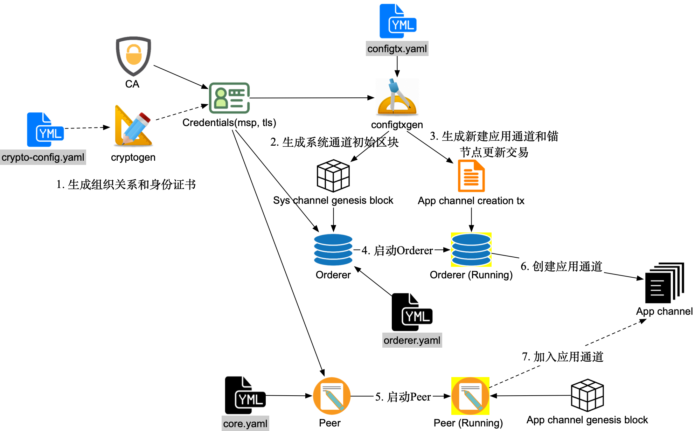
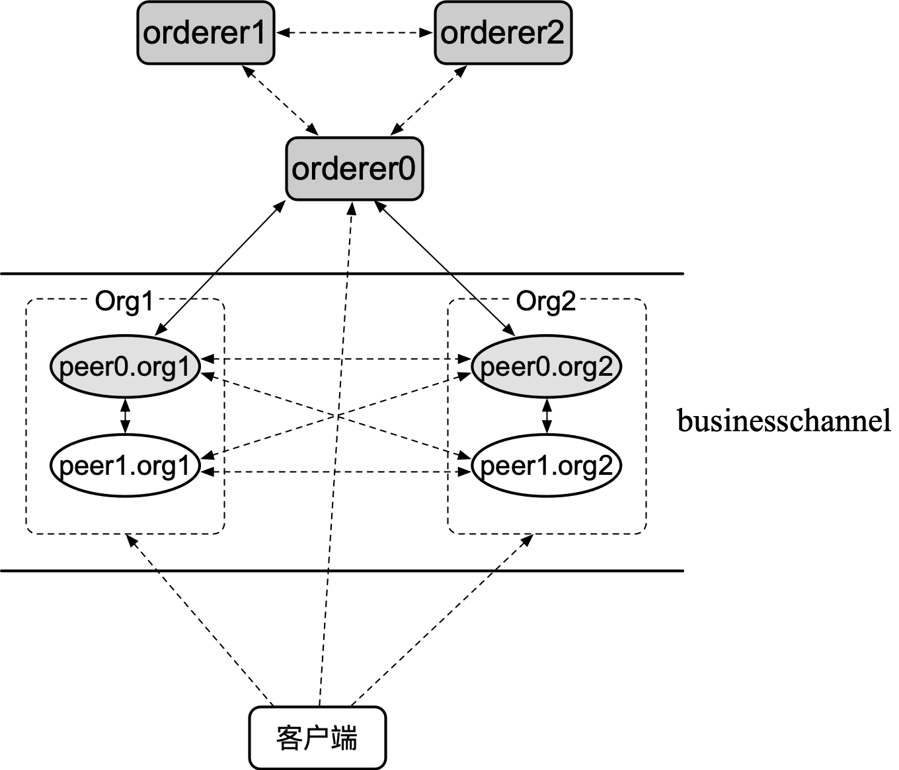

# 第九章 Fabric 安装与部署

**纸上得来终觉浅，绝知此事要躬行。**

作为被广泛应用的联盟链项目，Fabric 吸取了来自科技界和金融界的最新成果，提供面向企业场景的开放分布式账本平台实现。

本章将带领读者动手实践，学习如何从源码进行编译、安装 Fabric ，如何使用官方容器镜像，以及在多服务器环境下部署一个典型的 Fabric 网络，同时，还将介绍通道的相关实践操作。

## 版本选择与迁移边界

Hyperledger 项目当前同时提供经典 Fabric 与 Fabric-X 两种不同实现。经典 Fabric 的 2.5.x 是长期支持（LTS）分支，3.x 是引入 `V3_0` 通道能力和 SmartBFT 等特性的后续主版本；Fabric-X 则面向高吞吐数字资产场景，采用 ARMA 排序和解耦的提交架构。它们不是同一条版本号序列。

现状或目标 | 官方定位 | 推荐路径 | 进入下一阶段前的关键检查
--- | --- | --- | ---
经典 Fabric 1.x | 已停止维护的历史分支；仅 v1.4.x 有官方直达 2.5.x 的滚动升级说明 | 先备份；v1.4.x 可按 2.5 文档升级，早于 v1.4 的网络应先按对应历史文档到 v1.4.x，或评估重建网络 | 更新旧链码依赖，执行 Peer 数据库升级，准备 `V2_0` 链码生命周期
经典 Fabric 2.5 LTS | 经典 Fabric 的生产 LTS 分支 | 新部署优先选择最新 2.5.x 补丁；现有 2.x 可滚动升级到 2.5.x | 先升级二进制，再按需启用 `V2_5` 应用能力
经典 Fabric 3.x | 经典 Fabric 的当前功能分支 | 从 2.x 滚动升级；先在 2.x 阶段清除已移除功能 | Kafka/Solo 改为 Raft、旧链码生命周期改为 v2 生命周期、移除系统通道并使用 Channel Participation API、配置组织级 `OrdererEndpoints`
Fabric-X 1.x | 与经典 Fabric 并列的、面向高吞吐数字资产的独立实现 | 作为新平台单独部署和验收，规划应用、身份、治理与数据迁移 | **不是**从经典 Fabric 2.5/3.x 直接替换二进制即可完成的升级；API 或区块格式兼容性不等于受支持的原地升级路径

判断依据以官方资料为准：[Fabric 2.5 LTS 说明](https://hyperledger-fabric.readthedocs.io/en/release-2.5/whatsnew.html)、[从 1.4/2.x 升级到 2.5 的注意事项](https://hyperledger-fabric.readthedocs.io/en/release-2.5/upgrade_to_newest_version.html)、[进入 Fabric 3.x 的前置条件](https://hyperledger-fabric.readthedocs.io/en/latest/upgrade_to_newest_version.html)、[Fabric 与 Fabric-X 的双实现定位](https://www.lfdecentralizedtrust.org/projects/fabric)及 [Fabric-X 路线图](https://www.lfdecentralizedtrust.org/blog/the-hyperledger-fabric-x-roadmap)。具体升级步骤见运维章节的升级矩阵。

## 简介

Fabric 是超级账本社区首个项目也是最流行的分布式账本实现，由 IBM、DAH 等会员企业于 2015 年底贡献到社区。

作为面向企业场景的联盟链，Fabric 中有许多经典的设计和先进的理念。包括多通道、身份证书机制、隐私保护、运维管理接口等。另外，其可扩展的架构可以满足不同场景下的性能需求，如虚拟机部署场景下可以达到 3500 tps 的吞吐量和小于 1 秒的延迟（参考《Hyperledger Fabric: A Distributed Operating System for Permissioned Blockchains》），更多物理资源情况下可以达到更大的（10 K+）的吞吐量。

### 主要版本历史

Fabric 首个主版本 1.0.0 于 2017 年 7 月发布，该版本根据之前测试版的应用反馈，在架构上进行了重新设计，在可扩展性和可插拔性方面都有了不少改进。后续版本持续围绕性能、安全性和隐私性完善。Fabric 2.5.x 是当前 LTS 系列，Fabric 3.x 已是正式发布系列。Fabric 的主要版本历史总结如下表所示，也可在 https://github.com/hyperledger/fabric/releases 找到。

版本 | 发布时间 | 新特性 | 增强和改善
--- | ------- | ---- | ----
1.0.0 | 2017-07-11 | 重新设计架构，支持多通道、Kafka 共识机制、系统链码、分角色节点 | 大幅度提升性能和可扩展性
1.1.0 | 2018-03-15 | Node.js 链码，链码加密库，链码中基于证书属性的访问控制，节点之间的双向 TLS，Fabric CA 中对 CRL 的支持。部分实验特性，如 sideDB、idemix、细粒度的权限控制。| 大幅优化了性能，某些场景下可提升一个数量级；提供基于通道的事件通知模型
1.2.0 | 2018-07-04 | 正式支持私有数据（Private Data），提供可插拔的 ESCC 和 VSCC，细粒度访问控制，服务自动发现 | 提高了稳定性和易用性
1.3.0 | 2018-10-11 | 正式支持 Java 链码；提供细粒度的基于状态的背书策略；支持 idemix 增强隐私保护| 部分重构链码生命周期管理；通过分页机制优化链码中对大量数据的查询
1.4.0 | 2019-01-09 | 提供运维相关的 RESTful API（统计、健康检查、日志级别）；使用新的日志控制环境变量 | 增强私有数据：新 Peer 自动获取缺失私有数据，客户端层面对私有数据的权限控制
1.4.1 | 2019-04-11 | 引入基于 etcd 实现的 Raft 排序服务（崩溃容错，CFT） | 相比 Kafka 排序更易部署和运维，各组织可各自贡献排序节点
2.0.0 | 2020-01-29 | 新的面向通道的链码生命周期管理；独立 shim 库；外部链码启动器 | 增强私有数据支持；移除系统链码白名单；改进性能
2.2.0 | 2020-07-07 | 长期支持版本（LTS）；增强私有数据及其协调机制 | 引入异步区块处理；优化链码生命周期
2.5.0 | 2023-01-23 | 长期支持版本（LTS）；新增私有数据历史清理能力（需启用 V2_5 应用能力） | 发布 amd64/arm64 二进制和镜像；发布二进制采用静态链接；Docker 镜像转为 Ubuntu 基础镜像
3.0.0 | 2024-09-17 | 正式引入基于 SmartBFT 的 BFT 排序服务；支持 Ed25519 MSP 凭证（需启用 V3_0 通道能力） | 移除系统通道、Solo/Kafka 排序、旧链码生命周期和 `fabric-tools` 镜像；通道创建转向 participation API 和 `osnadmin`
3.1.0 | 2025-03-18 | 链码执行性能优化 | 持续维护 3.x 功能版本线

*注：Kafka 排序服务已在 Fabric 2.x 中弃用，并在 Fabric 3.x 中移除。新部署应使用 Raft；需要拜占庭容错时再评估 Fabric 3.x 的 BFT 排序服务。*

### 网络基本结构

Fabric 网络中存在背书节点（Endorser）、记账节点（Committer）、排序节点（Orderer）和证书节点（CA）等不同组件，彼此协作完成整个区块链系统的记账功能。

关于网络架构和详细的节点角色说明，请参考 Fabric 架构与设计 章节。

客户端可以向网络内发送交易，交易经过共识后被通道内的 Peer 节点接收并更新本地对应的账本。

本章后续将详细介绍安装、部署 Fabric 网络并进行启动的操作过程，建议读者跟随步骤进行实践学习。

## 安装 Fabric

本节主要介绍如何安装 Hyperledger Fabric 的相关组件（二进制文件和 Docker 镜像）。

Hyperledger Fabric 官方提供了 `install-fabric.sh` 脚本，可以按需下载 Docker 镜像、二进制文件（`peer`、`orderer`、`configtxgen`、`osnadmin` 等）以及示例代码（`fabric-samples`）。

## 准备工作

### 1. 操作系统

Linux (Ubuntu/CentOS), macOS 或 Windows（通过 WSL2）。

### 2. 安装 Git 和 cURL

确保系统已安装 `git` 和 `curl`。
```bash
sudo apt-get install git curl
```

### 3. 安装 Docker

Fabric 运行依赖 Docker 容器环境。
*   **Docker**: 24.0 或更高版本。（推荐使用 24.0+ 以支持最新特性和安全补丁）
*   **Docker Compose**: 推荐安装 Docker Desktop（包含 Docker Compose）或独立的 Docker Compose 插件。

## 使用官方脚本安装（推荐）

最简单的方法是使用官方提供的 `install-fabric.sh` 脚本。

### 步骤 1：创建工作目录

```bash
mkdir -p $HOME/hyperledger
cd $HOME/hyperledger
```

### 步骤 2：运行安装脚本

以下命令会先从官方仓库下载脚本，再执行安装。生产环境或受控环境中应先审查脚本内容，避免使用短链接和直接 pipe-to-bash 的方式执行远程脚本。

```bash
curl -sSLO https://raw.githubusercontent.com/hyperledger/fabric/main/scripts/install-fabric.sh
chmod +x install-fabric.sh
./install-fabric.sh docker binary samples
```

官方脚本默认使用当前 Fabric LTS 和 Fabric CA 版本。需要固定版本时显式指定，例如 Fabric v2.5.16 和 Fabric CA v1.5.21：

```bash
./install-fabric.sh --fabric-version 2.5.16 --ca-version 1.5.21 docker binary samples
```

该脚本会执行以下操作：
1.  克隆 `fabric-samples` 仓库。
2.  下载 Fabric 二进制文件（`peer`, `orderer`, `configtxgen` 等）到 `fabric-samples/bin` 目录。
3.  下载指定版本的 Hyperledger Fabric Docker 镜像。
4.  将 Fabric CA 客户端和服务端二进制文件下载到 `fabric-samples/bin`。

### 步骤 3：配置环境变量

为了方便使用下载的二进制文件，将其路径添加到环境变量中：

```bash
export PATH=$HOME/hyperledger/fabric-samples/bin:$PATH
```

验证安装是否成功：

```bash
peer version
```

## 从源码编译安装（高级）

如果你是开发者，或者需要跟踪正式发布版本之外的源码变更，可以选择从源码编译。Fabric 3.x 已是正式发布系列，不应再按 Beta 版本处理。

### 1. 安装 Go 语言环境

确保安装目标 Fabric 版本发布说明中测试过的 Go 版本。例如 Fabric v2.5.16 与 v3.1.5 的 `go.mod` 均声明 Go 1.26.4。

### 2. 获取源码

```bash
git clone https://github.com/hyperledger/fabric.git
cd fabric
```

### 3. 编译

使用 `make` 命令编译组件。编译后的二进制文件位于 `build/bin` 目录。

```bash

## 编译所有组件
make all

# 或者单独编译
make peer
make orderer
make configtxgen
```

### 4. 安装

将编译好的二进制文件移动到系统路径或添加到 PATH 中。

## 配置容器环境

Hyperledger Fabric 深度依赖容器技术。为了运行 Fabric 网络，你需要准备好 Docker 和 Docker Compose 环境。

## 1. 安装 Docker

### Linux

Docker 官方提供了便利安装脚本，适合开发和测试环境快速安装。生产环境不要依赖该脚本，应按 Docker 针对具体发行版提供的仓库安装步骤执行，并固定可审计的软件源和版本。

```bash
curl -fsSL https://get.docker.com -o get-docker.sh

## 预览脚本将执行的步骤，不会安装
sudo sh get-docker.sh --dry-run

# 本地开发/测试环境确认风险后再执行实际安装
sudo sh get-docker.sh
```

如果只是本地实验，可在阅读脚本输出并确认风险后运行；生产或长期环境应优先按 Docker 官方针对具体发行版的仓库安装步骤执行。

安装完成后，建议将当前用户加入 `docker` 用户组，以免每次运行命令都需要 `sudo`：

```bash
sudo usermod -aG docker $USER

# 注销并重新登录后生效
```

### macOS / Windows

直接下载并安装 **Docker Desktop**：https://www.docker.com/products/docker-desktop

## 2. 安装 Docker Compose

Docker Compose 用于定义和运行多容器应用。

*   **Docker Desktop (Mac/Windows)**: 已经内置了 Docker Compose，无需额外安装。
*   **Linux**: 如果你通过官方脚本安装了最新的 Docker Engine，现在它通常包含 `docker compose` 插件（注意命令中间没有连字符）。

验证安装：

```bash
docker compose version

# 或者旧版本
docker-compose --version
```

## 3. Fabric 核心镜像

Fabric 的网络节点大多运行在 Docker 容器中。主要涉及以下核心镜像：

| 镜像名称 | 描述 |
| :--- | :--- |
| `hyperledger/fabric-peer` | Peer 节点，负责维护账本和执行链码。 |
| `hyperledger/fabric-orderer` | Orderer 节点，负责交易排序和打包区块（基于 Raft 共识）。 |
| `hyperledger/fabric-tools` | 包含 `peer`, `osnadmin`, `configtxgen` 等工具的命令行环境，Fabric 2.5 中仍可用于测试；Fabric 3.x 不再发布该镜像，应改用发布的二进制文件。 |
| `hyperledger/fabric-ccenv` | Go/Java 链码的编译环境。 |
| `hyperledger/fabric-baseos` | 链码运行时的基础操作系统环境。 |
| `hyperledger/fabric-ca` | 证书授权服务（CA），用于身份管理。 |
| `couchdb` |（可选）用作 Peer 节点的状态数据库，支持富查询。 |

**状态数据库选择建议**：
*   **LevelDB（首选）**：Peer 节点的默认状态数据库（内嵌在 `fabric-peer` 镜像中）。它性能更高、运维更简单。除非你有明确的富查询需求，否则应优先选择 LevelDB。
*   **CouchDB**：支持基于 JSON 数据的复杂查询（Rich Queries）。如果你的应用需要对链上数据进行多维度的检索和统计，才建议配置 CouchDB。

**注意**：早期版本的 Kafka 和 Zookeeper 镜像已在 Fabric 2.x 中被弃用，并在 Fabric 3.x 中移除。新网络应优先使用 Raft；需要拜占庭容错时可在 Fabric 3.x 中评估 BFT 排序服务。

## 4. 获取镜像

如果你使用了上一节提到的 `install-fabric.sh` 脚本，镜像应该已经自动下载完毕。

你也可以手动拉取指定版本的镜像：

```bash

# 设置版本变量；以当前 Fabric 2.5 LTS 补丁线和 Fabric CA 1.5 补丁线为例
export FABRIC_VERSION=2.5.16
export CA_VERSION=1.5.22

# 拉取镜像
docker pull hyperledger/fabric-peer:$FABRIC_VERSION
docker pull hyperledger/fabric-orderer:$FABRIC_VERSION
docker pull hyperledger/fabric-tools:$FABRIC_VERSION
docker pull hyperledger/fabric-ccenv:$FABRIC_VERSION
docker pull hyperledger/fabric-ca:$CA_VERSION
```

## 5. 镜像标签 （Tag）

Fabric 镜像通常提供多种标签：
*   `2.5.16`: 具体版本号（推荐生产环境固定使用同一补丁版本）。
*   `latest`: 指向最新的发布版本（不建议在生产环境使用，因为可能自动升级导致不兼容）。
*   多架构镜像：Fabric 2.5+ 发布镜像支持 amd64 和 arm64 等架构，通常由镜像清单自动选择。

确保你的 `docker-compose.yaml` 文件中引用的镜像版本与你下载的版本一致，以避免启动失败。

## 本地启动 Fabric 网络

启动一个 Fabric 网络主要包括如下步骤。Fabric 2.3+ 支持通过通道参与（channel participation）API 创建应用通道；Fabric 3.x 已移除系统通道，因此新部署应以该流程为主。

* **规划初始网络拓扑**：根据联盟的需求规划拓扑信息，包括联盟成员、排序服务集群、应用通道的初始成员等；
* **准备网络配置**：包括网络中组织结构和对应的身份证书（生产环境推荐使用 Fabric CA 或企业 PKI；测试环境可使用 cryptogen）、应用通道的初始配置区块文件，以及后续通道配置更新所需材料；
* **启动 Orderer 节点**：排序节点使用 `BootstrapMethod: none` 启动，不再依赖系统通道初始区块；
* **启动 Peer 节点**：不同的组织按照预置角色分别启动 Peer 节点；
* **创建通道**：使用 `configtxgen` 生成应用通道 genesis block，然后用 `osnadmin channel join` 将排序节点加入该通道；
* **加入通道**：Peer 节点利用应用通道 genesis block 加入通道。

<!--
* **使用链码**：用户通过客户端向网络中部署链码，链码容器启动后用户可对链码进行调用，并发送交易到通道中。
-->

主要步骤如下图所示，下面进行具体讲解。



### 规划初始网络拓扑

示例网络拓扑如下图所示，包括 3 个 Orderer 节点和 4 个 Peer 节点，以及 1 个客户端操作节点（负责生成相关启动文件，在网络启动后作为客户端执行命令）。



其中，排序服务采用 Raft 模式，所有节点都加入到新建的 businesschannel 中。4 个 Peer 节点分属两个组织：Org1 和 Org2，也都是应用通道成员。每个组织中的 peer0 节点作为锚节点（Anchor Peer）负责与其他组织节点分享信息。

### 准备启动配置文件

Fabric 网络在启动之前，需要提前生成一些用于启动的配置文件，主要包括 MSP 相关身份文件（`msp/*`）、TLS 相关身份文件（`tls/*`）、应用通道初始区块（例如 `businesschannel.genesis.block`）等。

各个文件的功能如下表所示。

启动配置 | 使用者 | 依赖文件 | 主要功能
-- | -- | -- | --
MSP 相关文件 `msp/*` | Peer、Orderer、客户端 | crypto-config.yaml | 包括证书文件、签名私钥等，代表实体身份相关信息
TLS 相关文件 `tls/*` | Peer、Orderer、客户端 | crypto-config.yaml | 启用 TLS 时用于验证
应用通道初始区块文件 `businesschannel.genesis.block` | Orderer、Peer | configtx.yaml | 用于通过 `osnadmin` 创建应用通道，并让 Peer 加入通道
通道配置更新 Envelope | 客户端 | configtx.yaml、当前通道配置块 | 用于后续更新锚节点、组织、策略等通道配置

下面主要描述这些配置文件的生成过程，后续相关章节将具体介绍其功能。

#### 生成组织关系和身份证书

Fabric 网络作为联盟链，需要多个成员组织共同维护。成员之间通过身份来进行鉴权，网络通过身份来实现资源访问的权限管理。因此各成员组织都需要提前准备对应的身份文件，并部署到其所拥有的节点和客户端上。

用户可通过标准 PKI 服务（如使用 Fabric CA 实现）或 OpenSSL 工具来手动生成各个实体的证书和私钥。Fabric 项目还提供了 cryptogen 工具（基于 Golang crypto 标准库）在本地生成，需要提前准备 crypto-config.yaml 配置文件。`cryptogen` 主要用于测试网络预生成密钥材料，生产网络通常不应使用；生产环境应通过 Fabric CA 或企业 PKI 注册、签发并轮换身份。

crypto-config.yaml 配置文件的结构十分简单，支持定义两种类型（OrdererOrgs 和 PeerOrgs）的若干组织。每个组织中又可以定义多个节点（Spec）和用户（User）。

一个示例的 crypto-config.yaml 配置文件内容如下，其中定义了一个 OrdererOrgs 类型的组织 example.com，包括 3 个节点；两个 PeerOrgs 类型的组织 org1.example.com 和 org2.example.com，分别包括 2 个节点和 1 个普通用户身份：

```yaml
OrdererOrgs:
  - Name: Orderer
    Domain: example.com
    CA:
        Country: US
        Province: California
        Locality: San Francisco
    Specs:
      - Hostname: orderer0
      - Hostname: orderer1
      - Hostname: orderer2
PeerOrgs:
  - Name: Org1
    Domain: org1.example.com
    EnableNodeOUs: true
    CA:
        Country: US
        Province: California
        Locality: San Francisco
    Template:
      Count: 2
    Users:
      Count: 1
  - Name: Org2
    Domain: org2.example.com
    EnableNodeOUs: true
    CA:
        Country: US
        Province: California
        Locality: San Francisco
    Template:
      Count: 2
    Users:
      Count: 1
```

使用该配置文件，通过如下命令可生成指定组织结构的身份文件，并存放到 crypto-config 目录下：

```bash
$ cryptogen generate \
    --config=./crypto-config.yaml \
    --output ./crypto-config
```

用户修改配置后，还可以通过 extend 子命令来更新 crypto-config 目录：

```bash
$ cryptogen extend \
    --config=./crypto-config.yaml \
    --input ./crypto-config
```

查看刚生成的 crypto-config 目录，结构如下所示：

```bash
$ tree -L 4 crypto-config
crypto-config
|-- ordererOrganizations
|   `-- example.com
|       |-- ca
|       |   |-- 293def0fc6d07aab625308a3499cd97f8ffccbf9e9769bf4107d6781f5e8072b_sk
|       |   `-- ca.example.com-cert.pem
|       |-- msp
|       |   |-- admincerts/
|       |   |-- cacerts/
|       |   `-- tlscacerts/
|       |-- orderers
|       |   `-- orderer0.example.com/
|       |   `-- orderer1.example.com/
|       |   `-- orderer2.example.com/
|       |-- tlsca
|       |   |-- 2be5353baec06ca695f7c3b04ca0932912601a4411939bfcfd44af18274d5a65_sk
|       |   `-- tlsca.example.com-cert.pem
|       `-- users
|           `-- Admin@example.com/
`-- peerOrganizations
    |-- org1.example.com
    |   |-- ca
    |   |   |-- 501c5f828f58dfa3f7ee844ea4cdd26318256c9b66369727afe8437c08370aee_sk
    |   |   `-- ca.org1.example.com-cert.pem
    |   |-- msp
    |   |   |-- admincerts/
    |   |   |-- cacerts/
    |   |   `-- tlscacerts/
    |   |-- peers
    |   |   |-- peer0.org1.example.com/
    |   |   `-- peer1.org1.example.com/
    |   |-- tlsca
    |   |   |-- 592a08f84c99d6f083b3c5b9898b2ca4eb5fbb9d1e255f67df1fa14c123e4368_sk
    |   |   `-- tlsca.org1.example.com-cert.pem
    |   `-- users
    |       |-- Admin@org1.example.com/
    |       `-- User1@org1.example.com/
    `-- org2.example.com
        |-- ca
        |   |-- 86d97f9eb601868611eab5dc7df88b1f6e91e129160651e683162b958a728162_sk
        |   `-- ca.org2.example.com-cert.pem
        |-- msp
        |   |-- admincerts/
        |   |-- cacerts/
        |   `-- tlscacerts/
        |-- peers
        |   |-- peer0.org2.example.com/
        |   `-- peer1.org2.example.com/
        |-- tlsca
        |   |-- 4b87c416978970948dffadd0639a64a2b03bc89f910cb6d087583f210fb2929d_sk
        |   `-- tlsca.org2.example.com-cert.pem
        `-- users
            |-- Admin@org2.example.com/
            `-- User1@org2.example.com/
```

按照 crypto-config.yaml 中定义，crypto-config 目录下包括多级目录结构。其中 ordererOrganizations 下包括构成 Orderer 组织（包括 3 个 Orderer 节点）的身份信息；peerOrganizations 下为所有的 Peer 节点组织（包括 2 个组织，4 个节点）的相关身份信息。各个实体都含有 msp 和 tls 目录，分别包括对应的认证身份文件和 TLS 身份文件（公钥证书、私钥等）。

对于 Orderer 节点来说，需要将 `ordererOrganizations/example.com/orderers/ordererX.example.com` 目录下内容（包括 msp 和 tls 两个子目录）复制到对应 Orderer 节点的配置路径（默认为 `/etc/hyperledger/fabric`）下。

对于 Peer 节点来说，则需要复制 peerOrganizations 下对应的身份证书文件。以 org1 的 peer0 为例，将 `peerOrganizations/org1.example.com/peers/peer0.org1.example.com` 目录下内容（包括 msp 和 tls）复制到 Peer0 节点的配置路径（默认为 `/etc/hyperledger/fabric`）下。

对于客户端节点来说，需要复制对应身份的用户目录，例如 Org1 的管理员身份为 peerOrganizations/org1.example.com/users/Admin@org1.example.com/。

#### 生成应用通道初始区块

在无系统通道流程中，每个应用通道都有自己的初始配置块。排序节点启动后，通过 `osnadmin channel join` 接收该区块并加入通道。

初始区块中包括排序服务、应用组织、策略和能力等通道配置。可以使用 `configtxgen` 工具生成，生成过程依赖 `configtx.yaml` 文件。

configtx.yaml 配置文件定义了整个网络中的相关配置和拓扑结构信息，用户可参考 `sampleconfig/configtx.yaml` 示例文件进行编写。这里采用如下内容，各个字段含义可参考后续配置说明章节：

```yaml
Organizations:
    - &OrdererOrg
        Name: OrdererOrg
        SkipAsForeign: false
        ID: OrdererMSP
        MSPDir: msp
        Policies:
            Readers:
                Type: Signature
                Rule: "OR('OrdererMSP.member')"
            Writers:
                Type: Signature
                Rule: "OR('OrdererMSP.member')"
            Admins:
                Type: Signature
                Rule: "OR('OrdererMSP.admin')"
        OrdererEndpoints:
            - "orderer0.example.com:7050"
            - "orderer1.example.com:7050"
            - "orderer2.example.com:7050"

    - &Org1
        Name: Org1MSP
        SkipAsForeign: false
        ID: Org1MSP
        MSPDir: msp
        Policies:
            Readers:
                Type: Signature
                Rule: "OR('Org1MSP.admin', 'Org1MSP.peer', 'Org1MSP.client')"
            Writers:
                Type: Signature
                Rule: "OR('Org1MSP.admin', 'Org1MSP.client')"
            Admins:
                Type: Signature
                Rule: "OR('Org1MSP.admin')"
            Endorsement:
                Type: Signature
                Rule: "OR('Org1MSP.member')"
        AnchorPeers:
            - Host: peer0.org1.example.com
              Port: 7051
    - &Org2
        Name: Org2MSP
        SkipAsForeign: false
        ID: Org2MSP
        MSPDir: msp
        Policies:
            Readers:
                Type: Signature
                Rule: "OR('Org2MSP.admin', 'Org2MSP.peer', 'Org2MSP.client')"
            Writers:
                Type: Signature
                Rule: "OR('Org2MSP.admin', 'Org2MSP.client')"
            Admins:
                Type: Signature
                Rule: "OR('Org2MSP.admin')"
            Endorsement:
                Type: Signature
                Rule: "OR('Org2MSP.member')"
        AnchorPeers:
            - Host: peer0.org2.example.com
              Port: 7051
Capabilities:
    Channel: &ChannelCapabilities
        V2_0: true
    Orderer: &OrdererCapabilities
        V2_0: true
    Application: &ApplicationCapabilities
        V2_0: true
Application: &ApplicationDefaults
    ACLs: &ACLsDefault
        _lifecycle/CommitChaincodeDefinition: /Channel/Application/Writers
        _lifecycle/QueryChaincodeDefinition: /Channel/Application/Readers
        _lifecycle/QueryNamespaceDefinitions: /Channel/Application/Readers
        lscc/ChaincodeExists: /Channel/Application/Readers
        lscc/GetDeploymentSpec: /Channel/Application/Readers
        lscc/GetChaincodeData: /Channel/Application/Readers
        lscc/GetInstantiatedChaincodes: /Channel/Application/Readers
        qscc/GetChainInfo: /Channel/Application/Readers
        qscc/GetBlockByNumber: /Channel/Application/Readers
        qscc/GetBlockByHash: /Channel/Application/Readers
        qscc/GetTransactionByID: /Channel/Application/Readers
        qscc/GetBlockByTxID: /Channel/Application/Readers
        cscc/GetConfigBlock: /Channel/Application/Readers
        peer/Propose: /Channel/Application/Writers
        peer/ChaincodeToChaincode: /Channel/Application/Readers
        event/Block: /Channel/Application/Readers
        event/FilteredBlock: /Channel/Application/Readers
    Organizations:
    Policies:
        LifecycleEndorsement:
            Type: ImplicitMeta
            Rule: "MAJORITY Endorsement"
        Endorsement:
            Type: ImplicitMeta
            Rule: "MAJORITY Endorsement"
        Readers:
            Type: ImplicitMeta
            Rule: "ANY Readers"
        Writers:
            Type: ImplicitMeta
            Rule: "ANY Writers"
        Admins:
            Type: ImplicitMeta
            Rule: "MAJORITY Admins"
    Capabilities:
        <<: *ApplicationCapabilities
Orderer: &OrdererDefaults
    OrdererType: etcdraft
    Addresses:
        - orderer0.example.com:7050
        - orderer1.example.com:7050
        - orderer2.example.com:7050
    BatchTimeout: 2s
    BatchSize:
        MaxMessageCount: 500
        AbsoluteMaxBytes: 10 MB
        PreferredMaxBytes: 2 MB
    MaxChannels: 0
    EtcdRaft:
        Consenters:
            - Host: orderer0.example.com
              Port: 7050
              ClientTLSCert: crypto-config/ordererOrganizations/example.com/orderers/orderer0.example.com/tls/server.crt
              ServerTLSCert: crypto-config/ordererOrganizations/example.com/orderers/orderer0.example.com/tls/server.crt
            - Host: orderer1.example.com
              Port: 7050
              ClientTLSCert: crypto-config/ordererOrganizations/example.com/orderers/orderer1.example.com/tls/server.crt
              ServerTLSCert: crypto-config/ordererOrganizations/example.com/orderers/orderer1.example.com/tls/server.crt
            - Host: orderer2.example.com
              Port: 7050
              ClientTLSCert: crypto-config/ordererOrganizations/example.com/orderers/orderer2.example.com/tls/server.crt
              ServerTLSCert: crypto-config/ordererOrganizations/example.com/orderers/orderer2.example.com/tls/server.crt
        Options:
            TickInterval: 500ms
            ElectionTick: 10
            HeartbeatTick: 1
            MaxInflightBlocks: 5
            SnapshotIntervalSize: 16 MB
    Organizations:
    Policies:
        Readers:
            Type: ImplicitMeta
            Rule: "ANY Readers"
        Writers:
            Type: ImplicitMeta
            Rule: "ANY Writers"
        Admins:
            Type: ImplicitMeta
            Rule: "MAJORITY Admins"
        BlockValidation:
            Type: ImplicitMeta
            Rule: "ANY Writers"
    Capabilities:
        <<: *OrdererCapabilities
Channel: &ChannelDefaults
    Policies:
        Readers:
            Type: ImplicitMeta
            Rule: "ANY Readers"
        Writers:
            Type: ImplicitMeta
            Rule: "ANY Writers"
        Admins:
            Type: ImplicitMeta
            Rule: "MAJORITY Admins"
    Capabilities:
        <<: *ChannelCapabilities
Profiles:
    TwoOrgsApplicationGenesis:
        <<: *ChannelDefaults
        Capabilities:
            <<: *ChannelCapabilities
        Orderer:
            <<: *OrdererDefaults
            Organizations:
                - *OrdererOrg
            Capabilities:
                <<: *OrdererCapabilities
        Application:
            <<: *ApplicationDefaults
            Organizations:
                - *Org1
                - *Org2
            Capabilities:
                <<: *ApplicationCapabilities
```

该配置文件定义了 `TwoOrgsApplicationGenesis` 模板，可直接生成应用通道的初始配置块。排序服务的共识类型采用 Raft 模式。

可通过如下命令生成应用通道的 genesis block：

```bash
$ export APP_CHANNEL=businesschannel
$ export APP_CHANNEL_PROFILE=TwoOrgsApplicationGenesis
$ export APP_CHANNEL_GENESIS_BLOCK=${APP_CHANNEL}.genesis.block
$ configtxgen \
    -configPath ./ \
    -channelID ${APP_CHANNEL} \
    -profile ${APP_CHANNEL_PROFILE} \
    -outputBlock ${APP_CHANNEL_GENESIS_BLOCK}
```

将所生成的初始区块文件分发给排序节点管理员和需要加入通道的 Peer 管理员。排序节点不再通过 `ORDERER_GENERAL_BOOTSTRAPFILE` 使用该文件启动，而是在节点启动后通过 `osnadmin channel join` 加入通道。

*注：状态数据库如果选择 CouchDB 类型，应用通道名称只能包括小写的 ASCII 字符、点或中划线，并且首字符必须为字母，总长度不超过 249 个字符。该限制详情可参考 FAB-2487。*

#### 准备锚节点配置更新

锚节点用来辅助通道内多个组织之间的节点发现。可以在初始 `configtx.yaml` 的 `AnchorPeers` 中直接声明初始锚节点；后续修改锚节点时，应按标准通道配置更新流程生成 config update envelope，再使用 `peer channel update` 提交。

Fabric 2.5 中 `configtxgen --outputAnchorPeersUpdate` 已弃用，Fabric 3.x 中已移除，不应作为新流程依赖。

所有配置文件都准备完毕后，即可启动网络。首先要启动 Orderer 节点，然后启动 Peer 节点。

### 启动 Orderer 节点

首先，检查配置路径（ 默认为 `/etc/hyperledger/fabric` ）下相关文件是否就绪：

* 配置文件 orderer.yaml（可参考 sampleconfig/orderer.yaml），指定了节点相关配置；
* 生成的 msp 文件目录、tls 文件目录，存放身份信息；
* 管理端点所需的服务端 TLS 证书，以及调用 `osnadmin` 的客户端 TLS 证书。

排序节点自身配置可通过配置文件或环境变量方式指定，部分常见配置如下表所示。

配置（以环境变量为例） | 功能 | 说明
-- | -- | --
`FABRIC_LOGGING_SPEC=info:orderer.common.blockcutter,orderer.operations=warning:orderer.common.cluster=debug`  | 输出日志的级别 | 建议至少为 INFO。可按模块指定，用冒号分割
ORDERER_GENERAL_LISTENADDRESS=0.0.0.0 | 服务监听的地址 | 建议指定网络地址
ORDERER_GENERAL_LISTENPORT=7050 | 服务监听的端口 | 默认为 7050
ORDERER_GENERAL_BOOTSTRAPMETHOD=none | 初始区块的提供方式 | 无系统通道流程必须设为 none
ORDERER_CHANNELPARTICIPATION_ENABLED=true | 是否启用通道参与 API | `osnadmin channel join` 依赖该 API
ORDERER_ADMIN_LISTENADDRESS=0.0.0.0:7053 | 管理端点监听地址 | `osnadmin` 连接该端点，不要与业务端口冲突
ORDERER_ADMIN_TLS_ENABLED=true | 是否为管理端点启用 TLS | 建议开启
ORDERER_ADMIN_TLS_PRIVATEKEY=/etc/hyperledger/fabric/admin-tls/server.key | 管理端点 TLS 私钥 | 建议使用独立管理端点证书
ORDERER_ADMIN_TLS_CERTIFICATE=/etc/hyperledger/fabric/admin-tls/server.crt | 管理端点 TLS 证书 | 与 `--ca-file` 信任链匹配
ORDERER_ADMIN_TLS_CLIENTAUTHREQUIRED=true | 是否要求客户端证书 | `osnadmin` 通常使用双向 TLS
ORDERER_ADMIN_TLS_CLIENTROOTCAS=[/etc/hyperledger/fabric/admin-tls/client-ca.crt] | 管理客户端 TLS 根证书 | 用于验证 `osnadmin` 客户端证书
ORDERER_GENERAL_LOCALMSPID=OrdererMSP | MSP 的 ID | 建议根据实际情况更新
ORDERER_GENERAL_LOCALMSPDIR=/etc/hyperledger/fabric/msp | MSP 文件路径 | 需与 Fabric CA、企业 PKI 或测试用 cryptogen 生成路径一致
ORDERER_GENERAL_TLS_ENABLED=true | 是否启用 TLS | 建议开启，提高安全
ORDERER_GENERAL_TLS_PRIVATEKEY=/etc/hyperledger/fabric/tls/server.key | TLS 开启时指定签名私钥位置 | 需与实际证书路径一致
ORDERER_GENERAL_TLS_CERTIFICATE=/etc/hyperledger/fabric/tls/server.crt| TLS 开启时指定身份证书位置 | 需与实际证书路径一致
ORDERER_GENERAL_TLS_ROOTCAS=[/etc/hyperledger/fabric/tls/ca.crt] | TLS 开启时指定信任的根 CA 证书位置 | 需与实际证书路径一致
ORDERER_GENERAL_CLUSTER_CLIENTPRIVATEKEY=/var/hyperledger/orderer/tls/server.key |与其他排序节点进行双向 TLS 认证时的客户端私钥| 仅在 Raft 模式下使用
ORDERER_GENERAL_CLUSTER_CLIENTCERTIFICATE=/var/hyperledger/orderer/tls/server.crt |与其他排序节点进行双向 TLS 认证时的客户端证书| 仅在 Raft 模式下使用
ORDERER_GENERAL_CLUSTER_ROOTCAS=[/var/hyperledger/orderer/tls/ca.crt] |与其他排序节点进行双向 TLS 认证时的信任的服务端的根证书| 仅在 Raft 模式下使用
ORDERER_OPERATIONS_LISTENADDRESS=127.0.0.1:8443 | 运营管理 REST 服务的监听地址 | 本机调试可开启；远程监控应绑定受控内网地址并启用 operations TLS 与客户端证书
ORDERER_METRICS_PROVIDER=prometheus | 开启统计功能后，指定的采集器机制 | statsd、prometheus 或 disabled

运营管理服务和 metrics 属于独立的 operations endpoint。启用 TLS 后，日志和 metrics 接口需要有效客户端证书；生产环境应使用独立 CA 签发 operations endpoint 证书。

之后，用户可以采用如下命令来启动 Orderer 节点。启动成功后，Orderer 会在没有系统通道的状态下等待通过 `osnadmin` 加入应用通道：

```bash
$ orderer start
...
Registrar initializing without a system channel, number of application channels: 0
Starting orderer
...
```

### 启动 Peer 节点

首先，检查配置路径（ 默认为 `/etc/hyperledger/fabric` ）下相关文件是否就绪：

* 配置文件 core.yaml（可以参考 sampleconfig/core.yaml），指定了节点相关配置；
* 生成的 msp 文件目录、tls 文件目录，存放身份信息。

Peer 节点的配置可通过配置文件或环境变量方式进行指定，场景设置如下表所示。

配置（以环境变量为例） | 功能 | 说明
-- | -- | --
`FABRIC_LOGGING_SPEC=info:msp,gossip=warning:chaincode=debug` | 输出日志的级别 | 建议至少为 INFO。可按模块指定，用冒号分割
CORE_PEER_ID=peer0.org1.example.com | Peer 的 ID | 不同节点分别指定唯一的 ID
CORE_PEER_LISTENADDRESS=0.0.0.0:7051 | 本地监听服务地址 | 可指定只从某网络地址监听
CORE_PEER_GOSSIP_EXTERNALENDPOINT=peer0.org1.example.com:7051 | 对组织外节点发布的地址 | 不同节点分别指定，不指定则组织外节点无法连接到该节点
CORE_PEER_GOSSIP_USELEADERELECTION=true | 是否自动选举代表节点 | 建议开启
CORE_PEER_GOSSIP_ORGLEADER= false | 是否作为组织代表节点从排序服务拉取区块 | 建议关闭，进行自动选举
CORE_PEER_LOCALMSPID=Org1MSP | 所属组织 MSP 的 ID | 不同节点分别指定，根据实际情况更新
CORE_PEER_MSPCONFIGPATH=msp | msp 文件所在的相对路径 | 需与 Fabric CA、企业 PKI 或测试用 cryptogen 生成路径一致
CORE_VM_ENDPOINT=unix:///var/run/docker.sock | Docker 服务地址 | 根据实际情况配置
CORE_VM_DOCKER_HOSTCONFIG_NETWORKMODE=host | 链码容器使用的网络方式 | 如果进行配置，需要跟 Peer 在同一个网络上，以进行通信
CORE_PEER_TLS_ENABLED=true | 是否启用服务端的 TLS | 建议开启，提高安全
CORE_PEER_TLS_CERT_FILE=/etc/hyperledger/fabric/tls/server.crt | TLS 开启时指定服务端身份证书位置 | 需与实际证书路径一致
CORE_PEER_TLS_KEY_FILE=/etc/hyperledger/fabric/tls/server.key | TLS 开启时指定服务端签名私钥位置 | 需与实际证书路径一致
CORE_PEER_TLS_ROOTCERT_FILE=/etc/hyperledger/fabric/tls/ca.crt | TLS 开启时指定信任的服务端根 CA 证书位置 | 需与实际证书路径一致
CORE_OPERATIONS_LISTENADDRESS=127.0.0.1:9443 | 运营管理 REST 服务的监听地址 | 本机调试可开启；远程监控应绑定受控内网地址并启用 operations TLS 与客户端证书
CORE_METRICS_PROVIDER=prometheus | 开启统计功能后，指定的采集器机制 | statsd、prometheus 或 disabled

Peer 的 operations endpoint 同样独立于业务端口，且不通过通道 MSP 做访问控制。启用 Prometheus 后，metrics 通过 operations 服务的 `/metrics` 暴露；如 operations TLS 已开启，访问 metrics 需要有效客户端证书。

配置完成后，用户可以采用如下命令在多个服务器上分别启动 Peer 服务，启动成功后可以看到本地输出的日志消息：

```bash
$ peer node start
UTC [ledgermgmt] initialize -> INFO 002 Starting peer:
 Version: 2.5.16
 Commit SHA: 83c7930
 Go version: go1.26.4
 OS/Arch: linux/amd64
 Chaincode:
  Base Docker Namespace: hyperledger
  Base Docker Label: org.hyperledger.fabric
  Docker Namespace: hyperledger"
...
UTC [nodeCmd] serve -> INFO 01e Started peer with ID=[name:"peer0.org1.example.com" ], network ID=[dev], address=[peer0.org1.example.com:7051]
...
```

此时，Peer 节点已经启动起来，会尝试通过 gossip 发现邻居节点。

### 创建通道

Peer 节点启动后，由于尚未跟 Orderer 建立连接，暂时还未加入网络中的应用通道。

在无系统通道流程中，创建通道的核心动作是让排序节点通过管理端点加入应用通道。客户端不再使用 `peer channel create` 向系统通道提交创建通道交易；`peer channel create` 在新版本命令参考中已标记为 deprecated，只适用于仍运行系统通道的旧 Fabric 2.x 网络。

每个排序节点管理员使用 `osnadmin channel join` 将节点加入通道。以下示例先加入 `orderer0`，再按相同方式加入其他排序节点：

```bash
$ APP_CHANNEL=businesschannel
$ APP_CHANNEL_GENESIS_BLOCK=${APP_CHANNEL}.genesis.block
$ OSN_TLS_CA_ROOT_CERT=/etc/hyperledger/fabric/admin-tls/tls-ca.crt
$ ADMIN_TLS_SIGN_CERT=/etc/hyperledger/fabric/admin-tls/client.crt
$ ADMIN_TLS_PRIVATE_KEY=/etc/hyperledger/fabric/admin-tls/client.key

$ osnadmin channel join \
    --channelID ${APP_CHANNEL} \
    --config-block ${APP_CHANNEL_GENESIS_BLOCK} \
    -o orderer0.example.com:7053 \
    --ca-file ${OSN_TLS_CA_ROOT_CERT} \
    --client-cert ${ADMIN_TLS_SIGN_CERT} \
    --client-key ${ADMIN_TLS_PRIVATE_KEY}
```

如果 Raft 配置中包含 3 个 consenter，至少需要多数排序节点加入后通道才具备可用法定人数。可使用如下命令查看排序节点上的通道状态：

```bash
$ osnadmin channel list \
    --channelID ${APP_CHANNEL} \
    -o orderer0.example.com:7053 \
    --ca-file ${OSN_TLS_CA_ROOT_CERT} \
    --client-cert ${ADMIN_TLS_SIGN_CERT} \
    --client-key ${ADMIN_TLS_PRIVATE_KEY}
```

### 加入通道

应用通道的成员组织的 Peer 都可以加入到通道中。

在客户端使用管理员身份依次让组织 Org1 和 Org2 中所有节点都加入新的应用通道。操作需要指定所操作的 Peer 的地址，以及应用通道初始区块。

以 Org1 中的 peer0 节点为例，可以执行如下操作：

```bash
$ CORE_PEER_LOCALMSPID="Org1MSP" \
    CORE_PEER_MSPCONFIGPATH=/etc/hyperledger/fabric/crypto-config/peerOrganizations/org1.example.com/users/Admin@org1.example.com/msp \
    CORE_PEER_ADDRESS=peer0.org1.example.com:7051 \
    peer channel join \
    -b ${APP_CHANNEL_GENESIS_BLOCK}

Peer joined the channel!
```

此时，所操作的 Peer 会连接到应用通道指定的排序服务，开始接收区块。Fabric 2.5 起已经提示区块通过 gossip 分发可能在未来移除，生产部署建议配置 Peer 直接从排序服务接收区块。

### 更新锚节点配置

锚节点（作为组织内成员代表）负责跟其他组织节点进行信息交换。通道配置内会记录各组织的锚节点列表信息，Peer 通过访问其他组织的锚节点来获取其他组织内的 Peer 信息。

组织管理员可以通过通道配置更新来修改锚节点。更新流程通常是获取最新配置块、解码为 JSON、修改 `Application` 组内对应组织的 `AnchorPeers`、计算配置更新、封装为 envelope，并使用 `peer channel update` 提交。例如，生成 `${UPDATE_ANCHOR_ORG1_TX}` 后提交：

```bash
$ CORE_PEER_LOCALMSPID="Org1MSP" \
    CORE_PEER_MSPCONFIGPATH=/etc/hyperledger/fabric/crypto-config/peerOrganizations/org1.example.com/users/Admin@org1.example.com/msp \
    peer channel update \
    -o orderer0.example.com:7050 \
    -c ${APP_CHANNEL} \
    -f ${UPDATE_ANCHOR_ORG1_TX} \
    --tls \
    --cafile /etc/hyperledger/fabric/crypto-config/ordererOrganizations/example.com/orderers/orderer0.example.com/msp/tlscacerts/tlsca.example.com-cert.pem
```

锚节点配置更新后，同一通道内不同组织之间的 Peer 也可以进行 Gossip 通信，共同维护通道账本。后续，用户可以在通道内通过智能合约更新账本记录。

## 容器方式启动 Fabric 网络

除了上面讲解的手动部署方式，读者还可以使用官方 `fabric-samples` 中的 test network 快速验证 Fabric 网络。该网络基于 Docker Compose，适合学习、开发和测试，不是生产部署模板。

完成 `install-fabric.sh` 安装后，进入 test network 目录：

```bash
$ cd $HOME/hyperledger/fabric-samples/test-network
$ ./network.sh down
```

启动网络并创建通道：

```bash
$ ./network.sh up createChannel -ca -c businesschannel
```

其中：

* `-ca` 表示使用 Fabric CA 生成测试网络的身份材料；
* `-c businesschannel` 指定要创建并加入的通道名称；
* 如需使用 CouchDB 状态数据库，可增加 `-s couchdb`；
* 如需在 Fabric 3.x 中体验 BFT 排序服务，可使用 `-bft`；该选项不适用于 Fabric 2.x。

test network 默认配置较简化：两个 Peer 组织、一个 Orderer 组织，并以本机 Docker Compose 网络隔离运行。生产网络需要独立设计 CA、MSP、TLS、排序服务法定人数、持久化存储、operations endpoint、监控和证书轮换等配置。

网络启动后，可以通过如下命令查看容器：

```bash
$ docker ps --format 'table {{.Names}}\t{{.Image}}\t{{.Status}}'
```

如需单独创建通道，可先启动节点，再执行：

```bash
$ ./network.sh up -ca
$ ./network.sh createChannel -c businesschannel
```

如需部署官方示例链码，可执行：

```bash
$ ./network.sh deployCC \
    -ccn basic \
    -ccp ../asset-transfer-basic/chaincode-go \
    -ccl go \
    -c businesschannel
```

完成测试后清理网络和生成物：

```bash
$ ./network.sh down
```
