# 第十章 管理 Fabric 网络

**万事万物皆系统。可观，然后可以控。**

本章将讲解使用和管理 Fabric 网络的常见操作，包括管理通道、链码等资源，利用事件监听和网络发现来提高使用效率等，还介绍了 SDK 项目，运维和升级网络的操作。最后，本章探讨了生产环境部署管理的注意事项。

## 简介

Fabric 网络中存在四种不同种类的服务节点，彼此协作完成整个区块链系统的记账功能。

* 背书节点（Endorser Peer）：一类特殊的 Peer，负责对交易提案（Transaction Proposal）进行检查，计算交易执行结果（读写集合）并进行背书；
* 记账节点（Committer Peer）：负责维护账本，检查排序后交易结果合法性，接受合法修改，并写入到本地账本结构。目前所有 Peer 默认都是记账节点；
* 排序节点（Orderer）：正式交易会发给排序节点，排序节点负责对网络中所有交易进行排序处理，并整理为区块结构，之后被记账节点拉取提交到本地账本；
* 证书节点（CA）：提供标准的 PKI 服务，负责对网络中所有的证书进行管理。

对网络中节点角色进行解耦是 Fabric 设计中的一大创新，这也是联盟链场景下的特殊需求和环境所决定的。

通道是 Fabric 网络的另一个重要特性，每个通道实际上都是独立的账本。早期 Fabric 网络可以包含一个系统通道（System Channel）来管理排序服务和联盟信息；Fabric 2.3 之后推荐通过 Channel Participation API 创建和管理应用通道，Fabric 3.x 已不支持系统通道。应用通道（Application Channel，可以有任意多个，供用户发送交易使用）负责为不同成员之间的业务合作提供隔离支持。

网络启动后，对 Fabric 网络的管理主要包括两大类操作：

* 通道操作：包括创建、加入通道、查询通道信息、更新通道配置等；
* 链码操作：包括安装、实例化（部署）、调用链码等。

为了提高使用网络的效率，Fabric 还提供了时间通知机制和网络发现功能。后面讲具体进行介绍。

## 使用多通道

### 通道操作命令

命令行下 `peer channel` 命令支持包括 create、fetch、join、list、update、getinfo、signconfigtx 等子命令。其中，create 是带系统通道旧网络中的创建方式；Fabric 2.3+ 推荐使用 `osnadmin channel` 和 Channel Participation API 创建、加入、列出和移除排序节点上的应用通道。fetch、update 命令主要与排序服务打交道；join、list、getinfo 与 Peer 节点打交道，signconfigtx 为本地处理。

各个命令的功能如下表所示：

命令 | 发往组件 | 功能
-- | -- | --
create | 排序服务 | 在带系统通道的旧网络中创建一个新的应用通道；Fabric 3.x 不支持该流程。
fetch | 排序服务 | 从排序服务获取指定区块。
update | 排序服务 | 更新通道的配置信息，如组织、锚节点配置等。
join  | Peer 节点 | 将 Peer 节点加入到某个应用通道中。
list | Peer 节点 | 列出 Peer 已经加入的所有的应用通道。
getinfo | Peer 节点 | 获取通道的基本信息，包括高度、当前 Hash、前导区块 Hash。
signconfigtx | 本地操作 | 为本地的通道配置更新添加签名。

可以通过 `peer channel <subcommand> --help` 来查看具体的命令使用说明。

### 命令选项

`peer channel` 命令支持的全局选项如下。

全局选项 | 类型 | 含义
--- | --- | ---
--connTimeout | duration | 客户端连接超时，默认为 `3s`（duration 类型，须写成 `3s` 这类带单位的形式）
--keyfile | string | 与排序服务双向 TLS 认证时使用的私钥文件
-o, --orderer | string | Orderer 服务地址
--tls | bool | 连接到 Orderer 服务时是否启用 TLS
--cafile | string | 信任的排序服务的 TLSCA 证书，PEM 编码格式
--certfile | string | 与排序服务双向 TLS 认证时使用的证书文件
--clientauth | bool | 与排序服务通信时是否启用双向 TLS 认证
--ordererTLSHostnameOverride | string | 验证 Orderer TLS 时候覆盖所校验的主机名

默认情况下，客户端会从环境变量中读取操作的 Peer 地址和客户端身份信息，因此需要提前指定。

例如，下面命令指定了对 org1 的 peer1 节点执行相关操作命令，身份为组织的管理员 Admin@org1。

```bash
$ CORE_PEER_ADDRESS=peer1:7051 \
  CORE_PEER_LOCALMSPID="org1" \
  CORE_PEER_MSPCONFIGPATH=/etc/hyperledger/fabric/crypto/org1/users/Admin@org1/msp \
  CORE_PEER_TLS_ROOTCERT_FILE=/etc/hyperledger/fabric/crypto/org1/peers/peer1/tls/ca.crt \
  peer channel <subcommand>
```

### 创建通道

Fabric 2.3 之后推荐使用 **Channel Participation API** 创建应用通道：先用 `configtxgen -outputBlock` 生成应用通道的创世块，再用 `osnadmin channel join` 让各个排序节点加入该通道。Fabric 3.x 已不支持系统通道，依赖系统通道的 `peer channel create` 和 `configtxgen -outputCreateChannelTx` 只能作为 2.x 旧网络的历史流程理解。

旧 create 子命令由拥有创建通道权限的组织管理员调用，在带系统通道的排序服务上创建新的应用通道，需要提供排序服务地址。

该子命令支持选项包括：

* -c, --channelID string：所创建通道的名称；
* -f, --file string：指定创建通道所用的交易文件；
* --outputBlock string：创建通道成功后，将初始区块写到本地指定文件，默认为 ./<channelID>.block；
* -t, --timeout duration：创建超时，默认为 10 秒（`10s`）。

旧流程一般通过提前创建的通道配置交易文件来指定配置信息。如果不指定通道配置文件，则默认采用 SampleConsortium 配置和本地的 MSP 组织来构造配置交易结构。

当前推荐流程示例如下，使用应用通道创世块而不是系统通道上的 channel create tx。

```bash
$ APP_CHANNEL="businesschannel"
$ configtxgen \
  -profile ChannelUsingRaft \
  -outputBlock ./${APP_CHANNEL}.block \
  -channelID ${APP_CHANNEL}

$ osnadmin channel join \
  -o orderer:9443 \
  --ca-file ${ORDERER_ADMIN_TLS_CA} \
  --client-cert ${ORDERER_ADMIN_TLS_SIGN_CERT} \
  --client-key ${ORDERER_ADMIN_TLS_PRIVATE_KEY} \
  --channelID ${APP_CHANNEL} \
  --config-block ./${APP_CHANNEL}.block
```

加入成功后，Ordering 服务端会将该通道加入本节点的通道集合。其他排序节点也需要通过 `osnadmin channel join` 加入同一个通道。Peer 节点继续使用应用通道的创世块执行 `peer channel join -b businesschannel.block`。

带系统通道的旧创建过程如下图所示。

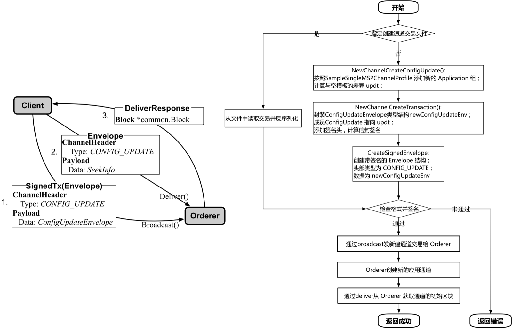

旧流程主要步骤包括：

* 客户端调用 sendCreateChainTransaction()，检查指定的配置交易文件，或者利用默认配置，构造一个创建应用通道的配置交易结构，封装为 Envelope，指定 channel 头部类型为 CONFIG_UPDATE。
* 客户端发送配置交易到排序服务。
* Orderer 收到 CONFIG_UPDATE 消息后，检查指定的通道还不存在，则开始创建通道，并构造该应用通道的初始区块。
    * Orderer 首先检查通道应用（Application）配置中的组织都在创建的联盟（Consortium）配置组织中。
    * 之后从系统通道中获取 Orderer 相关的配置，并创建应用通道配置，对应 mod_policy 为系统通道配置中的联盟指定信息。该步骤仅适用于 Fabric 2.x 的旧系统通道网络。
    * 接下来根据 CONFIG_UPDATE 消息的内容更新获取到的配置信息。所有配置发生变更后版本号都要更新。
    * 创建签名 Proposal 消息（头部类型为 ORDERER_TRANSACTION），发送到排序服务共识实现，指定目标为系统通道；
    * Orderer 从共识实现收到对应消息，初始化本地账本结构，完成应用通道的创建过程。
* 客户端从 Orderer Deliver gRPC 服务获取应用通道的初始区块（具体过程类似 fetch 命令），请求类型为 CONFIG_UPDATE，负载为 SeekInfo。
* 客户端将收到的区块写入到本地的 chainID + `.block` 文件。这个文件后续会被需要加入到通道的节点使用。

其中，最关键的数据结构是配置交易相关的 Envelope 结构，如下图所示。

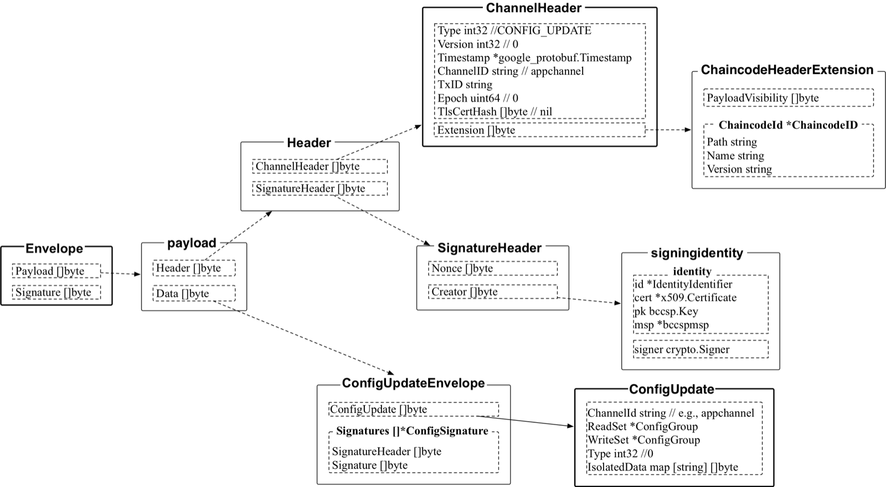

### 加入通道

join 子命令会让指定的 Peer 节点加入到指定的应用通道。需要提前拥有所加入应用通道的初始区块文件，并且只有属于通道的某个组织的管理员身份可以成功执行该操作。加入通道命令主要通过调用 Peer 的配置系统链码进行处理。

例如，通过如下命令将本地 Peer 加入到应用通道 businesschannel 中。

该子命令支持选项包括：

* -b, --blockpath string：指定初始区块文件的路径

```bash
$ peer channel join \
  -b ${APP_CHANNEL}.block

Peer joined the channel!
```

加入应用通道的主要过程如下图所示。

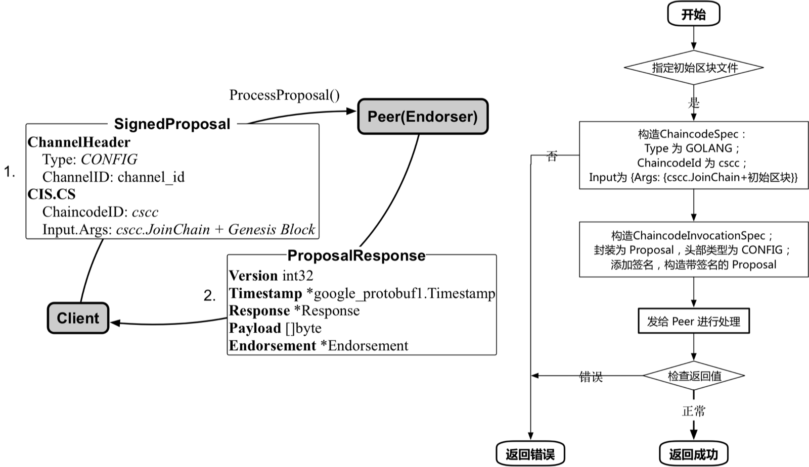

主要步骤包括：

* 客户端首先创建一个 ChaincodeSpec 结构，其 input 中的 Args 第一个参数是 CSCC.JoinChain（指定调用配置链码的操作），第二个参数为所加入通道的配置区块。
* 利用 ChaincodeSpec 构造一个 ChaincodeInvocationSpec 结构。
* 利用 ChaincodeInvocationSpec，创建 Proposal 结构并进行签名，channel 头部类型为 CONFIG。
* 客户端通过 gRPC 将 Proposal 签名后发给 Endorser（所操作的 Peer），调用 `ProcessProposal(ctx context.Context, in *SignedProposal, opts ...grpc.CallOption) (*ProposalResponse, error)` 方法进行处理，主要通过配置系统链码从配置区块中读取通道内已有成员的 TLS CA 根证书，加入到本地的根证书信任结构中，并进行本地链结构的初始化工作。
* 初始化完成后，即可收到来自通道内的 Gossip 消息等。

其中，比较重要的数据结构包括 ChaincodeSpec、ChaincodeInvocationSpec、Proposal 等，它们的具体结构如下图所示。


*注：权限不足情况下，执行加入通道命令可能不会报错，但实际上并没有加入到通道，也不会获取到通道内的数据。*

### 列出所加入的通道

list 子命令会列出指定的 Peer 节点已经加入的所有应用通道的列表。加入通道命令也是主要通过调用 Peer 的配置系统链码进行处理。

例如通过如下命令，可以列出本地 Peer 已经加入的所有应用通道。

```bash
$ peer channel list
Channels peers has joined to:
   businesschannel
   businesschannel2
```

列出所加入应用通道的主要过程如下图所示。

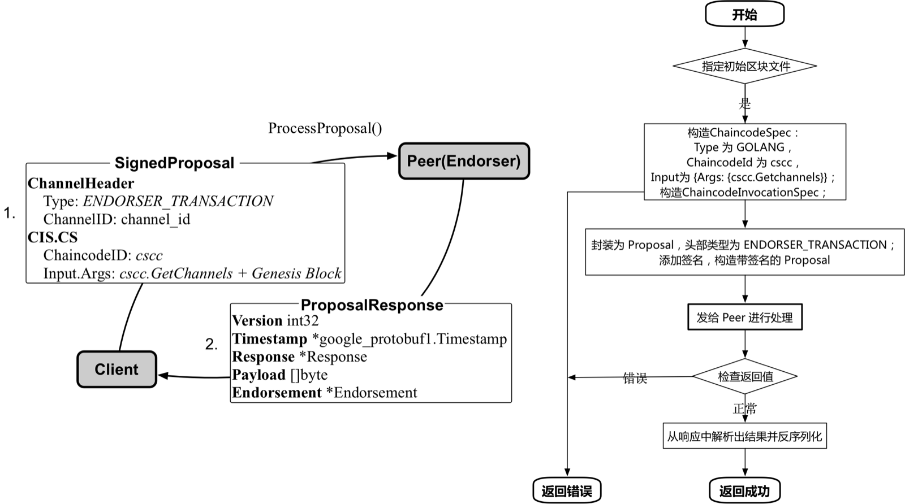

主要步骤包括：

* 客户端首先创建一个 ChaincodeSpec 结构，其 input 中的 Args 第一个参数是 CSCC.GetChannels（指定调用配置链码的操作）。
* 利用 ChaincodeSpec 构造一个 ChaincodeInvocationSpec 结构。
* 利用 ChaincodeInvocationSpec，创建 Proposal 结构并进行签名，channel 头部类型为 ENDORSER_TRANSACTION。
* 客户端通过 gRPC 将 Proposal 发给 Endorser（所操作的 Peer），调用 `ProcessProposal(ctx context.Context, in *SignedProposal, opts ...grpc.CallOption) (*ProposalResponse, error)` 方法进行处理，主要是通过配置系统链码查询本地链信息并返回。
* 命令执行成功后，客户端会收到来自 Peer 端的回复消息，从其中提取出应用通道列表信息并输出。

其中，比较重要的数据结构同样也包括 ChaincodeSpec、ChaincodeInvocationSpec、Proposal 等，注意 channel 头部类型和 ChaincodeSpec 结构中数据与加入通道的消息中略有差异。

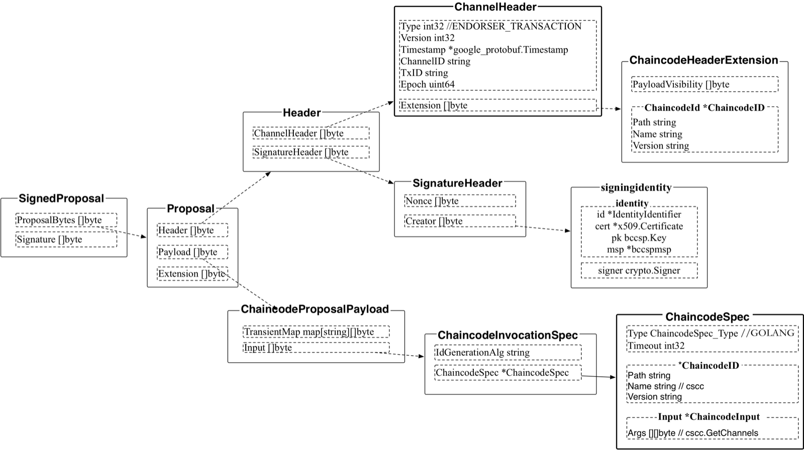

### 获取某区块

fetch 子命令会向排序服务进行查询，获取到指定通道的指定区块。并将收到的区块写入到本地的文件（默认为 chainID_序号.block）。

命令格式为 `peer channel fetch <newest|oldest|config|(number)> [outputfile] [flags]`。

该子命令支持选项包括：

* -c, --channelID string：所获取的通道的名称；

例如通过如下命令，可以获取到已存在的 businesschannel 应用通道的初始区块，并保存到本地的 businesschannel.block 文件。

```bash
$ peer channel fetch oldest businesschannel_0.block \
  -c businesschannel \
  -o orderer:7050

$ peer channel fetch 1 businesschannel_1.block \
  -c businesschannel \
  -o orderer:7050
```

获取区块的主要过程如下图所示。

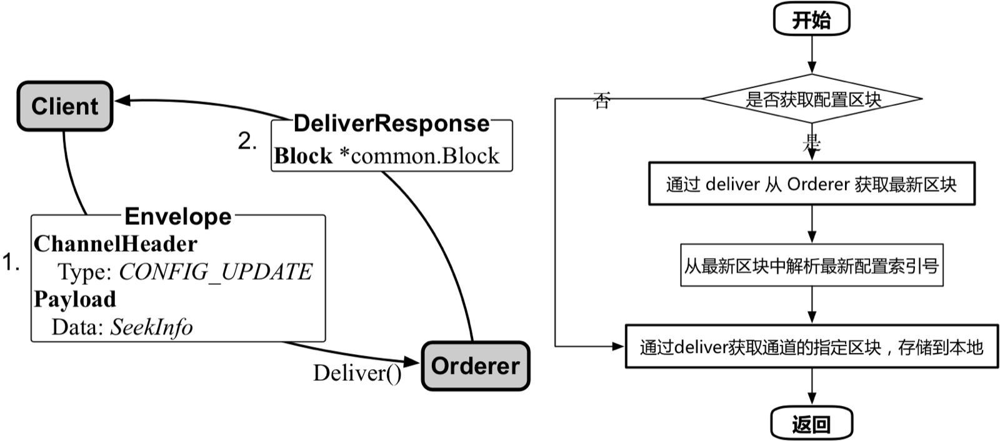

主要步骤包括：

* 客户端构造 SeekInfo 结构，该结构可以指定要获取的区块范围。这里 Start、Stop 指定为目标区块；
* 客户端利用 SeekInfo 结构，构造 Envelope 并进行签名，通过 deliverClient 经 gRPC 通道发给排序服务接口；
* 从 Orderer 获取指定通道的区块后，写到本地文件中。

其中，比较重要的数据结构包括 SeekInfo、Envelope 结构等，它们的具体结构如下图所示。

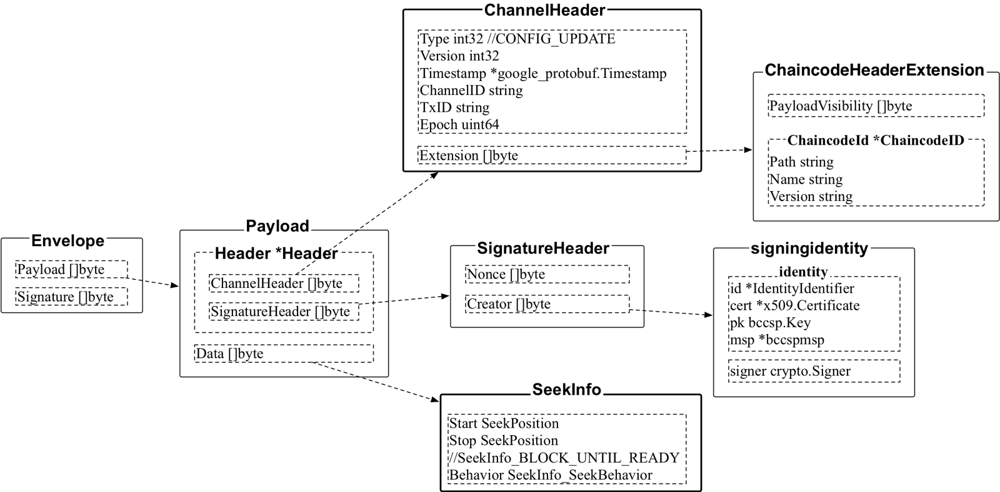

### 更新通道配置

update 子命令的执行过程与 create 命令类似，会向排序服务发起更新配置交易请求。

该命令执行也需要提前创建的通道更新配置交易文件来指定配置信息。

该子命令支持选项包括：

* -c, --channelID string：所更新通道的名称；
* -f, --file string：指定更新通道所用的交易文件。

例如，通过如下操作来更新通道中的锚节点配置，首先利用 configtxgen 来创建锚节点配置更新文件，之后使用该更新文件对通道进行配置更新操作。

注意：`configtxgen --outputAnchorPeersUpdate` 在 Fabric 2.5 中已弃用，在 Fabric 3.x 中已移除，下面的命令仅供旧网络参考。新流程应按标准通道配置更新流程生成 config update envelope，再用 `peer channel update` 提交。

```bash
$ configtxgen \
    -profile ${APP_CHANNEL_PROFILE} \
    -outputAnchorPeersUpdate ./update_anchors.tx \
    -channelID businesschannel \
    -asOrg Org1MSP
$ peer channel update \
    -c businesschannel \
    -o orderer:7050 \
    -f ./update_anchors.tx
```

更新应用通道的主要过程如下图所示。

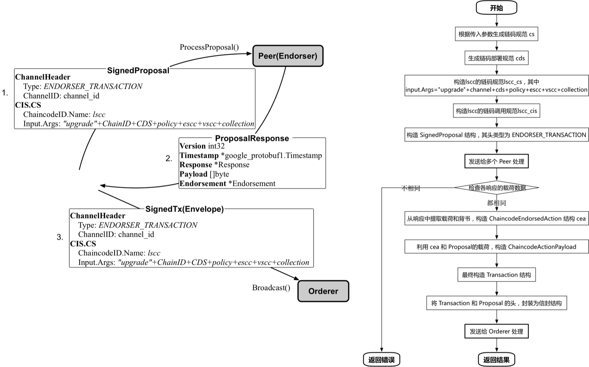

主要步骤包括：

* 客户端读取指定的配置交易文件，构造一个更新应用通道的配置交易信封结构，确认通道头部类型为 CONFIG_UPDATE，通道 ID 存在且与命令行参数一致。
* 客户端对更新信封结构进行签名，最终构造签名信封结构，通道头部类型为 CONFIG_UPDATE。
* 客户端通过 gRPC 发送配置交易到排序服务的 Broadcast 接口。
* Orderer 收到 CONFIG_UPDATE 消息后，判断是配置消息，则进行配置相关处理：
    * 调用 ProcessConfigUpdateMsg() 尝试接受配置，计算新配置结构（封装为 CONFIG 类型的信封结构）和对应的序号；
    * Orderer 将新的配置信封结构发送给当前排序服务共识实现（如 Raft 或 Fabric 3.x 的 BFT）进行排序，并响应客户端答复；
    * 排序完成后，Orderer 将新的配置交易存放到账本结构中等待 Peer 节点获取。
* 客户端在发出请求后会接收到响应，但实际请求仍在 Orderer 端异步进行。

其中，最关键的数据结构是配置交易相关的 Envelope 结构，如下图所示。

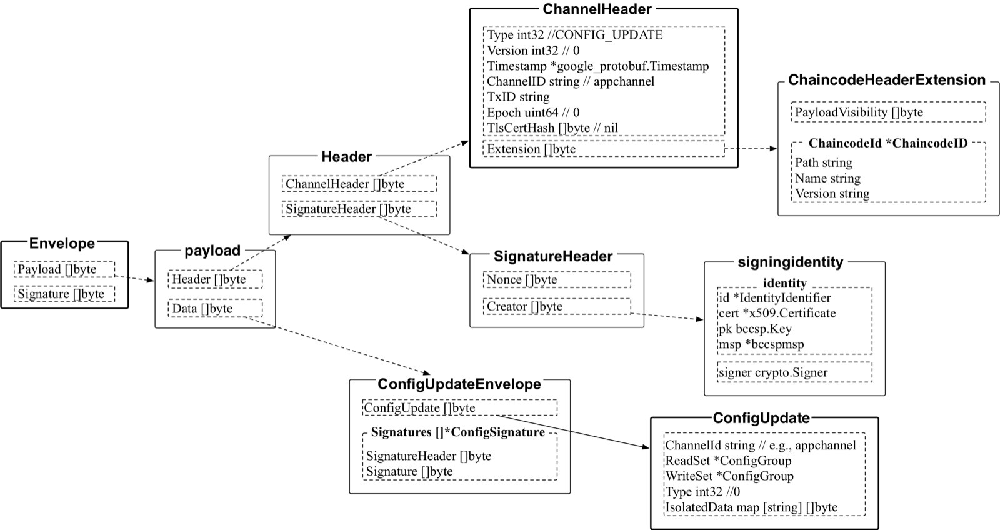

### 获取通道基本信息

getinfo 可以向指定的 Peer 节点获取某个通道的基本信息，包括高度、当前 Hash、前导区块 Hash 等。

该子命令支持选项包括：

* -c, --channelID string：所获取信息的通道的名称。

例如，查询默认 Peer 节点上 businesschannel 通道的信息：

```bash
$ peer channel getinfo -c businesschannel
Blockchain info: {"height":7,"currentBlockHash":"bHlVT/swOzeJ8JaTXyhStu40QL4JBxZBD695FISJf2o=","previousBlockHash":"ViDfGewz/GRg3wDz68dtg4s9NNojtq3ciBB4VcpGBuk="}
```

获取通道基本信息的主要过程如下图所示。

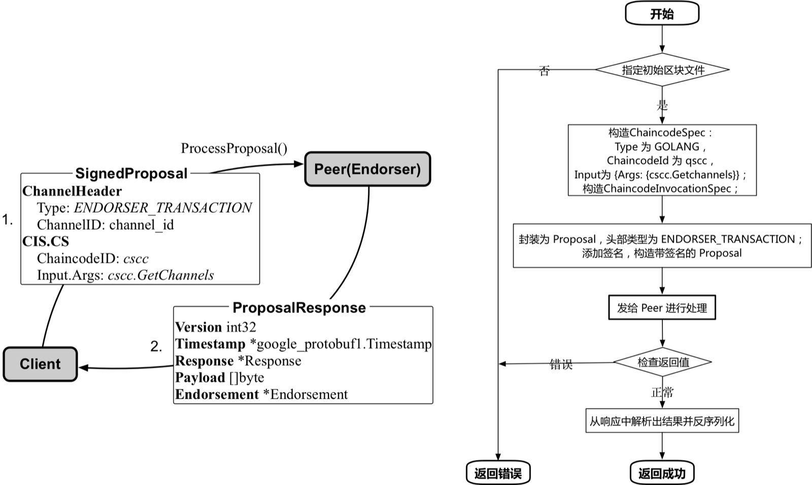

主要步骤包括：

* 客户端首先创建一个 ChaincodeSpec 结构，其 input 中的 Args 第一个参数是 QSCC.GetChainInfo（指定调用查询系统链码的操作），第二个参数为目标通道的名称；
* 利用 ChaincodeSpec 构造一个 ChaincodeInvocationSpec 结构；
* 利用 ChaincodeInvocationSpec，创建 Proposal 结构并进行签名，channel 头部类型为 ENDORSER_TRANSACTION。
* 客户端通过 gRPC 将 Proposal 签名后发给 Endorser（所操作的 Peer），调用 `ProcessProposal(ctx context.Context, in *SignedProposal, opts ...grpc.CallOption) (*ProposalResponse, error)` 方法进行处理，主要通过查询系统链码（QSCC）获取对应账本的基本信息并返回客户端。

其中，比较重要的数据结构包括 ChaincodeSpec、ChaincodeInvocationSpec、Proposal 等，它们的具体结构如下图所示。

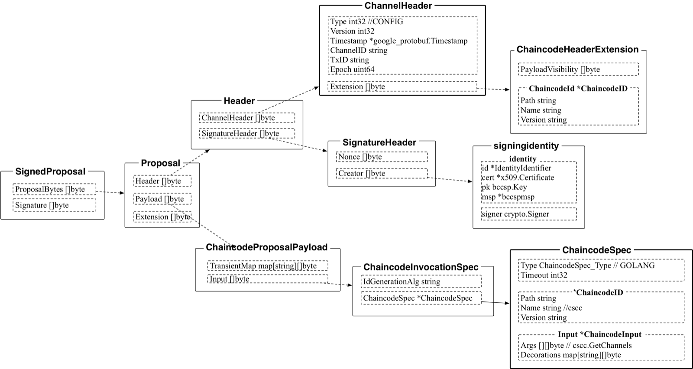

### 对通道配置更新添加签名

signconfigtx 可以为本地的通道更新交易进行签名，属于客户端本地操作，不跟 Peer 或 Orderer 打交道。

该子命令支持选项包括：

* -f, --file string：指定所签名的通道配置更新交易文件。

例如，对本地的通道配置更新添加签名。

```bash
$ peer channel signconfigtx -f config_delta_env.pb
```

## 管理节点

Fabric 网络由多种不同类型的节点组成，每种节点负责不同的功能。了解如何管理这些节点对于维护一个健康的区块链网络至关重要。

## 节点类型

### Peer 节点

Peer 节点是 Fabric 网络的核心组件，主要负责：
*   **维护账本**：存储区块链数据和世界状态（State DB）。
*   **执行链码**：运行智能合约并生成交易提案的背书。
*   **参与共识**：验证交易并提交区块。

根据角色不同，Peer 可以分为：
*   **背书节点（Endorser）**：执行链码并对结果签名背书。
*   **提交节点（Committer）**：验证交易并将区块写入账本（所有 Peer 都是 Committer）。
*   **锚节点（Anchor Peer）**：用于跨组织的 Gossip 通信发现。

### Orderer 节点

Orderer 节点负责交易排序和区块生成：
*   接收来自客户端的交易。
*   对交易进行全局排序。
*   将交易打包成区块并分发给 Peer 节点。
*   Fabric 2.5 LTS 常用 **Raft** 共识协议；Fabric 3.x 还支持 BFT 排序服务，Kafka 已不再支持。

### CA 节点

证书授权（Certificate Authority）节点负责身份管理：
*   为网络参与者签发数字证书。
*   管理证书的注册、吊销等生命周期。

## 常用管理操作

### 查看节点状态

```bash

## 查看 Peer 节点加入的通道
peer channel list

# 查看 Peer 节点安装的链码
peer lifecycle chaincode queryinstalled
```

### 节点日志管理

```bash

# 查看 Docker 容器日志
docker logs peer0.org1.example.com

# 调整日志级别（通过运维服务的 /logspec 接口，详见本章“使用运维服务”一节）
curl -X PUT -H 'Content-Type: application/json' \
  -d '{"spec":"gossip=warning:info"}' \
  http://peer:9443/logspec
```

### Orderer 集群管理

Raft 或 BFT 模式下的 Orderer 集群支持动态添加和移除节点。当前网络应通过应用通道配置更新和 `osnadmin` Channel Participation API 管理排序节点加入、移除和通道列表；仍带系统通道的 Fabric 2.x 旧网络应先迁移并移除系统通道，再升级到 Fabric 3.x。

## 最佳实践

1.  **资源隔离**：生产环境中，Peer、Orderer 和 CA 应部署在不同的物理机或虚拟机上。
2.  **备份策略**：定期备份 Peer 节点的账本、私有数据、状态数据库和配置文件；账本快照可用于新 Peer 加入或一致性检查，但不能替代完整备份。
3.  **监控告警**：使用 Prometheus + Grafana 监控节点健康状态。
4.  **证书管理**：设置证书到期提醒，避免因证书过期导致网络故障。

## 管理链上代码

> **历史说明**：本节记录 Fabric 1.x 及未启用 `V2_0` 应用能力时的旧链码生命周期，包含 `peer chaincode install/instantiate/upgrade/list/package/signpackage` 和 LSCC（Lifecycle System Chaincode）内部流程。Fabric 2.5 LTS 和 Fabric 3.x 的生产网络应使用 `peer lifecycle chaincode` 命令族，详见 管理链上代码（Lifecycle）。在启用 `V2_0` 应用能力的通道上，旧生命周期不能再用于安装、实例化或升级链码；迁移场景中，旧生命周期部署过的链码仍可被调用。Fabric-X 是另一套实现，不能直接套用本节的经典 Fabric 链码部署命令，也不是从 2.5/3.x 原地升级得到；版本选择和迁移边界见升级矩阵。

链上代码（Chaincode），简称链码，一般指的是用户编写的用来实现智能合约的应用代码。

链码被部署在 Peer 节点上，运行在独立的沙盒或外部链码服务中，并通过 gRPC 协议来与相应的 Peer 节点进行交互。链码被调用时，会按照预定逻辑根据当前账本状态来计算对账本的更新（读写集合）。

启动 Fabric 网络后，可以通过命令行或 SDK 进行链码调用。

*注：用户链码有别于系统链码（System Chaincode）。系统链码指的是 Fabric Peer 中负责系统配置、背书、验证等平台功能的代码逻辑，运行在 Peer 进程内，将在后续章节予以介绍。*

### 客户端链码操作命令

旧生命周期中，用户可以通过命令行方式来管理链码，支持的链码子命令包括 install、instantiate、invoke、query、upgrade、list、package、signpackage 等。大部分命令（除了 package、signpackage 外）的处理过程都是类似的，创建签名提案消息，发给 Peer 进行背书，获取 ProposalResponse 消息。

特别地，旧生命周期的 instantiate、upgrade 以及普通的 invoke 子命令还需要根据 ProposalResponse 消息创建交易，发送给 Orderer 进行排序后被全网接受。package、signpackage 子命令作为本地操作，无需跟 Peer 或 Orderer 打交道。

Fabric 2.5 LTS 和 Fabric 3.x 中，链码安装、组织批准、提交、查询定义和升级应使用 `peer lifecycle chaincode`；`peer chaincode invoke/query` 仍用于调用和查询已经提交的链码。

各个命令的功能总结如下表所示：

旧命令 | 发往组件 | 功能
-- | -- | --
install | Peer 节点 | 将链码信息打包并安装到 Peer（旧生命周期）
query  | Peer 节点 | 查询链码
list | Peer 节点 | 列出旧生命周期链码信息，包括某个 Peer 上安装过的链码或通道内实例化过的链码
instantiate | Peer 节点和排序服务 | 在通道中实例化链码（旧生命周期）
invoke | Peer 节点和排序服务 | 调用链码
upgrade | Peer 节点和排序服务 | 升级链码（旧生命周期）
package | 本地操作 | 打包本地链码为部署 Spec 包（旧生命周期）
signpackage | 本地操作 | 为给定链码包添加签名（旧生命周期）

可以通过 `peer chaincode <subcommand> --help` 来查看具体的命令使用说明。

这些操作管理了链码的整个生命周期，如下图所示。

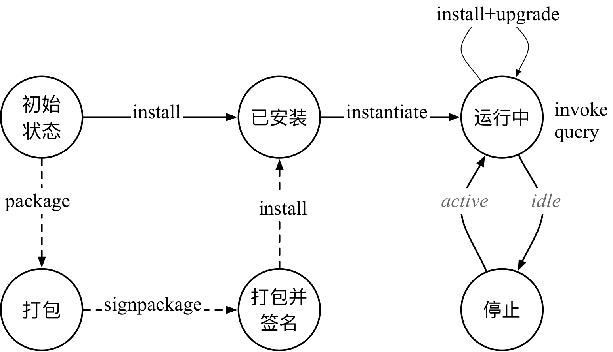

旧生命周期中，用户需要将链码安装到 Peer 节点，之后可以在 Peer 所属的某个通道内实例化链码容器。此时链码处于运行状态，应用可以通过 invoke 或 query 来调用链码。链码在一定时间不被调用会处于空闲状态，可能被停止并在后续调用时重新启动。此外，用户还可以升级链码到新的版本。Fabric 2.5 LTS 和 3.x 中对应流程已经变为打包、安装、组织批准、提交链码定义，以及递增 `--sequence` 完成升级。

后面将以 Fabric 项目中自带的 Go 语言 example02 链码（路径在 examples/chaincode/go/chaincode_example02）为例进行相关命令讲解。

### 命令选项

链码操作支持如下全局命令选项，对应的功能如下表所示。

全局选项 | 类型 | 含义
--- | --- | ---
--connTimeout | duration | 客户端连接超时，默认为 `3s`（duration 类型，须写成 `3s` 这类带单位的形式）
--keyfile | string | 与排序服务双向 TLS 认证时使用的私钥文件
-o, --orderer | string | Orderer 服务地址
--transient | string | JSON 格式的临时数据，仅供 Peer 在背书环节使用
--tls | bool | 连接到 Orderer 服务时是否启用 TLS
--cafile | string | 信任的排序服务的 TLSCA 证书，PEM 编码格式
--certfile | string | 与排序服务双向 TLS 认证时使用的证书文件
--clientauth | bool | 与排序服务通信时是否启用双向 TLS 认证
--ordererTLSHostnameOverride | string | 验证 Orderer TLS 时候覆盖所校验的主机名

此外，不同子命令还可能支持一些子选项，如下表所示。

子命令选项 | 类型 | 含义
--- | --- | ---
--connectionProfile | string | 指定连接配置（Connection Profile）文件
-C, --channelID | string | 所面向的通道（无默认值）
-c, --ctor  | string | 指定链码命令的参数信息，JSON 格式，默认为 `{}`
-E, --escc  | string | 指定所用背书系统链码的名称，默认为 `escc`
-l, --lang  | string | 链码实现语言，默认为 `golang`
-n, --name  | string | 链码名称
--peerAddresses | string list | Peer 节点地址，可以指定多个
-o, --orderer | string | 排序服务地址
--tlsRootCertFiles | string list | 采用 TLS 时，信任的 Peer 的根证书列表，需要跟 Peer 节点地址列表给出的顺序一致
-p, --path  | string | 所操作链码的本地路径，如果是 Go 语言为包路径（相对于 $GOPATH/src），如果是其他语言则为绝对路径
-P, --policy | string  | 链码所关联的背书策略，例如 `-P "OR ('Org1MSP.member','Org2MSP.member')"`
-v, --version | string | install/instantiate/upgrade 等命令中指定的版本信息
-V, --vscc  | string | 指定所使用验证系统链码的名称，默认为 `vscc`

注意，不同子命令具体支持不同的参数，总结如下表所示。

命令 |-C 通道| -c cc 参数| -E escc | -l 语言 | -n 名称 | -o Orderer | -p 路径 | -P policy | -v 版本 | -V vscc |
-- | -- | -- | -- | -- | -- | -- | -- | -- | -- | -- |
install    |不支持| 支持 |不支持 | 支持 |必需|不支持|必需|不支持| 必需 | 不支持 |
instantiate|必需| 必需 |支持 | 支持 |必需|支持|不支持|支持|必需 | 支持 |
invoke     |支持| 必需 |不支持 | 支持 |必需|支持|不支持|不支持|不支持|不支持 |
query      |支持| 必需 |不支持 | 支持 |必需|不支持|不支持|不支持|不支持|不支持 |
upgrade    |必需| 必需 |支持 | 支持 |必需|支持|不支持|支持| 必需| 支持 |
list      |支持| 不支持 |不支持 | 不支持 |不支持|不支持|不支持|不支持|不支持|不支持 |
package    |不支持| 支持 |不支持 | 支持 |必需|不支持|必需|不支持|必需 | 不支持|
signpackage |不支持| 支持 |不支持 | 支持 |必需|不支持|必需|不支持|必需 | 不支持|

其中，必需、支持和不支持三种情况的含义为：

* 必需：该参数必需被指定，包括通过命令行、环境变量、配置等。
* 支持：该参数可以被使用。某些时候如果不指定，可能采取默认值或自动获取。
* 不支持：该参数不应该使用。

### 安装链码

旧生命周期的 install 命令将链码的源码和环境等内容封装为一个链码安装打包文件（Chaincode Install Package，CIP），并传输到指定的 Peer 节点。当前生命周期的安装命令为 `peer lifecycle chaincode install <package.tar.gz>`。

此过程只需要跟 Peer 节点打交道，无需修改账本状态，并不产生交易。只有安装过链码的节点才能进行链码实例化和进行背书处理。默认情况下，执行者需要为该 Peer 节点的管理员角色。

例如，采用如下命令可以部署 test_cc.1.0 的链码打包文件到指定的 Peer 节点。

```bash
$ CORE_PEER_ADDRESS=peer.your_domain.com:7051 # 设置默认的 Peer 地址
$ peer chaincode install \
	-n test_cc \
	-v 1.0 \
	-p github.com/hyperledger/fabric/examples/chaincode/go/chaincode_example02
```

Peer 节点收到请求，检查和解析后将 CIP 文件保存在 `${CORE_PEER_FILESYSTEMPATH}/chaincodes/` 目录下（一般以 cc_name.version 格式命名，如 /var/hyperledger/production/chaincodes/testcc.1.0），供后续操作（如重新创建和启动链码容器）使用。

CIP 文件中主要包括如下数据。

* `ChaincodeDeploymentSpec`：链码的源码和一些关联环境，如名称和版本。
* 链码实例化策略，默认是任意通道上的 MSP 管理员身份均可。
* 拥有这个链码的实体的证书和签名。
* 安装时，添加本地 MSP 管理员的签名。

其中，ChaincodeDeploymentSpec（CDS）结构最为核心，主要包括 ChaincodeSpec（CS）数据结构（链码部署信息）和 CodePackage（链码源代码相关数据）。CDS 和 CS 结构同时也大量在其他链码命令（如实例化命令和升级命令）中使用。

链码安装的整体实现流程如下图所示。

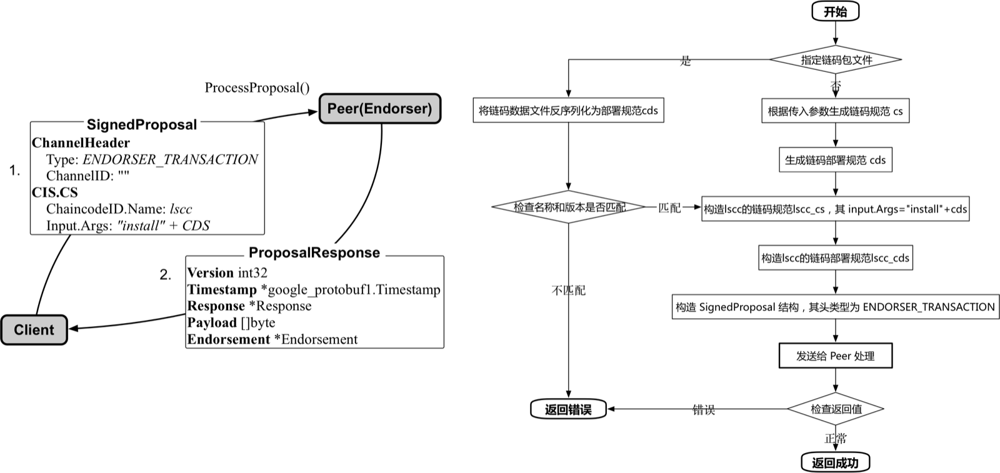

主要步骤包括：

* 首先是构造带签名的提案结构（SignedProposal）。
    * 调用 `InitCmdFactory(isEndorserRequired, isOrdererRequired bool) (*ChaincodeCmdFactory, error)` 方法，初始化 EndorserClient（跟 Peer 通信）、BroadcastClient（跟 Orderer 通信）、Signer（签名操作）等辅助结构体。所有链码子命令都会执行该过程，会根据需求具体初始化不同的结构。
    * 然后根据命令行参数进行解析，判断是根据传入的打包文件来直接读取 ChaincodeDeploymentSpec（CDS）结构，还是根据传入参数从本地链码源代码文件来构造生成。
    * 以本地重新构造情况为例，首先根据命令行中传入的路径、名称等信息，构造生成 ChaincodeSpec（CS）结构。
    * 利用 ChaincodeSpec 结构，结合链码包数据生成一个 ChaincodeDeploymentSpec 结构（chainID 为空），调用本地的 `install(msg proto.Message, cf *ChaincodeCmdFactory) error` 方法。
    * install 方法基于传入的 ChaincodeDeploymentSpec 结构，构造一个对生命周期管理系统链码（LSCC）调用的 ChaincodeSpec 结构，其中，Type 为 ChaincodeSpec_GOLANG，ChaincodeId.Name 为“lscc”，Input 为 “install”+ChaincodeDeploymentSpec。进一步地，构造了一个 LSCC 的 ChaincodeInvocationSpec（CIS）结构，对 ChaincodeSpec 结构进行封装。
    * 基于 LSCC 的 ChaincodeInvocationSpec 结构，添加头部结构，生成一个提案（Proposal）结构。其中，通道头部中类型为 ENDORSER_TRANSACTION，TxID 为对随机数+签名实体，进行 Hash。
    * 对 Proposal 进行签名，转化为一个签名后的提案消息结构 SignedProposal。
* 将带签名的提案结构通过 EndorserClient 经由 gRPC 通道发送给 Peer 的 `ProcessProposal(ctx context.Context, in *SignedProposal, opts ...grpc.CallOption) (*ProposalResponse, error)` 接口。
* Peer 模拟运行生命周期链码的调用交易进行处理，检查格式、签名和权限等，通过则保存到本地文件系统。

下图给出了链码安装过程中最为重要的 SignedProposal 数据结构，该结构对于大部分链码操作命令都是类似的，其中最重要的是 ChannelHeader 结构和 ChaincodeSpec 结构中参数的差异。

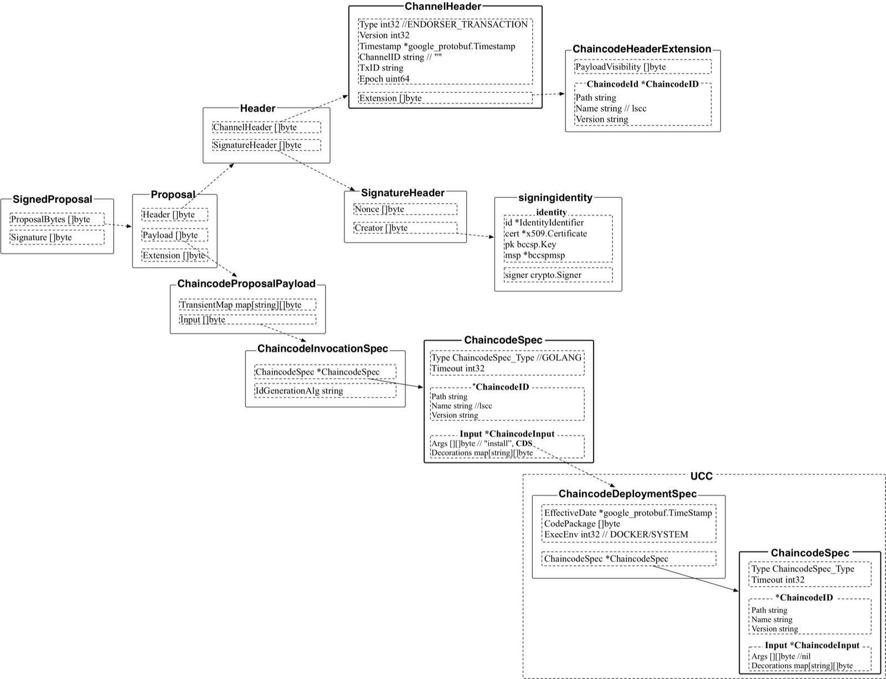

### 实例化链码

旧生命周期的 instantiate 命令通过构造生命周期管理系统链码（Lifecycle System Chaincode，LSCC）的交易，将安装过的链码在指定通道上进行实例化部署调用，在节点上创建容器启动，并执行初始化操作。实例化链码需要同时跟 Peer 和 Orderer 打交道。Fabric 2.5 LTS 和 3.x 不再用 instantiate 启动链码，而是由通道成员批准并提交链码定义。

执行 instantiate 命令的用户身份必须满足实例化的策略（默认为通道内 MSP 管理员角色），并且在所指定的通道上拥有写（Write）权限。在 instantiate 命令中可以通过 `-P` 参数指定链码调用的背书策略（Endorsement Policy），在 Commit 阶段会进行策略检查。

旧版资料通常会展示 `peer chaincode instantiate` 命令；由于该路径在 Fabric 2.5 LTS 的新通道和 Fabric 3.x 中不再作为推荐生命周期，本节不再给出可复制的旧命令。当前网络应按 管理链上代码（Lifecycle） 使用 `peer lifecycle chaincode approveformyorg` 和 `commit` 提交链码定义。

旧命令中的 `collection.json` 为私密账本（sideDB）特性中使用（Fabric v1.1.0 开始支持），可以在同一通道内实现私密数据局部共享。在当前生命周期中，同样通过 collections config 随链码定义审批和提交。如果不指定该参数则默认不启用该特性，意味着通道内所有成员都可以看到链码调用结果。

collection.json 的一个示例如下所示。

```jsonc
[
 {
	 "name": "public", // 集合名称
	 "policy": "OR('Org1MSP.member', 'Org2MSP.member')", // 集合成员
	 "requiredPeerCount": 1, // 至少扩散私密数据到几个节点
	 "maxPeerCount": 3, // 最大扩散节点个数
	 "blockToLive":99999, //私密数据存活时长
	 "memberOnlyRead": true // 是否只允许集合的成员访问私密数据
},
 {
	 "name": "private",
	 "policy": "OR('Org1MSP.member')",
	 "requiredPeerCount": 1,
	 "maxPeerCount": 3,
	 "blockToLive":3,
	 "memberOnlyRead": false
 }
]
```

其中定义了 public 和 private 两个集合，分别包括两个组织和单个组织。当在链码逻辑中指定某个键值属于特定集合时，只有集合内成员能看到明文的读写集合，非集合成员即便在同一通道内也无法获取隐私数据。对应 policy 只支持 OR 语法，指定哪些组织可以看到隐私数据集合。

链码实例化实现的整体流程如下图所示。

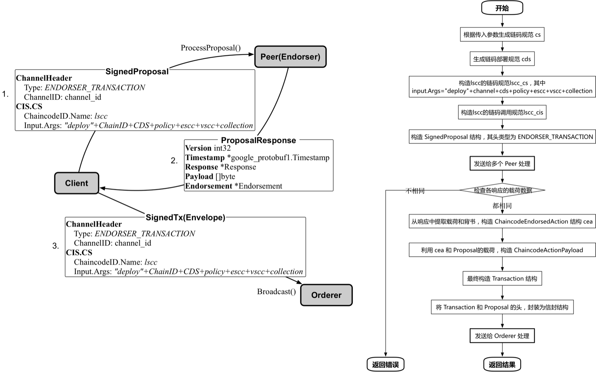

主要步骤包括：

* 首先，类似链码安装命令，需要创建一个 SignedProposal 消息。注意 instantiate 和 upgrade 支持 policy、escc、vscc 等参数。LSCC 的 ChaincodeSpec 结构中，Input 中包括类型（“deploy”）、通道 ID、ChaincodeDeploymentSpec 结构、背书策略、escc 和 vscc 等。
* 调用 EndorserClient，发送 gRPC 消息，将签名后的 Proposal 发给指定的 Peer 节点（Endorser），调用 `ProcessProposal(ctx context.Context, in *SignedProposal, opts ...grpc.CallOption) (*ProposalResponse, error)` 方法，进行背书处理。节点会模拟运行 LSCC 的调用交易，启动链码容器。实例化成功后会返回 ProposalResponse 消息（其中包括背书签名）。
* 根据 Peer 返回的 ProposalResponse 消息，创建一个 SignedTX（Envelop 结构的交易，带有签名）。
* 使用 BroadcastClient 将交易消息通过 gRPC 通道发给 Orderer，Orderer 会进行全网排序，并广播给 Peer 进行确认提交。

其中，SignedProposal 结构如下图所示。

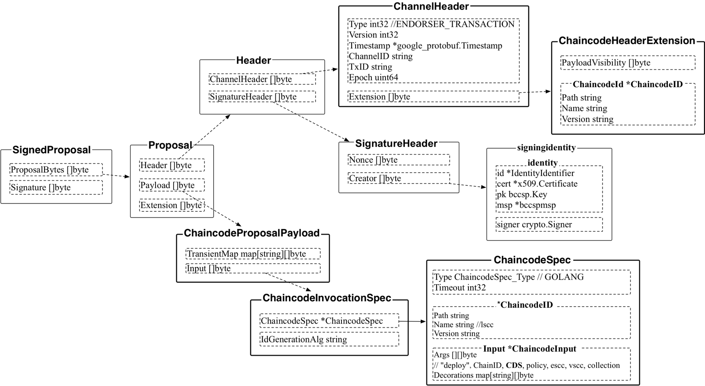

交易 Envelope 结构如下图所示。

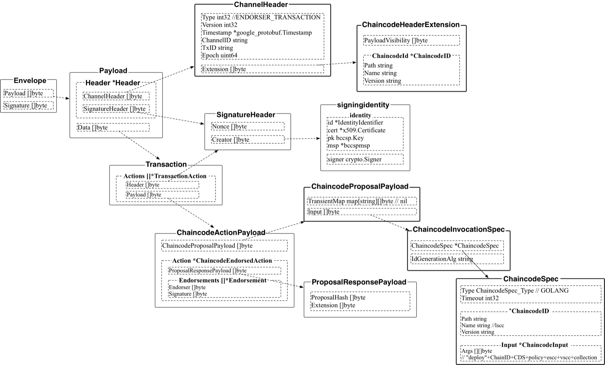

Peer 返回的 ProposalResponse 消息定义如下。

```go
type ProposalResponse struct {
	// 消息协议版本
	Version int32 `protobuf:"varint,1,opt,name=version" json:"version,omitempty"`
	// 消息创建时的时间戳
	Timestamp *google_protobuf1.Timestamp `protobuf:"bytes,2,opt,name=timestamp" json:"timestamp,omitempty"`
	// 返回消息，包括状态、消息、元数据载荷等
	Response *Response `protobuf:"bytes,4,opt,name=response" json:"response,omitempty"`
	// 数据载荷，包括提案的 Hash 值，和扩展的行动等
	Payload []byte `protobuf:"bytes,5,opt,name=payload,proto3" json:"payload,omitempty"`
	// 背书信息列表，包括背书者的证书，以及其对“载荷+背书者证书”的签名
	Endorsement *Endorsement `protobuf:"bytes,6,opt,name=endorsement" json:"endorsement,omitempty"`
}
```

*注：目前命令行下的 instantiate 命令还不支持指定实例化策略，Peer 会采用默认的实例化策略（组织管理员身份）。*

### 调用链码

通过 invoke 命令可以调用运行中的链码的方法。`-c` 参数指定的函数名和参数会被传入到链码的 Invoke() 方法进行处理。调用链码操作需要同时跟 Peer 和 Orderer 打交道。

例如，对部署成功的链码执行调用操作，由 `a` 向 `b` 转账 10 元。

在 peer0 容器中执行如下操作，注意验证最终结果状态正常 `response:<status:200 message:"OK" >`。

```bash
$ peer chaincode invoke \
	-o orderer0:7050 \
	-n test_cc \
	-C ${APP_CHANNEL} \
	-c '{"Args":["invoke","a","b","10"]}' \
	--tls \
	--cafile ${ORDERER_TLS_CA}
```

这一命令会调用最新版本的 test_cc 链码，将参数 `'{"Args":["invoke","a","b","10"]}'` 传入链码中的 `Invoke()` 方法执行。命令会生成一笔交易，需指定排序者地址。

需要注意，invoke 命令不支持指定链码版本，默认调用最新版本的链码。

实现上，基本过程如下图所示。

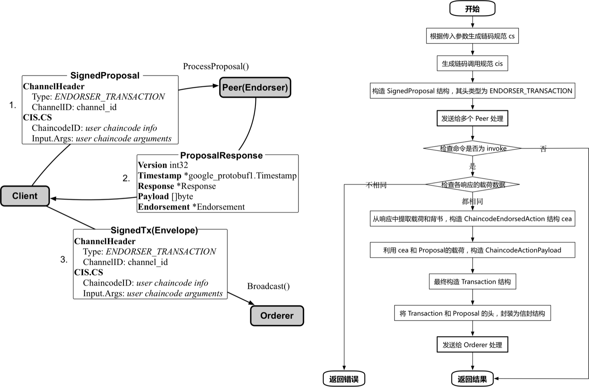

实现上，基本过程如下：

* 首先，也是要创建一个 SignedProposal 消息。根据传入的各种参数，生成 ChaincodeSpec 结构（其中，Input 为传入的调用参数）。然后，根据 ChaincodeSpec、chainID、签名实体等，生成 ChaincodeInvocationSpec 结构。进而封装生成 Proposal 结构（通道头部中类型为 ENDORSER_TRANSACTION），并进行签名。
* 调用 EndorserClient，发送 gRPC 消息，将签名后的 Proposal 发给指定的 Peer 节点（Endorser），调用 `ProcessProposal(ctx context.Context, in *SignedProposal, opts ...grpc.CallOption) (*ProposalResponse, error)` 方法，进行背书处理。节点会模拟运行链码调用交易，成功后会返回 ProposalResponse 消息（带有背书签名）。
* 根据 Peer 返回的 ProposalResponse 消息，创建一个 SignedTX（Envelop 结构的交易，带有签名）。
* 调用 BroadcastClient 将交易消息通过 gRPC 通道发给 Orderer 进行全网排序并广播给 Peer 进行确认提交。

在此过程中，发给 Peer 节点的交易提案数据结构如下图所示。

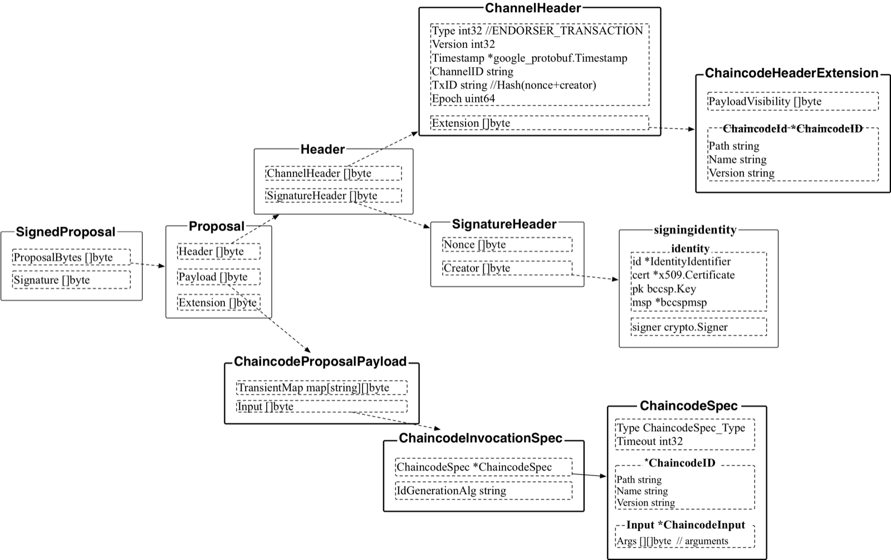

发给排序服务的交易数据结构如下图所示。

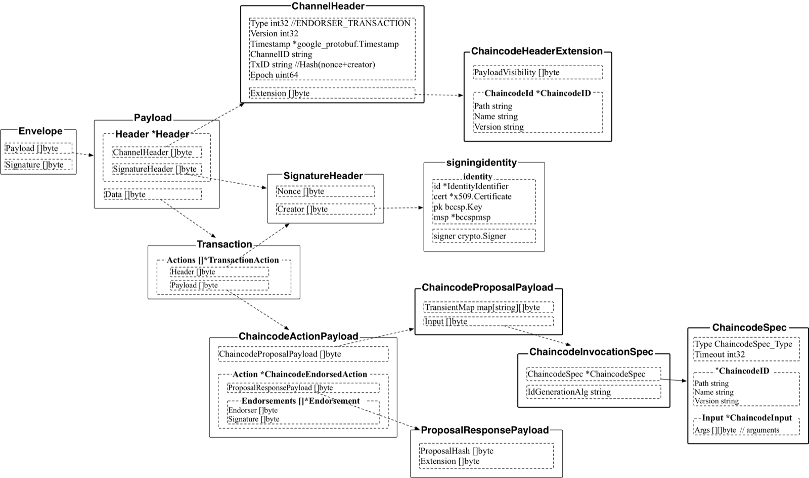

注意 invoke 是异步操作，invoke 成功只能保证交易已经进入 Orderer 进行排序，但无法保证最终写到账本中（例如交易未通过 Committer 验证而被拒绝）。需要通过 eventHub 或查询方式来进行确认交易是否最终写入到账本上。

### 查询链码

查询链码可以通过 query 子命令。

该子命令实际上是 invoke 操作与 Peer 打交道的部分，即将签名后的 Proposal 发给指定的 Peer 节点的 ProcessProposal() gRPC 接口。最终将 `-c` 指定的命令参数发送给了链码中的 `Invoke()` 方法执行。

与 invoke 操作的区别在于，query 操作用来查询 Peer 上账本状态（需要链码支持查询逻辑），不生成交易，也不需要与 Orderer 打交道。

例如，执行如下命令会向 Peer 查询状态 `a` 的值，并返回查询结果。

```bash
$ peer chaincode query \
	-n test_cc \
	-C ${APP_CHANNEL} \
	-c '{"Args":["query","a"]}'
```

在实例化链码容器后，可以在 peer0 容器中执行如下命令，注意输出无错误信息，最后的结果为初始值 `Query Result: 100`。

```bash
$ peer chaincode query \
	-n test_cc \
	-C ${APP_CHANNEL} \
	-c '{"Args":["query","a"]}'
Query Result: 100
[main] main -> INFO 001 Exiting.....
```

类似的，查询 `b` 的余额，注意最终返回结果为初始值 `Query Result: 200`。

```bash
$ peer chaincode query \
	-n test_cc \
	-C ${APP_CHANNEL} \
	-c '{"Args":["query","b"]}'
Query Result: 200
[main] main -> INFO 001 Exiting.....
```

在执行完 a 向 b 转账 10 的交易后，再次查询 `a` 和 `b` 的余额，发现发生变化。

`a` 的新余额为 90。

```bash
$ peer chaincode query \
	-n test_cc \
	-C ${APP_CHANNEL} \
	-c '{"Args":["query","a"]}'
Query Result: 90
[main] main -> INFO 001 Exiting.....
```

`b` 的新余额为 210。

```bash
$ peer chaincode query \
	-n test_cc \
	-C ${APP_CHANNEL} \
	-c '{"Args":["query","b"]}'
Query Result: 210
[main] main -> INFO 001 Exiting.....
```

query 的主要实现过程如下所示。

* 根据传入的各种参数，最终构造签名提案，通过 endorserClient 发送给指定的 Peer。
* 成功的话，获取到 ProposalResponse，打印出 proposalResp.Response.Payload 内容。

注意 invoke 和 query 的区别，query 子命令会返回从 Peer 的查询结果，但不创建 SignedTx 发送到 Orderer。

### 升级链码

当需要修复链码漏洞或进行功能拓展时，可以对链码进行升级，部署新版本的链码。旧生命周期通过 `peer chaincode upgrade` 完成；Fabric 2.5 LTS 和 3.x 通过重新打包/安装、各组织批准新链码定义并递增 `--sequence` 后 `commit` 完成升级。

旧生命周期资料会先把新版本链码安装到 Peer，再通过 `peer chaincode upgrade` 在通道上实例化新版本链码。Fabric 2.5 LTS 和 3.x 的当前流程不再使用可复制的旧 `upgrade` 命令，而是重新打包和安装链码包，由各组织批准新链码定义，并在 `commit` 时递增 `--sequence`。如果需要执行初始化逻辑，应在当前生命周期中显式使用 `--init-required` 和 `--isInit` 语义，并谨慎设计初始化函数，避免升级时意外改写已有状态。

链码实例化实现的整体流程如下图所示，十分类似实例化过程。

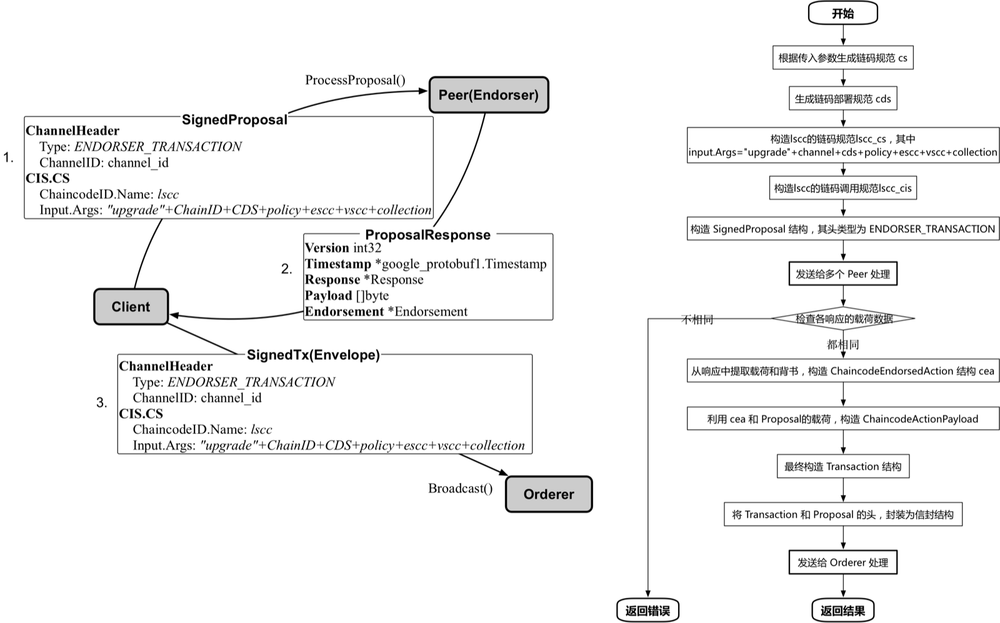

* 首先，需要创建一个封装了 LSCC 调用交易的 SignedProposal 消息。注意 instantiate 和 upgrade 支持指定 policy、escc、vscc 等参数。LSCC 的 ChaincodeSpec 结构中，Input 中包括类型（“upgrade”）、通道 ID、ChaincodeDeploymentSpec 结构、背书策略、escc 和 vscc 等。
* 调用 EndorserClient，发送 gRPC 消息，将签名后的 Proposal 发给指定的 Peer 节点（Endorser），调用 `ProcessProposal(ctx context.Context, in *SignedProposal, opts ...grpc.CallOption) (*ProposalResponse, error)` 方法，进行背书处理。节点会模拟运行 LSCC 的调用交易，启动链码容器。实例化成功后会返回 ProposalResponse 消息（其中包括背书签名）。
* 根据 Peer 返回的 ProposalResponse 消息，创建一个 SignedTX（Envelop 结构的交易，带有签名）。
* 使用 BroadcastClient 将交易消息通过 gRPC 通道发给 Orderer，Orderer 会进行全网排序，并广播给 Peer 进行确认提交。

### 查询链码安装和实例化信息（旧生命周期）

旧生命周期的 list 子命令支持查询某个节点上已经安装的链码信息（--installed）或某个通道内已经实例化的链码信息（--instantiated）。请求发送到 Peer 节点，调用 LSCC 系统链码提供的接口进行查询。当前生命周期应使用 `peer lifecycle chaincode queryinstalled`、`querycommitted` 或 `checkcommitreadiness`。

例如，如下命令查询默认 Peer 上安装的链码情况，返回结果显示已安装链码 exp02 的 v1.0 版本。

```bash
$ peer chaincode list \
		--installed

Get installed chaincodes on peer:
Name: exp02, Version: 1.0, Path: examples/chaincode/go/chaincode_example02, Id: 08ca675c39a8bae2631847a521fc92e12969fe122bd4a9df0a707cf1059e8730
```

例如，如下命令查询通道 ${APP_CHANNEL} 内实例化的链码情况，返回结果显示已实例化链码 exp02 的 v1.0 版本。

```bash
$ peer chaincode list \
		--instantiated \
		-C ${APP_CHANNEL}

Get instantiated chaincodes on channel businesschannel:
Name: exp02, Version: 1.0, Path: examples/chaincode/go/chaincode_example02, Escc: escc, Vscc: vscc
```

链码列出安装和实例化过程的实现流程如下图所示。

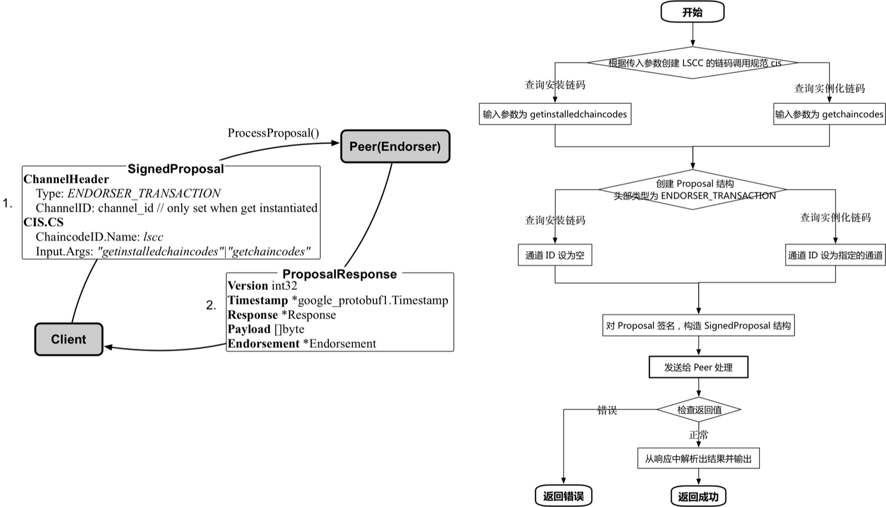

* 首先，根据输入参数创建一个 LSCC 的链码调用规范。LSCC 的 ChaincodeSpec 结构中，Input 参数根据查询类型设置为 getinstalledchaincodes 或 getchaincodes。
* 根据 LSCC 的链码调用规范封装为一个 Proposal 结构，头部类型为 ENDORSER_TRANSACTION，通道 ID 设置为空（查询安装信息）或给定的通道（查询实例化信息）。
* 调用 EndorserClient，发送 gRPC 消息，将签名后的 Proposal 发给指定的 Peer 节点（Endorser），调用 `ProcessProposal(ctx context.Context, in *SignedProposal, opts ...grpc.CallOption) (*ProposalResponse, error)` 方法，进行背书处理。节点会运行 LSCC 的相应逻辑，成功后会返回 ProposalResponse 消息。
* 客户端解析 Peer 返回的 ProposalResponse 消息，如果成功则打印查询结果。

### 打包链码和签名

旧生命周期通过将链码相关的数据进行封装，可以实现对其进行打包和签名操作。当前生命周期应使用 `peer lifecycle chaincode package` 生成 `.tar.gz` 链码包；旧的 `signpackage` 流程仅用于历史网络。

打包命令支持三个特定参数：

* -s, --cc-package：表示创建完整打包格式，而不是仅打包 ChaincodeDeploymentSpec 结构。
* -S, --sign：对打包的文件使用本地的 MSP（core.yaml 中的 localMspid 指定）进行签名。
* -i --instantiate-policy string：指定实例化策略。可选参数。

例如，通过如下命令创建一个本地的打包文件 ccpack.out。

```bash
$ peer chaincode package \
	-n test_cc -p github.com/hyperledger/fabric/examples/chaincode/go/chaincode_example02 \
	-v 1.0 \
	-s \
	-S \
	-i "AND('Org1.admin')" \
	ccpack.out
```

打包后的文件，也可以直接用于 install 操作，如

```bash
$ peer chaincode install ccpack.out
```

签名命令则对一个打包文件进行签名操作（添加当前 MSP 签名到签名列表中）。

```bash
$ peer chaincode signpackage ccpack.out signedccpack.out
```

其中，打包文件结构主要包括三部分的信息：

* ChaincodeDeploymentSpec 结构；
* 实例化策略信息；
* 拥有者的签名列表。

实现的整体流程如下：

* 首先会调用 `InitCmdFactory(isEndorserRequired, isOrdererRequired bool) (*ChaincodeCmdFactory, error)` 方法初始化 Signer 等结构。对于打包命令来说纯属本地操作，不需要 Endorser 和 Orderer 的连接。
* 调用 getChaincodeSpec() 方法，解析命令行参数，根据所指定的数据生成 ChaincodeSpec 结构。
* 根据 ChaincodeSpec 结构，结合链码相关数据构造 ChaincodeDeploymentSpec 结构，并传入 getChaincodeInstallPackage 方法。
* getChaincodeInstallPackage 方法基于传入的 ChaincodeDeploymentSpec 结构，添加实例化策略和签名信息等，生成一个 SignedChaincodeDeploymentSpec，并进一步作为 Data 生成一个 Envelope 结构，其中 ChannelHeader 指定为 CHAINCODE_PACKAGE。
* 将 Envelope 结构序列化，写到指定的本地文件。

其中，Envelope 结构如下图所示。

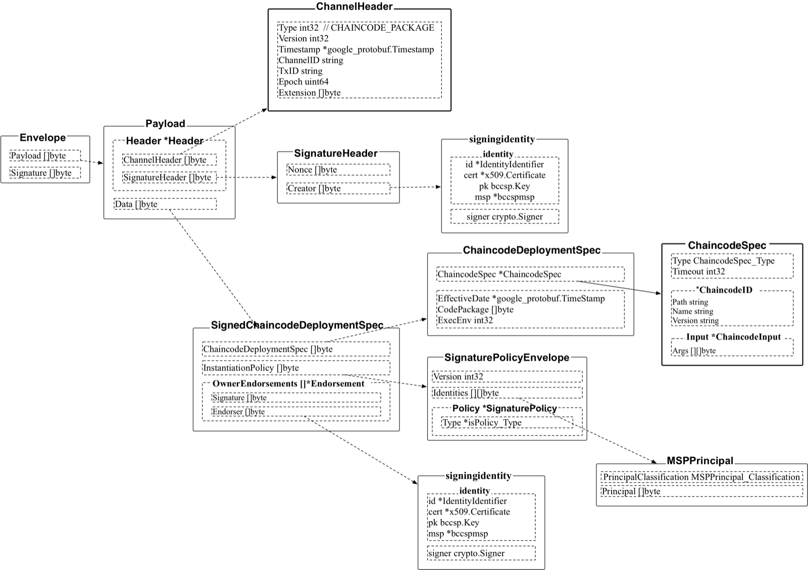

## 管理链上代码（Lifecycle）

从 Fabric 2.0 开始，引入了全新的链码生命周期管理机制（Chaincode Lifecycle），旨在支持更去中心化的治理模式。与 1.x 版本中“一旦实例化全网生效”的旧 LSCC 生命周期不同，新生命周期要求组织间达成共识才能启动链码。

本章将详细介绍如何使用 `peer lifecycle chaincode` 命令族来管理 Fabric 2.5 LTS 和 Fabric 3.x 网络的链码。旧的 `peer chaincode install/instantiate/upgrade/list` 仅作为历史网络和迁移背景理解，不应用于启用 `V2_0` 应用能力的通道。

## 链码生命周期概览

在 Fabric 2.5 LTS 和 Fabric 3.x 中，部署一个链码需要经历以下四个核心步骤：

1.  **打包（Package）**: 将链码源码和元数据打包成 `.tar.gz` 文件。
2.  **安装（Install）**: 将链码包安装到 **每个** 需要运行该链码的 Peer 节点上。
3.  **批准（Approve）**: 每个组织根据自己的意愿，为特定的链码定义（版本、背书策略等）投票（批准）。
4.  **提交（Commit）**: 当获得足够多组织（满足生命周期背书策略，默认是大多数）的批准后，链码定义被提交到通道，正式生效。

之后，用户就可以调用或查询链码了。


## 1. 打包链码 （Package）

打包操作在本地进行，不需要连接网络。

```bash

## 设置环境变量
export CC_NAME=basic
export CC_VERSION=1.0
export CC_SRC_PATH=../asset-transfer-basic/chaincode-go

# 打包
peer lifecycle chaincode package ${CC_NAME}.tar.gz \
    --path ${CC_SRC_PATH} \
    --lang golang \
    --label ${CC_NAME}_${CC_VERSION}
```

这会生成一个 `basic.tar.gz` 文件。

## 2. 安装链码 （Install）

将打包好的文件安装到 Peer 节点上。此操作是针对**节点**的，需要在所有背书节点上执行。

```bash
peer lifecycle chaincode install ${CC_NAME}.tar.gz
```

安装成功后，系统会返回一个**包标识符（Package ID）**，格式为 `label:hash`。你需要记录下这个 ID，后续步骤会用到。

```bash

# 查询已安装的链码包ID
peer lifecycle chaincode queryinstalled

# 输出示例: basic_1.0:e23a...
```

## 3. 组织批准 （Approve）

这是 2.x 最关键的变更。每个组织都需要使用自己的 MSP 身份批准链码定义。链码定义包括：名称、版本、序列号、背书策略等。

**注意**：所有组织必须批准**相同的链码定义参数**，但 `Package ID` 本身不要求每个组织完全一致。是否填写 `Package ID`，取决于该组织是否需要在本地安装并运行对应链码包。

```bash

# 环境变量
export PACKAGE_ID=basic_1.0:e23a...
export CHANNEL_NAME=mychannel

# 批准链码定义
peer lifecycle chaincode approveformyorg \
    --channelID ${CHANNEL_NAME} \
    --name ${CC_NAME} \
    --version ${CC_VERSION} \
    --package-id ${PACKAGE_ID} \
    --sequence 1 \
    --tls --cafile ${ORDERER_CA}
```

*   `--sequence`: 序列号。首次部署为 1，每次升级链码时需递增（如 2, 3）。
*   `--package-id`: 指定本组织要安装并运行的代码包 ID；没有本地安装需求的组织可以只批准链码定义，而不绑定同一个包 ID。

你可以随时检查当前通道的批准状态：

```bash
peer lifecycle chaincode checkcommitreadiness \
    --channelID ${CHANNEL_NAME} \
    --name ${CC_NAME} \
    --version ${CC_VERSION} \
    --sequence 1 \
    --output json
```

## 4. 提交链码 （Commit）

当 `checkcommitreadiness` 显示已有足够多的组织（默认是大多数，Majority）批准了该定义，任意一个组织的管理员都可以执行提交操作。

```bash
peer lifecycle chaincode commit \
    --channelID ${CHANNEL_NAME} \
    --name ${CC_NAME} \
    --version ${CC_VERSION} \
    --sequence 1 \
    --tls --cafile ${ORDERER_CA} \
    --peerAddresses peer0.org1.example.com:7051 --tlsRootCertFiles ${ORG1_CA} \
    --peerAddresses peer0.org2.example.com:9051 --tlsRootCertFiles ${ORG2_CA}
```

**注意**：`commit` 交易需要收集足够多组织的背书，因此通常需要指定多个 `--peerAddresses` 来收集背书签名。

## 5. 调用与查询

链码提交成功后，即可正常使用。如果链码包含 `Init` 方法且需要初始化，可以使用 `--isInit` 标志调用一次（需要在 Approve 和 Commit 时指定 `--init-required`）。大多数现代链码不需要显式 Init。

**调用（Invoke）:**

```bash
peer chaincode invoke \
    -o localhost:7050 \
    --ordererTLSHostnameOverride orderer.example.com \
    --tls --cafile ${ORDERER_CA} \
    -C ${CHANNEL_NAME} \
    -n ${CC_NAME} \
    --peerAddresses peer0.org1.example.com:7051 --tlsRootCertFiles ${ORG1_CA} \
    --peerAddresses peer0.org2.example.com:9051 --tlsRootCertFiles ${ORG2_CA} \
    -c '{"function":"InitLedger","Args":[]}'
```

**查询（Query）:**

```bash
peer chaincode query -C ${CHANNEL_NAME} -n ${CC_NAME} -c '{"Args":["GetAllAssets"]}'
```

## 升级链码

在 Fabric 2.x 中，升级链码本质上是更新链码定义。流程如下：

1.  **Package & Install**: 打包并安装新版本的代码（如 v1.1）。这会生成一个新的 Package ID。
2.  **Approve**: 组织批准新的定义。注意：**增加序列号**（如 `--sequence 2`），更新版本号，并指向新的 `package-id`。
3.  **Commit**: 提交新的定义。

不需要像 1.x 那样执行专门的 `upgrade` 命令，只要 Commit 成功，新代码即刻生效。

## 总结

新的生命周期管理（Lifecycle）虽然步骤看起来繁琐（Install -> Approve -> Commit），但它带来了真正的**去中心化治理**能力。组织之间可以协商链码的升级策略，而不再是被动接受某个管理员的单方面操作。这对于企业级联盟链来说至关重要。

## 监听网络事件

Fabric 的交易提交是异步完成的。客户端提交交易后，需要通过提交状态或事件来确认交易是否已经被 Peer 验证并写入账本。

### 推荐方式：Fabric Gateway 事件

Fabric 2.4 之后，Peer 默认提供 Fabric Gateway 服务。Fabric 2.5 LTS 和 Fabric 3.x 的应用程序应优先使用 Gateway 客户端 API（Go、Node.js、Java）接收事件，而不是使用早期 SDK 的 EventHub 或示例工具 `eventsclient`。

Gateway API 可以处理以下常见场景：

* 提交交易后等待 commit status，获取交易验证码；
* 订阅链码事件，响应链码在成功提交交易中发出的事件；
* 订阅区块事件或过滤区块事件，处理账本新增区块。

Gateway 层内部会使用 Peer 的通道事件服务，但对应用隐藏了底层 Deliver 协议细节。应用侧只需要连接目标 Peer 的 Gateway gRPC 地址（通常与 Peer 服务地址相同，例如 `peer0.org1.example.com:7051`）。

### 底层 Peer 事件服务

如果需要直接接入底层事件流，可以使用 Peer 的通道事件服务。该服务按通道授权和投递事件，默认由通道 Readers 策略控制访问权限。

Fabric 2.5 LTS 和 Fabric 3.x 主要提供三类 Deliver 服务：

* `Deliver`：返回完整区块，区块中包含交易和链码事件信息；
* `DeliverWithPrivateData`：返回完整区块，并附带客户端组织有权限访问的私有数据；
* `DeliverFiltered`：返回过滤后的区块，只包含区块号、交易 ID、交易类型、验证码和过滤后的链码事件；过滤区块不会包含链码事件 payload。

客户端注册事件时，会向 Peer 发送包含 `SeekInfo` 的签名信封，指定起始和结束区块位置。需要持续监听时，结束位置通常设置为最大区块号。若 Peer 启用了双向 TLS，事件请求的通道头还需要包含 TLS 证书哈希。

### 旧 EventHub 和 eventsclient

Fabric 早期版本曾提供 Peer 级别的 EventHub，并常用 `eventsclient` 示例工具连接 `7053` 端口监听事件。这是旧事件模型：事件按 Peer 而非通道注册，访问控制和断点恢复能力都有限。

Fabric 1.1 起事件模型改为通道级 Deliver 服务；Fabric 2.5 LTS 和 Fabric 3.x 文档中不应再把 `eventsclient`、`eventHub` 或 `localhost:7053` 作为推荐做法。历史网络或旧 SDK 维护时，可以把这些内容作为迁移背景；新应用应使用 Gateway 事件 API，或直接实现 Deliver/DeliverFiltered 客户端。

## 自动探测网络信息

客户端要往 Fabric 网络中发送请求，首先需要知道网络的相关信息，如网络中成员、背书节点的地址、链码安装信息等。

在 Fabric v1.2.0 版本之前这些信息需要使用者来手动采集提供。这种方式下需要提前指定，容易出错，另外是当网络中信息变更后（如节点上下线）还需要再次更新。

为了解决这些问题，社区自 v1.2.0 版本开始在 Peer 节点上提供了 Discovery 服务，并编写了 discover 客户端工具（位于 discovery/cmd）。该工具可以访问 Peer 节点提供的 Discovery 服务，查询获取指定信息。

### 主要功能

discover 工具目前提供如下的查询功能：

* 节点信息查询：使用 `peers` 子命令查询节点的身份、服务等信息；
* 通道配置：使用 `config` 子命令查询通道的配置信息，包括成员组织、排序服务信息等；
* 链码背书信息：使用 `endorsers` 子命令查询对某个链码可以进行背书的节点信息。

命令使用格式为 `discover [全局参数] <子命令> [子命令参数列表]`。

### 全局参数

discover 支持的全局参数和相关说明如下：

```text
* --help：输出帮助信息；
* --configFile=CONFIGFILE：指定从配置文件中载入参数配置，则无需从命令行指定参数；
* --peerTLSCA=PEERTLSCA：指定校验 peer 端 TLS 的 CA 证书；
* --tlsCert=TLSCERT：指定客户端使用的 TLS 证书（可选，当 Peer 校验客户端 TLS 时）；
* --tlsKey=TLSKEY：指定客户端使用的 TLS 私钥（可选，当 Peer 校验客户端 TLS 时）；
* --userKey=USERKEY：客户端签名私钥；
* --userCert=USERCERT：客户端签名证书；
* --MSP=MSP：指定客户端的 MSP ID。
```

### 子命令

discover 目前支持四个子命令：`peers`、`config`、`endorsers`、`saveConfig`，可以通过 `help <子命令>` 来查看各子命令的功能和使用方法。

#### peers 子命令

显示网络中的 Peer 节点信息，包括它们的 MSP Id、gRPC 服务监听地址和身份证书。

命令格式为 `peers [参数列表]`，支持参数如下：

```text
* --server=SERVER：指定命令连接的 Peer 节点地址；
* --channel=CHANNEL：指定查询某个特定通道内的节点信息。
```

例如，通过 peer0.org1.example.com 节点查询 businesschannel 通道内的 Peer 节点信息，可以执行如下命令：

```bash
$ discover \
    --peerTLSCA tls/ca.crt \
    --userKey msp/keystore/f76cf3c92dac81103c82d5490c417ac0123c279f93213f65947d8cc69e11fbc5_sk \
    --userCert msp/signcerts/Admin\@org1.example.com-cert.pem \
    --MSP Org1MSP \
    --tlsCert tls/client.crt \
    --tlsKey tls/client.key \
    peers \
    --server peer0.org1.example.com:7051 \
    --channel businesschannel

[
	{
		"MSPID": "Org2MSP",
		"Endpoint": "peer1.org2.example.com:7051",
		"Identity": "-----BEGIN CERTIFICATE-----\nMIICKD...pVTw==\n-----END CERTIFICATE-----\n"
	},
	{
		"MSPID": "Org2MSP",
		"Endpoint": "peer0.org2.example.com:7051",
		"Identity": "-----BEGIN CERTIFICATE-----\nMIICKT...cGaA=\n-----END CERTIFICATE-----\n"
	},
	{
		"MSPID": "Org1MSP",
		"Endpoint": "peer0.org1.example.com:7051",
		"Identity": "-----BEGIN CERTIFICATE-----\nMIICKD...mgaA==\n-----END CERTIFICATE-----\n"
	},
	{
		"MSPID": "Org1MSP",
		"Endpoint": "peer1.org1.example.com:7051",
		"Identity": "-----BEGIN CERTIFICATE-----\nMIICKD...UO+g==\n-----END CERTIFICATE-----\n"
	}
]
```

结果显示 businesschannel 通道内目前包括属于 2 个组织的 4 个 Peer 节点成员：

* Org1MSP
  * peer0.org1.example.com
  * peer1.org1.example.com
* Org2MSP
  * peer0.org2.example.com
  * peer1.org2.example.com

#### config 子命令

显示网络中的通道配置信息，包括各个组织的 MSP 信息和排序节点信息。

命令格式为 `config [<参数>]`，支持参数如下：

```text
* --server=SERVER：指定命令连接的 Peer 节点地址；
* --channel=CHANNEL：指定查询某个特定通道内的配置信息。
```

例如，通过 peer0.org1.example.com 节点查询 businesschannel 通道内的配置信息，可以执行如下命令：

```bash
$ discover \
    --peerTLSCA tls/ca.crt \
    --userKey msp/keystore/f76cf3c92dac81103c82d5490c417ac0123c279f93213f65947d8cc69e11fbc5_sk \
    --userCert msp/signcerts/Admin\@org1.example.com-cert.pem \
    --MSP Org1MSP \
    --tlsCert tls/client.crt \
    --tlsKey tls/client.key \
    config \
    --server peer0.org1.example.com:7051 \
    --channel businesschannel

{
	"msps": {
		"OrdererMSP": {
			"name": "OrdererMSP",
			"root_certs": [
				"LS0tLS...tLQo="
			],
			"admins": [
				"LS0tLS...LS0K"
			],
			"crypto_config": {
				"signature_hash_family": "SHA2",
				"identity_identifier_hash_function": "SHA256"
			},
			"tls_root_certs": [
				"LS0tLS...0tCg=="
			]
		},
		"Org1MSP": {
			"name": "Org1MSP",
			"root_certs": [
				"LS0tLS...0tCg=="
			],
			"admins": [
				"LS0tLS...LS0K"
			],
			"crypto_config": {
				"signature_hash_family": "SHA2",
				"identity_identifier_hash_function": "SHA256"
			},
			"tls_root_certs": [
				"LS0tLS...LS0K"
			],
			"fabric_node_ous": {
				"enable": true,
				"client_ou_identifier": {
					"certificate": "LS0tLS...0tCg==",
					"organizational_unit_identifier": "client"
				},
				"peer_ou_identifier": {
					"certificate": "LS0tLS...0tCg==",
					"organizational_unit_identifier": "peer"
				}
			}
		},
		"Org2MSP": {
			"name": "Org2MSP",
			"root_certs": [
				"LS0tLS...LS0K"
			],
			"admins": [
				"LS0tLS...0tCg=="
			],
			"crypto_config": {
				"signature_hash_family": "SHA2",
				"identity_identifier_hash_function": "SHA256"
			},
			"tls_root_certs": [
				"LS0tLS...LS0K"
			],
			"fabric_node_ous": {
				"enable": true,
				"client_ou_identifier": {
					"certificate": "LS0tLS...LS0K",
					"organizational_unit_identifier": "client"
				},
				"peer_ou_identifier": {
					"certificate": "LS0tLS...LS0K",
					"organizational_unit_identifier": "peer"
				}
			}
		}
	},
	"orderers": {
		"OrdererMSP": {
			"endpoint": [
				{
					"host": "orderer.example.com",
					"port": 7050
				}
			]
		}
	}
}
```

结果将显示通道内的各个 MSP 的信息和排序服务信息。

#### endorsers 子命令

显示网络中的背书节点信息，包括它们的 MSP Id、账本高度、服务地址和身份证书等。

命令格式为 `endorsers [参数列表]`，支持参数如下：

```text
* --server=SERVER：指定命令连接的 Peer 节点地址；
* --channel=CHANNEL：指定查询某个特定通道内的节点信息；
* --chaincode=CHAINCODE：指定链码名称列表；
* --collection=CC:C1,C2...：指定链码中集合信息。
```

例如，查询可以对链码 marblesp 的 collectionMarbles 集合进行背书的节点，可以执行如下命令：

```bash
$ discover \
    --peerTLSCA tls/ca.crt \
    --userKey msp/keystore/f76cf3c92dac81103c82d5490c417ac0123c279f93213f65947d8cc69e11fbc5_sk \
    --userCert msp/signcerts/Admin\@org1.example.com-cert.pem \
    --MSP Org1MSP \
    --tlsCert tls/client.crt \
    --tlsKey tls/client.key \
    endorsers \
    --server peer0.org1.example.com:7051 \
    --channel businesschannel \
    --chaincode marblesp \
    --collection=marblesp:collectionMarbles

[
	{
		"Chaincode": "marblesp",
		"EndorsersByGroups": {
			"G0": [
				{
					"MSPID": "Org1MSP",
					"LedgerHeight": 10,
					"Endpoint": "peer1.org1.example.com:7051",
					"Identity": "-----BEGIN CERTIFICATE-----\nMIICKD...UO+g==\n-----END CERTIFICATE-----\n"
				},
				{
					"MSPID": "Org1MSP",
					"LedgerHeight": 10,
					"Endpoint": "peer0.org1.example.com:7051",
					"Identity": "-----BEGIN CERTIFICATE-----\nMIICKD...mgaA==\n-----END CERTIFICATE-----\n"
				}
			],
			"G1": [
				{
					"MSPID": "Org2MSP",
					"LedgerHeight": 10,
					"Endpoint": "peer0.org2.example.com:7051",
					"Identity": "-----BEGIN CERTIFICATE-----\nMIICKT...cGaA=\n-----END CERTIFICATE-----\n"
				},
				{
					"MSPID": "Org2MSP",
					"LedgerHeight": 10,
					"Endpoint": "peer1.org2.example.com:7051",
					"Identity": "-----BEGIN CERTIFICATE-----\nMIICKD...pVTw==\n-----END CERTIFICATE-----\n"
				}
			]
		},
		"Layouts": [
			{
				"quantities_by_group": {
					"G0": 1
				}
			},
			{
				"quantities_by_group": {
					"G1": 1
				}
			}
		]
	}
]
```

结果将按组展示符合要求的背书节点的信息。

#### saveConfig 子命令

该命令并不与 Peer 节点打交道，它将通过参数指定的变量信息保存为本地文件。这样用户在执行后续命令时候可以指定该文件，而无需再指定各个参数值。

需要通过 `--configFile=CONFIGFILE` 来指定所存放的参数信息文件路径。

例如，保存指定的参数信息到本地的 discover_config.yaml 文件，可以执行如下命令：

```bash
$ discover \
    --peerTLSCA tls/ca.crt \
    --userKey msp/keystore/f76cf3c92dac81103c82d5490c417ac0123c279f93213f65947d8cc69e11fbc5_sk \
    --userCert msp/signcerts/Admin\@org1.example.com-cert.pem \
    --MSP Org1MSP \
    --tlsCert tls/client.crt \
    --tlsKey tls/client.key \
    --configFile discover_config.yaml \
    saveConfig
```

命令执行完成后，查看本地的 `discover_config.yaml` 文件内容如下：

```yaml
version: 0
tlsconfig:
  certpath: /etc/hyperledger/fabric/crypto-config/peerOrganizations/org1.example.com/users/Admin@org1.example.com/tls/client.crt
  keypath: /etc/hyperledger/fabric/crypto-config/peerOrganizations/org1.example.com/users/Admin@org1.example.com/tls/client.key
  peercacertpath: /etc/hyperledger/fabric/crypto-config/peerOrganizations/org1.example.com/users/Admin@org1.example.com/tls/ca.crt
  timeout: 0s
signerconfig:
  mspid: Org1MSP
  identitypath: /etc/hyperledger/fabric/crypto-config/peerOrganizations/org1.example.com/users/Admin@org1.example.com/msp/signcerts/Admin@org1.example.com-cert.pem
  keypath: /etc/hyperledger/fabric/crypto-config/peerOrganizations/org1.example.com/users/Admin@org1.example.com/msp/keystore/f76cf3c92dac81103c82d5490c417ac0123c279f93213f65947d8cc69e11fbc5_sk
```

有了这个参数文件，当再使用同样的参数时就无需手动指定，直接使用 `--configFile discover_config.yaml` 即可。

当然，用户也可以手动编写参数文件，但直接使用 saveConfig 命令自动生成将更加方便、高效。

## 使用运维服务

Fabric Peer 和 Orderer 都内置了运维服务（Operations Service）。它是独立于 Fabric 交易、背书和排序服务之外的 HTTP REST API，面向运维人员使用，不通过通道 MSP 做访问控制。

运维服务主要提供以下资源：

* `/logspec`：获取和修改运行时日志级别；
* `/healthz`：检查组件健康状态；
* `/metrics`：在启用 Prometheus provider 时暴露指标；
* `/version`：查看组件版本和构建信息。

Peer 的示例监听地址通常为 `127.0.0.1:9443`，Orderer 的示例监听地址通常为 `127.0.0.1:8443`。端口号本身不代表 HTTPS：如果 operations TLS 未启用，使用普通 `http://`；如果启用了 operations TLS，则使用 `https://` 并按配置提供客户端证书。

### 配置运维服务

Peer 在 `core.yaml` 的 `operations` 和 `metrics` 段配置：

```yaml
operations:
  listenAddress: 127.0.0.1:9443
  tls:
    enabled: false
    cert:
      file:
    key:
      file:
    clientAuthRequired: false
    clientRootCAs:
      files: []

metrics:
  provider: prometheus
```

对应的常用环境变量前缀为 `CORE_`：

```bash
CORE_OPERATIONS_LISTENADDRESS=127.0.0.1:9443
CORE_OPERATIONS_TLS_ENABLED=false
CORE_METRICS_PROVIDER=prometheus
CORE_METRICS_STATSD_ADDRESS=127.0.0.1:8125
```

上面的环境变量仅适合本机调试。Fabric 官方文档说明，operations service 不使用通道 MSP 做访问控制；当 TLS 关闭时，能连到端点的客户端都可以使用该 API。若需要让监控系统远程访问，应绑定受控内网地址，启用 operations TLS 和客户端证书认证，并使用独立运维 CA。

Orderer 在 `orderer.yaml` 的 `Operations` 和 `Metrics` 段配置：

```yaml
Operations:
  ListenAddress: 127.0.0.1:8443
  TLS:
    Enabled: false
    Certificate:
    PrivateKey:
    ClientAuthRequired: false
    ClientRootCAs: []

Metrics:
  Provider: prometheus
```

对应的常用环境变量前缀为 `ORDERER_`：

```bash
ORDERER_OPERATIONS_LISTENADDRESS=127.0.0.1:8443
ORDERER_OPERATIONS_TLS_ENABLED=false
ORDERER_METRICS_PROVIDER=prometheus
ORDERER_METRICS_STATSD_ADDRESS=127.0.0.1:8125
```

注意不要把 Peer 的 `CORE_*` 和 Orderer 的 `ORDERER_*` 混用。StatsD 的配置键也区分大小写和组件前缀，例如 Peer 使用 `CORE_METRICS_STATSD_WRITEINTERVAL`，Orderer 使用 `ORDERER_METRICS_STATSD_WRITEINTERVAL`。

### 获取和配置日志级别

日志资源为 `/logspec`。

获取日志级别可以发送 GET 请求，返回 JSON 格式对象。例如在未启用 operations TLS 时：

```bash
$ curl http://orderer:8443/logspec
{"spec":"info"}
$ curl http://peer:9443/logspec
{"spec":"info"}
```

修改日志级别可以发送 PUT 请求，消息内容为 `{"spec":"[<logger>[,<logger>...]=]<level>[:[<logger>[,<logger>...]=]<level>...]"}`。例如修改 Gossip 模块日志级别为 DEBUG，全局默认级别仍为 INFO：

```bash
$ curl -X PUT \
  -H 'Content-Type: application/json' \
  -d '{"spec":"gossip=debug:info"}' \
  http://peer:9443/logspec
```

启用 operations TLS 时，日志和指标接口需要有效客户端证书；如果 `clientAuthRequired` 为 `true`，所有接口都要求客户端证书。

### 监控系统组件的健康状态

健康检查资源为 `/healthz`。

可以发送 GET 请求，返回带有健康信息的 JSON 格式对象：

```bash
$ curl http://orderer:8443/healthz
{"status":"OK","time":"XXXX-YY-ZZT01:02:03.567890Z"}
$ curl http://peer:9443/healthz
{"status":"OK","time":"XXXX-YY-ZZT01:02:03.567890Z"}
```

Peer 健康检查会覆盖已配置的依赖，例如 Docker 链码运行环境和 CouchDB 状态数据库。Orderer 和 Peer 都会根据已注册的健康检查返回 `200 OK` 或 `503 Service Unavailable`。

### 获取系统统计信息

指标资源为 `/metrics`。只有当 `metrics.provider` / `Metrics.Provider` 设置为 `prometheus` 时，Fabric 才会在运维服务上暴露 Prometheus 指标。

```bash
$ curl http://orderer:8443/metrics

## HELP blockcutter_block_fill_duration The time from first transaction enqueuing to the block being cut in seconds.
# TYPE blockcutter_block_fill_duration histogram
blockcutter_block_fill_duration_bucket{channel="businesschannel",le="0.005"} 0
...

$ curl http://peer:9443/metrics

# HELP chaincode_launch_duration The time to launch a chaincode.
# TYPE chaincode_launch_duration histogram
chaincode_launch_duration_bucket{chaincode="basic",success="true",le="0.005"} 1
...
```

Orderer 的统计信息包括切块时间、广播队列、校验时间、发送块数量、Go 进程信息、gRPC 请求、系统资源等。Peer 的统计信息包括链码执行、Go 进程信息、gRPC 请求、区块处理、账本提交、状态数据库更新、系统资源等。

Fabric 支持两类指标模式：Prometheus 是拉取方式，由 Prometheus 主动访问 `/metrics`；StatsD 是推送方式，由 Peer 或 Orderer 将指标推送到 StatsD 服务。生产环境中应只暴露给受控监控网络，并优先启用 operations TLS 和专用运维 CA 证书。

下图展示了链码 shim 层请求的执行延迟统计。

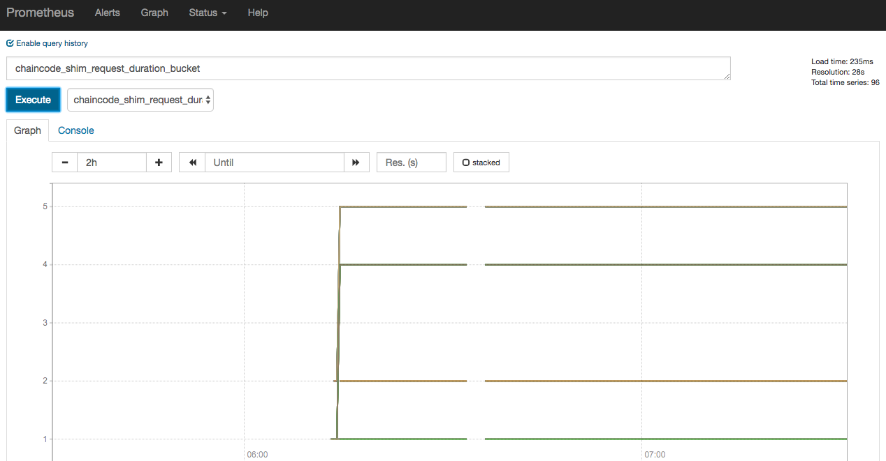

## 如何升级版本

经典 Fabric 支持在满足版本前置条件时滚动升级组件，但不能据此假定任意历史版本都可直接跨级升级，也不能把 Fabric-X 当作经典 Fabric 的下一主版本。

网络升级主要包括对如下资源进行升级：

* 核心组件：包括 Peer、Orderer、CA 等核心程序；
* 能力配置：更新通道配置中支持的能力集合版本号，以启动新的特性；
* 第三方资源：包括依赖的 CouchDB，以及旧网络中可能仍存在但升级到 Fabric 3.x 前必须迁移掉的 Kafka 排序服务。

### 支持状态与迁移矩阵

起点 | 目标 | 路径性质 | 必做事项 | 结论
--- | --- | --- | --- | ---
经典 Fabric v1.4.x | 经典 Fabric 2.5 LTS | 官方支持滚动升级 | 备份；修正链码 shim/运行时兼容性；对 Peer 执行 `peer node upgrade-dbs`；节点升级完成后再启用 `V2_0`/`V2_5` 能力并迁移到 v2 链码生命周期 | 可升级；不要跳过 v1.4 到 v2.x 的专项步骤
早于 v1.4 的经典 Fabric 1.x | 经典 Fabric 2.5 LTS | 没有当前文档覆盖的直接跨级路径 | 先按对应历史版本文档升级到 v1.4.x，或经业务停机、账本导出与重新部署评估后重建 | 不应直接套用 v1.4→2.5 命令
经典 Fabric 2.x/2.5 | 经典 Fabric 3.x | 官方支持滚动升级组件 | 在升级二进制前移除 Solo/Kafka、迁移全部链码到 v2 生命周期、移除系统通道并启用 Channel Participation API；配置组织级 `OrdererEndpoints` | 前置条件满足后，先滚动升级 Orderer/Peer，再启用 `V3_0` 能力
经典 Fabric 2.5/3.x | Fabric-X 1.x | 新平台迁移，不是经典 Fabric 原地升级 | 建立独立试验网络；重新验证客户端、智能合约、MSP/策略、状态与历史数据导入、性能及灾备；设计双写、停机切换或回滚方案 | **不存在“替换镜像后沿用原账本”的官方直接升级路径**

官方依据如下：

* [Fabric 2.5 文档](https://hyperledger-fabric.readthedocs.io/en/release-2.5/whatsnew.html)将 2.5.x 定位为 LTS，并说明 v1.4.x 可直接滚动升级到 2.5.x；[2.5 升级注意事项](https://hyperledger-fabric.readthedocs.io/en/release-2.5/upgrade_to_newest_version.html)给出了数据库和链码生命周期转换步骤。
* [Fabric 3.x 升级注意事项](https://hyperledger-fabric.readthedocs.io/en/latest/upgrade_to_newest_version.html)明确移除了 Solo、Kafka 和 v1.x 链码生命周期；[能力说明](https://hyperledger-fabric.readthedocs.io/en/latest/capabilities_concept.html)要求仍使用系统通道的网络先迁移到 Channel Participation API。
* LF Decentralized Trust 将[经典 Fabric 和 Fabric-X 描述为两种不同实现](https://www.lfdecentralizedtrust.org/projects/fabric)。[Fabric-X 路线图](https://www.lfdecentralizedtrust.org/blog/the-hyperledger-fabric-x-roadmap)说明其使用新的编程、排序和提交架构，并仍在探索经典 Fabric 链码兼容性。因此，Fabric-X 的 API 或账本格式兼容点不能被解释为经典 Fabric 的升级承诺。

### 能力类型

为了避免网络多个节点运行不同版本组件时出现分叉风险，自 1.1.0 版本起在通道配置中引入了能力（Capabilities），标记节点应当支持和启用的特性。如果某节点程序版本低于能力要求则无法加入或自动退出；同时通道内高版本的节点程序在提交校验时只启用指定的特性集合检查（可参考 core/handlers/validation/builtin）。

目前能力分为三种类型，分别管理不同范围，如下表所示。

类型 | 功能  | 配置路径
--- | --- | ---
通道（Channel）能力| 通道整体相关能力，排序和 Peer 节点都得满足 | /Channel/Capabilities
排序（Orderer）能力| 排序服务能力，只与排序节点有关 | /Channel/Orderer/Capabilities
应用（Application）能力| 应用相关能力，只与 Peer 节点有关 | /Channel/Application/Capabilities

如果要启用相应的能力，需要修改通道配置内对应配置。例如，用户可以指定通道能力为 v1.1.0，排序能力为 v1.1.0 模式下，而应用能力为 v1.3.0。此时，只有不低于 v1.1.0 版本（满足通道和排序能力的较大者）的排序节点，以及不低于 v1.3.0 版本（满足通道和应用能力的较大者）的 Peer 节点可以支持该通道。同时，即使排序节点和 Peer 节点程序版本更新（如 v2.x），仍然只会启用指定的能力集合。

需要注意能力配置只能调整到更新版本而不应回退，例如可以将能力模式 v1.3.0 更新为更高版本的 v1.4.0，反之无意义。这是因为旧版本的节点即便加入到通道内，仍然无法正常处理其中新版本启用阶段的交易。

其中，各能力集合的版本和内容（可参考 common/capabilities）如下表所示，注意并不与程序版本一致。

能力版本 | 起始程序版本 | 类型 | 能力内容
--- | --- | --- | ---
ChannelV1_1 | v1.1.0 | 通道 | 仅供标记，程序版本为 1.1.0+
ChannelV1_3 | v1.3.0 | 通道 | 支持 idemix
OrdererV1_1 | v1.1.0 | 排序 | 重新提交和身份超时检查
OrdererV1_4_2 | v1.4.2 | 排序 | 引入共识类型迁移，即排序服务从 Kafka 切换到 Raft
OrdererV2_0 | v2.0.0 | 排序 | 继承 V1_4_2 的共识类型迁移能力；注意排序能力没有 V3_0
ApplicationV1_1 |v1.1.0 | 应用 | 禁止区块内重复交易 Id
ApplicationV1_2 |v1.2.0 | 应用 | 正式支持私有数据，支持升级私有数据成员组配置，细粒度的通道资源访问控制（ACL）
ApplicationV1_3 |v1.3.0 | 应用 | 支持基于键值的背书
ApplicationV2_0 |v2.0.0 | 应用 | 新的链码生命周期管理，以及配套的链码操作命令
ApplicationV2_5 |v2.5.0 | 应用 | 支持 Purge Private Data
ChannelV2_0 | v2.0.0 | 通道 | 与 V2_0 应用/排序能力配套
ChannelV3_0 | v3.0.0 | 通道 | Fabric 3.x 的通道能力（BFT 排序服务需要）

### 推荐升级步骤

#### 升级排序服务

对于不改变排序模式的情况下，升级较为简单。

逐个停止排序节点，并备份本地数据，包括身份文件、账本数据、配置文件等。

升级排序服务程序。重新启动并检查是否工作正常，如获取区块、发送交易等。

*注：自 Fabric v2.3 起，Kafka 排序服务已被正式废弃；升级到 v3.x 之前，应先完成从 Kafka 到 Raft 的迁移。对于新部署网络，当前更稳妥的默认建议仍是优先使用 **Raft**；BFT 更适合在确有拜占庭容错需求时专项评估，而不应简单视为 v3.0+ 的默认首选。*

#### 升级 Peer 节点

逐个停止 Peer 节点，并备份本地数据，包括身份文件、账本数据、链码包、配置文件等。

升级 Peer 程序。重新启动并检查是否工作正常，如查询信息、发送交易提案等。

链码包如果之前有引入旧的第三方库或者 Shim 包，或者需要启用新的 API，则还要执行链码升级操作。

#### 升级 CA 服务

停止 Fabric-CA 服务，备份数据库。

升级 fabric-ca 程序，重新启动并检查是否工作正常，如获取根证书。

```bash
$ fabric-ca-client getcacert -u https://<fabric-ca-server>:7054 --tls.certfiles tls-cert.pem
```

#### 升级通道配置

按照新的格式发送通道更新请求，特别是修改对应能力域值为新的版本。

对于 Fabric 2.x 中仍保留系统通道的旧网络，升级到 Fabric 3.x 前必须先按照官方流程迁移到 Channel Participation API 并移除系统通道；Fabric 3.x 不再支持系统通道，也不支持通过系统通道创建应用通道。

能力配置应按通道逐步更新：先确认排序节点、Peer 节点二进制版本均已满足目标能力，再分别更新各应用通道的 Channel、Orderer 和 Application 能力。更新后测试网络功能，如获取新区块、提交配置更新、调用链码等是否正常。

#### 升级第三方组件

包括 CouchDB 等第三方组件，升级之前最好备份数据文件。

CouchDB 版本自 1.x 版本可以很容易升级到高版本，具体操作可以参考项目文档：https://docs.couchdb.org/en/stable/install/upgrading.html。

如果网络仍停留在 Kafka 排序服务上，更稳妥的做法不是继续升级 Kafka，而是尽快按照官方迁移文档转向 Raft，再继续进行 Fabric 主版本升级。

## SDK 支持

除了基于命令行的客户端之外，超级账本 Fabric 历史上还提供过多种语言的 SDK，包括 Node.js、Python、Java、Go 等。但对新项目来说，更重要的是区分**历史 SDK**与**当前推荐路径**。

这些客户端能力允许用户和应用跟 Fabric 网络进行交互，但现代应用开发的推荐主路径已经转向 **Fabric Gateway**。因此，本节后半部分提到的传统 SDK 应更多理解为**历史项目或兼容性参考**，而不是新项目的默认选型。

**特别说明**：自 Fabric v2.4+ 起，Fabric Gateway 成为推荐的应用开发方式，它提供了更简洁的 API，简化了交易构造和背书收集的过程。建议新项目优先使用 Fabric Gateway API 而非传统的 SDK 接口。

### Fabric Gateway（推荐）

自 Fabric v2.4 起，**Fabric Gateway** 成为应用开发的首选方式。Gateway 将交易提案构造、背书收集和提交等复杂逻辑从客户端移至 Peer 节点内部，开发者只需连接到一个可信的 Gateway Peer 即可完成所有操作。

Gateway API 支持 Go、Node.js 和 Java 三种语言，源码仓库地址在 github.com/hyperledger/fabric-gateway。

以下是使用 Go 语言 Gateway API 提交交易的简化示例：

```go
package main

import (
	"crypto/x509"
	"fmt"
	"os"

	"github.com/hyperledger/fabric-gateway/pkg/client"
	"github.com/hyperledger/fabric-gateway/pkg/identity"
	"google.golang.org/grpc"
	"google.golang.org/grpc/credentials"
)

func main() {
	// 1. 加载 TLS 证书，建立 gRPC 连接到 Gateway Peer
	certPEM, _ := os.ReadFile("path/to/tls-ca-cert.pem")
	certPool := x509.NewCertPool()
	certPool.AppendCertsFromPEM(certPEM)
	tlsCreds := credentials.NewClientTLSFromCert(certPool, "peer0.org1.example.com")

	clientConnection, _ := grpc.NewClient("peer0.org1.example.com:7051",
		grpc.WithTransportCredentials(tlsCreds))
	defer clientConnection.Close()

	// 2. 创建客户端身份（从 MSP 证书和私钥）
	clientCertPEM, _ := os.ReadFile("path/to/client-cert.pem")
	clientCert, _ := identity.CertificateFromPEM(clientCertPEM)
	clientID, _ := identity.NewX509Identity("Org1MSP", clientCert)
	// ... 此处省略私钥加载和 Sign 函数创建

	// 3. 创建 Gateway 连接
	gw, _ := client.Connect(clientID, client.WithSign(sign),
		client.WithClientConnection(clientConnection))
	defer gw.Close()

	// 4. 获取网络和合约引用
	network := gw.GetNetwork("mychannel")
	contract := network.GetContract("mychaincode")

	// 5. 提交交易（自动完成背书、排序、提交）
	result, _ := contract.SubmitTransaction("CreateAsset", "asset1", "blue", "10")
	fmt.Printf("Transaction result: %s\n", string(result))

	// 6. 查询账本（仅背书，不提交）
	result, _ = contract.EvaluateTransaction("ReadAsset", "asset1")
	fmt.Printf("Query result: %s\n", string(result))
}
```

*注：以上为简化示例，省略了错误处理和私钥加载逻辑。完整可运行的样例参见 [fabric-samples/asset-transfer-basic](https://github.com/hyperledger/fabric-samples/tree/main/asset-transfer-basic/application-gateway-go)。*

相比传统 SDK，Fabric Gateway 的优势在于：客户端逻辑大幅简化（无需手动管理背书策略和节点发现）、自动重试机制、更好的错误处理，以及显著减少的网络往返次数。

### 历史 Node.js SDK（兼容性参考）

作为早期创建的 SDK 项目之一，Node.js SDK 曾支持对 Fabric 链码的主要操作以及访问 Fabric CA 服务。但在现代 Fabric 版本中，它更适合作为历史参考；新开发建议优先选择 Fabric Gateway。

源码仓库地址在 github.com/hyperledger/fabric-sdk-node。

源码的 test/integration/e2e 目录下包括了大量应用的示例代码，可供参考。

### 历史 Python SDK（历史项目）

Python 实现的 SDK 是早期项目，当前更多适合作为历史资料参考；如果是新的生产项目，不应把它当作官方推荐主线。

源码仓库地址在 github.com/hyperledger/fabric-sdk-py。

源码的 test/integration 目录下包括了大量应用的示例代码，可供参考。

### 历史 Java SDK（兼容性参考）

Java SDK 曾支持对 Fabric 中链码的主要操作以及访问 Fabric CA 服务，但现代 Java 应用开发同样更推荐 Fabric Gateway。

源码仓库地址在 github.com/hyperledger/fabric-sdk-java。

### 历史 Go SDK（已被 Gateway 路线取代）

Go SDK 也属于较早期的客户端路线。对新项目而言，更稳妥的建议仍然是优先使用 Fabric Gateway，而不是把传统 Go SDK 视为首选方案。

源码仓库地址在 github.com/hyperledger/fabric-sdk-go。

## 注意事项与最佳实践

区块链分布式结构的特点，使得其在管理上相对单点系统要复杂得多，需要从多个角度进行仔细考量和论证。这里总结一些在生产环境中使用 Fabric 网络需要注意的地方和最佳实践技巧。

### 节点角色差异

Fabric 网络中各个节点可以拥有不同的角色。不同角色的众多节点负责整个网络功能中不同环节的工作负载，呈现出了差异化的处理特性。

Ordering 服务需要排序整个网络中所有的交易消息，是全网的关键组件。Orderer 维护网络中所有通道的区块链结构，往往大量吞吐区块文件。因此，对于 Orderer 节点来讲需要加强网络（至少千兆网络）、存储和内存方面的配置，并且采用集群部署的方式提高其可靠性。

Peer 节点除了处理区块和背书交易（Endorser）之外，还需要对账本状态进行更新（Committer），对身份进行验证。同时，对于每个通道来说，加入通道的节点都需要维护一个针对该通道的账本结构（存放在数据库中）和区块链结构（存放在文件系统）。因此，Peer 节点需要加强 CPU、内存、存储等资源配置，Endorser 还可以在签名处理方面进行加权。对于打开文件句柄较多的节点（如配置使用 CouchDB 作为状态数据库时），可能还需要对系统的 ulimit 等参数进行调整。

而对于链码容器来说，自身不需要维护太多状态信息，但是需要执行计算操作，因此需要提供较好的计算能力支持。

一般来讲，链码容器常常跟 Peer 节点在同一服务器上，建议为 Peer 服务预留 2 GB 以上的空闲内存，4 CPU 以上资源，并且一般每个链码容器分配 256 MB 运行内存和 1/10 的 CPU 核资源（根据链码逻辑进行调整）。

### 日志级别

日志级别越低，输出日志内容越详细，出现问题后方便进行调试。但输出过多日志会拖慢系统的吞吐性能，严重时甚至能降低几个数量级。

因此，在生产环境中必须要仔细调整日志级别。对于关键路径上的系统，通常要配置不低于 Warning 级别的日志输出；对于非关键路径上的系统，则可以采用不低于 Info 级别的日志输出。

Fabric 在日志级别上，支持对不同组件提供不同的级别。推荐将全局配置为 warning 级别，gRPC 组件由于需要处理大量交互消息，可以配置为更高的 error 级别。

如果要追踪区块链网络中的状态变化，可以通过事件监听等方式，降低对网络处理的压力。

### 链码升级

在 Fabric 2.x 的链码生命周期（Lifecycle）下，升级链码本质上是更新链码定义：递增序列号（`--sequence`）、更新版本号并重新打包安装后，由各相关组织重新批准（approve），在满足通道的生命周期背书策略（默认为大多数组织，Majority）后，由任一组织提交（commit）生效。详见“管理链上代码（Lifecycle）”一节。

与 1.x 旧 LSCC 机制不同，升级需要组织间达成共识；一旦新定义提交成功，便在通道范围内统一生效，而非由单个管理员单方面操作，也不会出现部分节点新旧版本并存的情况。

从数据一致性上考虑，新版本链码应能够正确读取旧版本写入的状态数据，避免数据结构不兼容导致读写错误。建议先在测试网络或个别组织上，用新版本（递增 `--sequence`）验证对原有数据的读写，确认无误后再在生产通道上推进批准与提交。

大多数现代链码无需显式的 Init 方法；如确有初始化需求，可在 approve 与 commit 时指定 `--init-required`，并在提交后用 `--isInit` 调用一次以保护原有数据。

### 组织结构

组织代表了维护网络的独立成员身份。一般来说，组成联盟链的各个成员，每个都拥有代表自己身份的组织。一个组织可以进一步包括多个资源实体，这些资源实体彼此具有较强的信任度，并且对外都呈现为同一组织身份。

由于 Gossip 协议目前在 MSP 范围内进行传播，因此，一般建议将组织与 MSP 一一对应，即每个组织拥有自己专属的 MSP。当一个组织拥有多个 MSP 时，不同成员之间的交互可能会带来障碍；当多个组织同属于一个 MSP 时，可能会发生不希望的跨组织的数据泄露。

另外，一个组织可以包括多个成员身份，多个 Peer 可以通过使用同一成员身份来提高高可用性。

### 证书管理

Fabric 网络中，CA 负责证书的管理。`cryptogen` 主要用于测试和开发环境中快速生成网络密钥材料，通常不应作为生产网络的证书签发和生命周期管理工具。生产网络应由各组织运营 Fabric CA 或符合企业安全要求的外部 PKI/中间 CA，用于注册、签发、轮换和吊销节点、管理员、客户端等身份。

Fabric CA 占据网络中安全和隐私的最核心位置，因此需要加强安全方面的防护。CA 不应该暴露在公共网络域中，并且只能由有限个具备权限的用户可以访问。

另外，根证书往往要进行离线保护处理，减少接触和泄露的可能性。通常使用中间层证书来完成实体证书的签发。同时，绝对不能直接用根证书作为组织管理员的身份证书。

### 账本备份和裁剪

Fabric 2.3 之后支持 Peer 账本快照（ledger snapshot），可用于让新 Peer 从某一高度加入通道，或在多个 Peer 间比较快照哈希以检查是否存在账本分叉。但快照不是完整备份，也不会对已加入通道的 Peer 执行账本归档或裁剪。

一方面，推荐用户根据业务需求和吞吐量来估算所需磁盘的大小。一般的，在平均每秒百次 TPS、交易消息不太大情况下，每年大约产生 3 TB 左右数据。生产环境应为区块文件、状态数据库、私有数据、历史数据库和快照目录分别规划容量和告警阈值。

账本文件一般位于默认的 `/var/hyperledger/production` 目录下，包括区块文件、状态数据库、私有数据存储、历史数据库和节点本地元数据。不要手动删除活跃 Peer 的旧区块文件来“裁剪”账本；这会破坏后续的 `reset`、`rollback`、`rebuild-dbs` 等管理操作，并可能导致节点无法一致恢复。

快照目录只包含加入通道所需的最小数据，例如公开状态、私有数据哈希、交易 ID 和集合配置历史；不包含私有数据明文、完整区块历史、MSP、节点配置或运行时数据库文件。因此：

* 快照可以压缩、分发给新 Peer，或用于一致性校验；
* 快照不能替代 Peer 完整备份，也不能作为回滚到历史高度的机制；
* 通过快照加入通道的 Peer 不具备完整历史区块，不能使用依赖完整区块文件的 `reset`、`rollback` 或 `rebuild-dbs` 命令；
* 私有数据需要在加入后从有权限的集合成员 Peer 中重新协调拉取，可能需要额外时间；
* Fabric 2.5 的私有数据 purge 只处理私有数据状态和历史，不等同于公开账本裁剪。

完整备份应在一致性窗口内覆盖 Peer 文件系统、状态数据库（如 CouchDB）、私有数据、MSP、TLS 材料和配置文件，并在恢复演练中验证节点能重新加入网络、同步区块、查询账本和处理链码调用。

### 系统优化

区块链作为分布式系统，对系统的计算、网络、存储等资源都有所需求，优化的系统配置可以有效提高资源效率。

例如，可以调整系统缓存策略、允许打开的文件句柄数、调整 TCP 连接超时时间等网络参数等。如果使用容器，还可以调整容器的资源限额和访问权限等。

此外，对于第三方软件也应该根据对应文档进行调整和优化。例如使用 CouchDB 作为状态数据库时，应单独规划认证、网络隔离、备份和容量告警。仍使用 Kafka 排序服务的旧 Fabric 2.x 网络，应先迁移到 Raft，再考虑升级到 Fabric 3.x。
