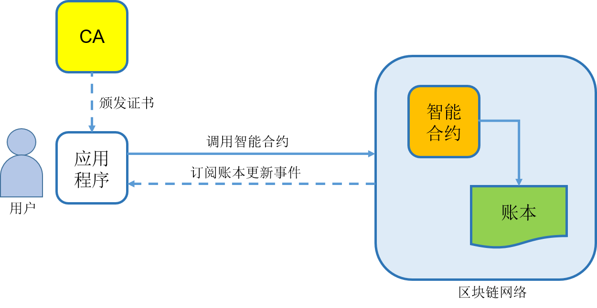

# 第十一章 智能合约开发

**代码即律法（Code is law）。**

智能合约丰富了区块链技术的适用范围，让分布式账本支持大规模的商业应用成为可能。

区块链应用开发者不光需要理解业务逻辑，还要能够开发智能合约和用户应用。超级账本 Fabric 的链码支持主流编程语言如 Go、Java、Node，并提供了链码开发框架，简化了分布式应用的开发过程。

本章将介绍 Fabric 链码的基本概念、结构和核心 API（包括推荐使用的 Contract API 和底层的 shim API），并通过六个可独立运行的案例演示如何实现典型区块链应用。通过本章学习，读者将掌握设计和开发链码的实践技巧。

> 六个链码示例分别位于 `examples/example01` 至 `examples/example06`，每个目录都是可独立编译和测试的 `main` 包。可在本目录运行 `go test ./examples/... -count=1` 一次验证全部示例。

## 简介

区块链应用一般由两部分组成：部署在区块链网络中的智能合约，以及调用这些智能合约的用户应用程序。典型结构如下图所示。



用户访问与业务相关的上层应用程序，应用程序调用智能合约，智能合约再与账本直接交互。

开发者除了需要开发传统的上层业务应用，还需要编写链上智能合约代码。智能合约通常是无状态、事件驱动的代码，被调用时执行合约逻辑，并创建、读取或更新账本状态。这些链上状态记录业务相关的重要数据，如资产信息、所有权、交易记录等。

在支持访问控制的场景下，应用程序还需要提前从 CA 获取身份证书，并使用该身份连接区块链网络。

### 智能合约开发

智能合约直接操作账本状态，同时承载核心业务规则，设计质量会直接影响应用的安全性、可维护性和扩展性。

以超级账本 Fabric 为例，链码可以使用 Go、JavaScript/TypeScript、Java 等语言开发。Go 链码新项目优先使用 Contract API；只有需要更底层控制时，才直接使用 shim API。

本章后续内容以 Fabric 为例，讲解链码结构、开发方式和典型应用案例。

### 应用程序开发

应用程序通常以 Web、移动端 App、后端服务等形式呈现，通过调用智能合约交易函数来实现业务逻辑。应用程序既可以运行在区块链网络节点附近，也可以运行在外部服务器上，但必须能够访问 Fabric Gateway 所暴露的服务端点。

从 Fabric v2.4 起，客户端应用应优先使用官方 **Fabric Gateway API**。Gateway 负责协调背书、提交交易、等待提交状态、事件监听等流程，使应用代码集中在业务逻辑上。官方 Gateway 客户端 API 覆盖：

* Go；
* Node.js（TypeScript/JavaScript）；
* Java。

Python 相关 SDK 如果被提及，应视为社区方案或历史兼容方案，不应作为 Fabric v2.4+ 新项目的首选官方客户端 API。

应用程序通常需要完成以下步骤：

* 从 CA 或钱包中加载合法身份；
* 连接 Gateway；
* 获取 network 和 contract；
* 使用 evaluate 类调用读取账本状态；
* 使用 submit 类调用提交会更新账本的交易；
* 根据需要监听提交状态、链码事件或区块事件。

## 链码概念与结构

超级账本 Fabric 中的链码（Chaincode）负责响应应用程序提交的交易请求，执行合约逻辑，并与账本状态交互。

链码执行过程中可以创建状态并写入账本。状态绑定到链码命名空间，默认仅由该链码访问；在合适的权限和业务设计下，链码也可以调用其他链码。Fabric 2.x 支持内置链码运行时，也支持外部链码服务模式。

Fabric 支持多种链码开发语言，包括 Go、JavaScript/TypeScript、Java 等。Go 新项目优先使用 Contract API。

### 推荐：Contract API

Contract API 用普通 Go 方法描述交易函数，框架负责参数映射、返回值序列化、错误处理和交易上下文注入。当前示例使用 v2 模块：

```go
require github.com/hyperledger/fabric-contract-api-go/v2 v2.2.2
```

最小结构如下。

```go
package main

import (
	"fmt"

	"github.com/hyperledger/fabric-contract-api-go/v2/contractapi"
)

type SmartContract struct {
	contractapi.Contract
}

func (s *SmartContract) InitLedger(ctx contractapi.TransactionContextInterface) error {
	return ctx.GetStub().PutState("hello", []byte("world"))
}

func (s *SmartContract) Read(ctx contractapi.TransactionContextInterface, key string) (string, error) {
	value, err := ctx.GetStub().GetState(key)
	if err != nil {
		return "", fmt.Errorf("failed to read %s: %w", key, err)
	}
	if value == nil {
		return "", fmt.Errorf("state %s does not exist", key)
	}
	return string(value), nil
}

func (s *SmartContract) Write(ctx contractapi.TransactionContextInterface, key string, value string) error {
	return ctx.GetStub().PutState(key, []byte(value))
}

func main() {
	chaincode, err := contractapi.NewChaincode(&SmartContract{})
	if err != nil {
		fmt.Printf("Error creating chaincode: %s", err)
		return
	}
	if err := chaincode.Start(); err != nil {
		fmt.Printf("Error starting chaincode: %s", err)
	}
}
```

### 可选：底层 shim API

需要直接控制 Fabric 响应对象时，可以使用 shim API。当前 Go v2 包路径如下：

```go
import (
	"github.com/hyperledger/fabric-chaincode-go/v2/shim"
	pb "github.com/hyperledger/fabric-protos-go-apiv2/peer"
)
```

底层接口只包含 `Init` 和 `Invoke`：

```go
type Chaincode interface {
	Init(stub shim.ChaincodeStubInterface) *pb.Response
	Invoke(stub shim.ChaincodeStubInterface) *pb.Response
}
```

Fabric v1 早期示例中的独立 `Query` 回调已经不是当前链码接口的一部分。读取类交易也通过 `Invoke` 路径进入链码，再由函数名路由到只读逻辑；客户端侧则通常用 Gateway 的 evaluate 类调用表达“只读查询”。

## 链码示例一：信息公证

[examples/example01/main.go](examples/example01/main.go) 使用 Go Contract API 实现一个最小键值账本：

* `InitLedger`：初始化 `hello_world` 的值；
* `Write`：创建或更新指定 key 的 value；
* `Read`：读取指定 key 的 value。

代码入口使用 `contractapi.NewChaincode` 创建链码实例，并调用 `Start` 由 Fabric peer 托管执行。

```go
func main() {
	chaincode, err := contractapi.NewChaincode(&SmartContract{})
	if err != nil {
		fmt.Printf("Error creating chaincode: %s", err)
		return
	}
	if err := chaincode.Start(); err != nil {
		fmt.Printf("Error starting chaincode: %s", err)
	}
}
```

客户端应用在 Fabric v2.4+ 中应通过 Gateway API 调用合约。读取状态时使用 evaluate 类调用 `Read`；修改状态时使用 submit 类调用 `Write`。

## 链码示例二：交易资产

[examples/example02/main.go](examples/example02/main.go) 使用 Go Contract API 实现两个账户之间的整数余额转账。

### 主要交易函数

* `InitAccounts`：初始化两个账户及其余额；
* `Transfer`：从一个账户向另一个账户转账；
* `ReadAccount`：读取账户余额；
* `Delete`：删除账户。

示例依赖当前 Go Contract API：

```go
import "github.com/hyperledger/fabric-contract-api-go/v2/contractapi"
```

转账逻辑会检查金额必须为正数、账户必须存在、付款账户余额必须充足，并拒绝源账户和目标账户相同的转账，避免覆盖同一状态键时破坏余额守恒。客户端应用应通过 Gateway API 的 submit 类调用提交 `Transfer`，通过 evaluate 类调用读取 `ReadAccount`。

## 数字货币发行与管理

[examples/example03/main.go](examples/example03/main.go) 演示一个简化的数字货币业务：中央银行发行货币，商业银行接收发行额度，企业接收和转移余额。

### 数据结构

* `CenterBank`：中央银行名称、发行总量、可用余额；
* `Bank`：商业银行 ID、名称、收到总量、可用余额；
* `Company`：企业 ID、名称、余额；
* `Transaction`：转出方、转入方、金额和交易时间。

### 主要交易函数

* `InitLedger`：初始化中央银行及初始发行量；
* `CreateBank`：注册商业银行；
* `CreateCompany`：注册企业；
* `IssueCoin`：中央银行增发；
* `IssueCoinToBank`：中央银行向商业银行划拨；
* `IssueCoinToCompany`：商业银行向企业划拨；
* `Transfer`：企业之间转账；
* `GetCenterBank`、`GetBankByID`、`GetCompanyByID`、`GetTransactionByID`、`GetBanks`、`GetCompanies`、`GetTransactions`：读取状态。

示例使用账本状态维护递增 ID，并使用 Fabric 交易时间戳记录交易时间，避免在链码中直接调用本地系统时间。企业转账会检查余额并拒绝自转账，使中央银行可用余额、商业银行可用余额和企业余额之和保持与发行总量一致。

## 学历认证

[examples/example04/main.go](examples/example04/main.go) 演示学校、学生和学历变更记录的链上管理。示例为了便于阅读，使用派生字符串模拟地址、公钥、私钥和签名。

### 数据结构

* `School`：学校名称、位置、地址、公私钥和学生地址列表；
* `Student`：学生姓名、地址和学历记录 ID 列表；
* `Background`：学历记录 ID、离校时间和状态；
* `Record`：学校对学生学历状态的变更记录。

### 主要交易函数

* `CreateSchool`：创建学校；
* `CreateStudent`：创建学生；
* `EnrollStudent`：学校登记学生入学；
* `UpdateDiploma`：学校更新学生学历状态；
* `GetStudentByAddress`、`GetSchoolByAddress`、`GetRecordByID`、`GetBackgroundByID`、`GetRecords`：读取状态。

同一学校不能重复登记同一学生；学校只能更新本校已登记学生的学历状态，且不能重复写入相同状态。真实系统中，签名与验签应由客户端身份、证书和密码学库完成，本例只保留业务流程骨架。

## 社区能源共享

[examples/example05/main.go](examples/example05/main.go) 演示社区能源微网中的家庭账户和电力交易。

### 数据结构

* `Home`：家庭地址、可售电量、余额、状态和模拟密钥；
* `EnergyTransaction`：买方、卖方、交易电量、金额和时间。

### 主要交易函数

* `CreateUser`：创建家庭账户；
* `BuyByAddress`：买方向卖方购买指定电量；
* `ChangeStatus`：账户所有者修改是否可交易；
* `GetHomeByAddress`、`GetHomes`、`GetTransactionByID`、`GetTransactions`：读取状态。

交易逻辑会检查买方签名、卖方交易状态、卖方电量和买方余额，并拒绝买卖双方地址相同的交易。家庭状态只允许在不可交易（`0`）和可交易（`1`）之间发生实际变化。交易时间使用 Fabric 交易时间戳。

> 与 [学历认证示例](chaincode_example04.md) 一样，本例使用派生字符串模拟签名验证，仅保留业务流程骨架。真实系统中应由客户端身份、证书和密码学库完成签名与验签。

## 物流供应链简单案例

[examples/example06/main.go](examples/example06/main.go) 演示物流公司、快递点、寄件人、收件人和寄货单的基本流程。

### 数据结构

* `User`：用户姓名、位置、地址、联系方式、余额和模拟密钥；
* `Express`：物流公司名称、地址、联系方式、余额和快递点列表；
* `ExpressPoint`：快递点名称、地址、联系方式和所属物流公司；
* `ExpressOrder`：寄货单、寄收双方、物流费用、途经快递点和签收状态。

### 主要交易函数

* `CreateUser`：创建寄件人或收件人；
* `CreateExpress`：创建物流公司；
* `CreateExpressPoint`：创建快递点；
* `AddExpressPoint`：将快递点加入物流公司；
* `CreateExpressOrder`：创建寄货单；
* `UpdateExpressOrder`：追加订单途经快递点；
* `FinishExpressOrder`：收件人签收并完成付款；
* `GetExpressOrderByID`、`GetExpress`、`GetUserByAddress`、`GetExpressPointByAddress`：读取状态。

示例保留两种付款方式：寄件人预付和收件人到付。物流公司和订单路线均拒绝重复添加同一网点；签收完成后不能重复签收或继续修改路线。真实系统中，签收验签与资金结算应接入正式身份、支付和风控流程。
