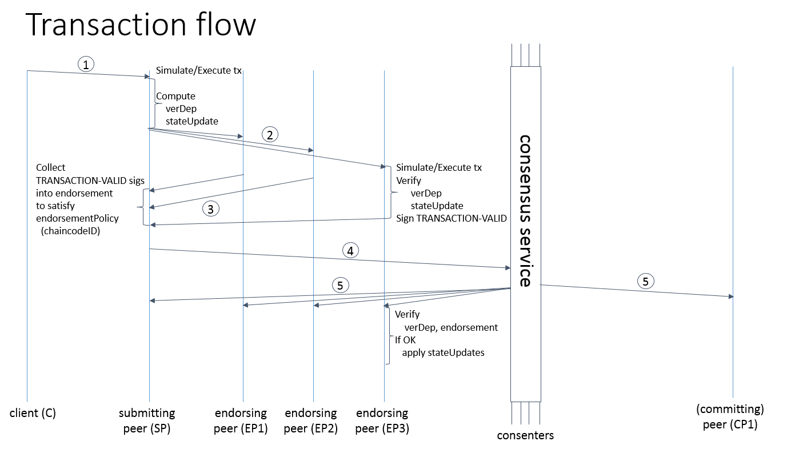

# 第十三章 Fabric 架构与设计

**好的架构不是设计出来的，而是演进出来的。**

Hyperledger Fabric 作为目前最受欢迎的联盟链底层平台，其架构经历了从早期的 0.6 版本到广受企业认可的 1.x 架构，再到目前更为成熟优化的 2.x/3.x 架构的不断演进。每一次重大重构，都在可扩展性、安全性、隐私保护以及性能等方面带来了显著提升。

本章将深入剖析 Fabric 的核心架构设计。首先介绍其整体架构和核心组件的作用；然后详细图解关键机制的设计思想，如执行-排序-验证（Execute-Order-Validate）的交易模型；同时还会介绍 Fabric 在网络通信协议和性能优化方面的考量。

通过本章的学习，读者将能够从底层原型的角度，深入理解 Fabric 是如何满足企业级分布式账本系统严苛要求的。

## 简介

Hyperledger Fabric 的设计初衷是为企业提供一个高度可插拔、可扩展和安全的分布式账本技术（DLT）平台。与许多公有链（如比特币、以太坊）不同，Fabric 针对企业级业务场景的需求进行了以下核心设计上的创新：

1. **模块化与可插拔设计**：Fabric 的共识机制、身份认证、加密算法、账本存储引擎等组件都是模块化且可插拔的（Pluggable）。例如，共识排序服务可以使用 Raft 或是 BFT 协议；状态数据库可以使用 LevelDB 或 CouchDB。这极大地赋予了开发者根据不同业务场景进行定制的灵活性。

2. **许可制的网络架构（Permissioned）**：企业业务通常不希望数据向全网完全公开。Fabric 是一个许可链，意味着网络中所有的参与者（节点、客户端等）都必须拥有经过授权的明确数字身份（由 MSP 证书管理组件签发）。无许可的节点根本无法加入网络，也无法读取账本数据。

3. **隐私保护与数据隔离**：针对企业对商业机密保护的高要求，Fabric 引入了**通道（Channel）** 的概念。通道将整个网络划分为多个相互隔离的私密子网。只有加入该通道的成员才能访问其中的交易状态和链码数据。结合私有数据（Private Data）特性，甚至可以在同一通道内的指定成员间实现更细粒度的数据保密。

4. **创新的解耦交易模型**：传统的“排序后执行（Order-Execute）”架构（所有节点顺序执行相同交易以保持一致）在处理高并发、非确定性合约时容易遇到瓶颈，因此 Fabric 在 1.x 版本之后首创了 **“执行-排序-验证（Execute-Order-Validate）”** 模型：
   - 不同的智能合约（链码）可以并行且隔离地由指定的背书节点预先**执行**。
   - 排序服务只负责对交易的顺序达成共识（**排序**），而不关心交易内容。
   - 所有节点最后按照全局顺序对各交易读写集的冲突和签名进行**验证**并提交。

   这种架构解耦了计算与共识，极大地提升了系统的并发处理能力和横向扩展性。

5. **支持通用编程语言**：与以太坊必须使用专门的 Solidity 语言不同，Fabric 的智能合约（Chaincode）支持使用主流通用语言如 Go、Java、Node.js 来编写。这有效降低了企业开发者的学习门槛，并能够复用现有的海量第三方库。

接下来，我们将详细分析 Fabric 的架构组成及内部实现细节。

## 架构设计

*注：本章架构设计主要基于 Fabric 1.x 及后续版本。随着版本的演进，架构在模块化和性能上不断优化，但核心的交易模型和节点角色设计保持了一致性。关于 2.x/3.0 引入的智能合约（链码）生命周期管理等新特性，详见后续《管理链上代码》章节。*

传统的区块链平台（如比特币、早期以太坊）通常采用 **排序-执行（Order-Execute）** 的架构。在这种架构中，网络中的所有节点必须按照一致的顺序，依序执行每一笔交易。这种设计虽然结构简单，但容易遇到明显的性能瓶颈，并且由于所有节点必须执行所有智能合约逻辑，对智能合约的确定性（如不能包含随机数、时间戳）提出了极高的要求。

为了突破这些限制，满足企业级高并发、高隐私保护的业务需求，Hyperledger Fabric 创新性地提出了 **执行-排序-验证（Execute-Order-Validate）** 的解耦架构。

Fabric 的整体重构围绕着以下核心组件展开：**Peer 节点（包含背书节点、提交节点和 Gateway 服务）**、**排序服务节点（Orderer）**、**客户端（Client/Gateway API）** 以及 **成员身份管理服务（CA）**。

### 核心组件与角色分工

在现代 Fabric 架构中，节点的功能被清晰地解耦，不同的物理节点可以承担不同的网络角色：

#### 1. 客户端节点（Client）

客户端代表最终用户（应用程序），是发起交易的源头。Fabric v2.4 之后推荐客户端使用 Fabric Gateway API（Go、Java、Node.js）连接一个受信任的 Gateway Peer，由 Gateway 服务代表客户端完成背书选择、背书收集、交易提交和提交状态查询。它的主要职责包括：
* 构造交易提案（Proposal），对提案或交易信封进行签名，并提交给 Gateway Peer。
* 在需要时指定目标背书组织；默认情况下由 Gateway 结合发现服务和背书策略选择合适的背书 Peer。
* 接收 Gateway 返回的已准备交易信封，完成签名后通过 Gateway 提交给排序服务。
* 等待提交状态事件或订阅链码事件，监听交易最终提交或验证失败的结果。

#### 2. Peer 节点（Peer）

Peer 节点是 Fabric 网络的主体，负责维护账本数据（区块链和世界状态）以及执行智能合约（链码）。根据参与交易流程的不同阶段，Peer 节点在逻辑上可以细分为两类角色（同一个物理 Peer 节点可以同时扮演这两种角色）：

* **背书节点（Endorser）：**
  背书节点负责对来自 Gateway 或兼容客户端的**交易提案进行模拟执行**。当收到提案后，Endorser 会在一个隔离的沙盒环境（通常是 Docker 容器）中运行对应的智能合约，对交易合法性和 ACL 权限进行校验，并生成模拟执行的结果，即**读写集（ReadWriteSet）**。此时交易并没有真正改变账本状态。Endorser 会对读写集进行密码学签名并返回给 Gateway 或兼容客户端。
* **提交节点（Committer）：**
  提交节点负责维护最终的账本状态。**所有加入通道的 Peer 节点都是提交节点**。当 Committer 从排序服务拉取新区块，或在可选配置下通过 Gossip 接收到新区块后，会对每个交易的背书签名是否满足策略，以及交易读写集是否存在版本冲突（如双花问题）进行最终的**验证（Validate）**。验证通过的合法交易会被标记为有效，并更新到本地账本的历史区块和世界状态数据库中。

#### 3. 排序节点（Orderer）

Orderer 节点组成了排序服务（Ordering Service），它们**不关心交易的具体内容，也不维护世界状态**，并且不执行智能合约逻辑。
排序服务的唯一核心职责是**达成共识并全局排序**：接收 Gateway 或兼容客户端提交的已背书交易，确定交易发生的全局顺序，将它们打包成区块，并通过 Deliver 服务供通道内有权限的 Peer 拉取。现代生产配置通常让 Peer 直接从排序服务拉取新区块；通过少数 Leader Peer 再用 Gossip 向组织内传播区块是可选配置。
Fabric 中的排序服务是可插拔的，现代版本默认且推荐使用的是基于 Raft 协议（Crash Fault Tolerant，CFT）的排序服务，以提供企业级的高可用性和一致性。自 **Fabric v3.0**（2024 年 9 月发布）起，正式引入了 **BFT（Byzantine Fault Tolerant）排序服务**，能够容忍最多 f 个恶意排序节点（需要至少 3f+1 个节点），适用于跨组织信任边界的排序集群场景。

#### 4. 成员权限管理（Fabric CA）

企业级账本是带许可的（Permissioned），网络中的每一个实体（Peer, Orderer, Client）都必须拥有明确的数字身份（X.509 证书）。
Fabric CA 负责网络内的身份管理，提供注册（Registration）和登记（Enrollment）服务，为实体签发**注册证书（ECert）** 和用于加密通信的 **TLS 证书**。通过 MSP（Member Service Provider）组件，Fabric 网络在处理交易时强制校验身份的合法性，拦截任何未经授权的操作。

### 交易流程剖析

有了明确的角色分工后，我们可以清晰地梳理出 Fabric 中一笔交易从发起到最终确认的生命周期，也就是其引以为傲的 **“执行-排序-验证”** 流程。



交易的完整生命周期可分为三个主要阶段：

#### 阶段一：提案与执行（Execute / Endorsement）

1. **发起提案**：客户端（Client）构造一个交易提案（Proposal），指定要调用的链码名称和函数参数，并使用自己的身份私钥进行签名。现代应用通常把提案发送给受信任的 Gateway Peer，由 Gateway 根据链码、私有数据集合和状态级背书策略计算并选择需要的背书 Peer。
2. **模拟执行**：背书节点收到提案后，首先验证客户端的签名及权限。然后，在当前的账本状态下，背书节点**模拟执行（Execute）** 指定的链码逻辑。
3. **生成读写集**：模拟执行不会立刻更新账本。链码执行过程中对状态数据库的所有读取（Read）和最终的写回意图（Write）会被记录下来，生成一个**读写集（ReadWriteSet）**。
4. **背书响应**：背书节点使用自身的私钥对这个包含了读写集的响应进行签名（这被称作“背书”），并返回给 Gateway；Gateway 收集足够背书后把待签名的交易信封返回给客户端。

#### 阶段二：打包与排序（Order）

5. **收集确认**：Gateway 持续收集来自不同背书节点的响应。当有效背书签名满足背书策略后，Gateway 组装包含原始提案、读写集和背书签名的交易信封，并交给客户端签名。兼容旧流程的客户端仍可自行收集背书，但这不再是推荐的默认应用模型。
6. **提交排序**：客户端签名后，通常通过 Gateway 将完整交易发送给排序服务（Orderer）。
7. **全局共识与打包**：Orderer 不看交易内容，只是将并发到达的大量交易按照先后顺序排列好，打包生成新的区块。这样保证了全网上所有的 Peer 节点未来看到的交易顺序是绝对一致的。

#### 阶段三：验证与提交（Validate / Commit）

8. **区块交付**：Peer 通过 Deliver 服务从排序服务拉取新区块并进入提交流程。旧式或特殊配置下，可以由组织内的 Leader Peer 拉取区块后再通过 Gossip 分发给其他 Peer；在 Fabric v2.2 之后的默认和推荐方向中，减少网络级联传播，让 Peer 直接从排序服务获取区块更常见。
9. **并发验证**：Committer 收到区块后，会对区块中的**每一笔**交易进行两道关键的**验证（Validate）**：
   - 验证这笔交易的背书签名是否真的满足了链码配置的背书策略（防止客户端伪造或背书数量不足）。
   - 验证交易的读写集版本号。即，从模拟执行（阶段一）到此时准备写入账本（阶段三）的时间差内，这笔交易读取过的状态有没有被其他并发的交易篡改过（多版本并发控制冲突检查）。
10. **最终提交与状态更新**：如果上述验证通过，该交易被标记为合法（Valid）；如果发生冲突，则标记为非法（Invalid）。最后，无论合法还是非法，该区块都会被追加到区块链的末尾（保证不可篡改的历史），但是**只有合法的交易对应的写集，才会被更新到 Peer 的世界状态数据库中**。
11. **事件通知**：Peer 节点产生事件通知，告知客户端交易已成功写入或者验证失败。

### 世界状态与账本存储

在上述流程中，Peer 节点维护的账本（Ledger）深刻体现了这种设计的合理性。每个 Peer 节点的账本在物理上实际上包含了两个不同的部分：

1. **底层区块链（Blockchain Log）：**
   这是一个只能追加（Append-Only）的数据结构，通常存储在文件系统中。它记录了所有区块的串联历史，包含了所有发生过的交易记录，无论这笔交易在最后的验证环节是成功还是失败。这保证了极强的**审计性（Auditability）**，任何人都可以回放区块日志完全重构出当前的状态。

2. **世界状态数据库（World State）：**
   这是一个键值对（Key-Value）数据库，只保存账本在当前时刻的最新状态（即所有合法交易执行后的最终结果集）。链码的执行和查询通常直接在世界状态数据库上进行以提升效率。目前 Fabric 支持 LevelDB（默认）和 CouchDB（支持更复杂的富查询如 JSON 选择器）两种状态数据库引擎。

通过将不可篡改的历史日志和最新的查询状态解耦，Fabric 兼顾了区块链的加密安全性和企业级应用查询性能的需求。

## 网络协议与交互机制

Fabric 网络的各个节点以及客户端为了能够正确处理交易、同步数据和管理集群，依赖于一套高效且安全的通信机制。这套机制主要基于 **gRPC** 远程调用框架以及用于实现去中心化数据发现与同步的 **Gossip 数据分发协议** 构建。

不再使用早期版本中那种全网广播、高度耦合的通信模式，现代 Fabric 将节点间的通信职责进行了极大的细化和专业化。主要包含了三大核心通信接口与协议层：**Peer 节点间数据交互（Gossip）**、**客户端到 Peer 的 Gateway/Endorsement 交互（gRPC）** 以及**排序交付交互（gRPC Deliver/Broadcast）**。

### 1. 基于 Gossip 的数据流协议

Fabric 采用了极其高效且具备很好容错率的 **Gossip 协议**（流言协议）来实现 Peer 节点之间的成员发现、服务发现元数据传播、私有数据分发，以及可选的区块传播和状态补齐。需要注意的是，Fabric v2.2 之后的默认和推荐生产方向通常是让 Peer 直接从排序服务（Orderer）拉取区块；使用 Gossip 在组织内部级联传播区块属于可配置能力，而不是现代部署的必然路径。

对于同一个通道内的各个组织（Organizations）而言，Gossip 重点承担了以下职责：

#### a. 成员发现服务（Service Discovery）

节点刚启动或网络拓扑发生变动时，如何知道哪些友方节点在线？
- Peer 节点会定期广播包含其自身标识与证书的在线探测消息。
- 接收到消息的活动节点可以利用这些信息构建出所在通道的局部拓扑网络。为了防止跨组织的信息泄露，Fabric 严格限定了 Gossip 消息的接收者必须拥有相应的通道只读权限并校验身份，不同组织或不同通道之间的 Gossip 是隔离的。

#### b. 交易和区块数据分发（Data Dissemination）

当 Orderer 将一批交易打包成区块后，Peer 通过 Deliver 服务拉取新区块。现代配置中，多个 Peer 甚至所有 Peer 都可以直接从排序服务拉取区块，以减少组织内的级联转发依赖。
- 需要节省排序服务连接或兼容旧部署时，可以配置一个或多个 **领导节点（Leader Peer）** 从排序服务拉取区块。
- 只有在启用对应配置时，Leader 节点才会通过 Gossip 以点对点（P2P）的方式在组织内部继续分发新区块。
- 如果某个节点因为网络抖动落后了，可以在启用状态传输配置时向其他 Peer 拉取缺失区块；也可以直接从排序服务补齐。

#### c. 私有数据（Private Data）安全分发

在涉及企业机密的场景中，私有数据集合（Private Data Collection）不会把明文私有数据写入通道公共区块，也不会提交给 Orderer 排序。实际私有数据通过 Gossip 点对点分发给集合策略授权的组织 Peer，并存入这些 Peer 的私有状态数据库；公共账本中只记录私有数据键和值的哈希，用于全通道一致验证、审计和后续证明。

### 2. 客户端与 Peer 的交互：Gateway 与背书服务接口

Fabric v2.4 之后，客户端推荐通过 Gateway API 连接一个受信任的 Peer。Gateway 会调用发现服务确定满足背书策略所需的 Peer，并代表客户端发起背书请求、收集足够背书、提交交易并等待提交状态。底层背书执行仍由 Peer 的 `Endorser` 服务完成：

```protobuf
service Endorser {
    // Gateway 或兼容旧客户端向被选中的背书节点发送交易提案（Proposal）
    rpc ProcessProposal(SignedProposal) returns (ProposalResponse) {}
}
```

其通信流程非常简洁：
1. **Gateway 发起调用**：发送封装了链码名称、函数、调用参数以及客户端签名信息的 `SignedProposal` 结构数据。兼容旧 SDK 的客户端也可以直接调用该接口。
2. **节点同步响应**：Peer 在沙盒中执行完毕后，同步返回包含了模拟执行的读写集以及最重要的——**Peer 自身数字签名的结果（ProposalResponse）**。这构成了整个“执行-排序-验证”模型的基础。

Gateway 会根据发现服务和背书策略向足够的 Peer 请求背书，并在收集到满足策略的签名后组装交易信封返回给客户端签名。客户端直接并行请求多个背书 Peer 是旧 SDK 兼容路径，不是现代 Gateway API 的默认职责划分。

### 3. 客户端（以及 Peer）与排序节点的交互：AtomicBroadcast 接口

无论是 Gateway/兼容客户端向 Orderer 提交已经背书完的合法交易（阶段二），还是 Peer 节点向 Orderer 订阅接收新打包区块的数据流（阶段三），统一由排序服务提供的 `AtomicBroadcast` 接口来完成：

```protobuf
service AtomicBroadcast {
    // 1. Gateway 或兼容客户端使用此接口向排序节点发送交易进行排序
    rpc Broadcast(stream common.Envelope) returns (stream BroadcastResponse) {}

    // 2. Peer 节点使用此接口订阅或请求新生成的区块
    rpc Deliver(stream common.Envelope) returns (stream DeliverResponse) {}
}
```

* **Broadcast 操作**：是一个基于 gRPC Stream（双向数据流）的单向接收端接口。排序节点接收到 `Envelope`（封装了带有全套签名的交易）后，校验发起者是否有向该通道写入的权限，校验通过后等待切分打包并排序。
* **Deliver 操作**：该接口允许具有合法读取通道权限的 Peer 拉取指定范围的区块数据流。Peer 可以作为组织 Leader，也可以作为普通 Peer 直接从排序服务拉取区块；是否再通过 Gossip 传播新区块取决于配置。

这两个高度精简的接口保证了排序层可以无缝地替换背后的共识引擎（从过去的 Kafka 到现代标准的 Raft），而不必去修改外围组件的任何通信协议层。

## 性能表现与评估

在区块链平台特别是联盟链的选型中，性能往往是企业最核心的考量指标之一。不仅要看交易吞吐量（TPS），还要综合考察交易延迟（Latency）、资源利用率以及横向扩展能力。

早期的 Fabric（如 v0.6 版）采用过更耦合的交易处理模型和不同的共识实现，性能评估结论高度依赖当时的硬件、客户端并发、链码逻辑和共识配置。Fabric 从 1.x 开始重构为“执行-排序-验证”架构，并在后续版本（2.x/3.x）中持续优化 Gateway、状态数据库、排序服务和并发处理能力，但任何 TPS 或延迟数字都必须放在明确的压测条件下解读。

### 架构解耦对性能的提升

现代 Fabric 架构能够在性能上远超其早期版本及其他部分联盟链平台，主要得益于其解耦的设计：

1. **计算与共识的解耦**：
   在传统的区块链中，所有节点都必须独立串行执行每一笔交易的智能合约。而在 Fabric 中阶段一的“模拟执行”与阶段三的“验证提交”被分离。
   - 包含复杂业务逻辑的智能合约仅由部分**背书节点**并行执行。
   - **排序节点**完全不执行合约，仅负责高速打包并确立全局交易顺序。这种分离让整个系统能够利用多核 CPU 加速处理。

2. **支持并行交易验证**：
   在最后阶段，提交节点（Committer）只针对轻量级的读写集（ReadWriteSet）进行基于版本号的冲突检查（MVCC - 多版本并发控制）。由于验证操作仅校验状态版本且不依赖于合约的具体逻辑，多个交易可以完全以**并发（Parallel）** 的方式进行校验，极大提升了吞吐。

3. **可插拔的共识机制**：
   在 Fabric 1.4 开始引入的基于 Raft 的排序服务（Raft Ordering Service）是一个容灾系统（CFT）。由于它只保证崩溃容错而不必像 PBFT 那样处理拜占庭作恶节点，其共识过程中避免了巨大的 O(N²) 级网络通信开销，因此交易的成块和分发速度极快。Fabric v3.0 新增的 BFT 排序服务虽然引入了额外的拜占庭容错通信开销，但在需要跨组织排序节点信任的场景下提供了更强的安全保障。

### 现代性能评估工具：Hyperledger Caliper

为了客观地衡量和对比不同区块链平台的性能，Hyperledger 社区推出了开源的基准压测工具——**Hyperledger Caliper**。这也是目前工业界在评估 Fabric 网络性能时的首选工具。

Caliper 能够让用户自定义各种复杂的测试场景及负载模型，并提供详细的 HTML/Markdown 报告，包括：
* **成功率（Success Rate）**：有多少请求被最终成功写入了账本。
* **最大/平均交易吞吐量（Max/Avg TPS）**：每秒处理的交易笔数。
* **交易延迟（Transaction Latency）**：一笔交易从客户端发起到最终确认写入账本（或报错）所需的总耗时。
* **资源消耗（Resource Consumption）**：CPU、内存、网络 IO 等使用情况。

_注：具体的性能数据受到智能合约的复杂程度、背书策略、私有数据集合使用方式、所选用的状态数据库（LevelDB 处理简单键值的速度通常快于 CouchDB）、区块打包参数（Batch Size/Timeout）、Gateway 并发限制、硬件配置（CPU/SSD）以及网络带宽等诸多因素影响。_

### 性能数据的解读方式

不要把 Fabric 的 TPS 或延迟写成脱离条件的固定指标。官方性能建议强调，网络吞吐和确认延迟会随以下条件显著变化：

* **负载模型**：单笔交易周期性提交时，确认延迟会明显受 `BatchTimeout` 影响，这类结果不能代表网络真实性能；应使用多客户端或并发提交进行基准压测。
* **区块打包参数**：增大区块大小或等待时间可能提升吞吐，但通常会增加低负载或单笔交易场景下的确认延迟。
* **状态数据库与查询方式**：CouchDB 支持 JSON 富查询，但在高吞吐写入、复杂查询或大状态集场景下可能成为瓶颈；LevelDB 更适合简单键值的高吞吐路径。
* **Gateway 与背书策略**：Peer Gateway 服务减少客户端连接复杂度并改进吞吐能力，但 `gatewayService` 并发限制、背书组织数量和状态级背书策略都会影响端到端结果。
* **私有数据集合**：私有数据提升隐私，不应简单当作性能优化手段；官方性能建议指出，以 PDC 存储资产通常比直接写公共世界状态带来更低 TPS，需要按业务隐私需求和压测结果权衡。

### 性能调优的常见切入点

在实际的生产应用中，当 Fabric 的默认配置无法满足瓶颈时，常见的优化策略包括：

1. **调整区块打包参数（Block Cutting Parameters）**：
   通过调整通道配置中的 `BatchSize`（每个区块的交易数量及数据量上限）和 `BatchTimeout`（区块产生前等待的最大超时时间），来平衡 TPS 与交易延迟。较大的 BatchSize 能提升总体 TPS，但在低负载时会增加单笔交易的延迟。

2. **精简背书策略（Endorsement Policy）**：
   减少每笔交易所需的背书签名数量。过多的背书组织意味着 Gateway 需要向更多组织的 Peer 请求背书，增加网络往返、签名验证和等待时间。

3. **优化链码设计与避免 MVCC 冲突**：
   高频并且并发更新同一状态键（Key）的业务场景极其容易产生版本冲突（MVCC Conflict），导致大量交易在最后验证阶段被迫标记为非法而失败。对此，可以考虑采用如增量变量、按组织/用户隔离存储键空间等方式来规避冲突。

4. **按隐私需求使用私有数据（Private Data）**：
   如果交易数据只应被少量授权组织看到，使用 Fabric 的私有数据特性可以让明文数据只分发给授权 Peer，公共区块中只包含哈希。但私有数据会引入背书时分发、提交时拉取和授权校验等额外路径，是否提升整体性能必须通过同一负载模型下的基准测试确认。
